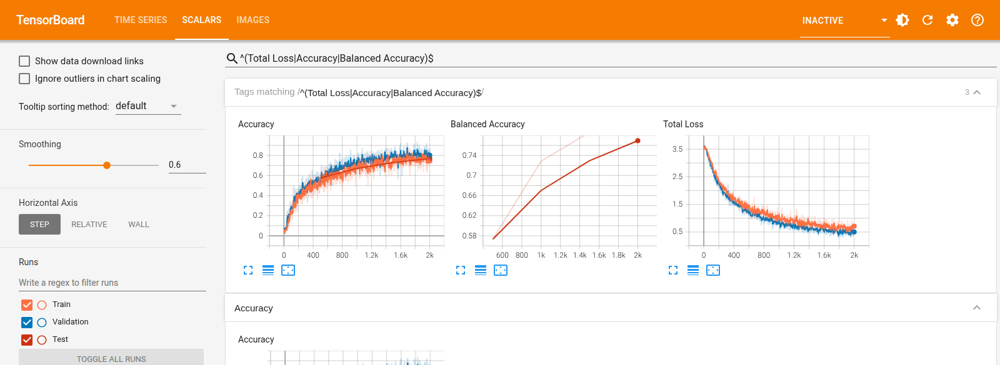
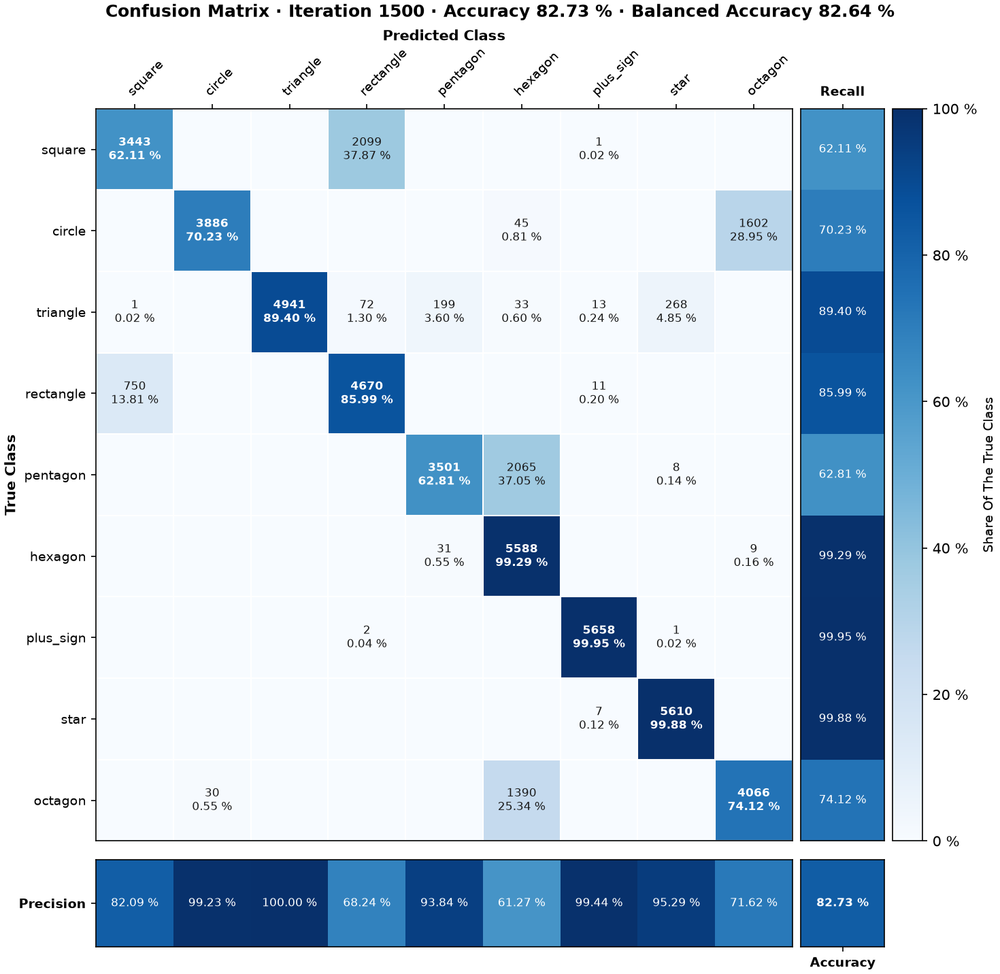
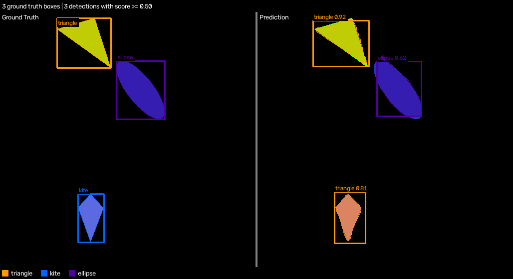

# Visual Language Model Spark

<p align="center">
  
</p>

> **Screenshot placeholder** (`README/tasks_overview.png`): one evaluation sample image of each of the eight tasks side by side, taken from `<run>/Evaluation/Iteration_<n>/Samples/` of the synthetic runs: a classified shape, the detected boxes, the detected boxes with their masks, a segmentation (input, true mask, predicted mask, error map), a sequence classification frame grid, a sequence labelling frame grid, a before / after pair and a frame selection grid with its heat map.

## Table Of Content
- [Description](#description)
- [Prerequisites](#prerequisites)
  - [Package Requirements](#package-requirements)
  - [Data Requirements](#data-requirements)
- [Quick Start With Synthetic Data](#quick-start-with-synthetic-data)
- [Training](#training)
  - [Launching A Run](#launching-a-run)
  - [Run Folder](#run-folder)
  - [Console Output](#console-output)
  - [Stopping And Resuming](#stopping-and-resuming)
  - [Viewing The Input Images](#viewing-the-input-images)
  - [TensorBoard Monitoring](#tensorboard-monitoring)
  - [Moving Average Of The Weights](#moving-average-of-the-weights)
- [Tasks](#tasks)
  - [Common Dataset Layout](#common-dataset-layout)
  - [Classification (CLS)](#classification-cls)
  - [Object Detection (DET)](#object-detection-det)
  - [Instance Segmentation (INS)](#instance-segmentation-ins)
  - [Semantic Segmentation (SEG)](#semantic-segmentation-seg)
  - [Sequence Windows (M2O, M2M, CMP, SEL)](#sequence-windows-m2o-m2m-cmp-sel)
  - [Sequence Classification (M2O)](#sequence-classification-m2o)
  - [Sequence Labelling (M2M)](#sequence-labelling-m2m)
  - [Sequence Comparison (CMP)](#sequence-comparison-cmp)
  - [Frame Selection (SEL)](#frame-selection-sel)
- [Transfer Between Runs](#transfer-between-runs)
  - [Adding Classes](#adding-classes)
- [Evaluating Checkpoints](#evaluating-checkpoints)
- [Comparing Launches](#comparing-launches)
- [Deployment](#deployment)
  - [Export](#export)
  - [Triton Server](#triton-server)
  - [Throughput Measurement](#throughput-measurement)
- [Configurations](#configurations)
- [Run Names](#run-names)
- [MLflow Tracking](#mlflow-tracking)
- [Migrating Old Runs](#migrating-old-runs)
- [Tests](#tests)
- [Repository Structure](#repository-structure)
- [TODO](#todo)

## Description
This repository trains, evaluates and exports PyTorch models for eight vision tasks. The tasks share the same backbone (convolution blocks with optional residual, squeeze-and-excitation and inception modules), the same training loop, the same configuration format, the same evaluation report and the same export to Triton. Each task adds its own dataset, model head, losses and metrics.

| Code | Task | Input | Output | Model |
|---|---|---|---|---|
| CLS | `classification` | one image | one class (multi-class) or several classes (multi-label) | backbone, global pooling, fully connected head |
| DET | `object_detection` | one image | boxes with their class and score | backbone, region proposal heads on several backbone levels, RoI Align detection heads |
| INS | `instance_segmentation` | one image | boxes with their class and score, and the mask of every object | the detector of DET with a RoI Align mask head on every detection level |
| SEG | `semantic_segmentation` | one image | one class per pixel | backbone as the encoder of a U-Net decoder with skip connections |
| M2O | `sequence_classification` | a sequence of frames | one class per sequence (many to one) | backbone on every frame, temporal module, fully connected head |
| M2M | `sequence_labelling` | a sequence of frames | one class per frame (many to many) | backbone on every frame, temporal module, head on every frame |
| CMP | `sequence_comparison` | a before and an after sequence | one class per pair | backbone on every frame, fusion of both members, temporal module, fully connected head |
| SEL | `frame_selection` | a sequence of frames | the frames of every wanted class | backbone on every frame, temporal module, head on every frame, Hungarian or greedy decoding |

<p align="center">
  
</p>

> **Image placeholder** (`README/architectures.png`): a diagram of the shared backbone feeding the task heads: the classification head, the region proposal and detection heads (with the mask heads for INS), the U-Net decoder, and the temporal module (with the fusion of the two members for CMP) followed by the classification head (and the decoding of the selection for SEL).

## Prerequisites

### Package Requirements
- Python 3.13+
- uv
- An NVIDIA GPU with CUDA. The trainings fall back on the CPU without one, much slower.
- Docker with the NVIDIA container runtime, only to serve the exported models with Triton.

The Python packages (PyTorch, torchvision, kornia, OpenCV, TensorBoard, FiftyOne, ONNX, ONNX Runtime, the Triton client, MLflow) are listed in `pyproject.toml`. To install them, run from the repository root:

```bash
uv sync
```

Every script is run as a module from the repository root, so that the `vision_training` and `scripts` packages are found:

```bash
# Run a training from a configuration file, given by its path (absolute or relative to the current folder)
uv run python -m vision_training.main --configuration_path="vision_training/configurations/classification/configuration_synthetic_shapes.yaml"
```

The training takes the path of its configuration file on the command line (`--configuration_path`), absolute or relative to the current folder, the task trained being the one of the file (`ExperimentConfiguration.task`). In a PyCharm run configuration, it goes in the Script parameters. The other scripts have no command line arguments: their settings are the variables of their `if __name__ == "__main__":` block, to be edited before running them.

### Data Requirements
Every task reads three split folders (train, validation and test), each holding its images in `data/` and their labels in a `labels.json` manifest, and a `label_mapping.json` file giving the class predicted for every category. The layout of every task is given in [Tasks](#tasks), with the scripts converting existing datasets to it. To try the repository without a dataset, generate a synthetic one ([Quick Start With Synthetic Data](#quick-start-with-synthetic-data)).

## Quick Start With Synthetic Data
Every task has a synthetic shapes dataset, generated in a few minutes, on which a model learns within minutes. It checks that the installation and a configuration work before training on real data.

1. Open `vision_training/data/synthetic/create_synthetic_dataset.py`, set `task` and the output folder of that task in `output_folders` in its main block, then run:

```bash
# Generate the train, validation and test splits and the label_mapping.json file of the task
uv run python -m vision_training.data.synthetic.create_synthetic_dataset
```

2. In the synthetic configuration of the task (table below, in `vision_training/configurations/`), set `experiment_folder`, the three data folders and `Data.label_mapping.mapping_file_path` to the generated dataset.
3. Train with that configuration, given by its path:

```bash
uv run python -m vision_training.main --configuration_path="vision_training/configurations/classification/configuration_synthetic_shapes.yaml"
```

| Task | Synthetic dataset | Classes | Configuration |
|---|---|---|---|
| CLS | one shape per 512 pixel image | 20 shapes: square, circle, triangle, rectangle, pentagon, hexagon, plus sign, star, octagon, rhombus, parallelogram, trapezoid, kite, heptagon, nonagon, ellipse, semicircle, annulus, capsule, L-shape | `classification/configuration_synthetic_shapes.yaml` |
| DET | up to 6 shapes per 1024 pixel image, a shape left with fewer than 64 visible pixels by the later ones being left out | the 20 shapes | `object_detection/configuration_synthetic_shapes.yaml` |
| INS | up to 6 shapes per 512 pixel image, with the run length encoding of the visible part of every shape, a shape left with fewer than 64 visible pixels being left out | the 20 shapes | `instance_segmentation/configuration_synthetic_shapes.yaml` |
| SEG | up to 6 shapes per 512 pixel image, with the class mask of every image | the 20 shapes and the background | `semantic_segmentation/configuration_synthetic_shapes.yaml` |
| M2O | one shape crossing 2 to 12 frames | `moving_left`, `moving_right`, `moving_up`, `moving_down` | `sequence_classification/configuration_synthetic_sequences.yaml` |
| M2M | one shape changing class 1 to 3 times over 2 to 12 frames, labelled per frame | the 20 shapes | `sequence_labelling/configuration_synthetic_sequences.yaml` |
| CMP | a before and an after member of 2 to 12 frames, the before member showing 2 to 6 shapes | `loss_of_object` (the after member lost one shape), `same_number_of_objects` | `sequence_comparison/configuration_synthetic_pairs.yaml` |
| SEL | one shape per frame over 4 to 12 frames, the largest circle, triangle and star of the sequence being the frames to select, the other frames showing smaller copies of them or other shapes | `unselected`, `circle`, `triangle`, `star` | `frame_selection/configuration_synthetic_sequences.yaml` |

The shapes of the CLS, DET, INS and SEG images measure from 64 pixels (`MINIMUM_SHAPE_SIZE`) to a third of the image side, and the changing shape of M2M at least 64 pixels, so that the nonagon, the roundest polygon, stays distinct from the octagon and the circle. Every class keeps apart from its neighbours:
- the rhombuses have acute angles of 44° to 70°;
- the parallelograms have sides of different lengths (ratio 1.5 to 2.5);
- the trapezoids have one pair of parallel sides of different lengths;
- the ellipses and capsules are 1.5 to 3 times as long as they are wide.

The first nine shapes keep their category identifiers. A dataset generated before the eleven others were added keeps its nine classes, which its `labels.json` and `label_mapping.json` give to the training.

## Training

### Launching A Run
1. Copy the `configuration_example.yaml` of the task, in `vision_training/configurations/<task>/`, and fill it: `experiment_folder` (the root folder receiving the runs), the three data folders and the label mapping file. Every key is explained by its comment in the file, and [Configurations](#configurations) lists the keys of every task.
2. Run the training, with the path of the configuration file (`--configuration_path`):

```bash
uv run python -m vision_training.main --configuration_path="vision_training/configurations/classification/my_configuration.yaml"
```

A path leading to no file stops the program before anything starts.

The configuration is checked before anything starts: a missing key, a value the task cannot use or an inconsistent combination stops the program with the list of every problem found.

### Run Folder
A run is saved in `<experiment_folder>/<run name>/`, the run name being built from its settings ([Run Names](#run-names)):

```text
<experiment_folder>/<run name>/
├── training_configuration.yaml        # Copy of the configuration of the last start of the run
├── training_configuration_until_iteration_<n>.yaml  # Configuration that trained the run up to iteration n, kept by a resume that changed it
├── data.json                          # Class names, and data folder, SHA-256 of labels.json and images of every split
├── data_until_iteration_<n>.json      # Data that trained the run up to iteration n, kept by a resume whose data changed
├── Weights/
│   ├── full-checkpoint                # Registry of the saved checkpoints, the last one first
│   └── Iteration_<n>/model_<n>.pt     # Weights, optimizer state, moving average of the weights and metadata of iteration n
├── Tensorboard/
│   ├── Train/                         # Training curves, every iteration
│   ├── Validation/                    # Validation curves
│   ├── Test/                          # Test metrics and sample images of every evaluation
│   └── Test_EMA/                      # Same for the moving average of the weights, when it is on
├── Results.txt                        # Report of every evaluated checkpoint
├── Evaluation/
│   └── Iteration_<n>/                 # Files of the evaluation of iteration n
│       └── EMA/                       # Files of the evaluation of the moving average of the weights, when it is on
└── mlflow_run.json                    # MLflow run of the training, with the tracking on
```

`data.json` records the data of the run: the class names in class index order (`class_names`, the background first for DET, INS and SEG), read by a run adding classes to this one ([Adding Classes](#adding-classes)), and for the train, validation and test splits, the absolute data folder, the SHA-256 of `labels.json` (identifying its images and labels exactly) and the list of its images in manifest order (the `file_name` of the COCO images and of the samples, the frames of the sequences and of both members of the pairs). It is written when the run starts, and sent to the `data` folder of the MLflow run with the tracking on. For ImageNet-1k it takes about 1.5 seconds and 70 MB.

A checkpoint is saved every `intermediate_weight_saving_iterations` iterations, and a checkpoint evaluated on the whole test split every `weight_saving_iterations` iterations. The files of an evaluation are listed in [Evaluation Outputs](#evaluation-outputs).

### Console Output
At launch, the trainer prints the run name, its folders and files as clickable links, the settings and the data changed since the last start of a resumed run ([Stopping And Resuming](#stopping-and-resuming)), every component initialised by another run, every split with its number of samples, the iterations per epoch, the main training settings and the summary of the model. A transferred component ([Transfer Between Runs](#transfer-between-runs)) is printed as a block with its source run folder, the source checkpoint iteration, whether it is frozen, whether the normalization layers of the backbone are frozen, and the learning rate it learns at with its `learning_rate_multiplier` (none for a frozen component, which does not learn):

```text
- Pretrained Backbone     : file:///…/experiments/CLS_IN-KAR-256_…_HAVG.512.256-CWB_MC1000
    - Source Iteration    : last saved checkpoint
    - Frozen              : False
    - Norm. Layers Frozen : False
    - Learning Rate       : 0.0005 (multiplier 0.5 x 0.001)
- Pretrained Temp. Module : file:///…/experiments/M2O_IN-KAR-256_…_T8_GRU1x128-BI_HAVG.64_MC4
    - Source Iteration    : 25000
    - Frozen              : True
```

 With `diagnosis_modes.compute_receptive_field` and `compute_model_size`, it also prints the receptive field and the size of the model.

<p align="center">
  
</p>

> **Screenshot placeholder** (`README/experiment_launch_information.png`): the `=== Experiment Launch Information ===` block printed at the start of a training, with the run name, the folder links, the splits and their number of samples.

Every `information_dump` iterations, it prints the averages of the interval: the iteration, the samples seen, the throughput (and the real frames per second for the sequence tasks), the training and validation losses and metrics, and the duration of the interval. The summaries stay on the multiples of `information_dump`: a run resumed from a checkpoint between two of them (an intermediate save or a Ctrl+C) has a shorter first interval, whose averages and throughput cover only the iterations it ran.

<p align="center">
  
</p>

> **Screenshot placeholder** (`README/interval_summary.png`): two or three consecutive interval summaries of a training, with the iteration header, the throughput and the training and validation metrics.

Every `weight_saving_iterations` iterations, the checkpoint is evaluated on the test split, and its report is printed and appended to `Results.txt` with the same layout: the global metrics, the notes and, with `evaluation.per_class_report`, the table of the classes sorted worst first. With the moving average of the weights on, a second report of the same checkpoint follows, headed `Iteration <n> · <evaluated samples> · EMA Weights · <date and time>` ([Moving Average Of The Weights](#moving-average-of-the-weights)).

<p align="center">
  
</p>

> **Screenshot placeholder** (`README/evaluation_report.png`): the report of one evaluated checkpoint in the console, with its header `Iteration <n> · <evaluated samples> · <date and time>`, the global metrics and the per-class table.

### Stopping And Resuming
Ctrl+C stops the training and saves a checkpoint of the current iteration. With `resume_training: true`, launching the same configuration again resumes from the last checkpoint of its run folder, with its optimizer state.

The settings that give no token in the run name (augmentation, batch size, learning rate and its schedule, `pretrained.learning_rate_multiplier`, gradient clipping, mixed precision, moving average of the weights, dropout rates) can be changed between two resumptions of a run. Changing any other setting gives another run name, so the training starts in a new run folder.

A resumed run compares the launched configuration with the `training_configuration.yaml` saved in its folder by the previous start, before the copy of the new one replaces it, and prints every setting changed, added or removed since:

```text
- Previous Configuration  : file:///…/training_configuration_until_iteration_72500.yaml
- Changed Settings        : Since Iteration 72500
    - ExperimentConfiguration.learning_rate        : 0.0002 -> 0.0001
    - Backbone.pretrained.learning_rate_multiplier : 0.5 -> 1.0
```

When the configuration changed, the previous file is kept as `training_configuration_until_iteration_<n>.yaml`, the configuration that trained the run up to the checkpoint of iteration n it resumes from. A file of that name is never replaced, so a run resumed twice from the same checkpoint keeps the configuration that really trained it. An unchanged configuration prints `- Changed Settings        : None Since Iteration <n>` and keeps no file.

The data is compared the same way: a split changed when its data folder or the SHA-256 of its `labels.json` differs from `data.json`. The previous record is then kept as `data_until_iteration_<n>.json` (never replaced either) and the new one written:

```text
- Previous Data Record    : file:///…/data_until_iteration_72500.json
- Changed Data Splits     : train Since Iteration 72500
```

Unchanged data prints `- Changed Data Splits     : None Since Iteration <n>` and keeps `data.json` as it is, with its date.

### Viewing The Input Images
`ExperimentConfiguration.diagnosis_modes.view_input_images: True` opens a Training and a Validation window showing the samples exactly as the network receives them, the training ones augmented, each captioned with its targets. It checks the preprocessing, the label mapping and the augmentation before a training. SPACE shows the next samples, ENTER closes the windows and exits without training. It needs a display, and creates no run folder.

<p align="center">
  
</p>

> **Screenshot placeholder** (`README/input_viewer.png`): the Training and Validation windows of the input viewer side by side, with an augmented training sample and its caption.

### TensorBoard Monitoring
To follow the training and validation curves and the test evaluations of a run, start TensorBoard on its folder and open http://localhost:6006:

```bash
uv run tensorboard --logdir <experiment_folder>/<run name>/Tensorboard
```

The `Train` and `Validation` curves are written every iteration. The `Test` scalars and the sample images (`Samples/<sample>`, with a slider over the evaluations) are written at every evaluation. With the moving average of the weights on, `Test_EMA` holds the same tags for the averaged weights, so that TensorBoard draws both curves of every metric on the same chart.

<p align="center">
  
</p>

> **Screenshot placeholder** (`README/tensorboard.png`): the TensorBoard scalars of a run, with the training and validation loss curves and a Test metric (e.g. `Accuracy` or `Mean IoU`) over the evaluations.

### Moving Average Of The Weights
`Optimization.exponential_moving_average` keeps a second copy of the model, never trained itself, moved towards the trained weights after every optimizer step:

```text
ema_weights = decay × ema_weights + (1 − decay) × current_weights
```

A weight of k steps ago counts with a factor decay^k, so the average follows roughly the last 1 / (1 − decay) iterations: about 1,000 at 0.999, 5,000 at 0.9998 and 10,000 at 0.9999. Its n-th update uses min(decay, (1 + n) / (10 + n)), so that the random starting weights fade quickly. The running statistics of the batch normalization layers are averaged the same way. The averaged copy costs the memory of one more model, and its update a small fraction of a training step.

Every test evaluation scores the trained weights, then the averaged weights of the same checkpoint:

| Output | Trained weights | Averaged weights |
|---|---|---|
| Console and `Results.txt` header | `Iteration <n> · <evaluated samples> · <date and time>` | `Iteration <n> · <evaluated samples> · EMA Weights · <date and time>` |
| Evaluation files | `Evaluation/Iteration_<n>/` | `Evaluation/Iteration_<n>/EMA/` |
| TensorBoard | `Test` | `Test_EMA` |
| MLflow | `test/`, `test_class/`, `test/best_<headline metric>` (tag `best_iteration`) | `test_ema/`, `test_ema_class/`, `test_ema/best_<headline metric>` (tag `best_iteration_test_ema`) |
| `evaluation_summary.csv` of `evaluate_checkpoint.py` | one column per scalar | the same columns preceded by `ema_` |

The average is saved in every checkpoint and restored when the run resumes. It gives no run name token, so that it can be turned on or off when a run resumes: turned on from a checkpoint saved without it, it restarts from the weights of that checkpoint, and is evaluated from the next evaluation on. The validation curves use the trained weights; the export uses them unless `use_averaged_weights` is True in its main block (see Exporting Models). A component transferred to another run is loaded from the averaged weights when that run keeps a moving average too ([Transfer Between Runs](#transfer-between-runs)).

## Tasks

### Common Dataset Layout
A dataset is a folder per split, each holding its images in `data/` and a `labels.json` manifest naming them relative to `data/`:

```text
<dataset>/
├── label_mapping.json
├── train/
│   ├── data/
│   └── labels.json
├── validation/
│   ├── data/
│   └── labels.json
└── test/
    ├── data/
    └── labels.json
```

The `train_data_folder`, `validation_data_folder` and `test_data_folder` keys point to the split folders. The training split is trained on, the validation split gives the validation curves during the training (`validation_iteration_ratio`), and the test split is evaluated whole at every `weight_saving_iterations` checkpoint. The same folder can be given to the validation and the test splits.

The categories of a manifest have integer identifiers. `label_mapping.json` maps every category identifier, written as a string, to the class index predicted by the model, and is given by `Data.label_mapping.mapping_file_path` with `Data.label_mapping.mode: "multi_class"`:

```json
{
    "1": 0,
    "2": 1,
    "3": 1
}
```

- CLS, M2O, M2M, CMP and SEL predict the classes 0 to K-1. DET, INS and SEG predict the classes 1 to K, class 0 being their background.
- Several categories mapped to the same class are merged into it, the class being named after both (`name_2+name_3`).
- A category missing from the mapping is left out: its samples are skipped (CLS multi-class, M2O, CMP), it is dropped from the classes of its samples (CLS multi-label), its frames are ignored (M2M), its frames become unselected (SEL), its objects are ignored (DET, INS), or its pixels become background (SEG).
- DET, INS and SEG also accept `mode: "binary"`, which maps every category to the foreground class 1 without a mapping file.

The dataset scripts below and the synthetic dataset generator write `label_mapping.json` next to the splits.

### Classification (CLS)
The classifier predicts the class of an image (`ClassificationHead.output_mode: "multi_class"`, softmax) or every class present in it (`"multi_label"`, sigmoid).

**Data.** Every split holds its images in `data/` and lists them in `labels.json`, with their `category_id` (multi-class) or their `category_ids` (multi-label):

```text
<split>/
├── data/
│   ├── circle/image_0001.png
│   └── square/image_0002.png
└── labels.json
```

```json
{
  "categories": [{"id": 1, "name": "circle"}, {"id": 2, "name": "square"}],
  "samples": [
    {"id": 1, "file_name": "circle/image_0001.png", "category_id": 1},
    {"id": 2, "file_name": "square/image_0002.png", "category_id": 2}
  ]
}
```

**Converting a dataset.**
- One folder of images per class (e.g. `training_data/circle/*.png`): `vision_training/data/classification/class_folder_manifests.py` writes the manifests and the label mapping file, `data/` being a symbolic link to the class folders, so no image is copied. Set `split_folders` and `output_folder` in its main block, then run `uv run python -m vision_training.data.classification.class_folder_manifests`.
- ImageNet-1k: `vision_training/data/classification/imagenet_download.py` downloads it from Hugging Face (about 310 GB) and writes its train, validation and test splits.
- Tencent ML-Images (17.6M multi-label images, 11,166 categories) for the pre-training of the backbones: `vision_training/data/classification/foundation_model_image_downloader.py` (about 1.7 TB).

**Configuration.** Copy `classification/configuration_example.yaml`. The task keys are `ClassificationHead` (global pooling `average`, `max` or `flatten`, fully connected layers, their normalization `fully_connected_normalization` and its `batch_normalization_momentum`, output mode, label smoothing, class weighting) and the evaluation keys `top_k`, `target_precision`, `save_predictions` and `error_dumps`. With `fully_connected_normalization: "batch"` or `"layer"`, every hidden layer is linear, normalization, ReLU; it needs at least one hidden layer. The batch normalization normalizes every unit over the vectors of the batch, with running statistics at `batch_normalization_momentum`, and the sequence tasks leave the padding frames out of its batch statistics. The layer normalization normalizes every vector over its units, the same way in training and evaluation and whatever the other vectors of the batch.

**Evaluation.** Accuracy, balanced accuracy, macro F1 and top-k accuracy (multi-label: subset accuracy, micro and macro F1), and the precision, recall and F1 of every class. The score threshold of every class reaching `target_precision` is saved in `class_thresholds.json` for the deployment, with the recall it keeps in the per-class table. The confusion matrix (multi-class), `predictions.csv` (`save_predictions`) and the misclassified images in `Errors/<TRUE>-TO-<PREDICTED>/` (`error_dumps`, multi-class) complete the report.

<p align="center">
  
</p>

> **Screenshot placeholder** (`README/classification_sample.png`): two or three sample images of a classification evaluation (`Evaluation/Iteration_<n>/Samples/`), each captioned `true -> predicted probability`, one green (right) and one red (wrong).

<p align="center">
  
</p>

> **Screenshot placeholder** (`README/confusion_matrix.png`): the `confusion_matrix.png` of an evaluation of the synthetic shapes classifier.

<p align="center">
  
</p>

> **Screenshot placeholder** (`README/error_dumps.png`): the `Errors/` folder of an evaluation in a file browser, with its `<TRUE>-TO-<PREDICTED>` folders and a few misclassified images.

### Object Detection (DET)
The two-stage detector predicts the box, class and score of every object of an image. The region proposal heads and the detection heads run on several backbone levels (`Backbone.detection_convolution_block_indices`), each level having its own anchors.

**Data.** Every split holds its images in `data/` and their annotations in a COCO `labels.json`, the boxes being `[x, y, width, height]` in pixels of the original image:

```text
<split>/
├── data/
│   └── 000001.png
└── labels.json
```

```json
{
  "images": [{"id": 1, "file_name": "000001.png", "width": 1024, "height": 1024}],
  "annotations": [
    {"id": 1, "image_id": 1, "category_id": 3, "bbox": [120, 340, 64, 48], "area": 3072, "iscrowd": 0}
  ],
  "categories": [{"id": 3, "name": "triangle"}]
}
```

The crowd annotations (`"iscrowd": 1`, one box around a group of objects too many to be labelled one by one) are left out of the training and the evaluation, as in INS, so that the detector learns and is scored on single objects only.

**Converting a dataset.** `vision_training/data/data_retriever.py` downloads COCO 2017 with FiftyOne, whose splits have this layout (about 25 GB in full). Set the dataset folder and `maximum_samples` in its main block, then run `uv run python -m vision_training.data.data_retriever`.

**Configuration.** Copy `object_detection/configuration_example.yaml`. The task keys are `Backbone.detection_convolution_block_indices`, `Anchors` (scales and aspect ratios of every level), `RegionProposal`, `Detector`, `evaluation.score_threshold`, `evaluation.target_precision` and `evaluation.error_dumps`.

**Evaluation.** The mAP at IoU 0.5, 0.75 and 0.5:0.95 with the area, 11-point and 101-point methods, and the AP@0.5 of every class. The detections below `evaluation.score_threshold` are left out of the mAP. The score threshold of every class reaching `target_precision`, the detections of a class being right when they find an object of the class at IoU 0.5 (the AP@0.5 matching), is saved in `class_thresholds.json` with the recall it keeps, for a deployment filtering the detections class by class.

The detections the deployed detector returns (score reaching `Detector.inference.score_threshold`) are matched to the objects of every test image at IoU 0.5, from the most confident: first to the objects of their class, then to the objects left of any class. The matches give `confusion_matrix.csv` and `.png`, with a `background` row for the false positives (a detection finding no object) and a `background` column for the missed objects (an object found by no detection). The report counts the right detections, the wrong classes, the false positives and the missed objects. With `error_dumps.activated`, every test image with errors is saved in `Errors/FALSE-POSITIVE/<class>/`, `Errors/MISSED/<class>/` and `Errors/<TRUE>-TO-<PREDICTED>/`, drawn like the sample images with the boxes in error outlined with red dashes, at most `maximum_per_class_pair` images per folder.

<p align="center">
  
</p>

> **Screenshot placeholder** (`README/detection_sample.png`): a sample image of a detection evaluation, the ground truth boxes on the left next to the detections above `Detector.inference.score_threshold` on the right, every box in the colour of its class.

### Instance Segmentation (INS)
The instance segmenter is the two-stage detector of DET with one mask head per detection level, as in Mask R-CNN ([He et al., 2017](https://arxiv.org/abs/1703.06870)): every detection gets its box, class and score, and the binary mask of its object. The mask head of a level pools every box from the feature map of that level with RoI Align, at the pool size of the level (`MaskHead.head_configurations.<level>.roi_align_pool_size`, 14 by default), and refines it with convolution layers. It then doubles its resolution as many times as fits in `MaskHead.mask_resolution` M (28 by default), with transposed convolutions or bilinear upsamplings followed by a convolution (`MaskHead.upsampling`), and gives one M x M mask per class, the mask of the detected class being kept. When the doublings fall short of M, as for a pool size of 10 doubled to 20, the masks are resized bilinearly to M, so that every level gives masks of the same size. During the training, the mask heads learn on the positive proposals, whose mask targets are the ground truth masks cropped to the proposals; at inference, they run on the final detection boxes.

**Data.** The COCO `labels.json` of DET, every object having a `segmentation`: a list of polygons, every polygon a flat `[x1, y1, x2, y2, ...]` list in pixels of the original image (the parts of an object are united), or a run length encoding `{"size": [height, width], "counts": ...}`, uncompressed (a list of run lengths) or compressed (a string), the runs following the pixels column by column. The masks are built at the network resolution by the loader workers, a polygon covering the pixels whose centre lies inside it. The crowd annotations (`"iscrowd": 1`) are left out of the training and the evaluation, an object without `segmentation` stops the loading, and an object whose mask vanishes at the network resolution is removed with its box.

```json
{
  "images": [{"id": 1, "file_name": "000001.png", "width": 1024, "height": 1024}],
  "annotations": [
    {"id": 1, "image_id": 1, "category_id": 3, "bbox": [120, 340, 64, 48], "area": 1536, "iscrowd": 0,
     "segmentation": [[120, 388, 152, 340, 184, 388]]}
  ],
  "categories": [{"id": 3, "name": "triangle"}]
}
```

The COCO 2017 splits downloaded by `vision_training/data/data_retriever.py` already hold the segmentations. The geometric augmentations move the masks with the image, and the box of every object becomes the tight box of its moved mask.

**Configuration.** Copy `instance_segmentation/configuration_example.yaml`. The task keys are those of DET and the `MaskHead` section: the mask resolution and the upsampling, the pool size and the `[layers, channels]` convolutions of the mask head of every detection level, its normalization and modules, and `inference.mask_threshold`, the mask probability from which a pixel belongs to its object. Older INS runs, with one `roi_align_pool_size` for every level, are upgraded by the configuration migration (masks twice the pool size, transposed convolution), and their checkpoints load into the current mask heads.

**Evaluation.** The mask mAP and the box mAP of the same detections, each at IoU 0.5, 0.75 and 0.5:0.95 with the area, 11-point and 101-point methods, with the AP@0.5 of every class. The mask IoU compares the predicted masks, pasted into their boxes and thresholded at `mask_threshold`, with the ground truth masks at the network input resolution. The mask mAP@0.5 of the area method (`Mask mAP@0.5/area`) compares the checkpoints; the box scalars keep the names of DET, so that INS and DET runs can be compared. Both are saved in `class_metrics.csv`, the mask columns prefixed with `mask_`. The class thresholds, the confusion matrix and the error images are those of DET, the detections being matched to the objects by their masks at IoU 0.5, and the error images painting the masks under the boxes.

<p align="center">
  
</p>

> **Screenshot placeholder** (`README/instance_segmentation_sample.png`): a sample image of an instance segmentation evaluation, the ground truth boxes and masks on the left next to the detections above `Detector.inference.score_threshold` with their masks on the right, every box and mask in the colour of its class.

### Semantic Segmentation (SEG)
The segmenter predicts the class of every pixel. The backbone is the encoder of a U-Net: the decoder upsamples its last feature map level by level, each level merging the skip connection of a backbone block.

**Data.** Every split holds its images in `data/`, their masks in `masks/` and lists both in `labels.json`. A mask is a single-channel uint8 PNG of the size of its image, every pixel holding the category identifier of the image pixel: 0 for the background, 255 for the unlabelled pixels, ignored by the losses and the metrics.

```text
<split>/
├── data/
│   └── image_001.png
├── masks/
│   └── image_001.png
└── labels.json
```

```json
{
  "categories": [{"id": 1, "name": "car"}, {"id": 2, "name": "road"}],
  "samples": [{"id": 1, "file_name": "image_001.png", "mask_file_name": "image_001.png"}]
}
```

**Configuration.** Copy `semantic_segmentation/configuration_example.yaml`. The task keys are `SegmentationDecoder` (upsampling, convolution block of every level keyed by the backbone block it merges, modules, normalization, deep supervision), `SegmentationLoss` (cross entropy, focal factor, label smoothing, class weighting, Dice, Lovász and boundary losses), `Data.tiling` and `evaluation.save_predicted_masks`, `original_resolution` and `boundary_tolerance`.

**Losses.** Every loss is multiplied by its weight in `SegmentationLoss`, a weight of 0 turning it off; at least one of the cross entropy, the Dice loss and the Lovász loss must be on.
- `cross_entropy_weight`: cross entropy of every labelled pixel, with `focal_gamma`, `label_smoothing` and `class_weighting`.
- `dice_weight`: one minus the mean soft Dice of the classes present in the batch, every class counting the same whatever its area.
- `lovasz_weight`: Lovász-Softmax loss, a smooth version of one minus the mean IoU of the classes present in the batch, which optimizes the evaluated metric directly. It usually fine-tunes a run trained with the cross entropy.
- `boundary_weight`: cross entropy of the pixels within `boundary_distance` pixels of a true edge between two classes, weighted from 1 on the edge down to 0 beyond `boundary_distance`. It sharpens the contours that the other losses, dominated by the inside of the regions, hardly see. The edges with the unlabelled pixels and the image border are not edges.

**Deep supervision.** `SegmentationDecoder.deep_supervision_weights` adds a 1x1 class layer on every listed intermediate level of the decoder, keyed like `convolutions`, e.g. `{ "5": 0.1, "4": 0.2, "3": 0.3, "2": 0.4 }`. The logits of every level are upsampled to the input size and given the same losses as the final logits, times the weight of the level, in `deep_supervision_loss`. The gradient then reaches the early layers more directly, which helps deep decoders. These layers only serve the training: the inference, the test evaluation and the exported models never run them, and they are only transferred with the decoder when `SegmentationDecoder.pretrained.load_class_layers` is True ([Adding Classes](#adding-classes)). `{}` turns it off.

**Training on tiles.** Images much larger than the network input lose their small objects and thin structures when resized to it. With `Data.tiling.activated: True`, the images and masks are first scaled by `Data.tiling.scale` (1.0 for their full resolution), then:
- the training samples are tiles of `Data.image_settings.size` pixels cut at a random place of every image at every epoch, so that every part of the image is seen;
- the validation samples are tiles cut at a place fixed per image, so that the validation metrics of two checkpoints compare the same pixels;
- the test images are segmented whole, tile by tile, one image per batch: the tiles overlap by `Data.tiling.overlap` pixels, and the probabilities of every pixel are averaged over the tiles covering it, which removes the seams at the tile borders.

A side shorter than a tile is padded, the padding being ignored. `keep_ratio` is unused with tiling, the tiles never resizing the images. The run name gets the `TL<scale>` section; the overlap only changes the evaluation and gives no token.

**Evaluation.** Mean IoU, mean Dice, mean boundary IoU and boundary F1, pixel accuracy and frequency weighted IoU, and the IoU, Dice, boundary IoU, boundary F1, precision and recall of every class.
- The boundary metrics score only the pixels near the contours, where the IoU hardly sees an error: an object predicted 3 pixels too wide on every side keeps a high IoU, but none of its contour is right. The boundary IoU is the IoU of the bands of the true and predicted regions within `boundary_tolerance` pixels of their contours. The boundary F1 is the harmonic mean of the share of the predicted contour within `boundary_tolerance` pixels of the true contour and of the reverse. A class without true contour in the test split, absent or covering whole images, has no boundary metric and is left out of the means.
- The metrics are computed at the network resolution, or on the scaled test images with tiling. With `original_resolution: True`, the probabilities of every test image are brought back to its original size (the `keep_ratio` padding being cut off) and compared with its original mask, as the deployed output is used. The thin structures lost by the resizing of the masks are then scored. It costs one mask reading and one resizing per test image.
- `save_predicted_masks` writes the predicted class of every pixel to `Predicted_Masks/`, at the resolution of the metrics.

<p align="center">
  
</p>

> **Screenshot placeholder** (`README/segmentation_sample.png`): a sample image of a segmentation evaluation: the input, the true mask, the predicted mask and the error map side by side.

### Sequence Windows (M2O, M2M, CMP, SEL)
The sequence tasks read sequences of frames. Every sequence holds its frames in `data/<sequence name>/`, listed in order in `labels.json`. The backbone runs on every frame, then the temporal module (`TemporalModel.type`) combines the frames: `mean_pooling`, `max_pooling` and `attention_pooling` ignore their order, `gru`, `lstm`, `transformer` and `temporal_convolution` follow it.

`Data.sequence_settings` sets how the sequences are cut into windows, the samples the model sees:
- `sequence_length`: the largest number of frames of a window.
- `window_stride` (M2O, M2M): the number of frames between the starts of two windows of a sequence. A last window ending on the last frame is added when the stride does not reach it. For example, with `sequence_length: 50` and `window_stride: 25`, a 60-frame sequence gives the windows 0–49 and 10–59.
- `short_sequences` (M2O, M2M, CMP): a sequence shorter than `sequence_length` gives one window padded with black frames (`"pad"`), or is left out (`"skip"`).
- `batch_padding`: the windows of a batch are padded to `sequence_length` frames (`"sequence_length"`), or cut to the longest window of the batch (`"longest"`), which loads and processes fewer padding frames. The model outputs are the same.

The padding frames are masked: they never change the outputs of the model. To see every sequence whole, in one window, set `sequence_length` to at least the length of the longest sequence of the dataset. SEL always sees every sequence whole, so it has neither `window_stride` nor `short_sequences`.

The augmentations draw the same transformation for all the frames of a window, unless `Data.data_augmentation.independent_frames` draws the photometric ones frame by frame. `shuffle_frames` shuffles the frames of a training window, for sequences whose order carries no information (sets of photos). For such sequences, `TemporalModel.positional_embedding: False` removes the learned position of every frame from the transformer, which then treats a window as a set: shuffling its frames leaves the output of M2O and CMP unchanged and shuffles the per-frame outputs of M2M and SEL along with them. A causal transformer still sees the order through its attention mask. `Backbone.normalization.feature_map_normalization: "sequence"` computes the normalization statistics over the frames of every window.

### Sequence Classification (M2O)
The sequence classifier predicts one class per sequence (many to one). Every window carries the class of its sequence, and counts as one sample in the metrics.

**Data.**

```text
<split>/
├── data/
│   ├── sequence_0001/
│   │   ├── 000000.png
│   │   └── 000001.png
│   └── sequence_0002/
└── labels.json
```

```json
{
  "categories": [{"id": 1, "name": "moving_left"}, {"id": 2, "name": "moving_right"}],
  "sequences": [
    {"id": 1, "name": "sequence_0001", "category_id": 1,
     "frames": ["sequence_0001/000000.png", "sequence_0001/000001.png"]}
  ]
}
```

**Configuration.** Copy `sequence_classification/configuration_example.yaml`. The task keys are `Data.sequence_settings`, `TemporalModel` (all 7 types) and `ClassificationHead`, with the evaluation keys of CLS.

**Evaluation.** The metrics and files of CLS, computed on the windows.

<p align="center">
  
</p>

> **Screenshot placeholder** (`README/sequence_classification_sample.png`): a sample image of a sequence classification evaluation: the frame grid of a window captioned `true -> predicted probability`.

### Sequence Labelling (M2M)
The sequence labeller predicts one class per frame (many to many), the temporal module keeping one vector per frame. With `TemporalModel.causal: True` (transformer, temporal convolution), every frame only sees the frames before it, as in a live stream.

**Data.** The layout of M2O, every sequence giving the category of each of its frames in `frame_category_ids`:

```json
{
  "categories": [{"id": 1, "name": "square"}, {"id": 2, "name": "circle"}],
  "sequences": [
    {"id": 1, "name": "sequence_0001", "frame_category_ids": [1, 1, 2],
     "frames": ["sequence_0001/000000.png", "sequence_0001/000001.png", "sequence_0001/000002.png"]}
  ]
}
```

**Configuration.** Copy `sequence_labelling/configuration_example.yaml`. The keys are the ones of M2O, with the temporal types `gru`, `lstm`, `transformer` and `temporal_convolution` only, the poolings giving no output per frame.

**Evaluation.** The metrics of CLS computed on the labelled frames, and the sequence exact match: the share of windows with every frame right.

The segment metrics score the events instead of the frames, a segment being a run of consecutive labelled frames of one class. The windows of every test sequence are first merged back into the whole sequence, the probabilities of a frame held by several windows being averaged, and an unlabelled frame ends a segment.
- Edit Score: 1 minus the number of segments to insert, remove or replace to turn the predicted order of segment classes into the true one, divided by the larger number of segments, averaged over the sequences. It is low when the prediction is fragmented, even with most frames right.
- Segment F1@10, @25 and @50: every predicted segment, in order, is right when it overlaps the true segment of its class it overlaps most by at least 10, 25 or 50 % (intersection over union) and that true segment was not matched before. The F1 comes from the matches counted over all the sequences.

For example, a sequence true `A A A A A B B B B B` predicted `A A B A A B B A B B` has 80 % of its frames right, an edit score of 0.33 (`A B` against `A B A B A B`), a segment F1@10 of 0.50 and a segment F1@50 of 0. The note `Segments` of the report gives the number of true and predicted segments and of whole test sequences.

<p align="center">
  
</p>

> **Screenshot placeholder** (`README/sequence_labelling_sample.png`): a sample image of a sequence labelling evaluation: the frame grid of a window, every frame captioned `true/predicted`, the wrong frames marked with `X`.

### Sequence Comparison (CMP)
The sequence comparator predicts one class per pair of a before and an after sequence, e.g. whether an object was lost between two visits. Both members go through the same backbone and temporal module, and `Fusion.type` combines them: `concatenation`, `difference` (the change between both members made explicit) or `cross_attention` (the frames of each member attend to the frames of the other member).

**Data.** Every pair lists the frames of its `before` and `after` members, relative to `data/`:

```text
<split>/
├── data/
│   └── pair_0001/
│       ├── before/000000.png
│       └── after/000000.png
└── labels.json
```

```json
{
  "categories": [{"id": 1, "name": "loss_of_object"}, {"id": 2, "name": "same_number_of_objects"}],
  "pairs": [
    {"id": 1, "name": "pair_0001", "category_id": 1,
     "before": ["pair_0001/before/000000.png", "pair_0001/before/000001.png"],
     "after": ["pair_0001/after/000000.png"]}
  ]
}
```

Each member gives one window of at most `sequence_length` frames: a longer member keeps `sequence_length` frames evenly spaced over its length, so there is no `window_stride`.

**Converting a dataset.** A dataset described by one pair list file per split, `{"source": <folder of the frame folders>, "data": [{"before": <frame folder>, "after": <frame folder>, "label": <class name>, "sequence": <pair name>}]}`, is converted by `vision_training/data/sequence/pair_list_manifests.py`, `data/` being a symbolic link to the source folder. Set `pair_list_files` and `output_folder` in its main block, then run `uv run python -m vision_training.data.sequence.pair_list_manifests`.

**Configuration.** Copy `sequence_comparison/configuration_example.yaml`. The task keys are the ones of M2O without `window_stride`, and `Fusion`. `Fusion.sequence_normalization_scope` sets whether the sequence normalization of the backbone normalizes every member on its own (`"member"`) or both together (`"pair"`).

**Evaluation.** The metrics and files of CLS, computed on the pairs.

<p align="center">
  
</p>

> **Screenshot placeholder** (`README/sequence_comparison_sample.png`): a sample image of a sequence comparison evaluation: the before member above the after member, captioned `true -> predicted probability`.

### Frame Selection (SEL)
The frame selector chooses in every sequence the frames of every wanted class, the criterion of a choice being whatever the labels of the dataset encode (e.g. the sharpest view of each side of an object among the photos of a visit). Every class of the label mapping except the unselected one (`Selection.unselected_category`) is a wanted class, every sequence holds exactly `Selection.frames_per_class` frames of each, and its other frames are unselected.

The model is the one of M2M, one class per frame, trained with the per-frame loss and a selection loss weighted by `Selection.selection_loss_weight`: for every wanted class, the softmax of its logit over the frames of the sequence is trained towards its true frames, so that the frames of a sequence compete for the class. Every sequence is one window holding it whole, so `Data.sequence_settings` only has `sequence_length`, at least the length of the longest sequence, and `batch_padding`.

**Decoding.** The probabilities of the frames are turned into a selection by one of two decodings:
- `hungarian`: the optimal assignment, the most probable labelling of the whole sequence with every wanted class chosen `frames_per_class` times, every frame being chosen at most once.
- `greedy`: every frame takes its most probable class, a class taken by too many frames keeps its most probable ones, and a class taken by too few is completed with the unselected frames most probable for it.

For example, with two wanted classes A and B and three frames of probabilities (A, B, unselected) (0.50, 0.45, 0.05), (0.45, 0.05, 0.50) and (0.02, 0.08, 0.90), the greedy rule gives A to frame 1 and completes B with frame 3, while the Hungarian assignment gives B to frame 1 and A to frame 2, a labelling of the sequence ten times more probable. Both decodings are scored at every evaluation, and `Selection.decoding` sets the one drawn in the images, giving the confidence thresholds and run by the deployed model.

**Data.** The layout of M2M, `frame_category_ids` giving the unselected category or a wanted category for every frame:

```json
{
  "categories": [{"id": 1, "name": "unselected"}, {"id": 2, "name": "circle"}, {"id": 3, "name": "triangle"}],
  "sequences": [
    {"id": 1, "name": "sequence_0001", "frame_category_ids": [1, 3, 1, 2],
     "frames": ["sequence_0001/000000.png", "sequence_0001/000001.png", "sequence_0001/000002.png",
                "sequence_0001/000003.png"]}
  ]
}
```

`label_mapping.json` must map the unselected category. The frames of a category left out of the mapping become unselected frames, so that leaving a wanted class out of the mapping turns its frames into unselected ones. A sequence not holding exactly `frames_per_class` frames of every wanted class, or longer than `sequence_length`, stops the training at startup with the list of such sequences.

**Configuration.** Copy `frame_selection/configuration_example.yaml`. The keys are the ones of M2M without `window_stride` and `short_sequences`, and `Selection` (`unselected_category`, `decoding`, `frames_per_class`, `selection_loss_weight`). The temporal types are the ones of M2M: a bidirectional GRU or LSTM, or a transformer or temporal convolution that is not causal, compares every frame with the whole sequence.

**Evaluation.** Every test sequence is decoded by both decodings, and the report gives:
- `Hungarian Selection Accuracy` and `Greedy Selection Accuracy`: the share of the true frames of the wanted classes chosen for their class. The one of `Selection.decoding` is the headline metric.
- `<Decoding> Fully Right Sequences`: the share of the sequences with every choice right.
- `<Decoding> Unselected Precision` and `<Decoding> Unselected Recall`: of the frames the decoding leaves unselected.
- `Top-<k> Selection Accuracy` and `Mean True Frame Rank`: the share of the true frames among the `evaluation.top_k` most probable frames of their class, and their mean rank, 1 being the most probable frame of the sequence. They show whether a wrong choice was a close one.
- `Frame Accuracy`, `Frame Balanced Accuracy` and `Frame Macro F1`: the most probable class of every frame, before decoding.

The per-class table gives every wanted class with its true frames, its accuracy with both decodings, its top-k accuracy, its mean rank, and its threshold and recall at `target_precision`. The files are the ones of M2M, with these differences:
- `class_thresholds.json`: for every wanted class, the probability of a chosen frame from which the choices of the class reach `target_precision`, with the share of the true frames kept. The deployed model flags the choices below it as low confidence.
- `confusion_matrix.csv` and `.png`: the classes of the frames after the decoding.
- `selections.csv` (with `save_predictions`): one row per sequence and wanted class, with the true frames, their probabilities and ranks, and for each decoding the chosen frames, their probabilities, the number of right choices and the low-confidence flags.
- `Errors/<CLASS>/<sequence>.png` (with `error_dumps.activated`): the sequences in which the class was chosen wrong, at most `maximum_per_class_pair` per class.

The sample and error images show the whole sequence as a grid of numbered thumbnails: a solid green border on a frame chosen for its true class, solid red on a frame chosen for a class it does not hold, dashed yellow on a true frame left unchosen, and the rightly unselected frames dimmed. Below the grid, a heat map gives the probability of every frame for every wanted class, with a dot on the chosen frames and a box on the true ones.

<p align="center">
  
</p>

> **Screenshot placeholder** (`README/frame_selection_sample.png`): a sample image of a frame selection evaluation on the synthetic dataset: the thumbnail grid of a sequence with its selection borders, one wrong choice if possible, the heat map of the circle, triangle and star classes below it, the caption `<right>/<total> selections right` and the legend.

## Transfer Between Runs
A component of a trained run can initialise the same component of a new run, of the same task or of another one, through the `pretrained` block of its section:

| Section | Component | From the tasks |
|---|---|---|
| `Backbone` | backbone | any task |
| `TemporalModel` | temporal module | M2O, M2M, CMP, SEL |
| `ClassificationHead` | classification head, with its class layer | CLS, M2O, M2M, CMP, SEL |
| `SegmentationDecoder` | U-Net decoder, with its final class layer and its deep supervision layers when `load_class_layers` is True | SEG |
| `RegionProposal` | region proposal heads of every detection level | DET, INS |
| `Detector` | detection heads of every detection level, with their classification and box regression layers | DET, INS |
| `MaskHead` | mask heads of every detection level, with their mask prediction layers | INS |

For example, a backbone trained on ImageNet classification initialises a detector, a segmenter or a sequence model:

```yaml
Backbone:
  pretrained:
    # Run folder whose trained backbone initialises this run
    experiment_folder: "/path/to/experiments/CLS_IN-KAR-256_SE-RES-BN-B1x64.2x64.2x64.4x64.5x64.5x64_HFLAT.512.256-CWB_MC1000"
    # Checkpoint iteration of that run, null for its last saved checkpoint
    iteration: null
    # Keeps the loaded backbone fixed, only the other components learn
    freeze: False
    # Keeps the scale and shift of its normalization layers fixed while its convolutions learn
    freeze_normalization_parameters: False
    # Fine-tunes the loaded backbone ten times slower than the new layers
    learning_rate_multiplier: 0.1
```

The settings defining the layers of the component must be identical in both runs (for the backbone: `input_channels`, `convolutions`, `modules`, `normalization` and `last_max_pooling`, a source run written before `modules.residual_nets_v2` counting as False; for the classification head: `fully_connected` and `fully_connected_normalization`), which is checked before the training starts. The `batch_normalization_momentum` of every section changes no weight and may differ. A transformer with its positional embedding also needs the same `sequence_length`, its embedding holding one vector per frame; without it, the transformer moves between runs of any window length. The region proposal heads need the same detection levels, `head_configurations`, normalization and number of anchors per position of every level, other anchor scales or ratios of the same counts being reported; the detection heads need the same detection levels, `head_configurations`, normalization and modules; the mask heads need the same detection levels, `mask_resolution`, `upsampling`, `head_configurations`, normalization and modules. An object detection run thus initialises an instance segmentation run, whose mask heads learn alone when the backbone, region proposal and detection heads are frozen. The image size may differ. A run resuming from its own checkpoints does not load the pretrained component again. The run name marks a pretrained component with `PT`, and `FRZ` when it is frozen, prefixed by the letter of its section (e.g. `RPT` and `RFRZ` for the region proposal heads, [Run Names](#run-names)), and `SegmentationDecoder.pretrained.load_class_layers` adds `DCL` after `DPT`. The `learning_rate_multiplier` gives no token, so that it can change when the run is resumed.

A component is loaded from the averaged weights of the source checkpoint when the source run kept a moving average of the weights ([Moving Average Of The Weights](#moving-average-of-the-weights)) and the new run has `Optimization.exponential_moving_average.activated` True, and from its trained weights otherwise. The console prints which weights initialised every component.

### Adding Classes
A component with class layers (classification head, detection heads, mask heads, class layers of the SEG decoder) can initialise a run with more classes than its source run. The classes of the source run must be the first classes of the new run, in the same order, the background staying first for DET, INS and SEG; the new classes come after them. The class names of both runs are read from their `data.json` ([Run Folder](#run-folder)) and compared before the training starts: a renamed or reordered class, or fewer classes in the new run, stops the run. A source run written before the class names were recorded prints a warning and its classes are taken as the first classes of the new run. To add classes to a run, append them at the end of its label mapping file and give the new run the extended mapping.

The rows of the source classes are copied, and the rows of the new classes are set as follows, the background being left out of the means:

| Layer | Section | New classes |
|---|---|---|
| Class layer of the classification head | `ClassificationHead` | zero weights, bias 3 below the mean bias of the source classes |
| Classification layer of the detection heads | `Detector` | zero weights, bias 3 below the mean bias of the source foreground classes |
| Box regression layer of the detection heads (4 rows per class) | `Detector` | zero weights and biases |
| Mask prediction layer of the mask heads | `MaskHead` | mean of the weights and biases of the source foreground classes |
| Final class layer and deep supervision layers of the decoder | `SegmentationDecoder` with `load_class_layers` | zero weights, bias 3 below the mean bias of the source foreground classes |

A new class thus starts at about 5 % of the probability of an average source class (e^-3), so that the predictions of the source classes are kept at the first iteration, and the box regression leaves its proposals unchanged. The mask classes do not compete with each other, so a new mask class starts from the mean mask of the source classes. The console prints the number of kept and added classes of every component. With `load_class_layers`, a deep supervision level of the new run that the source run does not have keeps its random weights, with a warning.

## Evaluating Checkpoints
`scripts/evaluation/evaluate_checkpoint.py` evaluates the checkpoints of a trained run again, e.g. on another labelled split or with a larger batch size, without modifying the run folder. Set in its main block:
- `run_name` and `experiment_folder`: the evaluated run, `<repository>/experiments/<run name>` by default.
- `iteration`: `None` for the last checkpoint, an iteration, or `"all"` for every checkpoint, the last one first.
- `test_data_folder`: another labelled split to evaluate, `None` for the test split of the run.
- `batch_size`, and `track_evaluation` to send the evaluation to MLflow in a run of its own (`<run name>-evaluation`).
- `output_folder`: the root folder of the evaluations, `<experiments>/evaluations` by default.

```bash
uv run python -m scripts.evaluation.evaluate_checkpoint
```

The evaluation writes `Results.txt`, `Tensorboard/Test` and the `Evaluation/` folder in `<output_folder>/<run name>/`, as during the training. A run with the moving average of the weights on in its configuration is also evaluated on the averaged weights of its checkpoints, in `Tensorboard/Test_EMA` and `Evaluation/Iteration_<n>/EMA/`. With `iteration = "all"`, `Evaluation/evaluation_summary.csv` compares the metrics of every checkpoint, those of the averaged weights in `ema_<scalar>` columns, and the best checkpoint is printed for the trained and the averaged weights.

## Comparing Launches
`scripts/evaluation/collect_experiment_results.py` gathers the test evaluations of the launches of a hyperparameter experiment into one CSV file. Every launch trains in its own `run_<n>` folder (the `experiment_folder` of its configuration file), a repeat launch of the same settings in a `run_<n><letters>` folder (`run_23b`, `run_23c`), and the script reads the test curve of its run folder (`Tensorboard/Test`) and the swept settings of its `training_configuration.yaml`. Set in its main block:
- `experiment_folder`: the folder holding the `run_<n>` and `run_<n><letters>` folders, `<repository>/hyperparameter_experiments` by default.
- `metric`: the compared test curve, `"Accuracy"`, `"Balanced Accuracy"`, `"Macro F1"` or `"Top-5 Accuracy"` for CLS.
- `number_last_evaluations`: the number of last evaluated iterations averaged in a second mean column, 4 by default (iterations 1250 to 2000 when the launches are evaluated every 250 iterations up to 2000).
- `output_path`: the CSV file, `<experiment_folder>/results.csv` by default.

```bash
uv run python -m scripts.evaluation.collect_experiment_results
```

The file has one row per launch, in launch order (every repeat launch right after its original one: `run_23`, `run_23b`, `run_23c`, `run_24`): the launch, the metric at every evaluated iteration, the mean of these values, the mean of the values at the last `number_last_evaluations` iterations evaluated in the experiment (`<metric>_last_<n>_mean`, which leaves out how fast a launch starts), `finished` (evaluated at its last iteration), the swept settings (`SWEPT_SETTINGS`: learning rate, augmentation, global pooling, residual connections and their pre-activation placement, squeeze and excitation, normalization of the fully connected head, batch normalization momentums of the backbone and of the head, feature map normalization, mixed precision, moving average of the weights, class weighting and dropout rate) and the run folder. The launches of the same settings, repeat launches included, are grouped and followed by a `mean` row averaging them. A launch still training has empty cells for the iterations not evaluated yet, so the file can be written again at any time.

## Deployment

### Export
`vision_training/deployment/export_model.py` exports a trained run to the Triton model repository as TorchScript and ONNX, writes the Triton configuration of every model and checks every export against the PyTorch model. Set in its main block the run folder (`experiment_folder`), the `iteration`, `use_averaged_weights` (True exports the moving average of the weights stored in the checkpoint, for a run trained with `Optimization.exponential_moving_average` on, an error being raised for a checkpoint without it), the `formats`, the largest batch size and the TensorRT precision of the ONNX model (`"FP16"`, `"FP32"`, or `None` for ONNX Runtime CUDA only), then run:

```bash
uv run python -m vision_training.deployment.export_model
```

The models are written to `vision_training/deployment/triton/served_models/<model name>_<format>/<version>/` with their `config.pbtxt`:

| Task | Model name | Inputs | Outputs |
|---|---|---|---|
| CLS | `image_classifier` | `images` [B, 3, S, S] | `class_probabilities` [B, K] |
| DET | `object_detector` | `images` [B, 3, S, S] | `detection_boxes` [B, D, 4], `detection_scores` [B, D], `detection_labels` [B, D], `number_detections` [B] |
| INS | `instance_segmenter` | `images` [B, 3, S, S] | the outputs of DET, then `detection_masks` [B, D, M, M] |
| SEG | `semantic_segmenter` | `images` [B, 3, S, S] | `class_map` [B, S, S], `class_probabilities` [B, K, S, S] |
| M2O | `sequence_classifier` | `images` [B, T, 3, S, S] | `class_probabilities` [B, K] |
| M2M | `sequence_labeller` | `images` [B, T, 3, S, S] | `class_probabilities` [B, T, K] |
| CMP | `sequence_comparator` | `before_images`, `after_images` [B, T, 3, S, S] | `class_probabilities` [B, K] |
| SEL | `frame_selector` | `images` [B, T, 3, S, S] | `class_probabilities` [B, T, K] |

S is `Data.image_settings.size`, K the number of classes, D the largest number of detections per image, M `MaskHead.mask_resolution`, and T any number of frames from 1 to `sequence_length`. The inputs are float32 BGR images in [0, 255], resized and padded like the data loaders do (`keep_ratio`); the input normalization is part of the exported model.

The outputs of SEG are at the network resolution: `restore_prediction_to_original_image` of `vision_training/data/preprocessing.py` brings a class map or the class probabilities back to the original image. A SEG run trained on tiles (`Data.tiling`) is exported the same way, its input being one tile: the client scales the image by `Data.tiling.scale`, then segments it with `segment_image_by_tiles` of `vision_training/models/segmentation/sliding_window.py`, given a function sending a batch of tiles to Triton and returning their `class_probabilities`.

The masks of INS are the probabilities of the detected class inside the box of every detection, 0 for the padding detections. The client pastes every mask into the image inside its box with `paste_instance_masks` of `vision_training/models/instance_segmentation/mask_operations.py`, the boxes being first brought back to the original image by `restore_boxes_to_original_image` of `vision_training/data/preprocessing.py`, then keeps the pixels above `MaskHead.inference.mask_threshold`.

For SEL, the export also writes the decoder `frame_selector_decoder`, a Triton Python backend model run on the CPU, and one ensemble per format, `frame_selector_<format>_ensemble`, chaining the exported network and the decoder. The decoder runs the decoding of `Selection.decoding` with the thresholds of `Evaluation/Iteration_<n>/class_thresholds.json` of the exported checkpoint, every threshold being 0 when that checkpoint was not evaluated. Its folder holds a copy of `vision_training/models/sequence/frame_selection_decoding.py`, the decoding of the evaluation, and `decoding_settings.json`, giving the names of the wanted classes in output order. It uses the numpy and scipy of the Triton image. The ensemble takes the `images` of the network and gives:

| Output | Type | Shape | Content |
|---|---|---|---|
| `selected_frames` | INT64 | [B, W, N] | frames chosen for every wanted class, -1 when the sequence has fewer frames than selections |
| `selected_probabilities` | FP32 | [B, W, N] | probability of every chosen frame for its class |
| `low_confidence` | BOOL | [B, W, N] | choice below the threshold of its class, or no frame |
| `candidate_frames` | INT64 | [B, W, k] | the k most probable frames of every wanted class, -1 past the last frame |
| `candidate_probabilities` | FP32 | [B, W, k] | their probabilities |

W is the number of wanted classes, N `Selection.frames_per_class` and k `ExperimentConfiguration.evaluation.top_k`.

### Triton Server
Start the Triton server from the folder of its compose file, and keep it running:

```bash
cd vision_training/deployment/triton
docker compose up
```

It serves every model of `served_models/`, on the ports 8000 (HTTP, health check with `curl localhost:8000/v2/health/ready`), 8001 (gRPC) and 8002 (metrics).

### Throughput Measurement
`vision_training/deployment/run_inference.py` sends the images of `vision_training/deployment/inference_data/` to the model of a run, in this process and through Triton (TorchScript, then ONNX with TensorRT), and prints the throughput of each. For SEL, the local run decodes every sequence after the network and Triton is queried through the ensembles. Set the run folder in its main block, then run:

```bash
uv run python -m vision_training.deployment.run_inference
```

<p align="center">
  
</p>

> **Screenshot placeholder** (`README/run_inference_output.png`): the console output of `run_inference.py`, with the throughput of the local run, of the TorchScript model and of the ONNX TensorRT model served by Triton.

## Configurations
Every task has its own configuration files in `vision_training/configurations/<task>/`: a `configuration_example.yaml` and a `configuration_synthetic_*.yaml`. Both files of a task have the same keys, only their values differ.

A configuration file holds only the keys its task reads, and every one of them is required. To start a new run, copy the file of the right task, not the file of another task. The check of the task lists any missing key, and a section used only by another task is ignored.

The tables below list only the keys that are not in every task. Every other key (the rest of `ExperimentConfiguration`, including `evaluation.per_class_report`, `evaluation.number_sample_images` and `tracking`, `Optimization`, `Data` and `Backbone`) is the same in all tasks. A section name alone (e.g. `RegionProposal`) means the whole section with all its keys. Tasks are written with their run name codes:

| Code | Task |
|---|---|
| DET | object_detection |
| INS | instance_segmentation |
| CLS | classification |
| M2O | sequence_classification |
| M2M | sequence_labelling |
| CMP | sequence_comparison |
| SEG | semantic_segmentation |
| SEL | frame_selection |

### Keys Per Task
| Key | DET | INS | CLS | M2O | M2M | CMP | SEG | SEL |
|---|:---:|:---:|:---:|:---:|:---:|:---:|:---:|:---:|
| `RegionProposal` | ✓ | ✓ | | | | | | |
| `Anchors` | ✓ | ✓ | | | | | | |
| `Detector` | ✓ | ✓ | | | | | | |
| `ExperimentConfiguration.evaluation.score_threshold` | ✓ | ✓ | | | | | | |
| `MaskHead` | | ✓ | | | | | | |
| `ExperimentConfiguration.evaluation.top_k` | | | ✓ | ✓ | ✓ | ✓ | | ✓ |
| `ExperimentConfiguration.evaluation.target_precision` | ✓ | ✓ | ✓ | ✓ | ✓ | ✓ | | ✓ |
| `ExperimentConfiguration.evaluation.save_predictions` | | | ✓ | ✓ | ✓ | ✓ | | ✓ |
| `ExperimentConfiguration.evaluation.error_dumps` | ✓ | ✓ | ✓ | ✓ | ✓ | ✓ | | ✓ |
| `ClassificationHead` | | | ✓ | ✓ | ✓ | ✓ | | ✓ |
| `TemporalModel` | | | | ✓ | ✓ | ✓ | | ✓ |
| `Data.sequence_settings` | | | | ✓ | ✓ | ✓ | | ✓ |
| `Data.sequence_settings.short_sequences` | | | | ✓ | ✓ | ✓ | | |
| `Data.sequence_settings.window_stride` | | | | ✓ | ✓ | | | |
| `Fusion` | | | | | | ✓ | | |
| `SegmentationDecoder` | | | | | | | ✓ | |
| `SegmentationLoss` | | | | | | | ✓ | |
| `Data.tiling` | | | | | | | ✓ | |
| `ExperimentConfiguration.evaluation.save_predicted_masks` | | | | | | | ✓ | |
| `ExperimentConfiguration.evaluation.original_resolution` | | | | | | | ✓ | |
| `ExperimentConfiguration.evaluation.boundary_tolerance` | | | | | | | ✓ | |
| `Selection` | | | | | | | | ✓ |

### Keys Per Group Of Tasks
| Tasks | Keys they share that the other tasks do not have |
|---|---|
| DET, INS | `RegionProposal`, `Anchors`, `Detector`, `ExperimentConfiguration.evaluation.score_threshold` |
| INS | `MaskHead` |
| DET, INS, CLS, M2O, M2M, CMP, SEL | `ExperimentConfiguration.evaluation.target_precision`, `error_dumps` |
| CLS, M2O, M2M, CMP, SEL | `ClassificationHead`, `ExperimentConfiguration.evaluation.top_k`, `save_predictions` |
| M2O, M2M, CMP, SEL | `TemporalModel`, `Data.sequence_settings` (`sequence_length`, `batch_padding`) |
| M2O, M2M, CMP | `Data.sequence_settings.short_sequences` |
| M2O, M2M | `Data.sequence_settings.window_stride` |
| CMP | `Fusion` |
| SEG | `SegmentationDecoder`, `SegmentationLoss`, `Data.tiling`, `ExperimentConfiguration.evaluation.save_predicted_masks`, `original_resolution`, `boundary_tolerance` |
| SEL | `Selection` |

### Values Per Task
Some keys are in several tasks but do not accept the same values in each. The check of the task refuses a value that its task cannot use. Everything not listed here accepts the same values in every task that has the key.

| Key | DET | INS | CLS | M2O | M2M | CMP | SEG | SEL |
|---|---|---|---|---|---|---|---|---|
| `Data.label_mapping.mode` | `binary` or `multi_class` | `binary` or `multi_class` | `multi_class` | `multi_class` | `multi_class` | `multi_class` | `binary` or `multi_class` | `multi_class` |
| `Data.data_augmentation.independent_frames` | `False` | `False` | `False` | `True` or `False` | `True` or `False` | `True` or `False` | `False` | `True` or `False` |
| `Data.data_augmentation.shuffle_frames.activated` | `False` | `False` | `False` | `True` or `False` | `True` or `False` | `True` or `False` | `False` | `True` or `False` |
| `Backbone.detection_convolution_block_indices` | at least one block | at least one block | `[]` | `[]` | `[]` | `[]` | `[]` | `[]` |
| `Backbone.normalization.feature_map_normalization` | any except `sequence` | any except `sequence` | any except `sequence` | any | any | any | any except `sequence` | any |
| `ClassificationHead.global_pooling` | | | `average`, `max` or `flatten` | `average` or `max` | `average` or `max` | `average` or `max` | | `average` or `max` |
| `ClassificationHead.output_mode` | | | `multi_class` or `multi_label` | `multi_class` | `multi_class` | `multi_class` | | `multi_class` |
| `TemporalModel.type` | | | | all 7 types | `gru`, `lstm`, `transformer`, `temporal_convolution` | all 7 types | | `gru`, `lstm`, `transformer`, `temporal_convolution` |
| `TemporalModel.causal` | | | | `False` | `True` or `False` | `False` | | `True` or `False` |

An empty cell means that the task does not have the key. The 7 temporal types are `mean_pooling`, `max_pooling`, `attention_pooling`, `gru`, `lstm`, `transformer` and `temporal_convolution`. M2M and SEL need one output per frame, which the three poolings do not give.

For SEG, the keys of `SegmentationDecoder.convolutions` must be the backbone blocks whose output before pooling is a skip connection: blocks 1 to N-1 of a backbone of N blocks, and block N too with `Backbone.last_max_pooling: True`. The keys of `SegmentationDecoder.deep_supervision_weights` must be keys of `convolutions` other than the finest level, which gives the final logits. The categories of a `multi_class` mapping file are the pixel values of the masks (1 to 254, 0 being the background and 255 the unlabelled pixels).

For INS, the keys of `MaskHead.head_configurations` must be the detection levels of `Backbone.detection_convolution_block_indices`, like those of `RegionProposal`, `Anchors` and `Detector`.

INS has the keys of DET and `MaskHead`. M2O and M2M have exactly the same keys. SEL has the keys of M2M without `window_stride` and `short_sequences`, and `Selection`. The number of blocks in `Backbone.convolutions` changes from one example to another, but this is a value, not a different key.

### Evaluation Outputs
Every evaluated checkpoint is reported in the console and in a block of `<run>/Results.txt` with the same layout: a header `Iteration <n> · <evaluated samples> · <date and time>`, the global metrics, the notes (e.g. the error images) and the tables of the task, the per-class table being sorted worst first. Its files are written in `<run>/Evaluation/Iteration_<n>/`, those of the moving average of the weights in `<run>/Evaluation/Iteration_<n>/EMA/`. `ExperimentConfiguration.evaluation.per_class_report` set to `False` keeps the global metrics only, for runs with many classes: the files written in every case keep the details.

| Output | Tasks | Written |
|---|---|---|
| Global metrics and notes (console, `Results.txt`), global Test scalars (TensorBoard) | all | every evaluation |
| Per-class table (console, `Results.txt`), per-class Test scalars (TensorBoard) | all | with `per_class_report` |
| `class_metrics.csv`: one row per class (samples, precision, recall, F1, threshold and recall at the target precision; detection: ground truths and average precisions, with the mask average precisions for INS, and the threshold and recall at the target precision; segmentation: pixels, IoU, Dice, boundary IoU, boundary F1, precision, recall) | all | every evaluation |
| `class_thresholds.json` | DET, INS, CLS, M2O, M2M, CMP, SEL | every evaluation |
| `confusion_matrix.csv` (pixels for SEG, decoded frames for SEL, detections of the deployed detector with a `background` row and column for DET and INS) | DET, INS, CLS (multi-class), M2O, M2M, CMP, SEG, SEL | every evaluation |
| `confusion_matrix.png` and its Test image (TensorBoard), the shares of the true class only for SEG | DET, INS, CLS (multi-class), M2O, M2M, CMP, SEG, SEL | with `per_class_report` |
| `predictions.csv` | CLS, M2O, M2M, CMP | with `save_predictions` |
| `selections.csv`: one row per sequence and wanted class | SEL | with `save_predictions` |
| `Errors/<TRUE>-TO-<PREDICTED>/` | CLS (multi-class), M2O, M2M, CMP | with `error_dumps.activated` |
| `Errors/<CLASS>/<sequence>.png` | SEL | with `error_dumps.activated` |
| `Errors/FALSE-POSITIVE/<class>/`, `Errors/MISSED/<class>/`, `Errors/<TRUE>-TO-<PREDICTED>/`: the test images with errors, the boxes in error outlined with red dashes | DET, INS | with `error_dumps.activated` |
| `Samples/<sample>.png` and its Test image `Samples/<sample>` (TensorBoard): the same test samples at every evaluation with their targets and predictions. CLS, M2O, CMP: the input (frame grid of the window, before member above after member for CMP) captioned `true -> predicted probability`, green when right and red when wrong. M2M: the frame grid, every frame captioned `true/predicted` with `X` on the wrong ones. SEL: the thumbnail grid of the whole sequence with the borders of the selection, and the probability heat map of the wanted classes. DET: ground truth boxes next to the detections above `Detector.inference.score_threshold`. INS: the same, with the masks of the objects painted under their boxes. SEG: input, true mask, predicted mask and error map | all | with `number_sample_images` above 0, whatever `per_class_report` |
| `Predicted_Masks/<image>.png`: class index of every pixel at the resolution of the metrics (network input, scaled image with `Data.tiling`, original image with `original_resolution`) | SEG | with `save_predicted_masks` |
| `Evaluation/evaluation_summary.csv` (`scripts/evaluation/evaluate_checkpoint.py` with `iteration = "all"`) | all | per-class columns with `per_class_report` |

The `number_sample_images` test samples are chosen once from the test split, so that the same samples are shown at every evaluation and after a resume. For CLS, M2O, M2M and CMP they are spread over the classes first, one per class in turn (a window of M2M counts for the class of most of its frames), then evenly over the samples of each class. For DET, INS and SEG they are evenly spread over the test images, and for SEL, whose sequences all hold the same wanted classes, over the test sequences. A test split smaller than `number_sample_images` shows all its samples.

## Run Names
A training run is saved in `<ExperimentConfiguration.experiment_folder>/<run name>`. The run name is built from the configuration by `vision_training/configuration_processing/run_name.py`: the same settings resume in the same folder, changed settings start a new folder.

The name is made of sections joined with `_`, the tokens of a section being joined with `-`. A flag token is left out when its setting is off, and the optimizer section is left out with plain Adam without weight decay. The sections always come in the order of the table below. Values in `<...>` are read from the configuration.

The training settings that can change between two resumptions of a run give no token: augmentation (including `shuffle_frames` and `independent_frames`), batch size, learning rate, warm-up, cosine schedule, the `pretrained.learning_rate_multiplier` of the transferred components, gradient clipping, mixed precision, the moving average of the weights (`Optimization.exponential_moving_average`), the `batch_normalization_momentum` of every section, the dropout rates (`ClassificationHead.dropout_rate`, `TemporalModel.dropout_rate`, `Fusion.dropout_rate`, `SegmentationDecoder.dropout_rate`) and the losses of SEG (`SegmentationLoss`, Lovász and boundary losses included, whose class weights are set again from the configuration when a run resumes) and the decoding of SEL (`Selection.decoding`, both decodings being scored at every evaluation). A run can be resumed in its folder with changed values, and two runs differing only by these settings share a folder. The optimizer keeps its token, because the state of one optimizer cannot be resumed by another.

| Section | Token | Meaning (configuration key) | DET | INS | CLS | M2O | M2M | CMP | SEG | SEL |
|---|---|---|:---:|:---:|:---:|:---:|:---:|:---:|:---:|:---:|
| Task | `DET`, `INS`, `CLS`, `M2O`, `M2M`, `CMP`, `SEG`, `SEL` | `ExperimentConfiguration.task` | ✓ | ✓ | ✓ | ✓ | ✓ | ✓ | ✓ | ✓ |
| Input | `IN` | `Backbone.normalization.input_normalization` is True | ✓ | ✓ | ✓ | ✓ | ✓ | ✓ | ✓ | ✓ |
| Input | `PSN` | `Backbone.normalization.per_sample_normalization` is True | ✓ | ✓ | ✓ | ✓ | ✓ | ✓ | ✓ | ✓ |
| Input | `KAR` | `Data.image_settings.keep_ratio` is True | ✓ | ✓ | ✓ | ✓ | ✓ | ✓ | ✓ | ✓ |
| Input | `<size>` | `Data.image_settings.size` | ✓ | ✓ | ✓ | ✓ | ✓ | ✓ | ✓ | ✓ |
| Backbone | `SE`, `RES` | `Backbone.modules.squeeze_and_excite`, `residual_nets` are True | ✓ | ✓ | ✓ | ✓ | ✓ | ✓ | ✓ | ✓ |
| Backbone | `RES2` instead of `RES` | `Backbone.modules.residual_nets_v2` is True (pre-activation shortcuts) | ✓ | ✓ | ✓ | ✓ | ✓ | ✓ | ✓ | ✓ |
| Backbone | `INC<block>` | `Backbone.modules.inception` is True, from `inception_starting_block` | ✓ | ✓ | ✓ | ✓ | ✓ | ✓ | ✓ | ✓ |
| Backbone | `BN`, `LN`, `NN` | `Backbone.normalization.feature_map_normalization`: batch, layer, none | ✓ | ✓ | ✓ | ✓ | ✓ | ✓ | ✓ | ✓ |
| Backbone | `SN` | `Backbone.normalization.feature_map_normalization`: sequence | | | | ✓ | ✓ | ✓ | | ✓ |
| Backbone | `B<layers>x<filters>.…` | `Backbone.convolutions`, one `<layers>x<filters>` per block | ✓ | ✓ | ✓ | ✓ | ✓ | ✓ | ✓ | ✓ |
| Backbone | `PT` | `Backbone.pretrained.experiment_folder` is set | ✓ | ✓ | ✓ | ✓ | ✓ | ✓ | ✓ | ✓ |
| Backbone | `FRZ` | `Backbone.pretrained.freeze` is True | ✓ | ✓ | ✓ | ✓ | ✓ | ✓ | ✓ | ✓ |
| Backbone | `FBN` | `Backbone.pretrained.freeze_normalization_parameters` is True | ✓ | ✓ | ✓ | ✓ | ✓ | ✓ | ✓ | ✓ |
| Levels | `L<blocks>` | `Backbone.detection_convolution_block_indices` | ✓ | ✓ | | | | | | |
| Anchors | `A<anchors>.<smallest>-<largest>` | `Anchors.scales_and_ratios`: anchors per position, range of the scales | ✓ | ✓ | | | | | | |
| Region proposal | `RBN`, `RLN`, `RNN` | `RegionProposal.normalization.feature_map_normalization` | ✓ | ✓ | | | | | | |
| Region proposal | `R<layers>x<filters>` | `RegionProposal.head_configurations` | ✓ | ✓ | | | | | | |
| Region proposal | `RPT`, then `RFRZ` when frozen | `RegionProposal.pretrained` | ✓ | ✓ | | | | | | |
| Detector | `DSE`, `DRES`, `DINC` | `Detector.modules` | ✓ | ✓ | | | | | | |
| Detector | `DBN`, `DLN`, `DNN` | `Detector.normalization.feature_map_normalization` | ✓ | ✓ | | | | | | |
| Detector | `D<pool>.<layers>x<filters>.<fully connected>` | `Detector.head_configurations` | ✓ | ✓ | | | | | | |
| Detector | `DPT`, then `DFRZ` when frozen | `Detector.pretrained` | ✓ | ✓ | | | | | | |
| Mask heads | `MSE`, `MRES`, `MINC` | `MaskHead.modules` | | ✓ | | | | | | |
| Mask heads | `MBN`, `MLN`, `MNN` | `MaskHead.normalization.feature_map_normalization` | | ✓ | | | | | | |
| Mask heads | `MUTC` or `MUBL` | `MaskHead.upsampling`: transposed, bilinear | | ✓ | | | | | | |
| Mask heads | `M<pool>.<layers>x<channels>` | `MaskHead.head_configurations` | | ✓ | | | | | | |
| Mask heads | `MR<mask resolution>` | `MaskHead.mask_resolution` | | ✓ | | | | | | |
| Mask heads | `MPT`, then `MFRZ` when frozen | `MaskHead.pretrained` | | ✓ | | | | | | |
| Tiling | `TL<scale>` | `Data.tiling.activated` is True, with `Data.tiling.scale` | | | | | | | ✓ | |
| Decoder | `UTC` or `UBL` | `SegmentationDecoder.upsampling`: transposed, bilinear | | | | | | | ✓ | |
| Decoder | `DSE`, `DRES` | `SegmentationDecoder.modules` | | | | | | | ✓ | |
| Decoder | `DBN`, `DLN`, `DNN` | `SegmentationDecoder.feature_map_normalization` | | | | | | | ✓ | |
| Decoder | `D<layers>x<channels>.…` | `SegmentationDecoder.convolutions`, one `<layers>x<channels>` per level from the deepest one | | | | | | | ✓ | |
| Decoder | `AUX<level>.…` | `SegmentationDecoder.deep_supervision_weights` is not empty, its levels from the deepest one | | | | | | | ✓ | |
| Decoder | `DPT`, then `DCL` with the class layers, then `DFRZ` when frozen | `SegmentationDecoder.pretrained`, `load_class_layers` is True | | | | | | | ✓ | |
| Classes | `BIN` or `MC<classes>` | `Data.label_mapping.mode`: binary or multi_class, foreground classes of the label dictionary | ✓ | ✓ | | | | | ✓ | |
| Window | `T<frames>` | `Data.sequence_settings.sequence_length` (frames per member for CMP) | | | | ✓ | ✓ | ✓ | | ✓ |
| Temporal module | `MEAN`, `MAX`, `ATT<hidden size>` | `TemporalModel.type`: mean_pooling, max_pooling, attention_pooling | | | | ✓ | | ✓ | | |
| Temporal module | `GRU<layers>x<hidden size>`, `LSTM<layers>x<hidden size>` | `TemporalModel.type`: gru, lstm | | | | ✓ | ✓ | ✓ | | ✓ |
| Temporal module | `TRF<layers>x<hidden size>.<heads>` | `TemporalModel.type`: transformer | | | | ✓ | ✓ | ✓ | | ✓ |
| Temporal module | `TCN<layers>x<hidden size>.<kernel size>` | `TemporalModel.type`: temporal_convolution | | | | ✓ | ✓ | ✓ | | ✓ |
| Temporal module | `BI` | `TemporalModel.bidirectional` is True (gru, lstm) | | | | ✓ | ✓ | ✓ | | ✓ |
| Temporal module | `CAU` | `TemporalModel.causal` is True (transformer, temporal_convolution) | | | | | ✓ | | | ✓ |
| Temporal module | `NPE` | `TemporalModel.positional_embedding` is False (transformer) | | | | ✓ | ✓ | ✓ | | ✓ |
| Temporal module | `TPT`, then `TFRZ` when frozen | `TemporalModel.pretrained` (not for mean or max pooling) | | | | ✓ | ✓ | ✓ | | ✓ |
| Fusion | `FCAT`, `FDIF`, `FXA<heads>` | `Fusion.type`: concatenation, difference, cross_attention | | | | | | ✓ | | |
| Fusion | `SNP` | `Fusion.sequence_normalization_scope` is pair, with the `SN` backbone | | | | | | ✓ | | |
| Head | `HAVG.<fully connected>` or `HMAX.<fully connected>` | `ClassificationHead.global_pooling` average or max, `fully_connected` | | | ✓ | ✓ | ✓ | ✓ | | ✓ |
| Head | `HFLAT.<fully connected>` | `ClassificationHead.global_pooling` flatten, `fully_connected` | | | ✓ | | | | | |
| Head | `HBN`, `HLN` | `ClassificationHead.fully_connected_normalization` is batch or layer | | | ✓ | ✓ | ✓ | ✓ | | ✓ |
| Head | `LS<rate>` | `ClassificationHead.label_smoothing` is above 0 | | | ✓ | ✓ | ✓ | ✓ | | ✓ |
| Head | `CWB` | `ClassificationHead.class_weighting` is balanced | | | ✓ | ✓ | ✓ | ✓ | | ✓ |
| Head | `HPT`, then `HFRZ` when frozen | `ClassificationHead.pretrained` | | | ✓ | ✓ | ✓ | ✓ | | ✓ |
| Classes | `MC<classes>` | `ClassificationHead.output_mode` multi_class, classes of the label dictionary | | | ✓ | ✓ | ✓ | ✓ | | ✓ |
| Classes | `ML<classes>` | `ClassificationHead.output_mode` multi_label | | | ✓ | | | | | |
| Selection | `FPC<frames>` | `Selection.frames_per_class` | | | | | | | | ✓ |
| Selection | `SLW<weight>` | `Selection.selection_loss_weight` is above 0 | | | | | | | | ✓ |
| Optimizer | `ADAMW` or `SGD` | `Optimization.optimizer` is not adam | ✓ | ✓ | ✓ | ✓ | ✓ | ✓ | ✓ | ✓ |
| Optimizer | `WD<decay>` | `Optimization.weight_decay` is above 0 | ✓ | ✓ | ✓ | ✓ | ✓ | ✓ | ✓ | ✓ |

For the detection heads, the mask heads and the anchors, a setting identical on every detection level is written once, otherwise the levels are joined with `+` in level order. The classes of SEG count the foreground classes. The weights of the deep supervision levels of SEG give no token, only their levels: the heads exist whatever their weights. The `Data.tiling.overlap` of SEG gives no token, being only used by the evaluation. The `MaskHead.inference.mask_threshold` of INS gives no token. The loading settings (`Data.loading`) and the evaluation settings add no token either.

Examples, built from the configurations of the repository:

| Task | Run name |
|---|---|
| DET | `DET_IN-KAR-1024_SE-RES-BN-B1x16.2x32.2x32.4x64.4x64.6x128.6x128_L567_A9.32-512_RBN-R2x64_DSE-DRES-DBN-D7.2x64.256.128_BIN` |
| INS | `INS_IN-KAR-1024_SE-RES-BN-B1x16.2x32.2x32.4x64.4x64.6x128.6x128_L567_A9.32-512_RBN-R2x64_DSE-DRES-DBN-D7.2x64.256.128_MRES-MBN-MUTC-M14.4x64-MR28_BIN` |
| CLS | `CLS_IN-KAR-512_SE-RES-BN-B1x16.2x32.2x32.2x64.2x64.2x128_HAVG.128_MC4` |
| M2O | `M2O_IN-KAR-512_SE-RES-BN-B1x16.2x32.2x32.2x64.2x64_T8_GRU1x128-BI_HAVG.64_MC4` |
| CMP | `CMP_IN-KAR-512_SE-RES-BN-B1x16.2x32.2x32.2x64.2x64_T8_MEAN_FDIF_HAVG.64_MC2` |
| SEG | `SEG_IN-KAR-512_SE-RES-BN-B1x16.2x32.2x32.2x64.2x64.2x128_UTC-DBN-D2x64.2x64.2x32.2x32.1x16_MC9` |
| SEL | `SEL_IN-KAR-256_SE-RES-BN-B1x16.2x32.2x32.2x64.2x64_T12_GRU1x128-BI_HAVG.64_MC4_FPC1-SLW1` |

M2M names have the same layout as M2O names. SEL names have it too, followed by the selection section.

## MLflow Tracking
MLflow keeps every training run in one database, so that the runs can be listed, compared and searched by their settings and results in a web page. It is used next to TensorBoard and `Results.txt`, not instead of them.

To launch it, set `ExperimentConfiguration.tracking.activated: True` in the configuration and train as usual. The runs are written to `<experiment_folder>/mlflow.db` and their files to `<experiment_folder>/mlartifacts/`. To browse them, start the interface and open http://localhost:5000:

```bash
uv run mlflow ui --backend-store-uri sqlite:///<experiment_folder>/mlflow.db
```

<p align="center">
  
</p>

> **Screenshot placeholder** (`README/mlflow_runs.png`): the run table of the MLflow interface, with several runs of the experiments root folder sorted by a test metric, and their parameter and metric columns.

Advantages:
- All the runs of an experiments root folder in one table, sorted and filtered by any setting or metric (e.g. the best test accuracy).
- The full configuration of every run is kept, with the git commit it was trained from.
- A resumed training continues the same MLflow run, and the changed settings are recorded.
- It never slows down nor stops the training: the values are written by a background thread, and an unavailable database only prints a warning.

Disadvantages:
- An extra package, about 1 s to import, and a few seconds to create a new database.
- The training curves are interval averages (every `information_dump` iterations): the per-iteration curves stay in TensorBoard.
- The checkpoints, predictions, error images and sample images are not sent, only the folder of the run is recorded.
- The copied files (configuration, evaluation files) take extra disk space.

What is logged:

| Output | Tasks |
|---|---|
| The configuration as parameters, the number of model parameters and of samples | all |
| `train/<metric>`, `validation/<metric>`, `learning_rate`, `train/throughput` | all |
| `train/frame_throughput` (real frames per second, padding frames excluded) | M2O, M2M, CMP, SEL |
| `test/best_<headline metric>`, `Results.txt` and the configuration file | all |
| `test_ema/<metric>`, `test_ema_class/<metric>` and the files under `evaluation/iteration_<n>/ema/`: the metrics and files below for the moving average of the weights | all, with `Optimization.exponential_moving_average.activated` |
| `test/mAP@0.5`, `mAP@0.75`, `mAP@[0.5:0.95]` per method (`area`, `11_point`, `101_point`); `test_class/AP@0.5/<class>`; `class_metrics.csv`, `class_thresholds.json`, `confusion_matrix.png` | DET |
| `test/Accuracy`, `Balanced Accuracy`, `Macro F1`, `Top-<k> Accuracy` (multi-label: `Subset Accuracy`, `Micro F1`, `Macro F1`); `test_class/Precision`, `Recall`, `F1` per class; `class_metrics.csv`, `class_thresholds.json`, `confusion_matrix.png` | CLS, M2O, M2M, CMP |
| `test/Sequence Exact Match`, `Edit Score`, `Segment F1@10`, `Segment F1@25`, `Segment F1@50` | M2M |
| `test/Hungarian Selection Accuracy`, `Greedy Selection Accuracy`, `<Decoding> Fully Right Sequences`, `<Decoding> Unselected Precision`, `<Decoding> Unselected Recall`, `Top-<k> Selection Accuracy`, `Mean True Frame Rank`, `Frame Accuracy`, `Frame Balanced Accuracy`, `Frame Macro F1`; `test_class/Hungarian Selection Accuracy`, `Greedy Selection Accuracy`, `Mean True Frame Rank` per wanted class; `class_metrics.csv`, `class_thresholds.json`, `confusion_matrix.png` | SEL |
| `test/Mean IoU`, `Mean Dice`, `Mean Boundary IoU`, `Mean Boundary F1`, `Pixel Accuracy`, `Frequency Weighted IoU`; `test_class/IoU`, `Dice`, `Boundary IoU`, `Boundary F1`, `Precision`, `Recall` per class; `class_metrics.csv`, `confusion_matrix.png` | SEG |

The `test_class/` metrics and `confusion_matrix.png` need `evaluation.per_class_report: True`, and the files need `tracking.log_artifacts: True`. MLflow writes `@` as `_at_` and `[0.5:0.95]` as `0.5-0.95` in the metric names. `scripts/evaluation/evaluate_checkpoint.py` logs its evaluations in a separate run, `<run name>-evaluation`.

## Migrating Old Runs
`scripts/configuration_processing/migrate_configuration.py` updates a run folder trained before the task-aware configuration and the component transfers (e.g. the `pretrained` blocks of the region proposal and detection heads of DET) or before a newer setting (e.g. the `batch_normalization_momentum` of every section, 0.1 as in PyTorch, the `ClassificationHead.fully_connected_normalization` setting, `"none"`, its True or False values of the runs written before the layer normalization becoming `"batch"` or `"none"`, `Backbone.modules.residual_nets_v2`, False, `Optimization.exponential_moving_average`, off, the `evaluation.target_precision`, 0.99, and `evaluation.error_dumps`, off, of DET and INS, the `MaskHead.pretrained` block of INS, without transfer, and `SegmentationDecoder.pretrained.load_class_layers` of SEG, False), so that it can be resumed, evaluated or exported. It adds the missing keys to its `training_configuration.yaml`, keeping its comments, and prints the folder name given by the current run name. Set `run_folder`, `task` and `rename_folder` (`True` renames the folder, never while a training writes into it) in its main block, then run:

```bash
uv run python -m scripts.configuration_processing.migrate_configuration
```

## Tests
The tests are in `tests/`, in folders mirroring `vision_training/`. They include short trainings of every task on tiny synthetic datasets. To run them all:

```bash
uv run pytest tests
```

The checkpoint evaluation, launch comparison and configuration migration scripts are in `scripts/`, also in folders mirroring `vision_training/`.

## Repository Structure

```text
.
├── README.md                          # This documentation file
├── README/                            # Images used in the documentation
├── pyproject.toml                     # Project package and dependency configuration
├── uv.lock                            # Locked dependencies for reproducible environments
├── markdown files/                    # Proposed improvements
├── vision_training/                   # Training framework
│   ├── main.py                        # Entry point of the trainings
│   ├── configurations/                # Example and synthetic configuration of every task
│   ├── configuration_processing/      # Loading, checks, run names, migration and comparison of the configurations
│   ├── core/                          # Task registry and contracts shared by the tasks
│   ├── data/                          # Datasets, loaders, preprocessing, augmentation, label mapping
│   │   ├── classification/            # Classification dataset, class folder converter, ImageNet download
│   │   ├── detection/                 # COCO dataset, decoding of the COCO segmentations into instance masks
│   │   ├── segmentation/              # Segmentation dataset
│   │   ├── sequence/                  # Sequence and pair datasets, pair list converter
│   │   └── synthetic/                 # Synthetic shapes datasets of every task
│   ├── models/                        # Backbone, task models, components and transfer between runs
│   ├── losses/                        # Losses of every task
│   ├── trainers/                      # Base trainer, trainer of every task, checkpoints, metric tracking, moving average of the weights
│   ├── evaluation/                    # Metrics, reports and checkpoint evaluation
│   ├── tracking/                      # MLflow tracking
│   ├── deployment/                    # Export, Triton configuration and server, frame selection decoder, throughput measurement
│   └── utilities/                     # File, tensor, mask morphology and visualization helpers
├── scripts/                           # Checkpoint evaluation, launch comparison and configuration migration scripts
└── tests/                             # Tests, mirroring vision_training/
```

## TODO

## Implementation Plan
Choice of the initialisation of the classes a run adds after those of its source run, so that both can be benchmarked: the current one, built from the source classes, or the random initialisation of a run trained from scratch.

Current behavior:
- `prepare_class_layers` (`vision_training/models/model_transfer.py`) checks that the source classes are the first classes of the new run, then `extend_class_layers` grows every class layer found by `CLASS_LAYERS` with `extend_class_layer`: the source rows are kept and the rows of the new classes are built from the source classes, "quiet" (zero weights, bias `NEW_CLASS_BIAS_OFFSET` below the mean source bias) for the classification head, the classifiers of the detection heads and the class layers of the semantic segmentation, "zero" for the box regressors and "average" (mean of the source foreground rows) for the mask predictors.
- The component of the new run, built with the PyTorch initialisation before the transfer, is given to these functions as `target_state`, so its random rows are at hand.
- The `pretrained` block of every transferable section is checked by `check_pretrained_configuration` (`common_checks.py`), gives the `<prefix>PT`, `DCL` and `<prefix>FRZ` run name tokens (`build_pretrained_tokens`), is printed by `print_pretrained_components` of the base trainer, and is added to old run folders by `configuration_migration.py`.

Needed changes:
1. `vision_training/configuration_processing/configuration_values.py`: `NEW_CLASS_INITIALISATIONS` ("source", "random") and `CLASS_LAYER_SECTIONS` (ClassificationHead, Detector, MaskHead, SegmentationDecoder).
2. `vision_training/models/model_transfer.py`: `extend_class_layer` and `extend_class_layers` take the new class initialisation and the layers of the new run, "random" keeping the random rows of the new run for the new classes and copying the rows of the source classes over theirs; `prepare_class_layers`, `load_pretrained_component` and `load_segmentation_class_layers` pass `<section>.pretrained.new_class_initialisation`.
3. `vision_training/configuration_processing/common_checks.py`: `check_pretrained_configuration` checks `new_class_initialisation` for the sections with class layers.
4. `vision_training/configuration_processing/run_name.py`: `build_pretrained_tokens` adds `<prefix>RND` (HRND, DRND, MRND) after the transfer tokens when the new classes start random.
5. `vision_training/trainers/base_trainer.py`: `print_pretrained_components` prints the initialisation of the new classes.
6. `vision_training/configuration_processing/configuration_migration.py`: `add_new_class_initialisation_to_configuration`, adding "source" to the run folders written before the setting, called by `migrate_run_folder`.
7. Every configuration file with a `ClassificationHead`, `Detector`, `MaskHead` or `SegmentationDecoder` `pretrained` block: the new key with its comment.
8. Tests: the dictionaries of the `pretrained` settings in the tests get the new key; new tests of the random initialisation, the check, the run name token and the migration.
9. `README.md`: Adding Classes, Run Names, Migrating Old Runs; this plan removed once done.
