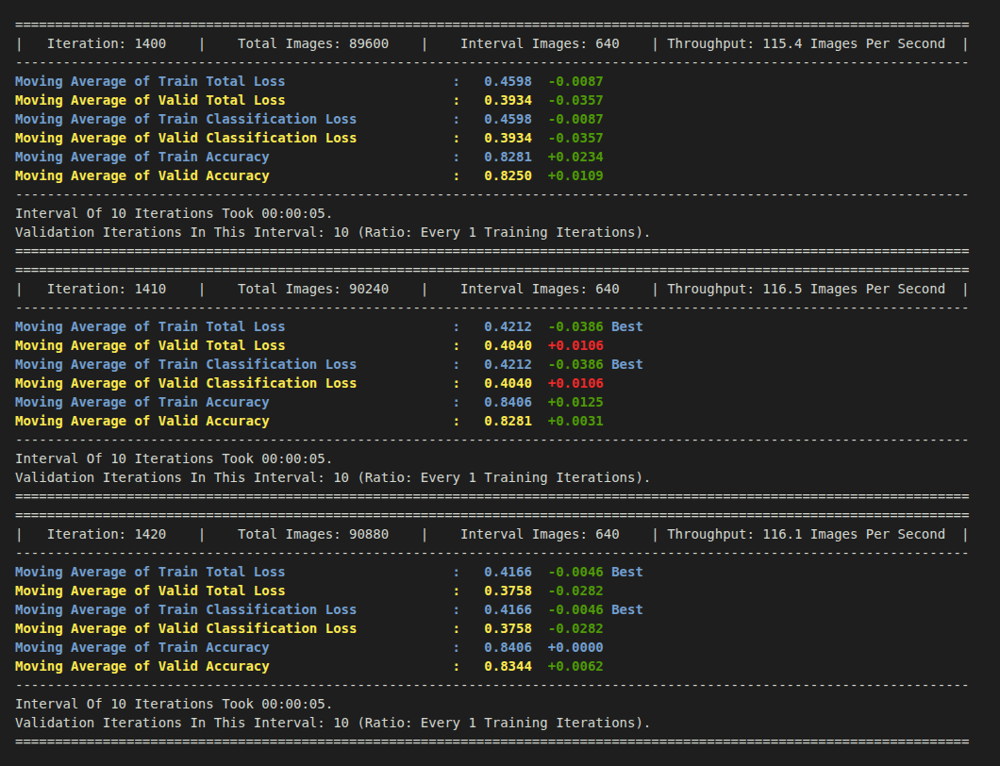
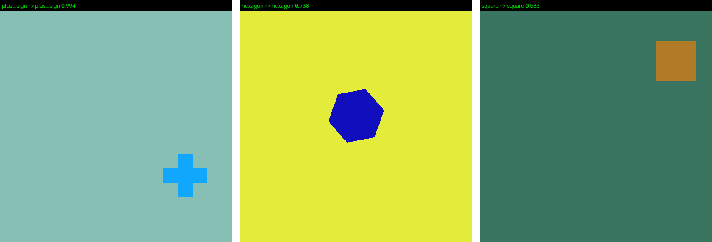
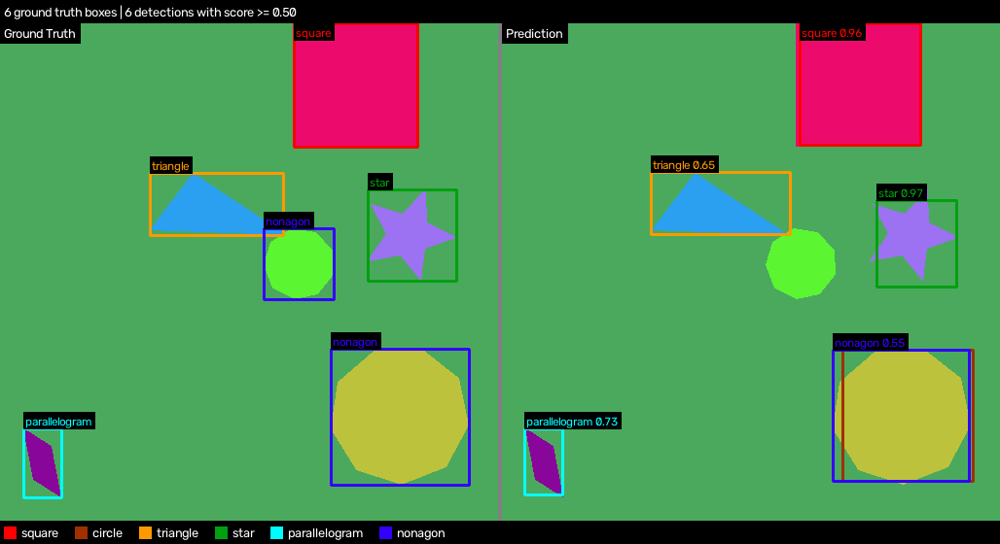
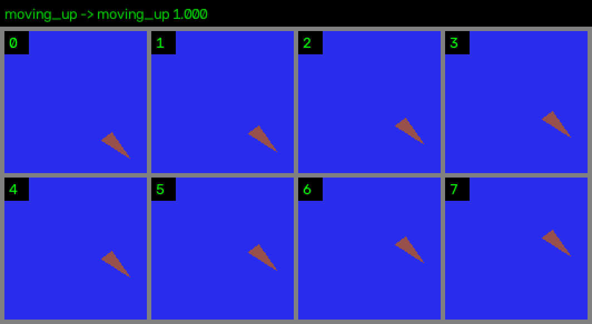
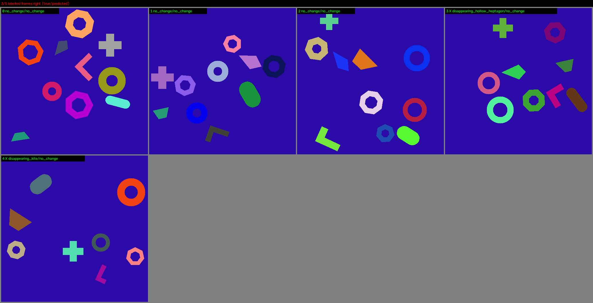
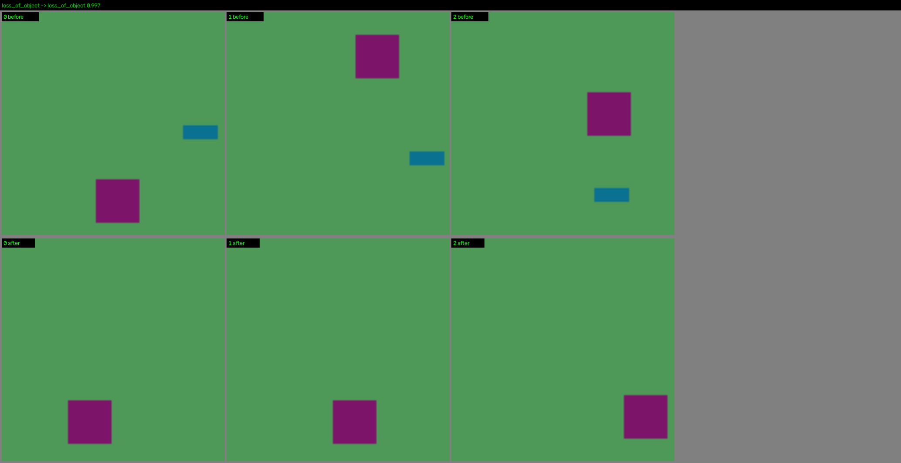

# Visual Language Model Spark

<p align="center">
  
</p>

> **Screenshot placeholder** (`README/tasks_overview.png`): one evaluation sample image of each of the nine supervised tasks side by side, taken from `<run>/Evaluation/Iteration_<n>/Samples/` of the synthetic runs: a classified shape, the detected boxes, the detected boxes with their masks, the grouped keypoints of the objects of an image, a segmentation (input, true mask, predicted mask, error map), a sequence classification frame grid, a sequence labelling frame grid, a before / after pair and a frame selection grid with its heat map.

## Table Of Content
- [Description](#description)
- [Prerequisites](#prerequisites)
  - [Package Requirements](#package-requirements)
  - [Data Requirements](#data-requirements)
- [Quick Start With Synthetic Data](#quick-start-with-synthetic-data)
- [Training](#training)
  - [Launching A Run](#launching-a-run)
  - [Run Folder](#run-folder)
  - [Console Output](#console-output)
  - [Stopping And Resuming](#stopping-and-resuming)
  - [Viewing The Input Images](#viewing-the-input-images)
  - [TensorBoard Monitoring](#tensorboard-monitoring)
  - [Moving Average Of The Weights](#moving-average-of-the-weights)
- [Tasks](#tasks)
  - [Common Dataset Layout](#common-dataset-layout)
  - [Classification (CLS)](#classification-cls)
  - [Object Detection (DET)](#object-detection-det)
  - [Instance Segmentation (INS)](#instance-segmentation-ins)
  - [Keypoint Detection (KPT)](#keypoint-detection-kpt)
  - [Semantic Segmentation (SEG)](#semantic-segmentation-seg)
  - [Sequence Lengths (M2O, M2M, CMP, SEL)](#sequence-lengths-m2o-m2m-cmp-sel)
  - [Sequence Classification (M2O)](#sequence-classification-m2o)
  - [Sequence Labelling (M2M)](#sequence-labelling-m2m)
  - [Sequence Comparison (CMP)](#sequence-comparison-cmp)
  - [Frame Selection (SEL)](#frame-selection-sel)
  - [Self-Supervised Learning (SSL)](#self-supervised-learning-ssl)
- [Transfer Between Runs](#transfer-between-runs)
  - [Adding Classes](#adding-classes)
- [Evaluating Checkpoints](#evaluating-checkpoints)
- [Comparing Launches](#comparing-launches)
- [Deployment](#deployment)
  - [Export](#export)
  - [Triton Server](#triton-server)
  - [Throughput Measurement](#throughput-measurement)
- [Configurations](#configurations)
- [Run Names](#run-names)
- [MLflow Tracking](#mlflow-tracking)
- [Tests](#tests)
- [Repository Structure](#repository-structure)
- [TODO](#todo)

## Description
This repository trains, evaluates and exports PyTorch models for nine vision tasks, and pre-trains their shared backbone without labels with a tenth, self-supervised task. The tasks share the same backbone (convolution blocks with optional residual, squeeze-and-excitation and inception modules), the same training loop, the same configuration format, the same evaluation report and the same export to Triton. Each task adds its own dataset, model head, losses and metrics.

| Code | Task | Input | Output | Model |
|---|---|---|---|---|
| CLS | `classification` | one image | one class (multi-class) or several classes (multi-label) | backbone, global pooling, fully connected head |
| DET | `object_detection` | one image | boxes with their class and score | backbone, region proposal heads on several backbone levels, RoI Align detection heads |
| INS | `instance_segmentation` | one image | boxes with their class and score, and the mask of every object | the detector of DET with a RoI Align mask head on every detection level |
| KPT | `keypoint_detection` | one image | the objects found in the image, each with its class, its keypoints (one heatmap and one tag map per keypoint of every class, the keypoints grouped into objects by their tags) and its score | stem of the backbone, high resolution network (HRNet), 1x1 heatmap and tag head, higher resolution branch (HigherHRNet) |
| SEG | `semantic_segmentation` | one image | one class per pixel | backbone as the encoder of a U-Net decoder with skip connections |
| M2O | `sequence_classification` | a sequence of frames | one class per sequence (many to one) | backbone on every frame, temporal module, fully connected head |
| M2M | `sequence_labelling` | a sequence of frames | one class per frame (many to many) | backbone on every frame, temporal module, head on every frame |
| CMP | `sequence_comparison` | a before and an after sequence | one class per pair | backbone on every frame, fusion of both members, temporal module, fully connected head |
| SEL | `frame_selection` | a sequence of frames | the frames of every wanted class | backbone on every frame, temporal module, head on every frame, Hungarian or greedy decoding |
| SSL | `self_supervised` | one image, without label (two random views of it) | the representation of the image, its backbone initialising the other tasks | backbone, global pooling, projection head, SimCLR or Barlow Twins loss |

<p align="center">
  
</p>

> **Image placeholder** (`README/architectures.png`): a diagram of the shared backbone feeding the task heads: the classification head, the region proposal and detection heads (with the mask heads for INS), the high resolution network, heatmap and tag head and higher resolution branch of KPT on the backbone stem, the U-Net decoder, and the temporal module (with the fusion of the two members for CMP) followed by the classification head (and the decoding of the selection for SEL).

## Prerequisites

### Package Requirements
- Python 3.13+
- uv
- An NVIDIA GPU with CUDA. The trainings fall back on the CPU without one, much slower.
- Docker with the NVIDIA container runtime, only to serve the exported models with Triton.

The Python packages (PyTorch, torchvision, kornia, OpenCV, TensorBoard, FiftyOne, ONNX, ONNX Runtime, the Triton client, MLflow) are listed in `pyproject.toml`. To install them, run from the repository root:

```bash
uv sync
```

Every script is run as a module from the repository root, so that the `vision_training` and `scripts` packages are found:

```bash
# Run a training from a configuration file, given by its path (absolute or relative to the current folder)
uv run python -m vision_training.main --configuration_path="vision_training/configurations/classification/configuration_synthetic_shapes.yaml"
```

The training takes the path of its configuration file on the command line (`--configuration_path`), absolute or relative to the current folder, the task trained being the one of the file (`ExperimentConfiguration.task`). In a PyCharm run configuration, it goes in the Script parameters. The other scripts have no command line arguments: their settings are the variables of their `if __name__ == "__main__":` block, to be edited before running them.

### Data Requirements
Every task reads three split folders (train, validation and test), each holding its images in `data/` and their labels in a `labels.json` manifest, and a `label_mapping.json` file giving the class predicted for every category. The layout of every task is given in [Tasks](#tasks), with the scripts converting existing datasets to it. To try the repository without a dataset, generate a synthetic one ([Quick Start With Synthetic Data](#quick-start-with-synthetic-data)).

## Quick Start With Synthetic Data
Every task has a synthetic shapes dataset, generated in a few minutes, on which a model learns within minutes. It checks that the installation and a configuration work before training on real data.

1. Open `vision_training/data/synthetic/create_synthetic_dataset.py`, set `task` and the output folder of that task in `output_folders` in its main block, then run:

```bash
# Generate the train, validation and test splits and the label_mapping.json file of the task
uv run python -m vision_training.data.synthetic.create_synthetic_dataset
```

2. In the synthetic configuration of the task (table below, in `vision_training/configurations/`), set `experiment_folder`, the three data folders and `Data.label_mapping.mapping_file_path` to the generated dataset.
3. Train with that configuration, given by its path:

```bash
uv run python -m vision_training.main --configuration_path="vision_training/configurations/classification/configuration_synthetic_shapes.yaml"
```

| Task | Synthetic dataset | Classes | Configuration |
|---|---|---|---|
| CLS | one shape per 512 pixel image | 35 shapes: square, circle, triangle, rectangle, pentagon, hexagon, plus sign, star, octagon, rhombus, parallelogram, trapezoid, kite, heptagon, nonagon, ellipse, semicircle, annulus, capsule, L-shape, and the hollow `hollow_square`, `hollow_triangle`, `hollow_rectangle`, `hollow_pentagon`, `hollow_hexagon`, `hollow_octagon`, `hollow_rhombus`, `hollow_parallelogram`, `hollow_trapezoid`, `hollow_kite`, `hollow_heptagon`, `hollow_nonagon`, `hollow_ellipse`, `hollow_semicircle`, `hollow_capsule` | `classification/configuration_synthetic_shapes.yaml` |
| DET | the INS dataset (`task = "instance_segmentation"`), whose boxes are those of the visible part of every shape | the 35 shapes | `object_detection/configuration_synthetic_shapes.yaml` |
| INS | up to 6 shapes per 512 pixel image, with the run length encoding of the visible part of every shape, a shape left with fewer than 64 visible pixels being left out | the 35 shapes | `instance_segmentation/configuration_synthetic_shapes.yaml` |
| KPT | 2 to 4 objects per 512 pixel image, the 35 shapes drawn upright, a stick figure and a house, each category with its own keypoints (the corners of the polygons, the tips of the star and of the plus sign, the 2 ends and 4 corners of the capsule, the 11 joints of the stick figure, the hollow polygons and capsule with the corners of their hole after those of their filled shape, the hollow semicircle with those of its filled shape...), some hidden by another object (v = 1) or outside the image; `circle`, `ellipse`, `annulus` and `hollow_ellipse` have no keypoints and are left out of `label_mapping.json`, objects drawn in the images only to distract the network | the 35 shapes, `stick_figure`, `house` (33 classes, without the 4 distractors) | `keypoint_detection/configuration_synthetic_shapes.yaml` |
| SEG | up to 6 shapes per 512 pixel image, with the class mask of every image | the 35 shapes and the background | `semantic_segmentation/configuration_synthetic_shapes.yaml` |
| M2O | one shape crossing 2 to 12 frames | `moving_left`, `moving_right`, `moving_up`, `moving_down` | `sequence_classification/configuration_synthetic_sequences.yaml` |
| M2M | 5 to 10 shapes per frame over 2 to 12 frames, redrawn every frame with a new size, colour, position and rotation, at most one shape appearing or disappearing from one frame to the next, labelled per frame | `no_change`, and `appearing_<shape>` and `disappearing_<shape>` for the 35 shapes (71 labels) | `sequence_labelling/configuration_synthetic_sequences.yaml` |
| CMP | a before and an after member of 2 to 12 frames, the before member showing 2 to 6 shapes | `loss_of_object` (the after member lost one shape), `same_number_of_objects` | `sequence_comparison/configuration_synthetic_pairs.yaml` |
| SEL | one shape per frame over 4 to 12 frames, the largest circle, triangle and star of the sequence being the frames to select, the other frames showing smaller copies of them or other shapes | `unselected`, `circle`, `triangle`, `star` | `frame_selection/configuration_synthetic_sequences.yaml` |
| SSL | the CLS dataset (`task = "classification"`), its classes only used by the k-NN evaluation | the 35 shapes | `self_supervised/configuration_synthetic_shapes.yaml` |

The shapes of the CLS, DET, INS and SEG images measure from 64 pixels (`MINIMUM_SHAPE_SIZE`) to a third of the image side, and the changing shape of M2M at least 64 pixels, so that the nonagon, the roundest polygon, stays distinct from the octagon and the circle. Every class keeps apart from its neighbours:
- the rhombuses have acute angles of 44° to 70°;
- the parallelograms have sides of different lengths (ratio 1.5 to 2.5);
- the trapezoids have one pair of parallel sides of different lengths;
- the ellipses and capsules are 1.5 to 3 times as long as they are wide.
- the hollow shapes are their filled shape with one hole, the filled shape scaled down by 0.4 to 0.6 about its centre (`HOLLOW_INNER_SIZE_RATIO_RANGE`), inside walls of at least 2 pixels (`HOLLOW_MINIMUM_WALL_PIXELS`), the hole showing the background like that of the annulus, the hollow circle.

The first nine shapes keep their category identifiers. A dataset generated before the eleven others were added keeps its nine classes, which its `labels.json` and `label_mapping.json` give to the training. The 15 hollow shapes come after the first 20 shapes (identifiers 21 to 35), `stick_figure` and `house` of the KPT dataset moving to 36 and 37, and a dataset generated before them keeps its classes in the same way.

## Training

### Launching A Run
1. Copy the `configuration_example.yaml` of the task, in `vision_training/configurations/<task>/`, and fill it: `experiment_folder` (the root folder receiving the runs), the three data folders and the label mapping file. Every key is explained by its comment in the file, and [Configurations](#configurations) lists the keys of every task.
2. Run the training, with the path of the configuration file (`--configuration_path`):

```bash
uv run python -m vision_training.main --configuration_path="vision_training/configurations/classification/my_configuration.yaml"
```

A path leading to no file stops the program before anything starts.

The configuration is checked before anything starts: a missing key, a value the task cannot use or an inconsistent combination stops the program with the list of every problem found.

The launch turns on the expandable segments of the CUDA allocator (`expandable_segments:True` added to `PYTORCH_CUDA_ALLOC_CONF`, other allocator settings given in that variable being kept) before anything reaches the GPU: the batches of whole sequences change shape from batch to batch, and the default allocator otherwise keeps reserving more GPU memory during the test evaluations.

### Run Folder
A run is saved in `<experiment_folder>/<run name>/`, the run name being built from its settings ([Run Names](#run-names)):

```text
<experiment_folder>/<run name>/
├── training_configuration.yaml        # Copy of the configuration of the last start of the run
├── training_configuration_until_iteration_<n>.yaml  # Configuration that trained the run up to iteration n, kept by a resume that changed it
├── data.json                          # Classes counted in every split, and data folder, SHA-256 of labels.json and images of every split
├── data_until_iteration_<n>.json      # Data that trained the run up to iteration n, kept by a resume whose data changed
├── anchor_recall.csv                  # Anchor recall of the training objects (DET, INS), written at every launch
├── Weights/
│   ├── full-checkpoint                # Registry of the saved checkpoints, the last one first
│   └── Iteration_<n>/model_<n>.pt     # Weights, optimizer state, moving average of the weights and metadata of iteration n
├── Tensorboard/
│   ├── Train/                         # Training curves, every iteration
│   ├── Validation/                    # Validation curves
│   ├── Test/                          # Test metrics and sample images of every evaluation
│   └── Test_EMA/                      # Same for the moving average of the weights, when it is on
├── Results.txt                        # Report of every evaluated checkpoint
├── Evaluation/
│   └── Iteration_<n>/                 # Files of the evaluation of iteration n
│       └── EMA/                       # Files of the evaluation of the moving average of the weights, when it is on
└── mlflow_run.json                    # MLflow run of the training, with the tracking on
```

`data.json` records the data of the run: the classes in class index order (`classes`, the background first for DET, INS and SEG), whose names are read by a run adding classes to this one ([Adding Classes](#adding-classes)), and for the train, validation and test splits, the absolute data folder, the SHA-256 of `labels.json` (identifying its images and labels exactly) and the list of its images in manifest order (the `file_name` of the COCO images and of the samples, the frames of the sequences and of both members of the pairs). It is written when the run starts, and sent to the `data` folder of the MLflow run with the tracking on. For ImageNet-1k it takes about 1.5 seconds and 70 MB.

Every class gives its index, its name, the manifest categories the label mapping maps to it (none for the background) and its count in every split, read from the `labels.json` of the split:

```json
"classes": [
  {"class_index": 0, "class_name": "empty_bin", "category_ids": [1], "images": {"train": 11772, "validation": 5060, "test": 5060}},
  {"class_index": 1, "class_name": "not_empty", "category_ids": [2], "images": {"train": 31805, "validation": 13642, "test": 13642}}
]
```

| Task | Counts of a class |
|---|---|
| CLS, SSL | `images`: the images of the class; a multi-label image counts once for each of its classes, so the counts can add up to more than the images |
| DET, INS, KPT | `images`: the images holding at least one object of the class; `annotations`: its objects |
| SEG | `images`: the masks holding the class, from the `category_ids` of every sample of `labels.json`; none for a manifest without them |
| M2O | `sequences`: the sequences of the class |
| M2M, SEL | `frames`: the frames of the class; the frame selection counts the frames of the categories its label mapping leaves out in the unselected class, as its loader does |
| CMP | `pairs`: the pairs of the class |

A task without class names (an SSL dataset without categories) writes `"classes": null`. The runs written before the classes were counted hold `class_names` instead, still read when they are a source run.

A checkpoint is saved every `intermediate_weight_saving_iterations` iterations, and a checkpoint evaluated on the whole test split every `weight_saving_iterations` iterations. The files of an evaluation are listed in [Evaluation Outputs](#evaluation-outputs).

### Console Output
At launch, the trainer prints the run name, its folders and files as clickable links, the settings and the data changed since the last start of a resumed run ([Stopping And Resuming](#stopping-and-resuming)), every component initialised by another run, every split with its number of samples, the iterations per epoch, the main training settings and the summary of the model. A transferred component ([Transfer Between Runs](#transfer-between-runs)) is printed as a block with its source run folder, the source checkpoint iteration, whether it is frozen, whether the normalization layers of the backbone are frozen, and the learning rate it learns at with its `learning_rate_multiplier` (none for a frozen component, which does not learn):

```text
- Pretrained Backbone     : file:///…/experiments/CLS_IN-KAR-256_…_HAVG.512.256-CWB_MC1000
    - Source Iteration    : last saved checkpoint
    - Frozen              : False
    - Norm. Layers Frozen : False
    - Learning Rate       : 0.0005 (multiplier 0.5 x 0.001)
- Pretrained Temp. Module : file:///…/experiments/M2O_IN-KAR-256_…_T8_GRU1x128-BI_HAVG.64_MC4
    - Source Iteration    : 25000
    - Frozen              : True
```

 With `diagnosis_modes.compute_receptive_field` and `compute_model_size`, it also prints the receptive field and the size of the model.

<p align="center">
  
</p>

> **Screenshot placeholder** (`README/experiment_launch_information.png`): the `=== Experiment Launch Information ===` block printed at the start of a training, with the run name, the folder links, the splits and their number of samples.

Every `information_dump` iterations, it prints the averages of the interval: the iteration, the samples seen, the throughput (and the real frames per second for the sequence tasks), the training and validation losses and metrics, and the duration of the interval. The summaries stay on the multiples of `information_dump`: a run resumed from a checkpoint between two of them (an intermediate save or a Ctrl+C) has a shorter first interval, whose averages and throughput cover only the iterations it ran.

<p align="center">
  
</p>

> **Screenshot placeholder** (`README/interval_summary.png`): two or three consecutive interval summaries of a training, with the iteration header, the throughput and the training and validation metrics.

Every `weight_saving_iterations` iterations, the checkpoint is evaluated on the test split, and its report is printed and appended to `Results.txt` with the same layout: the global metrics, the notes and, with `evaluation.per_class_report`, the table of the classes sorted worst first. With the moving average of the weights on, a second report of the same checkpoint follows, headed `Iteration <n> · <evaluated samples> · EMA Weights · <date and time>` ([Moving Average Of The Weights](#moving-average-of-the-weights)).

<p align="center">
  
</p>

> **Screenshot placeholder** (`README/evaluation_report.png`): the report of one evaluated checkpoint in the console, with its header `Iteration <n> · <evaluated samples> · <date and time>`, the global metrics and the per-class table.

### Stopping And Resuming
Ctrl+C stops the training and saves a checkpoint of the current iteration. With `resume_training: true`, launching the same configuration again resumes from the last checkpoint of its run folder, with its optimizer state.

The settings that give no token in the run name (augmentation, batch size, learning rate and its schedule, `pretrained.learning_rate_multiplier`, gradient clipping, mixed precision, moving average of the weights, dropout rates) can be changed between two resumptions of a run. Changing any other setting gives another run name, so the training starts in a new run folder.

A resumed run compares the launched configuration with the `training_configuration.yaml` saved in its folder by the previous start, before the copy of the new one replaces it, and prints every setting changed, added or removed since:

```text
- Previous Configuration  : file:///…/training_configuration_until_iteration_72500.yaml
- Changed Settings        : Since Iteration 72500
    - ExperimentConfiguration.learning_rate        : 0.0002 -> 0.0001
    - Backbone.pretrained.learning_rate_multiplier : 0.5 -> 1.0
```

When the configuration changed, the previous file is kept as `training_configuration_until_iteration_<n>.yaml`, the configuration that trained the run up to the checkpoint of iteration n it resumes from. A file of that name is never replaced, so a run resumed twice from the same checkpoint keeps the configuration that really trained it. An unchanged configuration prints `- Changed Settings        : None Since Iteration <n>` and keeps no file.

The data is compared the same way, but changed labels need a new run: when the SHA-256 of the `labels.json` of a split differs from `data.json`, the resume stops with an error before anything in the run folder is replaced, asking to train from scratch (`resume_training: false`), to use another `experiment_folder`, or to set `ExperimentConfiguration.allow_data_change_on_resume: true`. Keeping track of the data a run is resumed on is up to the user; the switch is saved with the configuration, so an allowed change stays visible. With the switch, or when only the data folder moved, the previous record is kept as `data_until_iteration_<n>.json` (never replaced either) and the new one written:

```text
- Previous Data Record    : file:///…/data_until_iteration_72500.json
- Changed Data Splits     : train Since Iteration 72500
```

Unchanged data prints `- Changed Data Splits     : None Since Iteration <n>` and keeps `data.json` as it is, with its date.

### Viewing The Input Images
`ExperimentConfiguration.diagnosis_modes.view_input_images: True` opens a Training and a Validation window showing the samples exactly as the network receives them, the training ones augmented. Each window holds the image and, on its right, a black information panel listing its targets (the class, the objects counted per class, the classes of the mask, the real frames of a sequence) and, for the training sample, the augmentations drawn for it with their values (the crop size and position, the rotation angle, the brightness change, ...), frame by frame for the sequences drawn per frame, the objects the augmentations removed and the shuffled frame order. The self-supervised runs show the two views of a training image instead, each panel listing the view transformations drawn for it. The two windows are centred on the screen, side by side, or stacked and scaled down when they do not fit. It checks the preprocessing, the label mapping and the augmentation before a training. SPACE shows the next samples, ENTER closes the windows and exits without training. Nothing is printed in the terminal. It needs a display, and creates no run folder.

<p align="center">
  
</p>

> **Screenshot placeholder** (`README/input_viewer.png`): the Training and Validation windows of the input viewer side by side, each image followed by its black information panel listing its targets and, for the training sample, the augmentations drawn with their values.

### TensorBoard Monitoring
To follow the training and validation curves and the test evaluations of a run, start TensorBoard on its folder and open http://localhost:6006:

```bash
uv run tensorboard --logdir <experiment_folder>/<run name>/Tensorboard
```

The `Train` and `Validation` curves are written every iteration. The `Test` scalars and the sample images (`Samples/<sample>`, with a slider over the evaluations) are written at every evaluation. With the moving average of the weights on, `Test_EMA` holds the same tags for the averaged weights, so that TensorBoard draws both curves of every metric on the same chart.

<p align="center">
  
</p>

> **Screenshot placeholder** (`README/tensorboard.png`): the TensorBoard scalars of a run, with the training and validation loss curves and a Test metric (e.g. `Accuracy` or `Mean IoU`) over the evaluations.

### Moving Average Of The Weights
`Optimization.exponential_moving_average` keeps a second copy of the model, never trained itself, moved towards the trained weights after every optimizer step:

```text
ema_weights = decay × ema_weights + (1 − decay) × current_weights
```

A weight of k steps ago counts with a factor decay^k, so the average follows roughly the last 1 / (1 − decay) iterations: about 1,000 at 0.999, 5,000 at 0.9998 and 10,000 at 0.9999. Its n-th update uses min(decay, (1 + n) / (10 + n)), so that the random starting weights fade quickly. The running statistics of the batch normalization layers are averaged the same way. The averaged copy costs the memory of one more model, and its update a small fraction of a training step.

Every test evaluation scores the trained weights, then the averaged weights of the same checkpoint:

| Output | Trained weights | Averaged weights |
|---|---|---|
| Console and `Results.txt` header | `Iteration <n> · <evaluated samples> · <date and time>` | `Iteration <n> · <evaluated samples> · EMA Weights · <date and time>` |
| Evaluation files | `Evaluation/Iteration_<n>/` | `Evaluation/Iteration_<n>/EMA/` |
| TensorBoard | `Test` | `Test_EMA` |
| MLflow | `test/`, `test_class/`, `test/best_<headline metric>` (tag `best_iteration`) | `test_ema/`, `test_ema_class/`, `test_ema/best_<headline metric>` (tag `best_iteration_test_ema`) |
| `evaluation_summary.csv` of `evaluate_checkpoint.py` | one column per scalar | the same columns preceded by `ema_` |

The average is saved in every checkpoint and restored when the run resumes. It gives no run name token, so that it can be turned on or off when a run resumes: turned on from a checkpoint saved without it, it restarts from the weights of that checkpoint, and is evaluated from the next evaluation on. The validation curves use the trained weights; the export uses them unless `use_averaged_weights` is True in its main block (see Exporting Models). A component transferred to another run is loaded from the averaged weights when that run keeps a moving average too ([Transfer Between Runs](#transfer-between-runs)).

## Tasks

### Common Dataset Layout
A dataset is a folder per split, each holding its images in `data/` and a `labels.json` manifest naming them relative to `data/`:

```text
<dataset>/
├── label_mapping.json
├── train/
│   ├── data/
│   └── labels.json
├── validation/
│   ├── data/
│   └── labels.json
└── test/
    ├── data/
    └── labels.json
```

The `train_data_folder`, `validation_data_folder` and `test_data_folder` keys point to the split folders. The training split is trained on, the validation split gives the validation curves during the training (`validation_iteration_ratio`), and the test split is evaluated whole at every `weight_saving_iterations` checkpoint. The same folder can be given to the validation and the test splits.

The categories of a manifest have integer identifiers. `label_mapping.json` maps every category identifier, written as a string, to the class index predicted by the model, and is given by `Data.label_mapping.mapping_file_path` with `Data.label_mapping.mode: "multi_class"`:

```json
{
    "1": 0,
    "2": 1,
    "3": 1
}
```

- CLS, M2O, M2M, CMP and SEL predict the classes 0 to K-1. DET, INS, KPT and SEG predict the classes 1 to K, class 0 being their background (for KPT, the background of the detector giving its boxes).
- Several categories mapped to the same class are merged into it, the class being named after both (`name_2+name_3`).
- A category missing from the mapping is left out: its samples are skipped (CLS multi-class, M2O, CMP), it is dropped from the classes of its samples (CLS multi-label), its frames are ignored (M2M), its frames become unselected (SEL), its objects are ignored (DET, INS, KPT), or its pixels become background (SEG).
- DET, INS and SEG also accept `mode: "binary"`, which maps every category to the foreground class 1 without a mapping file.

The dataset scripts below and the synthetic dataset generator write `label_mapping.json` next to the splits.

### Classification (CLS)
The classifier predicts the class of an image (`ClassificationHead.output_mode: "multi_class"`, softmax) or every class present in it (`"multi_label"`, sigmoid).

**Data.** Every split holds its images in `data/` and lists them in `labels.json`, with their `category_id` (multi-class) or their `category_ids` (multi-label):

```text
<split>/
├── data/
│   ├── circle/image_0001.png
│   └── square/image_0002.png
└── labels.json
```

```json
{
  "categories": [{"id": 1, "name": "circle"}, {"id": 2, "name": "square"}],
  "samples": [
    {"id": 1, "file_name": "circle/image_0001.png", "category_id": 1},
    {"id": 2, "file_name": "square/image_0002.png", "category_id": 2}
  ]
}
```

**Converting a dataset.**
- One folder of images per class (e.g. `training_data/circle/*.png`): `vision_training/data/classification/class_folder_manifests.py` writes the manifests and the label mapping file, `data/` being a symbolic link to the class folders, so no image is copied. Set `split_folders` and `output_folder` in its main block, then run `uv run python -m vision_training.data.classification.class_folder_manifests`.
- ImageNet-1k: `vision_training/data/classification/imagenet_download.py` downloads it from Hugging Face (about 310 GB) and writes its train, validation and test splits.
- Tencent ML-Images (17.6M multi-label images, 11,166 categories) for the pre-training of the backbones: `vision_training/data/classification/foundation_model_image_downloader.py` (about 1.7 TB).

**Configuration.** Copy `classification/configuration_example.yaml`. The task keys are `ClassificationHead` (global pooling `average`, `max` or `flatten`, fully connected layers, their normalization `fully_connected_normalization` and its `batch_normalization_momentum`, output mode, label smoothing, class weighting) and the evaluation keys `top_k`, `target_precision`, `save_predictions` and `error_dumps`. With `fully_connected_normalization: "batch"` or `"layer"`, every hidden layer is linear, normalization, ReLU; it needs at least one hidden layer. The batch normalization normalizes every unit over the vectors of the batch, with running statistics at `batch_normalization_momentum`, and the sequence tasks leave the padding frames out of its batch statistics. The layer normalization normalizes every vector over its units, the same way in training and evaluation and whatever the other vectors of the batch.

**Evaluation.** Accuracy, balanced accuracy, macro F1 and top-k accuracy (multi-label: subset accuracy, micro and macro F1), and the precision, recall and F1 of every class. The score threshold of every class reaching `target_precision` is saved in `class_thresholds.json` for the deployment, with the recall it keeps in the per-class table. The confusion matrix (multi-class), `predictions.csv` (`save_predictions`) and the misclassified images in `Errors/<TRUE>-TO-<PREDICTED>/` (`error_dumps`, multi-class) complete the report.

<p align="center">
  
</p>

> **Screenshot placeholder** (`README/classification_sample.png`): two or three sample images of a classification evaluation (`Evaluation/Iteration_<n>/Samples/`), each captioned `true -> predicted probability`, one green (right) and one red (wrong).

<p align="center">
  
</p>

> **Screenshot placeholder** (`README/confusion_matrix.png`): the `confusion_matrix.png` of an evaluation of the synthetic shapes classifier.

<p align="center">
  
</p>

> **Screenshot placeholder** (`README/error_dumps.png`): the `Errors/` folder of an evaluation in a file browser, with its `<TRUE>-TO-<PREDICTED>` folders and a few misclassified images.

### Object Detection (DET)
The two-stage detector predicts the box, class and score of every object of an image. The region proposal heads and the detection heads run on several backbone levels (the keys of `DetectionLevels`), each level having its own anchors and heads. In training and in the validation loss, the ground truth boxes of every image are added to its proposals before the detection heads sample their positives and negatives, each at the level of its best anchor, so that every object gives a positive proposal even when the region proposal network misses it.

**Data.** Every split holds its images in `data/` and their annotations in a COCO `labels.json`, the boxes being `[x, y, width, height]` in pixels of the original image:

```text
<split>/
├── data/
│   └── 000001.png
└── labels.json
```

```json
{
  "images": [{"id": 1, "file_name": "000001.png", "width": 1024, "height": 1024}],
  "annotations": [
    {"id": 1, "image_id": 1, "category_id": 3, "bbox": [120, 340, 64, 48], "area": 3072, "iscrowd": 0}
  ],
  "categories": [{"id": 3, "name": "triangle"}]
}
```

The crowd annotations (`"iscrowd": 1`, one box around a group of objects too many to be labelled one by one) are objects like the others, in the training and the evaluation, as in INS.

**Augmentation.** The geometric augmentations move the boxes with the image. An object keeping less than 25 % of its moved box inside the image after `random_crop`, `random_translation` or `random_rotation` (`MINIMUM_VISIBLE_AREA_FRACTION` in `vision_training/data/augmentations.py`) is removed with its label, so that the detector is not trained to find a fragment cut by the border of the image. `random_crop` only zooms in (75 to 100 % of each side), so `random_zoom_out`, applied right after it, shrinks the image to 50 to 100 % of each side (`MINIMUM_ZOOM_OUT_FRACTION`) at a random position of a black canvas of the input size, moving the boxes and masks with it: the finest detection levels then also train on the objects that are large in the dataset. It is on in the `configuration_example.yaml` of DET and INS (probability 0.3), and off in the other configurations, those of the synthetic shapes turning every augmentation off. `random_translation`, applied after the zoom-out, shifts the image by whole pixels along its width, its height or both (drawn with equal chances), each shift reaching up to 25 % of its side in either direction (`MAXIMUM_TRANSLATION_FRACTION`), the uncovered border being black in the image, ignored in the class masks and background in the instance masks. It works for every task, the classification included, and is in every configuration file, off with probability 0.5.

**Converting a dataset.** `vision_training/data/data_retriever.py` downloads COCO 2017 with FiftyOne, whose splits have this layout (about 25 GB in full). Set the dataset folder and `maximum_samples` in its main block, then run `uv run python -m vision_training.data.data_retriever`.

**Configuration.** Copy `object_detection/configuration_example.yaml`. The task keys are `DetectionLevels`, `RegionProposal`, `Detector`, `evaluation.score_threshold`, `evaluation.target_precision` and `evaluation.error_dumps`. Every key of `DetectionLevels` is the quoted number of the backbone block whose feature map feeds the level, the keys going up from the finest feature map to the coarsest, and holds the settings of that level: its anchors (scales in input pixels, aspect ratios height / width), its region proposal head (`[layers, channels]` convolutions) and its detection head (RoI Align pool size, convolutions and fully connected layers). `RegionProposal` and `Detector` hold the settings shared by the levels: normalization, modules, proposal counts, IoU thresholds, sampling and pretrained heads.

```yaml
DetectionLevels:
  "5":
    anchors: { scales: [32, 64, 128], aspect_ratios: [0.5, 1.0, 2.0] }
    region_proposal: { convolutions: [2, 64] }
    detector: { roi_align_pool_size: 7, convolutions: [2, 64], fully_connected: [256, 128] }
  "6":
    anchors: { scales: [64, 128, 256], aspect_ratios: [0.5, 1.0, 2.0] }
    region_proposal: { convolutions: [2, 64] }
    detector: { roi_align_pool_size: 7, convolutions: [2, 64], fully_connected: [256, 128] }
  "7":
    anchors: { scales: [128, 256, 512], aspect_ratios: [0.5, 1.0, 2.0] }
    region_proposal: { convolutions: [2, 64] }
    detector: { roi_align_pool_size: 7, convolutions: [2, 64], fully_connected: [256, 128] }
```

**Evaluation.** The mAP at IoU 0.5, 0.75, 0.95 and 0.5:0.95 with the area, 11-point and 101-point methods, and the AP@0.5 of every class. The detections below `evaluation.score_threshold` are left out of the mAP. The score threshold of every class reaching `target_precision`, the detections of a class being right when they find an object of the class at IoU 0.5 (the AP@0.5 matching), is saved in `class_thresholds.json` with the recall it keeps, for a deployment filtering the detections class by class.

The table `Mean Average Precision By Object Size (Area)` gives the mAP of the small, medium and large objects with the area method, by box area in network input pixels as in COCO: small below 32², medium from 32² to 96², large from 96². The mAP of a size scores its objects only: the objects of the other sizes and the detections matched to them are ignored, as are the unmatched detections of another size. It is written to TensorBoard as `mAP@0.5 By Size/<size>` and `mAP@[0.5:0.95] By Size/<size>`, and `class_metrics.csv` gives the AP@0.5 and AP@[0.5:0.95] of every class and size (`average_precision_50_<size>`, `average_precision_50_95_<size>`, empty without object of the size).

The table `Mean Average Recall` gives the share of the objects found by any detection kept for the evaluation (above `evaluation.score_threshold`), at IoU 0.5, 0.75, 0.95 and averaged over 0.5:0.95, averaged over the classes, for all the objects and every size. It tells whether the objects missed by the mAP are not found at all or found with a score below the false positives. It is written to TensorBoard as `mAR@0.5/<all or size>`, `mAR@0.75/<all or size>` and `mAR@[0.5:0.95]/<all or size>`.

The recall of the region proposal network tells whether a missed object could have been found by the detection heads at all:
- At every launch, `anchor_recall.csv` in the run folder and the console give the share of the training objects whose best anchor overlaps them by at least `RegionProposal.foreground_iou_threshold.min`, for every level and all of them, for all the objects and every size. The other objects only get their single best anchor as foreground anchor. It is read from the annotations of the training split, without loading the images and without the augmentations.
- At every evaluation, the table `Proposal Recall` and `proposal_recall.csv` give the share of the test objects overlapped by a proposal given to the detection heads by at least 0.5 and 0.7, for all the objects, every size and the proposals of every level alone, with the mean number of proposals per image. It is written to TensorBoard as `Proposal Recall@0.5/<group>`, `Proposal Recall@0.7/<group>` and `Proposals Per Image/<group>`.

The detections the deployed detector returns (score reaching `Detector.inference.score_threshold`) are matched to the objects of every test image at IoU 0.5, from the most confident: first to the objects of their class, then to the objects left of any class. The matches give `confusion_matrix.csv` and `.png`, with a `background` row for the false positives (a detection finding no object) and a `background` column for the missed objects (an object found by no detection). The report counts the right detections, the wrong classes, the false positives and the missed objects. With `error_dumps.activated`, every test image with errors is saved in `Errors/FALSE-POSITIVE/<class>/`, `Errors/MISSED/<class>/` and `Errors/<TRUE>-TO-<PREDICTED>/`, drawn like the sample images with the boxes in error outlined with red dashes, at most `maximum_per_class_pair` images per folder.

<p align="center">
  
</p>

> **Screenshot placeholder** (`README/detection_sample.png`): a sample image of a detection evaluation, the ground truth boxes on the left next to the detections above `Detector.inference.score_threshold` on the right, every box in the colour of its class.

### Instance Segmentation (INS)
The instance segmenter is the two-stage detector of DET with one mask head per detection level, as in Mask R-CNN ([He et al., 2017](https://arxiv.org/abs/1703.06870)): every detection gets its box, class and score, and the binary mask of its object. The mask head of a level pools every box from the feature map of that level with RoI Align, at the pool size of the level (`DetectionLevels.<level>.mask_head.roi_align_pool_size`, 14 by default), and refines it with convolution layers. It then doubles its resolution as many times as fits in `MaskHead.mask_resolution` M (28 by default), with transposed convolutions or bilinear upsamplings followed by a convolution (`MaskHead.upsampling`), and gives one M x M mask per class, the mask of the detected class being kept. When the doublings fall short of M, as for a pool size of 10 doubled to 20, the masks are resized bilinearly to M, so that every level gives masks of the same size. During the training, the mask heads learn on the positive proposals, whose mask targets are the ground truth masks cropped to the proposals; at inference, they run on the final detection boxes.

**Data.** The COCO `labels.json` of DET, every object having a `segmentation`: a list of polygons, every polygon a flat `[x1, y1, x2, y2, ...]` list in pixels of the original image (the parts of an object are united), or a run length encoding `{"size": [height, width], "counts": ...}`, uncompressed (a list of run lengths) or compressed (a string), the runs following the pixels column by column. The masks are built at the network resolution by the loader workers, a polygon covering the pixels whose centre lies inside it. The crowd annotations (`"iscrowd": 1`) are objects like the others, an object without `segmentation` stops the loading, and an object whose mask vanishes at the network resolution is removed with its box, except from the test objects of `evaluation.original_resolution`. The box of every object is the tight box of its mask at the network resolution, so the annotations need no `bbox` (a `bbox` given is ignored); the anchor recall at launch reads it from the `segmentation` without building the masks.

```json
{
  "images": [{"id": 1, "file_name": "000001.png", "width": 1024, "height": 1024}],
  "annotations": [
    {"id": 1, "image_id": 1, "category_id": 3, "iscrowd": 0, "segmentation": [[120, 388, 152, 340, 184, 388]]}
  ],
  "categories": [{"id": 3, "name": "triangle"}]
}
```

The COCO 2017 splits downloaded by `vision_training/data/data_retriever.py` already hold the segmentations. The geometric augmentations move the masks with the image, and the box of every object becomes the tight box of its moved mask. An object keeping less than 25 % of its mask pixels inside the image, out of those it would have at the zoom of the crop, is removed with its box and mask.

**Configuration.** Copy `instance_segmentation/configuration_example.yaml`. The task keys are those of DET, a `mask_head` in every level of `DetectionLevels` (the RoI Align pool size and the `[layers, channels]` convolutions of the mask head of the level, e.g. `mask_head: { roi_align_pool_size: 14, convolutions: [4, 64] }`), and the `MaskHead` section shared by the levels: the mask resolution and the upsampling, the normalization and modules of the mask heads, and `inference.mask_threshold`, the mask probability from which a pixel belongs to its object.

**Evaluation.** The mask mAP and the box mAP of the same detections, each at IoU 0.5, 0.75, 0.95 and 0.5:0.95 with the area, 11-point and 101-point methods, with the AP@0.5 of every class. The mask IoU compares the predicted masks, pasted into their boxes and thresholded at `mask_threshold`, with the ground truth masks at the network input resolution or, with `evaluation.original_resolution`, at the original resolution of every test image, as COCO evaluates them: the detection boxes are restored to the original image, the masks pasted into them at that size, and the objects, their boxes and their sizes are those of the original annotations, an object whose mask vanishes at the network resolution staying in the evaluation. The anchor and proposal recall and the sample and error images stay at the network resolution. The mask mAP@0.5 of the area method (`Mask mAP@0.5/area`) compares the checkpoints; the box scalars keep the names of DET, so that INS and DET runs can be compared. Both are saved in `class_metrics.csv`, the mask columns prefixed with `mask_`. The mAP by object size is given for the masks, the objects measured by their mask area, and for the boxes, measured by their box area (`Mask mAP@0.5 By Size/<size>` and `mAP@0.5 By Size/<size>`), as is the mean average recall (`Mask mAR@0.5/<all or size>` and `mAR@0.5/<all or size>`). The anchor and proposal recall are those of DET. The class thresholds, the confusion matrix and the error images are those of DET, the detections being matched to the objects by their masks at IoU 0.5, and the error images painting the masks under the boxes.

<p align="center">
  
</p>

> **Screenshot placeholder** (`README/instance_segmentation_sample.png`): a sample image of an instance segmentation evaluation, the ground truth boxes and masks on the left next to the detections above `Detector.inference.score_threshold` with their masks on the right, every box and mask in the colour of its class.

### Keypoint Detection (KPT)
The keypoint detector is bottom-up, as in HigherHRNet ([Cheng et al., 2020](https://arxiv.org/abs/1908.10357)): the network sees the whole image, finds the keypoints of all its objects at once, and groups them into objects with the tags of associative embedding ([Newell et al., 2017](https://arxiv.org/abs/1611.05424)). It needs no box: an image without any object gives no keypoint, and an image with several objects of several classes gives all of them in one pass. Every sample is one whole image, as in DET.

The network is made of three parts:
- A stem: the first blocks of the backbone of the other tasks, bringing the image down to a quarter of its resolution. Every block but the last is followed by a 2x2 max pooling, so the stem has 3 blocks with `Backbone.last_max_pooling: False`, or 2 blocks with it True.
- The high resolution network (`HRNet`): it keeps a branch at 1/4 of the image through the whole network and adds a branch at half the resolution and twice the width at every stage (`base_width`, 2 x `base_width`...). The branches exchange their features at the end of every module, every branch receiving the sum of all the branches brought to its resolution and width. `modules_per_stage: [1, 4, 3]` with `base_width: 32` and `blocks_per_branch: 4` is HRNet-W32.
- The keypoint head (`KeypointHead`): a 1x1 convolution of the highest resolution branch giving one heatmap and one tag map per keypoint of every class, at 1/4 of the image. With `higher_resolution: True`, the higher resolution branch of HigherHRNet concatenates the features of the highest resolution branch with these heatmaps and tags, doubles their resolution with a transposed convolution, refines them with `HRNet.blocks_per_branch` residual blocks and gives a second set of heatmaps at 1/2 of the image, which helps the small objects. With `hidden_width` above 0, both 1x1 convolutions read a 3x3 convolution of `hidden_width` channels (with the `HRNet` normalization and a ReLU) instead of the features. A 1x1 convolution gives every heatmap as a weighted sum of its input channels at the cell, so with more heatmap channels than input channels the heatmaps cannot peak on their own keypoints while the others stay at zero; set `hidden_width` to at least the number of heatmap channels when they outnumber `HRNet.base_width` (243 channels and `hidden_width: 256` in `configuration_synthetic_shapes.yaml`), and to 0 for the 1x1 convolutions of the paper.

Several classes can have different keypoints (a person with 17 keypoints, a car with 12). The heatmap channels are the keypoints of every class, the classes in increasing order and the keypoints of a class in the order of its category, every channel having its own tag map. Every channel is trained in every image, towards zero where the image holds no keypoint of it.

**Training.** The heatmaps are the sigmoid of the predicted logits, the bias of their channels starting at the logit of 0.01. Their targets are Gaussians of `KeypointHead.heatmap_sigma` cells centred on the labelled keypoints of all the objects of the image, the cell containing a keypoint set to 1 and the highest value being kept where two Gaussians overlap, at 1/4 of the image and, with the higher resolution branch, at 1/2. The heatmap loss is the focal loss of CornerNet ([Law and Deng, 2018](https://arxiv.org/abs/1808.01244)), at every resolution: -(1 - p)² log(p) on the cells at 1 and -(1 - y)⁴ p² log(1 - p) on the others, p being the predicted heatmap and y the target, summed over the cells, channels and images and divided by the number of cells at 1. The keypoint cells are a few hundredths of a percent of the cells: a squared error averaged over the cells is lowest for heatmaps at 0 everywhere, while the focal loss gives little weight to the empty cells once their prediction is low and less to the cells near a keypoint. The tags have no target value: a keypoint reads the tag map of its channel at its cell, and only the distances between the tags are trained. The pull loss, the mean squared distance between the tags of the keypoints of every object and their mean, gathers the keypoints of an object around one value; the push loss, the mean of exp(-(h_m - h_n)²) over the pairs of objects of the same class in the same image, h being their mean tags, separates the objects. The loss is the heatmap loss plus `tag_pull_weight` x the pull loss plus `tag_push_weight` x the push loss. Only the labelled keypoints inside the image are trained.

**Grouping.** At inference, with the higher resolution branch, the heatmaps at 1/4 of the image are upsampled to 1/2 and averaged with its heatmaps, the tag maps being upsampled as well. The candidates of every channel are its `KeypointHead.inference.maximum_candidates` highest local maxima over 3x3 cells, each moved by a quarter of a cell towards its higher neighbour, with the heatmap value of its cell as score and the tag of its channel at that cell. `group_keypoint_candidates` of `vision_training/models/keypoints/keypoint_grouping.py` then forms the objects class by class: the keypoints of the class are taken in order, and the candidates of each above `keypoint_threshold` are matched to the objects formed by the previous keypoints (Hungarian matching on the distance between the candidate tag and the mean tag of the object, rounded to whole units, the score breaking the ties); a candidate left unmatched or farther than `tag_threshold` starts a new object. The score of an object is the sum of the scores of its keypoints divided by the number of keypoints of its class, so that an object missing keypoints scores lower. The evaluation keeps every object; the sample images and the deployment keep those scoring at least `object_score_threshold`.

**Data.** The COCO `labels.json` of DET, every object having its `keypoints`, a flat `[x1, y1, v1, x2, y2, v2, ...]` list in pixels of the original image with the visibility v (0 not labelled, 1 labelled but hidden, 2 labelled and visible), and every category its keypoint `keypoints` names and its `skeleton`, pairs of 1-based keypoint numbers linked in the drawings. The objects without any labelled keypoint are left out of the labels of every split, having nothing to learn from nor to evaluate; they stay in their images, where the heatmaps learn to find no keypoint.

```json
{
  "images": [{"id": 1, "file_name": "000001.png", "width": 640, "height": 480}],
  "annotations": [
    {"id": 1, "image_id": 1, "category_id": 1, "iscrowd": 0, "bbox": [120, 40, 80, 200],
     "keypoints": [160, 60, 2, 140, 120, 2, 180, 120, 1], "num_keypoints": 3}
  ],
  "categories": [{"id": 1, "name": "person", "keypoints": ["head", "left_hand", "right_hand"],
                  "skeleton": [[1, 2], [1, 3]]}]
}
```

The label mapping is that of DET, class 0 being the background, which has no heatmap channel, and the categories merged into one class must have the same keypoint names. The COCO 2017 person keypoints use the images of the COCO detection splits and the `person_keypoints_<split>2017.json` annotations of the COCO download as their `labels.json`.

**Augmentation.** The geometric types of `Data.data_augmentation` move the keypoints with the image, as boxes of zero size moved with the boxes of their objects. A keypoint leaving the image becomes unlabelled, and an object is removed when less than 25 % of its box and none of its labelled keypoints stay inside the image. A keypoint keeps its name and heatmap channel whatever the augmentation: a left to right flip leaves the `left_wrist` of a mirrored person on its right side, and a large rotation brings the `top` corner of a triangle to the bottom. These types only suit keypoints whose names depend neither on the side nor on the orientation (the tip of a flame), which is the choice of the user; both keypoint configurations turn the flips and the 90 degree rotations off. A dataset whose keypoints must be renamed by a flip is augmented offline. The photometric types leave the keypoints unchanged.

**Converting a dataset.** The COCO 2017 keypoint annotations are part of the COCO download (`annotations_trainval2017.zip`). Every split folder links the images of the COCO split as its `data/` and its `person_keypoints_<split>2017.json` as its `labels.json`. The keypoint annotations of the COCO test split are withheld, so `configuration_example.yaml` uses the validation split as its validation and test splits.

**Configuration.** Copy `keypoint_detection/configuration_example.yaml` (COCO persons, HigherHRNet-W32 on 512x512 images). The task keys are `HRNet`, `KeypointHead`, `evaluation.default_keypoint_sigma` and `evaluation.keypoint_sigmas`. `Data.image_settings.size` must be a multiple of the stride of the lowest resolution branch, 4 x 2 to the power of the number of stages (32 for 3 stages). `Backbone` is the stem, and `Backbone.pretrained` loads the first blocks of the backbone of any run (e.g. an ImageNet classification run), as many as the stem has. `HRNet.pretrained` and `KeypointHead.pretrained` load the network and the head of another KPT run.

```yaml
HRNet:
  base_width: 32
  modules_per_stage: [1, 4, 3]
  blocks_per_branch: 4
  modules: { squeeze_and_excite: True, residual_nets: True }
  normalization: { feature_map_normalization: "batch", batch_normalization_momentum: 0.1 }
KeypointHead:
  higher_resolution: True
  hidden_width: 0
  heatmap_sigma: 2.0
  tag_pull_weight: 0.1
  tag_push_weight: 0.1
  inference: { maximum_candidates: 30, keypoint_threshold: 0.1, tag_threshold: 1.0, object_score_threshold: 0.2 }
```

**Evaluation.** Every evaluated checkpoint finds the keypoints of every test image and groups them into objects with the settings of `KeypointHead.inference`, every object being kept whatever its score. Every object found is scored against the ground truth objects of the same class in its image with the object keypoint similarity (OKS) of COCO, which replaces the IoU of the detection average precisions:

OKS = Σ exp(-d² / (2 s² k²)) δ(v > 0) / Σ δ(v > 0)

where d is the distance between a predicted keypoint and its ground truth, s² the area of the ground truth box, k = 2 x sigma the constant of the keypoint and the sums run over the labelled keypoints. A keypoint at 2 x sigma x sqrt(box area) from its ground truth scores exp(-0.5) = 0.61. The sigma of every keypoint is `evaluation.keypoint_sigmas.<category>.<keypoint>`, or `default_keypoint_sigma` (0.05) for the keypoints it leaves out; a loosely defined keypoint (a hip under the clothes) gets a larger value than a sharp corner.

- The OKS mAP at 0.5, 0.75, 0.95 and 0.5:0.95 with the area, 11-point and 101-point methods, by object size and per class, and the OKS mean average recall, as the box tables of DET. `OKS mAP@0.5/area` compares the checkpoints.
- Matched Objects: every ground truth object is matched to at most one object found, by the one-to-one matching of the largest total OKS whatever the scores (a pair of OKS 0 never matching), and the share of the ground truth objects matched measures how many objects the grouping finds.
- PCK@0.05, the percentage of correct keypoints: the share of the labelled keypoints within 0.05 of the longest box side of their object, a missed object or keypoint counting as wrong.
- The mean OKS of the ground truth objects with their matched object (0 for a missed object) and the mean error of the keypoints found, in network input pixels.
- The table `Keypoint Accuracy Per Class` (objects, matched objects, labelled keypoints, PCK, mean OKS, mean error) and the table `Keypoint Accuracy Per Keypoint` (labelled and found keypoints, PCK and mean error of every keypoint of every class), saved in `class_metrics.csv` and `keypoint_metrics.csv`. A class or keypoint without labelled keypoint shows `—`.

The OKS metrics are written to TensorBoard with the names of the box metrics of DET prefixed by `OKS ` (`OKS mAP@0.5/area`, `OKS mAP@0.5 By Size/<size>`, `OKS mAR@0.5/<all or size>`, `OKS AP@0.5/<class>`), and the keypoint accuracy as `Keypoint Accuracy/Matched Objects`, `Keypoint Accuracy/PCK@0.05`, `Keypoint Accuracy/Mean OKS` and `Keypoint Accuracy/Mean Keypoint Error (pixels)`.

The sample images show the same test images at every evaluation: the ground truth objects captioned with their class next to the objects found scoring at least `object_score_threshold`, captioned with their class and score, all with the skeleton of their class, under a caption counting both and above a legend of the keypoint sides and classes drawn. The left keypoints are blue, the right ones orange and the others yellow (from the `left` or `right` word of their names), the hidden ones (v = 1) are drawn as rings and the unlabelled ones are left out. The input viewer (`view_input_images`) draws the boxes of the training and validation images with the keypoints of their objects the same way, next to a panel giving the objects per class, the keypoints by visibility, the keypoint colours, the drawn augmentations and the objects they removed.

<p align="center">
  
</p>

> **Screenshot placeholder** (`README/keypoint_sample.png`): a sample image of a keypoint detection evaluation, one test image with its ground truth objects, keypoints and skeletons on the left next to the objects found with their scores on the right.

### Semantic Segmentation (SEG)
The segmenter predicts the class of every pixel. The backbone is the encoder of a U-Net: the decoder upsamples its last feature map level by level, each level merging the skip connection of a backbone block.

**Data.** Every split holds its images in `data/`, their masks in `masks/` and lists both in `labels.json`. A mask is a single-channel uint8 PNG of the size of its image, every pixel holding the category identifier of the image pixel: 0 for the background, 255 for the unlabelled pixels, ignored by the losses and the metrics. The optional `category_ids` of a sample list the categories present in its mask; the loader does not read them, `data.json` counts the masks of every class from them ([Run Folder](#run-folder)), and the synthetic generator writes them.

```text
<split>/
├── data/
│   └── image_001.png
├── masks/
│   └── image_001.png
└── labels.json
```

```json
{
  "categories": [{"id": 1, "name": "car"}, {"id": 2, "name": "road"}],
  "samples": [{"id": 1, "file_name": "image_001.png", "mask_file_name": "image_001.png", "category_ids": [1, 2]}]
}
```

**Configuration.** Copy `semantic_segmentation/configuration_example.yaml`. The task keys are `SegmentationDecoder` (upsampling, convolution block of every level keyed by the backbone block it merges, modules, normalization, deep supervision), `SegmentationLoss` (cross entropy, focal factor, label smoothing, class weighting, Dice, Lovász and boundary losses), `Data.tiling` and `evaluation.save_predicted_masks`, `original_resolution` and `boundary_tolerance`.

**Losses.** Every loss is multiplied by its weight in `SegmentationLoss`, a weight of 0 turning it off; at least one of the cross entropy, the Dice loss and the Lovász loss must be on.
- `cross_entropy_weight`: cross entropy of every labelled pixel, with `focal_gamma`, `label_smoothing` and `class_weighting`.
- `dice_weight`: one minus the mean soft Dice of the classes present in the batch, every class counting the same whatever its area.
- `lovasz_weight`: Lovász-Softmax loss, a smooth version of one minus the mean IoU of the classes present in the batch, which optimizes the evaluated metric directly. It usually fine-tunes a run trained with the cross entropy.
- `boundary_weight`: cross entropy of the pixels within `boundary_distance` pixels of a true edge between two classes, weighted from 1 on the edge down to 0 beyond `boundary_distance`. It sharpens the contours that the other losses, dominated by the inside of the regions, hardly see. The edges with the unlabelled pixels and the image border are not edges.

**Deep supervision.** `SegmentationDecoder.deep_supervision_weights` adds a 1x1 class layer on every listed intermediate level of the decoder, keyed like `convolutions`, e.g. `{ "5": 0.1, "4": 0.2, "3": 0.3, "2": 0.4 }`. The logits of every level are upsampled to the input size and given the same losses as the final logits, times the weight of the level, in `deep_supervision_loss`. The gradient then reaches the early layers more directly, which helps deep decoders. These layers only serve the training: the inference, the test evaluation and the exported models never run them, and they are only transferred with the decoder when `SegmentationDecoder.pretrained.load_class_layers` is True ([Adding Classes](#adding-classes)). `{}` turns it off.

**Training on tiles.** Images much larger than the network input lose their small objects and thin structures when resized to it. With `Data.tiling.activated: True`, the images and masks are first scaled by `Data.tiling.scale` (1.0 for their full resolution), then:
- the training samples are tiles of `Data.image_settings.size` pixels cut at a random place of every image at every epoch, so that every part of the image is seen;
- the validation samples are tiles cut at a place fixed per image, so that the validation metrics of two checkpoints compare the same pixels;
- the test images are segmented whole, tile by tile, one image per batch: the tiles overlap by `Data.tiling.overlap` pixels, and the probabilities of every pixel are averaged over the tiles covering it, which removes the seams at the tile borders.

A side shorter than a tile is padded, the padding being ignored. `keep_ratio` is unused with tiling, the tiles never resizing the images. The run name gets the `TL<scale>` section; the overlap only changes the evaluation and gives no token.

**Evaluation.** Mean IoU, mean Dice, mean boundary IoU and boundary F1, pixel accuracy and frequency weighted IoU, and the IoU, Dice, boundary IoU, boundary F1, precision and recall of every class.
- The boundary metrics score only the pixels near the contours, where the IoU hardly sees an error: an object predicted 3 pixels too wide on every side keeps a high IoU, but none of its contour is right. The boundary IoU is the IoU of the bands of the true and predicted regions within `boundary_tolerance` pixels of their contours. The boundary F1 is the harmonic mean of the share of the predicted contour within `boundary_tolerance` pixels of the true contour and of the reverse. A class without true contour in the test split, absent or covering whole images, has no boundary metric and is left out of the means.
- The metrics are computed at the network resolution, or on the scaled test images with tiling. With `original_resolution: True`, the probabilities of every test image are brought back to its original size (the `keep_ratio` padding being cut off) and compared with its original mask, as the deployed output is used. The thin structures lost by the resizing of the masks are then scored. It costs one mask reading and one resizing per test image.
- `save_predicted_masks` writes the predicted class of every pixel to `Predicted_Masks/`, at the resolution of the metrics.

<p align="center">
  
</p>

> **Screenshot placeholder** (`README/segmentation_sample.png`): a sample image of a segmentation evaluation: the input, the true mask, the predicted mask and the error map side by side.

### Sequence Lengths (M2O, M2M, CMP, SEL)
The sequence tasks read sequences of frames. Every sequence holds its frames in `data/<sequence name>/`, listed in order in `labels.json`. The backbone runs on every frame, then the temporal module (`TemporalModel.type`) combines the frames: `mean_pooling`, `max_pooling` and `attention_pooling` ignore their order, `gru`, `lstm`, `transformer` and `temporal_convolution` follow it.

Every sequence, and every member of a pair for CMP, is fed whole to the model, one sample per sequence. `Data.sequence_settings.maximum_sequence_length` is the largest number of frames of a sequence: a longer sequence, or a pair with a longer member, is left out of its split with a red warning naming it, and a red total per split. The split descriptions printed at startup give the number of sequences (or pairs) kept.

The sequences of a batch are padded with black frames to the longest sequence of the batch. The padding frames are masked: they never change the outputs of the model. With the transformer positional embedding, `maximum_sequence_length` is also the number of learned frame positions.

The augmentations draw the same transformation for all the frames of a sequence, unless `Data.data_augmentation.independent_frames` draws the photometric ones frame by frame. `shuffle_frames` shuffles the frames of a training sequence, for sequences whose order carries no information (sets of photos). For such sequences, `TemporalModel.positional_embedding: False` removes the learned position of every frame from the transformer, which then treats a sequence as a set: shuffling its frames leaves the output of M2O and CMP unchanged and shuffles the per-frame outputs of M2M and SEL along with them. A causal transformer still sees the order through its attention mask. `Backbone.normalization.feature_map_normalization: "sequence"` computes the normalization statistics over the real frames of every sequence.

`ClassificationHead.global_pooling` reduces the feature map of every frame to its frame vector: `average`, `max`, or `flatten`, which keeps all its values, so that the frame vector follows the image size.

### Sequence Classification (M2O)
The sequence classifier predicts one class per sequence (many to one). Every sequence counts as one sample in the metrics.

**Data.**

```text
<split>/
├── data/
│   ├── sequence_0001/
│   │   ├── 000000.png
│   │   └── 000001.png
│   └── sequence_0002/
└── labels.json
```

```json
{
  "categories": [{"id": 1, "name": "moving_left"}, {"id": 2, "name": "moving_right"}],
  "sequences": [
    {"id": 1, "name": "sequence_0001", "category_id": 1,
     "frames": ["sequence_0001/000000.png", "sequence_0001/000001.png"]}
  ]
}
```

**Configuration.** Copy `sequence_classification/configuration_example.yaml`. The task keys are `Data.sequence_settings`, `TemporalModel` (all 7 types) and `ClassificationHead`, with the evaluation keys of CLS.

**Evaluation.** The metrics and files of CLS, computed on the sequences.

<p align="center">
  
</p>

> **Screenshot placeholder** (`README/sequence_classification_sample.png`): a sample image of a sequence classification evaluation: the frame grid of a sequence captioned `true -> predicted probability`.

### Sequence Labelling (M2M)
The sequence labeller predicts one class per frame (many to many), the temporal module keeping one vector per frame. With `TemporalModel.causal: True` (transformer, temporal convolution), every frame only sees the frames before it, as in a live stream.

**Data.** The layout of M2O, every sequence giving the category of each of its frames in `frame_category_ids`:

```json
{
  "categories": [{"id": 1, "name": "no_change"}, {"id": 2, "name": "appearing_square"}],
  "sequences": [
    {"id": 1, "name": "sequence_0001", "frame_category_ids": [1, 1, 2],
     "frames": ["sequence_0001/000000.png", "sequence_0001/000001.png", "sequence_0001/000002.png"]}
  ]
}
```

**Configuration.** Copy `sequence_labelling/configuration_example.yaml`. The keys are the ones of M2O, with the temporal types `gru`, `lstm`, `transformer` and `temporal_convolution` only, the poolings giving no output per frame.

**Evaluation.** The metrics of CLS computed on the labelled frames, and the sequence exact match: the share of sequences with every frame right.

The segment metrics score the events instead of the frames, a segment being a run of consecutive labelled frames of one class, computed on every whole test sequence, an unlabelled frame ending a segment.
- Edit Score: 1 minus the number of segments to insert, remove or replace to turn the predicted order of segment classes into the true one, divided by the larger number of segments, averaged over the sequences. It is low when the prediction is fragmented, even with most frames right.
- Segment F1@10, @25 and @50: every predicted segment, in order, is right when it overlaps the true segment of its class it overlaps most by at least 10, 25 or 50 % (intersection over union) and that true segment was not matched before. The F1 comes from the matches counted over all the sequences.

For example, a sequence true `A A A A A B B B B B` predicted `A A B A A B B A B B` has 80 % of its frames right, an edit score of 0.33 (`A B` against `A B A B A B`), a segment F1@10 of 0.50 and a segment F1@50 of 0. The note `Segments` of the report gives the number of true and predicted segments and of whole test sequences.

<p align="center">
  
</p>

> **Screenshot placeholder** (`README/sequence_labelling_sample.png`): a sample image of a sequence labelling evaluation: the frame grid of a sequence, every frame captioned `true/predicted`, the wrong frames marked with `X`.

### Sequence Comparison (CMP)
The sequence comparator predicts one class per pair of a before and an after sequence, e.g. whether an object was lost between two visits. Both members go through the same backbone and temporal module, and `Fusion.type` combines them: `concatenation`, `difference` (the change between both members made explicit) or `cross_attention` (the frames of each member attend to the frames of the other member).

**Data.** Every pair lists the frames of its `before` and `after` members, relative to `data/`:

```text
<split>/
├── data/
│   └── pair_0001/
│       ├── before/000000.png
│       └── after/000000.png
└── labels.json
```

```json
{
  "categories": [{"id": 1, "name": "loss_of_object"}, {"id": 2, "name": "same_number_of_objects"}],
  "pairs": [
    {"id": 1, "name": "pair_0001", "category_id": 1,
     "before": ["pair_0001/before/000000.png", "pair_0001/before/000001.png"],
     "after": ["pair_0001/after/000000.png"]}
  ]
}
```

Both members are read whole, and may hold different numbers of frames; a pair with a member longer than `maximum_sequence_length` is left out.

**Converting a dataset.** A dataset described by one pair list file per split, `{"source": <folder of the frame folders>, "data": [{"before": <frame folder>, "after": <frame folder>, "label": <class name>, "sequence": <pair name>}]}`, is converted by `vision_training/data/sequence/pair_list_manifests.py`, `data/` being a symbolic link to the source folder. Set `pair_list_files` and `output_folder` in its main block, then run `uv run python -m vision_training.data.sequence.pair_list_manifests`.

**Configuration.** Copy `sequence_comparison/configuration_example.yaml`. The task keys are the ones of M2O and `Fusion`. `Fusion.sequence_normalization_scope` sets whether the sequence normalization of the backbone normalizes every member on its own (`"member"`) or both together (`"pair"`).

**Evaluation.** The metrics and files of CLS, computed on the pairs.

<p align="center">
  
</p>

> **Screenshot placeholder** (`README/sequence_comparison_sample.png`): a sample image of a sequence comparison evaluation: the before member above the after member, captioned `true -> predicted probability`.

### Frame Selection (SEL)
The frame selector chooses in every sequence the frames of every wanted class, the criterion of a choice being whatever the labels of the dataset encode (e.g. the sharpest view of each side of an object among the photos of a visit). Every class of the label mapping except the unselected one (`Selection.unselected_category`) is a wanted class, every sequence holds exactly `Selection.frames_per_class` frames of each, and its other frames are unselected.

The model is the one of M2M, one class per frame, trained with the per-frame loss and a selection loss weighted by `Selection.selection_loss_weight`: for every wanted class, the softmax of its logit over the frames of the sequence is trained towards its true frames, so that the frames of a sequence compete for the class. Every sequence is fed whole, as in the other sequence tasks.

**Decoding.** The probabilities of the frames are turned into a selection by one of two decodings:
- `hungarian`: the optimal assignment, the most probable labelling of the whole sequence with every wanted class chosen `frames_per_class` times, every frame being chosen at most once.
- `greedy`: every frame takes its most probable class, a class taken by too many frames keeps its most probable ones, and a class taken by too few is completed with the unselected frames most probable for it.

For example, with two wanted classes A and B and three frames of probabilities (A, B, unselected) (0.50, 0.45, 0.05), (0.45, 0.05, 0.50) and (0.02, 0.08, 0.90), the greedy rule gives A to frame 1 and completes B with frame 3, while the Hungarian assignment gives B to frame 1 and A to frame 2, a labelling of the sequence ten times more probable. Both decodings are scored at every evaluation, and `Selection.decoding` sets the one drawn in the images, giving the confidence thresholds and run by the deployed model.

**Data.** The layout of M2M, `frame_category_ids` giving the unselected category or a wanted category for every frame:

```json
{
  "categories": [{"id": 1, "name": "unselected"}, {"id": 2, "name": "circle"}, {"id": 3, "name": "triangle"}],
  "sequences": [
    {"id": 1, "name": "sequence_0001", "frame_category_ids": [1, 3, 1, 2],
     "frames": ["sequence_0001/000000.png", "sequence_0001/000001.png", "sequence_0001/000002.png",
                "sequence_0001/000003.png"]}
  ]
}
```

`label_mapping.json` must map the unselected category. The frames of a category left out of the mapping become unselected frames, so that leaving a wanted class out of the mapping turns its frames into unselected ones. A sequence longer than `maximum_sequence_length` is left out with a warning, and a sequence not holding exactly `frames_per_class` frames of every wanted class stops the training at startup with the list of such sequences.

**Configuration.** Copy `frame_selection/configuration_example.yaml`. The keys are the ones of M2M and `Selection` (`unselected_category`, `decoding`, `frames_per_class`, `selection_loss_weight`). The temporal types are the ones of M2M: a bidirectional GRU or LSTM, or a transformer or temporal convolution that is not causal, compares every frame with the whole sequence.

**Evaluation.** Every test sequence is decoded by both decodings, and the report gives:
- `Hungarian Selection Accuracy` and `Greedy Selection Accuracy`: the share of the true frames of the wanted classes chosen for their class. The one of `Selection.decoding` is the headline metric.
- `<Decoding> Fully Right Sequences`: the share of the sequences with every choice right.
- `<Decoding> Unselected Precision` and `<Decoding> Unselected Recall`: of the frames the decoding leaves unselected.
- `Top-<k> Selection Accuracy` and `Mean True Frame Rank`: the share of the true frames among the `evaluation.top_k` most probable frames of their class, and their mean rank, 1 being the most probable frame of the sequence. They show whether a wrong choice was a close one.
- `Frame Accuracy`, `Frame Balanced Accuracy` and `Frame Macro F1`: the most probable class of every frame, before decoding.

The per-class table gives every wanted class with its true frames, its accuracy with both decodings, its top-k accuracy, its mean rank, and its threshold and recall at `target_precision`. The files are the ones of M2M, with these differences:
- `class_thresholds.json`: for every wanted class, the probability of a chosen frame from which the choices of the class reach `target_precision`, with the share of the true frames kept. The deployed model flags the choices below it as low confidence.
- `confusion_matrix.csv` and `.png`: the classes of the frames after the decoding.
- `selections.csv` (with `save_predictions`): one row per sequence and wanted class, with the true frames, their probabilities and ranks, and for each decoding the chosen frames, their probabilities, the number of right choices and the low-confidence flags.
- `Errors/<CLASS>/<sequence>.png` (with `error_dumps.activated`): the sequences in which the class was chosen wrong, at most `maximum_per_class_pair` per class.

The sample and error images show the whole sequence as a grid of numbered thumbnails: a solid green border on a frame chosen for its true class, solid red on a frame chosen for a class it does not hold, dashed yellow on a true frame left unchosen, and the rightly unselected frames dimmed. Below the grid, a heat map gives the probability of every frame for every wanted class, with a dot on the chosen frames and a box on the true ones.

<p align="center">
  
</p>

> **Screenshot placeholder** (`README/frame_selection_sample.png`): a sample image of a frame selection evaluation on the synthetic dataset: the thumbnail grid of a sequence with its selection borders, one wrong choice if possible, the heat map of the circle, triangle and star classes below it, the caption `<right>/<total> selections right` and the legend.

### Self-Supervised Learning (SSL)
The self-supervised task trains the backbone without labels, so that the images of a dataset too large to label initialise the backbone of the other tasks. Every training image is transformed twice at random (`Data.view_augmentation`), both views go through the backbone, the global pooling and a projection head, and the loss pulls the two views of an image together:
- `ProjectionHead.method: "simclr"`: InfoNCE. The 2N views of a batch of N images are compared by cosine similarity divided by `simclr.temperature`, and every view must find the other view of its image among the 2N - 1 others: a cross-entropy whose right class is the partner of the view. Larger batches give more views to tell apart.
- `ProjectionHead.method: "barlow_twins"`: every embedding feature is normalized over the batch, and the cross-correlation matrix of the features of the first views with those of the second views is pushed to the identity: the diagonal to 1 (every feature takes the same value on both views of an image), the off-diagonal terms to 0, weighted by `barlow_twins.off_diagonal_weight` (the features carry different information). It works with smaller batches than SimCLR and improves with wider embeddings.

The projection head only serves this training: the representation compared by the evaluation and exported is the pooled feature map before it, and the backbone initialises the other tasks through `Backbone.pretrained` ([Transfer Between Runs](#transfer-between-runs)).

**Data.** The layout of CLS. Every image of the manifests is read, with its `category_id`, its `category_ids` (multi-label manifest) or neither, and the categories only serve the evaluation: the unlabelled images and the images of categories missing from the label mapping are trained on like the others. A test image is labelled for the k-NN evaluation when exactly one of its categories is in the label mapping, and an image with several mapped categories is evaluated like an unlabelled one. The classes are named after the categories of the three manifests, so that a class missing from the test manifest keeps its name. A dataset without labels lists its samples without `category_id` and uses an empty label mapping file (`{}`).

**Views.** The views replace the data augmentation of the other tasks: `Data.data_augmentation.activated` must be False, and `Data.view_augmentation` sets the transformations, drawn independently for every image and every view (the random parameters on the CPU, so that a seed gives the same views on every device, the images being transformed on their device), the views of the validation batches being drawn the same way:
- `random_resized_crop`: a crop of a random area within `scale` (fraction of the image area) and aspect ratio within `aspect_ratio`, resized back to the input size, applied to every view.
- `left_right_flip`, `up_down_flip`: mirrors, each with its probability.
- `rotation`: a rotation within `maximum_degrees`, with its probability.
- `colour_jitter`: brightness, contrast and saturation scaled within [1 - strength, 1 + strength] and the hue shifted by up to `hue`, in a random order drawn for every batch, with its probability.
- `grayscale`: a grayscale conversion, with its probability.
- `gaussian_blur`: a blur of `kernel_size` with a sigma within `sigma`, with its probability.

The backbone learns to ignore what changes between the views, so a cue shared by both views lets it match them without learning the content: the colour of an object when the colour jitter is off, or its position when the crops are too large. A crop too small for the objects of the images leaves nothing in common between the views.

**Configuration.** Copy `self_supervised/configuration_example.yaml` (Barlow Twins) or `configuration_synthetic_shapes.yaml` (SimCLR). The task keys are `ProjectionHead` (global pooling `average`, `max` or `flatten`, `fully_connected` with the embedding size last, normalization of the hidden layers and its `batch_normalization_momentum`, `method`, `simclr.temperature`, `barlow_twins.off_diagonal_weight`), `Data.view_augmentation` and the evaluation key `number_neighbours`. Every hidden layer of the head is linear, normalization, ReLU, and the last one is linear only: SimCLR uses one hidden layer and a small embedding (`[2048, 128]`), Barlow Twins wide layers (`[2048, 2048, 2048]` or more). `batch_size` must be at least 2, and the training and validation loaders leave out their last incomplete batch, so that every batch compares `batch_size` images: a training or validation split smaller than `batch_size` stops the launch.

**Training metrics.** Next to the loss (`InfoNCE Loss` or `Barlow Twins Loss`), every training and validation batch tracks:
- `Positive Pair Accuracy` (SimCLR): the share of the views whose most similar view is their partner. Near 1 quickly while the evaluation stays poor, it shows a shortcut shared by the views.
- `Diagonal Correlation` and `Off-Diagonal Correlation` (Barlow Twins): the mean correlation of every feature with itself across the views, towards 1, and the mean absolute correlation of two different features, towards 0.
- `Embedding Standard Deviation`: the standard deviation of the L2 normalized embeddings over the batch, times the square root of their size: about 1 when they spread over the sphere, 0 when they collapse to a constant whatever the image.

**Evaluation.** Every evaluated checkpoint encodes the test images without views and scores their representations without training any classifier:
- `k-NN Accuracy`, `k-NN Balanced Accuracy` and `k-NN Macro F1`: every labelled test image is classified by its `number_neighbours` nearest neighbours among the other labelled test images, by cosine similarity, each neighbour voting for its class with the weight exp(similarity / 0.07), a tie going to the class of the lowest index. An image being left out of its own neighbours, the only labelled test image of a class is always misclassified, so every class needs several labelled test images. The precision, recall and F1 of every class are in the per-class table and `class_metrics.csv`. `k-NN Accuracy` is the headline metric.
- `Effective Rank`: the exponential of the entropy of the singular values of the representations of the test images, the number of directions they spread in, about 1 when they collapse. The representations are not negative after the ReLU and the pooling of the backbone, so it starts close to 1 and grows as the training spreads them. It is the headline metric of a test split without labels, and NaN when the weights diverged.
- `Representation Standard Deviation`: the standard deviation of the L2 normalized representations, as `Embedding Standard Deviation`. Not being negative, representations spread over their part of the sphere stay well below 1 (about 0.6 to 0.8): its trend and a fall to 0 tell a collapse.

The sample images show every fixed test image next to two random views of it, captioned with its class and the cosine similarity of the representations of both views, which a backbone invariant to the views brings close to 1. The views of a sample image are drawn with a seed of its sample, so that every evaluation compares the same views.

**Using the backbone.** A run of any task sets `Backbone.pretrained.experiment_folder` to the self-supervised run folder, with the same backbone settings. To measure what the self-supervised training brings, compare a classification run initialised by it with a run from random weights, on a small part of the labels (e.g. 1 % and 10 % of the training images) and on all of them: the gap is expected to be the largest with the fewest labels.

## Transfer Between Runs
A component of a trained run can initialise the same component of a new run, of the same task or of another one, through the `pretrained` block of its section:

| Section | Component | From the tasks |
|---|---|---|
| `Backbone` | backbone | any task |
| `TemporalModel` | temporal module | M2O, M2M, CMP, SEL |
| `ClassificationHead` | classification head, with its class layer | CLS, M2O, M2M, CMP, SEL |
| `SegmentationDecoder` | U-Net decoder, with its final class layer and its deep supervision layers when `load_class_layers` is True | SEG |
| `RegionProposal` | region proposal heads of every detection level | DET, INS |
| `Detector` | detection heads of every detection level, with their classification and box regression layers | DET, INS |
| `MaskHead` | mask heads of every detection level, with their mask prediction layers | INS |

For example, a backbone trained on ImageNet classification initialises a detector, a segmenter or a sequence model:

```yaml
Backbone:
  pretrained:
    # Run folder whose trained backbone initialises this run
    experiment_folder: "/path/to/experiments/CLS_IN-KAR-256_SE-RES-BN-B1x64.2x64.2x64.4x64.5x64.5x64_HFLAT.512.256-CWB_MC1000"
    # Checkpoint iteration of that run, null for its last saved checkpoint
    iteration: null
    # Keeps the loaded backbone fixed, only the other components learn
    freeze: False
    # Keeps the scale and shift of its normalization layers fixed while its convolutions learn
    freeze_normalization_parameters: False
    # Fine-tunes the loaded backbone ten times slower than the new layers
    learning_rate_multiplier: 0.1
```

The settings defining the layers of the component must be identical in both runs (for the backbone: `input_channels`, `convolutions`, `modules`, `normalization` and `last_max_pooling`, a source run written before `modules.residual_nets_v2` counting as False; for the classification head: `fully_connected` and `fully_connected_normalization`), which is checked before the training starts. The `batch_normalization_momentum` of every section changes no weight and may differ. A transformer with its positional embedding also needs the same `maximum_sequence_length`, its embedding holding one vector per frame; without it, the transformer moves between runs of any maximum sequence length. A classification head after a `flatten` pooling also needs the same image size, its input vector following the image size. The region proposal heads need the same detection levels, the same `region_proposal` and number of anchors per position in every level and the same normalization, other anchor scales or ratios of the same counts being reported; the detection heads need the same detection levels, the same `detector` in every level, normalization and modules; the mask heads need the same detection levels, the same `mask_head` in every level, `mask_resolution`, `upsampling`, normalization and modules. An object detection run thus initialises an instance segmentation run, whose mask heads learn alone when the backbone, region proposal and detection heads are frozen. The image size may differ. A run resuming from its own checkpoints does not load the pretrained component again. The run name marks a pretrained component with `PT`, and `FRZ` when it is frozen, prefixed by the letter of its section (e.g. `RPT` and `RFRZ` for the region proposal heads, [Run Names](#run-names)), and `SegmentationDecoder.pretrained.load_class_layers` adds `DCL` after `DPT`. The `learning_rate_multiplier` gives no token, so that it can change when the run is resumed.

A component is loaded from the averaged weights of the source checkpoint when the source run kept a moving average of the weights ([Moving Average Of The Weights](#moving-average-of-the-weights)) and the new run has `Optimization.exponential_moving_average.activated` True, and from its trained weights otherwise. The console prints which weights initialised every component.

### Adding Classes
A component with class layers (classification head, detection heads, mask heads, class layers of the SEG decoder) can initialise a run with more classes than its source run. The classes of the source run must be the first classes of the new run, in the same order, the background staying first for DET, INS and SEG; the new classes come after them. The class names of both runs are read from their `data.json` ([Run Folder](#run-folder)) and compared before the training starts: a renamed or reordered class, or fewer classes in the new run, stops the run. A source run written before the class names were recorded prints a warning and its classes are taken as the first classes of the new run. To add classes to a run, append them at the end of its label mapping file and give the new run the extended mapping.

The rows of the source classes are copied into the first rows of the class layers of the new run, and the rows of the new classes keep the random initialisation these layers received when the new run was built, as in a run trained from scratch (the PyTorch initialisation of its linear and convolution layers):

| Layer | Section |
|---|---|
| Class layer of the classification head | `ClassificationHead` |
| Classification layer of the detection heads | `Detector` |
| Box regression layer of the detection heads (4 rows per class) | `Detector` |
| Mask prediction layer of the mask heads | `MaskHead` |
| Final class layer and deep supervision layers of the decoder | `SegmentationDecoder` with `load_class_layers` |

The new classes thus start with small random logits, box offsets and masks, which may change the predictions of the source classes during the first iterations. The console prints the number of kept and added classes of every component. With `load_class_layers`, a deep supervision level of the new run that the source run does not have keeps its random weights, with a warning.

On the synthetic shapes, a classification run of 9 classes extended to 20 (stage 14 of `documentation/architecture_benchmarking/experiment_plan.md`, two launches of each), the random new classes learn as fast as with a random classification head (accuracy of the 11 new classes 0.75 at iteration 250 with the trained weights, against 0.31 when they started with zero weights and a bias 3 below the mean of the copied biases, an initialisation since removed), and the 9 source classes are kept (0.9986 with the averaged weights at iteration 250).

## Evaluating Checkpoints
`scripts/evaluation/evaluate_checkpoint.py` evaluates the checkpoints of a trained run again, e.g. on another labelled split or with a larger batch size, without modifying the run folder. Set in its main block:
- `run_name` and `experiment_folder`: the evaluated run, `<repository>/experiments/<run name>` by default.
- `iteration`: `None` for the last checkpoint, an iteration, or `"all"` for every checkpoint, the last one first.
- `test_data_folder`: another labelled split to evaluate, `None` for the test split of the run.
- `batch_size`, and `track_evaluation` to send the evaluation to MLflow in a run of its own (`<run name>-evaluation`).
- `output_folder`: the root folder of the evaluations, `<experiments>/evaluations` by default.

```bash
uv run python -m scripts.evaluation.evaluate_checkpoint
```

The evaluation writes `Results.txt`, `Tensorboard/Test` and the `Evaluation/` folder in `<output_folder>/<run name>/`, as during the training. A run with the moving average of the weights on in its configuration is also evaluated on the averaged weights of its checkpoints, in `Tensorboard/Test_EMA` and `Evaluation/Iteration_<n>/EMA/`. With `iteration = "all"`, `Evaluation/evaluation_summary.csv` compares the metrics of every checkpoint, those of the averaged weights in `ema_<scalar>` columns, and the best checkpoint is printed for the trained and the averaged weights, every tied iteration being listed when several checkpoints share the best value.

## Comparing Launches
`scripts/evaluation/collect_experiment_results.py` gathers the test evaluations of the launches of a hyperparameter experiment into one CSV file. Every launch trains in its own `run_<n>` folder (the `experiment_folder` of its configuration file), a repeat launch of the same settings in a `run_<n><letters>` folder (`run_23b`, `run_23c`), and the script reads the test curve of its run folder (`Tensorboard/Test`) and the swept settings of its `training_configuration.yaml`. Set in its main block:
- `experiment_folder`: the folder holding the `run_<n>` and `run_<n><letters>` folders, `<repository>/hyperparameter_experiments` by default.
- `metric`: the compared test curve, `"Accuracy"`, `"Balanced Accuracy"`, `"Macro F1"` or `"Top-5 Accuracy"` for CLS.
- `number_last_evaluations`: the number of last evaluated iterations averaged in a second mean column, 4 by default (iterations 1250 to 2000 when the launches are evaluated every 250 iterations up to 2000).
- `output_path`: the CSV file, `<experiment_folder>/results.csv` by default.

```bash
uv run python -m scripts.evaluation.collect_experiment_results
```

The file has one row per launch, in launch order (every repeat launch right after its original one: `run_23`, `run_23b`, `run_23c`, `run_24`): the launch, the metric at every evaluated iteration, the mean of these values, the mean of the values at the last `number_last_evaluations` iterations evaluated in the experiment (`<metric>_last_<n>_mean`, which leaves out how fast a launch starts), `finished` (evaluated at its last iteration), the swept settings (`SWEPT_SETTINGS`: learning rate, augmentation, global pooling, residual connections and their pre-activation placement, squeeze and excitation, normalization of the fully connected head, batch normalization momentums of the backbone and of the head, feature map normalization, mixed precision, moving average of the weights, class weighting and dropout rate) and the run folder. The launches of the same settings, repeat launches included, are grouped and followed by a `mean` row averaging them. A launch still training has empty cells for the iterations not evaluated yet, so the file can be written again at any time.

### Comparing The Best Evaluations Of Runs
`scripts/evaluation/compare_best_evaluations.py` prints Markdown tables comparing the best test evaluation of trained runs, e.g. one dataset at two image sizes or two datasets with the same settings. For every run, the best evaluation is the one with the best value of a test curve over the trained weights (`Tensorboard/Test`) and the averaged weights (`Tensorboard/Test_EMA`). Set in its main block:
- `experiment_folders`: experiment folders (every subfolder holding a `training_configuration.yaml` is a run) or run folders.
- `best_metric` and `higher_is_better`: the test curve choosing the best evaluation, e.g. `"Balanced Accuracy"`, `"Macro F1"`.
- `evaluated_weights`: `["trained", "ema"]`, or one of them; the best iteration ends with ` (EMA)` when the averaged weights win, and a tie keeps the first weights of the list, then the earliest iteration.
- `columns`, in their order of appearance:
  - `experiment`, `run`, `best_iteration`;
  - a test curve at the best evaluation, `{class}` giving one column per class having the curve: `"Balanced Accuracy"`, `"Recall/{class}"`, `"F1/{class}"`;
  - a setting of `training_configuration.yaml`: `"configuration:Data.image_settings.size"`, `"configuration:ExperimentConfiguration.learning_rate"`;
  - a count of `data.json`: `"<split>_<unit>"` for the total of the split and `"<split>_<unit>/{class}"` per class, the split being `train`, `validation` or `test` and the unit `images`, `annotations`, `sequences`, `frames` or `pairs` ([Run Folder](#run-folder)). The runs written before the classes were counted are counted from the `labels.json` of their splits with their label mapping, after checking the SHA-256 of these files against `data.json`.
- `column_titles`: the title of a column, `{class}` replaced by the class name, e.g. `{"Recall/{class}": "Recall {class}"}`; the other columns are titled by themselves.
- `table_grouping`: `"run"` for one table per run, `"columns"` for one table gathering the runs of the same column titles (the same classes).
- `number_decimals` of the curve values, and `output_path`, a Markdown file receiving the tables, `None` to only print them.

```bash
uv run python -m scripts.evaluation.compare_best_evaluations
```

```text
| Image Size | Best Iteration | Balanced Accuracy | Recall empty_bin | Recall not_empty | Validation Images | Validation empty_bin | Validation not_empty | Train Images | Train empty_bin | Train not_empty |
|---|---|---|---|---|---|---|---|---|---|---|
| 512 | 200 | 0.898 | 0.946 | 0.850 | 18,702 | 5,060 | 13,642 | 43,577 | 11,772 | 31,805 |
```

A run not evaluated yet is printed in yellow and left out. A missing curve or count stops the script with the available ones.

## Deployment

### Export
`vision_training/deployment/export_model.py` exports a trained run to the Triton model repository as TorchScript and ONNX, writes the Triton configuration of every model and checks every export against the PyTorch model. Set in its main block the run folder (`experiment_folder`), the `iteration`, `use_averaged_weights` (True exports the moving average of the weights stored in the checkpoint, for a run trained with `Optimization.exponential_moving_average` on, an error being raised for a checkpoint without it), the `formats`, the largest batch size and the TensorRT precision of the ONNX model (`"FP16"`, `"FP32"`, or `None` for ONNX Runtime CUDA only), then run:

```bash
uv run python -m vision_training.deployment.export_model
```

The models are written to `vision_training/deployment/triton/served_models/<model name>_<format>/<version>/` with their `config.pbtxt`:

| Task | Model name | Inputs | Outputs |
|---|---|---|---|
| CLS | `image_classifier` | `images` [B, 3, S, S] | `class_probabilities` [B, K] |
| DET | `object_detector` | `images` [B, 3, S, S] | `detection_boxes` [B, D, 4], `detection_scores` [B, D], `detection_labels` [B, D], `number_detections` [B] |
| INS | `instance_segmenter` | `images` [B, 3, S, S] | the outputs of DET, then `detection_masks` [B, D, M, M] |
| KPT | `keypoint_detector` | `images` [B, 3, S, S] | `candidate_positions` [B, C, N, 2], `candidate_scores` [B, C, N], `candidate_tags` [B, C, N] |
| SEG | `semantic_segmenter` | `images` [B, 3, S, S] | `class_map` [B, S, S], `class_probabilities` [B, K, S, S] |
| M2O | `sequence_classifier` | `images` [B, T, 3, S, S] | `class_probabilities` [B, K] |
| M2M | `sequence_labeller` | `images` [B, T, 3, S, S] | `class_probabilities` [B, T, K] |
| CMP | `sequence_comparator` | `before_images`, `after_images` [B, T, 3, S, S] | `class_probabilities` [B, K] |
| SEL | `frame_selector` | `images` [B, T, 3, S, S] | `class_probabilities` [B, T, K] |

S is `Data.image_settings.size`, K the number of classes, D the largest number of detections per image, M `MaskHead.mask_resolution`, T any number of frames from 1 to `maximum_sequence_length` (the before and after members of CMP may differ), C the number of heatmap channels and N the number of keypoint candidates of every channel, `KeypointHead.inference.maximum_candidates` (at most the number of cells of the heatmaps). The inputs are float32 BGR images in [0, 255], resized and padded like the data loaders do (`keep_ratio`); the input normalization is part of the exported model.

The outputs of SEG are at the network resolution: `restore_prediction_to_original_image` of `vision_training/data/preprocessing.py` brings a class map or the class probabilities back to the original image. A SEG run trained on tiles (`Data.tiling`) is exported the same way, its input being one tile: the client scales the image by `Data.tiling.scale`, then segments it with `segment_image_by_tiles` of `vision_training/models/segmentation/sliding_window.py`, given a function sending a batch of tiles to Triton and returning their `class_probabilities`.

The masks of INS are the probabilities of the detected class inside the box of every detection, 0 for the padding detections. The client pastes every mask into the image inside its box with `paste_instance_masks` of `vision_training/models/instance_segmentation/mask_operations.py`, the boxes being first brought back to the original image by `restore_boxes_to_original_image` of `vision_training/data/preprocessing.py`, then keeps the pixels above `MaskHead.inference.mask_threshold`.

The keypoint detector of KPT gives the keypoint candidates of every heatmap channel of the whole image, in network input pixels, their grouping into objects being a Python function run by the client:
1. Resize and pad the image like the data loaders (`preprocess_image` of `vision_training/data/preprocessing.py`) and send it to the model.
2. Build the channel of every keypoint of every class with `build_keypoint_channel_table` of `vision_training/models/keypoints/keypoint_detector.py`, from the `Data.keypoint_categories` of the run configuration (`load_experiment_configuration` of `vision_training/configuration_processing/configuration_loader.py` reads them from the training `labels.json`).
3. Group the candidates of every image into objects with `group_keypoint_candidates` of `vision_training/models/keypoints/keypoint_grouping.py`, given the channel table as a numpy array and the `KeypointHead.inference` settings of the run (`keypoint_threshold`, `tag_threshold`, `object_score_threshold`): it gives the class, the keypoints (NaN for the keypoints not found), the keypoint scores and the score of every object.
4. Bring the keypoints back to the original image like the boxes, the letterbox of `preprocess_image` being undone by `restore_boxes_to_original_image` of `vision_training/data/preprocessing.py` on boxes of zero size.

For SEL, the export also writes the decoder `frame_selector_decoder`, a Triton Python backend model run on the CPU, and one ensemble per format, `frame_selector_<format>_ensemble`, chaining the exported network and the decoder. The decoder runs the decoding of `Selection.decoding` with the thresholds of `Evaluation/Iteration_<n>/class_thresholds.json` of the exported checkpoint, every threshold being 0 when that checkpoint was not evaluated. Its folder holds a copy of `vision_training/models/sequence/frame_selection_decoding.py`, the decoding of the evaluation, and `decoding_settings.json`, giving the names of the wanted classes in output order. It uses the numpy and scipy of the Triton image. The ensemble takes the `images` of the network and gives:

| Output | Type | Shape | Content |
|---|---|---|---|
| `selected_frames` | INT64 | [B, W, N] | frames chosen for every wanted class, -1 when the sequence has fewer frames than selections |
| `selected_probabilities` | FP32 | [B, W, N] | probability of every chosen frame for its class |
| `low_confidence` | BOOL | [B, W, N] | choice below the threshold of its class, or no frame |
| `candidate_frames` | INT64 | [B, W, k] | the k most probable frames of every wanted class, -1 past the last frame |
| `candidate_probabilities` | FP32 | [B, W, k] | their probabilities |

W is the number of wanted classes, N `Selection.frames_per_class` and k `ExperimentConfiguration.evaluation.top_k`.

### Triton Server
Start the Triton server from the folder of its compose file, and keep it running:

```bash
cd vision_training/deployment/triton
docker compose up
```

It serves every model of `served_models/`, on the ports 8000 (HTTP, health check with `curl localhost:8000/v2/health/ready`), 8001 (gRPC) and 8002 (metrics).

### Throughput Measurement
`vision_training/deployment/run_inference.py` sends the images of `vision_training/deployment/inference_data/` to the model of a run, in this process and through Triton (TorchScript, then ONNX with TensorRT), and prints the throughput of each. The image tasks send one request per image; the sequence tasks send the whole folder as one sequence, at least 2 images and at most the `maximum_sequence_length` of the run, CMP taking its first half (rounded up) as the before member and the rest as the after member. For SEL, the local run decodes every sequence after the network and Triton is queried through the ensembles. Set the run folder in its main block, then run:

```bash
uv run python -m vision_training.deployment.run_inference
```

<p align="center">
  
</p>

> **Screenshot placeholder** (`README/run_inference_output.png`): the console output of `run_inference.py`, with the throughput of the local run, of the TorchScript model and of the ONNX TensorRT model served by Triton.

## Configurations
Every task has its own configuration files in `vision_training/configurations/<task>/`: a `configuration_example.yaml` and a `configuration_synthetic_*.yaml`. Both files of a task have the same keys, only their values differ.

A configuration file holds only the keys its task reads, and every one of them is required. To start a new run, copy the file of the right task, not the file of another task. The check of the task lists any missing key, and a section used only by another task is ignored.

The tables below list only the keys that are not in every task. Every other key (the rest of `ExperimentConfiguration`, including `evaluation.per_class_report`, `evaluation.number_sample_images` and `tracking`, `Optimization`, `Data` and `Backbone`) is the same in all tasks. A section name alone (e.g. `RegionProposal`) means the whole section with all its keys. Tasks are written with their run name codes:

| Code | Task |
|---|---|
| DET | object_detection |
| INS | instance_segmentation |
| CLS | classification |
| M2O | sequence_classification |
| M2M | sequence_labelling |
| CMP | sequence_comparison |
| SEG | semantic_segmentation |
| SEL | frame_selection |
| SSL | self_supervised |
| KPT | keypoint_detection |

### Keys Per Task
| Key | DET | INS | CLS | M2O | M2M | CMP | SEG | SEL | SSL | KPT |
|---|:---:|:---:|:---:|:---:|:---:|:---:|:---:|:---:|:---:|:---:|
| `DetectionLevels` | ✓ | ✓ | | | | | | | | |
| `RegionProposal` | ✓ | ✓ | | | | | | | | |
| `Detector` | ✓ | ✓ | | | | | | | | |
| `ExperimentConfiguration.evaluation.score_threshold` | ✓ | ✓ | | | | | | | | |
| `MaskHead` | | ✓ | | | | | | | | |
| `ExperimentConfiguration.evaluation.top_k` | | | ✓ | ✓ | ✓ | ✓ | | ✓ | | |
| `ExperimentConfiguration.evaluation.target_precision` | ✓ | ✓ | ✓ | ✓ | ✓ | ✓ | | ✓ | | |
| `ExperimentConfiguration.evaluation.save_predictions` | | | ✓ | ✓ | ✓ | ✓ | | ✓ | | |
| `ExperimentConfiguration.evaluation.error_dumps` | ✓ | ✓ | ✓ | ✓ | ✓ | ✓ | | ✓ | | |
| `ClassificationHead` | | | ✓ | ✓ | ✓ | ✓ | | ✓ | | |
| `TemporalModel` | | | | ✓ | ✓ | ✓ | | ✓ | | |
| `Data.sequence_settings` | | | | ✓ | ✓ | ✓ | | ✓ | | |
| `Fusion` | | | | | | ✓ | | | | |
| `SegmentationDecoder` | | | | | | | ✓ | | | |
| `SegmentationLoss` | | | | | | | ✓ | | | |
| `Data.tiling` | | | | | | | ✓ | | | |
| `ExperimentConfiguration.evaluation.save_predicted_masks` | | | | | | | ✓ | | | |
| `ExperimentConfiguration.evaluation.original_resolution` | | ✓ | | | | | ✓ | | | |
| `ExperimentConfiguration.evaluation.boundary_tolerance` | | | | | | | ✓ | | | |
| `Selection` | | | | | | | | ✓ | | |
| `ProjectionHead` | | | | | | | | | ✓ | |
| `Data.view_augmentation` | | | | | | | | | ✓ | |
| `ExperimentConfiguration.evaluation.number_neighbours` | | | | | | | | | ✓ | |
| `HRNet` | | | | | | | | | | ✓ |
| `KeypointHead` | | | | | | | | | | ✓ |
| `ExperimentConfiguration.evaluation.default_keypoint_sigma` | | | | | | | | | | ✓ |
| `ExperimentConfiguration.evaluation.keypoint_sigmas` | | | | | | | | | | ✓ |

### Keys Per Group Of Tasks
| Tasks | Keys they share that the other tasks do not have |
|---|---|
| DET, INS | `DetectionLevels`, `RegionProposal`, `Detector`, `ExperimentConfiguration.evaluation.score_threshold` |
| INS, SEG | `ExperimentConfiguration.evaluation.original_resolution` |
| INS | `MaskHead` |
| DET, INS, CLS, M2O, M2M, CMP, SEL | `ExperimentConfiguration.evaluation.target_precision`, `error_dumps` |
| CLS, M2O, M2M, CMP, SEL | `ClassificationHead`, `ExperimentConfiguration.evaluation.top_k`, `save_predictions` |
| M2O, M2M, CMP, SEL | `TemporalModel`, `Data.sequence_settings.maximum_sequence_length` |
| CMP | `Fusion` |
| SEG | `SegmentationDecoder`, `SegmentationLoss`, `Data.tiling`, `ExperimentConfiguration.evaluation.save_predicted_masks`, `boundary_tolerance` |
| SEL | `Selection` |
| SSL | `ProjectionHead`, `Data.view_augmentation`, `ExperimentConfiguration.evaluation.number_neighbours` |
| KPT | `HRNet`, `KeypointHead`, `ExperimentConfiguration.evaluation.default_keypoint_sigma`, `keypoint_sigmas` |

### Values Per Task
Some keys are in several tasks but do not accept the same values in each. The check of the task refuses a value that its task cannot use. Everything not listed here accepts the same values in every task that has the key.

| Key | DET | INS | CLS | M2O | M2M | CMP | SEG | SEL | SSL | KPT |
|---|---|---|---|---|---|---|---|---|---|---|
| `Data.label_mapping.mode` | `binary` or `multi_class` | `binary` or `multi_class` | `multi_class` | `multi_class` | `multi_class` | `multi_class` | `binary` or `multi_class` | `multi_class` | `multi_class` | `multi_class` |
| `Data.data_augmentation.activated` | `True` or `False` | `True` or `False` | `True` or `False` | `True` or `False` | `True` or `False` | `True` or `False` | `True` or `False` | `True` or `False` | `False` | `True` or `False` |
| `Data.data_augmentation.independent_frames` | `False` | `False` | `False` | `True` or `False` | `True` or `False` | `True` or `False` | `False` | `True` or `False` | `False` | `False` |
| `Data.data_augmentation.shuffle_frames.activated` | `False` | `False` | `False` | `True` or `False` | `True` or `False` | `True` or `False` | `False` | `True` or `False` | `False` | `False` |
| `Backbone.normalization.feature_map_normalization` | any except `sequence` | any except `sequence` | any except `sequence` | any | any | any | any except `sequence` | any | any except `sequence` | any except `sequence` |
| `ClassificationHead.global_pooling` | | | `average`, `max` or `flatten` | `average`, `max` or `flatten` | `average`, `max` or `flatten` | `average`, `max` or `flatten` | | `average`, `max` or `flatten` | | |
| `ClassificationHead.output_mode` | | | `multi_class` or `multi_label` | `multi_class` | `multi_class` | `multi_class` | | `multi_class` | | |
| `TemporalModel.type` | | | | all 7 types | `gru`, `lstm`, `transformer`, `temporal_convolution` | all 7 types | | `gru`, `lstm`, `transformer`, `temporal_convolution` | | |
| `TemporalModel.causal` | | | | `False` | `True` or `False` | `False` | | `True` or `False` | | |
| `Data.data_augmentation.types.<geometric type>.activated` | `True` or `False` | `True` or `False` | `True` or `False` | `True` or `False` | `True` or `False` | `True` or `False` | `True` or `False` | `True` or `False` | `True` or `False` | `True` or `False` |

An empty cell means that the task does not have the key. The geometric types are `random_crop`, `random_zoom_out`, `random_translation`, `random_left_right_flip`, `random_up_down_flip`, `random_rotation` and `random_90_rotation`, those of KPT moving the keypoints without renaming them. The 7 temporal types are `mean_pooling`, `max_pooling`, `attention_pooling`, `gru`, `lstm`, `transformer` and `temporal_convolution`. M2M and SEL need one output per frame, which the three poolings do not give.

For KPT, `Backbone` is the stem of the network and must end at 1/4 of the image: 3 blocks with `last_max_pooling: False`, or 2 blocks with it True. `Data.image_settings.size` must be a multiple of 4 x 2 to the power of the length of `HRNet.modules_per_stage`. `KeypointHead.higher_resolution` is `True` or `False`, `KeypointHead.hidden_width` is an integer of at least 0, the tag loss weights are at least 0, `inference.maximum_candidates` is an integer of at least 1, `inference.keypoint_threshold` is within ]0, 1[, `inference.tag_threshold` is positive and `inference.object_score_threshold` is within [0, 1]. The categories of `Evaluation.keypoint_sigmas` must be categories of the training split with keypoints, and their keypoint names those of the category.

For SEG, the keys of `SegmentationDecoder.convolutions` must be the backbone blocks whose output before pooling is a skip connection: blocks 1 to N-1 of a backbone of N blocks, and block N too with `Backbone.last_max_pooling: True`. The keys of `SegmentationDecoder.deep_supervision_weights` must be keys of `convolutions` other than the finest level, which gives the final logits. The categories of a `multi_class` mapping file are the pixel values of the masks (1 to 254, 0 being the background and 255 the unlabelled pixels).

For DET, every level of `DetectionLevels` holds exactly `anchors`, `region_proposal` and `detector`; for INS, it also holds `mask_head`, whose `roi_align_pool_size` must not exceed `MaskHead.mask_resolution`.

INS has the keys of DET and `MaskHead`. M2O and M2M have exactly the same keys. SEL has the keys of M2M and `Selection`. SSL has the keys of CLS without `ClassificationHead`, `top_k`, `target_precision`, `save_predictions` and `error_dumps`, and `ProjectionHead`, `Data.view_augmentation` and `number_neighbours`. KPT has the keys of SSL without `Data.view_augmentation`, `ProjectionHead` and `number_neighbours`, and `HRNet`, `KeypointHead`, `default_keypoint_sigma` and `keypoint_sigmas`. The number of blocks in `Backbone.convolutions` changes from one example to another, but this is a value, not a different key.

### Evaluation Outputs
Every evaluated checkpoint is reported in the console and in a block of `<run>/Results.txt` with the same layout: a header `Iteration <n> · <evaluated samples> · <date and time>`, the global metrics, the notes (e.g. the error images) and the tables of the task, the per-class table being sorted worst first. Its files are written in `<run>/Evaluation/Iteration_<n>/`, those of the moving average of the weights in `<run>/Evaluation/Iteration_<n>/EMA/`. `ExperimentConfiguration.evaluation.per_class_report` set to `False` keeps the global metrics only, for runs with many classes: the files written in every case keep the details.

| Output | Tasks | Written |
|---|---|---|
| Global metrics and notes (console, `Results.txt`), global Test scalars (TensorBoard) | all | every evaluation |
| Per-class table (console, `Results.txt`), per-class Test scalars (TensorBoard) | all | with `per_class_report` |
| `class_metrics.csv`: one row per class (samples, precision, recall, F1, threshold and recall at the target precision; detection: ground truths and average precisions, of all the objects and of every object size, with the mask average precisions for INS, and the threshold and recall at the target precision; segmentation: pixels, IoU, Dice, boundary IoU, boundary F1, precision, recall; self-supervised: labelled test images, k-NN precision, recall, F1; keypoints: objects and OKS average precisions as for DET, matched objects, labelled keypoints, PCK, mean OKS, mean error) | all, SSL with labelled test images | every evaluation |
| `keypoint_metrics.csv`: one row per keypoint of every class (labelled keypoints, PCK, mean error in pixels) | KPT | every evaluation |
| `Mean Average Precision By Object Size (Area)` and `Mean Average Recall` tables on the object keypoint similarity, `Keypoint Accuracy Per Keypoint` table (console, `Results.txt`) | KPT | every evaluation, the per keypoint table with `per_class_report` |
| `Mean Average Precision By Object Size (Area)`, `Mean Average Recall` and `Proposal Recall` tables (console, `Results.txt`), their Test scalars (TensorBoard), `proposal_recall.csv` | DET, INS | every evaluation |
| `class_thresholds.json` | DET, INS, CLS, M2O, M2M, CMP, SEL | every evaluation |
| `confusion_matrix.csv` (pixels for SEG, decoded frames for SEL, detections of the deployed detector with a `background` row and column for DET and INS) | DET, INS, CLS (multi-class), M2O, M2M, CMP, SEG, SEL | every evaluation |
| `confusion_matrix.png` and its Test image (TensorBoard), the shares of the true class only for SEG | DET, INS, CLS (multi-class), M2O, M2M, CMP, SEG, SEL | with `per_class_report` |
| `predictions.csv` | CLS, M2O, M2M, CMP | with `save_predictions` |
| `selections.csv`: one row per sequence and wanted class | SEL | with `save_predictions` |
| `Errors/<TRUE>-TO-<PREDICTED>/` | CLS (multi-class), M2O, M2M, CMP | with `error_dumps.activated` |
| `Errors/<CLASS>/<sequence>.png` | SEL | with `error_dumps.activated` |
| `Errors/FALSE-POSITIVE/<class>/`, `Errors/MISSED/<class>/`, `Errors/<TRUE>-TO-<PREDICTED>/`: the test images with errors, the boxes in error outlined with red dashes | DET, INS | with `error_dumps.activated` |
| `Samples/<sample>.png` and its Test image `Samples/<sample>` (TensorBoard): the same test samples at every evaluation with their targets and predictions. CLS, M2O, CMP: the input (frame grid of the sequence, before member above after member for CMP) captioned `true -> predicted probability`, green when right and red when wrong. M2M: the frame grid, every frame captioned `true/predicted` with `X` on the wrong ones. SEL: the thumbnail grid of the whole sequence with the borders of the selection, and the probability heat map of the wanted classes. DET: ground truth boxes next to the detections above `Detector.inference.score_threshold`. INS: the same, with the masks of the objects painted under their boxes. SEG: input, true mask, predicted mask and error map. SSL: the image next to two random views of it, captioned with its class and the cosine similarity of the representations of both views. KPT: the ground truth objects with their keypoints next to the objects found above `KeypointHead.inference.object_score_threshold`, with the skeleton of their class, captioned with their class (and score) | all | with `number_sample_images` above 0, whatever `per_class_report` |
| `Predicted_Masks/<image>.png`: class index of every pixel at the resolution of the metrics (network input, scaled image with `Data.tiling`, original image with `original_resolution`) | SEG | with `save_predicted_masks` |
| `Evaluation/evaluation_summary.csv` (`scripts/evaluation/evaluate_checkpoint.py` with `iteration = "all"`) | all | per-class columns with `per_class_report` |

The `number_sample_images` test samples are chosen once from the test split, so that the same samples are shown at every evaluation and after a resume. For CLS, M2O, M2M, CMP and SSL they are spread over the classes first, one per class in turn (a sequence of M2M counts for the class of most of its frames), then evenly over the samples of each class. For KPT they are spread over the classes the same way, one test object per class in turn. For DET, INS and SEG they are evenly spread over the test images, and for SEL, whose sequences all hold the same wanted classes, over the test sequences. A test split smaller than `number_sample_images` shows all its samples.

## Run Names
A training run is saved in `<ExperimentConfiguration.experiment_folder>/<run name>`. The run name is built from the configuration by `vision_training/configuration_processing/run_name.py`: the same settings resume in the same folder, changed settings start a new folder.

The name is made of sections joined with `_`, the tokens of a section being joined with `-`. A flag token is left out when its setting is off, and the optimizer section is left out with plain Adam without weight decay. The sections always come in the order of the table below. Values in `<...>` are read from the configuration.

The training settings that can change between two resumptions of a run give no token: augmentation (including `shuffle_frames` and `independent_frames`), batch size, learning rate, warm-up, cosine schedule, the `pretrained.learning_rate_multiplier` of the transferred components, gradient clipping, mixed precision, the moving average of the weights (`Optimization.exponential_moving_average`), the `batch_normalization_momentum` of every section, the dropout rates (`ClassificationHead.dropout_rate`, `TemporalModel.dropout_rate`, `Fusion.dropout_rate`, `SegmentationDecoder.dropout_rate`) and the losses of SEG (`SegmentationLoss`, Lovász and boundary losses included, whose class weights are set again from the configuration when a run resumes) and the decoding of SEL (`Selection.decoding`, both decodings being scored at every evaluation), and the views of SSL (`Data.view_augmentation`). A run can be resumed in its folder with changed values, and two runs differing only by these settings share a folder. The optimizer keeps its token, because the state of one optimizer cannot be resumed by another.

| Section | Token | Meaning (configuration key) | DET | INS | CLS | M2O | M2M | CMP | SEG | SEL | SSL | KPT |
|---|---|---|:---:|:---:|:---:|:---:|:---:|:---:|:---:|:---:|:---:|:---:|
| Task | `DET`, `INS`, `CLS`, `M2O`, `M2M`, `CMP`, `SEG`, `SEL`, `SSL`, `KPT` | `ExperimentConfiguration.task` | ✓ | ✓ | ✓ | ✓ | ✓ | ✓ | ✓ | ✓ | ✓ | ✓ |
| Input | `IN` | `Backbone.normalization.input_normalization` is True | ✓ | ✓ | ✓ | ✓ | ✓ | ✓ | ✓ | ✓ | ✓ | ✓ |
| Input | `PSN` | `Backbone.normalization.per_sample_normalization` is True | ✓ | ✓ | ✓ | ✓ | ✓ | ✓ | ✓ | ✓ | ✓ | ✓ |
| Input | `KAR` | `Data.image_settings.keep_ratio` is True | ✓ | ✓ | ✓ | ✓ | ✓ | ✓ | ✓ | ✓ | ✓ | ✓ |
| Input | `<size>` | `Data.image_settings.size` | ✓ | ✓ | ✓ | ✓ | ✓ | ✓ | ✓ | ✓ | ✓ | ✓ |
| Backbone | `SE`, `RES` | `Backbone.modules.squeeze_and_excite`, `residual_nets` are True | ✓ | ✓ | ✓ | ✓ | ✓ | ✓ | ✓ | ✓ | ✓ | ✓ |
| Backbone | `RES2` instead of `RES` | `Backbone.modules.residual_nets_v2` is True (pre-activation shortcuts) | ✓ | ✓ | ✓ | ✓ | ✓ | ✓ | ✓ | ✓ | ✓ | ✓ |
| Backbone | `INC<block>` | `Backbone.modules.inception` is True, from `inception_starting_block` | ✓ | ✓ | ✓ | ✓ | ✓ | ✓ | ✓ | ✓ | ✓ | ✓ |
| Backbone | `BN`, `LN`, `NN` | `Backbone.normalization.feature_map_normalization`: batch, layer, none | ✓ | ✓ | ✓ | ✓ | ✓ | ✓ | ✓ | ✓ | ✓ | ✓ |
| Backbone | `SN` | `Backbone.normalization.feature_map_normalization`: sequence | | | | ✓ | ✓ | ✓ | | ✓ | | |
| Backbone | `B<layers>x<filters>.…` | `Backbone.convolutions`, one `<layers>x<filters>` per block | ✓ | ✓ | ✓ | ✓ | ✓ | ✓ | ✓ | ✓ | ✓ | ✓ |
| Backbone | `PT` | `Backbone.pretrained.experiment_folder` is set | ✓ | ✓ | ✓ | ✓ | ✓ | ✓ | ✓ | ✓ | ✓ | ✓ |
| Backbone | `FRZ` | `Backbone.pretrained.freeze` is True | ✓ | ✓ | ✓ | ✓ | ✓ | ✓ | ✓ | ✓ | ✓ | ✓ |
| Backbone | `FBN` | `Backbone.pretrained.freeze_normalization_parameters` is True | ✓ | ✓ | ✓ | ✓ | ✓ | ✓ | ✓ | ✓ | ✓ | ✓ |
| Levels | `L<blocks>` | The keys of `DetectionLevels` | ✓ | ✓ | | | | | | | | |
| Anchors | `A<anchors>.<smallest>-<largest>` | `DetectionLevels.<level>.anchors`: anchors per position, range of the scales | ✓ | ✓ | | | | | | | | |
| Region proposal | `RBN`, `RLN`, `RNN` | `RegionProposal.normalization.feature_map_normalization` | ✓ | ✓ | | | | | | | | |
| Region proposal | `R<layers>x<filters>` | `DetectionLevels.<level>.region_proposal.convolutions` | ✓ | ✓ | | | | | | | | |
| Region proposal | `RPT`, then `RFRZ` when frozen | `RegionProposal.pretrained` | ✓ | ✓ | | | | | | | | |
| Detector | `DSE`, `DRES`, `DINC` | `Detector.modules` | ✓ | ✓ | | | | | | | | |
| Detector | `DBN`, `DLN`, `DNN` | `Detector.normalization.feature_map_normalization` | ✓ | ✓ | | | | | | | | |
| Detector | `D<pool>.<layers>x<filters>.<fully connected>` | `DetectionLevels.<level>.detector` | ✓ | ✓ | | | | | | | | |
| Detector | `DPT`, then `DFRZ` when frozen | `Detector.pretrained` | ✓ | ✓ | | | | | | | | |
| Mask heads | `MSE`, `MRES`, `MINC` | `MaskHead.modules` | | ✓ | | | | | | | | |
| Mask heads | `MBN`, `MLN`, `MNN` | `MaskHead.normalization.feature_map_normalization` | | ✓ | | | | | | | | |
| Mask heads | `MUTC` or `MUBL` | `MaskHead.upsampling`: transposed, bilinear | | ✓ | | | | | | | | |
| Mask heads | `M<pool>.<layers>x<channels>` | `DetectionLevels.<level>.mask_head` | | ✓ | | | | | | | | |
| Mask heads | `MR<mask resolution>` | `MaskHead.mask_resolution` | | ✓ | | | | | | | | |
| Mask heads | `MPT`, then `MFRZ` when frozen | `MaskHead.pretrained` | | ✓ | | | | | | | | |
| Tiling | `TL<scale>` | `Data.tiling.activated` is True, with `Data.tiling.scale` | | | | | | | ✓ | | | |
| Decoder | `UTC` or `UBL` | `SegmentationDecoder.upsampling`: transposed, bilinear | | | | | | | ✓ | | | |
| Decoder | `DSE`, `DRES` | `SegmentationDecoder.modules` | | | | | | | ✓ | | | |
| Decoder | `DBN`, `DLN`, `DNN` | `SegmentationDecoder.feature_map_normalization` | | | | | | | ✓ | | | |
| Decoder | `D<layers>x<channels>.…` | `SegmentationDecoder.convolutions`, one `<layers>x<channels>` per level from the deepest one | | | | | | | ✓ | | | |
| Decoder | `AUX<level>.…` | `SegmentationDecoder.deep_supervision_weights` is not empty, its levels from the deepest one | | | | | | | ✓ | | | |
| Decoder | `DPT`, then `DCL` with the class layers, then `DFRZ` when frozen | `SegmentationDecoder.pretrained`, `load_class_layers` is True | | | | | | | ✓ | | | |
| Classes | `BIN` or `MC<classes>` | `Data.label_mapping.mode`: binary or multi_class, foreground classes of the label dictionary | ✓ | ✓ | | | | | ✓ | | | |
| Sequence length | `T<frames>` | `Data.sequence_settings.maximum_sequence_length` (of a member for CMP) | | | | ✓ | ✓ | ✓ | | ✓ | | |
| Temporal module | `MEAN`, `MAX`, `ATT<hidden size>` | `TemporalModel.type`: mean_pooling, max_pooling, attention_pooling | | | | ✓ | | ✓ | | | | |
| Temporal module | `GRU<layers>x<hidden size>`, `LSTM<layers>x<hidden size>` | `TemporalModel.type`: gru, lstm | | | | ✓ | ✓ | ✓ | | ✓ | | |
| Temporal module | `TRF<layers>x<hidden size>.<heads>` | `TemporalModel.type`: transformer | | | | ✓ | ✓ | ✓ | | ✓ | | |
| Temporal module | `TCN<layers>x<hidden size>.<kernel size>` | `TemporalModel.type`: temporal_convolution | | | | ✓ | ✓ | ✓ | | ✓ | | |
| Temporal module | `BI` | `TemporalModel.bidirectional` is True (gru, lstm) | | | | ✓ | ✓ | ✓ | | ✓ | | |
| Temporal module | `CAU` | `TemporalModel.causal` is True (transformer, temporal_convolution) | | | | | ✓ | | | ✓ | | |
| Temporal module | `NPE` | `TemporalModel.positional_embedding` is False (transformer) | | | | ✓ | ✓ | ✓ | | ✓ | | |
| Temporal module | `TPT`, then `TFRZ` when frozen | `TemporalModel.pretrained` (not for mean or max pooling) | | | | ✓ | ✓ | ✓ | | ✓ | | |
| Fusion | `FCAT`, `FDIF`, `FXA<heads>` | `Fusion.type`: concatenation, difference, cross_attention | | | | | | ✓ | | | | |
| Fusion | `SNP` | `Fusion.sequence_normalization_scope` is pair, with the `SN` backbone | | | | | | ✓ | | | | |
| Head | `HAVG.<fully connected>` or `HMAX.<fully connected>` | `ClassificationHead.global_pooling` average or max, `fully_connected` | | | ✓ | ✓ | ✓ | ✓ | | ✓ | | |
| Head | `HFLAT.<fully connected>` | `ClassificationHead.global_pooling` flatten, `fully_connected` | | | ✓ | ✓ | ✓ | ✓ | | ✓ | | |
| Head | `HBN`, `HLN` | `ClassificationHead.fully_connected_normalization` is batch or layer | | | ✓ | ✓ | ✓ | ✓ | | ✓ | | |
| Head | `LS<rate>` | `ClassificationHead.label_smoothing` is above 0 | | | ✓ | ✓ | ✓ | ✓ | | ✓ | | |
| Head | `CWB` | `ClassificationHead.class_weighting` is balanced | | | ✓ | ✓ | ✓ | ✓ | | ✓ | | |
| Head | `HPT`, then `HFRZ` when frozen | `ClassificationHead.pretrained` | | | ✓ | ✓ | ✓ | ✓ | | ✓ | | |
| Classes | `MC<classes>` | `ClassificationHead.output_mode` multi_class, classes of the label dictionary | | | ✓ | ✓ | ✓ | ✓ | | ✓ | | |
| Classes | `ML<classes>` | `ClassificationHead.output_mode` multi_label | | | ✓ | | | | | | | |
| Selection | `FPC<frames>` | `Selection.frames_per_class` | | | | | | | | ✓ | | |
| Selection | `SLW<weight>` | `Selection.selection_loss_weight` is above 0 | | | | | | | | ✓ | | |
| Projection head | `PAVG.<layers>`, `PMAX.<layers>` or `PFLAT.<layers>` | `ProjectionHead.global_pooling` average, max or flatten, `fully_connected` (embedding size last) | | | | | | | | | ✓ | |
| Projection head | `PBN`, `PLN` | `ProjectionHead.fully_connected_normalization` is batch or layer | | | | | | | | | ✓ | |
| Method | `SIMCLR-T<temperature>` | `ProjectionHead.method` simclr, `simclr.temperature` | | | | | | | | | ✓ | |
| Method | `BT-OD<weight>` | `ProjectionHead.method` barlow_twins, `barlow_twins.off_diagonal_weight` | | | | | | | | | ✓ | |
| High resolution network | `HRSE`, `HRRES` | `HRNet.modules.squeeze_and_excite`, `residual_nets` are True | | | | | | | | | | ✓ |
| High resolution network | `HRBN`, `HRLN`, `HRNN` | `HRNet.normalization.feature_map_normalization` | | | | | | | | | | ✓ |
| High resolution network | `HR<width>.<modules of every stage>x<blocks>` | `HRNet.base_width`, `modules_per_stage`, `blocks_per_branch` | | | | | | | | | | ✓ |
| High resolution network | `HRPT`, then `HRFRZ` when frozen | `HRNet.pretrained` | | | | | | | | | | ✓ |
| Keypoint head | `K<channels>` | the heatmap channels, the keypoints of every class | | | | | | | | | | ✓ |
| Keypoint head | `KH<width>` | `KeypointHead.hidden_width` is above 0 | | | | | | | | | | ✓ |
| Keypoint head | `HH` | `KeypointHead.higher_resolution: True` | | | | | | | | | | ✓ |
| Keypoint head | `KHPT`, then `KHFRZ` when frozen | `KeypointHead.pretrained` | | | | | | | | | | ✓ |
| Classes | `MC<classes>` | foreground classes of the label dictionary | | | | | | | | | | ✓ |
| Optimizer | `ADAMW` or `SGD` | `Optimization.optimizer` is not adam | ✓ | ✓ | ✓ | ✓ | ✓ | ✓ | ✓ | ✓ | ✓ | ✓ |
| Optimizer | `WD<decay>` | `Optimization.weight_decay` is above 0 | ✓ | ✓ | ✓ | ✓ | ✓ | ✓ | ✓ | ✓ | ✓ | ✓ |

For the detection heads, the mask heads and the anchors, a setting identical on every detection level is written once, otherwise the levels are joined with `+` in level order. The classes of SEG count the foreground classes. The weights of the deep supervision levels of SEG give no token, only their levels: the heads exist whatever their weights. The `Data.tiling.overlap` of SEG gives no token, being only used by the evaluation. The `MaskHead.inference.mask_threshold` of INS gives no token, nor do `KeypointHead.heatmap_sigma`, `tag_pull_weight`, `tag_push_weight` and `inference` of KPT. The loading settings (`Data.loading`) and the evaluation settings add no token either.

Examples, built from the configurations of the repository:

| Task | Run name |
|---|---|
| DET | `DET_IN-KAR-1024_SE-RES-BN-B1x16.2x32.2x32.4x64.4x64.6x128.6x128_L567_A9.32-512_RBN-R2x64_DSE-DRES-DBN-D7.2x64.256.128_BIN` |
| INS | `INS_IN-KAR-1024_SE-RES-BN-B1x16.2x32.2x32.4x64.4x64.6x128.6x128_L567_A9.32-512_RBN-R2x64_DSE-DRES-DBN-D7.2x64.256.128_MRES-MBN-MUTC-M14.4x64-MR28_BIN` |
| CLS | `CLS_IN-KAR-512_SE-RES-BN-B1x16.2x32.2x32.2x64.2x64.2x128_HAVG.128_MC4` |
| M2O | `M2O_IN-KAR-512_SE-RES-BN-B1x16.2x32.2x32.2x64.2x64_T8_GRU1x128-BI_HAVG.64_MC4` |
| CMP | `CMP_IN-KAR-512_SE-RES-BN-B1x16.2x32.2x32.2x64.2x64_T8_MEAN_FDIF_HAVG.64_MC2` |
| SEG | `SEG_IN-KAR-512_SE-RES-BN-B1x16.2x32.2x32.2x64.2x64.2x128_UTC-DBN-D2x64.2x64.2x32.2x32.1x16_MC9` |
| SEL | `SEL_IN-KAR-256_SE-RES-BN-B1x16.2x32.2x32.2x64.2x64_T12_GRU1x128-BI_HAVG.64_MC4_FPC1-SLW1` |
| SSL | `SSL_IN-KAR-256_SE-RES-BN-B1x16.2x32.2x32.2x64.2x64.2x128_PAVG.512.128-PBN_SIMCLR-T0.2` |
| KPT | `KPT_IN-KAR-512_SE-RES-BN-B1x64.2x64.2x64_HRSE-HRRES-HRBN-HR32.1.4.3x4_K17-HH_MC1` |

M2M names have the same layout as M2O names. SEL names have it too, followed by the selection section.

## MLflow Tracking
MLflow keeps every training run in one database, so that the runs can be listed, compared and searched by their settings and results in a web page. It is used next to TensorBoard and `Results.txt`, not instead of them.

To launch it, set `ExperimentConfiguration.tracking.activated: True` in the configuration and train as usual. The runs are written to `<experiment_folder>/mlflow.db` and their files to `<experiment_folder>/mlartifacts/`. To browse them, start the interface and open http://localhost:5000:

```bash
uv run mlflow ui --backend-store-uri sqlite:///<experiment_folder>/mlflow.db
```

<p align="center">
  
</p>

> **Screenshot placeholder** (`README/mlflow_runs.png`): the run table of the MLflow interface, with several runs of the experiments root folder sorted by a test metric, and their parameter and metric columns.

Advantages:
- All the runs of an experiments root folder in one table, sorted and filtered by any setting or metric (e.g. the best test accuracy).
- The full configuration of every run is kept, with the git commit it was trained from.
- A resumed training continues the same MLflow run, and the changed settings are recorded.
- It never slows down nor stops the training: the values are written by a background thread, and an unavailable database only prints a warning.

Disadvantages:
- An extra package, about 1 s to import, and a few seconds to create a new database.
- The training curves are interval averages (every `information_dump` iterations): the per-iteration curves stay in TensorBoard.
- The checkpoints, predictions, error images and sample images are not sent, only the folder of the run is recorded.
- The copied files (configuration, evaluation files) take extra disk space.

What is logged:

| Output | Tasks |
|---|---|
| The configuration as parameters, the number of model parameters and of samples | all |
| `train/<metric>`, `validation/<metric>`, `learning_rate`, `train/throughput` | all |
| `train/frame_throughput` (real frames per second, padding frames excluded) | M2O, M2M, CMP, SEL |
| `test/best_<headline metric>`, `Results.txt` and the configuration file | all |
| `test_ema/<metric>`, `test_ema_class/<metric>` and the files under `evaluation/iteration_<n>/ema/`: the metrics and files below for the moving average of the weights | all, with `Optimization.exponential_moving_average.activated` |
| `test/mAP@0.5`, `mAP@0.75`, `mAP@0.95`, `mAP@[0.5:0.95]` per method (`area`, `11_point`, `101_point`); `test/mAP@0.5 By Size/<size>`, `mAP@[0.5:0.95] By Size/<size>`; `test/Proposal Recall@0.5/<group>`, `Proposal Recall@0.7/<group>`, `Proposals Per Image/<group>`; `test_class/AP@0.5/<class>`; `class_metrics.csv`, `class_thresholds.json`, `confusion_matrix.png`, `proposal_recall.csv`; `anchor_recall.csv` at every launch under `analysis/` (under `anchor_recall_resume_<n>.csv` for a resume from iteration n) | DET, INS (with the `Mask` metrics of the masks) |
| `test/Accuracy`, `Balanced Accuracy`, `Macro F1`, `Top-<k> Accuracy` (multi-label: `Subset Accuracy`, `Micro F1`, `Macro F1`); `test_class/Precision`, `Recall`, `F1` per class; `class_metrics.csv`, `class_thresholds.json`, `confusion_matrix.png` | CLS, M2O, M2M, CMP |
| `test/Sequence Exact Match`, `Edit Score`, `Segment F1@10`, `Segment F1@25`, `Segment F1@50` | M2M |
| `test/Hungarian Selection Accuracy`, `Greedy Selection Accuracy`, `<Decoding> Fully Right Sequences`, `<Decoding> Unselected Precision`, `<Decoding> Unselected Recall`, `Top-<k> Selection Accuracy`, `Mean True Frame Rank`, `Frame Accuracy`, `Frame Balanced Accuracy`, `Frame Macro F1`; `test_class/Hungarian Selection Accuracy`, `Greedy Selection Accuracy`, `Mean True Frame Rank` per wanted class; `class_metrics.csv`, `class_thresholds.json`, `confusion_matrix.png` | SEL |
| `test/Mean IoU`, `Mean Dice`, `Mean Boundary IoU`, `Mean Boundary F1`, `Pixel Accuracy`, `Frequency Weighted IoU`; `test_class/IoU`, `Dice`, `Boundary IoU`, `Boundary F1`, `Precision`, `Recall` per class; `class_metrics.csv`, `confusion_matrix.png` | SEG |
| `test/k-NN Accuracy`, `k-NN Balanced Accuracy`, `k-NN Macro F1` (with labelled test images), `Effective Rank`, `Representation Standard Deviation`; `test_class/k-NN Precision`, `k-NN Recall`, `k-NN F1` per class; `class_metrics.csv` | SSL |
| `test/OKS mAP@0.5`, `OKS mAP@0.75`, `OKS mAP@0.95`, `OKS mAP@[0.5:0.95]` per method, by size and the OKS mean average recalls, `Keypoint Accuracy/PCK@0.05`, `Keypoint Accuracy/Mean OKS`, `Keypoint Accuracy/Mean Keypoint Error (pixels)`; `test_class/OKS AP@0.5/<class>`; `class_metrics.csv`, `keypoint_metrics.csv` | KPT |

The `test_class/` metrics and `confusion_matrix.png` need `evaluation.per_class_report: True`, and the files need `tracking.log_artifacts: True`. MLflow writes `@` as `_at_` and `[0.5:0.95]` as `0.5-0.95` in the metric names. `scripts/evaluation/evaluate_checkpoint.py` logs its evaluations in a separate run, `<run name>-evaluation`.

## Tests
The tests are in `tests/`, in folders mirroring `vision_training/`. They include short trainings of every task on tiny synthetic datasets. To run them all:

```bash
uv run pytest tests
```

The checkpoint evaluation and launch comparison scripts are in `scripts/`, also in folders mirroring `vision_training/`.

## Repository Structure

```text
.
├── README.md                          # This documentation file
├── README/                            # Images used in the documentation
├── pyproject.toml                     # Project package and dependency configuration
├── uv.lock                            # Locked dependencies for reproducible environments
├── documentation/                     # Notes kept next to the code
│   ├── architecture_benchmarking/     # Classification experiment plan and results of all its launches
│   ├── task workflows/                # One run of every task followed function by function
│   ├── self_supervised.md             # State of the self-supervised task: tests, export checks, trainings to run
│   └── suggestions.md                 # Proposed improvements, repository audit, foundation model data downloader
├── vision_training/                   # Training framework
│   ├── main.py                        # Entry point of the trainings
│   ├── configurations/                # Example and synthetic configuration of every task
│   ├── configuration_processing/      # Loading, checks, run names and comparison of the configurations
│   ├── core/                          # Task registry and contracts shared by the tasks
│   ├── data/                          # Datasets, loaders, preprocessing, augmentation, label mapping
│   │   ├── classification/            # Classification dataset (every image kept for the self-supervised task), class folder converter, ImageNet download
│   │   ├── detection/                 # COCO dataset, decoding of the COCO segmentations into instance masks
│   │   ├── keypoints/                 # Keypoint categories, heatmap and tag targets
│   │   ├── segmentation/              # Segmentation dataset
│   │   ├── sequence/                  # Sequence and pair datasets, pair list converter
│   │   └── synthetic/                 # Synthetic shapes datasets of every task
│   ├── models/                        # Backbone, task models, components and transfer between runs
│   ├── losses/                        # Losses of every task
│   ├── trainers/                      # Base trainer, trainer of every task, checkpoints, metric tracking, moving average of the weights
│   ├── evaluation/                    # Metrics, reports and checkpoint evaluation
│   ├── tracking/                      # MLflow tracking
│   ├── deployment/                    # Export, Triton configuration and server, frame selection decoder, throughput measurement
│   └── utilities/                     # File, tensor, mask morphology and visualization helpers
├── scripts/                           # Checkpoint evaluation and launch comparison scripts
└── tests/                             # Tests, mirroring vision_training/
```

## TODO
