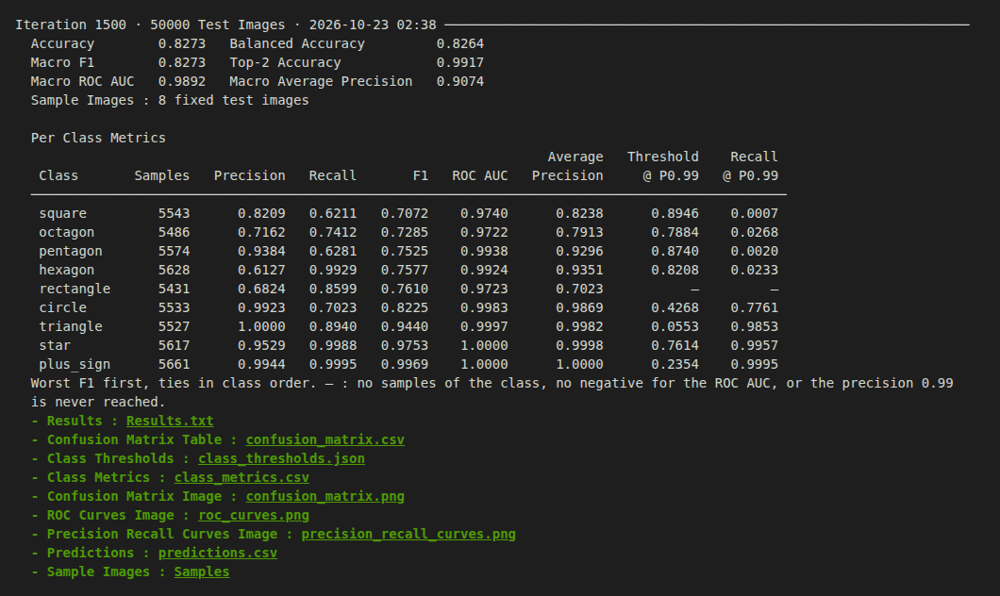

# Visual Language Model Spark

<p align="center">
  
</p>

## Table Of Content
- [Description](#description)
- [Prerequisites](#prerequisites)
  - [Package Requirements](#package-requirements)
  - [Data Requirements](#data-requirements)
  - [ImageNet-22k](#imagenet-22k)
- [Quick Start With Synthetic Data](#quick-start-with-synthetic-data)
- [Training](#training)
  - [Launching A Run](#launching-a-run)
  - [Run Folder](#run-folder)
  - [Stopping And Resuming](#stopping-and-resuming)
  - [Console And TensorBoard](#console-and-tensorboard)
  - [Augmentation And Diagnosis Modes](#augmentation-and-diagnosis-modes)
  - [Moving Average Of The Weights](#moving-average-of-the-weights)
- [Tasks](#tasks)
- [Transfer Between Runs](#transfer-between-runs)
- [Evaluating Checkpoints](#evaluating-checkpoints)
- [Comparing Launches](#comparing-launches)
- [Clustering Image Embeddings](#clustering-image-embeddings)
- [Deployment](#deployment)
  - [Export](#export)
  - [Input Contract](#input-contract)
  - [Triton Server](#triton-server)
- [Configurations](#configurations)
- [Run Names](#run-names)
- [MLflow Tracking](#mlflow-tracking)
- [Tests](#tests)
- [Tutorials](#tutorials)
- [Repository Structure](#repository-structure)
- [TODO](#todo)

## Description
If you are new to the repository, start from its tasks: it trains, evaluates and exports PyTorch models for nine vision tasks, plus a self-supervised task that pre-trains their shared backbone. All tasks share the backbone (convolution blocks with optional residual, squeeze-and-excitation and inception modules), the training loop, the configuration format, the evaluation report and the export to Triton; each adds its own dataset, head, losses and metrics.

| Code | Task | Input | Output | Model |
|---|---|---|---|---|
| CLS | `classification` | one image | one class (multi-class) or several classes (multi-label) | backbone, global pooling, fully connected head |
| DET | `object_detection` | one image | boxes with their class and score | backbone, region proposal and RoI Align detection heads on several backbone levels |
| INS | `instance_segmentation` | one image | the boxes of DET and the mask of every object | the detector of DET with a RoI Align mask head on every level |
| KPT | `keypoint_detection` | one image | the objects of the image with their class, keypoints and score | backbone stem, HRNet, heatmap and tag head (HigherHRNet), keypoints grouped by their tags |
| SEG | `semantic_segmentation` | one image | one class per pixel | backbone as the encoder of a U-Net decoder |
| M2O | `sequence_classification` | a sequence of frames | one class per sequence | backbone on every frame, temporal module, fully connected head |
| M2M | `sequence_labelling` | a sequence of frames | one class per frame | backbone on every frame, temporal module, head on every frame |
| CMP | `sequence_comparison` | a before and an after sequence | one class per pair | backbone on every frame, fusion of both members, temporal module, fully connected head |
| SEL | `frame_selection` | a sequence of frames | the frames of every wanted class | the model of M2M, Hungarian or greedy decoding |
| SSL | `self_supervised` | one unlabelled image (two random views of it) | a representation whose backbone initialises the other tasks | backbone, global pooling, projection head, SimCLR or Barlow Twins loss |

<p align="center">
  
</p>

This README gives the commands and the settings that matter most. The details are in `documentation/`:
- [Training reference](documentation/reference/training_reference.md): run folder, console output, resuming, augmentation strengths, input viewer, moving average of the weights, transfer between runs.
- [Tasks reference](documentation/reference/tasks_reference.md): synthetic datasets, data format, converters, losses and metrics of every task.
- [Configuration reference](documentation/reference/configuration_reference.md): keys and values of every task, evaluation outputs, run name tokens, MLflow metrics.
- [Tools reference](documentation/reference/tools_reference.md): checkpoint evaluation, launch comparison, embedding clustering, export, input contract and Triton.
- [Task workflows](documentation/task%20workflows/): one run of every task followed function by function.

## Prerequisites

### Package Requirements
Before running any script, install Python 3.13+ and uv. An NVIDIA GPU with CUDA is expected (the CPU fallback is much slower), and Docker with the NVIDIA container runtime is only needed to serve the exported models with Triton.

```bash
uv sync
```

Every script runs as a module from the repository root. The training takes `--configuration_path`, the task being read from the file; the other scripts take no arguments, their settings being the variables of their `if __name__ == "__main__":` block.

### Data Requirements
For a task to train, it needs a train, a validation and a test split folder, each holding its images in `data/` and a `labels.json` manifest, and a `label_mapping.json` file giving the class of every category ([Tasks](#tasks)). The [synthetic datasets](#quick-start-with-synthetic-data) need none of this.

### ImageNet-22k
Should you need the pre-trained backbones of the classification configurations (`configuration_example.yaml` and the `*_model.yaml` files of `vision_training/configurations/classification/`) or of the self-supervised example, download ImageNet-22k with `vision_training/data/classification/imagenet_download.py`. It reads `timm/imagenet-22k-wds` from Hugging Face at a pinned revision (fall11 release, 21,841 classes, 4,608 shards of about 0.29 GB).
1. Accept the terms of [timm/imagenet-22k-wds](https://huggingface.co/datasets/timm/imagenet-22k-wds) (non-commercial research and education only), then log in with `uv run hf auth login`.
2. Keep about 1.3 TB free on the disk of `dataset_folder` (main block of the script, `~/Data/classifier_data/imagenet-22k` by default); the download stops below 100 GB free.
3. Run it. It resumes shard by shard after an interruption, at about 1,500 shards an hour with 16 workers on a DGX Spark.

```bash
uv run python -m vision_training.data.classification.imagenet_download
```

The script then holds out one image per class of at least 50 images (18,846 images) as the test split, which is also the validation split, and writes `manifests/` and `label_mapping.json`. A setting chosen on the validation curves is therefore chosen on the test images, and the scores cannot be compared with published ImageNet-1k accuracies (images resized to at most 600 pixels by the source, person classes kept). The split sizes and the retries of the download are in the [tasks reference](documentation/reference/tasks_reference.md#classification-cls).

## Quick Start With Synthetic Data
In order to check the installation or a configuration within minutes, every task has a synthetic shapes dataset:
1. Set `task` and its folder in `output_folders` in the main block of `vision_training/data/synthetic/create_synthetic_dataset.py`, then run `uv run python -m vision_training.data.synthetic.create_synthetic_dataset`.
2. Point `experiment_folder`, the three data folders and `Data.label_mapping.mapping_file_path` of the synthetic configuration of the task (table below, in `vision_training/configurations/`) to the generated dataset.
3. Train with that configuration:

```bash
uv run python -m vision_training.main --configuration_path="vision_training/configurations/classification/configuration_synthetic_shapes.yaml"
```

| Task | Synthetic dataset | Configuration |
|---|---|---|
| CLS | one of 35 shapes per image | `classification/configuration_synthetic_shapes.yaml` |
| CLS (multi-label) | 5 to 10 shapes per image labelled with their distinct classes (`task = "multi_label_classification"`) | `classification/configuration_synthetic_counted_shapes.yaml` |
| DET | the INS images (`task = "object_detection"` generates the harder images of the detection benchmark) | `object_detection/configuration_synthetic_shapes.yaml` |
| INS | up to 6 shapes per image with their masks | `instance_segmentation/configuration_synthetic_shapes.yaml` |
| KPT | 2 to 5 objects per image (shapes, stick figure, house) with their keypoints | `keypoint_detection/configuration_synthetic_shapes.yaml` |
| SEG | up to 6 shapes per image with their class mask | `semantic_segmentation/configuration_synthetic_shapes.yaml` |
| M2O | one shape moving left, right, up or down over 2 to 12 frames | `sequence_classification/configuration_synthetic_sequences.yaml` |
| M2M | 5 to 10 shapes per frame, at most one appearing or disappearing per frame | `sequence_labelling/configuration_synthetic_sequences.yaml` |
| CMP | a before and an after member, the after one having lost a shape or not | `sequence_comparison/configuration_synthetic_pairs.yaml` |
| SEL | one shape per frame, the largest circle, triangle and star to select | `frame_selection/configuration_synthetic_sequences.yaml` |
| SSL | the CLS dataset, or 5 to 10 counted shapes per image | `self_supervised/configuration_synthetic_shapes.yaml`, `configuration_counted_shapes_simclr.yaml`, `configuration_counted_shapes_barlow_twins.yaml` |

## Training

### Launching A Run
Once a dataset is ready, copy the `configuration_example.yaml` of the task (`vision_training/configurations/<task>/`), fill `experiment_folder`, the three data folders and the label mapping file (every key is explained by its comment), and run:

```bash
uv run python -m vision_training.main --configuration_path="vision_training/configurations/classification/my_configuration.yaml"
```

The configuration is checked before anything starts: a missing key, an unusable value, an inconsistent combination or a removed setting (such as `resume_training`) stops the program with the list of every problem found.

### Run Folder
Whenever a training starts, it writes to `<experiment_folder>/<run name>/`, the name being built from its settings ([Run Names](#run-names)):

```text
<experiment_folder>/<run name>/
├── training_configuration.yaml        # Configuration of the last start of the run
├── data.json                          # Class counts, data folder and SHA-256 of labels.json and images of every split
├── label_dictionary.json              # Class index of every category, the classes of the run
├── Weights/Iteration_<n>/model_<n>.pt # Weights, optimizer state, moving average of the weights, metadata
├── Tensorboard/                       # Train, Validation, Test and Test_EMA curves
├── Results.txt                        # Report of every evaluated checkpoint
├── Evaluation/Iteration_<n>/          # Evaluation files of iteration n, EMA/ for the averaged weights
├── Checkpoint_Evaluation/             # Evaluations of scripts/evaluation/evaluate_checkpoint.py
└── mlflow_run.json                    # MLflow run of the training, with the tracking on
```

A checkpoint is saved every `intermediate_weight_saving_iterations` iterations (0 saves none), and a checkpoint evaluated on the whole test split every `weight_saving_iterations` iterations.

### Stopping And Resuming
In case a training has to stop, Ctrl+C saves a checkpoint of the last step, and launching the same configuration again resumes from the last checkpoint of its run folder with its optimizer state.
- `number_iterations` is the total of the run, not the iterations left.
- The settings without a run name token (augmentation, batch size, learning rate and schedule, moving average of the weights, dropout rates) may change between resumptions: the changes are printed and the previous configuration is kept as `training_configuration_until_iteration_<n>.yaml`. Any other change gives another run name, so a new run folder.
- Changed labels (another SHA-256 of a `labels.json`) stop the resume, unless `ExperimentConfiguration.allow_data_change_on_resume` is true.
- To train the same settings from scratch, give the run another `run_name_suffix` or `experiment_folder`, or move its run folder away.
- A failing iteration is reported in yellow, with the traceback of its error the first time that error occurs in the run, and skipped, as is an unreadable batch; more than 5 failing iterations in a row stop the training, saving a checkpoint.

### Console And TensorBoard
So that a run can be followed live, the trainer prints at launch the run name, its folders as clickable links, the settings and data changed since the last start, the transferred components, the splits and the model summary. Every `information_dump` iterations it prints the averages of the interval, and at every evaluation the report appended to `Results.txt` (with `evaluation.per_class_report`, the classes worst first and their recall with its 95 % confidence interval). CLS, M2O, M2M and CMP print their rates as percentages ("94.03 %"), the other tasks between 0 and 1; the files, TensorBoard and MLflow always keep 0 to 1.

<p align="center">
  
</p>

<p align="center">
  
</p>

TensorBoard holds `Train` and `Validation` (every iteration), `Test` (scalars and sample images at every evaluation) and `Test_EMA` (the averaged weights); open http://localhost:6006 after:

```bash
uv run tensorboard --logdir <experiment_folder>/<run name>/Tensorboard
```

### Augmentation And Diagnosis Modes
Suppose a run learns nothing: look at what the network receives before blaming the model.
- `Data.data_augmentation` augments the training images on the device right before the forward pass (`vision_training/data/augmentations.py`): a global `probability`, then 28 types with their own `activated` and `probability`. The strengths are hard-coded in `SUPERVISED_AUGMENTATION_STRENGTHS` (`SELF_SUPERVISED_AUGMENTATION_STRENGTHS` for the SSL views). The geometric types move the boxes, masks and keypoints with the image; `random_perspective` and `random_jigsaw` are refused for DET, INS, SEG and KPT. `uv run python -m scripts.data.visualize_augmentation_strengths` draws one figure per type.
- `ExperimentConfiguration.diagnosis_modes.view_input_images: True` shows the training and validation samples as the network receives them, with their targets and drawn augmentations (SPACE for the next samples, ENTER to exit; needs a display).
- `diagnosis_modes.compute_anchor_coverage: { activated: True, iou_threshold: 0.5 }` (DET, INS) prints, per split, level and object size, the share of the objects whose best anchor overlaps them by at least `iou_threshold`.

Both modes exit without training and create no run folder.

<p align="center">
  
</p>

### Moving Average Of The Weights
If one wishes to score a smoothed model, `Optimization.exponential_moving_average` keeps a second copy of the weights, moved towards the trained ones after every optimizer step (about the last 1,000 iterations at a decay of 0.999). Every test evaluation then scores both (`EMA Weights` report, `Evaluation/Iteration_<n>/EMA/`, `Test_EMA`). It gives no run name token, so it can be switched on or off when a run resumes.

## Tasks
Say you bring your own data: every task reads a folder per split with its images in `data/` and a `labels.json` manifest, and `label_mapping.json` maps every category identifier of the manifests to the class index the model predicts. In `{"1": 0, "2": 1, "3": 1}`, categories 2 and 3 are merged into class 1, and a category missing from the mapping is left out. CLS, M2O, M2M, CMP and SEL predict 0 to K-1; DET, INS, KPT and SEG predict 1 to K, class 0 being their background. Each task starts from the `configuration_example.yaml` of its folder.

| Task | Labels | Own sections | Evaluation | Details |
|---|---|---|---|---|
| CLS | `category_id`, or `category_ids` with `ClassificationHead.output_mode: "multi_label"`; `class_folder_manifests.py` converts one folder per class | `ClassificationHead` | accuracy, macro F1, top-5, per-class metrics and thresholds at `target_precision`, misclassified images in `Errors/` | [reference](documentation/reference/tasks_reference.md#classification-cls) · [workflow](documentation/task%20workflows/classification_workflow.md) |
| DET | COCO, boxes `[x, y, width, height]` in pixels | `DetectionLevels`, `Neck`, `RegionProposal`, `Detector` | mAP@[0.5:0.95] and by object size, anchor and proposal recall, confusion with a background class | [reference](documentation/reference/tasks_reference.md#object-detection-det) · [workflow](documentation/task%20workflows/object_detection_workflow.md) |
| INS | COCO `segmentation` (polygons or RLE) | the sections of DET, `MaskHead`, `Data.instance_index_maps` | mask and box mAP, `Mask mAP@0.5/area` comparing the checkpoints | [reference](documentation/reference/tasks_reference.md#instance-segmentation-ins) · [workflow](documentation/task%20workflows/instance_segmentation_workflow.md) |
| KPT | COCO `keypoints`, with the keypoint names and `skeleton` of every category | `Backbone` as the stem, `HRNet`, `KeypointHead` | OKS mAP, PCK@0.05, mean OKS | [reference](documentation/reference/tasks_reference.md#keypoint-detection-kpt) · [workflow](documentation/task%20workflows/keypoint_detection_workflow.md) |
| SEG | `masks/`: uint8 PNG, 0 for the background, 255 ignored | `SegmentationDecoder`, `SegmentationLoss`, `Data.tiling` | mean IoU and Dice, boundary IoU and F1 | [reference](documentation/reference/tasks_reference.md#semantic-segmentation-seg) · [workflow](documentation/task%20workflows/semantic_segmentation_workflow.md) |
| M2O | frames in `data/<sequence name>/`, one `category_id` per sequence | `Data.sequence_settings`, `TemporalModel` | the CLS metrics on the sequences | [reference](documentation/reference/tasks_reference.md#sequence-classification-m2o) · [workflow](documentation/task%20workflows/sequence_classification_workflow.md) |
| M2M | `frame_category_ids` | the sections of M2O, `TemporalModel.causal` for live streams | frame metrics, edit score, segment F1@10, @25 and @50 | [reference](documentation/reference/tasks_reference.md#sequence-labelling-m2m) · [workflow](documentation/task%20workflows/sequence_labelling_workflow.md) |
| CMP | a `before` and an `after` sequence; `pair_list_manifests.py` converts pair lists | the sections of M2O, `Fusion` | the CLS metrics on the pairs | [reference](documentation/reference/tasks_reference.md#sequence-comparison-cmp) · [workflow](documentation/task%20workflows/sequence_comparison_workflow.md) |
| SEL | the labels of M2M | the sections of M2M, `Selection` | selection accuracy of the Hungarian and greedy decodings, top-k, `selections.csv` | [reference](documentation/reference/tasks_reference.md#frame-selection-sel) · [workflow](documentation/task%20workflows/frame_selection_workflow.md) |
| SSL | the layout of CLS, the categories only serving the evaluation | `ProjectionHead` (SimCLR or Barlow Twins), `Data.grouped_batches` | k-NN accuracy, effective rank of the representations | [reference](documentation/reference/tasks_reference.md#self-supervised-learning-ssl) · [workflow](documentation/task%20workflows/self_supervised_workflow.md) |

A few behaviours are easy to miss:
- KPT: the geometric augmentations keep the keypoint names, so the flips and rotations only suit keypoints whose names depend neither on the side nor on the orientation.
- Sequences are fed whole: one longer than `Data.sequence_settings.maximum_sequence_length` is left out with a warning, and the batches are padded with masked frames. The `mean_pooling`, `max_pooling` and `attention_pooling` temporal modules ignore the frame order; `gru`, `lstm`, `transformer` and `temporal_convolution` follow it and are the only ones of M2M and SEL.
- M2O: a class given by a motion needs `ClassificationHead.global_pooling: flatten`, the other poolings removing the position of the objects.

## Transfer Between Runs
To be able to start from a trained component, such as a backbone trained on ImageNet for a detector, give its run in the `pretrained` block of the section, the source run being of the same task or of another one:

| Section | Component | From the tasks |
|---|---|---|
| `Backbone` | backbone | any task |
| `TemporalModel` | temporal module | M2O, M2M, CMP, SEL |
| `ClassificationHead` | classification head, with its class layer | CLS, M2O, M2M, CMP, SEL |
| `SegmentationDecoder` | U-Net decoder, with its class layers when `load_class_layers` is True | SEG |
| `RegionProposal` | region proposal heads of every detection level | DET, INS |
| `Detector` | detection heads of every detection level, with their classification and box regression layers | DET, INS |
| `MaskHead` | mask heads of every detection level, with their mask prediction layers | INS |

```yaml
Backbone:
  pretrained:
    # Run folder whose trained backbone initialises this run
    experiment_folder: "/path/to/experiments/CLS_IN-KAR-256_SE-RES-BN-B1x64.2x64.2x64.4x64.5x64.5x64_HFLAT.512.256-HLN-CWB_MC1000"
    # Checkpoint iteration of that run, null for its last saved checkpoint
    iteration: null
    # Keeps the loaded backbone fixed, only the other components learn
    freeze: False
    # Keeps the scale and shift of its normalization layers fixed while its convolutions learn
    freeze_normalization_parameters: False
    # Fine-tunes the loaded backbone ten times slower than the new layers
    learning_rate_multiplier: 0.1
```

The settings defining the layers of the component must be identical in both runs (checked before the training; the image size may differ), and the averaged weights of the source are loaded when both runs keep a moving average. A component with class layers can initialise a run with more classes, the classes of the source coming first in the same order. The detection heads read the levels after the neck, which is not transferable, so they only move between runs whose `Neck.type` is `none`. Details: [training reference](documentation/reference/training_reference.md#transfer-between-runs).

## Evaluating Checkpoints
Each time the checkpoints of a trained run must be scored again (another labelled split, another batch size, or for DET and INS another final NMS), set the variables of the main block of `scripts/evaluation/evaluate_checkpoint.py` (`run_name`, `experiment_folder`, `iteration` as `None` for the last checkpoint, a number or `"all"`, `test_data_folder`, ...), then run:

```bash
uv run python -m scripts.evaluation.evaluate_checkpoint
```

It writes `Results.txt`, `Tensorboard/Test`, `evaluation_summary.csv` and one `Iteration_<n>/` folder per checkpoint into `<run>/Checkpoint_Evaluation/` (`Checkpoint_Evaluation_nms_<criterion>[_<exponent>]/` for another NMS), leaving the files of the training untouched; with `"all"`, the summary compares every checkpoint and the best one is printed. A classifier evaluation also keeps `class_logits.npz` for its temperature explorer ([Export](#export)). Details: [tools reference](documentation/reference/tools_reference.md#evaluating-checkpoints).

## Comparing Launches
After the launches of a hyperparameter stage have trained, three scripts of `scripts/evaluation/` compare them:
- `collect_experiment_results.py` gathers the test curve and the swept settings of the `run_<n>` launches into one CSV file, with a `mean` row per setting.
- `compare_best_evaluations.py` prints Markdown tables of the best test evaluation of runs, over the trained and the averaged weights.
- `plot_experiment_comparisons.py` draws one figure per stage of the plans of `documentation/architecture_benchmarking`, from the stages of `experiment_comparisons.yaml`.

```bash
uv run python -m scripts.evaluation.collect_experiment_results
uv run python -m scripts.evaluation.compare_best_evaluations
uv run python -m scripts.evaluation.plot_experiment_comparisons
```

Their settings: [tools reference](documentation/reference/tools_reference.md#comparing-launches).

## Clustering Image Embeddings
Faced with a dataset of video frames, many of them nearly identical, `scripts/embedding/cluster_image_embeddings.py` embeds the images with a trained run and clusters them (HDBSCAN, DBSCAN or k-means after a PCA). For every asked layer it writes the clusters, their mosaics and three folders of kept images to compare (chosen by the clustering, drawn at random, spread over the groups of `group_pattern`); the stored features are reused by a relaunch.

```bash
uv run python -m scripts.embedding.cluster_image_embeddings
```

Its settings and outputs: [tools reference](documentation/reference/tools_reference.md#clustering-image-embeddings).

## Deployment

### Export
When a run is ready to be served, `vision_training/deployment/export_model.py` writes it to the Triton model repository as TorchScript and ONNX, with the Triton configuration of every model, and checks every export against the PyTorch model. Set `experiment_folder`, `iteration`, `use_averaged_weights`, `formats`, `maximum_batch_size` and `tensorrt_precision` (`"FP16"`, `"FP32"`, or `None` for ONNX Runtime CUDA only) in its main block, then run:

```bash
uv run python -m vision_training.deployment.export_model
```

The models are written to `vision_training/deployment/triton/served_models/<model name>_<format>/<version>/` with their `config.pbtxt`:

| Task | Model name | Inputs | Outputs |
|---|---|---|---|
| CLS | `image_classifier` | `images` [B, 3, S, S] | `class_probabilities` [B, K] |
| DET | `object_detector` | `images` [B, 3, S, S] | `detection_boxes` [B, D, 4], `detection_scores` [B, D], `detection_labels` [B, D], `number_detections` [B] |
| INS | `instance_segmenter` | `images` [B, 3, S, S] | the outputs of DET, then `detection_masks` [B, D, M, M] |
| KPT | `keypoint_detector` | `images` [B, 3, S, S] | `candidate_positions` [B, C, N, 2], `candidate_scores` [B, C, N], `candidate_tags` [B, C, N] |
| SEG | `semantic_segmenter` | `images` [B, 3, S, S] | `class_map` [B, S, S], `class_probabilities` [B, K, S, S] |
| M2O | `sequence_classifier` | `images` [B, T, 3, S, S] | `class_probabilities` [B, K] |
| M2M | `sequence_labeller` | `images` [B, T, 3, S, S] | `class_probabilities` [B, T, K] |
| CMP | `sequence_comparator` | `before_images`, `after_images` [B, T, 3, S, S] | `class_probabilities` [B, K] |
| SEL | `frame_selector` | `images` [B, T, 3, S, S] | `class_probabilities` [B, T, K] |

S is `Data.image_settings.size`, K the number of classes, D the largest number of detections per image, M `MaskHead.mask_resolution`, T the number of frames, C the heatmap channels and N the candidates of every channel. The inputs are float32 BGR images in [0, 255], resized and padded as the [input contract](#input-contract) states, the input normalization being part of the model. The post-processing run by the client (SEG at the original resolution, INS masks, KPT grouping) and the SEL decoder and ensembles are in the [tools reference](documentation/reference/tools_reference.md#export).

A classifier that reaches its target precision only above a threshold such as 0.999 can be exported with a logit temperature chosen on its evaluation: start `uv run python -m scripts.evaluation.serve_temperature_explorer`, open `http://127.0.0.1:8091/`, pick a run, an iteration and **Trained** or **EMA**, then press **Save Thresholds At This Temperature** and **Export At T = …**. The export goes to `<run>/Exports/Iteration_<n>[_EMA]_T<temperature>/`, a Triton model repository of its own; from the script, `use_saved_temperature` builds the saved temperature and thresholds into the model. Details: [tools reference](documentation/reference/tools_reference.md#logit-temperature).

### Input Contract
Should a server build the input of an exported model from a photo, it reads the input contract written with the model instead of assuming a resize or a channel order. Every export writes it into the `metadata_props` of `model.onnx` and as `preprocessing.json` next to the model of both formats, with the keys of `vision_training/deployment/input_contract.py`: the BGR photo as `cv2.imread` decodes it, a `stretch`, `keep_ratio` or `tiles` resize with its OpenCV interpolation, the padding and the layout. The export stops before writing any file when a run uses an input the contract cannot describe.

```python
session = onnxruntime.InferenceSession("model.onnx", providers=["CPUExecutionProvider"])
input_contract = session.get_modelmeta().custom_metadata_map
check_input_contract(input_contract=input_contract)
```

Every key and value is in the [tools reference](documentation/reference/tools_reference.md#input-contract). `build_input_from_contract` in `tests/deployment/test_input_contract.py` builds the inputs of a photo from the contract alone, checked pixel for pixel against `preprocess_image`.

### Triton Server
To serve every model of `served_models/`, start Triton from the folder of its compose file and keep it running; it listens on the ports 8000 (HTTP, `curl localhost:8000/v2/health/ready`), 8001 (gRPC) and 8002 (metrics):

```bash
cd vision_training/deployment/triton
docker compose up
```

`uv run python -m vision_training.deployment.run_inference` then sends the images of `vision_training/deployment/inference_data/` to the model of a run, in the process and through Triton, and prints the throughput of each.

## Configurations
Before writing a configuration of your own, start from a copy of the files of its task: every task has a `configuration_example.yaml` and a `configuration_synthetic_*.yaml` in `vision_training/configurations/<task>/`, holding only, and all, the keys the task reads, each explained by its comment. `Data.image_settings.size` must be even and a multiple of 2 to the power of the number of max poolings of `Backbone`, so that no pooling drops a row or a column: with 5 poolings, 96, 224, 384 and 512 are accepted. The keys and values of every task are in the [configuration reference](documentation/reference/configuration_reference.md#configurations).

## Run Names
To keep runs of different settings apart, `vision_training/configuration_processing/run_name.py` builds the run name from the configuration, so that the same settings resume in the same folder and changed settings start a new one. Sections are joined with `_` and their tokens with `-`; the settings that may change between resumptions give no token, and `ExperimentConfiguration.run_name_suffix` (letters, digits, `-` and `.`) ends the name to start a run of its own with the same settings.

| Task | Run name |
|---|---|
| CLS | `CLS_IN-KAR-512_SE-RES-BN-B1x16.2x32.2x32.2x64.2x64.2x128_HAVG.128_MC4` |
| DET | `DET_IN-KAR-1024_SE-RES-BN-B1x16.2x32.2x32.4x64.4x64.6x128.6x128_L567_A9.32-512.598295_RBN-R2x64-RPL_DSE-DRES-DBN-D7.2x64.256.128_BIN` |
| M2O | `M2O_IN-KAR-512_SE-RES-BN-B1x16.2x32.2x32.2x64.2x64_T8_GRU1x128-BI_HFLAT.64_MC4` |

Every token and an example of every task are in the [configuration reference](documentation/reference/configuration_reference.md#run-names).

## MLflow Tracking
If you are looking for one table of every run, sorted and filtered by any setting, turn on `ExperimentConfiguration.tracking.activated`: each training is recorded in `<experiment_folder>/mlflow.db`, its files in `<experiment_folder>/mlartifacts/`, with its configuration, git commit, curves averaged every `information_dump` iterations and test metrics, a resumed training continuing its MLflow run. Open http://localhost:5000 after:

```bash
uv run mlflow ui --backend-store-uri sqlite:///<experiment_folder>/mlflow.db
```

The per-iteration curves stay in TensorBoard, and the checkpoints and images are not sent. The metrics and files of every task are in the [configuration reference](documentation/reference/configuration_reference.md#mlflow-tracking).

## Tests
After a change to the code, run the tests of `tests/`, whose folders mirror `vision_training/` and `scripts/` and include short trainings of every task on tiny synthetic datasets:

```bash
uv run pytest tests
```

## Tutorials
If you would rather watch than read, narrated tutorial videos (an overview, a foundations series, then one series per task) are rebuilt from the storyboards, figure scripts and builder of `tutorials/`, the videos being written outside the repository (`~/Data/tutorial_videos` by default). `tutorials/README.md` describes the build and how to write a chapter:

```bash
# Rebuild every series, or one, or only check the storyboards against the repository
tutorials/build_tutorials.sh
tutorials/build_tutorials.sh --series object_detection
tutorials/build_tutorials.sh --check-references
```

## Repository Structure
To find your way in the code, here is where each part lives:

```text
.
├── README.md                          # This documentation file
├── README/                            # Images used in the documentation
├── pyproject.toml, uv.lock            # Dependencies and their locked versions
├── documentation/
│   ├── architecture_benchmarking/     # Experiment plans, copies of their results, stage figures, experiment_comparisons.yaml
│   ├── reference/                     # Training, tasks, configurations and tools in detail
│   ├── task workflows/                # One run of every task followed function by function
│   └── suggestions.md                 # Proposed improvements and repository audit
├── vision_training/                   # Training framework
│   ├── main.py                        # Entry point of the trainings
│   ├── configurations/                # Example and synthetic configuration of every task
│   ├── configuration_processing/      # Loading, checks, run names and comparison of the configurations
│   ├── core/                          # Task registry and contracts shared by the tasks
│   ├── data/                          # Datasets of every task, loaders, preprocessing, augmentation, synthetic datasets
│   ├── models/                        # Backbone, task models, components and transfer between runs
│   ├── losses/                        # Losses of every task
│   ├── trainers/                      # Base trainer, trainer of every task, checkpoints, moving average of the weights
│   ├── evaluation/                    # Metrics, reports and checkpoint evaluation
│   ├── tracking/                      # MLflow tracking
│   ├── deployment/                    # Export, input contract, Triton server, throughput measurement
│   └── utilities/                     # File, tensor, mask and visualization helpers
├── scripts/                           # Configuration, data, embedding and evaluation scripts
├── tests/                             # Tests, mirroring vision_training/ and scripts/
└── tutorials/                         # Narrated tutorial videos: storyboards, builder and figure scripts
```

## TODO
