# Visual Language Model Spark

<p align="center">
  
</p>
<p align="center"><em>One evaluation sample image of every supervised task, from short runs on the synthetic datasets; the semantic segmentation (9 classes) and sequence labelling samples come from runs trained on 2026-10-21 and 2026-11-15, on the datasets of those days.</em></p>

## Table Of Content
- [Description](#description)
- [Prerequisites](#prerequisites)
  - [Package Requirements](#package-requirements)
  - [Data Requirements](#data-requirements)
- [Quick Start With Synthetic Data](#quick-start-with-synthetic-data)
- [Training](#training)
  - [Launching A Run](#launching-a-run)
  - [Configurations](#configurations)
  - [Run Folder](#run-folder)
  - [Run Names](#run-names)
  - [Stopping And Resuming](#stopping-and-resuming)
  - [Console And TensorBoard](#console-and-tensorboard)
  - [MLflow Tracking](#mlflow-tracking)
  - [Augmentation And Diagnosis Modes](#augmentation-and-diagnosis-modes)
  - [Moving Average Of The Weights](#moving-average-of-the-weights)
  - [Transfer Between Runs](#transfer-between-runs)
- [Tasks](#tasks)
  - [Label Files](#label-files)
- [Evaluating Checkpoints](#evaluating-checkpoints)
- [Tutorials](#tutorials)
- [Deployment](#deployment)
  - [From A Checkpoint To A Served Model](#from-a-checkpoint-to-a-served-model)
  - [Number Formats](#number-formats)
  - [Export](#export)
  - [Export Sizes](#export-sizes)
  - [Input Contract](#input-contract)
  - [Triton Server](#triton-server)
  - [Serving Formats And Precision](#serving-formats-and-precision)
- [Tests](#tests)
- [Docker Image](#docker-image)
  - [Building The Image](#building-the-image)
  - [Running A Training](#running-a-training)
  - [Kubernetes Pods](#kubernetes-pods)
- [Repository Structure](#repository-structure)
- [Metrics Explained](#metrics-explained)
  - [Classification (CLS, M2O, CMP)](#classification-cls-m2o-cmp)
  - [Object Detection And Instance Segmentation (DET, INS)](#object-detection-and-instance-segmentation-det-ins)
  - [Keypoint Detection (KPT)](#keypoint-detection-kpt)
  - [Semantic Segmentation (SEG)](#semantic-segmentation-seg)
  - [Sequence Labelling (M2M)](#sequence-labelling-m2m)
  - [Frame Selection (SEL)](#frame-selection-sel)
  - [Self-Supervised Evaluation (SSL)](#self-supervised-evaluation-ssl)
  - [Self-Supervised Training Metrics (SSL)](#self-supervised-training-metrics-ssl)

## Description
If you are new to the repository, start from its tasks: it trains, evaluates and exports PyTorch models for nine vision tasks, plus a self-supervised task that pre-trains backbones. All tasks share one backbone design (each run training its own weights), the training loop, the configuration format, the evaluation report and the export to Triton.

| Code | Task | Input | Output |
|---|---|---|---|
| CLS | `classification` | one image | one class (multi-class) or several classes (multi-label) |
| DET | `object_detection` | one image | boxes with their class and score |
| INS | `instance_segmentation` | one image | the boxes of DET and the mask of every object |
| KPT | `keypoint_detection` | one image | the objects of the image with their class, keypoints and score |
| SEG | `semantic_segmentation` | one image | one class per pixel |
| M2O | `sequence_classification` | a sequence of frames | one class per sequence |
| M2M | `sequence_labelling` | a sequence of frames | one class per frame |
| CMP | `sequence_comparison` | a before and an after sequence | one class per pair |
| SEL | `frame_selection` | a sequence of frames | the frames of every wanted class |
| SSL | `self_supervised` | one unlabelled image (two random views of it) | a representation whose backbone initialises the other tasks |

<p align="center">
  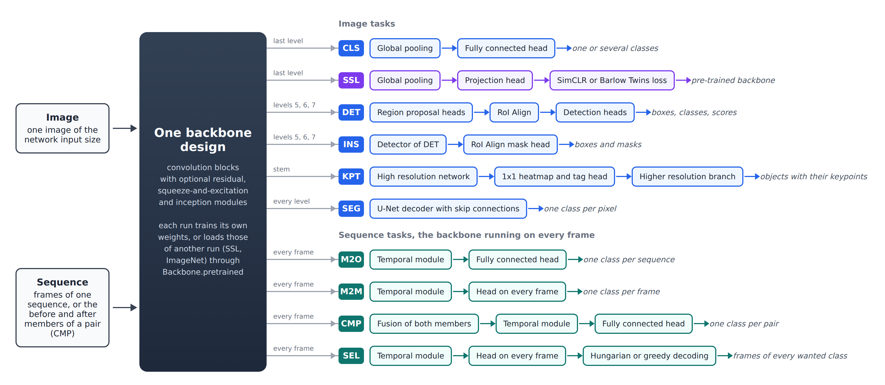
</p>

If this README is not enough, see `documentation/`:

| To ... | Read |
|---|---|
| follow a run: run folder, console, resuming, augmentations, input viewer, moving average, transfer | [Training reference](documentation/reference/training_reference.md) |
| prepare data: synthetic datasets, label format, converters, losses and metrics of every task | [Tasks reference](documentation/reference/tasks_reference.md) |
| set a configuration key, read an evaluation output, a run name or an MLflow metric | [Configuration reference](documentation/reference/configuration_reference.md) |
| evaluate a checkpoint, compare launches, cluster embeddings, export or serve a model | [Tools reference](documentation/reference/tools_reference.md) |
| pre-train the Small, Medium and Large backbones on ImageNet-22k and Open Images V7 | [Pretraining reference](documentation/reference/pretraining_reference.md) |
| follow one run of a task function by function | its workflow, linked in the Details column of the [Tasks](#tasks) table |

## Prerequisites

### Package Requirements
To start on a new machine:

```bash
# Install uv, then open a new shell
curl -LsSf https://astral.sh/uv/install.sh | sh

# Install the Python of .python-version
uv python install

# Install the packages of uv.lock
uv sync
```

### Data Requirements
For a task to train, it needs train, validation and test folders, each with its images in `data/` and a `labels.json`, plus a `label_mapping.json` ([Label Files](#label-files)). The [synthetic datasets](#quick-start-with-synthetic-data) need none of this.

Should a backbone start from pre-trained weights, see the [pretraining reference](documentation/reference/pretraining_reference.md).

## Quick Start With Synthetic Data
In order to check the installation or a configuration within minutes, every task has a synthetic shapes dataset:

```bash
# Generate the dataset of a task (--task from the table below)
uv run python -m vision_training.data.synthetic.create_synthetic_dataset --task=classification --output_folder="$HOME/Data/classifier_data/synthetic_shapes"

# Set its absolute paths in the synthetic configuration (no ~ nor $HOME), then train
uv run python -m vision_training.main --configuration_path="vision_training/configurations/classification/configuration_synthetic_shapes.yaml"
```

| Task | `--task` | Configuration |
|---|---|---|
| CLS | `classification` | `classification/configuration_synthetic_shapes.yaml` |
| CLS (multi-label) | `multi_label_classification` | `classification/configuration_synthetic_counted_shapes.yaml` |
| DET | `instance_segmentation` | `object_detection/configuration_synthetic_shapes.yaml` |
| INS | `instance_segmentation` | `instance_segmentation/configuration_synthetic_shapes.yaml` |
| KPT | `keypoint_detection` | `keypoint_detection/configuration_synthetic_shapes.yaml` |
| SEG | `semantic_segmentation` | `semantic_segmentation/configuration_synthetic_shapes.yaml` |
| M2O | `sequence_classification` | `sequence_classification/configuration_synthetic_sequences.yaml` |
| M2M | `sequence_labelling` | `sequence_labelling/configuration_synthetic_sequences.yaml` |
| CMP | `sequence_comparison` | `sequence_comparison/configuration_synthetic_pairs.yaml` |
| SEL | `frame_selection` | `frame_selection/configuration_synthetic_sequences.yaml` |
| SSL | `classification`, `self_supervised` | `self_supervised/configuration_synthetic_shapes.yaml`, `configuration_counted_shapes_simclr.yaml`, `configuration_counted_shapes_barlow_twins.yaml` |

<p align="center">
  
</p>
<p align="center"><em>Samples written by <code>create_synthetic_dataset.py</code>, drawn with their <code>labels.json</code> labels; the sequence tiles play their frames.</em></p>

## Training

### Launching A Run
Once a dataset is ready, start from the example configuration of its task:

```bash
# Copy vision_training/configurations/<task>/configuration_example.yaml, fill its folders as absolute paths
uv run python -m vision_training.main --configuration_path="vision_training/configurations/classification/my_configuration.yaml"
```

<p align="center">
  
</p>
<p align="center"><em>The run name decides the folder, and the last checkpoint of that folder decides between a new run and a resume.</em></p>

### Configurations
Every task has a `configuration_example.yaml` and a `configuration_synthetic_*.yaml`, each key explained by its comment ([every key](documentation/reference/configuration_reference.md#configurations)). Four sections are shared by every task:

<p align="center">
  
</p>

```bash
# Check configurations without training, e.g. in a pipeline (exit code 1 when one is invalid)
uv run python -m vision_training.check_configuration --configuration_path="vision_training/configurations/classification/configuration_synthetic_shapes.yaml" --check_paths
```

### Run Folder
Whenever a training starts, it writes to `<experiment_folder>/<run name>/` ([every file](documentation/reference/training_reference.md#run-folder)):

```text
<experiment_folder>/<run name>/
├── training_configuration.yaml        # Configuration of the last start of the run
├── Weights/Iteration_<n>/model_<n>.pt # Checkpoints
├── Tensorboard/                       # Curves
├── Results.txt                        # Report of every evaluated checkpoint
├── Evaluation/                        # Evaluation files and evaluation_summary.csv
└── Checkpoint_Evaluation/             # Evaluations of scripts/evaluation/evaluate_checkpoint.py
```

<p align="center">
  
</p>

### Run Names
To keep runs of different settings apart, the run name is built from the configuration: the same settings resume in the same folder, changed ones start a new one ([every token](documentation/reference/configuration_reference.md#run-names)).

<p align="center">
  
</p>

### Stopping And Resuming
In case a training has to stop, Ctrl+C saves a checkpoint and relaunching the configuration resumes it. `number_iterations` is the run total ([details](documentation/reference/training_reference.md#stopping-and-resuming)).

<p align="center">
  
</p>

### Console And TensorBoard
So that a run can be followed live, every evaluation prints its report into `Results.txt` ([console output](documentation/reference/training_reference.md#console-output)):

<p align="center">
  
</p>

```bash
# Curves of the run, on http://localhost:6006
uv run tensorboard --logdir <experiment_folder>/<run name>/Tensorboard
```

<p align="center">
  
</p>

### MLflow Tracking
If you are looking for one table of every run, set `ExperimentConfiguration.tracking.activated` ([metrics and tags](documentation/reference/configuration_reference.md#mlflow-tracking)):

```bash
# Runs of the experiment folder, on http://localhost:5000
uv run mlflow ui --backend-store-uri sqlite:///<experiment_folder>/mlflow.db
```

<p align="center">
  
</p>

### Augmentation And Diagnosis Modes
Suppose a run learns nothing: first look at what the network receives. `Data.data_augmentation` sets the types below ([strengths](documentation/reference/training_reference.md#data-augmentation)).

<p align="center">
  
</p>

Three diagnosis modes of `ExperimentConfiguration.diagnosis_modes` exit without training:

| Mode | Use it | Details |
|---|---|---|
| `view_input_images` | before a long run, to see the samples as the network receives them | [Viewing The Input Images](documentation/reference/training_reference.md#viewing-the-input-images) |
| `compute_anchor_coverage` (DET, INS) | after changing the image size, the detection levels or the anchors | [Checking The Anchor Coverage](documentation/reference/training_reference.md#checking-the-anchor-coverage) |
| `benchmark_speed` | before training an architecture, for its training and serving speed | [Benchmarking The Speed](documentation/reference/training_reference.md#benchmarking-the-speed) |

### Moving Average Of The Weights
If one wishes to score a smoothed model, `Optimization.exponential_moving_average` keeps an average of the weights, evaluated with them ([choosing the decay](documentation/reference/training_reference.md#moving-average-of-the-weights)).

<p align="center">
  
</p>
<p align="center"><em>The reference pair of the object detection benchmark: the averaged weights lead the trained ones at every evaluation.</em></p>

### Transfer Between Runs
To start from a trained component, such as an ImageNet backbone for a detector, give its run in the `pretrained` block of the section ([components and rules](documentation/reference/training_reference.md#transfer-between-runs)):

```yaml
Backbone:
  pretrained:
    # Run folder whose trained backbone initialises this run
    experiment_folder: "/path/to/experiments/CLS_IN-KAR-256_SE-RES-BN-B1x64.2x64.2x64.4x64.5x64.5x64_HFLAT.512.256-HLN-CWB_MC1000"
    # Checkpoint iteration of that run, null for its last saved checkpoint
    iteration: null
    # Keeps the loaded backbone fixed, only the other components learn
    freeze: False
    # Keeps the scale and shift of its normalization layers fixed while its convolutions learn
    freeze_normalization_parameters: False
    # Fine-tunes the loaded backbone ten times slower than the new layers
    learning_rate_multiplier: 0.1
```

<p align="center">
  
</p>

## Tasks
Say you bring your own data: start from the `configuration_example.yaml` of the task.

<p align="center">
  
</p>

| Task | Labels | Details |
|---|---|---|
| CLS | `category_id`, or `category_ids` for multi-label | [reference](documentation/reference/tasks_reference.md#classification-cls) · [workflow](documentation/task%20workflows/classification_workflow.md) |
| DET | COCO boxes | [reference](documentation/reference/tasks_reference.md#object-detection-det) · [workflow](documentation/task%20workflows/object_detection_workflow.md) |
| INS | COCO `segmentation` (polygons or RLE) | [reference](documentation/reference/tasks_reference.md#instance-segmentation-ins) · [workflow](documentation/task%20workflows/instance_segmentation_workflow.md) |
| KPT | COCO `keypoints` | [reference](documentation/reference/tasks_reference.md#keypoint-detection-kpt) · [workflow](documentation/task%20workflows/keypoint_detection_workflow.md) |
| SEG | PNG masks in `masks/` | [reference](documentation/reference/tasks_reference.md#semantic-segmentation-seg) · [workflow](documentation/task%20workflows/semantic_segmentation_workflow.md) |
| M2O | one `category_id` per sequence | [reference](documentation/reference/tasks_reference.md#sequence-classification-m2o) · [workflow](documentation/task%20workflows/sequence_classification_workflow.md) |
| M2M | `frame_category_ids` | [reference](documentation/reference/tasks_reference.md#sequence-labelling-m2m) · [workflow](documentation/task%20workflows/sequence_labelling_workflow.md) |
| CMP | a `before` and an `after` sequence | [reference](documentation/reference/tasks_reference.md#sequence-comparison-cmp) · [workflow](documentation/task%20workflows/sequence_comparison_workflow.md) |
| SEL | the labels of M2M | [reference](documentation/reference/tasks_reference.md#frame-selection-sel) · [workflow](documentation/task%20workflows/frame_selection_workflow.md) |
| SSL | the layout of CLS | [reference](documentation/reference/tasks_reference.md#self-supervised-learning-ssl) · [workflow](documentation/task%20workflows/self_supervised_workflow.md) |

### Label Files
Before a first launch on your own data, read the label file examples of your task in its reference. `class_folder_manifests.py` (one folder per class) and `pair_list_manifests.py` (CMP pair lists) write them for you.

## Evaluating Checkpoints
Each time the checkpoints of a run must be scored again (another split, batch size or NMS), set the main block of `scripts/evaluation/evaluate_checkpoint.py` ([details](documentation/reference/tools_reference.md#evaluating-checkpoints)):

```bash
# Writes into <run>/Checkpoint_Evaluation/, the training files left untouched
uv run python -m scripts.evaluation.evaluate_checkpoint
```

<p align="center">
  
</p>

Other tools read a run folder:

| To ... | Script | Details |
|---|---|---|
| draw the figures of a research report | `scripts/evaluation/draw_report_figures.py` | [tools reference](documentation/reference/tools_reference.md#drawing-the-figures-of-a-research-report) |
| score a large unlabelled split | `scripts/evaluation/score_image_split.py` | [tools reference](documentation/reference/tools_reference.md#scoring-a-large-split) |
| compare the launches of a hyperparameter stage | `scripts/evaluation/collect_experiment_results.py`, `compare_best_evaluations.py`, `plot_experiment_comparisons.py` | [tools reference](documentation/reference/tools_reference.md#comparing-launches) |
| cluster near-identical images | `scripts/embedding/cluster_image_embeddings.py` | [tools reference](documentation/reference/tools_reference.md#clustering-image-embeddings) |

## Tutorials
If you would rather watch than read, narrated videos cover every task; `tutorials/README.md` explains how to rebuild them.

<p align="center">
  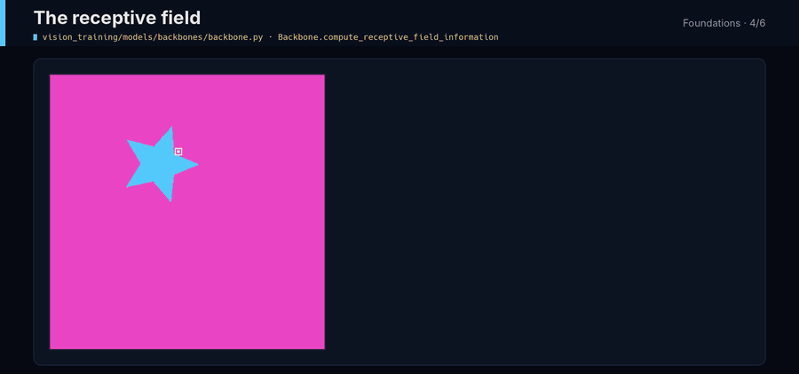
</p>

## Deployment
In order to serve a trained run to other programs, read the parts below in order: the words of deployment followed on one run ([From A Checkpoint To A Served Model](#from-a-checkpoint-to-a-served-model)), the number formats behind reduced precision ([Number Formats](#number-formats)), then the [export](#export), its [input contract](#input-contract), the [Triton server](#triton-server) and the measured [serving formats](#serving-formats-and-precision).

### From A Checkpoint To A Served Model
If words such as eager, ONNX or TensorRT stop you in the Deployment section, this part follows one trained run from its checkpoint to a served model: the 35-class synthetic shapes classifier of the README screenshots (512 pixels, iteration 2000), exported on 2026-11-19, from which every file, output and timing below comes unless the serving benchmark is named. The table gives each word in one line with a comparison, the subsections explain them on that run, and the [glossary](#glossary) defines the other terms.

| Word | What it is | Comparison |
|---|---|---|
| Eager | PyTorch running the Python classes of the repository line by line, each operation sent to the GPU when Python reaches it: how every training and evaluation runs, and the reference of every export | a cook reading the recipe step by step, free to change a step on the way |
| Export | `export_model.py` running the model once on an example batch, recording its operations and weights into `model.pt` and `model.onnx`, checking both against the eager model and writing them with their Triton configuration into `served_models/` | filming the cook once, so the film no longer needs the cook's notes |
| TorchScript (`model.pt`) | the graph format of PyTorch: the operations recorded by `torch.jit.trace` with the weights, run by PyTorch or its C++ library libtorch, in your process or in Triton | the film, playable only by PyTorch players |
| ONNX (`model.onnx`) | an open graph format of standard operators (opset 18): the graph in `model.onnx`, the weights in `model.onnx.data`, the input contract in its metadata, read by the runtimes of any framework | the recipe written in a universal language |
| ONNX Runtime | the library that runs `model.onnx`: on the CPU for the export check, on the GPU inside Triton through its CUDA or TensorRT execution provider | a kitchen that reads the universal recipe, on the stove plugged into it |
| TensorRT | the compiler of NVIDIA that turns `model.onnx` into an engine for one GPU model and one TensorRT version; ONNX Runtime builds the engines inside Triton at the first requests, and the export does not check them | the recipe rewritten for one specific kitchen, faster there and useless elsewhere |
| Precision (FP32 / FP16) | the bits of every computed value: the exports store FP32 (32 bits), and with `tensorrt_precision = "FP16"` TensorRT computes in FP16 (16 bits) where it is faster, with `torchscript_precision = "FP16"` the TorchScript network, the inputs and outputs staying FP32 | coarser measuring cups: quicker to use, every measure rounded more |
| Triton | the inference server of NVIDIA, a Docker container that loads `served_models/` and answers requests over HTTP and gRPC, batching those that arrive together | a restaurant taking orders from many tables at once |

<p align="center">
  
</p>
<p align="center"><em>The four ways to run the checkpoint of the README classifier, with the sizes of its export (model.pt, model.onnx) and of the TensorRT engines built from model.onnx in the Triton image (TensorRT 10.14.1, GB10).</em></p>

#### Training Versus Serving
Once a run has finished, what you hold is a run folder only this repository can read: `Weights/Iteration_2000/model_002000.pt` stores named tensors, and `load_trained_model` rebuilds the network from `training_configuration.yaml` with the Python classes of the repository before copying the tensors into it, the way every evaluation runs. Serving means another program, often on another machine, that receives images and returns predictions. It needs:
- **the operations and the weights in a file it can read** without this repository: which operation follows which, on which shapes, with which weights;
- **speed**: the latency of a request (the time until its answer) and the throughput (images answered per second when many arrive);
- **the same answers** as the model that was evaluated, within a tolerance.

#### The Eager Model
Each time you evaluate a run or call a model in a notebook, PyTorch runs it eagerly: it holds no plan of the network, Python executes `forward` line by line, and every PyTorch operation it reaches launches its kernel on the GPU at once. A kernel is one GPU program applied to a whole tensor by thousands of threads in parallel, such as the 3 x 3 convolution of the first block producing a [1, 16, 512, 512] feature map. Since Python decides what runs next, an `if`, a `print` or a breakpoint work as in any program; the price is that the serving machine needs Python, PyTorch, the code of the repository and the checkpoint. Kernel launches are asynchronous, Python moving to the next line while the GPU computes, so eager is not the slow path it may seem: on the 9-class README classifier, the serving benchmark measured 2.2 milliseconds for one image in the process, against 3.3 for TorchScript. The eager model is the reference of the repository: every evaluation, the in-process run of `run_inference.py` and the check of every export use it.

<p align="center">
  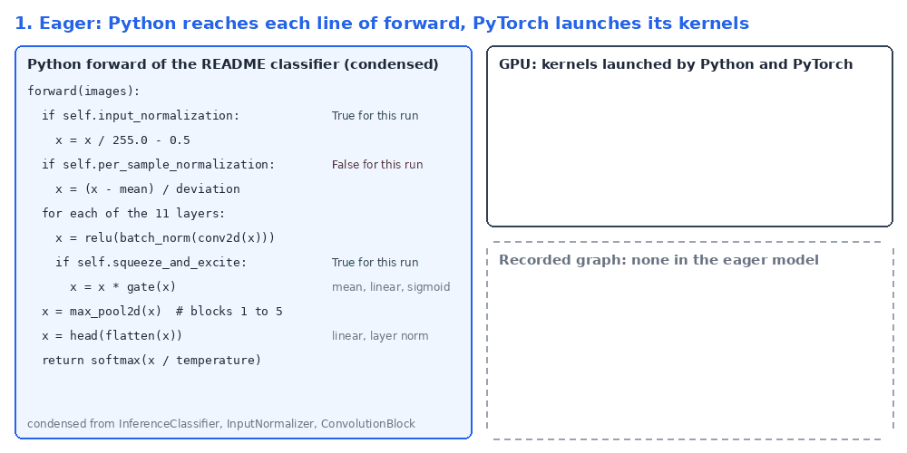
</p>
<p align="center"><em>The forward of the README classifier, condensed: run eagerly (Python reaches each line, the False <code>if</code> is skipped), traced by the export (each operation recorded once on a batch of 2 images), then run from model.pt by libtorch without the Python code. Operations that only reshape a tensor (unsqueeze, flatten) and the dropout of the evaluation mode launch no kernel and are left out.</em></p>

#### Checkpoint Versus Model File
Should you try to load a checkpoint without this repository, you get named tensors and no network to put them in; an exported file holds the graph (the operations with their connections and shapes) and the weights:

| | Checkpoint | TorchScript | ONNX |
|---|---|---|---|
| File | `Weights/Iteration_2000/model_002000.pt`, 55.8 MB | `model.pt`, 18.7 MB | `model.onnx`, 0.34 MB, and `model.onnx.data`, 18.5 MB |
| Holds | 106 named tensors (4.64 million values: weights, batch normalization statistics, class weights of the loss, 18.6 MB), the Adam optimizer state (two values per trained weight, 37.1 MB) and the run metadata | the recorded operations and their weights | 125 nodes of standard operators, 50 weight tensors (4.64 million values) and 5 constants, such as the 255 and 0.5 of the input normalization |
| Read by | `load_trained_model`, with `training_configuration.yaml` and the code of the repository | PyTorch or libtorch alone | any ONNX runtime |

#### How The Export Records The Graph
To turn Python code into a file of operations, `export_experiment` (`vision_training/deployment/export_model.py`) runs the inference model on an example batch and writes down what it does:
- **TorchScript**: `torch.jit.trace` (`export_torchscript` in `export_formats.py`) runs `forward` on a random batch of 2 images and records every tensor operation it executes. Python itself is not recorded: an `if` is decided once and only the branch the example batch took stays. The README classifier keeps the division by 255 and the subtraction of 0.5 of `InputNormalizer`, and nothing of the per-image standardization behind `if self.per_sample_normalization:`, False for this run; a branch on the values of a tensor would be frozen to the example batch in the same way.
- **ONNX**: `torch.onnx.export(..., opset_version=18, dynamo=True, dynamic_shapes=...)` (`export_onnx`) captures the graph with `torch.export`, which follows the batch dimension as a symbol, `batch` from 1 to `maximum_batch_size`, instead of the number 2, so that `model.onnx` declares its input as [batch, 3, 512, 512]. The optimizer of the exporter then simplifies the graph and folds each batch normalization into the weights and bias of the convolution before it. Last, `strip_exporter_metadata` removes the debugging notes the exporter attaches to every node (its Python stack trace, with the absolute paths of the machine that exported it, its module path and the text of its FX node) and to the graph (the signature of the traced program), which no runtime reads and which made 87 to 94 % of `model.onnx` on the ten tutorial runs (1.37 MB for the run_9 detector, 0.16 MB without them), the input contract written afterwards into the metadata of the model staying.
- **The check**: each file runs again on a random batch of 3 images, so that a batch dimension frozen to 2 fails at export rather than in Triton: `model.pt` with `torch.jit.load` on the GPU, `model.onnx` with ONNX Runtime on the CPU. Their outputs must match the eager model, TF32 off, within the tolerance of the task (1e-4 on probabilities, 0.01 pixel on boxes), and the served models are replaced only when every format matches ([Export](#export)).

#### TorchScript
Suppose the service that answers the requests already links PyTorch, in Python or in C++: TorchScript is the graph format of PyTorch itself, and `model.pt` holds the traced graph with its weights. libtorch, the C++ library at the core of PyTorch, runs it with the same kernels as the eager model, so that on the GPU `model.pt` gives the eager probabilities of the test image below to the last digit. `torch.jit.load` in Python, or `torch::jit::load` in C++, needs no code of the repository, and Triton serves the file with its PyTorch backend (`platform: "pytorch_libtorch"`, the output named `class_probabilities__0`). The graph keeps one operator per PyTorch call, 11 `aten::_convolution` and 11 `aten::batch_norm`, nothing folded. The trace also records the TF32 switch of every convolution, off during the export, as the `allow_tf32` argument of its `aten::_convolution`: libtorch runs these convolutions without TF32 whatever the switch of the process (`model.pt` run with both TF32 switches of PyTorch on stays within 1.2e-07 of the reference of the test image below, against 1.85e-05 for the eager model), and in Triton, whose PyTorch backend has no TF32 setting. PyTorch 2.14 warns that `torch.jit.trace` and `torch.jit.load` are deprecated and points to `torch.export`; `hide_known_export_warnings` hides these warnings during the export.

#### ONNX
Whenever the program that serves the model has no PyTorch, a service written in C# or Java, or TensorRT itself, it reads ONNX, the Open Neural Network Exchange format shared by the frameworks: a graph of standard operators (Conv, Relu, Gemm for a fully connected layer, Softmax...) whose behaviour the ONNX specification fixes for every opset version, 18 in this repository. Any runtime implementing opset 18 runs the file, ONNX Runtime, TensorRT or others, from Python, C++, C# or Java, on a CPU or a GPU. Read with the `onnx` package, the export of the README classifier holds 125 nodes: the input normalization inside the graph (its first Div and Sub, so a client sends pixels from 0 to 255), no BatchNormalization node, and the [input contract](#input-contract) in its metadata.

<p align="center">
  
</p>
<p align="center"><em>The first 13 and last 7 of the 125 nodes of model.onnx, with the output shape of every node and the shapes of its weights, read from the export of 2026-11-19 with <code>onnx.load</code> and <code>onnx.shape_inference</code>; the squeeze-and-excitation branch is indented.</em></p>

#### ONNX Runtime And Its Execution Providers
For an ONNX file to compute anything, a runtime must execute its graph; the export check and Triton use ONNX Runtime. It loads the graph, simplifies it, then hands every node to an execution provider, the plug-in that decides on which hardware and with which kernels the node runs:

| Execution provider | How it runs the graph | In this repository |
|---|---|---|
| `CPUExecutionProvider` | every node on the CPU | the export check of `model.onnx` |
| `CUDAExecutionProvider` | the nodes on the GPU, one after the other, the convolutions with cuDNN and the matrix products with cuBLAS, the kernel libraries of NVIDIA that PyTorch calls too | Triton with `tensorrt_precision = None` |
| `TensorrtExecutionProvider` | hands the parts of the graph TensorRT supports to TensorRT, the rest to CUDA | Triton with `"FP32"` (default) or `"FP16"` |

Before you plan a GPU run of `model.onnx` in your own process, check which providers your installation offers, the `onnxruntime` package of `pyproject.toml` being the CPU build:

```python
import onnxruntime

print(onnxruntime.get_available_providers())
```

It prints `['AzureExecutionProvider', 'CPUExecutionProvider']` in the environment of the repository. The CUDA and TensorRT providers come with the `onnxruntime-gpu` package and with the Triton image, where this repository runs ONNX on the GPU.

#### TensorRT
In case the speed of one model on one GPU matters more than a portable file, TensorRT, the inference compiler of NVIDIA, turns the graph into an engine for that GPU. ONNX Runtime CUDA works mostly like an interpreter, running the nodes one after the other with library kernels after a few rewrites of the graph; TensorRT works like a compiler, reading the whole graph once and writing a program for one GPU. Built from `model.onnx` of the README classifier with `trtexec` in the Triton image (TensorRT 10.14.1, FP32, one image), its engine shows the three things it does:
- **Fusion**: several nodes computed in one kernel, their intermediate tensors never written to memory. The first convolution produces a [1, 16, 512, 512] float32 feature map, 16.8 MB, that a separate ReLU kernel would read back and write again; TensorRT runs the Conv and its Relu as one layer (`node_Conv_99_myl0_2` covers `node_Conv_99` and `node_relu`), as it does for the 8 other convolutions a Relu follows (the 2 left feed the squeeze-and-excitation of a residual block), the Div and Sub of the input normalization as another, and makes 79 layers of the 125 nodes.
- **Kernel auto-tuning**: for every layer, the builder times candidate kernels, called tactics, on the GPU itself and keeps the fastest; for that first convolution it timed 60, from 0.0859 milliseconds (TF32 on the Tensor Cores, the units of the GPU that multiply small matrices in reduced precision) to 0.2888.
- **Reduced precision**: with `"FP16"`, it takes FP16 kernels where they are faster; for the same convolution it kept one of 0.0217 milliseconds.

<p align="center">
  
</p>
<p align="center"><em>The input normalization and block 1 of the README classifier: their 13 nodes in model.onnx, the 9 layers TensorRT made of them (layer names of the engine report of <code>trtexec --exportLayerInfo</code>), then the 60 candidate kernels its builder timed for the fused convolution on the GB10 and the one it kept, from its verbose log.</em></p>

The output, an engine (also called a plan), is valid for one GPU model (the cached engines carry `sm121`, the compute capability 12.1 of the GB10), one TensorRT version and the input shapes it was built for; it is slow to build and fast to run, `trtexec` building this one in 5.46 seconds. In this repository the TensorRT provider of ONNX Runtime builds the engines inside Triton at the first requests and caches them in `/tmp/tensorrt_engine_cache` of the container under a prefix naming the export, 19.1 MB in FP32 and 10.3 MB in FP16 for this classifier; a native engine built at export (`model.plan`) is not implemented. [TensorRT Or TorchScript And ONNX Runtime CUDA](#tensorrt-or-torchscript-and-onnx-runtime-cuda) lists what this costs.

#### Precision Of The Numbers
So that you can weigh a reduced precision before serving with it, note that every export stores FP32 (32-bit) weights, inputs and floating-point outputs, but the FP16 TorchScript file (`torchscript_precision = "FP16"`, FP16 convolution, linear and attention weights), while the Tensor Cores compute faster on fewer bits: TF32 (eager PyTorch convolutions and TensorRT "FP32" by default), BF16 and FP16 (16 bits), FP8 and INT8 (8 bits), FP4 (4 bits), each value then rounded more or held in a narrower range. The detector of this repository lost 7.88 points of mAP@0.5 with TensorRT FP16 because the box coordinates its exported NMS offset went above 65,504, the largest FP16 value, until the NMS was fixed ([Serving Benchmark Results](#serving-benchmark-results)). [Number Formats](#number-formats) explains every format with examples.

#### Triton Inference Server
When other programs must query the model over the network rather than call it inside your own script, a server holds it: Triton Inference Server, the serving program of NVIDIA, started as a Docker container from `vision_training/deployment/triton/docker-compose.yml` ([Triton Server](#triton-server)). It loads the model folders of `served_models/`, each described by its `config.pbtxt`, receives requests over HTTP (port 8000) or gRPC (port 8001), waits up to 1 millisecond to group the requests that arrive together into one batch (dynamic batching), runs each file with its backend, the plug-in of one format (libtorch for `model.pt`, ONNX Runtime with or without TensorRT for `model.onnx`), and returns the outputs. "In the process" is the opposite: the model lives inside your own Python program (the eager model, `torch.jit.load` or an `onnxruntime.InferenceSession`), with no network and no queue.

In order to query Triton once it serves the export of the run, a client needs `tritonclient` and numpy (OpenCV here to read the test image of [One Image Through Every Path](#one-image-through-every-path)), not PyTorch; the calls are those of `run_triton_inference` in `deployment_utilities.py`:

```python
import cv2
import numpy as np
import tritonclient.grpc as triton_client

images = cv2.imread("<synthetic_shapes_folder>/test/data/test_000012.png").transpose(2, 0, 1)[None].astype(np.float32)
client = triton_client.InferenceServerClient(url="localhost:8001")
inference_input = triton_client.InferInput(name="images", shape=list(images.shape), datatype="FP32")
inference_input.set_data_from_numpy(input_tensor=images)
result = client.infer(model_name="image_classifier_onnx", inputs=[inference_input],
                      outputs=[triton_client.InferRequestedOutput(name="class_probabilities")])
print(result.as_numpy(name="class_probabilities").max())
```

Sent on 2026-11-19 to a Triton server holding the export of the README classifier, it printed 0.96520966, the hexagon probability of `model.onnx` run with the TensorRT FP32 accelerator the export writes by default, and 0.9652039 once the container was started again, its TensorRT engine being built again (below).

#### One Image Through Every Path
Say you want to see on one image what "the export checks each format against the eager model" means: take `test_000012.png` of the test split of the CLS synthetic shapes dataset the run was trained on (`<synthetic_shapes_folder>`, generated as in [Quick Start With Synthetic Data](#quick-start-with-synthetic-data)), a hexagon of 512 x 512 pixels, the input size, so that the `keep_ratio` resize of the input contract leaves it as it is.

If one wishes to run it through the three paths of a single process, run this snippet from the repository root once `export_model.py` has written the run into `served_models/`, `<experiment_folder>` being the folder that holds the run:

```python
import cv2
import numpy as np
import onnxruntime
import torch

from pathlib import Path

from vision_training.deployment.export_specifications import build_inference_model
from vision_training.models.model_loading import load_trained_model

# One test image of 512 x 512 pixels, the input size, so the keep_ratio resize of the input contract leaves it as it is
images = cv2.imread("<synthetic_shapes_folder>/test/data/test_000012.png").transpose(2, 0, 1)[None].astype(np.float32)
served_models = Path("vision_training/deployment/triton/served_models")

# Eager: the repository code builds the network from the configuration, then loads the checkpoint (TF32 off, as the
# export check runs it)
torch.backends.cudnn.allow_tf32 = False
run_folder = Path("<experiment_folder>/CLS_IN-KAR-512_SE-RES-BN-B1x16.2x32.2x32.2x64.2x64.2x128-PT_HFLAT.128-HLN-CWB_MC35")
model = load_trained_model(configuration_path=run_folder / "training_configuration.yaml", device=torch.device("cuda"),
                           checkpoint_path=run_folder / "Weights/Iteration_2000/model_002000.pt", use_averaged_weights=False)
eager_model = build_inference_model(task="classification", model=model)
with torch.no_grad():
    eager_probabilities = eager_model(images=torch.from_numpy(images).cuda()).cpu().numpy()

# TorchScript: PyTorch alone reads the graph and the weights of model.pt
torchscript_model = torch.jit.load(f=served_models / "image_classifier_torchscript/1/model.pt", map_location="cuda")
with torch.no_grad():
    torchscript_probabilities = torchscript_model(torch.from_numpy(images).cuda()).cpu().numpy()

# ONNX: ONNX Runtime alone reads model.onnx and the weights of model.onnx.data, here on the CPU
session = onnxruntime.InferenceSession(served_models / "image_classifier_onnx/1/model.onnx", providers=["CPUExecutionProvider"])
onnx_probabilities = session.run(output_names=["class_probabilities"], input_feed={"images": images})[0]

print(eager_probabilities.max(), np.abs(torchscript_probabilities - eager_probabilities).max(),
      np.abs(onnx_probabilities - eager_probabilities).max())
```

It printed `0.96520376 0.0 2.7418137e-06`: the hexagon probability of the eager model, then the largest difference of the 35 probabilities of TorchScript and of ONNX Runtime from it. With the served models of the Triton server above added, all on 2026-11-19:

| Path | hexagon | hollow_hexagon | pentagon | Largest difference from the eager model, over the 35 probabilities |
|---|---|---|---|---|
| Eager, TF32 off (reference of the export check) | 0.965204 | 0.013958 | 0.006539 | reference |
| Eager, PyTorch defaults (TF32 convolutions) | 0.965195 | 0.013976 | 0.006531 | 1.85e-05 |
| TorchScript, `torch.jit.load` on the GPU | 0.965204 | 0.013958 | 0.006539 | 0 |
| ONNX, ONNX Runtime on the CPU | 0.965207 | 0.013957 | 0.006538 | 2.74e-06 |
| Triton, TorchScript | 0.965204 | 0.013958 | 0.006539 | 1.25e-07 |
| Triton, ONNX Runtime CUDA | 0.965241 | 0.013953 | 0.006515 | 3.72e-05 |
| Triton, ONNX with TensorRT FP32 | 0.965210 | 0.013936 | 0.006542 | 2.16e-05 |
| Triton, ONNX with TensorRT FP32, container started again | 0.965204 | 0.013946 | 0.006541 | 1.22e-05 |
| Triton, ONNX with TensorRT FP16 | 0.965332 | 0.013985 | 0.006657 | 1.28e-04 |

Every path keeps the three classes in the same order. The export checks the TorchScript and ONNX files as the third and fourth rows run them, within 1e-4; the TensorRT FP16 engine, which it never checks, is the one path beyond that tolerance on this image. A TensorRT engine also depends on its build: the restarted container built its engines again, timing the candidate kernels again, and its new FP32 engine gave the digits of the row "container started again" (its new FP16 engine 0.006630 for pentagon), while every other path repeated its digits.

Where latency or throughput decides the path, the [serving benchmark](documentation/architecture_benchmarking/serving_benchmark_plan.md) measured these paths on 2026-11-17 on the idle GPU with the 9-class README classifier of that day (the same architecture with 9 classes, 512 pixels; Triton over shared memory, one client). The needs are those of the program that runs the model; a Triton client only needs a Triton client library (`tritonclient` and numpy in Python) or plain HTTP or gRPC calls:

| Path | File | Python needed | PyTorch needed | Repository code needed | Tied to one GPU model and TensorRT version | Checked by the export | Batch 1 p50 (milliseconds) | Batch 16 (images per second) |
|---|---|---|---|---|---|---|---|---|
| In the process, eager | checkpoint | yes | yes | yes | no | reference | 2.2 | 349 |
| In the process, TorchScript | `model.pt` | no, C++ loads it too | libtorch | no | no | yes, on the GPU | 3.3 | 355 |
| Triton, TorchScript | `model.pt` | no | libtorch, inside the container | no | no | yes, on the GPU | 4.5 | 320 |
| Triton, ONNX Runtime CUDA | `model.onnx` | no | no | no | no | yes, on the CPU | 3.6 | 435 |
| Triton, ONNX with TensorRT FP32 | `model.onnx`, engine built at the first requests | no | no | no | yes, the engine | the ONNX graph, not the engine | 3.0 | 646 |
| Triton, ONNX with TensorRT FP16 | the same | no | no | no | yes, the engine | no | 2.5 | 1,215 |

#### Which One When
To find your way among these paths, start from your situation:
- **Debugging, evaluating or changing the model**: the eager model, the reference of every other path.
- **A service in C++ or Python that already links PyTorch**: TorchScript, `torch.jit.load` on `model.pt`, with the kernels of the eager model; PyTorch 2.14 marks TorchScript as deprecated.
- **No PyTorch where the model runs, or another language such as C# or Java**: ONNX with ONNX Runtime, on a CPU or a GPU.
- **The most images per second on a known GPU**: ONNX with TensorRT FP16, after measuring its test metric through Triton with `scripts/deployment/evaluate_served_formats.py`, since the export never checks the engine.
- **Many cameras or services at once, several models or versions behind one endpoint**: Triton, which also batches the requests that arrive together.

#### Glossary
If you are looking for one word of the Deployment section, here it is in one line, with where it appears in this repository:

| Term | Meaning | In this repository |
|---|---|---|
| Kernel | one GPU program applied to a whole tensor by thousands of threads in parallel | the 3 x 3 convolution of block 1 over [1, 16, 512, 512] |
| CUDA | the platform of NVIDIA to program its GPUs | `torch.device("cuda")`, the CUDA execution provider |
| cuDNN, cuBLAS | the libraries of GPU kernels of NVIDIA for neural network layers (convolutions) and for matrix products | run by PyTorch, libtorch and ONNX Runtime CUDA |
| Tensor Cores | units of the GPU that multiply small matrices in reduced precision (TF32, BF16, FP16, FP8, INT8, FP4) faster than its regular cores | the TF32 kernel TensorRT kept for the first convolution |
| Eager | PyTorch running `forward` line by line, each operation launched when Python reaches it | every training and evaluation, the in-process run of `run_inference.py` |
| Graph | the operations of a network with their connections, shapes and weights, known before it runs | `model.pt`, `model.onnx` |
| Tracing | recording the operations a forward pass executes on an example batch | `torch.jit.trace` on a batch of 2 |
| `torch.export` | the graph capture of PyTorch that follows dynamic dimensions as symbols | the ONNX export, `dynamo=True` |
| TorchScript | the graph format of PyTorch, run by libtorch | `model.pt`, Triton `pytorch_libtorch` |
| libtorch | the C++ library at the core of PyTorch | runs `model.pt` in Python, C++ or Triton |
| ONNX | the framework-neutral graph format of standard operators | `model.onnx` and `model.onnx.data` |
| Opset | the version of the ONNX operators and of their definitions a file uses | 18 |
| ONNX Runtime | the library of Microsoft that runs ONNX files | the export check (CPU), Triton `onnxruntime_onnx` |
| Execution provider | the plug-in of ONNX Runtime that decides on which hardware and with which kernels each node runs | CPU, CUDA, TensorRT |
| TensorRT | the compiler and runtime of NVIDIA that turns a graph into an engine for one GPU | `tensorrt_precision` "FP32" or "FP16" |
| Engine, plan | the compiled network of TensorRT, valid for one GPU model, one TensorRT version and a range of input shapes | `/tmp/tensorrt_engine_cache` of the container |
| Fusion | several operations computed in one kernel, their intermediate tensors kept out of memory | 9 Conv and Relu pairs of the TensorRT engine |
| Tactic | a candidate kernel the TensorRT builder times for a layer | 60 for the first convolution |
| Triton Inference Server | the server of NVIDIA that loads model files and answers requests over HTTP and gRPC | `vision_training/deployment/triton/docker-compose.yml` |
| Model repository | the folder Triton reads: one folder per model, with its `config.pbtxt` and version folders | `served_models/` |
| Backend | the plug-in of Triton that runs one format | `pytorch_libtorch`, `onnxruntime_onnx` |
| Dynamic batching | Triton grouping the requests that arrive close together into one batch | `max_queue_delay_microseconds: 1000` |
| Instance | one copy of a model loaded by Triton, running requests in parallel with the other copies | `instance_group` count 1 |
| In the process | the model inside your own program, without a server | eager, `torch.jit.load`, `onnxruntime.InferenceSession` |
| Latency, p50 | the time from a request to its answer; p50 is its median over many requests, p99 the time 99 % of them stay under | the Batch 1 p50 columns |
| Throughput | the images answered per second | the Batch 16 columns |
| Warm-up | requests sent first and not timed, while CUDA initializes and TensorRT builds its engines | 20 in `run_inference.py` |
| Shared memory | a memory region client and server both map, so that an image is written once instead of sent inside the request | `use_shared_memory`, `/dev/shm` |
| Input contract | the preprocessing a client must apply, written with the model | `preprocessing.json`, the ONNX metadata |
| FP32 | 32-bit floating point: 8 exponent and 23 mantissa bits ([Number Formats](#number-formats)) | every export and evaluation |
| TF32 | Tensor Core mode with the range of FP32 and 10 mantissa bits ([Number Formats](#number-formats)) | eager PyTorch convolutions, TensorRT "FP32" |
| BF16 | 16 bits: the range of FP32 with 7 mantissa bits ([Number Formats](#number-formats)) | the forward passes of the training |
| FP16 | 16 bits: 5 exponent bits, largest value 65,504, and 10 mantissa bits ([Number Formats](#number-formats)) | `tensorrt_precision = "FP16"`, `torchscript_precision = "FP16"` |
| FP8 | 8 bits, E4M3 or E5M2 ([Number Formats](#number-formats)) | not implemented |
| INT8 | 8-bit integers times a scale ([Number Formats](#number-formats)) | not implemented |
| FP4 | 4 bits, E2M1 ([Number Formats](#number-formats)) | not implemented |

### Number Formats
Before you pick the precision of a served model (`tensorrt_precision` of the [export](#export)) or read why the trainings compute in BF16, this section shows what each number format stores, why it exists, where the repository uses it and what it does to the values of a classifier and a detector. A **bit** is a 0 or a 1, and a format packs every number into a fixed number of bits, from 32 for FP32 down to 4 for FP4: it holds a finite set of values and rounds every other number to the nearest of them. Fewer bits mean less memory to read and faster arithmetic, for a coarser rounding or a smaller range.

#### What A Floating-Point Number Is
To be able to read the tables of this section, start from how a floating-point format writes a number. Its bits form three fields:
- the **sign**, one bit: 0 for a positive number, 1 for a negative one;
- the **exponent**, which picks a power of two: its bits set the **range**, how large and how small a number can get;
- the **mantissa**, which places the number between that power of two and the next one in equal steps: its bits set the **precision**, how finely neighbouring numbers are spaced.

The value of a normal number is (-1)^sign x 2^(exponent - bias) x (1 + mantissa / 2^m), m being the number of mantissa bits and the bias (15 in FP16) letting the exponent field stand for negative powers too. The pixel coordinate 1000.3 of a 1024-pixel detector input, decoded from the FP16 bits PyTorch stores for it (0x63D1):

<p align="center">
  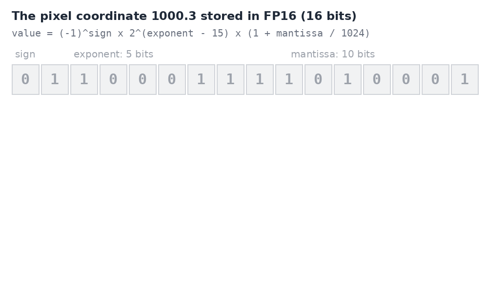
</p>

The 10 mantissa bits of FP16 split the interval between two powers of two into 1,024 equal steps: from 512 to 1024 the **gap** between two neighbouring values is 512 / 1024 = 0.5, so 1000.3 is stored as 1000.5. The gap doubles at every power of two, so the rounding error stays below one part in 2,048 of the value at any magnitude, and the **gap after 1**, the distance from 1 to the next value, gives the precision of a format (0.000977 for FP16). Two limits close the range: a number above the largest value **overflows** to infinity (inf), and a number below the smallest normal value is stored as a **subnormal**, with fewer significant bits, then as 0.

#### The Formats One By One
If you are looking for what a name such as BF16 or E4M3 stands for, each format below gives its full name, its bits, its largest value and its gap after 1, why it exists, where the repository uses it and when to choose it. The bits are drawn to scale, one cell per bit:

<p align="center">
  
</p>

- **FP32, single precision** (1 + 8 + 23 bits, largest 3.40 x 10^38, gap after 1 1.19 x 10^-7). The default format of PyTorch and the reference of the repository: the weights of every model (`MODEL_DTYPE` of `vision_training/models/model_registry.py`), the test evaluation, and the inputs and floating-point outputs of every export (`TYPE_FP32` in `config.pbtxt`). It rounds too, at the eighth significant digit: 1000.3 is stored as 1000.29998779. Keep it for anything compared with a threshold.
- **TF32, TensorFloat-32** (1 + 8 + 10 bits, largest 3.40 x 10^38, gap after 1 0.000977). A compute mode of the NVIDIA **Tensor Cores**, the GPU units that multiply small blocks of matrices in one instruction, and not a storage type: the values stay FP32 in memory, the Tensor Cores read their sign, their exponent and the first 10 of their 23 mantissa bits, and add the products in FP32 (the **accumulation**, the running sum of a convolution or a matrix multiplication). It runs FP32 code on the Tensor Cores without a change, with the range of FP32 and the precision of FP16. PyTorch leaves it on for convolutions (`torch.backends.cudnn.allow_tf32` is True, `torch.backends.cuda.matmul.allow_tf32` False), so the eager model in the process computes its convolutions in TF32, and TensorRT allows it in "FP32" engines. Choose it for speed, not when two runtimes must match: `export_experiment` of `vision_training/deployment/export_model.py` turns both switches off while it exports and checks, then restores them, and the trace keeps the convolutions of `model.pt` without TF32 ([TorchScript](#torchscript)).
- **BF16, bfloat16 ("brain floating point")** (1 + 8 + 7 bits, largest 3.39 x 10^38, gap after 1 0.0078125). The first 16 bits of an FP32 number: the range of FP32 in 2 bytes, so a value that fits FP32 fits BF16, rounded to about 2.4 significant decimal digits. Every training and validation forward pass runs under `torch.autocast(..., dtype=torch.bfloat16)` in `run_model_iteration` of `vision_training/trainers/base_trainer.py`: **autocast** computes the convolutions and matrix multiplications in BF16 and keeps the weights, and the operations PyTorch lists as needing precision such as softmax and the losses, in FP32; the test evaluation runs in FP32. Between 512 and 1024 its gap is 4 pixels, so 1000.3 becomes 1000. It is not servable through the ONNX Runtime backend of Triton 26.01 ([What Is Exported Today](#what-is-exported-today)). Choose it for training; keep thresholds and post-processing in FP32.
- **FP16, half precision** (1 + 5 + 10 bits, largest 65,504, gap after 1 0.000977). Eight times finer than BF16 near any value, for 3 fewer exponent bits: it overflows above 65,504 and stores values below 6.10 x 10^-5 as subnormals. `tensorrt_precision = "FP16"` in the main block of `export_model.py` writes `precision_mode` "FP16" into `config.pbtxt` (`write_triton_configuration` of `triton_configuration.py`), TensorRT then running FP16 kernels where it finds them faster; the export check never runs that engine. `torchscript_precision = "FP16"` traces instead an FP16 copy of the network into `model.pt` under the automatic mixed precision of PyTorch, the normalization layers, recurrent layers and softmax kept in FP32 ([Export](#export)). 1000.3 becomes 1000.5 and the area of a 256 x 256 box, 65,536, becomes inf. Choose it to serve CLS and M2M (within 0.03 points of the eager model at 1.9 times the images of TensorRT FP32, [Serving Benchmark Results](#serving-benchmark-results)) once no value inside the model can pass 65,504.
- **FP8, E4M3 and E5M2** (1 + 4 + 3 bits: largest 448, gap after 1 0.125; 1 + 5 + 2 bits: largest 57,344, gap after 1 0.25). One byte per value, the name counting the exponent (E) and mantissa (M) bits: E4M3 keeps one more mantissa bit, E5M2 the range of FP16, and the TensorRT [quantized types](https://docs.nvidia.com/deeplearning/tensorrt/10.x.x/inference-library/work-quantized-types.html) list E4M3, through explicit quantization only. Without a [scale](#scales-for-int8-and-fp8), the values of a model fall outside or between their few steps: E4M3 has no infinity and PyTorch clamps 1000.3 to 448, E5M2 rounds it to 1,024, and both store 1e-6 as 0. Not implemented: FP8 is not a `precision_mode` of the ONNX Runtime backend.
- **INT8, 8-bit integer** (8 bits, -128 to 127). Not a floating-point format: 256 evenly spaced levels that a [scale](#scales-for-int8-and-fp8) turns into values, run by the integer Tensor Cores in 1 byte. Not implemented: TensorRT needs [Q/DQ nodes or a calibration table](#scales-for-int8-and-fp8), implicit calibration being deprecated since TensorRT 10.1.
- **FP4 E2M1** (1 + 2 + 1 bits: 0, 0.5, 1, 1.5, 2, 3, 4 and 6 and their negatives; gap after 1 0.5). Half a byte per value; the published 1 petaFLOP of the [DGX Spark](https://www.nvidia.com/en-us/products/workstations/dgx-spark/) is a theoretical FP4 figure with sparsity. Without a scale, 0.1 becomes 0 and 1000.3 becomes 6. Not implemented.

Block floating point (BFP), where one exponent is shared by a block of values as in the MX formats, is not BF16 and is not used in this repository.

#### The Same Values In Every Format
Suppose a class threshold, a detector coordinate, two box areas, a box offset and a weight update of the repository are stored in each format: PyTorch 2.14 holds them as follows, written with up to 6 significant digits, or 7 when that is exact (`torch.float16`, `torch.bfloat16`, `torch.float8_e4m3fn` and `torch.float8_e5m2`; the TF32 column rounds the FP32 mantissa to 10 bits, to the nearest value, ties to even).

| Value of the repository | FP32 | TF32 | BF16 | FP16 | FP8 E4M3 | FP8 E5M2 |
|---|---|---|---|---|---|---|
| Class threshold 0.999 | 0.999 | 0.999023 | **1** | 0.999023 | 1 | 1 |
| Pixel coordinate 1000.3 of a 1024-pixel input | 1,000.3 | 1,000.5 | 1,000 | 1,000.5 | 448 | 1,024 |
| Area of a 256 x 256 box, 65,536 | 65,536 | 65,536 | 65,536 | **inf** | 448 | inf |
| Area of a 300 x 300 box, 90,000 | 90,000 | 89,984 | 90,112 | inf | 448 | inf |
| Box offset 0.1 | 0.1 | 0.0999756 | 0.100098 | 0.0999756 | 0.1015625 | 0.09375 |
| Weight update 1e-6 | 1e-6 | 1.00024e-6 | 9.98378e-7 | 1.01328e-6 (subnormal) | 0 | 0 |
| Weight 0.1 after that update | **0.100001** | 0.0999756 | 0.100098 | 0.0999756 | 0.1015625 | 0.09375 |

The same values on the number line of every format, with the gap of the format around each one:

<p align="center">
  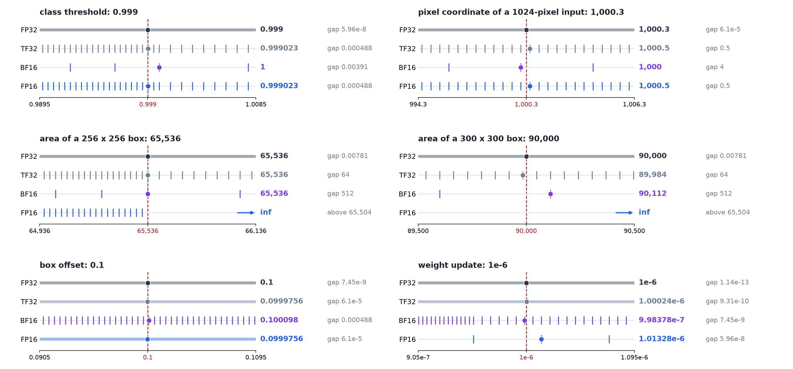
</p>
<p align="center"><em>Every lane holds the values of one format (ticks, or a bar where they are too close to draw apart); the dot is the stored value, and an arrow marks a value stored outside the window: 448 for E4M3, which has no infinity, inf above the largest value, 0 below the smallest.</em></p>

The gap of each format at every magnitude, from 10^-6 to 10^7:

<p align="center">
  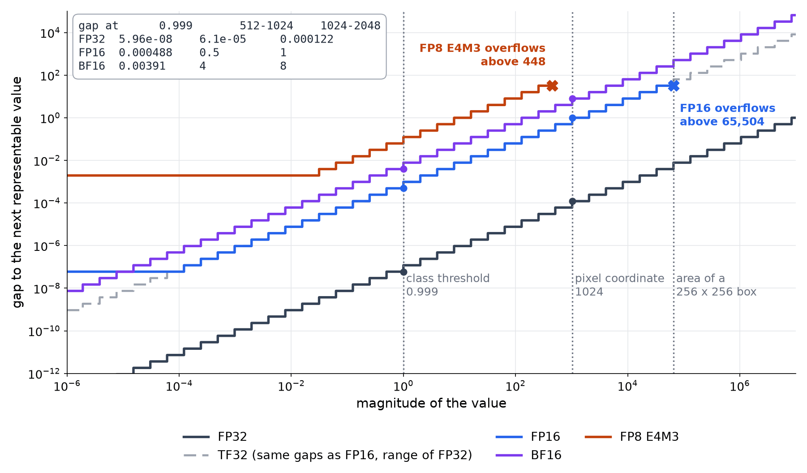
</p>
<p align="center"><em>Gap between neighbouring representable values: a value is rounded by up to half of it, and the format overflows past the cross. The dotted lines mark values of this repository: a class threshold, a pixel coordinate of a 1024-pixel input and the area of a 256 x 256 box.</em></p>

#### What These Numbers Mean
Each time a model moves to a reduced precision, check its values against these cases of the repository:
- **BF16 turns the threshold 0.999 into 1.** Near 1 its values are 0.99609375 and 1, so the probabilities 0.9985 and 0.9995 both read 1 and a threshold of 0.999 can no longer separate them: thresholds, such as those of the logit temperature of the [export](#export), and post-processing stay in FP32, as the test evaluation does.
- **FP16 makes the area of a 256 x 256 box infinite.** The NMS exported inside the detector overflowed FP16 twice: its greedy NMS moved the boxes of every image and class apart by about 1,025 pixels per group, so the coordinates passed 65,504 from about the 64th group and duplicates stayed (run_9 lost 7.88 points of mAP@0.5 with TensorRT FP16), and its DIoU-NMS computed areas in pixels, infinite from 256 x 256 pixels. One NonMaxSuppression batch per group (`suppress_stacked_groups` of `vision_training/models/detection/postprocessing.py`) and boxes in fractions of the image fixed both, the FP16 engine then reading +0.21 points against the eager model ([Serving Benchmark Results](#serving-benchmark-results)). Every sum, area or offset computed inside a model served in FP16 must stay below 65,504.
- **TF32 moves detection scores by about 1e-3.** On eight test images of the DET tutorial run, the eager model with TF32 convolutions moved the scores by up to 9.8e-4 and the boxes by up to 0.15 pixel against the same model in FP32, ten times the 1e-4 and the 0.01 pixel the export accepts (`comparison_tolerances` of `vision_training/deployment/export_specifications.py`); the probabilities of the README classifier moved by up to 5e-5. `export_experiment` therefore turns TF32 off and compares the exports with an eager reference in exact FP32 (its comment on `allow_tf32`).
- **A weight update of 1e-6 vanishes in a 16-bit weight.** Added to a weight of 0.1, it leaves the BF16 and FP16 weight unchanged, their gaps there being 0.000488 and 0.000061, while FP32 holds 0.100001: autocast keeps the weights in FP32 and computes only the forward passes in BF16.
- **INT8 and FP8 need a scale.** Stored as they are, 0.1 becomes 0.1016 in E4M3 and 0 as an integer; with one scale for a tensor between -6 and 6, INT8 stores it as 2 and reads it back as 0.0945 ([Scales For INT8 And FP8](#scales-for-int8-and-fp8)).

#### Scales For INT8 And FP8
Should a model run in INT8 or FP8, every tensor first needs a **scale**, the number its stored values are multiplied by to give back real values:
- **Scale.** For a tensor whose values stay between -6 and 6, the scale 6 / 127 = 0.0472 maps 6 to the integer 127: 0.1 is stored as round(0.1 / 0.0472) = 2 and read back as 0.0945, 2.5 as 53 and read back as 2.504, every value moving by at most half the scale, 0.0236. TensorRT rounds to the nearest integer, ties to even, and clips to -128 and 127.
- **Zero point.** An integer added to the stored values so that a range not centred on 0, such as 0 to 6 after a ReLU, uses all 256 levels. TensorRT quantizes symmetrically, with a scale only.
- **Per tensor or per channel.** One scale for a whole tensor suits activations; weights get one scale per output channel, as TensorRT recommends. After folding its batch normalization into the weights, as the ONNX export does, the first convolution of the second backbone block of the README classifier (`backbone.convolution_blocks.1`, 32 output channels) has a largest weight of 0.285 in its narrowest channel and of 2.73 in its widest: one scale for the tensor leaves the narrowest channel 13 of the 127 positive levels, one scale per channel gives every channel all 127.
- **Calibration.** Choosing the scales of the activations from data: TensorRT runs representative images through the model, about 500 for an ImageNet classifier, and records the range of every tensor. This implicit quantization is deprecated since TensorRT 10.1.
- **Q/DQ nodes.** QuantizeLinear and DequantizeLinear nodes written into the ONNX graph, each with its scale, marking where a tensor becomes INT8 or FP8 and where it returns to a wider format; TensorRT converts exactly where they say (explicit quantization), the only path to FP8 and FP4.

None of this is implemented: the export writes neither Q/DQ nodes nor a calibration table, `tensorrt_precision` accepts only "FP32", "FP16" and None (the export refuses any other value), the ONNX Runtime backend of Triton has no FP8 `precision_mode`, and the export check never runs a TensorRT engine ([What Is Exported Today](#what-is-exported-today)).

#### Summary Of The Formats
In case you need the facts of one format again, here they are, computed by PyTorch (TF32 and FP4 from their bit layouts):

| Format | Full name | Bits (sign + exponent + mantissa) | Largest value | Gap after 1 | Used in this repository for |
|---|---|---|---|---|---|
| FP32 | single precision (IEEE 754 binary32) | 1 + 8 + 23 | 3.40 x 10^38 | 1.19 x 10^-7 | weights, test evaluation, post-processing, inputs and floating-point outputs of every export |
| TF32 | TensorFloat-32 | 1 + 8 + 10, read from FP32 values | 3.40 x 10^38 | 0.000977 | convolutions of the eager model (PyTorch default) and TensorRT "FP32" engines; off in the export |
| BF16 | bfloat16, "brain floating point" | 1 + 8 + 7 | 3.39 x 10^38 | 0.0078125 | training and validation forward passes (autocast of `base_trainer.py`) |
| FP16 | half precision (IEEE 754 binary16) | 1 + 5 + 10 | 65,504 | 0.000977 | `tensorrt_precision = "FP16"`, served without check |
| FP8 E4M3 | 8-bit floating point, 4 exponent bits, 3 mantissa bits | 1 + 4 + 3 | 448 | 0.125 | not implemented |
| FP8 E5M2 | 8-bit floating point, 5 exponent bits, 2 mantissa bits | 1 + 5 + 2 | 57,344 | 0.25 | not implemented |
| INT8 | 8-bit integer | 8 (integer) | 127 times the scale | the scale | not implemented |
| FP4 E2M1 | 4-bit floating point, 2 exponent bits, 1 mantissa bit | 1 + 2 + 1 | 6 | 0.5 | not implemented |

#### Weight Memory And Bandwidth
For a served model to read less memory at every request, a reduced precision also shrinks its weights and activations. The weights of four saved runs, counted from their model state (weights and batch normalization statistics):

<p align="center">
  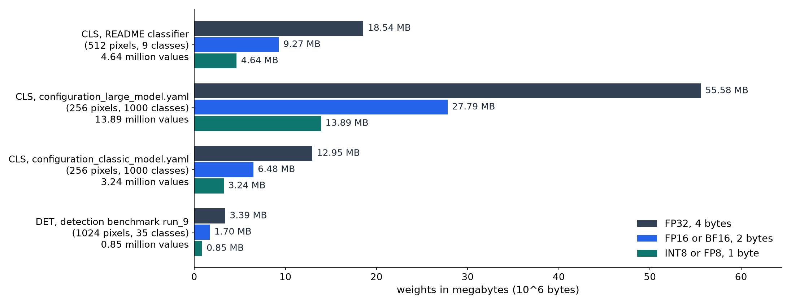
</p>

The DGX Spark gives its GPU 273 GB/s of memory bandwidth shared with the CPU ([specifications](https://www.nvidia.com/en-us/products/workstations/dgx-spark/)), so halving the bytes of weights and activations halves the traffic of a memory-bound layer; TensorRT FP16 serves 1.9 times the images of TensorRT FP32 at batch 16 on CLS and M2M, and DET serves 189 images per second with both since the fix of its exported NMS ([Serving Benchmark Results](#serving-benchmark-results)).

### Export
When a run is ready to be served, `vision_training/deployment/export_model.py` writes it to the Triton model repository as [TorchScript](#torchscript) and [ONNX](#onnx), with the Triton configuration of every model, and checks every export against the [eager](#the-eager-model) PyTorch model, the served models being replaced only once every format matches ([How The Export Records The Graph](#how-the-export-records-the-graph)). Set `experiment_folder`, `iteration`, `use_averaged_weights`, `formats` (`"torchscript"` and `"onnx"`), `maximum_batch_size`, `tensorrt_precision` (`"FP16"`, `"FP32"`, or `None` for ONNX Runtime CUDA only) and `torchscript_precision` (`"FP32"` or `"FP16"`) in its main block, any other format or precision stopping the export before it starts (a keypoint detector with `None` for now: served with TensorRT, the keypoint detector of the tutorials crashed Triton 26.01 at its first request on 2026-11-22, and the TensorRT FP32 engines of the four sequence models of the tutorials failed to build beyond batch 1, item 41 of `documentation/suggestions.md`), then run:

```bash
uv run python -m vision_training.deployment.export_model
```

<p align="center">
  
</p>

The models are written to `vision_training/deployment/triton/served_models/<model name>_<format>/<version>/` with their `config.pbtxt`:

| Task | Model name | Inputs | Outputs |
|---|---|---|---|
| CLS | `image_classifier` | `images` [B, 3, S, S] | `class_probabilities` [B, K] |
| DET | `object_detector` | `images` [B, 3, S, S] | `detection_boxes` [B, D, 4], `detection_scores` [B, D], `detection_labels` [B, D], `number_detections` [B] |
| INS | `instance_segmenter` | `images` [B, 3, S, S] | the outputs of DET, then `detection_masks` [B, D, M, M] |
| KPT | `keypoint_detector` | `images` [B, 3, S, S] | `candidate_positions` [B, C, N, 2], `candidate_scores` [B, C, N], `candidate_tags` [B, C, N] |
| SEG | `semantic_segmenter` | `images` [B, 3, S, S] | `class_map` [B, S, S], `class_probabilities` [B, K, S, S] |
| M2O | `sequence_classifier` | `images` [B, T, 3, S, S] | `class_probabilities` [B, K] |
| M2M | `sequence_labeller` | `images` [B, T, 3, S, S] | `class_probabilities` [B, T, K] |
| CMP | `sequence_comparator` | `before_images`, `after_images` [B, T, 3, S, S] | `class_probabilities` [B, K] |
| SEL | `frame_selector` | `images` [B, T, 3, S, S] | `class_probabilities` [B, T, K] |
| SSL | `image_encoder` | `images` [B, 3, S, S] | `representations` [B, F] |

S is `Data.image_settings.size`, K the number of classes, F the size of the L2 normalized representation (the pooled last feature map of the backbone), D the largest number of detections per image, M `MaskHead.mask_resolution`, T the number of frames, C the heatmap channels and N the candidates of every channel. The inputs are float32 BGR images in [0, 255], resized and padded as the [input contract](#input-contract) states, the input normalization being part of the model. The post-processing run by the client (SEG at the original resolution, INS masks, KPT grouping) and the SEL decoder and ensembles are in the [tools reference](documentation/reference/tools_reference.md#export).

Should a smaller TorchScript file computing on the FP16 Tensor Cores be wanted without TensorRT, `torchscript_precision = "FP16"` traces an FP16 copy of the network (`convert_to_half_precision` of `vision_training/deployment/export_formats.py`): its convolution, linear and attention weights in FP16, about half the file, under the automatic mixed precision of PyTorch, the normalization layers, the recurrent layers, the buffers (anchors, logit temperature) and the softmax staying FP32, with the FP32 inputs and outputs of the FP32 file. It is written as `model_fp16.pt`, which the `default_model_filename` line of its `config.pbtxt` names, so that it can sit next to the `model.pt` of an FP32 export in the same version folder. Its check compares it with the eager FP16 copy, at tolerances 100 times those of FP32 (`HALF_PRECISION_TOLERANCE_FACTOR` of `export_model.py`), and prints its differences from the FP32 model for information only; its cost against FP32 is measured by the parity below.

Before a format goes to production, above all with a reduced precision (TensorRT FP16 that the check of the export never runs, or an FP16 TorchScript file), set `test_split_parity = True` in the main block. A temporary Triton container (Docker and the image of `vision_training/deployment/triton/docker-compose.yml`) then serves every exported format as it will be served, and the test evaluation of the task scores the eager model and every format on the whole test split of the run, every request of a format also going through the eager model so that the samples whose outputs moved are listed. The summary, `parity_summary.md` with `parity_summary.json` and `parity_samples.csv`, goes to `<run>/Export_Parity/Iteration_<n>[_EMA][_T<temperature>]_<precisions>/` with the evaluation files of every row, and next to every installed model; the folder names the temperature of a classifier and the precision of every exported format (e.g. `Iteration_5000_EMA_T3_TorchScript-FP16_TensorRT-FP32`, `ONNXRuntime-CUDA` for ONNX without TensorRT), so that only a parity of the same export replaces it. It is written even when the check of the export fails, and it never decides the installation, so that an expected drop of TensorRT FP16 or FP16 TorchScript does not stop an export; it costs one test evaluation per format and one for the eager model. Details: [tools reference](documentation/reference/tools_reference.md#test-split-parity).

A classifier that reaches its target precision only above a threshold such as 0.999 can be exported with a logit temperature chosen on its evaluation: start `uv run python -m scripts.evaluation.serve_temperature_explorer`, open `http://127.0.0.1:8091/`, pick a run, an iteration and **Trained** or **EMA**, check the balanced accuracy at the top of its page (with the best iteration of its evaluation folder), then press **Save Thresholds At This Temperature** and **Export At T = …**. The export goes to `<run>/Exports/Iteration_<n>[_EMA]_T<temperature>/`, a Triton model repository of its own, where an export of the same temperature in the other TorchScript precision keeps the earlier `model.pt` or `model_fp16.pt` next to its own and serves its own; from the script, `use_saved_temperature` builds the saved temperature and thresholds into the model. Details: [tools reference](documentation/reference/tools_reference.md#logit-temperature).

### Export Sizes
Before a run trains for hours, the Export Sizes panel printed at its launch, right after the Model Size panel, gives the size of every file its model will be turned into, so that a model too large for its server, its device or its disk shows before the training. Every task prints it; here the detector of the detection benchmark (run_9, Adam with the moving average) on a GPU shared with a training, on 2026-11-25:

```text
╭────────────────────── Export Sizes ──────────────────────╮
│ Exported Parameters : 845,544 of 845,544                 │
│                                                          │
│    Format                           Size  Method         │
│    PyTorch FP32 Weights          3.55 MB  ± 1 %          │
│    PyTorch FP16 Weights          1.85 MB  ± 1 %          │
│    TorchScript FP32              4.61 MB  traced         │
│    TorchScript FP16              2.92 MB  ± 2 %          │
│    ONNX                          4.20 MB  ± 3 %          │
│    TensorRT FP32 Engine  5.59 - 10.92 MB  range          │
│    TensorRT FP16 Engine   3.58 - 8.91 MB  range          │
│    Training Checkpoint          14.05 MB  ± 1 %          │
╰────────────────────── 1.8 seconds ───────────────────────╯
```

The real files of this run measure 3.57 and 1.84 MB (`torch.save` of the state dictionary in FP32 and FP16), 2.98 MB (the `model_fp16.pt` of `torchscript_precision = "FP16"`), 4.14 MB (`model.onnx` and `model.onnx.data`), 6.42 and 4.40 MB (the engines Triton 26.01 built for the check below on 2026-11-22) and 14.17 MB (`model_015000.pt`). Only the FP32 TorchScript file is written, to a temporary folder removed at once; every other size comes from a formula of `vision_training/deployment/export_size_estimates.py` that stayed within its margin on the ten tutorial runs, one per task:

| Format | How the size is obtained | Largest error on the ten tutorial runs |
|---|---|---|
| PyTorch FP32 and FP16 weights | the values of the state dictionary of the inference model, the floating ones in 2 bytes for FP16, plus 300 bytes and the characters of its key per tensor | 0.70 % |
| TorchScript FP32 | the trace of the export (`export_torchscript`) on its example batch, written to a temporary `model.pt` | measured; an export in another process differs by up to 1 %, the classes of a trace being numbered after the earlier traces of its process |
| TorchScript FP16 | the FP32 trace less 2 bytes per FP32 value of the convolution, linear and attention weights the FP16 export converts (`count_half_precision_saved_bytes`), estimated on the CPU too, where the FP16 export cannot run | 1.54 %, always below the real file (the casts autocast adds to the traced code are left out), up to 5 % for the 0.2 MB models of the tests |
| ONNX | the weights and constants (such as the anchors) one forward pass of one sample reads, every batch normalization folded into the convolution before it, plus 165 bytes of graph per operator | 2.30 % |
| TensorRT FP32 and FP16 engines | the same weights in the precision of the engine, plus 7,700 bytes per convolution, matrix product or recurrent layer and 2,300 per other operator, times 0.5 to 2.2 | the 20 engines of the ten runs (Triton 26.01, 2026-11-22) between 0.52 and 2.12 times this overhead: it follows the operators loosely, so the range is wide where the overhead outweighs the weights (INS 10.31 - 24.84 MB for a 19.74 MB engine) |
| Training checkpoint | the weights of the model (twice with the moving average), the moments of the optimizer for every trained parameter (two for Adam and AdamW, one for SGD) and 20 kB of metadata | 0.87 % |

`Exported Parameters` counts the parameters the forward pass reads, those the ONNX file and the engines keep: 438,368 of 571,104 for the SimCLR encoder of the tutorials, whose projector serves the training only (the PyTorch weights and the TorchScript file still hold it). The estimates take 0.1 to 0.8 seconds per tutorial run on the idle GPU and 0.2 to 5.0 seconds on the CPU (2026-11-22), up to 2.1 seconds for the Medium ImageNet classifier of 19.2 million parameters on a GPU other trainings shared, against 2 to 27 seconds for the real TorchScript, ONNX and PyTorch files of the tutorial runs, the ONNX export taking most of it, and from 5 seconds to 43 minutes for each TensorRT engine (the batch-16 engine of the instance segmenter). A forward pass or a trace that fails leaves its rows `failed` in red with the error under the table, and the training goes on.

After a change to the exports or to their libraries, `scripts/deployment/check_export_size_estimates.py` exports the ten tutorial runs, prints every estimate against its real file and fits the constants again ([tools reference](documentation/reference/tools_reference.md#export-size-check)); with `--build_tensorrt_engines`, on an idle GPU, it also builds the 20 TensorRT engines through Triton, about two hours, to fit the TensorRT constants:

```bash
uv run python -m scripts.deployment.check_export_size_estimates
uv run python -m scripts.deployment.check_export_size_estimates --device cuda --build_tensorrt_engines
```

### Input Contract
Should a server build the input of an exported model from a photo, it reads the input contract written with the model instead of assuming a resize or a channel order. Every export writes it into the `metadata_props` of `model.onnx` and as `preprocessing.json` next to the model of both formats, with the keys of `vision_training/deployment/input_contract.py`: the BGR photo as `cv2.imread` decodes it, a `stretch`, `keep_ratio` or `tiles` resize with its OpenCV interpolation, the padding and the layout. The export stops before writing any file when a run uses an input the contract cannot describe.

<p align="center">
  
</p>
<p align="center"><em>The three resizes of a 640 x 359 photo for an input size of 256, computed by <code>preprocess_image</code>, <code>compute_letterbox_region</code> and <code>compute_tile_starts</code> (tiles with an overlap of 64). Photo: COCO 2017 validation image 288882, Flickr, CC BY 2.0.</em></p>

```python
session = onnxruntime.InferenceSession("model.onnx", providers=["CPUExecutionProvider"])
input_contract = session.get_modelmeta().custom_metadata_map
check_input_contract(input_contract=input_contract)
```

Every key and value is in the [tools reference](documentation/reference/tools_reference.md#input-contract). `build_input_from_contract` in `tests/deployment/test_input_contract.py` builds the inputs of a photo from the contract alone, checked pixel for pixel against `preprocess_image`.

### Triton Server
To serve every model of `served_models/`, start Triton from the folder of its compose file and keep it running; it listens on the ports 8000 (HTTP, `curl localhost:8000/v2/health/ready`), 8001 (gRPC) and 8002 (metrics):

```bash
cd vision_training/deployment/triton
docker compose up
```

<p align="center">
  
</p>

`uv run python -m vision_training.deployment.run_inference` then sends the images of `vision_training/deployment/inference_data/` to the model of a run, in the process and through Triton, and prints the throughput of each. It sends one request at a time from one client, so the dynamic batcher never forms a batch of more than one image, and its in-process reference is the eager PyTorch model on the GPU, not the TorchScript file. A SEG run trained on tiles is refused, since a photo needs many tile requests where the script would letterbox it into one.

<p align="center">
  
</p>
<p align="center"><em>The default run of <code>run_inference.py</code>, the 35-class README classifier (512 pixels) exported with TensorRT FP32, measured on 2026-11-22 on the idle GPU: one image per request, so Triton pays a gRPC request for every image the process sends straight to the model.</em></p>

### Serving Formats And Precision
Before a model goes to production, its serving path and its number format decide its latency, its throughput, its memory and how far its outputs move from the FP32 model that was evaluated. This part states what the repository exports today, what Triton, TensorRT and the [reduced precisions](#number-formats) add and cost on the DGX Spark of the measurements (GB10 GPU; the Triton image `26.01-py3` ships Triton 2.65.0, CUDA 13.1.1 and TensorRT 10.14.1, [release notes](https://docs.nvidia.com/deeplearning/triton-inference-server/archives/triton-inference-server-2670/release-notes/rel-26-01.html)), and what the [serving benchmark](documentation/architecture_benchmarking/serving_benchmark_plan.md) of 2026-11-17 measured on the idle GPU.

#### What Is Exported Today
If you are looking for what can be deployed without new code, here is what `export_model.py` and `triton_configuration.py` write. The inputs and the floating-point outputs of every served model stay float32 (`TYPE_FP32` in `config.pbtxt`, labels and counts `TYPE_INT64`) whatever the precision: it only changes the computation inside the engine, so a request keeps its size.

| Path | File and Triton platform | Computation | Checked by the export | Status |
|---|---|---|---|---|
| In the process | checkpoint, eager PyTorch (`run_inference.py`) | FP32, convolutions in TF32 (PyTorch default) | reference | measured by `run_inference.py` |
| TorchScript | `model.pt`, `pytorch_libtorch` | FP32 by libtorch, the convolutions traced with TF32 off | `torch.jit.load` on the GPU against the eager model, TF32 off | exported |
| ONNX Runtime CUDA | `model.onnx`, `onnxruntime_onnx` | FP32 | ONNX Runtime on the CPU against the eager model | `tensorrt_precision = None` |
| ONNX with TensorRT, FP32 | the same file, TensorRT accelerator | FP32, TF32 allowed by TensorRT by default | the ONNX graph on the CPU, never the TensorRT engine | default (`"FP32"`) |
| ONNX with TensorRT, FP16 | the same file, `precision_mode` FP16 | FP16 where TensorRT picks it, FP32 elsewhere | not checked | `"FP16"`, served unchecked |
| INT8 | `precision_mode` value the [ONNX Runtime backend](https://github.com/triton-inference-server/onnxruntime_backend) documents | | | not offered: the export documents `"FP32"`, `"FP16"` and `None` (the temperature explorer refuses any other value) and has no calibration |
| BF16 | none: not a `precision_mode` of the ONNX Runtime backend of Triton 26.01 (later versions of the backend list it) | | | not servable through this backend: Triton 26.01 refuses `precision_mode` "BF16" and the `trt_bf16_enable` parameter, and ONNX Runtime ignores `ORT_TENSORRT_BF16_ENABLE` (serving benchmark, row 7) |
| Native TensorRT engine | `model.plan`, `tensorrt_plan` | FP32 to FP8 | | not implemented |
| FP8, FP4 | Q/DQ nodes of explicit quantization | | | not implemented |

<p align="center">
  
</p>

#### Triton Or The Model In The Process
Suppose several cameras or services query the same model at once: in the process every call runs alone, while Triton queues the requests, batches them and spreads them over its instances.

| Triton gives | Set by the export | It costs |
|---|---|---|
| [Dynamic batching](https://docs.nvidia.com/deeplearning/triton-inference-server/user-guide/docs/user_guide/batcher.html): requests arriving within the queue delay run as one batch | `dynamic_batching { max_queue_delay_microseconds: 1000 }`, `max_batch_size` 16 | up to 1 millisecond of queue time; a batch only forms when requests overlap |
| Several [instances](https://docs.nvidia.com/deeplearning/triton-inference-server/user-guide/docs/user_guide/model_configuration.html) of a model running requests in parallel on the GPU | `instance_group [ { kind: KIND_GPU count: 1 } ]` | the weights and workspace of the model once per instance |
| Every model and format of `served_models/` behind one endpoint, the frame selector chaining its GPU network and CPU decoder in an ensemble | one folder per model | the GPU memory of every loaded model at once |
| HTTP and gRPC for any language: the client needs `tritonclient` and numpy, not PyTorch nor a CUDA context | ports 8000 and 8001 | a container to run and upgrade (`nvcr.io/nvidia/tritonserver:26.01-py3`, NVIDIA container runtime) |
| Versions side by side in the repository, the served one chosen by `version_policy` | `version_policy: { specific: { versions: [ 1 ] } }` | the compose file starts Triton without a model control mode, so a new export is loaded at the next start |
| [Metrics](https://docs.nvidia.com/deeplearning/triton-inference-server/user-guide/docs/user_guide/metrics.html) of every model on port 8002: requests, queue time, compute time, GPU use | on by default in Triton | |
| The photo prepared by the client, the network run by the server | the input contract, `preprocessing.json` | every request carries its float32 tensor through gRPC, 3.1 MB per 512 x 512 image and 12.6 MB at 1024, unless `use_shared_memory` passes it through `/dev/shm` |

<p align="center">
  
</p>

With one client and one request at a time, Triton adds latency: the CLS answers one 512-pixel image in 4.5 milliseconds through TorchScript and 2.5 with TensorRT FP16 over shared memory (6.5 and 3.9 over gRPC), against 2.2 for the eager model in the process, the queue delay of the dynamic batcher taking about 1.2 milliseconds of each request. Dynamic batching pays only when requests overlap, and on none of these models: with TensorRT FP16, single images and 16 concurrent requests over shared memory, CLS and M2M run faster with it off and two instances (CLS 1,747 against 1,168 images per second, M2M 6,594 against 5,436 frames per second), and DET serves 166 images per second without it against 153 with it since the fix of its exported NMS (the 171 against 64 of the benchmark came from the NMS broken in batches). The tables are in [Serving Benchmark Results](#serving-benchmark-results).

#### TensorRT Or TorchScript And ONNX Runtime CUDA
Whenever the latency of a model matters more than the portability of its file, TensorRT compiles the ONNX graph into an engine for this GPU instead of running it operator by operator:
- **Layer and tensor fusion.** The convolution, batch normalization and ReLU of `convolution_block.py` become one kernel ([TensorRT](#tensorrt)). The ONNX export already folds the batch normalization into the weights and bias of the convolution, `model.onnx` holding no BatchNormalization node; ONNX Runtime lists its fusion of a convolution with its activation for the CPU provider only ([graph optimizations](https://onnxruntime.ai/docs/performance/model-optimizations/graph-optimizations.html)), and libtorch runs the traced operators one by one, the batch normalization included.
- **Kernel auto-tuning.** The builder times the candidate kernels of every layer on the GPU itself and keeps the fastest.
- **Reduced precision.** FP16 kernels on the Tensor Cores where TensorRT finds them faster, the FP16 flag allowing them without forcing them ([precision control, TensorRT 10](https://docs.nvidia.com/deeplearning/tensorrt/10.x.x/inference-library/precision-control.html)).

With one client sending batches of 16 images over shared memory, TensorRT FP32 serves 646 CLS images per second against 435 with ONNX Runtime CUDA and 320 with TorchScript, and FP16 1,215; DET gains most, 189 images per second with TensorRT FP32 or FP16 since the fix of its exported NMS, against 71 with ONNX Runtime CUDA (30 before the fix) and 11 with TorchScript. What it costs with the configuration the export writes ([TensorRT execution provider](https://onnxruntime.ai/docs/execution-providers/TensorRT-ExecutionProvider.html)):
- **Engines built while serving.** ONNX Runtime builds an engine at the first request, a build its documentation warns can be very long (every kernel is profiled): the first DET requests at batch 1, 4 and 16 waited 11.94, 17.06 and 34.40 seconds with FP32, against at most 3.77 seconds without TensorRT. The 20 warm-up requests of `run_inference.py` absorb it for batches of one image only.
- **A new engine for every larger batch.** `config.pbtxt` gives no `trt_profile_min_shapes`, `trt_profile_opt_shapes` or `trt_profile_max_shapes`, so ONNX Runtime builds for the shapes seen so far and rebuilds when a request falls outside them: every batch larger than all the earlier ones, as the dynamic batcher forms them, waits for a build.
- **A cache lost with the container, named after the export.** `trt_engine_cache_path` is `/tmp/tensorrt_engine_cache` inside the container, which `docker-compose.yml` does not mount, so a recreated container builds every engine again. The engines of an export are named after its `trt_engine_cache_prefix`, `<model name>_<version>_<precision>_<hash>`, the hash being the first 16 hexadecimal characters of the SHA-256 of `model.onnx` and `model.onnx.data` (`build_tensorrt_engine_cache_prefix` of `triton_configuration.py`): ONNX Runtime names a cached engine after the graph, its documentation asking to delete the cache whenever the model changes, so that without the prefix an export of another checkpoint into the same version could be served with the engines of the earlier weights by a container that kept its cache (`docker compose restart`). Each export of other files builds its own engines; the cache is still stale after a change of ONNX Runtime, of TensorRT or of the GPU.
- **Engines tied to the GPU and the TensorRT version.** An engine built on the GB10 (compute capability 12.1) with TensorRT 10.14.1 runs on no other GPU or TensorRT version, unless built in the hardware and version compatibility modes of TensorRT; `model.onnx` and `model.pt` run on any GPU. TensorRT 11 keeps only strongly typed networks ([current precision control](https://docs.nvidia.com/deeplearning/tensorrt/latest/inference-library/precision-control.html)), to check before upgrading the image.
- **Unsupported operators.** ONNX Runtime gives TensorRT only the subgraphs it supports and runs the rest with CUDA, every boundary adding a copy; whether the post-processing of DET, INS and KPT (NMS, top-k, RoI Align) runs inside TensorRT is not checked yet.
- **Workspace memory.** `max_workspace_size_bytes` lets every engine take up to 4294967296 bytes (4 GiB, the backend default being 1 GB), out of the 128 GB of memory the GPU shares with the CPU and the trainings on a DGX Spark.
- **"FP32" is not exact FP32.** TensorRT allows TF32 Tensor Cores by default, as eager PyTorch does for convolutions; the export turns TF32 off for its reference and its trace, so that `model.pt` keeps its convolutions in FP32 ([TorchScript](#torchscript)), but it never runs the TensorRT engine.

Native engines (`model.plan` served by `tensorrt_plan`) are not implemented: they would be built at export with explicit optimization profiles of the batch sizes, instead of at the first requests, but on the GPU and with the TensorRT version of the server.

#### Serving Benchmark Results
Should you pick a serving path for a model, the [serving benchmark](documentation/architecture_benchmarking/serving_benchmark_plan.md) measured each one on 2026-11-17 on the idle GPU, every cell giving CLS / DET / M2M: the 9-class README classifier (512 pixels), the detection benchmark run_9 (1024 pixels, NMS inside the model) and the sequence labelling tutorial run (counted in frames, 7 per sequence). The Triton rows use the exported configuration (dynamic batching on, one instance) and system shared memory; "Best" is the highest throughput over batches of 1, 4 and 16 and 1, 4 and 16 requests in flight (one caller in the process); the memory is the drop of available memory of the whole server or process; the test metric is the headline metric of the test split (CLS and M2M accuracy, DET mAP@0.5 of the detections above the deployment score threshold 0.5) in points against the eager model. To run the two drivers again, `scripts/deployment/benchmark_serving_formats.py` and `scripts/deployment/evaluate_served_formats.py`, see their settings in the [tools reference](documentation/reference/tools_reference.md#serving-benchmark).

| Path | Batch 1 p50 (milliseconds) | Batch 16, one client (images per second) | Best (images per second) | Memory (gigabytes) | First requests at batch 1, 4 and 16 (seconds) | Test metric against eager (points) |
|---|---|---|---|---|---|---|
| In the process, eager PyTorch | 2.2 / 16.0 / 3.6 | 349 / 11 / 1,841 | 432 / 62 / 1,918 | 1.74 / 6.73 / 2.23 | none / none / none | 82.73 % / 86.77 % / 77.15 % |
| In the process, TorchScript (`torch.jit.load`) | 3.3 / 15.6 / 3.4 | 355 / 11 / 2,013 | 355 / 63 / 2,125 | 1.42 / 6.61 / 2.05 | none / none / none | not measured (the file of the next row) |
| Triton, TorchScript | 4.5 / 24.3 / 5.9 | 320 / 11 / 1,788 | 394 / 41 / 1,988 | 2.55 / 8.72 / 2.41 | 1.1 / 5.9 / 1.4 | 0.00 / 0.00 / +0.01 |
| Triton, ONNX Runtime CUDA | 3.6 / 17.0 / 5.3 | 435 / 30 / 2,207 | 498 / 58 / 2,269 | 3.93 / 13.66 / 5.49 | 0.9 / 1.9 / 0.5 | 0.00 / +0.01 / +0.01 |
| Triton, ONNX with TensorRT FP32 | 3.0 / 23.8 / 4.2 | 646 / 153 / 3,357 | 677 / 158 / 3,483 | 4.08 / 7.26 / 2.73 | 21.5 / 63.4 / 29.0 | -0.01 / -0.46 / 0.00 |
| Triton, ONNX with TensorRT FP16 | 2.5 / 17.6 / 3.1 | 1,215 / 246 / 6,249 | 1,326 / 253 / 6,623 | 3.98 / 5.99 / 2.47 | 23.2 / 60.2 / 34.6 | -0.03 / **-7.88** / +0.02 |
| Triton, ONNX with TensorRT BF16 | refused by the ONNX Runtime backend (row 7 of the plan) | | | | | |
| Triton, native TensorRT engine | not implemented | | | | | |
| INT8 or FP8 | not implemented | | | | | |

Since the benchmark, the exported NMS of the detectors runs without coordinate offsets (`suppress_stacked_groups` of `vision_training/models/detection/postprocessing.py`, one `NonMaxSuppression` batch per group in ONNX) and on boxes in fractions of the image for DIoU-NMS. In place of the DET cells of the ONNX rows above, run_9 exported again reads (`serving_benchmark_nms_fix_test_metrics.csv` and the `perf_analyzer` reports of `serving_benchmark_nms_fix_loads/`, committed next to the plan with the two results files of the sweep, `serving_benchmark_results.csv` and `serving_benchmark_test_metrics.csv`):

| DET, exported NMS fixed | Batch 1 p50 (milliseconds) | Batch 16, one client (images per second) | Test metric against eager (points) |
|---|---|---|---|
| Triton, ONNX Runtime CUDA | 19.5 | 71 | +0.01 |
| Triton, ONNX with TensorRT FP32 | 7.5 | 189 | +0.01 |
| Triton, ONNX with TensorRT FP16 | 7.7 | 189 | +0.21 |

The plan gives the gRPC loads, the four server settings and the queue and compute times of the server. In short:
- **TensorRT FP16 is the fastest path for CLS and M2M** from batches of 4 up: at batch 16, 3.5 (CLS) and 3.4 (M2M) times the eager model and 1.9 times TensorRT FP32, their test metric within 0.03 points.
- **DET needed its exported NMS fixed for TensorRT.** It lost 7.88 points of mAP@0.5 in FP16 (5.73 of mAP@[0.5:0.95], 9.23 on large objects) for the same recall: the group offsets of its NMS overflowed FP16 from the second image of a batch and duplicates stayed, and DIoU-NMS overflowed its areas in pixels. With one NonMaxSuppression batch per group and DIoU on boxes in fractions of the image, its FP16 and FP32 engines match the eager model (+0.21 and +0.01 points) and serve 189 images per second at batch 16, 17 times the eager model, the NMS taking as long in both precisions.
- **The FP32 paths match the eager model** within 0.01 points, TensorRT FP32 on DET too since the NMS fix (-0.46 points before it).
- **TorchScript through Triton is not faster than the eager model**, and ONNX Runtime CUDA takes the most memory (DET 13.66 GB against 5.99 with TensorRT FP16).
- **TensorRT engines cost about a minute of first requests for DET** (FP32 and FP16), paid again in every recreated container since `docker-compose.yml` does not mount the engine cache. The instance segmenter of the tutorials needs 49 minutes, 43 of them for its batch-16 engine ([Export Size Check](documentation/reference/tools_reference.md#export-size-check), 2026-11-22).
- **The exported dynamic batching suits none of these models**: CLS and M2M serve more with it off and two instances, DET as much or more with it off since the NMS fix (166 against 153 images per second at 16 requests in flight), and over gRPC a client sending batches of large float32 images is bound by the request (CLS 109 images per second at batch 16 against 1,215 over shared memory).
- **The eager and TorchScript DET do not gain from batches** (16 milliseconds for one image, 1.4 seconds for 16), unlike its TensorRT engines.

## Tests
After a change to the code, run the tests of `tests/`, whose folders mirror `vision_training/` and `scripts/` and include short trainings of every task on tiny synthetic datasets:

```bash
uv run pytest tests
```

In case you changed a single folder, run its mirror alone, e.g. `uv run pytest tests/configuration_processing`:

<p align="center">
  
</p>

## Docker Image
Should a training run on the GPU pods of a cloud Kubernetes cluster, or in a container on a development machine, the `Dockerfile` of the repository root builds the trainer for `linux/amd64` (cloud nodes) and `linux/arm64` (DGX Spark). The CUDA 13 libraries come with the torch wheels of `uv.lock` and the GPU driver from the machine, so the image starts from Ubuntu 24.04, not from a CUDA image. `.dockerignore` sends only `pyproject.toml`, `uv.lock`, `vision_training/`, `scripts/` and `tests/` to the build.

| Stage | Holds | Built by |
|---|---|---|
| `uv` | the uv binary | the builder |
| `base` | Ubuntu 24.04, the architecture check, the libraries OpenCV loads at import, tini, the user 10001 | every stage |
| `builder` | Python 3.13 in `/opt/python`, the environment of `uv.lock` without its default groups in `/opt/venv`, the code in `/app` | the test and runtime stages |
| `test` | the builder with the `dev` group and `tests/`, running `pytest tests` | `--target test` |
| `runtime` | base with the interpreter, the environment and the code of the builder | default |

### Building The Image
Each time the image is built, the machine builds its own architecture natively: the Spark for its local trainings, an amd64 machine for the cloud.

```bash
docker buildx build --platform linux/arm64 --tag vision-trainer:local --load .
docker buildx build --platform linux/arm64 --target test --tag vision-trainer:test --load .
```

So that the cloud nodes and the Spark pull the same tag, each architecture is pushed under its own tag and the two are joined, the registry being `<region>-docker.pkg.dev/<project>/<repository>` (`gcloud auth configure-docker <region>-docker.pkg.dev` once per machine):

```bash
# On the Spark, then the same with linux/amd64 and <tag>-amd64 on an amd64 machine (e.g. Cloud Build)
docker buildx build --platform linux/arm64 --build-arg GIT_COMMIT="$(git rev-parse HEAD)" \
    --tag <registry>/vision-trainer:<tag>-arm64 --push .
# One tag for both: each machine pulls its architecture
docker buildx imagetools create --tag <registry>/vision-trainer:<tag> \
    <registry>/vision-trainer:<tag>-amd64 <registry>/vision-trainer:<tag>-arm64
```

A builder with QEMU registered for the other architecture builds both in one command (`--platform linux/amd64,linux/arm64 --push`), the emulated one being several times slower. `GIT_COMMIT` becomes the `org.opencontainers.image.revision` and `org.opencontainers.image.version` labels: the image holds no git history, so the MLflow runs of a container carry no commit tag.

### Running A Training
Before a training starts in a container, it needs the GPU, the shared memory of its loader workers (64 MB by default in Docker) and the folders its configuration names, mounted at the same absolute paths. `--user` makes the run folders yours instead of the user 10001 of the image, and the mounted configurations replace those of the image, so that an edit needs no rebuild:

```bash
docker run --rm --gpus all --ipc=host --user "$(id -u):$(id -g)" \
    -v "$HOME/Data:$HOME/Data" -v "$PWD/experiments:$PWD/experiments" \
    -v "$PWD/vision_training/configurations:/app/vision_training/configurations:ro" \
    vision-trainer:local python -m vision_training.main \
    --configuration_path=vision_training/configurations/classification/configuration_synthetic_shapes.yaml
```

In case a pipeline checks the configuration before the training starts, the same image and mounts run `python -m vision_training.check_configuration --configuration_path=<file> --check_paths` in place of `python -m vision_training.main`, without `--gpus`, its exit code 1 stopping the pipeline ([Configurations](#configurations)).

The image stops with SIGINT, which the trainer handles as Ctrl+C: it saves the checkpoint of its last steps and closes its MLflow run, so give it the time with `docker stop --timeout 120 <container>`. The pre-trained ImageNet backbones are not in the image yet: a configuration loading one mounts its run folder.

### Kubernetes Pods
For a pod to train as the Spark does, its specification sets:
- `args`, not `command`, for the training command: `command` would replace tini, which forwards the stop signal and reaps the loader workers.
- `resources.limits` with `nvidia.com/gpu: 1`, on nodes whose driver runs CUDA 13 (R580 or newer) and whose GPU is a Turing or newer one (T4, L4, A100, H100); the image puts `/usr/local/nvidia`, where GKE mounts the driver, on its paths.
- An `emptyDir` volume with `medium: Memory` mounted at `/dev/shm`, the loader workers passing their batches through it.
- `terminationGracePeriodSeconds` long enough for the final checkpoint, the stop of the pod sending SIGINT.
- `securityContext` with `runAsNonRoot: true`, `runAsUser: 10001` and `fsGroup: 10001`, so that the user of the image writes into the mounted volumes of the datasets and run folders, at the paths of the configuration (given by a `ConfigMap`).

## Repository Structure
To find your way in the code, the diagram follows the packages along the path of a training and the tools reading its run folder, and the tree lists where each part lives:

<p align="center">
  
</p>

```text
.
├── README.md                          # This documentation file
├── README/                            # Images used in the documentation
├── pyproject.toml, uv.lock            # Dependencies and their locked versions
├── Dockerfile, .dockerignore          # Trainer image (stages uv, base, builder, test, runtime) and the files of its build
├── documentation/
│   ├── architecture_benchmarking/     # Experiment plans, copies of their results, stage figures, experiment_comparisons.yaml
│   ├── presentation/                  # Slide deck of the repository: deck.json, deck.css, one HTML file per slide and the figures made for it
│   ├── reference/                     # Training, tasks, configurations, tools and pretraining (ImageNet-22k, Open Images V7, order of the S, M and L sizes) in detail
│   ├── task workflows/                # One run of every task followed function by function
│   └── suggestions.md                 # Proposed improvements not implemented yet
├── vision_training/                   # Training framework
│   ├── main.py                        # Entry point of the trainings
│   ├── check_configuration.py         # Check of configuration files without training, for pipelines
│   ├── configurations/                # Example and synthetic configuration of every task
│   ├── configuration_processing/      # Loading, checks, run names and comparison of the configurations
│   ├── core/                          # Task registry and contracts shared by the tasks
│   ├── data/                          # Datasets of every task, loaders, preprocessing, augmentation, synthetic datasets
│   ├── models/                        # Backbone, task models, components and transfer between runs
│   ├── losses/                        # Losses of every task
│   ├── trainers/                      # Base trainer, trainer of every task, checkpoints, moving average, speed benchmark
│   ├── evaluation/                    # Metrics, reports and checkpoint evaluation
│   ├── tracking/                      # MLflow tracking
│   ├── deployment/                    # Export, export size estimates, input contract, Triton server, throughput measurement
│   └── utilities/                     # File, tensor, mask and visualization helpers
├── scripts/                           # Configuration, data, deployment (serving benchmark, export size check), embedding, evaluation and model drawing scripts
├── tests/                             # Tests, mirroring vision_training/ and scripts/
└── tutorials/                         # Narrated tutorial videos: storyboards, figure scripts, run snapshots, README.md of the build
```

Should you need to change what a task computes, the training code splits into a shared part and one part per task: `base_trainer.py` runs the loop of every task, and the trainer of the task, picked from `ExperimentConfiguration.task` by `vision_training/core/task_registry.py`, fills its hooks.

<p align="center">
  
</p>

## Metrics Explained
Each time a checkpoint is evaluated, its report (`Results.txt`, the console, TensorBoard, MLflow and `class_metrics.csv`) gives a dozen numbers or more, and choosing between two runs means knowing what each one measures. This section takes them one by one, task family by task family: what the metric answers, how the repository computes it (the function and the exact name it has in the report), a small worked example on synthetic shapes whose numbers come from the repository's own metric functions, and how to read it. The figures and animations were drawn from these same toy examples.

Every rate is written as a percentage with two decimals in the reports (`81.76 %`) and kept between 0 and 1 in `class_metrics.csv`, TensorBoard and MLflow. The headline metric of a task is the one that compares the checkpoints of a run: it names the best checkpoint printed by `evaluate_checkpoint.py`, the ringed iteration of `evaluation_curves.png` and the `best_` value in MLflow.

| Task | Headline metric (compares the checkpoints) | Metrics explained in |
|---|---|---|
| CLS | `Accuracy` (`Subset Accuracy` in multi-label mode) | [Classification](#classification-cls-m2o-cmp) |
| M2O, CMP | `Accuracy` over the test sequences or pairs | [Classification](#classification-cls-m2o-cmp), [Sequences, Pairs And Frames](#sequences-pairs-and-frames) |
| DET | `mAP@0.5/area` | [Object Detection And Instance Segmentation](#object-detection-and-instance-segmentation-det-ins) |
| INS | `Mask mAP@0.5/area` | [Object Detection And Instance Segmentation](#object-detection-and-instance-segmentation-det-ins) |
| KPT | `OKS mAP@0.5/area` | [Keypoint Detection](#keypoint-detection-kpt), with the mAP of [detection](#object-detection-and-instance-segmentation-det-ins) |
| SEG | `Mean IoU` | [Semantic Segmentation](#semantic-segmentation-seg) |
| M2M | `Accuracy` over the labelled frames | [Sequence Labelling](#sequence-labelling-m2m), with the frame metrics of [classification](#classification-cls-m2o-cmp) |
| SEL | `<Decoding> Selection Accuracy`, the decoding of `Selection.decoding` | [Frame Selection](#frame-selection-sel) |
| SSL | `k-NN Accuracy` (`Effective Rank` without labelled test images) | [Self-Supervised Evaluation](#self-supervised-evaluation-ssl), [Self-Supervised Training Metrics](#self-supervised-training-metrics-ssl) |

The 95 % confidence intervals written next to the recalls of every task are explained once, in [Recall Intervals](#recall-intervals).

### Classification (CLS, M2O, CMP)

If you are looking for what the report of a classifier measures, this part takes its metrics one by one: those of the classification task (CLS), which the sequence classification (M2O) and sequence comparison (CMP) tasks report on their sequences and pairs, and the sequence labelling task (M2M) on its labelled frames ([Sequences, Pairs And Frames](#sequences-pairs-and-frames)).

Every metric is computed once per evaluated checkpoint over the whole test split, from the class probabilities of every test sample: the softmax of the logits (`ClassificationHead.output_mode: "multi_class"`) or one sigmoid per class (`"multi_label"`), at a logit temperature of 1. The predicted class of a sample is its most probable class. `compute_evaluation_results` of `vision_training/trainers/classification_trainer.py` gathers them, and its headline metric, `Accuracy` (`Subset Accuracy` in multi-label mode), compares the checkpoints of CLS, M2O, CMP and M2M: it names the best checkpoint printed by `evaluate_checkpoint.py`, the ringed iteration of `evaluation_curves.png` and `test/best_Accuracy` in MLflow. `Results.txt` writes every rate as a percentage (`81.76 %`); `class_metrics.csv`, `evaluation_summary.csv`, TensorBoard (run `Test`, tags such as `Accuracy` and `Recall/<class>`) and MLflow (`test/Accuracy`, `test_class/Recall/<class>`) keep it between 0 and 1. `class_metrics.csv`, `class_thresholds.json` and `confusion_matrix.csv` are written at every evaluation; the per-class tables of the report, the per-class TensorBoard scalars, the ROC AUC and average precision, and the images need `evaluation.per_class_report: True`.

#### Confusion Matrix

Before reading any rate of a multi-class evaluation, open its confusion matrix: every metric down to the top-k accuracy is a ratio of its cells.

- **What it holds**: the number of test samples of every true class (rows) predicted as every class (columns), the right predictions on the diagonal. `compute_confusion_matrix` of `vision_training/evaluation/classification/classification_metrics.py` counts the pairs (true class, most probable class) with a `bincount` of `true × K + predicted`.
- **Where**: `confusion_matrix.csv` in the evaluation folder of the checkpoint, always; above 1,000 classes (`MAXIMUM_DENSE_CONFUSION_CLASSES`) `confusion_cells.csv` lists the non-zero cells as `true_class,predicted_class,count` instead, the metrics staying the same. With the per-class report, `confusion_matrix.png` colours every cell by its share of the true class and adds the recall of every row on the right, the precision of every column at the bottom and the accuracy in the corner (the 35-class one is shown in [Evaluating Checkpoints](#evaluating-checkpoints)). The multi-label mode has no confusion matrix.
- **How to read it**: a row tells where the samples of a class go, a column what a prediction holds. A strong off-diagonal cell is a pair of classes the model mixes up, and its error images are in `Errors/<TRUE>-TO-<PREDICTED>/`. The detection tasks add a background row and column, explained with their own metrics.

<p align="center">
  
</p>
<p align="center"><em>A toy classifier of four shapes on 100 test images (40 triangles, 30 squares, 20 circles, 10 stars), its matrix and metrics computed by <code>compute_confusion_matrix</code> and <code>compute_metrics_from_confusion_matrix</code>: the row of the squares gives their recall, 21 / 30 = 70.00 %, and their column their precision, 21 / 27 = 77.78 %. The table on the right is sorted as the report sorts it, worst F1 first.</em></p>

#### Precision, Recall And F1

Suppose a deployment acts on every star the model reports: the precision of the star class tells how many of those reports are stars, its recall how many of the test stars get reported.

```
precision(k) = matrix[k, k] / sum of column k     right predictions of k / all predictions of k
recall(k)    = matrix[k, k] / sum of row k        right predictions of k / all test samples of k
F1(k)        = 2 × precision(k) × recall(k) / (precision(k) + recall(k))
```

- **How it is computed**: `compute_precision_recall_f1` of `classification_metrics.py`, called by `compute_metrics_from_confusion_matrix`. A class never predicted gets a precision of 0, a class without test samples a recall of 0, and the F1 is 0 when both are 0. The recall of class k is also its true positive rate, read again on the ROC curve below.
- **Where**: the `Per Class Metrics` table of the report (columns `Samples`, `Precision`, `Recall`, `F1`, worst F1 first, a class without test samples written `—` and listed last), the columns `samples`, `precision`, `recall` and `f1` of `class_metrics.csv`, and the TensorBoard tags `Precision/<class>`, `Recall/<class>` and `F1/<class>` (`test_class/...` in MLflow).
- **Toy example** (figure above): the squares have a recall of 70.00 % (21 / 30) and a precision of 77.78 % (21 / 27), so an F1 of 73.68 %; the stars 60.00 % and 66.67 % (6 / 9), an F1 of 63.16 %.
- **How to read it**: the F1 is a harmonic mean, so it stays close to the lower of the two. A class whose precision is far below its recall takes the samples of other classes: in the 35-class report of the README classifier, `parallelogram` has a precision of 45.88 % for a recall of 63.83 %, receiving the trapezoids it is confused with. Read the recall with its number of samples and its [interval](#recall-intervals): 6 of 10 stars says little.

#### Accuracy

Whenever two checkpoints of a CLS, M2O, CMP or M2M run are compared, the repository reads their accuracy: it is the headline metric of these tasks.

- **How it is computed**: `accuracy = sum of the diagonal / sum of the matrix`, the share of test samples whose most probable class is the true one (0 without samples), in `compute_metrics_from_confusion_matrix`. It is named `Accuracy` in the report, in TensorBoard and in `evaluation_summary.csv`, and `test/Accuracy` in MLflow.
- **Toy example**: 78 of the 100 toy images are on the diagonal, an accuracy of 78.00 %.
- **How to read it**: every test sample weighs the same, so the classes with the most samples decide it. On a test split of 90 circles and 10 stars, a classifier that answers circle for every image scores 90.00 % (figure below). Read it next to the balanced accuracy and the macro F1, and prefer them when the classes of the test split are imbalanced. The accuracy printed in the console during the training is that of the training and validation batches, not of the test split.

#### Balanced Accuracy

If one wishes to give every class the same weight whatever its number of test samples, read the balanced accuracy.

- **How it is computed**: `balanced accuracy = mean of recall(k) over the classes present in the test split`, in `compute_metrics_from_confusion_matrix`, as scikit-learn's `balanced_accuracy_score`. A class without test samples is left out of the mean, though the samples wrongly given to it still lower the recall of their own classes. It is named `Balanced Accuracy` in the report, TensorBoard and MLflow, and the title of `confusion_matrix.png` writes it next to the accuracy.
- **Toy example**: the four recalls of the toy matrix, 85.00 %, 70.00 %, 85.00 % and 60.00 %, give 75.00 %, below the accuracy of 78.00 % since the weakest class, star, has the fewest images. On 90 circles and 10 stars, the classifier always answering circle drops from 90.00 % accuracy to 50.00 % balanced accuracy, while one finding 8 of the 10 stars at the cost of 10 circles keeps 88.00 % accuracy and reaches 84.44 %.
- **How to read it**: chance is 1 / K for K classes whatever the imbalance, and the balanced accuracy equals the accuracy on a test split holding the same number of samples per class. It ignores precision: a class predicted for every sample keeps a recall of 100 %, so read the macro F1 with it. The training curves of `draw_report_figures.py` show the kept checkpoint on the balanced accuracy.

<p align="center">
  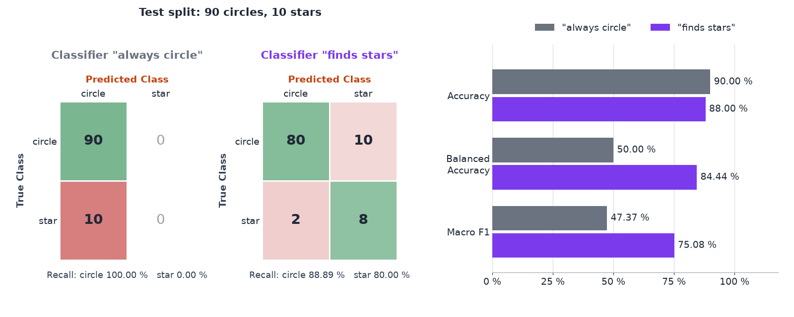
</p>
<p align="center"><em>On 90 circles and 10 stars, the classifier answering circle for every image has the higher accuracy, 90.00 % against 88.00 %, while its balanced accuracy, 50.00 %, and its macro F1, 47.37 %, show it never finds a star; the classifier finding 8 of the 10 stars at the cost of 10 circles reaches 84.44 % and 75.08 %. Computed by <code>compute_metrics_from_confusion_matrix</code>.</em></p>

#### Macro And Micro Averages

To keep the frequent and the rare classes apart in one number, a per-class metric is averaged in one of two ways.

- **Macro**: the plain mean of the metric over the classes, every class weighing the same. The report gives the `Macro F1`, the mean F1 over the classes present in the test split or predicted at least once (a class predicted without any test sample counts with its F1 of 0, as in scikit-learn); the balanced accuracy is the macro mean of the recall over the present classes, and the `Macro ROC AUC` and `Macro Average Precision` below are macro means too.
- **Micro**: the counts of every class are pooled first, then the metric is computed once, every sample weighing the same. With one class per sample, every sample adds one prediction and one true class, so the micro precision, recall and F1 all equal the accuracy; the multi-class report therefore gives no micro metric, and the multi-label report gives the `Micro F1` ([Multi-Label Metrics](#multi-label-metrics)).
- **Toy example**: the toy matrix has a macro F1 of 75.42 %, the mean of 81.93 %, 73.68 %, 82.93 % and 63.16 %; the classifier always answering circle gets 47.37 %, the mean of 94.74 % for circle and 0.00 % for star.
- **How to read it**: a low macro F1 next to a high accuracy points at a few weak classes, which the per-class table, sorted worst F1 first, lists at its top. On classes of a few test samples, a macro mean moves a lot from one checkpoint to the next.

#### Top-k Accuracy

Should you need to know whether the right class is at least among the first guesses of the model, for a human picking among suggestions or a second stage re-ranking them, read the top-k accuracy.

- **How it is computed**: the share of test samples whose true class is among their k most probable classes, `compute_top_k_accuracy` of `classification_metrics.py`. The k is fixed at 5 (`TOP_K_ACCURACY_CLASSES`) and clipped to the number of classes, so the report names it `Top-5 Accuracy`. It has no multi-label version.
- **Toy example**: three images whose probabilities over triangle, square, circle and star are `[0.10, 0.60, 0.25, 0.05]` (a square), `[0.05, 0.50, 0.40, 0.05]` (a circle) and `[0.45, 0.30, 0.05, 0.20]` (a star) have a top-1 accuracy (the accuracy) of 33.33 %, a top-2 accuracy of 66.67 %, a top-3 accuracy of 100.00 %, and a top-5 accuracy of 100.00 %, k being clipped to the 4 classes.
- **How to read it**: a large gap between the accuracy and the top-5 accuracy means the errors are between close classes, as in the 35-class report of the README classifier (81.76 % against 99.12 %). With 5 classes or fewer it is always 100.00 % and says nothing, as in the M2O run of 4 classes and the CMP run of 2 classes of the tutorials.

#### ROC Curve And ROC AUC

In order to judge how well the scores of one class separate its samples from all the others, whatever threshold a deployment picks, read its ROC curve and the area under it.

- **How it is computed**: every class is taken one against the rest, over the probability of that class for every test sample. Every distinct score is a threshold, a sample being accepted when its score reaches it (tied scores are accepted together). Every threshold gives one point, `true positive rate = accepted samples of the class / samples of the class` (its recall) against `false positive rate = accepted samples of other classes / samples of other classes`, the curve starting at (0, 0). `ROC AUC` is the trapezoidal area under it, as scikit-learn's `roc_auc_score`: the chance that a random sample of the class scores higher than a random sample of another class, ties counting half. It is undefined (`—`) for a class without samples or without other samples. `Macro ROC AUC` is its mean over the classes defining it. Code: `compute_class_score_curves`, `compute_curves_from_score_counts` and `compute_macro_curve_metrics` of `vision_training/evaluation/classification/score_curves.py`.
- **Where** (per-class report only): `roc_curves.png`, the column `ROC AUC` of the per-class table, `roc_auc` in `class_metrics.csv`, the TensorBoard tag `ROC AUC/<class>`, and `Macro ROC AUC` among the headline metrics.
- **Toy example**: 32 test images of the toy classifier, 8 per shape, scored with logits drawn from a fixed seed (animation below): the star class has a ROC AUC of 97.40 %, which is also the share of the 192 (star, other shape) pairs in which the star scores higher. The macro ROC AUC of the four shapes is 96.88 %.
- **How to read it**: 50 % is chance and 100 % a perfect ranking. Its rates are taken within the class and within all the other samples, so it ignores how rare the class is: in the 35-class report, `trapezoid` keeps a ROC AUC of 97.11 % while its average precision is 38.31 % and its F1 24.22 %, its false positives being diluted among the 48,613 other test images. Read the average precision for a rare class. With two classes (CMP), both classes get the same ROC AUC (98.33 % in the CMP tutorial run), the score of one being 1 minus the score of the other.

#### Average Precision Of A Class

For the scores of a rare class to be judged on the errors that matter to it, read its average precision, the area under its precision-recall curve.

- **How it is computed**: the same sweep of the thresholds of one class, one against the rest, gives at every threshold `precision = accepted samples of the class / accepted samples` and `recall = accepted samples of the class / samples of the class`. The average precision is the sum, over the thresholds from the highest, of the precision at every threshold times the recall it adds, as scikit-learn's `average_precision_score`:

  ```
  AP = sum over thresholds t of (recall(t) − recall(previous t)) × precision(t)
  ```

  It is the area under the step-wise curve of `precision_recall_curves.png`, without the interpolation of the detection AP, which also matches detections to objects (detection metrics). It is undefined for a class without test samples, and `Macro Average Precision` is its mean over the classes with samples. Code: `compute_curves_from_score_counts` and `compute_macro_curve_metrics` of `score_curves.py`.
- **Where** (per-class report only): `precision_recall_curves.png` (one plot up to 10 classes, a grid of panels above, the 100 lowest above 100 classes), the column `Average Precision` of the per-class table, `average_precision` in `class_metrics.csv`, the TensorBoard tag `Average Precision/<class>`, and `Macro Average Precision` among the headline metrics.
- **Toy example**: the star class of the 32 toy images has an average precision of 93.81 %: its 6 highest scores are stars (precision 100.00 % up to a recall of 75.00 %), then two other shapes come before the seventh star.
- **How to read it**: chance is the share of the class in the test split (1 / K with balanced classes), not 50 %. A high average precision needs the precision to stay high while the recall rises, which is what a deployment with a per-class threshold relies on.

<p align="center">
  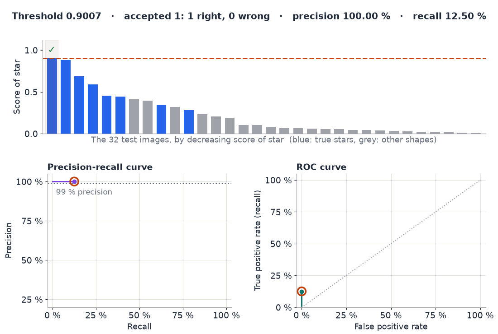
</p>
<p align="center"><em>The threshold of the star class swept down the 32 scored test images of the toy classifier (8 stars in blue, 24 other shapes in grey): every cut accepts one more image, right or wrong, and adds one point to the precision-recall curve (left) and the ROC curve (right), as computed by <code>compute_class_score_curves</code>. The last frame goes back to the threshold reaching 99 % precision, 0.4414, which keeps 6 of the 8 stars (<code>Recall @ P99 %</code> 75.00 %); the shaded areas are the average precision, 93.81 %, and the ROC AUC, 97.40 %.</em></p>

#### Threshold And Recall At A Target Precision

Say your deployment only accepts the class of a sample when its score reaches a threshold of that class, so that 99 % of what it accepts is right: the evaluation finds that threshold for every class and tells how much of the class it keeps.

- **How it is computed**: `find_score_threshold` and `find_class_thresholds` of `vision_training/evaluation/classification/threshold_finder.py`, for every target of `evaluation.target_precision` (0.99 in the configurations of the repository; a list such as `[0.99, 0.95, 0.90]` makes the first one the main target). Every class is taken one against the rest over the probability of that class for every test sample, whatever its most probable class. The scores are sorted from the highest, every distinct score being a cut that accepts the samples at or above it; among the cuts whose precision reaches the target with at least one right sample, the one keeping the most samples of the class wins, and among those the highest threshold (a lower one would only add wrong samples, keeping the recall at a precision closer to the target). The recall is counted over every test sample of the class. A class whose precision never reaches the target gets no threshold: `—` in the report, `null` in the file. With fewer than 100 accepted samples, 99 % precision means that none is wrong.
- **Where**: the columns `Threshold @ P99 %` (4 decimals) and `Recall @ P99 %` of the per-class table, a `Per Class Thresholds` table when several targets are given, the columns `threshold_at_target_precision` and `recall_at_target_precision` of `class_metrics.csv` (`threshold_at_precision_0.95` and `recall_at_precision_0.95` for the other targets), and `class_thresholds.json`, the exact values read by the deployment. `precision_recall_thresholds.png` zooms on the points of the thresholds and writes every threshold rounded down to the fewest decimals (at least 4) that select the same samples.
- **Toy example**: the 6 highest star scores of the toy images are stars and the seventh, 0.4130, is not, so the star threshold is the sixth score, 0.4414, with a recall of 6 / 8 = 75.00 % (last frame of the animation). The `class_thresholds.json` of the four toy classes reads:

  ```json
  {"logit_temperature": 1.0, "target_precision": 0.99,
   "classes": {"triangle": {"threshold": 0.5714178085327148, "recall": 0.75},
               "square": {"threshold": 0.37729308009147644, "recall": 0.875},
               "circle": {"threshold": 0.5392856597900391, "recall": 0.75},
               "star": {"threshold": 0.4414396584033966, "recall": 0.75}}}
  ```

- **How to read it**: `Recall @ P99 %` is the share of the class a deployment keeps at that precision. A tiny value means only the few highest scores are safe: `rhombus` keeps 0.14 % of its 1,425 test images (2 images) in the 35-class report. Since the threshold is taken one against the rest, it can be below 0.5 and keep more than the recall of the most probable class: in the CMP tutorial run at iteration 1000, `loss_of_object` has a threshold of 0.4881 and a `Recall @ P99 %` of 90.82 %, above its recall of 89.80 %. A precision of 99 % measured on a few hundred samples rests on a handful of them, and a threshold only holds at the temperature it was found at ([Logit Temperature](#logit-temperature)); a server applying the file must also decide what to do with the classes whose threshold is `null`.

#### Multi-Label Metrics

In case your images hold several classes at once (`ClassificationHead.output_mode: "multi_label"`), the report replaces the metrics of the most probable class with metrics of class decisions.

- **How it is computed**: every class is predicted when its sigmoid probability reaches 0.5 (`MULTI_LABEL_THRESHOLD` of `classification_trainer.py`), and is positive when its label is at least 0.5. `compute_multi_label_metrics` of `classification_metrics.py` gives:
  - `Subset Accuracy`: the share of test samples whose every class decision is right, the headline metric comparing the checkpoints.
  - `Micro F1`: `2 × right decisions / (positive decisions + positive labels)`, the counts pooled over the classes.
  - `Macro F1`: the mean F1 over the classes positive or predicted in at least one sample.
  - The precision, recall and F1 of every class, its support being its positive samples (column `Positives` of the report). The thresholds at a target precision, the ROC AUC, the average precision and the recall intervals are computed as above, the positives of a class being its labelled samples. There is no confusion matrix and no top-k accuracy.
- **Toy example**: four images over triangle, square, circle and star, decided at 0.5:

  | Image | True classes | Probabilities (triangle, square, circle, star) | Predicted classes | Every decision right |
  |---|---|---|---|---|
  | 1 | triangle, square | 0.9, 0.6, 0.2, 0.1 | triangle, square | yes |
  | 2 | circle | 0.1, 0.4, 0.8, 0.2 | circle | yes |
  | 3 | square, circle | 0.3, 0.7, 0.4, 0.1 | square | no, circle missed |
  | 4 | triangle, star | 0.8, 0.1, 0.6, 0.3 | triangle, circle | no, star missed and circle added |

  The subset accuracy is 50.00 % (2 of 4 images), the micro F1 76.92 % (5 right decisions, 6 predicted, 7 positive: 2 × 5 / 13), and the macro F1 62.50 %, the mean of the F1 of triangle (100.00 %), square (100.00 %), circle (50.00 %) and star (0.00 %).
- **How to read it**: the subset accuracy is strict and falls quickly as the classes per image grow; the micro F1 follows the frequent classes and the macro F1 the rare ones. The `accuracy` printed in the console during a multi-label training is the share of right class decisions, every class of every sample counted apart, so it reads far above the subset accuracy of the test report.

#### Logit Temperature

After a change to the logit temperature of an export, the scores the deployment sees change, and so do the thresholds it must apply.

- **What it does**: the probabilities become `softmax(logits / T)` (`sigmoid(logits / T)` in multi-label mode), `compute_temperature_probabilities` of `vision_training/evaluation/classification/temperature_explorer.py`. Every evaluation uses T = 1, written as `logit_temperature` in `class_thresholds.json`. With the per-class report, `temperature_explorer.html` shows the score distribution of every class and its thresholds from T = 0.5 to 10; served by `scripts/evaluation/serve_temperature_explorer.py`, it saves the thresholds of a chosen temperature to `saved_temperature_thresholds.json` and exports the classifier with it ([Export](#export)).
- **What it never changes**: dividing the logits of a sample by the same T > 0 keeps the order of its classes, so the most probable class, the confusion matrix, the accuracy, the balanced accuracy, the precision, recall and F1, the macro F1 and the top-k accuracy stay the same. A multi-label decision at 0.5 stays the same too, `sigmoid(z / T) ≥ 0.5` being `z ≥ 0` at every temperature.
- **What it changes**: the scores, and so the thresholds. With two classes or in multi-label mode, the samples keep their order by the score of a class, so only the threshold moves: six toy samples of two classes, their logits written by hand in the script of the figures, keep recalls of 33.33 % and 66.67 % at 99 % precision from T = 0.5 to 3, while the first threshold goes from 0.9975 to 0.9526 to 0.7311. With more than two classes, the score of one class also depends on the other logits of the sample, so the order of the samples can change, and with it the `Recall @ P99 %`, the ROC AUC and the average precision: the star class of the toy images keeps 75.00 % of its images at T = 1 and 50.00 % at T = 3, its ROC AUC going from 97.40 % to 94.79 %.
- **Toy example**: a square image with the logits 6, 3 and 0 over square, rectangle and circle gets the probabilities 0.950, 0.047 and 0.002 at T = 1, 0.665, 0.245 and 0.090 at T = 3, and 0.998, 0.002 and 0.000 at T = 0.5.
- **How to read it**: a temperature above 1 spreads the scores a well-trained softmax squeezes against 1, so that the thresholds do not all sit at 0.999 and above. A threshold only holds at the temperature it was found at, so the server must divide the logits by the same T; the ROC AUC, average precision and thresholds of the report are those of T = 1, while `draw_report_figures.py` draws its precision-recall curves at the saved temperature.

<p align="center">
  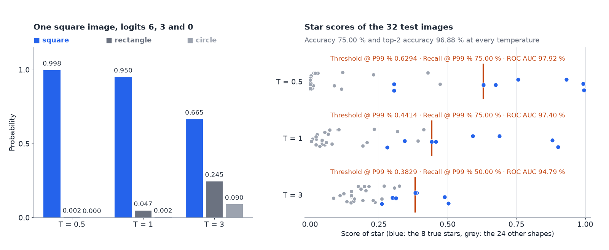
</p>
<p align="center"><em>Left: one square image whose logits 6, 3 and 0 are divided by 0.5, 1 and 3 before the softmax; the square stays the most probable class (0.998, 0.950, 0.665). Right: the star scores of the 32 toy test images at the same temperatures, computed by <code>compute_temperature_probabilities</code>: the accuracy (75.00 %) and the top-2 accuracy (96.88 %) never change, while the star threshold at 99 % precision moves from 0.6294 to 0.4414 to 0.3829 and, some images changing order, its recall falls from 75.00 % to 50.00 % at T = 3.</em></p>

#### Recall Intervals

So that a recall measured on a few hundred test samples is not read as an exact value, every task writes a 95 % confidence interval next to the recall of every class: the range that holds the recall the model would reach on unlimited data of the same kind in 95 % of the test splits one could draw.

- **Where**: the `Per Class Recall` table of the report (with the per-class report, worst recall first, columns `95 % Lower` and `95 % Upper`) and the columns `recall_lower` and `recall_upper` next to `recall` in `class_metrics.csv` (`<recall>_lower` and `<recall>_upper` for the recalls of the detection and keypoint tasks, e.g. `recall_50_lower`), none for a class without test samples. They are not sent to TensorBoard. The level is `CONFIDENCE_LEVEL` = 0.95 of `vision_training/evaluation/recall_intervals.py`.
- **Clopper-Pearson, over independent samples**: when every counted sample is drawn independently (the images of CLS, the sequences of M2O, the pairs of CMP, the k-NN images of SSL, the ground-truth objects of DET, INS and KPT), `compute_clopper_pearson_intervals` gives the exact interval of k samples found among n, from the quantiles of the beta distribution:

  ```
  lower = beta quantile 2.5 %  with parameters (k, n − k + 1)     0 when k = 0
  upper = beta quantile 97.5 % with parameters (k + 1, n − k)     1 when k = n
  ```

  It covers the true recall at least 95 % of the time, stays within 0 and 1, and narrows as about 1 / √n: a recall of 90 % lies between 55.50 % and 99.75 % on 10 samples, 82.38 % and 95.10 % on 100, 87.97 % and 91.79 % on 1,000, and four times more samples halve the width (5.5 points at 500, 2.7 at 2,000). In the CMP tutorial run at iteration 1000, `loss_of_object` has a recall of 89.80 % on 98 pairs, between 82.03 % and 95.00 %.
- **Korn-Graubard, over correlated samples**: when the samples come in groups that share their content (the frames of a test sequence for M2M and the selection accuracy of SEL, the pixels of a test image for SEG), the exact interval over the samples would be far too narrow, and `compute_bootstrap_recall_intervals` measures the variance over whole groups instead:
  1. The found and true samples of every class are added up per group (`sum_counts_by_group`).
  2. 1,000 bootstrap resamples (fixed seed 0, so an evaluation always gives the same interval) each draw as many groups as there are, with replacement; the recall of a class in a resample is its found samples over its true samples in the drawn groups, a resample without a true sample of the class not counting for it.
  3. From the variance v of these recalls and the recall p of the class, the independent samples giving the same variance are `p × (1 − p) / v`, at most the true samples of the class; multiplied by `(z / t)²`, the normal quantile over the Student quantile at the groups holding the class minus one, this gives the effective sample size, smaller when few groups hold the class.
  4. The bounds are the Clopper-Pearson interval of the recall p at that size, the counts being fractional. When every group holding the class has the same recall between 0 and 1 (1 frame of 2 found in every sequence), the variance is 0 and the size is the true samples of the class, the limit of step 3, reduced the same way. When the recall is 0 or 100 % (no group finding any of the class, or every group finding all of it), or a single group holds it, the variance says nothing and the size is the number of groups holding the class, each counted as one sample.

  The effective size is not written to any file. On 1,000 frames of 100 test sequences with a recall of 90 %, the frames taken as independent would give 87.97 % to 91.79 %; with the 100 missed frames scattered at random the Korn-Graubard interval is about the same, 87.94 % to 91.81 % (effective size 976), with 5 frames missed in each of 20 sequences it is 85.34 % to 93.57 % (227), and with 10 sequences missed whole 82.40 % to 95.09 % (100), the interval of 100 independent samples.
- **How to read it**: two classes or two checkpoints whose intervals overlap widely may differ by chance alone, and a class of a few test samples has a wide interval even at a recall of 100 % (the M2O tutorial run finds all 49 `moving_right` sequences at iteration 250, between 92.75 % and 100.00 %). For correlated samples, the number that matters is the number of groups holding the class, not the number of frames or pixels.

<p align="center">
  
</p>
<p align="center"><em>Left: the exact 95 % interval of a recall of 90 % (<code>compute_clopper_pearson_intervals</code>) from 10 to 5,000 independent samples, from 55.50 % to 99.75 % at 10 samples and from 89.13 % to 90.82 % at 5,000. Right: the same recall over 1,000 frames of 100 test sequences (<code>compute_bootstrap_recall_intervals</code>): misses scattered at random give about the interval of 1,000 independent frames (effective size 976), 5 misses in each of 20 sequences an effective size of 227, and 10 sequences missed whole an effective size of 100. The effective sizes are recovered by finding the size whose Clopper-Pearson interval has the same lower bound.</em></p>

#### Sequences, Pairs And Frames

To find your way in the reports of the sequence tasks, map their samples onto the images of CLS: the metrics above are computed by the same code, and only what counts as one sample changes.

- **M2O**: one test sequence is one sample, classified as a whole (`200 Test Sequences` in the header of the report). Every metric above applies to the sequences, the recall intervals being Clopper-Pearson over the sequences; there is no temperature explorer nor `class_logits.npz`. The M2O tutorial run reaches an accuracy of 99.00 % and a balanced accuracy of 99.04 % at iteration 500.
- **CMP**: one test pair (a before and an after sequence) is one sample (`200 Test Pairs`), with the same metrics and Clopper-Pearson intervals over the pairs. With its 2 classes, the `Top-5 Accuracy` is always 100.00 % and both classes share one ROC AUC; the CMP tutorial run reaches 95.00 % accuracy at iteration 1000.
- **M2M**: one labelled frame is one sample (`10000 Test Sequences, 69918 Labelled Frames` in the tutorial run), padding frames and frames of unmapped categories being left out. `Accuracy` is the frame accuracy, the per-class table counts `Frames`, and the confusion matrix, thresholds and curves are those of the frames. The recall intervals are Korn-Graubard over the test sequences (`compute_recall_intervals` of `vision_training/trainers/sequence_labelling_trainer.py`): in the tutorial run, `appearing_kite` is never found on its 501 frames, an interval of 0.00 % to 0.75 %. The report adds the sequence exact match, the [edit score](#edit-score) and the [segment F1](#segment-f110-25-and-50), explained with the sequence metrics.

### Object Detection And Instance Segmentation (DET, INS)
Should your model draw boxes or masks around the objects, its report rests on the overlap measure and the matching rule below, which the keypoint detection reuses for its OKS mAP: read them in this order.

#### Intersection Over Union Of Two Boxes
Before reading any detection number, know that every one of them rests on a single overlap measure between a predicted box and a true box.

The intersection over union (IoU) answers "how well does this box sit on this object": 1 for identical boxes, 0 for disjoint ones. The repository uses it to match detections to objects (mAP, recalls, confusion matrix), to assign the anchors and proposals their targets in training, in the non-maximum suppression, and in the anchor and proposal recalls.

It is computed by `get_intersection_over_union` of `vision_training/models/detection/box_operations.py`, for every pair of two sets of `[x1, y1, x2, y2]` boxes in pixels:
```
area(box)   = (x2 - x1) * (y2 - y1)
IoU(A, B)   = area(A ∩ B) / (area(A) + area(B) - area(A ∩ B))
```
- The coordinates are continuous (no "+ 1" pixel convention), so a box `[0, 0, 10, 10]` has an area of 100 square pixels.
- The union is clamped to the smallest positive value of its type instead of adding an epsilon: an exact ratio such as 3 / 4 stays exactly 0.75 and reaches a threshold of 0.75, and two empty boxes give 0.
- The evaluation converts the boxes to float64 before the division (`gather_class_detections`, `compute_overlap_matrix`), so an IoU of exactly 0.95 counts at the threshold 0.95.

Four toy pairs against the same 120 x 120 ground truth box: a box shifted by 40 and 30 pixels gives `7,200 / 21,600 = 0.33`, a box shifted by a third of its width `0.50`, a box missing the bottom quarter `0.75`, and a box 6 pixels short `0.95`.

<p align="center">
  
</p>
<p align="center"><em>The same 120 x 120 ground truth box (blue) against four detections (orange), the IoU computed by <code>get_intersection_over_union</code>: 0.33, 0.50, 0.75 and 0.95, and whether each pair counts as a match at the thresholds 0.5, 0.75 and 0.95 of the mAP.</em></p>

How to read it: an IoU of 0.5 still allows a box shifted by a third of its width, which is why mAP@0.5 says little about localisation. The IoU punishes the same pixel error more on a small object: a box one pixel short on one side of a 20 x 20 object gives `19 x 20 / 400 = 0.95`, two pixels short 0.90, an error a 200-pixel object absorbs at 0.995, so the small objects fall first at the strict thresholds.

#### Matching Detections To Ground Truths
Say you have two detections on the same parcel, or one detection lying across two parcels: before any precision or recall can be counted, each detection must be declared right or wrong, and this rule decides it.

The matching tells which detections found an object (true positives) and which did not (false positives). It is done class by class and threshold by threshold by `gather_class_detections`, `find_best_ground_truth` and `match_detections_to_ground_truth` of `vision_training/evaluation/detection/mean_average_precision.py`:
- Only the detections of one predicted class are compared with the ground truths of that same class, in their own image. A detection of the wrong class is never compared with the object it covers: it is a false positive of its own class, and the object stays unfound for its class unless a detection of the right class finds it.
- Every detection keeps its best ground truth, the one of its class and image it overlaps most. This does not depend on the threshold, so it is computed once.
- The detections of the class over the whole test split are sorted by decreasing score (a stable sort, ties keeping the image order), then visited greedily: a detection is a true positive when its best ground truth overlaps it by at least the IoU threshold and was not taken by a more confident detection; otherwise it is a false positive. A ground truth is taken at most once.
- This is the PASCAL VOC rule: a detection whose best ground truth is already taken is a false positive even if another free ground truth of its class overlaps it above the threshold. The official COCO tools would give it that other ground truth, so the numbers of the repository at any threshold are not those of the COCO tools.
- Only the detections the evaluation keeps enter the matching: score at least `evaluation.score_threshold` (0.05 in the example configurations, lower than the deployment `Detector.inference.score_threshold` of 0.5 so that the curves keep their low-confidence end), at most `Detector.inference.maximum_detections` (100) per image after the per-class non-maximum suppression.

A toy case of the VOC rule, computed by `evaluate_detections`: two parcels `[0, 0, 100, 100]` and `[40, 0, 140, 100]`, a first detection exactly on the first one (score 0.9) and a second one `[15, 0, 115, 100]` (score 0.8) overlapping the first parcel by 0.74 and the second by 0.60. The second detection's best ground truth is already taken, so it is a false positive: AP@0.5 50.00 % and recall 50.00 %, where a matching to the best free ground truth would have found both parcels.

How to read it: duplicates count against the precision (non-maximum suppression too loose), boxes below the threshold count twice, once as a false positive and once as a missed object. The [precision-recall GIF](#precision-recall-curve-and-average-precision-of-a-class) below shows the matching step by step.

#### Precision-Recall Curve And Average Precision Of A Class
If one wishes to judge a detector of one class across all its score thresholds at once, without choosing a deployment threshold first, this curve and its area are the tool.

The average precision (AP) of a class answers "if I rank all the detections of this class by score, how well are the true positives ranked above the false positives, and how many objects are reached at all". It is built by `compute_precision_recall` and `compute_average_precision` of `mean_average_precision.py`:
```
for the k most confident detections of the class over the test split:
  precision_k = true positives among them / k
  recall_k    = true positives among them / ground truths of the class (found or not)
```
Every detection, in score order, is one point of the curve: the precision and recall obtained if the score threshold were its score. The curve is then summarised by one of three methods, all printed in the report (rows `Area`, `11 Point`, `101 Point`):
- **Area** (PASCAL VOC 2010 and later, the headline): the points at recall 0 and recall 1 with precision 0 are added, every precision is replaced by the highest precision at the same or a higher recall (the envelope, which removes the zigzag), and the rectangles `recall step x envelope precision` are summed.
- **11 point** (PASCAL VOC 2007): the mean of the envelope precision at the recalls 0, 0.1, ..., 1.0, a level beyond the highest recall reached counting 0.
- **101 point** (COCO): the same at the recalls 0, 0.01, ..., 1.0.
- Edge cases: a class without any detection has an AP of 0; a class without any ground truth has no AP (written "—") and is left out of every mean.

The toy example of the GIF: three test images with five ground truth circles (A1, A2, B1, B2, C1) and eight circle detections. At IoU 0.5 the matching gives, by decreasing score: #1 0.95 true positive on A1 (IoU 0.98), #2 0.90 true positive on B1 (0.82), #3 0.85 duplicate on A1 (0.69, already taken), #4 0.80 false positive on the background, #5 0.70 true positive on C1 (0.63), #6 0.60 false positive on B2 (0.41, below 0.5), #7 0.45 true positive on A2 (0.78), #8 0.30 false positive. The curve ends at a recall of 0.8, B2 never being found. The three methods give:
```
area      = 0.2 x 1.00 + 0.2 x 1.00 + 0.2 x 0.60 + 0.2 x 0.5714            = 63.43 %
11 point  = (5 levels at 1.00 + 2 at 0.60 + 2 at 0.5714 + 2 at 0) / 11    = 66.75 %
101 point                                                                   = 63.79 %
```

<p align="center">
  
</p>
<p align="center"><em>Greedy matching at IoU 0.5 of eight circle detections, sorted by score, to five ground truth circles over three test images: each step adds one point to the precision-recall curve (green true positive, red false positive, orange duplicate). The last frames shade the area of the area method (AP 63.43 %) and mark the samples of the 11-point (66.75 %) and 101-point (63.79 %) methods, all computed by <code>compute_average_precision</code>.</em></p>

The per-class table of the report (`Per Class Average Precision (Area)`, with `evaluation.per_class_report`) lists for every class its `Ground Truths` and its AP of the area method at 0.5, 0.75, 0.95 and 0.5 to 0.95, worst AP@0.5 first, followed by the score threshold reaching `evaluation.target_precision` and the recall it keeps (`Threshold @ P99 %`, `Recall @ P99 %`, read from the same curve at IoU 0.5, see [the threshold at a target precision](#threshold-and-recall-at-a-target-precision)). The same values are in `class_metrics.csv` (`average_precision_50`, `average_precision_75`, `average_precision_95`, `average_precision_50_95`, between 0 and 1) and in TensorBoard and MLflow as `AP@0.5/<class>` (`test_class/` in MLflow).

How to read it: the AP mixes ranking and coverage. A class with a high recall and a low AP is found, but its true positives are ranked among many false positives: in the object detection run of the tutorials (iteration 5000, 5,000 test images), the kite has an AP@0.5 of 32.81 % with a recall@0.5 of 92.65 %, and none of its detections reaches the deployment threshold of 0.50, so that the confusion matrix counts 714 of its 776 objects as missed. The three methods differ by a few points (75.25 %, 72.09 % and 74.99 % at 0.5 in that run, the 11-point method above or below the area depending on the curve): compare runs with the same method, the area one.

#### mAP@0.5, mAP@0.75, mAP@0.95 And mAP@[0.5:0.95]
To be able to tell whether a detector finds the objects or also draws their boxes tightly, read its mean average precision at several IoU thresholds instead of one.

The mean average precision (mAP) at a threshold is the mean of the AP of the classes at that threshold. `evaluate_detections` of `mean_average_precision.py` matches the detections at the ten thresholds `0.50, 0.55, ..., 0.95` (`INTERSECTION_OVER_UNION_THRESHOLDS`), and `summarise_thresholds` reports:
```
mAP@t          = mean over the classes with at least one ground truth of AP@t
mAP@[0.5:0.95] = mean of mAP@0.50, mAP@0.55, ..., mAP@0.95   (COCO-style average)
```
- The mean is a macro average: every class with ground truth weighs the same, whatever its number of objects; a class without ground truth is left out, a class never detected counts 0.
- The table `Mean Average Precision` of the report holds one row per method and the columns `mAP@0.5`, `mAP@0.75`, `mAP@0.95`, `mAP@[0.5:0.95]`; TensorBoard and MLflow name them `mAP@0.5/area`, `mAP@[0.5:0.95]/101_point`, and so on (`test/` and `test_ema/` in MLflow).
- `mAP@0.5/area` compares the checkpoints of an object detection run (`headline_metric` of `compute_evaluation_results` in `vision_training/trainers/detection_trainer.py`): it is the best value tracked in MLflow (`test/best_mAP@0.5/area`), the metric of `evaluation_curves.png` and of the best checkpoint line of `evaluate_checkpoint.py`. The instance segmentation uses `Mask mAP@0.5/area` ([mask mAP](#mask-iou-and-mask-map)).

The same eight toy detections at the ten thresholds give an AP of 63.43 % up to 0.60, 48.57 % from 0.65 to 0.75 (#5, at 0.63, becomes a false positive), 40.00 % at 0.80 (#7 at 0.78 drops), and 20.00 % from 0.85 (#2 at 0.82 drops, only #1 at 0.98 remains): mAP@0.5 63.43 %, mAP@0.75 48.57 %, mAP@0.95 20.00 % and mAP@[0.5:0.95] 43.60 %.

<p align="center">
  
</p>
<p align="center"><em>The eight detections of the GIF judged at each of the ten thresholds (TP true positive, FP false positive) by <code>match_detections_to_ground_truth</code>, with the AP of the area method under every column: the stricter the threshold, the fewer true positives, so mAP@[0.5:0.95] (43.60 %) sits below mAP@0.5 (63.43 %).</em></p>

How to read it: mAP@0.5 measures finding and classifying the objects; the gap to mAP@0.75 measures the localisation. In the object detection run of the tutorials (iteration 5000), the trained weights reach 75.25 % at 0.5, 68.29 % at 0.75, 0.49 % at 0.95 and 55.05 % over 0.5 to 0.95, the moving average of the weights 77.78 %, 74.06 %, 5.73 % and 63.55 %: mAP@0.95 stays near zero because a box within 5 % of the object is rare, and the averaged weights gain most at the strict thresholds. Two pitfalls: the mAP@[0.5:0.95] of the repository uses the VOC matching at every threshold and is not the number the COCO tools would print, and a macro mean lets a few rare classes move it as much as the frequent ones.

#### AP And mAP By Object Size
In case you suspect the detector of missing only the small objects, the overall mAP will not show it; the same mAP restricted to each object size will.

The mAP by size repeats the evaluation for the small, medium and large objects of COCO, `OBJECT_SIZE_RANGES` of `vision_training/evaluation/detection/object_sizes.py`:
```
small  : area <  32 x 32 = 1,024 square pixels
medium : 1,024 <= area < 96 x 96 = 9,216
large  : area >= 9,216
```
- The area is the box area in network input pixels (the size the detection levels see) for the object detection and the box mAP of the instance segmentation, the mask area (number of pixels) for the mask mAP, and in original image pixels with [the evaluation at the original resolution](#evaluation-at-the-original-resolution).
- `select_object_size_detections` of `mean_average_precision.py` applies the COCO rule for one size: the ground truths of the other sizes are ignored, and so are the detections matched to them (their best ground truth overlaps them by at least the threshold) and the unmatched detections whose own box is of another size. A detection whose best ground truth of the size is already taken stays a false positive.
- A size without objects has no mAP ("—" in the table, no scalar).
- The table `Mean Average Precision By Object Size (Area)` (area method only) gives the number of objects of each size and its mAP at 0.5, 0.75, 0.95 and 0.5 to 0.95; `class_metrics.csv` holds `average_precision_50_<size>` and `average_precision_50_95_<size>` per class; TensorBoard and MLflow `mAP@0.5 By Size/<size>` and `mAP@[0.5:0.95] By Size/<size>`.

In the toy example, A2 (24 x 24 = 576 square pixels) is small, B1, B2 and C1 (60 x 60, 50 x 50, 70 x 70) are medium and A1 (100 x 100) is large. The medium row keeps the two medium true positives and the three false positives whose own box is medium (#4 and #8, 40 x 40, and #6, 50 x 50, matched to nothing): mAP@0.5 small 100.00 %, medium 55.56 %, large 100.00 %, and mAP@[0.5:0.95] 60.00 %, 30.00 % and 100.00 %.

How to read it: compare the rows with the overall mAP and with the [anchor recall](#anchor-recall) by size. In the object detection run of the tutorials (iteration 5000), the small objects reach a mAP@0.5 of 71.25 %, the medium 80.09 % and the large 73.17 %. A weak size points at the levels and anchors serving it (a finer level or smaller anchors for the small objects, a larger anchor scale for the large ones). A row with few objects is noisy; read its `Objects` column first.

#### Mean Average Recall
Should you need to know whether the objects are found at all, whatever the score of the detection that finds them, read the mean average recall next to the mAP.

The mean average recall (mAR) answers "which share of the objects has a kept detection of the right class on it". `compute_mean_average_precision` of `mean_average_precision.py` counts, for every class and threshold, the true positives of the matching among all the detections kept for the evaluation (from `evaluation.score_threshold`, at most `maximum_detections` per image):
```
recall of a class at t = true positives at t / ground truths of the class
mAR@t                  = mean over the classes with ground truth of their recall at t
mAR@[0.5:0.95]         = mean of mAR@0.50, ..., mAR@0.95
```
- It does not depend on the average precision method, nor on the order of the detections beyond the matching itself.
- The table `Mean Average Recall` gives one row for all the objects and one per size (`Objects Of`, `Objects`, `mAR@0.5`, `mAR@0.75`, `mAR@0.95`, `mAR@[0.5:0.95]`); the scalars are `mAR@0.5/all`, `mAR@0.5/small`, and so on. With at most 100 detections per image, `mAR@[0.5:0.95]` is close to the AR@100 of COCO, with the VOC matching of the repository.

In the toy example, four of the five circles are found at 0.5 (B2 has only a detection at 0.41): mAR@0.5 80.00 %, mAR@0.75 60.00 %, mAR@0.95 20.00 %, mAR@[0.5:0.95] 52.00 %.

How to read it: the mAR is the ceiling of the recall the precision-recall curve reaches. A high mAR with a low mAP means the objects are found but ranked below false positives (in the object detection run of the tutorials, mAR@0.5 96.65 % against mAP@0.5 75.25 %); a low mAR means objects that no kept detection reaches, to be compared with the [proposal recall](#proposal-recall). A very low `evaluation.score_threshold` raises the mAR without changing what the deployed detector returns.

#### Per-Class Recall At IoU 0.5 And 0.75
If you are looking for the share of the objects of each class that the detector finds, with the uncertainty that its number of test objects allows, this table gives it.

The per-class recall is the recall of one class at IoU 0.5 and at 0.75, from the same matching as the mAR (all the kept detections, whatever their score), with an exact 95 % confidence interval over the ground truths of the class. `build_class_average_precision_rows` of `vision_training/evaluation/detection/average_precision_report.py` reads it (`CLASS_RECALL_COLUMNS`), recovers the true positives as `round(recall x ground truths)` and computes the Clopper-Pearson interval, explained with [the recall intervals](#recall-intervals).
- With `evaluation.per_class_report`, the table `Per Class Recall` (columns `Ground Truths`, `Recall @0.5`, `95 % Lower`, `95 % Upper`, `Recall @0.75`, ...) follows the per-class AP table, worst recall at 0.5 first; the instance segmentation prints a `Mask Per Class Recall` and a `Box Per Class Recall`.
- `class_metrics.csv` always holds `recall_50`, `recall_50_lower`, `recall_50_upper`, `recall_75`, `recall_75_lower`, `recall_75_upper` (prefixed `mask_` for the masks); a class without ground truth has none.

In the toy example, the circle class has a recall of 80.00 % at 0.5 with an interval of 28.36 % to 99.49 %, and 60.00 % at 0.75 (14.66 % to 94.73 %): five objects say little. In the object detection run of the tutorials, the triangle reaches 90.20 % at 0.5 over 796 ground truths, interval 87.92 % to 92.18 %.

How to read it: two classes whose intervals overlap are not shown apart by the test split. A class whose recall at 0.75 falls far below its recall at 0.5 is found but poorly boxed (the L shape of that run: 94.18 % at 0.5, 75.47 % at 0.75).

#### Detection Confusion Matrix
Suppose the deployed detector returns only the detections above `Detector.inference.score_threshold`: the confusion matrix shows what it gets right and wrong at that threshold, which the mAP, taken over all scores, does not.

The confusion matrix counts four outcomes on the test split: right (an object found with its class), wrong class (an object found with another class), false positive (a detection finding no object) and missed (an object found by no detection). It is built per test image by `vision_training/evaluation/detection/detection_confusion.py`:
- Only the detections whose score reaches `Detector.inference.score_threshold` (0.50 in the example configurations) are kept, not those of the evaluation threshold.
- `match_image_detections` makes two passes over the detections, from the most to the least confident, each detection taking the free object it overlaps most at an IoU of at least 0.5 (`MATCHING_INTERSECTION_OVER_UNION_THRESHOLD`): the first pass among the objects of its own class, so that an object found with its class counts as found even when a detection of another class overlaps it more, the second among the objects left of any class, which gives the confusions. One object per detection, one detection per object.
- `add_to_confusion_matrix` puts every detection in the row of the class of its object and the column of its own class, a false positive in the `background` row and a missed object in the `background` column; `summarise_confusion_matrix` reads the four counts.
- The report note prints them, e.g. `Confusion Matrix : score >= 0.50, IoU >= 0.5 (boxes), 17096 right, 2347 wrong class, 1775 false positives, 8005 missed`; the matrix is saved in `confusion_matrix.csv` and, with `evaluation.per_class_report`, drawn in `confusion_matrix.png`; with `error_dumps.activated` the images go to `Errors/FALSE-POSITIVE/<class>/`, `Errors/MISSED/<class>/` and `Errors/<TRUE>-TO-<PREDICTED>/` (`group_image_errors`). The instance segmentation matches by mask IoU (`(masks)` in the note).

The toy image holds a square, a circle, a triangle and a star, and six detections: a square (0.92) and a circle (0.88) right, a star (0.81) on the triangle, a circle (0.66) on the background, a second square (0.58, IoU 0.60 with the square already taken) and a star (0.30) on the star, under the threshold. The note reads 2 right, 1 wrong class, 2 false positives (the background circle and the duplicate square) and 1 missed (the star), and the image goes to `FALSE-POSITIVE/circle`, `FALSE-POSITIVE/square`, `MISSED/star` and `triangle-TO-star`. The mAP of the same detections, matched class by class from the evaluation threshold 0.05, sees them otherwise: the star at 0.30 finds its star (AP@0.5 of the star 50.00 %, behind the false positive star at 0.81), the triangle is never found by a triangle detection (AP 0.00 %), square and circle reach 100.00 %, mAP@0.5 62.50 %.

<p align="center">
  
</p>
<p align="center"><em>The four outcomes on one toy image at the deployment threshold 0.50, counted by <code>add_to_confusion_matrix</code> (background row: false positives, background column: missed objects): 2 right, 1 wrong class, 2 false positives, 1 missed. On the right, the AP@0.5 of the same detections, from the evaluation threshold 0.05 and matched class by class (mAP@0.5 62.50 %).</em></p>

How to read it: right + wrong class + missed equals the number of test objects (17,096 + 2,347 + 8,005 = 27,448 in the object detection run of the tutorials). There, with a mAR@0.5 of 96.65 %, most of the 8,005 missed objects do have a detection, scored under 0.50: the deployment threshold, or the per-class thresholds of `class_thresholds.json`, decides them. The largest off-diagonal cells name the class pairs to look at in the error images.

#### Proposal Recall
After a change to the anchors, the region proposal settings or the proposal selection, check that the proposals still cover the test objects, since the detection heads can only refine and classify what the region proposal network hands them.

The proposal recall answers "which share of the test objects has a proposal close enough for the detection heads". `accumulate_proposal_recall` and `summarise_proposal_recall` of `vision_training/evaluation/detection/region_recall.py` take, at every evaluated checkpoint and for every test object, the best IoU with the valid proposals the region proposal network gives the heads at inference (the padding copies left out), then:
```
Recall@0.5 = objects whose best proposal IoU >= 0.5 / objects     (PROPOSAL_RECALL_THRESHOLDS = [0.5, 0.7])
Recall@0.7 = objects whose best proposal IoU >= 0.7 / objects
```
- Rows: all the objects, every size (box area in network input pixels), then the proposals of every block alone (`Block <n> Proposals`), with the mean number of valid proposals per image; a size without objects is written "—".
- Saved in `proposal_recall.csv` (`group`, `objects`, `recall_50`, `recall_70`, `proposals_per_image`), with the scalars `Proposal Recall@0.5/<group>`, `Proposal Recall@0.7/<group>` and `Proposals Per Image/<group>`. The instance segmentation measures it at the network resolution, also with `evaluation.original_resolution`.

The five toy objects of the anchor figure below, against five proposals (two of block 4, three of block 5): Recall@0.5 100.00 % and Recall@0.7 60.00 % for all of them, 40.00 % and 20.00 % with the block 4 proposals alone, 60.00 % and 40.00 % with those of block 5.

How to read it: the 0.7 column tells whether the proposals are close enough to be refined into tight boxes. In the object detection run of the tutorials (iteration 5000), 98.39 % of the 27,448 test objects have a proposal at 0.5 and 95.70 % at 0.7, 95.38 % and 89.13 % of the small ones; the blocks alone reach 33.57 %, 38.80 %, 40.72 % and 48.74 %, more than 100 % together since the levels cover the same objects, and block 4 takes 238.69 of the 250 proposals per image. A proposal recall far above the [mean average recall](#mean-average-recall) points at the detection heads; a low one at the anchors, the proposal counts or the selection.

#### Anchor Recall
For the region proposal network to learn an object, at least one anchor must overlap it by its foreground threshold: the anchor recall, printed at every launch before the training, says which share of the training objects has one.

It is measured once per launch on the training objects, read from the annotations without loading any image and without augmentation (`analyse_training_data` of `detection_trainer.py`), and by the diagnosis mode `diagnosis_modes.compute_anchor_coverage` on the training, validation and test splits at its own `iou_threshold` ([Augmentation And Diagnosis Modes](#augmentation-and-diagnosis-modes)). `Anchors.compute_best_overlaps` of `vision_training/models/detection/anchors.py` gives the exact IoU of the best anchor of every object in every level (the grid anchor nearest the box centre for each scale and aspect ratio), and `summarise_anchor_recall` of `region_recall.py`:
```
recall of a level = objects whose best anchor of the level has IoU >= RegionProposal.foreground_iou_threshold.min / objects
All Levels        = the same with the best anchor over all the levels (the network assigns all the levels at once)
```
- The console table `Anchor Recall Of The Training Objects` has one row for all the objects and one per size (box area in network input pixels), one column per level (`Block <n>`) and `All Levels`; `anchor_recall.csv` in the run folder holds `objects`, `count`, `recall_block_<n>` and `recall_all_levels` between 0 and 1.
- An object under the threshold in every level is not lost: the region proposal network still makes its single best anchor foreground, but it learns it from one anchor only.

In the toy figure (256-pixel input, block 4 with 16-pixel anchors every 8 pixels, block 5 with 64-pixel anchors at aspect ratios 0.5, 1 and 2 every 32 pixels), the 10 x 10 square reaches 0.39, the 20 x 20 square 0.64 (block 4), the 48 x 48 square 0.56 and the 84 x 36 rectangle 0.74 (block 5, wide anchor), the 112 x 112 square 0.33: All Levels 60.00 %, small 50.00 %, medium 100.00 %, large 0.00 %.

<p align="center">
  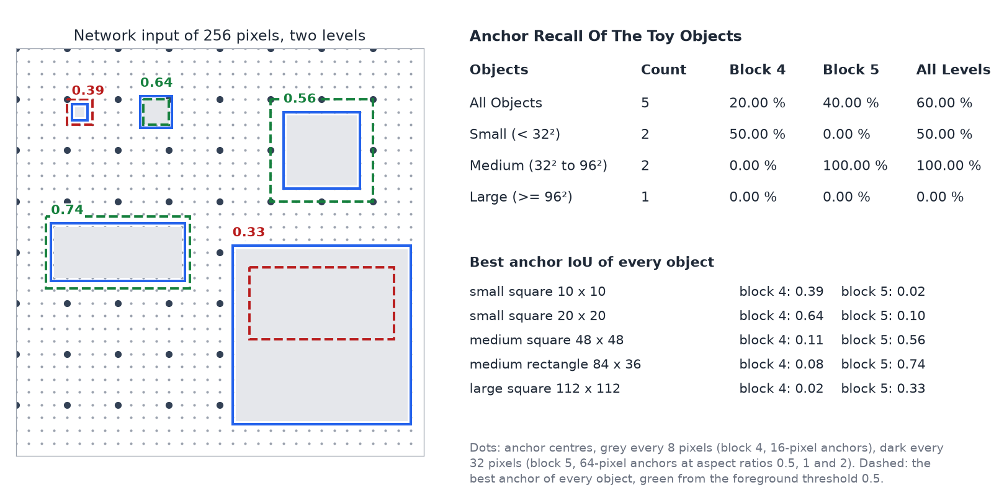
</p>
<p align="center"><em>Five toy objects (blue) and the best anchor of each over two levels (dashed, green from the foreground threshold 0.5, red under it), computed by <code>compute_best_anchor_overlaps</code>, with the table of <code>summarise_anchor_recall</code>: the 10-pixel square is too small for the 16-pixel anchors and the 112-pixel square too large for the 64-pixel ones.</em></p>

How to read it: read `All Levels` size by size. In the object detection run of the tutorials, 78.02 % of the 703,879 training objects have an anchor at 0.5, but 43.99 % of the small ones, against 80.93 % of the medium and 92.24 % of the large: the small objects learn from few anchors, consistent with their lower mAP. Smaller scales on a finer level help the small objects, a larger scale the large ones, other aspect ratios the elongated ones.

#### Mask IoU And Mask mAP
Whenever an instance segmentation run is evaluated, its detections are scored twice, by their masks and by their boxes, and the mask IoU replaces the box IoU in every matching of the mask metrics.

The mask IoU compares the pixels of a predicted mask with those of a ground truth mask:
```
mask IoU = pixels in both masks / pixels in either mask     (0 for two empty masks)
```
- The instance segmentation trainer pastes the `MaskHead.mask_resolution` (28 x 28) probabilities of every detection into its box at the size of the ground truth masks (`paste_instance_masks`), keeps the pixels from `MaskHead.inference.mask_threshold` (0.5), and compares every detection with every object of the image by `compute_mask_intersection_over_union` of `vision_training/models/instance_segmentation/mask_operations.py` (`compute_mask_overlaps` of `vision_training/trainers/instance_segmentation_trainer.py`). The pixel counts are exact and the ratio is taken in float64, so an exact 13 / 20 is not pushed below 0.65.
- The mask mAP is `evaluate_detections` with these overlaps (`overlap_type="masks"`): the same matching, curves, methods, thresholds and mean average recall as the boxes, the objects being sized by their mask area. The report prints the `Mask` tables (`Mask Mean Average Precision`, `Mask Mean Average Precision By Object Size (Area)`, `Mask Mean Average Recall`, `Mask Per Class Average Precision (Area)`, ...) before the `Box` tables of the same detections; the mask scalars start with `Mask ` (`Mask mAP@0.5/area`, `Mask mAR@0.5/all`), the box scalars keep the names of the object detection so that both tasks compare, and the mask columns of `class_metrics.csv` start with `mask_`.
- `Mask mAP@0.5/area` compares the checkpoints of an instance segmentation run (`headline_metric` of `compute_evaluation_results` in `instance_segmentation_trainer.py`). The class thresholds, the confusion matrix and the error images also match by masks.

Two toy masks show how far the two overlaps can disagree, both computed by the repository functions on 96 x 96 masks (the boxes being the tight boxes of the masks, `compute_mask_bounding_boxes`): a hollow square whose predicted mask fills the hole has a box IoU of 1.00 and a mask IoU of 0.64; an L shape whose mask misses the top 20 pixels of its arm has a box IoU of 0.69 and a mask IoU of 0.81, a match at 0.75 by its mask but not by its box.

<p align="center">
  
</p>
<p align="center"><em>Mask IoU against box IoU of the same objects, computed by <code>compute_mask_intersection_over_union</code> and <code>get_intersection_over_union</code>: a mask spilling into a hole keeps a perfect box (1.00) with a mask IoU of 0.64, a mask missing a thin arm loses more box IoU (0.69) than mask IoU (0.81).</em></p>

How to read it: in the instance segmentation run of the README screenshots (iteration 6000), the mask mAP reaches 82.96 % at 0.5, 72.02 % at 0.75, 1.69 % at 0.95 and 60.97 % over 0.5 to 0.95, the boxes of the same detections 83.54 %, 77.43 %, 0.52 % and 61.99 %: at 0.95 the masks do better, a mask being scored on all its pixels where a box one pixel off on a small object already fails. The mask and box size tables hold different objects (8,080 small objects by mask area against 5,778 by box area), since a mask covers less than its box. A box mAP close to the mask mAP with a mask IoU low on hollow or thin classes points at the mask head, not at the detector.

#### Evaluation At The Original Resolution
So that the mask and box mAP of an instance segmentation run are measured on the images as they arrive in deployment, as COCO measures them, turn on `ExperimentConfiguration.evaluation.original_resolution`.

With it off (the default of the example configurations), the boxes and masks are scored at the network resolution, the objects measured in network input pixels, and an object whose mask vanishes once resized is removed from the test objects. With it on (`InstanceSegmentationTrainer`, `add_original_instances` of `vision_training/data/detection/coco_dataset.py`):
- The test loader also builds every object at the original resolution, its mask from the annotation at the image size and its box as the tight box of that mask; only the objects without any pixel in the original image are removed, so an object vanishing at the network resolution stays, and counts as missed unless found.
- The detection boxes are brought back to the original image by undoing the resizing and padding (`restore_detection_boxes`, like the clients): clipped to the image for the box mAP, whole for pasting the masks, which are then thresholded at the original size.
- The object sizes are measured in original image pixels (the legends say "original image pixels"), while the proposal recall and the sample and error images stay at the network resolution. The masks of large images take more memory and time: the trainer compares fewer detections at once on them.

A toy object makes the size difference concrete: a 60 x 60 object in a 1280 x 720 image, letterboxed into a 512-pixel input by `preprocess_boxes`, becomes the box `[240, 232, 264, 256]`, 24 x 24 = 576 square pixels, a small object at the network resolution but a medium one (3,600 square pixels) at the original resolution.

How to read it: compare runs evaluated at the same resolution only. The original resolution moves objects between the size rows, counts the thin or tiny objects the resize erased, and scores the masks at full detail; the network resolution measures what the model sees and is faster to evaluate.

### Keypoint Detection (KPT)

To find your way in the report of a keypoint detection (KPT) run, start from one quantity, the object keypoint similarity (OKS) of a predicted object with a ground truth object: the OKS mAP and mAR use it where object detection uses the box IoU, and the keypoint accuracy (Matched Objects, PCK@0.05, Mean OKS, Mean Keypoint Error and their two tables) uses it to pair every ground truth object with one predicted object. All of them are computed on the test split by `compute_evaluation_results` of `vision_training/trainers/keypoint_trainer.py`, on the objects formed by the grouping of the keypoint candidates, every object kept whatever its score (`predict_batch` groups with an object score threshold of 0), in network input pixels (the images resized to `Data.image_settings.size`). The objects without any labelled keypoint are removed from every split by the loader (`add_keypoints` of `vision_training/data/detection/coco_dataset.py`), so they are never ground truths. The report of the keypoint tutorial run (`tutorials/run_snapshots/keypoint_focal_synthetic`, 1024 test images holding 3,174 objects) opens every evaluation with these four values:

```text
Iteration 6000 · 1024 Test Images · 2026-11-19 07:28 ──────────────────────────────────
  Matched Objects   97.32 %   PCK@0.05                       93.47 %
  Mean OKS          92.99 %   Mean Keypoint Error (pixels)   4.7397
```

#### Object Keypoint Similarity (OKS)

Each time a predicted object is compared with a ground truth object, the comparison comes down to one number between 0 and 1, the COCO object keypoint similarity: how close the predicted keypoints are to the labelled ones, relative to the size of the object and to how precisely each keypoint can be placed. It replaces the box IoU of detection: a pair matches at OKS 0.5 as a pair of boxes matches at IoU 0.5.

`compute_object_keypoint_similarity` of `vision_training/evaluation/keypoints/object_keypoint_similarity.py` computes, in float64:

```text
OKS = sum over the labelled keypoints of exp(-d² / (2 · area · (2σ)²)) / number of labelled keypoints
```

- `d` is the distance in pixels between a predicted keypoint and the ground truth keypoint of the same name (`compute_squared_distances`). A keypoint the grouping did not find is NaN, turned into an infinite distance: it adds 0 to the sum but still counts in the denominator.
- `area` is the area of the ground truth box (`compute_box_areas`), clamped to the smallest float64 so that a degenerate box gives a similarity instead of NaN. The COCO tools use the segment area, smaller than the box for most shapes, so the same prediction scores somewhat higher here and the values are not comparable with published COCO keypoint results.
- `σ` is the sigma of the keypoint in its class (`build_keypoint_sigma_table`): `evaluation.keypoint_sigmas.<category>.<keypoint>`, or `evaluation.default_keypoint_sigma` (0.05 in both keypoint configurations) for the keypoints not listed. The constant `k` of the COCO paper is `2σ`; a keypoint `2σ·√area` away scores `exp(-0.5) = 0.61`. Categories merged into one class must give the same sigma to a shared keypoint, otherwise `ValueError`.
- The labelled keypoints are those of visibility 1 (hidden) or 2 (visible). Visibility 0 (unlabelled, for example a keypoint outside the image) and the padding positions of the classes with fewer keypoints are left out of the sum and of the count, so a prediction at such a position counts nowhere.
- A predicted object and a ground truth object of different classes get an OKS of 0 (`evaluate_image_keypoints`), their keypoints not corresponding.

Should you need to loosen the tolerance of a keypoint that annotators place loosely (a hip, the middle of a curved edge) or tighten it for a sharp corner, set its sigma by category and keypoint name. `configuration_synthetic_shapes.yaml` gives the stick figure the COCO sigmas of the elbows, wrists, knees and ankles:

```yaml
evaluation:
  default_keypoint_sigma: 0.05
  keypoint_sigmas:
    stick_figure: { left_elbow: 0.072, right_elbow: 0.072, left_hand: 0.062, right_hand: 0.062, left_knee: 0.087,
                    right_knee: 0.087, left_foot: 0.089, right_foot: 0.089 }
```

The sigmas change the evaluation only (the heatmap targets use `KeypointHead.heatmap_sigma`), but they change every OKS-based value, so two runs are compared with the same sigmas.

The tolerance grows with the square root of the box area: with the default sigma, the similarity of a keypoint 5 pixels away is 0.9265 on a 128 × 128 box and 0.2950 on a 32 × 32 box (values of `compute_object_keypoint_similarity`). Since a keypoint not found adds 0, an object missing half of its labelled keypoints has an OKS of 0.5 at most, reached only when every other keypoint is exact, and one bad keypoint can cost a triangle (3 keypoints) a third of its OKS but a stick figure (11 keypoints) an eleventh. The OKS of single objects is not written in the report: it decides the true positives of the OKS mAP, the matches of the keypoint accuracy, and averages into Mean OKS.

<p align="center">
  
</p>
<p align="center"><em>Similarity of a one-keypoint object against the distance of its keypoint, computed by compute_object_keypoint_similarity: with the default sigma 0.05 it falls to 0.5 at 3.8 pixels on a 32 × 32 box and at 15.1 pixels on a 128 × 128 box, with the sigma 0.089 of the stick figure feet at 6.7 and 26.8 pixels. The dotted line is the PCK@0.05 tolerance of each box, where a keypoint still scores 0.8825 with the default sigma.</em></p>

On a stick figure of the synthetic dataset (box 155 × 195 pixels) with ten labelled keypoints, a prediction placing nine of them 1.41 to 15.23 pixels away and missing the right hand gives an OKS of 8.6516 / 10 = 0.8652 (`evaluate_image_keypoints`). The right knee, 11.40 pixels away, still scores 0.9314 thanks to its sigma of 0.087, while the left foot, unlabelled, is left out although a keypoint was predicted there.

<p align="center">
  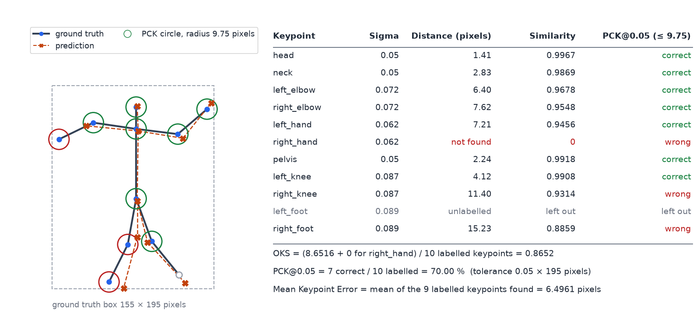
</p>
<p align="center"><em>A stick figure drawn by the synthetic dataset and a prediction of its keypoints: the similarity of every keypoint with its sigma, the 9.75 pixel PCK@0.05 circles (green correct, red wrong), and the OKS of 0.8652, PCK@0.05 of 70.00 % and mean keypoint error of 6.4961 pixels computed by evaluate_image_keypoints and summarise_keypoint_accuracy.</em></p>

#### Matched Objects

So that the keypoint accuracy describes every ground truth object once, with the best placed object found for it, `match_ground_truth_objects` pairs the ground truth objects and the predicted objects of each image one to one before PCK@0.05, Mean OKS and the mean keypoint error are measured. `Matched Objects` is the share of the ground truth objects that get a partner: it answers "how many objects did the detector find with usable keypoints, at any score?".

- The [D, G] OKS matrix of the image (0 across classes) has its pairs below `MINIMUM_MATCH_SIMILARITY` (0.5, the threshold of OKS mAP@0.5) set to 0, then `scipy.optimize.linear_sum_assignment` with `maximize=True` picks the one-to-one assignment of the largest total OKS. An assigned pair of OKS 0.5 or more is a match; the scores of the predicted objects play no part.
- A missed ground truth object keeps NaN keypoints: its labelled keypoints all count as wrong in PCK@0.05, its OKS is 0 in Mean OKS, and it adds no pixel error.
- `Matched Objects` = matched ground truth objects / ground truth objects, pooled over every class and image. It is the first value of the report grid, `Keypoint Accuracy/Matched Objects` in TensorBoard, and the `Matched Objects` count of the per-class table (`objects` and `matched_objects` in `class_metrics.csv`).

The OKS mAP does its own matching, in decreasing score order: a predicted object takes its best ground truth when that one is still free, otherwise it is a false positive. The two matchings can disagree. In the toy image below, P1 (score 0.92, OKS 0.6192 with T1) and P2 (score 0.55, OKS 0.9823 with T1) both lie on T1: the mAP counts P1 as the true positive at 0.5 and P2 as a false positive duplicate, while the keypoint accuracy measures T1 with P2, the better placed one. P4, a triangle found on three corners of the square S1, has an OKS of 0 with it (other class), and P5 reaches only 0.2992 with T2, so T2 is missed. `Matched Objects` is 66.67 % (2 of 3 objects), PCK@0.05 70.00 %, Mean OKS 65.38 % and the mean keypoint error 2.6486 pixels, measured on the 7 keypoints of T1 and S1.

<p align="center">
  
</p>
<p align="center"><em>Two triangles and a square of the synthetic dataset with five predicted objects: the OKS matrix of evaluate_image_keypoints with the one-to-one matches of match_ground_truth_objects (green), and the true and false positives of the OKS mAP in score order at 0.5 and 0.75. The image gives Matched Objects 66.67 %, OKS mAR@0.5 75.00 %, OKS mAP@0.5 75.00 % and OKS mAP@0.75 58.33 %.</em></p>

`Matched Objects` ignores the scores and the false positives: a detector giving many objects per ground truth can reach 100.00 % with a low mAP, and an object scoring far below the `object_score_threshold` of the deployment (0.2 in both configurations) still counts, so the value is more generous than what a client sees. Read it with the OKS mAP. It also differs from the OKS mAR@0.5, which counts the same kind of match but averages the recall of the classes and matches in score order: 75.00 % against 66.67 % on the toy image (triangle 1 of 2, square 1 of 1), 97.36 % against 97.32 % at iteration 6000 of the tutorial run.

#### OKS mAP And mAR

If you are looking for the number that ranks the checkpoints of a keypoint run, it is `OKS mAP@0.5/area` (`KEYPOINT_HEADLINE_METRIC` of `keypoint_trainer.py`), the line "The mAP@0.5 of the area method compares the checkpoints of the run." of the report and the value of the best checkpoint line of `evaluate_checkpoint.py`. It is the [mean average precision](#map05-map075-map095-and-map05095) of object detection (precision-recall curve per class, area, 11 point and 101 point methods, thresholds 0.5, 0.75, 0.95 and 0.5 to 0.95, mean over the classes with ground truths, mean average recall from all the kept objects), run by `summarise_average_precisions(overlap_type="keypoints")` of `vision_training/evaluation/detection/average_precision_report.py`. Only these points differ:

- The overlap is the OKS of `evaluate_image_keypoints` instead of the box IoU, 0 across classes. A predicted object is a true positive at a threshold when its best ground truth of the image and class reaches it with the OKS and no more confident object took that ground truth.
- The test objects without any labelled keypoint (a COCO person without keypoints, a crowd) are ignored, as in pycocotools: a predicted object that is not a true positive but reaches the threshold with one of them counts neither as a true nor as a false positive, and these objects add nothing to the recall. Its OKS with such an object is measured against the box of the object extended by its width on the left and right and by its height above and below (a keypoint inside counts 1), averaged over the keypoints the prediction found (`compute_squared_extended_box_distances`). A crowd takes any number of predicted objects and any other ignored object only one, the most confident: a predicted object whose ignored objects reaching the threshold are all taken is a false positive.
- The ranked objects are all the objects of the grouping, by their object score: the sum of their keypoint scores divided by the number of keypoints of their class, a keypoint not found counting 0. The low-score objects form the end of the curves.
- The object sizes are the COCO ranges on the ground truth box area (small below 32², medium 32² to 96², large from 96², in network input pixels). A predicted object reaching its best ground truth takes the size of that ground truth, an ignored one counts in no size, and any other is sized by the box of its keypoints found (`compute_keypoint_boxes`), which is smaller than the object and has an area of 0 for an object found on one keypoint, so such false positives fall in the small objects. The COCO keypoint evaluation reports only medium and large objects; this one keeps the small ones.
- The names carry `OKS`: the tables `OKS Mean Average Precision`, `OKS Mean Average Precision By Object Size (Area)`, `OKS Mean Average Recall`, `OKS Per Class Average Precision (Area)` and `OKS Per Class Recall` (the recall of every class at OKS 0.5 and 0.75 with [the recall intervals](#recall-intervals)); the TensorBoard scalars `OKS mAP@<threshold>/<method>`, `OKS mAP@0.5 By Size/<size>`, `OKS mAR@<threshold>/<all or size>` and `OKS AP@0.5/<class>`; the `class_metrics.csv` columns `oks_average_precision_50` to `oks_recall_75_upper`; in MLflow `test/OKS mAP_at_0.5/area` (`test_ema/` for the averaged weights).

On the toy image of [Matched Objects](#matched-objects), the triangle class lists P1 (true positive at 0.5), P5, P2 and P4 (false positives) for an AP@0.5 of 50.00 %, the square 100.00 %, so `OKS mAP@0.5` is 75.00 %. At 0.75, P1 (0.6192) is a false positive and P2 takes T1 third in the ranking, giving 58.33 %.

The tutorial run reaches `OKS mAP@0.5/area` 96.58 % at iteration 6000, `OKS mAP@0.75/area` 87.45 % and `OKS mAP@0.95/area` 72.79 %. From iteration 2000 to 6000 the mAP@0.5 gains 4.34 points (92.24 % to 96.58 %) and the mAP@0.95 18.16 points (54.63 % to 72.79 %): once the objects are found, the stricter thresholds tell the checkpoints apart. The values depend on the sigmas and on the box areas, so they are compared between runs with the same `evaluation` section only. Ignoring the objects without labelled keypoint matters on COCO: 4,652 of the 11,004 persons of the validation split of 2017 (227 of them crowds) have none, against no object of the 1,024 test images of the tutorial run.

#### PCK@0.05

To be able to say how many keypoints land close enough to their labelled position to be used, the report gives the percentage of correct keypoints: the labelled keypoints placed within 5 % of the longest side of the box of their object.

- `measure_keypoint_accuracy` compares every ground truth object with the keypoints of its matched object ([Matched Objects](#matched-objects)): a keypoint is correct when it is labelled and its distance is at most `CORRECT_KEYPOINT_FRACTION` × max(box width, box height) = 0.05 × the longest side of the ground truth box. Every keypoint has the same tolerance, whatever its sigma.
- `PCK@0.05` = correct keypoints / labelled keypoints, pooled over all the labelled keypoints of the split: a class with more keypoints (the stick figure, 11) weighs more than a triangle (3). A keypoint not found and every keypoint of a missed object count as wrong.
- Its name is `PCK@0.05` in the report grid and both keypoint tables, `Keypoint Accuracy/PCK@0.05` in TensorBoard, `percentage_correct_keypoints` in `class_metrics.csv` and `keypoint_metrics.csv`.

The longest side keeps the tolerance proportional to the object, as the square root of the area does for the OKS. On a square box the tolerance is the distance at which a keypoint of the default sigma scores 0.8825 (0.9613 with the sigma 0.089), the dotted line of the [OKS figure](#object-keypoint-similarity-oks). On an elongated box the longest side exceeds the square root of the area, so PCK@0.05 is more lenient than the OKS on thin objects. On the stick figure above the tolerance is 0.05 × 195 = 9.75 pixels and 7 of the 10 labelled keypoints are correct, 70.00 %: the right knee at 11.40 pixels is wrong for PCK although its similarity is 0.9314, the right hand not found is wrong, and the unlabelled left foot is left out.

A keypoint is right or wrong, so PCK@0.05 does not say how far the wrong ones are (read the [mean keypoint error](#mean-keypoint-error)), and it mixes keypoints not found with keypoints misplaced. The `Labelled` and `Found` columns of the per-keypoint table separate them: in the tutorial run at iteration 6000, the `left` keypoint of the rhombus is found 66 times out of 74 labelled, its PCK@0.05 of 89.19 % is exactly 66 / 74 with a mean error of 0.6979 pixels, so every keypoint found is correct and the 8 wrong ones are misses. On a 32 × 32 object the tolerance is 1.6 pixels.

#### Mean OKS

Suppose two checkpoints find the same objects with keypoints placed differently: PCK@0.05 changes only when a keypoint crosses its tolerance, while Mean OKS follows every pixel, with the sigma of every keypoint.

- `measure_keypoint_accuracy` computes the OKS of every ground truth object with the keypoints of its matched object (same formula, sigmas and box area as the matching), a missed object scoring 0. `Mean OKS` is the mean over the ground truth objects having at least one labelled keypoint, all of them after the loader, pooled over the classes.
- A match needs an OKS of 0.5, so every object adds either 0 or a value between 0.5 and 1: `Mean OKS` is `Matched Objects` times the mean OKS of the matched objects.
- Its name is `Mean OKS` in the report grid and the per-class table, `Keypoint Accuracy/Mean OKS` in TensorBoard, `mean_object_keypoint_similarity` in `class_metrics.csv`. The per-keypoint table has none, the OKS being a value of an object.

On the toy image of [Matched Objects](#matched-objects), (0.9823 + 0 + 0.9792) / 3 = 65.38 %, the missed T2 counting 0. A drop of `Mean OKS` comes from more missed objects or from worse placement: `Matched Objects` tells which. Through the sigmas it forgives the keypoints labelled loosely: in the tutorial run at iteration 6000 the stick figure has a PCK@0.05 of 89.14 % but a `Mean OKS` of 91.27 %, its limbs having sigmas of 0.062 to 0.089, while the hollow triangle, all at the default sigma, has 88.80 % and 88.25 %.

#### Mean Keypoint Error

In case you need the placement error in pixels, for example to compare it with the tolerance of the application reading the keypoints, `Mean Keypoint Error (pixels)` gives the mean distance of the predicted keypoints to their labelled position.

- `summarise_keypoint_accuracy` averages the distances of the labelled keypoints found in a matched object, pooled over the split. The keypoints not found and all the keypoints of the missed objects are left out, never counted as an infinite or a capped distance.
- The distances are in network input pixels, after the resize to `Data.image_settings.size`, not in pixels of the original images.
- Its name is `Mean Keypoint Error (pixels)` in the report grid (4 decimals), `Mean Error (pixels)` in both keypoint tables, `mean_error_pixels` in `class_metrics.csv` and `keypoint_metrics.csv`, `Keypoint Accuracy/Mean Keypoint Error (pixels)` in TensorBoard. With no keypoint found it has no value: `—` in the tables, an empty cell in the files and no TensorBoard scalar.

On the stick figure above it is 6.4961 pixels over the 9 labelled keypoints found, the right hand not found being left out. Since it only describes what was matched, the error can fall when the detector gets worse: a prediction drifting away raises it until its OKS falls below 0.5, then leaves the mean altogether, as in the GIF below. Read it with `Matched Objects` and PCK@0.05, and with the `Found` column of the per-keypoint table. Being in pixels, it grows with the size of the objects for the same relative accuracy, which PCK@0.05 and the OKS do not.

<p align="center">
  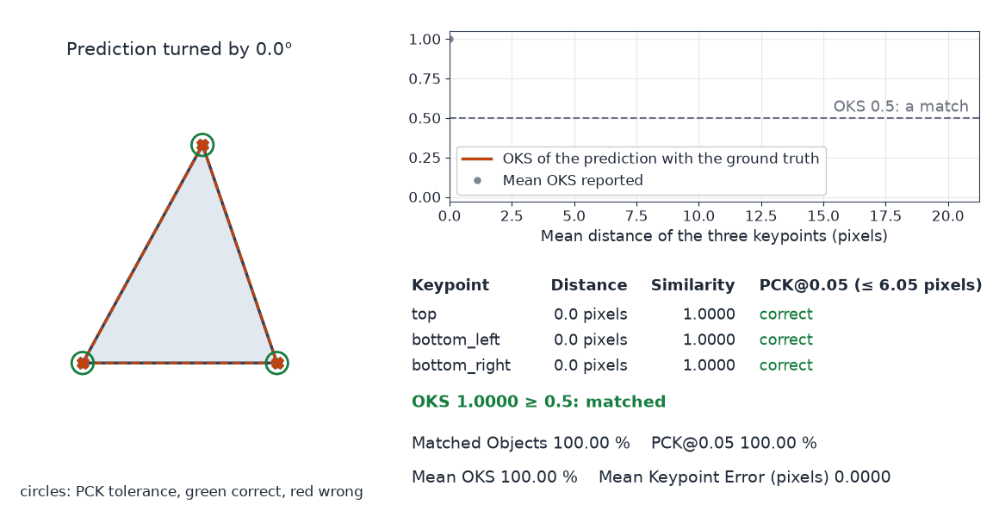
</p>
<p align="center"><em>A predicted triangle turning away from its ground truth (box 108 × 121 pixels, PCK@0.05 tolerance 6.05 pixels), every value computed by evaluate_image_keypoints and summarise_keypoint_accuracy: at 8.4° the OKS is 0.5026, the object is matched with a PCK@0.05 of 33.33 % and a mean keypoint error of 13.9012 pixels; at 9.0° the OKS is 0.4699, the object is missed, Matched Objects, PCK@0.05 and Mean OKS fall to 0.00 % although the bottom right keypoint is still within its tolerance, and the mean keypoint error has no value.</em></p>

#### Keypoint Accuracy Per Class And Per Keypoint

Whenever the global values hide which shapes or which keypoints fail, two tables of the per-class report (`evaluation.per_class_report: True`) restrict the same definitions to one class or one keypoint, worst PCK@0.05 first:

- `Keypoint Accuracy Per Class`: `Objects`, `Matched Objects` (counts), `Labelled Keypoints`, `PCK@0.05`, `Mean OKS` and `Mean Error (pixels)` of every class. The rows are saved in `class_metrics.csv` next to the `oks_` average precisions and recalls of the class, whatever `per_class_report`.
- `Keypoint Accuracy Per Keypoint`: `Labelled` (the objects of the class where the keypoint is labelled, fewer than the objects when it falls outside some images), `Found` (those found in a matched object), `PCK@0.05` and `Mean Error (pixels)` of every keypoint of every class, saved in `keypoint_metrics.csv` in the evaluation folder of the checkpoint.
- A class or keypoint never labelled has `—` (no value), and so has the mean error of a keypoint never found.

```text
  Keypoint Accuracy Per Keypoint
                                                                             Mean Error
   Class                            Keypoint   Labelled   Found   PCK@0.05     (pixels)
  ──────────────────────────────────────────────────────────────────────────────────────
   stick_figure                   right_knee        104      99    80.77 %      18.3462
   hollow_triangle                 inner_top         95      90    81.05 %      20.1602
   stick_figure                   right_hand        102      97    82.35 %      19.1068
```

`Found` well below `Labelled` with a small error points to misses (a keypoint below `keypoint_threshold`, an object missed); `Found` close to `Labelled` with a large error points to misplaced keypoints, or to keypoints given to the wrong one of two neighbouring objects of the same class by the grouping. In the tutorial run at iteration 6000, the elbows, the hands and the right knee of the stick figure are found 97 to 104 times out of 102 to 107 labelled but lie 13 to 19 pixels off on average, while its right foot lies 1.79 pixels off. Each row rests on 55 to 114 labelled keypoints in that run, so a few objects move it by more than a point; the tables give no interval, the [recall intervals](#recall-intervals) being those of the OKS recall of every class.

### Semantic Segmentation (SEG)

To find your way in the scores of a semantic segmentation run, start from what they count. Every metric is computed on the labelled pixels of every test image at the evaluated resolution, added over the whole test split before any ratio is taken: one pooled ratio per class, never a mean over images. The region metrics all come from one pixel confusion matrix (`compute_segmentation_metrics` of `vision_training/evaluation/segmentation/segmentation_metrics.py`), the contour metrics from boundary counts (`compute_boundary_metrics` of `boundary_metrics.py`), and the recall intervals from the counts of every test image. The **Mean IoU** is the headline metric (`"headline_metric": "Mean IoU"` in `SegmentationTrainer.compute_evaluation_results` of `vision_training/trainers/segmentation_trainer.py`): it picks the best checkpoint of an evaluation of several checkpoints and is followed as `test/best_Mean IoU` in MLflow.

| Metric | `Results.txt` | `class_metrics.csv` | TensorBoard `Test` writer (MLflow `test/...`) |
|---|---|---|---|
| Pixel accuracy | `Pixel Accuracy` | | `Pixel Accuracy` |
| IoU of a class, mean IoU | `IoU` column, `Mean IoU` | `iou` | `IoU/<class>`, `Mean IoU` |
| Dice of a class, mean Dice | `Dice` column, `Mean Dice` | `dice` | `Dice/<class>`, `Mean Dice` |
| Frequency weighted IoU | `Frequency Weighted IoU` | | `Frequency Weighted IoU` |
| Boundary IoU | `Boundary IoU` column, `Mean Boundary IoU` | `boundary_iou` | `Boundary IoU/<class>`, `Mean Boundary IoU` |
| Boundary F1 | `Boundary F1` column, `Mean Boundary F1` | `boundary_f1` | `Boundary F1/<class>`, `Mean Boundary F1` |
| Pixel precision and recall | `Precision`, `Recall` columns, `Per Class Recall` table | `precision`, `recall`, `recall_lower`, `recall_upper` | `Precision/<class>`, `Recall/<class>` |

The report writes the rates as percentages, the files, TensorBoard and MLflow keep them between 0 and 1, and the per-class scalars (`test_class/...` in MLflow) are written only with `per_class_report`. The `Macro ROC AUC` and `Macro Average Precision` that the per-class report adds are those of the [classification metrics](#roc-curve-and-roc-auc), computed on the pixels. During the training, the console and the `Train` and `Validation` writers of TensorBoard show a `Pixel Accuracy` and a `Mean IoU` computed on every batch (`compute_batch_metrics`, on the tiles with `Data.tiling`) and averaged over the batches of an interval: a mean of batch values, each over the classes of its batch, which follows the trend of the run but is not the test number.

#### Pixel Confusion Matrix And Unlabelled Pixels

Before any of these metrics is read, it helps to know which pixels they count. A mask PNG holds the category of every pixel, 0 for the background and 255 for the pixels the annotator left unlabelled; `build_class_lookup_table` of `vision_training/data/segmentation/segmentation_dataset.py` turns 255 into `IGNORED_LABEL_INDEX` (-100), which the letterbox padding of the resized masks also receives. `compute_pixel_confusion_matrix` then counts every labelled pixel once, at its true class (row) and its predicted class (column), in a `[K, K]` matrix whose class 0 is the background. A prediction on an ignored pixel counts nowhere, neither as right nor as wrong. The report gives the number of counted pixels in its notes (`Labelled Pixels : 6016 at the network resolution, the padding and the unlabelled pixels being ignored`), every evaluation writes the counts to `confusion_matrix.csv`, and with `per_class_report` the image `confusion_matrix.png` shows the share of every true class in each cell.

In the toy image below (32 x 32 pixels, background, square and circle), the 4 bottom rows hold the value 255: 128 of the 1,024 pixels are left out, 896 are counted, and the 18 pixels painted circle inside the strip appear in no cell. The rows of the matrix are background `[564, 30, 9]`, square `[0, 144, 0]` and circle `[30, 13, 106]`. Every other region metric of this section is read from these nine counts.

<p align="center">
  
</p>
<p align="center"><em>A toy image scored by compute_pixel_confusion_matrix and compute_segmentation_metrics: the unlabelled strip (value 255) is left out, then every class is scored on its right pixels (green) over the union of its true (blue) and predicted (orange) pixels, giving IoU 89.10 %, 77.01 % and 67.09 %, a mean IoU of 77.73 % and a pixel accuracy of 90.85 %.</em></p>

Keep 255 for the pixels whose class nobody can tell; a wide unlabelled area also hides every error the model makes there.

#### Pixel Accuracy

If one wishes to know what share of the labelled pixels got their class, read the pixel accuracy. It is `pixel accuracy = sum of the diagonal / labelled pixels`, the `accuracy` of `compute_metrics_from_confusion_matrix` (shared with the [classification metrics](#accuracy)) applied to the pixel confusion matrix, 0 without any labelled pixel. In the toy image, `(564 + 144 + 106) / 896 = 90.85 %`. The sample images of every evaluation are captioned with the pixel accuracy of their own labelled pixels.

The background holds most of the pixels of a segmentation image, so the pixel accuracy mostly measures the background: in the first case of the figure of the next section, a model that misses the star entirely still scores 97.36 %, and the synthetic segmentation run of the tutorials (`readme_screenshots/SEG_..._MC9`) scored 93.24 % at iteration 1000 with a mean IoU of 20.67 %. Read it as a sanity check, next to the mean IoU.

#### IoU Of A Class And Mean IoU

In order to score every class on its own, whatever its area, read its IoU, the intersection over union of its true and predicted pixels. It is `IoU = right pixels / (true pixels + predicted pixels - right pixels)`, the right pixels being the diagonal cell of the class, its true pixels the row sum and its predicted pixels the column sum, all labelled pixels; a class with an empty union gets 0. The **Mean IoU** averages the IoU over the classes with a non-empty union, those present in the test masks or predicted on at least one labelled pixel, the background included: a class painted without any true pixel counts with its IoU of 0, and a class neither present nor predicted is left out, as in mmseg and Cityscapes (`test_class_painted_without_true_pixel_lowers_the_mean_iou` of `tests/evaluation/segmentation/test_segmentation_metrics.py`).

In the toy image above, the square has a recall of 100.00 % but an IoU of `144 / 187 = 77.01 %`, because 43 more pixels were painted square (30 on the background, 13 on the circle); the circle gets `106 / 158 = 67.09 %`, the background `564 / 633 = 89.10 %`, and the mean IoU is `(89.10 % + 77.01 % + 67.09 %) / 3 = 77.73 %`.

<p align="center">
  
</p>
<p align="center"><em>Two 64 x 64 toy images over four classes, scored by compute_segmentation_metrics. Missing the small star costs it an IoU of 0 and brings the mean IoU to 64.46 % while the pixel accuracy stays at 97.36 %; painting a circle where the true mask has none puts a circle IoU of 0 in the mean (64.77 %), and a class neither true nor predicted is left out of it.</em></p>

Every class weighs the same in the mean, so a class of 78 pixels moves it as much as the background, which is what the headline should do when the small classes matter. Two pitfalls: a class absent from the test split but predicted somewhere costs a full 0 in the mean, yet the per-class table shows `—` for it (it has no true pixel), so look for it in its column of `confusion_matrix.csv`; and the IoU is pooled over the split, so a class covering large areas in a few images weighs those images more than the many images where it is small. At iteration 2000 of the synthetic run, the mean IoU is 66.83 % for a pixel accuracy of 97.60 %, the hexagon (30.97 %) being the class to work on.

#### Dice And Mean Dice

Should you need to compare with a paper or a baseline that reports Dice, the report gives it next to the IoU. It is `Dice = 2 x right pixels / (true pixels + predicted pixels)`, the F1 score of the pixels of the class (the `f1` of `compute_metrics_from_confusion_matrix`), and the **Mean Dice** is its mean over the same classes as the mean IoU (`macro_f1`), a class painted without true pixel counting 0. For one class, `Dice = 2 x IoU / (1 + IoU)`: the square of the toy image has a Dice of `2 x 144 / (144 + 187) = 87.01 %` for its IoU of 77.01 %, and the mean Dice of the image is 87.18 %.

Since the Dice of a class only depends on its IoU, both rank the classes the same way, but the Dice sits higher for the same masks; compare runs on one of them, never one run's Dice with another's IoU. The soft Dice of `SegmentationLoss.dice_weight` is a training loss on the probabilities, not this metric.

#### Frequency Weighted IoU

Suppose the classes matter in proportion to the area they cover; the frequency weighted IoU is then the number to read. It weighs the IoU of every class by its true pixels, `sum of (true pixels of the class x IoU of the class) / labelled pixels`. In the toy image, `(603 x 89.10 % + 144 x 77.01 % + 149 x 67.09 %) / 896 = 83.50 %`.

A class painted without true pixel has a weight of 0, so unlike the mean IoU this metric never sees it, and the background dominates it like the pixel accuracy: 94.81 % for the model that misses the star of the figure above, 91.14 % for the synthetic run at iteration 1000 when its mean IoU was 20.67 %. It tells how well the large areas are segmented, never how the small classes fare.

#### Boundary IoU And Boundary F1

Whenever the contours matter more than the areas (outlines drawn on the image, cut lines, measured widths), read the boundary metrics. The region metrics hardly see a contour error: an object predicted a few pixels too wide keeps a high IoU while none of its contour is right. Both boundary metrics score the pixels near the contours of every class, at the distance `ExperimentConfiguration.evaluation.boundary_tolerance` (2 pixels in the configurations, noted `Boundary Tolerance : 2 pixels` in the report):
- **Band** of a region within `d` pixels of its contour: the pixels of the region with a pixel outside of it at most `d` pixels away, the 8 neighbours of a pixel being 1 pixel away (`compute_contour_bands` of `vision_training/utilities/mask_morphology.py`). The band at `d = 1` is the **edge** of the region. The ignored pixels and the outside of the image count as part of the region, so they draw no contour, and the predictions on ignored pixels are left out.
- **Boundary IoU** of a class: `|true band ∩ predicted band| / |true band ∪ predicted band|`, both bands taken at the tolerance.
- **Boundary F1** of a class: the harmonic mean of the share of the predicted edge pixels lying within the tolerance of a true edge pixel (precision) and the share of the true edge pixels lying within the tolerance of a predicted edge pixel (recall).

`compute_boundary_counts` adds up the six counts of every class (`BOUNDARY_COUNT_COLUMNS`) over the test split, then `compute_boundary_metrics` takes the ratios and averages them into `Mean Boundary IoU` and `Mean Boundary F1` over the classes with true edges. A class without true edge (absent from the test masks, or covering whole images) has no boundary metric (`—`) and is left out of the means, even when it is predicted, unlike the mean IoU. The boundary IoU follows the definition of [Boundary IoU](https://arxiv.org/abs/2103.16562), with a tolerance fixed in pixels rather than a share of the image diagonal.

In the toy below, a 32 x 32 square on a 48 x 48 image is predicted too wide by 0, 1, 2 and 4 pixels on its left, top, right and bottom sides. Its region IoU is 81.40 % whatever the tolerance. At a tolerance of 1 pixel only its left and top sides are matched, except their far ends: precision 47.83 %, recall 51.61 %, boundary F1 49.65 %, boundary IoU 13.91 %. At the default 2 pixels the right side joins (boundary F1 75.63 %, boundary IoU 22.71 %), and from 4 pixels every edge pixel lies within the tolerance (boundary F1 100.00 %). The boundary IoU keeps growing with the bands (39.59 % at 4 pixels, 70.56 % at 10) and equals the region IoU from 17 pixels, where the bands fill both squares.

<p align="center">
  
</p>
<p align="center"><em>The tolerance grows from 1 to 10 pixels around a toy square predicted too wide by 0, 1, 2 and 4 pixels; compute_boundary_counts and compute_boundary_metrics give its boundary F1 (49.65 % at 1 pixel, 100.00 % from 4) and boundary IoU (13.91 % to 70.56 %), while its region IoU stays at 81.40 %.</em></p>

The boundary F1 answers "is every contour pixel within `d` pixels of the other contour" and reaches 100 % as soon as it is, while the boundary IoU needs the bands themselves to overlap and keeps rewarding a closer contour. Both depend on the tolerance and on the evaluated resolution, so compare runs only at the same `boundary_tolerance` and resolution. At iteration 2000 of the synthetic run, the square has an IoU of 86.44 % but a boundary IoU of 46.81 % and a boundary F1 of 76.39 %, and over the classes the mean IoU of 66.83 % goes with a mean boundary IoU of 36.25 % and a mean boundary F1 of 63.53 %.

#### Evaluated Resolution

For the scores to describe the masks the deployed model delivers, choose the resolution they are computed at; the report names it in its `Labelled Pixels` note:
- `network resolution` (the default): the test images and masks resized to the network input, the masks with the nearest interpolation on the pixel centres, the letterbox padding ignored. An object thinner than a pixel of the resized mask disappears from the ground truth and is never counted as missed.
- `images scaled by <scale>, segmented tile by tile` (`Data.tiling.activated`): every test image scaled by `Data.tiling.scale` and kept whole, segmented tile by tile with the probabilities averaged where the tiles overlap (`segment_image_by_tiles`), and scored against its mask scaled by the same factor.
- `original resolution of the images` (`ExperimentConfiguration.evaluation.original_resolution: True`): the probabilities of every image are cut out of the letterbox padding, when there is one, and resized bilinearly to its original size (`restore_prediction_to_original_image`), and their argmax is scored against the original mask, as the deployed output is used.

A uniform scaling leaves the region metrics as they are, since they are ratios of areas, but `boundary_tolerance` counts pixels of the evaluated resolution. The toy square of the animation, scaled 4 times (192 x 192 pixels), keeps its region IoU of 81.40 % but drops from a boundary F1 of 75.63 % to 24.63 % and a boundary IoU of 22.71 % to 13.68 % at a tolerance of 2 pixels; at 8 pixels it scores 75.05 % and 22.71 % again. Scale the tolerance with the resolution before comparing such runs.

#### Per Class Table

If you are looking for the class that pulls the mean IoU down, open the `Per Class Metrics` table of the report. It lists every class with its true pixels and all its metrics, worst IoU first (`build_segmentation_class_table` of `vision_training/evaluation/segmentation/segmentation_report.py`). It is shown with `per_class_report: True`, which also adds the `ROC AUC` and `Average Precision` columns, computed from histograms of 10,000 bins of the pixel probabilities ([ROC AUC](#roc-curve-and-roc-auc)). `class_metrics.csv` holds the same rows in class order at every evaluation, whatever `per_class_report`, with the bounds of the recall interval. `Precision` is the share of the pixels painted as the class that are of the class and `Recall` the share of its true pixels painted as the class ([precision and recall](#precision-recall-and-f1)). A class without true pixel shows `—` in every column (an empty cell of the file), even when it is predicted and lowers the mean IoU, and a class without true edge shows `—` in the boundary columns.

The block below is the report of a toy test split of six 32 x 32 images (the image of the first figure and five more, each with its own error: a shifted square, part of a circle taken for the square, a circle missed, a square too small, a circle too large), built with the functions the trainer calls; its ROC AUC and average precision come from toy probabilities and say nothing on their own.

```text
Iteration 1000 · 6 Test Images · 2026-11-20 10:00 ──────────────────────────────────────────────────────────────────────
  Mean IoU            80.05 %   Mean Dice                 88.62 %
  Mean Boundary IoU   53.55 %   Mean Boundary F1          91.67 %
  Pixel Accuracy      93.55 %   Frequency Weighted IoU    88.05 %
  Macro ROC AUC       90.60 %   Macro Average Precision   82.83 %
  Labelled Pixels : 6016 at the network resolution, the padding and the unlabelled pixels being ignored
  Boundary Tolerance : 2 pixels

  Per Class Metrics
                                             Boundary   Boundary                                     Average
   Class        Pixels       IoU      Dice        IoU         F1   Precision    Recall   ROC AUC   Precision
  ───────────────────────────────────────────────────────────────────────────────────────────────────────────
   circle          686   70.39 %   82.62 %    52.73 %    87.75 %     90.17 %   76.24 %   87.76 %     73.99 %
   square          849   76.89 %   86.94 %    49.85 %    92.36 %     87.66 %   86.22 %   92.41 %     79.47 %
   background     4481   92.86 %   96.30 %    58.08 %    94.91 %     95.04 %   97.59 %   91.64 %     95.04 %
  Worst IoU first, ties in class order. Boundary IoU and F1 : contours within the boundary tolerance. — : no pixel (or
  no edge for the boundary metrics) of the class in the test masks, or no pixel of another class for the ROC AUC.

  Per Class Recall
                                      95 %      95 %
   Class        Pixels    Recall     Lower     Upper
  ───────────────────────────────────────────────────
   circle          686   76.24 %   33.75 %   97.70 %
   square          849   86.22 %   47.22 %   99.45 %
   background     4481   97.59 %   92.71 %   99.57 %
  Worst Recall first, ties in class order. 95 % Lower and Upper : Korn-Graubard interval, exact at the effective sample
  size of the variance of 1000 bootstrap resamples of the test images (fixed seed), or over the test images holding the
  class when they all have the same recall. — : no pixels of the class.
```

The precision and recall of a class tell how it goes wrong: the circle of the toy split has a precision of 90.17 % but a recall of 76.24 %, so it is missed (one image loses it entirely) more than painted where it is not. In the synthetic run at iteration 2000, the pentagon has a precision of 52.59 % for a recall of 81.41 %: it is painted over other shapes, and its column of `confusion_matrix.csv` shows that 240,428 of its 795,846 predicted pixels are hexagon pixels.

#### Pixel Recall Interval

So that a recall change between two checkpoints is not read as a gain when it is the noise of the test split, the recall of every class comes with a 95 % interval. The pixels of an image are correlated (a missed object loses all its pixels together), so the interval is not taken over the pixels but over the test images: `compute_image_class_pixel_counts` keeps the true pixels of every class in every image and those predicted as the class, and `compute_bootstrap_recall_intervals` of `vision_training/evaluation/recall_intervals.py` turns them into a Korn-Graubard interval, explained with [the recall intervals](#recall-intervals). The bounds are `recall_lower` and `recall_upper` in `class_metrics.csv` and the `95 % Lower` and `95 % Upper` columns of the `Per Class Recall` table, shown with `per_class_report` after the per-class table, worst recall first.

In the toy split, the circle has 106 of 149, 113 of 113, 74 of 113, 0 of 81, 81 of 81 and 149 of 149 pixels right in the six images: a recall of 76.24 % with an interval from 33.75 % to 97.70 % over the images, where an exact interval over its 686 pixels taken as independent (`compute_clopper_pearson_intervals`) would give 72.87 % to 79.38 %. In the synthetic run at iteration 2000, the hexagon has 608,283 true pixels in 200 test images and a recall of 41.23 %: its interval over the images runs from 32.28 % to 50.63 %, the one over its pixels would be 41.11 % to 41.35 %.

The width depends on the number of test images holding the class and on how much its recall varies between them, not on its number of pixels: evaluating at a higher resolution multiplies the pixels and leaves the interval as wide. A recall change much smaller than the half-width of the interval is within the noise of the test split.

### Sequence Labelling (M2M)

If one wishes to know whether a sequence labeller gives every frame its class and also cuts the sequence into the right events, its report gives two kinds of metrics: the frame metrics, which score every labelled frame on its own, and the sequence and segment metrics, which score whole sequences and runs of frames. The checkpoints are compared on `Accuracy`, the frame accuracy (the `headline_metric` returned by `compute_evaluation_results` of `vision_training/trainers/classification_trainer.py`): it gives the `Best Checkpoint` line of `scripts/evaluation/evaluate_checkpoint.py`, the `test/best_Accuracy` value of MLflow and the curve of `evaluation_curves.png`, while `evaluation_summary.csv` keeps every metric of every evaluated iteration, one column each, for a comparison on another metric. Every metric of the M2M and SEL reports keeps its report name in TensorBoard and in `evaluation_summary.csv`, and gets the prefix `test/` in MLflow (`test_ema/` for the averaged weights), its rates between 0 and 1.

#### Frame Accuracy And The Frame Metrics

Say you want to know how many frames of the test sequences get their class: the frame metrics are the classification metrics computed on frames, every labelled frame of every test sequence being one sample.

The trainer keeps the class probabilities of the labelled frames only, so the padding frames of a batch and the frames of the categories the label mapping does not map (both labelled `-100`, `IGNORED_LABEL_INDEX`) never enter a metric. From the most probable class of every kept frame it builds the confusion matrix and reads the metrics of the image classification: `Accuracy` (the frame accuracy), [`Balanced Accuracy`](#balanced-accuracy), [`Macro F1`](#precision-recall-and-f1), [`Top-5 Accuracy`](#top-k-accuracy), and with `per_class_report` [`Macro ROC AUC`](#roc-curve-and-roc-auc) and [`Macro Average Precision`](#average-precision-of-a-class), the `Per Class Metrics` table (its support column named `Frames`), `class_metrics.csv`, `confusion_matrix.csv` and the [thresholds at the target precision](#threshold-and-recall-at-a-target-precision) of `class_thresholds.json`. The [recall intervals](#recall-intervals) of the `Per Class Recall` table come from a bootstrap over the test sequences, not over the frames, since the frames of a sequence are predicted together. The training and validation batches print the same accuracy, `compute_frame_accuracy` of `vision_training/evaluation/sequence/sequence_metrics.py`:

```
frame accuracy = labelled frames predicted right / labelled frames        (0 without labelled frame)
```

For example, a batch of three sequences of six frames, `-` marking an unlabelled frame (`-100`):

```
true        A A - A B B     A A A B B B     - - - - - -
predicted   A A B A B B     A A B B B B     A A A A A A
```

`compute_frame_accuracy` gives 10 right frames out of 11 labelled ones, 90.91 %: the third frame of the first sequence and the whole third sequence count for nothing.

The frame accuracy follows the most frequent class: in the sequence labelling tutorial run, `no_change` holds 32,843 of the 69,918 labelled test frames (46.97 %), the accuracy of a model predicting `no_change` on every frame, so read `Balanced Accuracy` and `Macro F1` first (77.16 % accuracy against 72.17 % balanced accuracy and 65.28 % macro F1 at iteration 2,000). It also ignores where the wrong frames are: the first two predictions of the figure of the [edit score](#edit-score) both have 90.00 % of their frames right, one with the two true events and the other with two extra events.

#### Sequence Exact Match

In case you need whole sequences right, for a downstream rule that reads every frame of a sequence, `Sequence Exact Match` is the share of the test sequences whose every labelled frame is right.

`compute_sequence_exact_matches` of `vision_training/evaluation/sequence/sequence_metrics.py` marks a sequence right when every frame is either predicted right or unlabelled; a sequence whose frames are all unlabelled has nothing to match and is left out of the numerator and of the denominator (and of the `Test Sequences` count of the report header). The metric is the mean of these booleans, 0 without sequence, named `Sequence Exact Match`.

On the batch above, the function returns `[True, False]`, 50.00 %: the first sequence is exact although its unlabelled frame is predicted `B`, the second misses one frame, and the third is left out.

It is the strictest metric and falls fast with the length of the sequences: the tutorial run has 77.16 % of its frames right but 24.00 % of its 10,000 test sequences exact, with 6.99 labelled frames per sequence on average. A model predicting the majority class everywhere is exact on every sequence holding that class only, so compare it with that share. One wrong frame makes the sequence wrong whether it is a boundary shifted by one frame or a missed event: the edit score and the segment F1 tell the two apart.

#### Edit Score

Each time the predicted class flickers inside an event, the frame accuracy loses one frame while the event is cut in three: the edit score measures that fragmentation.

A segment is a run of consecutive labelled frames of one class (`extract_segments` of `vision_training/evaluation/sequence/segment_metrics.py`), ended by a change of class and by a gap of unlabelled frames, whose class is unknown. True and predicted segments are read on the same labelled frames, so a gap cuts both the same way: the first sequence of the batch above holds three true segments, `A`, `A` and `B`. `compute_segment_metrics` then compares the orders of the segment classes:

```
edit distance            = Levenshtein distance between the predicted and the true orders of segment classes
                           (inserting, removing or replacing one segment costs 1, compute_edit_distance)
edit score of a sequence = 1 − edit distance / max(number of predicted segments, number of true segments)
Edit Score               = mean over the test sequences holding a labelled frame (0 without sequence)
```

Every sequence weighs the same whatever its length. The report writes `Edit Score` and the note `Segments : <true> true and <predicted> predicted in <sequences> test sequences, an unlabelled frame ending a segment`.

With the true sequence `A A A A A B B B B B` of the [tasks reference](documentation/reference/tasks_reference.md#sequence-labelling-m2m), the prediction `A A B A A B B A B B` gives the order `A B A B A B` against `A B`: four segments to remove, an edit distance of 4 and an edit score of 1 − 4 / 6 = 33.33 %. One flickering frame, `A A B A A B B B B B`, gives `A B A B`, a distance of 2 and 50.00 %, while a boundary one frame early, `A A A A B B B B B B`, keeps the order `A B` and scores 100.00 %, with the same 90.00 % of frames right as the flicker.

<p align="center">
  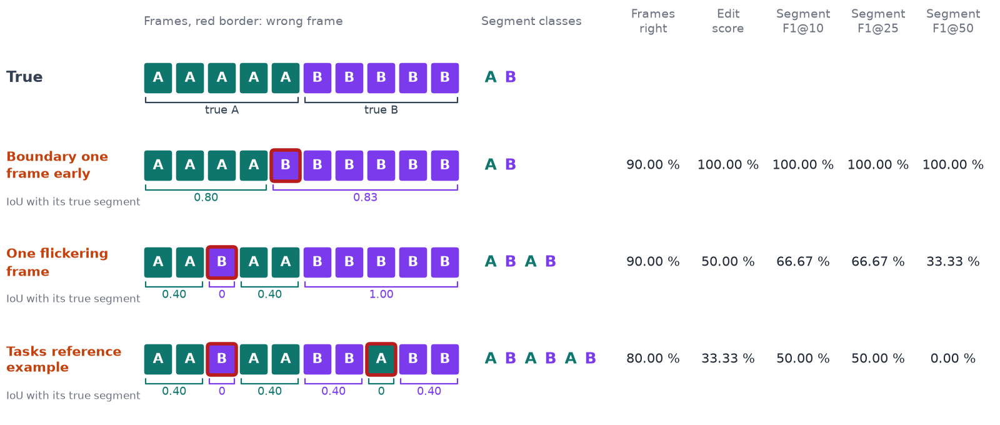
</p>
<p align="center"><em>Three predictions of the true sequence A A A A A B B B B B, scored by compute_frame_accuracy and compute_segment_metrics: the boundary one frame early and the flickering frame both have 90.00 % of their frames right, but edit scores of 100.00 % and 50.00 % and segment F1@50 of 100.00 % and 33.33 %. Under every predicted segment, its overlap (IoU of the frames) with the true segment of its class it overlaps most.</em></p>

A low edit score means fragmented predictions, more predicted segments than true ones (the tutorial run predicts 60,959 segments for 58,133 true ones and scores 74.51 %). It ignores the positions and the lengths of the segments, the shifted boundary scoring 100.00 %, so read it with `Segment F1@50`.

#### Segment F1@10, @25 And @50

So that every true event counts as found or missed, the segment F1 matches the predicted segments with the true ones, like detections with objects but along time.

`count_segment_matches` of `vision_training/evaluation/sequence/segment_metrics.py` takes the predicted segments of a sequence in order and compares each with the true segment of its class it overlaps most, the overlap being the IoU of their frames (`shared frames / frames of either`, the first true segment on a tie). The predicted segment is right when that overlap reaches the threshold and that true segment was not matched by a preceding predicted segment; otherwise it is a false positive, even when another true segment of its class overlaps it enough. True segments left unmatched are false negatives. The counts are summed over all the test sequences, then:

```
precision  = right / (right + wrong)          recall = right / (right + missed)          (0 when nothing is counted)
Segment F1 = 2 × precision × recall / (precision + recall)                              (0 when nothing is right)
```

at every overlap of `SEGMENT_OVERLAP_THRESHOLDS = [0.10, 0.25, 0.50]`, named `Segment F1@10`, `Segment F1@25` and `Segment F1@50`.

On the example of the tasks reference, every predicted segment of class `A` or `B` overlaps its true segment by 2 / 5 = 0.40 or not at all. At 0.10 and 0.25, the first `A` and the first `B` segments match, the second ones find their true segment taken and the single-frame segments find no true segment of their class: 2 right, 4 wrong, 0 missed, a precision of 2 / 6, a recall of 2 / 2 and an F1 of 50.00 %. At 0.50 nothing reaches the threshold: 0 right, 6 wrong, 2 missed, 0.00 %. One flickering frame gives 66.67 % at 0.10 and 0.25 and 33.33 % at 0.50.

<p align="center">
  
</p>
<p align="center"><em>The example of the tasks reference scored by extract_segments, compute_edit_distance and count_segment_matches: an edit score of 33.33 %, then every predicted segment matched in order against the true segment of its class it overlaps most, for a segment F1 of 50.00 % at 0.10 and 0.25 and 0.00 % at 0.50.</em></p>

`Segment F1@10` asks whether every event was found once and counts every extra fragment as wrong; `Segment F1@50` also needs the predicted and true segments of an event to share at least half of the frames they cover together. When the true segments are one or two frames long, an overlap is close to all or nothing and the three thresholds agree: the tutorial run has 58,133 true segments in 69,918 labelled frames (1.20 frames per segment) and scores 75.96 %, 75.93 % and 75.26 %. A gap between `@10` and `@50` points to events found at a shifted position or with a wrong length, a low `@10` with a good frame accuracy to fragmentation or to missed short events.

### Frame Selection (SEL)

Suppose a frame selector must pick, in every test sequence, the `Selection.frames_per_class` frames of every wanted class (every class but `Selection.unselected_category`, to which the frames of unmapped categories also go): its report scores the picks of two decodings, the ranks of the true frames before any decoding, and the classification of every frame. The checkpoints are compared on the selection accuracy of the decoding set in `Selection.decoding` (the `headline_metric` returned by `compute_evaluation_results` of `vision_training/trainers/frame_selection_trainer.py`), `Hungarian Selection Accuracy` in the README run. The toy examples below use four test sequences, the wanted classes triangle and star, one frame per class, a `top_k` of 2 and a target precision of 99 %, every number computed by the functions named.

#### Hungarian And Greedy Decodings

Before reading any selection metric, know that the picks come from a decoding of the probabilities, every frame having a probability for every class (the softmax over the classes). Both decodings of `vision_training/models/sequence/frame_selection_decoding.py` run on the same probabilities at every evaluation:

- `hungarian` (`decode_hungarian_selection`): the gain of frame `f` for wanted class `c` is `log p(f, c) − log p(f, unselected)` (probabilities clipped at 1e-12), every class column is repeated `frames_per_class` times, and `scipy.optimize.linear_sum_assignment` with `maximize=True` takes the assignment with the largest total gain, every frame chosen at most once: the most probable labelling of the sequence in which every wanted class holds exactly `frames_per_class` frames.
- `greedy` (`decode_greedy_selection`): every frame takes its most probable class, a wanted class holding too many frames keeps its most probable ones (the others become unselected), then a class holding too few takes, class by class in class order, the unselected frames most probable for it.

The decoding of `Selection.decoding` is the one drawn in the sample and error images, behind the thresholds and the decoded confusion matrix, and deployed. On the example of the tasks reference, where frame 1 (0.50, 0.45, 0.05 for triangle, star, unselected) is the true star and frame 2 (0.45, 0.05, 0.50) the true triangle, the greedy rule gives frame 1 to triangle and completes star with frame 3 (0.08 against 0.05 for frame 2): both picks are wrong, a selection accuracy of 0.00 % for a labelling probability of 0.50 × 0.50 × 0.08 = 0.020. The Hungarian assignment adds the gains +2.20 (star, frame 1) and −0.11 (triangle, frame 2) into the largest total, +2.09: both picks are right, 100.00 %, for a labelling probability of 0.45 × 0.45 × 0.90 = 0.182, 9.1 times the greedy one.

<p align="center">
  
</p>
<p align="center"><em>Both decodings of decode_frame_selection on the example of the tasks reference, the true classes dashed: the greedy rule step by step (selection accuracy 0.00 %), then the gains and the assignments of the Hungarian decoding (selection accuracy 100.00 %), scored by compute_selection_metrics.</em></p>

The Hungarian assignment maximises the probability of the labelling, not the number of right picks. In sequence 3 of the toy test split, the true triangle (frame 1: 0.50 triangle, 0.48 unselected) has a gain of +0.04, below the +0.47 of frame 2 (0.40 triangle, 0.25 unselected), so the Hungarian decoding picks frame 2, wrong, where the greedy rule picks frame 1, right. The difference between the two selection accuracies of a report comes from the decoding alone (95.83 % against 95.17 % in the README run at iteration 1,000, 98.17 % against 98.33 % at iteration 2,000).

#### Selection Accuracy

Should you need one number for how many picks are right, the selection accuracy is the share of the true frames of the wanted classes chosen for their class.

`compute_selection_metrics` of `vision_training/evaluation/sequence/frame_selection_metrics.py` compares, in every sequence, the set of the frames chosen for a class with the set of its true frames:

```
right(c)                = sum over the sequences of |true frames of c ∩ frames chosen for c|
true(c)                 = sum over the sequences of |true frames of c|
selection accuracy of c = right(c) / true(c)                  (None, written —, without true frame)
Selection Accuracy      = sum of right(c) / sum of true(c)    (every true frame weighs the same)
```

The order of the picks inside a class does not matter. Since every sequence must hold exactly `frames_per_class` true frames of every wanted class (checked at the start of the training) and both decodings choose that many, the selection accuracy is at once the recall and the precision of the picks. The report writes `Hungarian Selection Accuracy` and `Greedy Selection Accuracy` (per class `Hungarian Selection Accuracy/<class>` and `Greedy Selection Accuracy/<class>` in TensorBoard), `class_metrics.csv` the columns `hungarian_accuracy` and `greedy_accuracy`, with `<decoding>_accuracy_lower` and `<decoding>_accuracy_upper` for the decoding of the run, the [recall intervals](#recall-intervals) over the test sequences shown in the `Per Class Recall` table.

On the toy test split, the Hungarian decoding gets 5 of the 8 true frames, 62.50 % (triangle 50.00 %, star 75.00 %), and the greedy rule 4 of 8, 50.00 % (50.00 % for both).

<p align="center">
  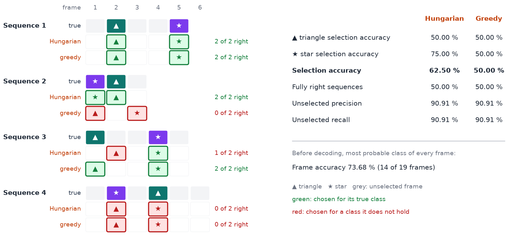
</p>
<p align="center"><em>The toy test split, its true frames and the picks of both decodings, with the metrics of compute_selection_metrics: sequence 2 is the example of the tasks reference, sequence 3 a Hungarian pick of a background frame, sequence 4 a swap of both shapes; the most probable class of every frame gets 73.68 % of the frames right.</em></p>

With one frame per class and few sequences, every pick moves the metric by whole points (one pick is 12.50 % of this toy split). A wrong pick for a class always means a true frame of that class missed and a frame chosen that is not one of them: the background and swapped picks tell which kind of frame was taken.

#### Fully Right Sequences

If you are looking for the share of the sequences a human never has to correct, `<Decoding> Fully Right Sequences` counts the test sequences in which every wanted class got exactly its true frames (`compute_selection_metrics`, the chosen and true frames of every class compared as sets).

On the toy test split, the Hungarian decoding is fully right on sequences 1 and 2 and the greedy rule on sequences 1 and 3, 50.00 % each.

Compared with the selection accuracy, it tells whether the wrong picks gather in a few sequences: in the README run at iteration 1,000, 95.83 % of the Hungarian picks are right but 90.50 % of the 200 test sequences fully right, its 25 wrong picks falling in 19 sequences (`selections.csv`).

#### Background And Swapped Picks

To keep the wrong picks that took a background frame apart from those that swapped two wanted classes, `compute_selection_metrics` reads the true class of every frame a decoding chose for a wanted class and counts over all the picks of all the test sequences:

```
Background Picks = picks of a truly unselected frame / picks
Swapped Picks    = picks of a true frame of another wanted class / picks
right picks + background picks + swapped picks = picks
```

named `<Decoding> Background Picks` and `<Decoding> Swapped Picks`, 0 when nothing is picked; a pick of a frame whose class is neither wanted nor unselected stops the evaluation with a `ValueError`. Since every sequence holds exactly `frames_per_class` true frames of every wanted class and both decodings pick that many, the selection accuracy and these two shares add up to 100 %.

On the toy test split, the Hungarian decoding makes 1 background pick and 2 swapped picks of its 8, 12.50 % and 25.00 %: the wrong triangle of sequence 3 took an unselected frame, the swap of sequence 4 the true frames of the other shape. The greedy rule gets sequence 3 right but sequence 2 wrong, its triangle taking the true star frame and its star an unselected frame, which with the swap of sequence 4 gives 1 background and 3 swapped picks, 12.50 % and 37.50 %.

In the README run at iteration 1,000, 21 of the 600 Hungarian picks took a frame to leave unselected and 4 the true frame of another wanted class, 3.50 % and 0.67 % next to its 95.83 % selection accuracy (`Results.txt`, the picks counted in `selections.csv`): most of its wrong picks take an unselected frame (in these sequences a smaller copy of a wanted shape or another shape) rather than the true frame of another class.

#### Top-k Selection Accuracy And Mean True Frame Rank

Whenever a pick is wrong, these two metrics tell whether the right frame was a close second; they score the probabilities before any decoding (`compute_ranking_metrics` of `vision_training/evaluation/sequence/frame_selection_metrics.py`, `compute_frame_ranks` of `frame_selection_decoding.py`):

```
rank of frame f for class c = 1 + number of frames of its sequence with a strictly higher probability for c
Top-k Selection Accuracy    = true frames of rank ≤ k / true frames              (k = evaluation.top_k)
Mean True Frame Rank        = mean rank of the true frames                         (1 is the best)
```

Frames tied on their probability all take the best of their ranks, and `k` is also the number of candidate frames the deployed decoder returns for every class. The report writes `Top-<k> Selection Accuracy` (`Top-2 Selection Accuracy` in the README run) and `Mean True Frame Rank`, a rank with 4 decimals rather than a percentage; per class, the columns `Top-<k> Accuracy` and `Mean Rank` of the per-class table, `top_k_accuracy` and `mean_rank` in `class_metrics.csv`, and `Mean True Frame Rank/<class>` in TensorBoard.

On the toy test split, the true triangles have the ranks 1, 2, 1 and 3 and the true stars 1, 1, 1 and 2: a top-2 selection accuracy of 87.50 % (75.00 % and 100.00 %) and a mean true frame rank of 1.5000 (1.7500 and 1.2500).

<p align="center">
  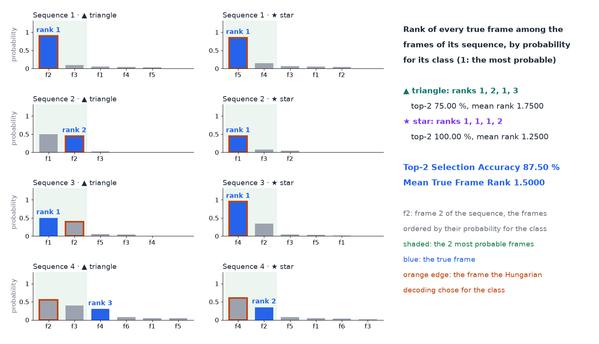
</p>
<p align="center"><em>The frames of every toy sequence ordered by their probability for each wanted class, the true frame in blue with its rank from compute_frame_ranks and the Hungarian pick outlined: the true triangle of sequence 3 has rank 1 and is not picked, the one of sequence 2 has rank 2 and is picked. compute_ranking_metrics gives a top-2 selection accuracy of 87.50 % and a mean true frame rank of 1.5000.</em></p>

A top-k well above the selection accuracy means that the wrong picks were near misses, among the candidates the deployed decoder returns: 98.67 % against 95.83 % in the README run at iteration 1,000, with a mean true frame rank of 1.0767. The rank reads the probability of the class, not the gain of the Hungarian decoding, so a rank of 1 does not guarantee the pick. Ties take the best rank: a model giving the same probabilities to every frame gets a top-2 selection accuracy of 100.00 % and a mean true frame rank of 1.0000 (`compute_ranking_metrics` on five equal frames), so read both with the selection accuracy.

#### Frame Accuracy, Frame Balanced Accuracy And Frame Macro F1

For the per-frame classifier inside the frame selector to be judged on its own, the report adds the classification metrics of the most probable class of every frame, over all the frames of the test sequences, the unselected class included and before any decoding: `Frame Accuracy`, `Frame Balanced Accuracy` and `Frame Macro F1` (`compute_metrics_from_confusion_matrix`, explained in [accuracy](#accuracy), [balanced accuracy](#balanced-accuracy) and [macro F1](#precision-recall-and-f1)). The training and validation batches print the same frame accuracy as `Accuracy`, while the confusion matrix of the report (`confusion_matrix.csv`, and its image titled `Decoded Frames` with `per_class_report`) holds the decoded classes of the decoding of the run.

On the toy test split, 14 of the 19 frames get their class: 73.68 %, with a balanced accuracy of 63.64 % and a macro F1 of 64.17 %.

The unselected class dominates (961 of the 1,561 test frames of the README run, 61.56 %), so read the balanced accuracy first. The frame accuracy can sit below the selection accuracy (92.76 % against 95.83 % in the README run at iteration 1,000): the decoding forces exactly `frames_per_class` picks per class, so a true frame whose most probable class is unselected can still be picked.

#### Per Class Selection Table

To find your way in the `Per Class Selection` table of the report (printed with `per_class_report`, its values always saved in `class_metrics.csv`), read one row per wanted class, the worst selection accuracy of the decoding of the run first: the true frames, the selection accuracy of both decodings, the top-k accuracy and mean rank of the true frames, and the [low-confidence threshold](#low-confidence-thresholds) with the share of the true frames it keeps. The `Per Class Recall` table follows, with the selection accuracy of the decoding of the run and its [recall interval](#recall-intervals). On the toy test split:

```
                         Hungarian     Greedy      Top-2     Mean   Threshold    Recall
 Class      True Frames   Accuracy   Accuracy   Accuracy     Rank     @ P99 %   @ P99 %
 triangle             4    50.00 %    50.00 %    75.00 %   1.7500      0.9000   25.00 %
 star                 4    75.00 %    50.00 %   100.00 %   1.2500      0.8500   50.00 %
```

#### Low-Confidence Thresholds

In order to flag the picks a human should check, every evaluation finds a confidence threshold for every wanted class with the decoding of the run, `find_selection_thresholds` of `vision_training/evaluation/sequence/frame_selection_metrics.py`. It gathers the frames chosen for the class over the whole test split with their probability for the class, a pick being right when it is a true frame, and keeps the probability from which these picks reach `evaluation.target_precision` with the most right picks, the highest such probability when a lower one only adds wrong picks (`find_score_threshold`, the rule of the [classification thresholds](#threshold-and-recall-at-a-target-precision)). Its recall is the share of all the true frames of the class picked at or above it; a class never reaching the target precision gets a null threshold. The thresholds go to `class_thresholds.json` (`target_precision`, `decoding`, `unselected_class`, then the `threshold` and `recall` of every class), to the columns `Threshold @ P99 %` and `Recall @ P99 %` of the per-class table, and to `threshold_at_target_precision` and `recall_at_target_precision` in `class_metrics.csv`. The deployed decoder (`flag_low_confidence`) marks as low confidence a pick below the threshold of its class, every pick of a class with a null threshold and a missing frame, and `selections.csv` writes the same flags as `<decoding>_low_confidence`. The frame selection takes one target precision only, a list being refused.

On the toy test split, the Hungarian triangle picks have the probabilities 0.90 (right), 0.55 (wrong), 0.45 (right) and 0.40 (wrong): only 0.90 reaches 99 %, a threshold of 0.90 keeping 1 of the 4 true triangles, 25.00 %. The star picks, 0.95, 0.85, 0.60 (wrong) and 0.45, give a threshold of 0.85 keeping 2 of 4, 50.00 %. Five of the eight picks are flagged: the three wrong ones and the two right picks of sequence 2, at 0.45.

<p align="center">
  
</p>
<p align="center"><em>The Hungarian picks of the toy test split on the probability axis of their class, green when right and red when wrong, with the thresholds of find_selection_thresholds at a target precision of 99 % (0.90 and 0.85) and the share of the true frames they keep (25.00 % and 50.00 %); the picks in the shaded region are flagged by flag_low_confidence.</em></p>

`Recall @ P99 %` is the share of the true frames that pass without a human check at that precision, never above the selection accuracy of the class since a true frame the decoding did not pick is never kept (in the README run at iteration 1,000: circle 99.00 % from 0.0184, triangle 58.50 % from 0.9211, star 56.00 % from 0.9425). A threshold only flags doubtful picks: a confident wrong pick goes through, and thresholds found on a few hundred picks per class move from one checkpoint to the next (triangle 0.9211 at iteration 1,000 and 0.3767 at iteration 2,000 in the README run).

### Self-Supervised Evaluation (SSL)

Whenever a self-supervised checkpoint is evaluated, there is no classifier to score: the evaluation judges the **representation** of every test image, the pooled final feature map of the backbone before the projection head (128 values in the tutorial run), which is also what the export serves and what the other tasks start from. Two questions are asked: do the images of a class lie close to each other (the k-NN metrics, when the test split has labels), and do the representations use many directions or collapse to a few (the effective rank and the representation standard deviation, labels or not). Every evaluation runs on the whole test split, for the trained weights and, when the run keeps them, for the averaged weights (`Tensorboard/Test_EMA`, `test_ema/<metric>` in MLflow).

#### The k-NN Evaluation

Before reading any k-NN number of a report, keep in mind that it depends on two settings of `ExperimentConfiguration.evaluation` and on a fixed sample of training images. The labelled test images are classified by their nearest **reference images**, labelled training images encoded with the weights being evaluated, without augmentation, at every evaluation; no classifier is ever trained, and the labels never reach the training.

- **The reference images** (`select_reference_samples` of `vision_training/evaluation/self_supervised/representation_metrics.py`): in every class of the training split, the `number_reference_images_per_class` images whose file names have the smallest MD5 hashes, so that the same images are chosen at every evaluation, resume and standalone evaluation whatever the shuffling, and the cost stays bounded on a large training split (10 per class in the ImageNet-22k example, 50 in the synthetic configurations). A class with fewer images gives all of them; images without exactly one class are left out. Every class of the training split stays a possible prediction, even without labelled test image; a test class without labelled training image is announced in yellow, its images never classified correctly.
- **The vote** (`compute_nearest_neighbour_predictions`): the representations are L2 normalized and compared by cosine similarity, every test image only with the reference images, never with the other test images (so a test split of one image per class, like the held-out images of ImageNet-22k, is scored like any other). Its `number_neighbours` most similar reference images vote for their class, each with the weight `exp(similarity / 0.07)` (`NEAREST_NEIGHBOUR_TEMPERATURE`, the value of the DINO evaluations), and the class of the largest total weight is predicted:

```
s_j        = cosine similarity of the test image with reference image j     (both L2 normalized)
neighbours = the k reference images of largest s_j,  k = min(number_neighbours, number of reference images)
vote(c)    = sum over the neighbours of class c of exp(s_j / 0.07)
prediction = the class of the largest vote, the lowest class index on a tie
```

The temperature makes the vote close to a nearest neighbour rule with a soft count: a neighbour more similar by 0.07 weighs e (2.72) times more. When two reference images tie at exactly the same similarity on the k-th place, `torch.topk` keeps one of them, its choice not being part of the metric. No reference image at all raises a `ValueError`; the trainer stops before that, when the test split has labels and the training split none.

Worked example, picture below: a star test image among 20 reference images of four classes, `number_neighbours = 5`. Its five nearest images are two stars (similarities 0.9903 and 0.9511) and three circles (0.8829, 0.8192, 0.7431). A plain majority would say circle (60.00 % of the neighbours); the weights give the two stars 52.55 % + 30.01 % = 82.56 % of the vote, and `compute_nearest_neighbour_predictions` returns star.

<p align="center">
  
</p>
<p align="center"><em>The vote of compute_nearest_neighbour_predictions for one star test image, 5 neighbours, temperature 0.07: 3 circles against 2 stars by count, 17.44 % against 82.56 % by weight, prediction star. Two-value toy representations, so that the cosine similarity is the cosine of the angle.</em></p>

The reference images of a toy split, two per class: `star_001.png` (MD5 `0d4d3975…`) and `star_002.png` (`16a1e564…`) are chosen, `star_003.png` (`21391db4…`) is not; `circle_002.png` (`1ab7eace…`) and `circle_003.png` (`17291fe9…`) are chosen before `circle_001.png` (`20d92e8d…`); `unlabelled_001.png` is left out. Every report notes the sample, e.g. `k-NN : 20 neighbours among 450 labelled training images of 9 classes (50 per class at most)`, then `k-NN : <n> training classes without labelled test image, kept as possible predictions` when it applies.

#### k-NN Accuracy, Balanced Accuracy And Macro F1

If you are looking for the number that compares the checkpoints of a self-supervised run, it is the **k-NN Accuracy**: the headline metric whenever the test split holds labelled images, the best checkpoint being the one of the highest value (`find_best_iterations` of `vision_training/evaluation/evaluation_curves.py`, `test/best_k-NN Accuracy` in MLflow). It answers whether the representation, as it is, places the images of a class closer to each other than to the other classes.

The k-NN predictions are scored by the code of the classifier (`compute_confusion_matrix` and `compute_metrics_from_confusion_matrix` of `vision_training/evaluation/classification/classification_metrics.py`, called by `SelfSupervisedTrainer.compute_nearest_neighbour_results`), so the three metrics follow their classification definitions: `k-NN Accuracy` is the share of the labelled test images whose vote gives their own class, `k-NN Balanced Accuracy` the mean recall over the classes present in the test images ([balanced accuracy](#balanced-accuracy)), `k-NN Macro F1` the mean F1 over the classes present or predicted ([macro averages](#macro-and-micro-averages)). Only test images with a mapped category are classified (`Labelled Test Images : <l> of <N>` in the report); without any, the k-NN is skipped (`k-NN : skipped, no labelled test image`) and the effective rank becomes the headline. Above 1,000 classes (ImageNet-22k) the confusion matrix is counted from its non-zero cells only, for the same values. The names are the same in `Results.txt` (as percentages), `evaluation_summary.csv`, TensorBoard (`Test`, `Test_EMA`) and MLflow (`test/k-NN Accuracy`), the files keeping rates between 0 and 1.

Worked example (`compute_nearest_neighbour_predictions`, then the two classification functions): 10 labelled test images (6 circles, 2 squares, 2 stars) among 23 reference images of five classes, the triangle and hexagon classes having reference images but no test image. One circle test image lies among the hexagons and is predicted hexagon, one square lies between the circles and the stars and is predicted circle; the 8 others are right.

| Class | Test images | Voted to it | Precision | Recall | F1 | Averaged in |
|---|---|---|---|---|---|---|
| circle | 6 | 6 (5 right) | 83.33 % | 83.33 % | 83.33 % | both |
| square | 2 | 1 (1 right) | 100.00 % | 50.00 % | 66.67 % | both |
| star | 2 | 2 (2 right) | 100.00 % | 100.00 % | 100.00 % | both |
| hexagon | 0 | 1 (0 right) | 0.00 % | 0.00 % | 0.00 % | macro F1 only |
| triangle | 0 | 0 | 0.00 % | 0.00 % | 0.00 % | neither |

`k-NN Accuracy` is 8 / 10 = 80.00 %; `k-NN Balanced Accuracy` (83.33 + 50.00 + 100.00) / 3 = 77.78 %, the hexagon having no test image; `k-NN Macro F1` (83.33 + 66.67 + 100.00 + 0.00) / 4 = 62.50 %, the hexagon counting with its F1 of 0 because it was predicted, while the triangle, neither present nor predicted, is left out.

How to read them:
- The chance level is one in the number of classes for balanced classes: 11.11 % for the 9 classes of the tutorial run, which goes from 12.33 % at iteration 500 to 54.83 % at 20,000 (balanced accuracy 54.82 %, macro F1 55.13 %). On a balanced test split the three stay within a fraction of a point; a gap between accuracy and balanced accuracy means the test classes are imbalanced and the large ones are classified better, and a macro F1 clearly below the balanced accuracy can come from classes absent from the test split that the vote still predicts (62.50 % against 77.78 % in the worked example).
- The value depends on `number_neighbours`, `number_reference_images_per_class` and the reference images themselves: compare runs evaluated with the same settings, and read it as the quality of the representation without any training on top, not as the accuracy a fine-tuned classifier on this backbone would reach.
- A high k-NN accuracy with a low effective rank is possible on few classes (a few directions suffice to separate 9 shapes); the effective rank says whether the rest of the representation is used.

#### Per Class k-NN Metrics

Suppose the k-NN accuracy stalls while the effective rank keeps rising: the classes that stay mixed are in the per-class metrics. Every evaluation writes the precision, recall and F1 of every class ([precision, recall and F1](#precision-recall-and-f1)) with the exact (Clopper-Pearson) 95 % interval of its recall over the labelled test images of the class ([the recall intervals](#recall-intervals), the test images being independent) into `class_metrics.csv` (`class_index,class,samples,precision,recall,recall_lower,recall_upper,f1`, whatever `per_class_report`). With `per_class_report: True`, `Results.txt` also shows the `Per Class k-NN Metrics` table (worst F1 first) and the `Per Class k-NN Recall` table (worst recall first, with `95 % Lower` and `95 % Upper`), and TensorBoard gets `k-NN Precision/<class>`, `k-NN Recall/<class>` and `k-NN F1/<class>` (`test_class/k-NN Recall/<class>` in MLflow). A class without labelled test image shows `—` for its precision, recall and F1 in the tables and is listed last, even when the vote predicted it: in the worked example above, the hexagon row reads `—` although its wrong prediction lowers the macro F1; `class_metrics.csv` writes 0 for the three, with `samples` 0 and empty recall bounds.

At iteration 20,000 of the tutorial run, the triangle and the star lead with an F1 of 81.39 % and 75.08 %, while the hexagon (34.08 %) and the octagon (34.88 %) trail, the octagon recall being 33.07 % with an interval of 31.82 % to 34.33 % over its 5,486 test images; the plus sign has a precision of 86.88 % but a recall of 58.12 %: many plus signs are voted to other classes, while the images voted plus sign are mostly plus signs.

#### Effective Rank

For a test split without labels to still rank the checkpoints, the evaluation needs a metric that reads the representations alone: the **Effective Rank** (`compute_effective_rank` of `representation_metrics.py`, RankMe, Garrido et al. 2023) counts in how many directions the representations of the test images spread. It is computed on every test image, labelled or not, and is the headline metric of a test split without labelled image, the highest value marking the best checkpoint.

```
s_1 >= s_2 >= ... >= s_r   singular values of the [N, F] matrix of the representations (not centred), r = min(N, F)
p_i            = s_i / (s_1 + s_2 + ... + s_r)
effective rank = exp( - sum_i p_i * log(p_i + 1e-12) )
```

`exp` of the entropy turns the distribution of the singular values into a number of directions: representations spread evenly over r orthogonal directions give r, all along one direction give 1, and the largest possible value is min(N, F), 128 for the 128 values of the tutorial representation. The matrix is decomposed in float64; a non-finite representation (diverged weights) gives `NaN` instead of stopping the run, and a `NaN` is never the best checkpoint. The name is `Effective Rank` everywhere, written with 4 decimals.

<p align="center">
  
</p>
<p align="center"><em>Normalized singular values of four toy sets of 512 representations of 16 values, with compute_effective_rank and compute_embedding_standard_deviation: spread 15.93 and 1.00, non-negative 15.03 and 0.82, spread over 3 directions 3.77 and 0.46, one vector for every image 1.29 and 0.01 (the last two with 1 % of noise).</em></p>

How to read it:
- About 1 means a collapse: every image gets nearly the same representation, whatever the other metrics say. The tutorial run goes from 23.90 at iteration 500 to 46.18 at 20,000, while its k-NN accuracy rises. The first checkpoints of a run can sit near 1 without any collapse: the test images are encoded in evaluation mode, whose batch normalization uses running statistics still far from the data after a few updates (an effective rank of 1.05 after 12 iterations in `documentation/task workflows/self_supervised_workflow.md`).
- The representations are not centred, so the part every image shares (their mean) is one more direction. After the ReLU and the pooling of the backbone the representations are not negative and their mean takes the first singular value: 16.00 % of the sum against 7.20 % for centred values in the toy figure.
- It is not a count of useful directions: small directions count too. The toy spread over 3 directions gives 3.77, not 3, because 1 % of noise in the 13 others takes about 4 % of the sum, and the collapsed toy gives 1.29.
- It says how many directions are used, not whether they separate the classes: noise spreads representations too. Compare checkpoints of the same run or of the same representation size, since the maximum is min(N, F), and read the k-NN accuracy whenever the test split has labels.

<p align="center">
  
</p>
<p align="center"><em>A toy collapse in 24 steps: 256 representations of 16 values around a common direction lose their spread one direction after the other. compute_effective_rank falls from 15.80 to 1.08 and compute_embedding_standard_deviation from 0.97 to 0.003.</em></p>

#### Representation Standard Deviation

In case you suspect a collapse and want a second, simpler signal next to the effective rank, the **Representation Standard Deviation** measures how spread the representations of the test images are (`compute_embedding_standard_deviation` of `vision_training/losses/self_supervised_losses.py`, the function of the embedding standard deviation of the training, called on the test representations by `SelfSupervisedTrainer.compute_evaluation_results`):

```
e_n                = x_n / ||x_n||                         every representation L2 normalized
sigma_f            = standard deviation over the N test images of value f of e_n   (population, not unbiased)
standard deviation = mean over the F values of sigma_f, times sqrt(F)
```

Points spread uniformly over the whole sphere have a variance of 1 / F per value, hence the factor `sqrt(F)` that brings them to about 1; the same vector for every image gives 0. It is named `Representation Standard Deviation` in `Results.txt` (4 decimals), `evaluation_summary.csv`, TensorBoard and MLflow.

How to read it: only its fall towards 0 tells a collapse. The representations are not negative after the ReLU and the pooling, so they cover only part of the sphere and stay well below 1 (0.82 for the non-negative toy above); the tutorial run reads 0.6964 at iteration 500 and 0.5703 at 20,000, its lowest value 0.5414 at 7,500, while its k-NN accuracy rises. It does not tell a representation spread over a few directions from a spread one as clearly as the effective rank: the toy spread over 3 directions keeps 0.46 where its effective rank falls to 3.77.

### Self-Supervised Training Metrics (SSL)

Each time the console prints a summary of a self-supervised run, the loss of the method comes with batch metrics computed on every training and validation batch from the **embeddings** of the two views (the output of the projection head): `Positive Pair Accuracy` for SimCLR, `Diagonal Correlation` and `Off-Diagonal Correlation` for Barlow Twins, `Embedding Standard Deviation` for both (`METHOD_TRACKED_METRICS` of `vision_training/trainers/self_supervised_trainer.py`). They are in `Tensorboard/Train` and `Tensorboard/Validation` under these names, in MLflow as `train/<name>` and `validation/<name>`, and in the console as moving averages; only the positive pair accuracy is written as a percentage there. They watch the training; the evaluation above judges the representation.

#### Positive Pair Accuracy (SimCLR)

After a change to the views (augmentation types or strengths) or to the batch size, the positive pair accuracy shows whether the InfoNCE loss can still find the two views of an image, and how fast. It is computed with the loss (`compute_info_nce_loss` of `self_supervised_losses.py`):

```
z_a       = L2-normalized embeddings of the 2N views of a batch of N images (first views, then second views)
S_ab      = z_a . z_b / temperature, the similarity of a view with itself masked (-inf)
partner   = the other view of the same image, N places away
accuracy  = share of the 2N views whose most similar other view is their partner
```

Every view faces 2N - 1 other views, so the chance level is 1 / (2N - 1): 0.39 % for the batch of 128 images of the tutorial run. On a tie the first view in batch order wins, so identical embeddings for every view (a collapse) give 1 / (2N): 12.50 % for 4 images, with an InfoNCE loss stuck at log(2N - 1) = 1.9459. TensorBoard keeps the value between 0 and 1; the console writes it as a percentage, its change in percentage points.

<p align="center">
  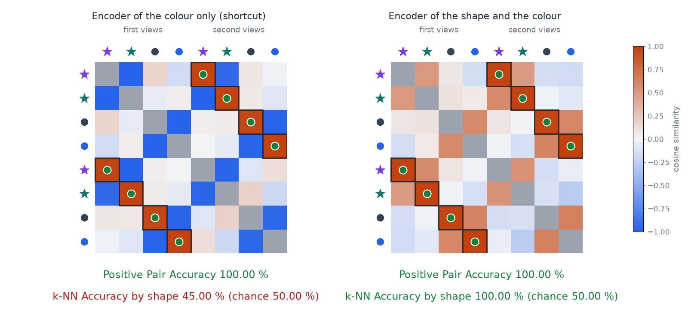
</p>
<p align="center"><em>Cosine similarities of the 8 views of 4 toy images (2 stars, 2 circles, 4 colours), partners outlined, the most similar view of every row marked green when it is the partner. Both toy encoders reach a positive pair accuracy of 100.00 % (compute_info_nce_loss); the one that encodes only the colour scores 45.00 % in the k-NN by shape (chance 50.00 %), the other 100.00 % (compute_nearest_neighbour_predictions, 5 neighbours).</em></p>

How to read it:
- It is an instance score, not a class score: a view must single out its partner among every other view, including those of other images of the same class. A rising curve shows the loss works; a value near 100 % (1 in TensorBoard) long before the k-NN accuracy rises shows a shortcut, a cue the two views share (the colour of an object when the colour types are off, its position when the crops are too large), as in the left matrix above.
- In the tutorial run it is 3.91 % at the very first iteration, 10 times chance before any update, because the two views share the colour of the shape; it ends at 34.82 % (mean of the last 500 iterations) while the k-NN accuracy reaches 54.83 %. A moderate value can go with a good representation.
- It depends on the batch size (2N - 1 candidates) and on the strength of the views: compare runs with the same batch and augmentations only.

#### Diagonal And Off-Diagonal Correlation (Barlow Twins)

Should you train with Barlow Twins, these two values replace the positive pair accuracy. Every embedding feature is standardized over the batch, then the features of the first views are correlated with those of the second views (`compute_feature_cross_correlation`, read by `compute_barlow_twins_loss` of `self_supervised_losses.py`):

```
u, v                     = embeddings of the first and second views, every feature standardized over the batch:
                           (value - mean) / sqrt(variance + 1e-5)
C                        = u^T v / N                         the [D, D] cross-correlation
Diagonal Correlation     = mean over i of C_ii
Off-Diagonal Correlation = sum over i != j of |C_ij|, divided by D (D - 1)
loss                     = sum over i of (C_ii - 1)^2 + off_diagonal_weight * sum over i != j of C_ij^2
```

The diagonal measures **invariance** (every feature takes the same value on both views of an image, target 1), the off-diagonal measures **redundancy** (two features carrying the same information, target 0). Both keep 4 decimals in the console; the `Best` marker rises with the diagonal and falls with the off-diagonal.

<p align="center">
  
</p>
<p align="center"><em>Cross-correlation of three toy pairs of views of 512 images with 8 features (compute_feature_cross_correlation, compute_barlow_twins_loss with an off-diagonal weight of 0.005): diagonal 0.9889 and off-diagonal 0.0389 for invariant, decorrelated features; 0.9633 and 0.5522 for features repeating two underlying values; -0.0004 and 0.0241 for views that disagree.</em></p>

How to read them:
- A diagonal near 0 means the views disagree, or a collapse: a constant feature standardizes to 0, so a constant embedding gives a diagonal of 0.0000 and a loss of D (8.0000 for 8 features), not a perfect diagonal.
- A diagonal near 1 with a high off-diagonal means the features repeat each other, a partial collapse of the embedding to few directions (middle matrix). With the weight of 0.005 of every configuration, this costs the loss 0.1492, far less than views that disagree (8.0288).
- The off-diagonal never reaches 0 on a finite batch: independent features still give a small mean absolute correlation from the batch sampling alone (0.0241 for 512 images in the right matrix). Being a mean over D (D - 1) terms, it compares across embedding sizes, while the loss grows with D.

#### Embedding Standard Deviation

To be able to tell a collapse from a slow start during training, both methods track the `Embedding Standard Deviation`: the formula of the [representation standard deviation](#representation-standard-deviation) applied to the embeddings of the first views of every batch (`SelfSupervisedModel.forward`), D values out of the projection head. Unlike the representations, the embeddings can be negative and spread over the whole sphere, so a healthy run sits near 1 (0.9751 over the last 500 iterations of the tutorial run) and a collapse falls to 0 (1.00 and 0.01 for the spread and collapsed toys of the effective rank figure).

How to read it: a fall towards 0 on the training curve, with the loss stuck (InfoNCE at log(2N - 1), or a Barlow Twins diagonal falling to 0), is a collapse. The first validation batches can sit near 0 without one (0.0013 at iteration 5 of the tutorial run, against 0.56 for the training batch of the same iteration): validation images are encoded in evaluation mode, whose batch normalization running statistics are not settled yet. The `Best` marker of the console counts a higher value as better.
