# Visual Language Model Spark

<p align="center">
  
</p>
<p align="center"><em>One evaluation sample image of every supervised task, from short runs on the synthetic datasets; the semantic segmentation (9 classes) and sequence labelling samples come from runs trained on 2026-10-21 and 2026-11-15, on the datasets of those days.</em></p>

## Table Of Content
- [Description](#description)
- [Prerequisites](#prerequisites)
- [Quick Start With Synthetic Data](#quick-start-with-synthetic-data)
- [Training](#training)
  - [Launching A Run](#launching-a-run)
  - [Configurations](#configurations)
  - [Run Folder](#run-folder)
  - [Run Names](#run-names)
  - [Stopping And Resuming](#stopping-and-resuming)
  - [Console And TensorBoard](#console-and-tensorboard)
  - [MLflow Tracking](#mlflow-tracking)
  - [Augmentation And Diagnosis Modes](#augmentation-and-diagnosis-modes)
  - [Moving Average Of The Weights](#moving-average-of-the-weights)
  - [Transfer Between Runs](#transfer-between-runs)
- [Tasks](#tasks)
  - [Label Files](#label-files)
- [Evaluating Checkpoints](#evaluating-checkpoints)
- [Tutorials](#tutorials)
- [Deployment](#deployment)
  - [From A Checkpoint To A Served Model](#from-a-checkpoint-to-a-served-model)
  - [The Same Values In Every Format](#the-same-values-in-every-format)
  - [Export](#export)
  - [Input Contract](#input-contract)
  - [Triton Server](#triton-server)
  - [Serving Formats And Precision](#serving-formats-and-precision)
- [Tests](#tests)
- [Docker Image](#docker-image)
  - [Building The Image](#building-the-image)
  - [Running A Training](#running-a-training)
- [Repository Structure](#repository-structure)
- [Metrics Explained](#metrics-explained)

## Description
If you are new to the repository, start from its tasks: it trains, evaluates and exports PyTorch models for nine vision tasks, plus a self-supervised task that pre-trains backbones.

| Code | Task | Input | Output |
|---|---|---|---|
| CLS | `classification` | one image | one class (multi-class) or several classes (multi-label) |
| DET | `object_detection` | one image | boxes with their class and score |
| INS | `instance_segmentation` | one image | the boxes of DET and the mask of every object |
| KPT | `keypoint_detection` | one image | the objects of the image with their class, keypoints and score |
| SEG | `semantic_segmentation` | one image | one class per pixel |
| M2O | `sequence_classification` | a sequence of frames | one class per sequence |
| M2M | `sequence_labelling` | a sequence of frames | one class per frame |
| CMP | `sequence_comparison` | a before and an after sequence | one class per pair |
| SEL | `frame_selection` | a sequence of frames | the frames of every wanted class |
| SSL | `self_supervised` | one unlabelled image (two random views of it) | a representation whose backbone initialises the other tasks |

The figure below shows the architecture of every task, all built on one backbone design:

<p align="center">
  
</p>

If this README is not enough, see `documentation/`:

| To ... | Read |
|---|---|
| follow a run: run folder, console, resuming, augmentations | [Training reference](documentation/reference/training_reference.md) |
| prepare data: datasets, label formats, losses | [Tasks reference](documentation/reference/tasks_reference.md) |
| set a configuration key or read an output | [Configuration reference](documentation/reference/configuration_reference.md) |
| evaluate, compare, export or serve a model | [Tools reference](documentation/reference/tools_reference.md) |
| pre-train backbones on ImageNet-22k and Open Images V7 | [Pretraining reference](documentation/reference/pretraining_reference.md) |
| understand a metric of the evaluation reports | [Metrics reference](documentation/reference/metrics_reference.md) |

## Prerequisites
To start on a new machine:

```bash
# Install uv, then open a new shell
curl -LsSf https://astral.sh/uv/install.sh | sh

# Install the Python of .python-version
uv python install

# Install the packages of uv.lock
uv sync
```

## Quick Start With Synthetic Data
In order to check the installation or a configuration within minutes, every task has a synthetic shapes dataset:

```bash
# Generate the dataset of a task (--task from the table below)
uv run python -m vision_training.data.synthetic.create_synthetic_dataset --task=classification --output_folder="$HOME/Data/classifier_data/synthetic_shapes"

# Set its absolute paths in the synthetic configuration (no ~ nor $HOME), then train
uv run python -m vision_training.main --configuration_path="vision_training/configurations/classification/configuration_synthetic_shapes.yaml"
```

| Task | `--task` | Configuration |
|---|---|---|
| CLS | `classification` | `classification/configuration_synthetic_shapes.yaml` |
| CLS (multi-label) | `multi_label_classification` | `classification/configuration_synthetic_counted_shapes.yaml` |
| DET | `instance_segmentation` | `object_detection/configuration_synthetic_shapes.yaml` |
| INS | `instance_segmentation` | `instance_segmentation/configuration_synthetic_shapes.yaml` |
| KPT | `keypoint_detection` | `keypoint_detection/configuration_synthetic_shapes.yaml` |
| SEG | `semantic_segmentation` | `semantic_segmentation/configuration_synthetic_shapes.yaml` |
| M2O | `sequence_classification` | `sequence_classification/configuration_synthetic_sequences.yaml` |
| M2M | `sequence_labelling` | `sequence_labelling/configuration_synthetic_sequences.yaml` |
| CMP | `sequence_comparison` | `sequence_comparison/configuration_synthetic_pairs.yaml` |
| SEL | `frame_selection` | `frame_selection/configuration_synthetic_sequences.yaml` |
| SSL | `classification`, `self_supervised` | `self_supervised/configuration_synthetic_shapes.yaml`, `configuration_counted_shapes_simclr.yaml`, `configuration_counted_shapes_barlow_twins.yaml` |

<p align="center">
  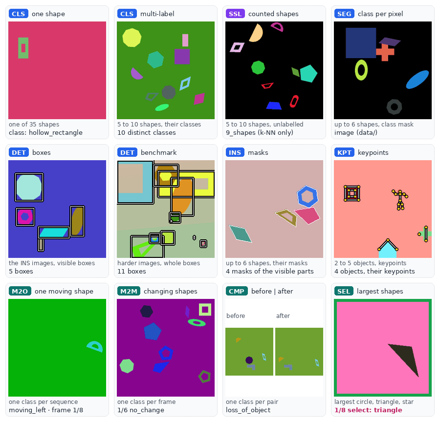
</p>
<p align="center"><em>Samples written by <code>create_synthetic_dataset.py</code>, drawn with their <code>labels.json</code> labels; the sequence tiles play their frames.</em></p>

## Training

### Launching A Run
Once a dataset is ready, start from the example configuration of its task:

```bash
# Copy vision_training/configurations/<task>/configuration_example.yaml, fill its folders as absolute paths
uv run python -m vision_training.main --configuration_path="vision_training/configurations/classification/my_configuration.yaml"
```

The figure below numbers the steps of a launch, from the configuration file to the training loop:

<p align="center">
  
</p>
<p align="center"><em>The run name decides the folder, and the last checkpoint of that folder decides between a new run and a resume.</em></p>

### Configurations
Every task has a `configuration_example.yaml` and a `configuration_synthetic_*.yaml`, each key explained by its comment ([every key](documentation/reference/configuration_reference.md#configurations)). Four sections are shared by every task:

<p align="center">
  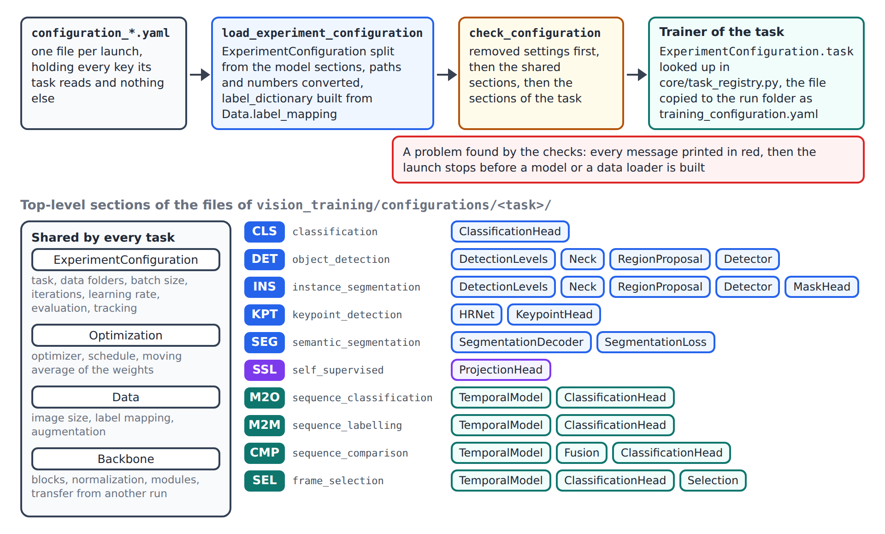
</p>

```bash
# Check configurations without training, e.g. in a pipeline (exit code 1 when one is invalid)
uv run python -m vision_training.check_configuration --configuration_path="vision_training/configurations/classification/configuration_synthetic_shapes.yaml" --check_paths
```

### Run Folder
Whenever a training starts, it writes to `<experiment_folder>/<run name>/` ([every file](documentation/reference/training_reference.md#run-folder)):

```text
<experiment_folder>/<run name>/
├── training_configuration.yaml        # Configuration of the last start of the run
├── Weights/Iteration_<n>/model_<n>.pt # Checkpoints
├── Tensorboard/                       # Curves
├── Results.txt                        # Report of every evaluated checkpoint
├── Evaluation/                        # Evaluation files and evaluation_summary.csv
└── Checkpoint_Evaluation/             # Evaluations of scripts/evaluation/evaluate_checkpoint.py
```

<p align="center">
  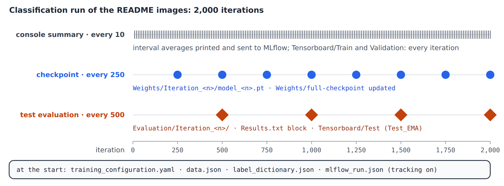
</p>

### Run Names
To keep runs of different settings apart, the run name is built from the configuration: the same settings resume in the same folder, changed ones start a new one ([every token](documentation/reference/configuration_reference.md#run-names)).

<p align="center">
  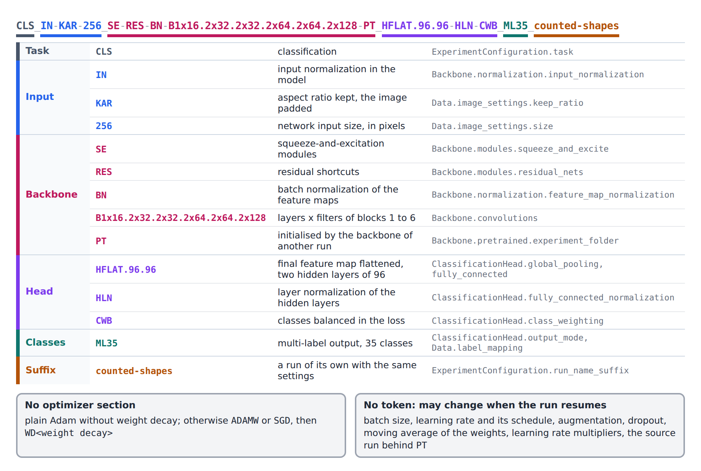
</p>

### Stopping And Resuming
In case a training has to stop, Ctrl+C saves a checkpoint and relaunching the configuration resumes it. `number_iterations` is the run total ([details](documentation/reference/training_reference.md#stopping-and-resuming)).

<p align="center">
  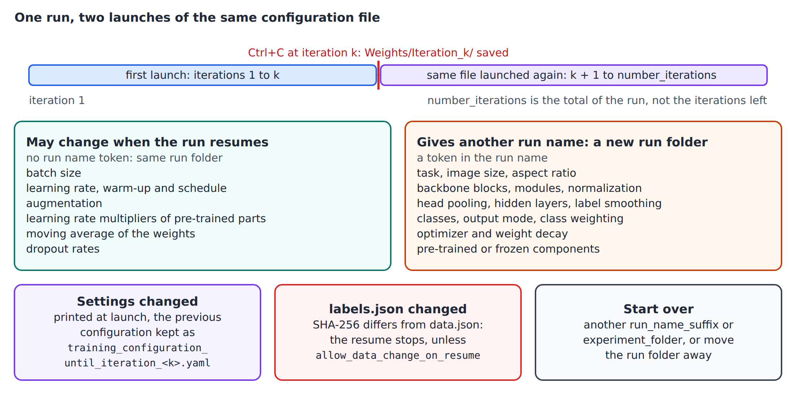
</p>

### Console And TensorBoard
So that a run can be followed live, every evaluation prints its report into `Results.txt` ([console output](documentation/reference/training_reference.md#console-output)):

<p align="center">
  
</p>

```bash
# Curves of the run, on http://localhost:6006
uv run tensorboard --logdir <experiment_folder>/<run name>/Tensorboard
```

<p align="center">
  
</p>

### MLflow Tracking
If you are looking for one table of every run, set `ExperimentConfiguration.tracking.activated` ([metrics and tags](documentation/reference/configuration_reference.md#mlflow-tracking)):

```bash
# Runs of the experiment folder, on http://localhost:5000
uv run mlflow ui --backend-store-uri sqlite:///<experiment_folder>/mlflow.db
```

<p align="center">
  
</p>

### Augmentation And Diagnosis Modes
Suppose a run learns nothing: first look at what the network receives. `Data.data_augmentation` sets the types below ([strengths](documentation/reference/training_reference.md#data-augmentation)).

<p align="center">
  
</p>

Three diagnosis modes of `ExperimentConfiguration.diagnosis_modes` exit without training:

| Mode | Use it | Details |
|---|---|---|
| `view_input_images` | before a long run, to see the samples as the network receives them | [Viewing The Input Images](documentation/reference/training_reference.md#viewing-the-input-images) |
| `compute_anchor_coverage` (DET, INS) | after changing the image size, the detection levels or the anchors | [Checking The Anchor Coverage](documentation/reference/training_reference.md#checking-the-anchor-coverage) |
| `benchmark_speed` | before training an architecture, for its training and serving speed | [Benchmarking The Speed](documentation/reference/training_reference.md#benchmarking-the-speed) |

### Moving Average Of The Weights
If one wishes to score a smoothed model, `Optimization.exponential_moving_average` keeps an average of the weights, evaluated with them ([choosing the decay](documentation/reference/training_reference.md#moving-average-of-the-weights)).

<p align="center">
  
</p>
<p align="center"><em>The reference pair of the object detection benchmark: the averaged weights lead the trained ones at every evaluation.</em></p>

### Transfer Between Runs
To start from a trained component, such as an ImageNet backbone for a detector, give its run in the `pretrained` block of the section ([components and rules](documentation/reference/training_reference.md#transfer-between-runs)):

```yaml
Backbone:
  pretrained:
    # Run folder whose trained backbone initialises this run
    experiment_folder: "/path/to/experiments/CLS_IN-KAR-256_SE-RES-BN-B1x64.2x64.2x64.4x64.5x64.5x64_HFLAT.512.256-HLN-CWB_MC1000"
    # Checkpoint iteration of that run, null for its last saved checkpoint
    iteration: null
    # Keeps the loaded backbone fixed, only the other components learn
    freeze: False
    # Keeps the scale and shift of its normalization layers fixed while its convolutions learn
    freeze_normalization_parameters: False
    # Fine-tunes the loaded backbone ten times slower than the new layers
    learning_rate_multiplier: 0.1
```

<p align="center">
  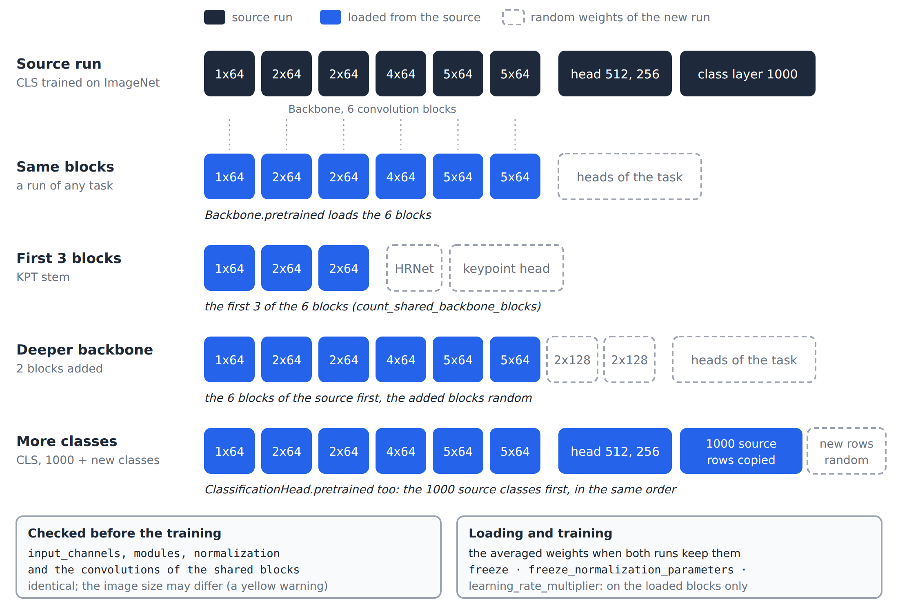
</p>

## Tasks
Say you bring your own data: every split is a folder holding its images in `data/` and their labels in `labels.json`, and one `label_mapping.json` turns the categories of the labels into the classes the model predicts, merging or leaving out categories. Then start from the `configuration_example.yaml` of the task.

<p align="center">
  
</p>

The table gives what `labels.json` holds for every task. Its reference shows an annotated label file, the configuration sections and the metrics of the task; its workflow follows one run function by function.

| Task | Labels | Details |
|---|---|---|
| CLS | `category_id`, or `category_ids` for multi-label | [reference](documentation/reference/tasks_reference.md#classification-cls) · [workflow](documentation/task%20workflows/classification_workflow.md) |
| DET | COCO boxes | [reference](documentation/reference/tasks_reference.md#object-detection-det) · [workflow](documentation/task%20workflows/object_detection_workflow.md) |
| INS | COCO `segmentation` (polygons or RLE) | [reference](documentation/reference/tasks_reference.md#instance-segmentation-ins) · [workflow](documentation/task%20workflows/instance_segmentation_workflow.md) |
| KPT | COCO `keypoints` | [reference](documentation/reference/tasks_reference.md#keypoint-detection-kpt) · [workflow](documentation/task%20workflows/keypoint_detection_workflow.md) |
| SEG | PNG masks in `masks/` | [reference](documentation/reference/tasks_reference.md#semantic-segmentation-seg) · [workflow](documentation/task%20workflows/semantic_segmentation_workflow.md) |
| M2O | one `category_id` per sequence | [reference](documentation/reference/tasks_reference.md#sequence-classification-m2o) · [workflow](documentation/task%20workflows/sequence_classification_workflow.md) |
| M2M | `frame_category_ids` | [reference](documentation/reference/tasks_reference.md#sequence-labelling-m2m) · [workflow](documentation/task%20workflows/sequence_labelling_workflow.md) |
| CMP | a `before` and an `after` sequence | [reference](documentation/reference/tasks_reference.md#sequence-comparison-cmp) · [workflow](documentation/task%20workflows/sequence_comparison_workflow.md) |
| SEL | the labels of M2M | [reference](documentation/reference/tasks_reference.md#frame-selection-sel) · [workflow](documentation/task%20workflows/frame_selection_workflow.md) |
| SSL | the layout of CLS | [reference](documentation/reference/tasks_reference.md#self-supervised-learning-ssl) · [workflow](documentation/task%20workflows/self_supervised_workflow.md) |

### Label Files
Before a first launch on your own data, read the label file examples of your task in its reference.

Two converters write the label files from layouts you may already have, linking the images instead of copying them:
- `vision_training/data/classification/class_folder_manifests.py`: images sorted into one folder per class (CLS, SSL), such as ImageNet;
- `vision_training/data/sequence/pair_list_manifests.py`: a list of before and after sequences per split (CMP).

## Evaluating Checkpoints
Each time the checkpoints of a run must be scored again (another split, batch size or NMS), set the main block of `scripts/evaluation/evaluate_checkpoint.py` ([details](documentation/reference/tools_reference.md#evaluating-checkpoints)):

```bash
# Writes into <run>/Checkpoint_Evaluation/, the training files left untouched
uv run python -m scripts.evaluation.evaluate_checkpoint
```

<p align="center">
  
</p>

Other tools read a run folder:

| To ... | Script | Details |
|---|---|---|
| draw the figures of a research report | `scripts/evaluation/draw_report_figures.py` | [tools reference](documentation/reference/tools_reference.md#drawing-the-figures-of-a-research-report) |
| score a large unlabelled split | `scripts/evaluation/score_image_split.py` | [tools reference](documentation/reference/tools_reference.md#scoring-a-large-split) |
| compare the launches of a hyperparameter stage | `scripts/evaluation/collect_experiment_results.py`, `compare_best_evaluations.py`, `plot_experiment_comparisons.py` | [tools reference](documentation/reference/tools_reference.md#comparing-launches) |
| cluster near-identical images | `scripts/embedding/cluster_image_embeddings.py` | [tools reference](documentation/reference/tools_reference.md#clustering-image-embeddings) |

## Tutorials
If you would rather watch than read, narrated videos cover every task; `tutorials/README.md` explains how to rebuild them.

<p align="center">
  
</p>

## Deployment
In order to serve a trained run to other programs, read these parts in order: [From A Checkpoint To A Served Model](#from-a-checkpoint-to-a-served-model) (the words of deployment on one run), [The Same Values In Every Format](#the-same-values-in-every-format), then [Export](#export), [Input Contract](#input-contract), [Triton Server](#triton-server) and [Serving Formats](#serving-formats-and-precision).

### From A Checkpoint To A Served Model
If words such as eager, ONNX or TensorRT stop you, this part follows one run to a served model: the 35-class synthetic shapes classifier of the README screenshots (512 pixels, iteration 2000). All files, outputs and timings below come from it unless the serving benchmark is named; the [glossary](#glossary) defines other terms.

| Word | What it is |
|---|---|
| Eager | PyTorch running the Python code line by line, each operation sent to the GPU when Python reaches it: how training and evaluation run, and the reference of every export |
| Export | `export_model.py` runs the model once, records its operations and weights into `model.pt` and `model.onnx`, checks both against the eager model and writes them with their Triton configuration into `served_models/` |
| TorchScript (`model.pt`) | the graph format of PyTorch, run by PyTorch or its C++ library libtorch, in your process or in Triton |
| ONNX (`model.onnx`) | an open graph format of standard operators (opset 18): graph in `model.onnx`, weights in `model.onnx.data`, input contract in its metadata; read by runtimes of any framework |
| ONNX Runtime | the library that runs `model.onnx`: on the CPU for the export check, on the GPU in Triton through its CUDA or TensorRT execution provider |
| TensorRT | the NVIDIA compiler that turns `model.onnx` into an engine for one GPU model and one TensorRT version; built inside Triton at the first requests, never checked by the export |
| Precision (FP32 / FP16) | the bits of each computed value: exports store FP32; `tensorrt_precision = "FP16"` lets TensorRT compute in FP16 where faster, `torchscript_precision = "FP16"` does it for the TorchScript network, inputs and outputs staying FP32 |
| Triton | the NVIDIA inference server, a Docker container that loads `served_models/`, answers HTTP and gRPC requests and batches those that arrive together |

<p align="center">
  
</p>
<p align="center"><em>The four ways to run the checkpoint of the README classifier, with the sizes of model.pt, model.onnx and the TensorRT engines built from model.onnx in the Triton image (TensorRT 10.14.1, GB10).</em></p>

#### Triton Inference Server
So that other programs can query the model over the network, Triton serves `served_models/` from a Docker container ([Triton Server](#triton-server)), on HTTP port 8000 and gRPC port 8001.

A client only needs `tritonclient` and numpy:

```python
import cv2
import numpy as np
import tritonclient.grpc as triton_client

images = cv2.imread("<synthetic_shapes_folder>/test/data/test_000012.png").transpose(2, 0, 1)[None].astype(np.float32)
client = triton_client.InferenceServerClient(url="localhost:8001")
inference_input = triton_client.InferInput(name="images", shape=list(images.shape), datatype="FP32")
inference_input.set_data_from_numpy(input_tensor=images)
result = client.infer(model_name="image_classifier_onnx", inputs=[inference_input],
                      outputs=[triton_client.InferRequestedOutput(name="class_probabilities")])
print(result.as_numpy(name="class_probabilities").max())
```

#### One Image Through Every Path
Say you want to see the export check on one image: this script runs `test_000012.png`, a hexagon of the CLS synthetic test split, through the eager model, `model.pt` and `model.onnx` after `export_model.py`.

```python
import cv2
import numpy as np
import onnxruntime
import torch

from pathlib import Path

from vision_training.deployment.export_specifications import build_inference_model
from vision_training.models.model_loading import load_trained_model

# One test image of 512 x 512 pixels, the input size, so the keep_ratio resize of the input contract leaves it as it is
images = cv2.imread("<synthetic_shapes_folder>/test/data/test_000012.png").transpose(2, 0, 1)[None].astype(np.float32)
served_models = Path("vision_training/deployment/triton/served_models")

# Eager: the repository code builds the network from the configuration, then loads the checkpoint (TF32 off, as the
# export check runs it)
torch.backends.cudnn.allow_tf32 = False
run_folder = Path("<experiment_folder>/CLS_IN-KAR-512_SE-RES-BN-B1x16.2x32.2x32.2x64.2x64.2x128-PT_HFLAT.128-HLN-CWB_MC35")
model = load_trained_model(configuration_path=run_folder / "training_configuration.yaml", device=torch.device("cuda"),
                           checkpoint_path=run_folder / "Weights/Iteration_2000/model_002000.pt", use_averaged_weights=False)
eager_model = build_inference_model(task="classification", model=model)
with torch.no_grad():
    eager_probabilities = eager_model(images=torch.from_numpy(images).cuda()).cpu().numpy()

# TorchScript: PyTorch alone reads the graph and the weights of model.pt
torchscript_model = torch.jit.load(f=served_models / "image_classifier_torchscript/1/model.pt", map_location="cuda")
with torch.no_grad():
    torchscript_probabilities = torchscript_model(torch.from_numpy(images).cuda()).cpu().numpy()

# ONNX: ONNX Runtime alone reads model.onnx and the weights of model.onnx.data, here on the CPU
session = onnxruntime.InferenceSession(served_models / "image_classifier_onnx/1/model.onnx", providers=["CPUExecutionProvider"])
onnx_probabilities = session.run(output_names=["class_probabilities"], input_feed={"images": images})[0]

print(eager_probabilities.max(), np.abs(torchscript_probabilities - eager_probabilities).max(),
      np.abs(onnx_probabilities - eager_probabilities).max())
```

The serving paths, timed by the [serving benchmark](documentation/architecture_benchmarking/serving_benchmark_plan.md) on the 9-class version of this classifier:

| Path | File | Runs with | Checked by the export | Batch 1 (milliseconds) | Batch 16 (images per second) |
|---|---|---|---|---|---|
| In the process, eager | checkpoint | Python, PyTorch, this repository | reference | 2.2 | 349 |
| In the process, TorchScript | `model.pt` | PyTorch or libtorch | yes | 3.3 | 355 |
| Triton, TorchScript | `model.pt` | Triton | yes | 4.5 | 320 |
| Triton, ONNX Runtime CUDA | `model.onnx` | Triton | yes | 3.6 | 435 |
| Triton, ONNX with TensorRT FP32 | `model.onnx` | Triton, engine tied to one GPU model | the ONNX graph, not the engine | 3.0 | 646 |
| Triton, ONNX with TensorRT FP16 | `model.onnx` | Triton, engine tied to one GPU model | no | 2.5 | 1,215 |

#### Which One When
To find your way among these paths, find your situation in the table: it gives the path to use and the file it runs.

| Your situation | Use | File |
|---|---|---|
| Debugging, evaluating or changing the model | eager, the reference | the checkpoint |
| The program running the model links PyTorch | TorchScript | `model.pt` |
| The most images per second on one known GPU | ONNX with TensorRT FP16, after checking its metric | `model.onnx` |
| No PyTorch, or C# or Java | ONNX Runtime, CPU or GPU | `model.onnx` |
| Many clients or models behind one endpoint | Triton, serving either file; on a known GPU, `model.onnx` with TensorRT FP16 after checking its metric | `model.pt` or `model.onnx` |

- **Debugging, evaluating or changing the model**: eager, the reference of every other path.
- **A C++ or Python service that already links PyTorch**: TorchScript (`torch.jit.load` on `model.pt`), which PyTorch 2.14 marks as deprecated.
- **No PyTorch where the model runs, or C# or Java**: ONNX with ONNX Runtime, on CPU or GPU.
- **The most images per second on a known GPU**: ONNX with TensorRT FP16, about 3.5 times the eager throughput in the table above. The export never checks the engine, so measure its test metric through Triton first with `scripts/deployment/evaluate_served_formats.py`.
- **Many cameras or services, several models or versions behind one endpoint**: Triton, which serves any of these files and batches the requests that arrive together.

#### Glossary
If you are looking for one word of the Deployment section:

| Term | Meaning | In this repository |
|---|---|---|
| Kernel | one GPU program applied to a whole tensor by thousands of threads | the 3 x 3 convolution of block 1 over [1, 16, 512, 512] |
| CUDA | the NVIDIA platform to program its GPUs | `torch.device("cuda")`, the CUDA execution provider |
| cuDNN, cuBLAS | NVIDIA GPU kernel libraries for convolutions and matrix products | run by PyTorch, libtorch and ONNX Runtime CUDA |
| Tensor Cores | GPU units that multiply small matrices in reduced precision (TF32, BF16, FP16, FP8, INT8, FP4) faster than the regular cores | the TF32 kernel TensorRT kept for the first convolution |
| Eager | PyTorch running `forward` line by line, each operation launched when Python reaches it | every training and evaluation, the in-process run of `run_inference.py` |
| Graph | the operations of a network with their connections, shapes and weights, known before it runs | `model.pt`, `model.onnx` |
| Tracing | recording the operations a forward pass executes on an example batch | `torch.jit.trace` on a batch of 2 |
| `torch.export` | the PyTorch graph capture that follows dynamic dimensions as symbols | the ONNX export, `dynamo=True` |
| TorchScript | the PyTorch graph format, run by libtorch | `model.pt`, Triton `pytorch_libtorch` |
| libtorch | the C++ library at the core of PyTorch | runs `model.pt` in Python, C++ or Triton |
| ONNX | the framework-neutral graph format of standard operators | `model.onnx` and `model.onnx.data` |
| Opset | the version of the ONNX operator definitions a file uses | 18 |
| ONNX Runtime | the Microsoft library that runs ONNX files | the export check (CPU), Triton `onnxruntime_onnx` |
| Execution provider | the ONNX Runtime plug-in that picks the hardware and kernels of each node | CPU, CUDA, TensorRT |
| TensorRT | the NVIDIA compiler and runtime that turns a graph into an engine for one GPU | `tensorrt_precision` "FP32" or "FP16" |
| Engine, plan | the compiled TensorRT network, valid for one GPU model, one TensorRT version and a range of input shapes | `/tmp/tensorrt_engine_cache` of the container |
| Fusion | several operations in one kernel, intermediate tensors kept out of memory | 9 Conv and Relu pairs of the TensorRT engine |
| Tactic | a candidate kernel the TensorRT builder times for a layer | 60 for the first convolution |
| Triton Inference Server | the NVIDIA server that loads model files and answers HTTP and gRPC requests | `vision_training/deployment/triton/docker-compose.yml` |
| Model repository | the folder Triton reads: one folder per model, with its `config.pbtxt` and version folders | `served_models/` |
| Backend | the Triton plug-in that runs one format | `pytorch_libtorch`, `onnxruntime_onnx` |
| Dynamic batching | Triton grouping requests that arrive close together into one batch | `max_queue_delay_microseconds: 1000` |
| Instance | one copy of a model in Triton, running requests in parallel with the other copies | `instance_group` count 1 |
| In the process | the model inside your own program, without a server | eager, `torch.jit.load`, `onnxruntime.InferenceSession` |
| Latency, p50 | time from a request to its answer; p50 is the median, p99 the time 99 % of requests stay under | the Batch 1 p50 columns |
| Throughput | images answered per second | the Batch 16 columns |
| Warm-up | first requests, not timed, while CUDA initializes and TensorRT builds its engines | 20 in `run_inference.py` |
| Shared memory | memory both client and server map, so an image is written once instead of sent in the request | `use_shared_memory`, `/dev/shm` |
| Input contract | the preprocessing a client must apply, written with the model | `preprocessing.json`, the ONNX metadata |
| FP32 | 32-bit floating point: 8 exponent and 23 mantissa bits | every export and evaluation |
| TF32 | Tensor Core mode with the range of FP32 and 10 mantissa bits | eager PyTorch convolutions, TensorRT "FP32" |
| BF16 | 16 bits: the range of FP32 with 7 mantissa bits | the forward passes of the training |
| FP16 | 16 bits: 5 exponent bits, largest value 65,504, and 10 mantissa bits | `tensorrt_precision = "FP16"`, `torchscript_precision = "FP16"` |

### The Same Values In Every Format
Before you pick the precision of a served model ([export](#export)), see what FP32, TF32, BF16 and FP16 store for typical values of the repository (PyTorch 2.14, up to 6 significant digits; TF32 rounds the FP32 mantissa to 10 bits, ties to even):

| Value of the repository | FP32 | TF32 | BF16 | FP16 |
|---|---|---|---|---|
| Class threshold 0.999 | 0.999 | 0.999023 | **1** | 0.999023 |
| Pixel coordinate 1000.3 of a 1024-pixel input | 1,000.3 | 1,000.5 | 1,000 | 1,000.5 |
| Area of a 256 x 256 box, 65,536 | 65,536 | 65,536 | 65,536 | **inf** |
| Area of a 300 x 300 box, 90,000 | 90,000 | 89,984 | 90,112 | inf |
| Box offset 0.1 | 0.1 | 0.0999756 | 0.100098 | 0.0999756 |
| Weight update 1e-6 | 1e-6 | 1.00024e-6 | 9.98378e-7 | 1.01328e-6 (subnormal) |
| Weight 0.1 after that update | **0.100001** | 0.0999756 | 0.100098 | 0.0999756 |

The figure below puts the same values on the number line of each format:

<p align="center">
  
</p>
<p align="center"><em>One lane per format: the ticks are the values it holds, the dot the stored value, and an arrow a value stored as inf (FP16 above 65,504).</em></p>

### Export
Once a run is ready to be served, `vision_training/deployment/export_model.py` writes it to the Triton model repository as TorchScript and ONNX, with a Triton configuration per model. It checks every format against the eager model and replaces the served models only when all match. Set in its main block:

- `experiment_folder`, `iteration`, `use_averaged_weights`, `maximum_batch_size`;
- `formats`: `"torchscript"` and `"onnx"`;
- `tensorrt_precision`: `"FP16"`, `"FP32"`, or `None` for ONNX Runtime CUDA only. Use `None` for a keypoint detector, which crashed Triton 26.01 with TensorRT; the TensorRT FP32 engines of the tutorial sequence models do not build beyond batch 1 (item 41 of `documentation/suggestions.md`);
- `torchscript_precision`: `"FP32"` or `"FP16"`.

Any other value stops the export before it starts. Then run:

```bash
uv run python -m vision_training.deployment.export_model
```

<p align="center">
  
</p>

The models go to `vision_training/deployment/triton/served_models/<model name>_<format>/<version>/` with their `config.pbtxt`:

| Task | Model name | Inputs | Outputs |
|---|---|---|---|
| CLS | `image_classifier` | `images` [B, 3, S, S] | `class_probabilities` [B, K] |
| DET | `object_detector` | `images` [B, 3, S, S] | `detection_boxes` [B, D, 4], `detection_scores` [B, D], `detection_labels` [B, D], `number_detections` [B] |
| INS | `instance_segmenter` | `images` [B, 3, S, S] | the outputs of DET, then `detection_masks` [B, D, M, M] |
| KPT | `keypoint_detector` | `images` [B, 3, S, S] | `candidate_positions` [B, C, N, 2], `candidate_scores` [B, C, N], `candidate_tags` [B, C, N] |
| SEG | `semantic_segmenter` | `images` [B, 3, S, S] | `class_map` [B, S, S], `class_probabilities` [B, K, S, S] |
| M2O | `sequence_classifier` | `images` [B, T, 3, S, S] | `class_probabilities` [B, K] |
| M2M | `sequence_labeller` | `images` [B, T, 3, S, S] | `class_probabilities` [B, T, K] |
| CMP | `sequence_comparator` | `before_images`, `after_images` [B, T, 3, S, S] | `class_probabilities` [B, K] |
| SEL | `frame_selector` | `images` [B, T, 3, S, S] | `class_probabilities` [B, T, K] |
| SSL | `image_encoder` | `images` [B, 3, S, S] | `representations` [B, F] |

S is `Data.image_settings.size`, K the number of classes, F the size of the L2 normalized representation, D the largest number of detections per image, M `MaskHead.mask_resolution`, T the number of frames, C the heatmap channels and N the candidates per channel. Inputs are float32 BGR images in [0, 255], prepared as the [input contract](#input-contract) states; the normalization is inside the model. Client-side post-processing (SEG at full resolution, INS masks, KPT grouping), the SEL decoder and ensembles: [tools reference](documentation/reference/tools_reference.md#export).

Should you want a TorchScript file half the size that uses the FP16 Tensor Cores without TensorRT, set `torchscript_precision = "FP16"`. Convolution, linear and attention weights become FP16; normalization, recurrent layers, buffers, softmax, inputs and outputs stay FP32 (`convert_to_half_precision` in `vision_training/deployment/export_formats.py`). The file is `model_fp16.pt`, so it can sit next to an FP32 `model.pt`. It is checked against the eager FP16 model at 100 times the FP32 tolerances (`HALF_PRECISION_TOLERANCE_FACTOR`).

Before a format goes to production, above all in FP16, set `test_split_parity = True`. A temporary Triton container (Docker, image of `vision_training/deployment/triton/docker-compose.yml`) serves every format, and the eager model and every format are scored on the whole test split, listing the samples whose outputs moved. The summary goes to `<run>/Export_Parity/Iteration_<n>[_EMA][_T<temperature>]_<precisions>/` (e.g. `Iteration_5000_EMA_T3_TorchScript-FP16_TensorRT-FP32`) and next to every installed model. It is a report only: it never blocks the installation. Cost: one test evaluation per format, plus one for the eager model. Details: [tools reference](documentation/reference/tools_reference.md#test-split-parity).

Suppose a classifier reaches its target precision only above a threshold such as 0.999: export it with a logit temperature.

1. Start `uv run python -m scripts.evaluation.serve_temperature_explorer` and open `http://127.0.0.1:8091/`.
2. Pick a run, an iteration and **Trained** or **EMA**, and check the balanced accuracy at the top of the page.
3. Press **Save Thresholds At This Temperature**, then **Export At T = …**.

The export goes to its own Triton model repository, `<run>/Exports/Iteration_<n>[_EMA]_T<temperature>/`. From the script, `use_saved_temperature` builds the saved temperature and thresholds into the model. Details: [tools reference](documentation/reference/tools_reference.md#logit-temperature).

### Input Contract
If a server has to turn a photo into a model input, it reads the input contract written with the model instead of guessing the resize or the channel order.

Every export writes the contract twice (keys in `vision_training/deployment/input_contract.py`):
- in the `metadata_props` of `model.onnx`;
- as `preprocessing.json` next to the model.

The contract describes:
- **the input**: the BGR photo as `cv2.imread` decodes it;
- **the resize**: `stretch`, `keep_ratio` or `tiles`, with its OpenCV interpolation;
- **the padding and the layout** of the tensor.

A run the contract cannot describe is not exported. The figure below shows the three resizes on one photo:

<p align="center">
  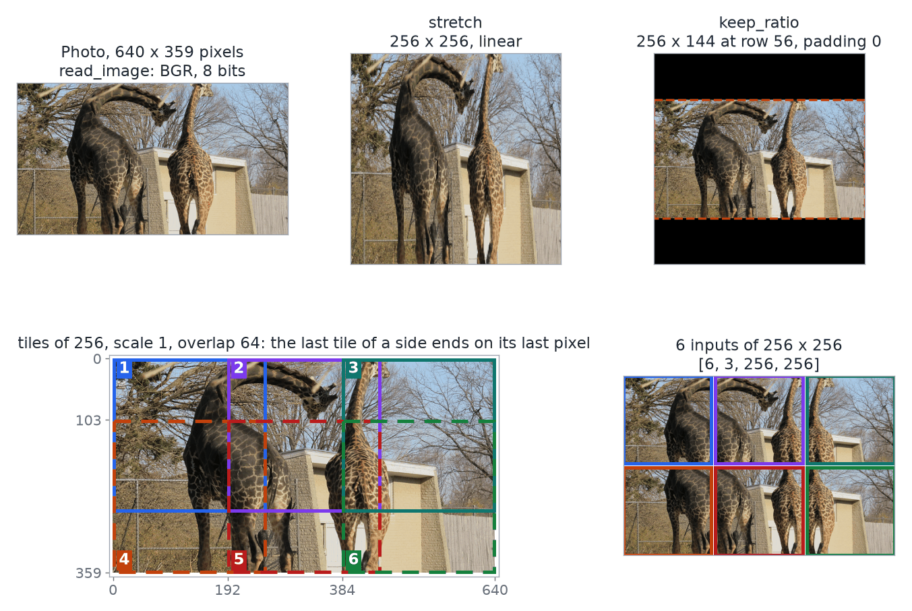
</p>
<p align="center"><em>The three resizes of a 640 x 359 photo for an input size of 256 (tiles overlapping by 64). Photo: COCO 2017 validation image 288882, Flickr, CC BY 2.0.</em></p>

A client reads and checks the contract of an ONNX file in three lines:

```python
# Open the exported model on the CPU
session = onnxruntime.InferenceSession("model.onnx", providers=["CPUExecutionProvider"])

# Read the contract from the ONNX metadata
input_contract = session.get_modelmeta().custom_metadata_map

# Fail if a key is missing or has an unknown value
check_input_contract(input_contract=input_contract)
```

Every key is in the [tools reference](documentation/reference/tools_reference.md#input-contract). `build_input_from_contract` in `tests/deployment/test_input_contract.py` builds the input from the contract alone, matching `preprocess_image` pixel for pixel.

### Triton Server
To serve every model of `served_models/`, start Triton and keep it running:

```bash
# Go to the Triton folder
cd vision_training/deployment/triton

# Start Triton on ports 8000 (HTTP), 8001 (gRPC) and 8002 (metrics)
docker compose up
```

The figure below shows the path of one request through Triton:

<p align="center">
  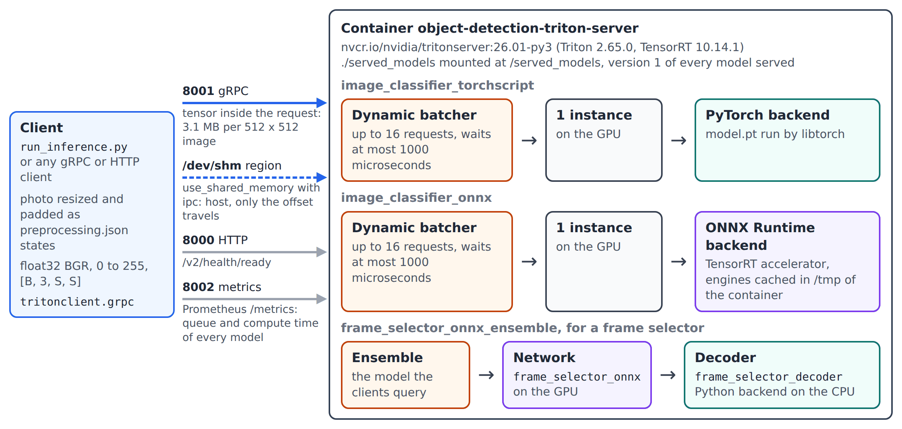
</p>

Whenever you want to compare in-process and Triton speed, `run_inference.py` sends the images of `vision_training/deployment/inference_data/` both ways, one image per request:

```bash
# Print the throughput in the process and through Triton
uv run python -m vision_training.deployment.run_inference
```

The figure below shows its output for the README classifier:

<p align="center">
  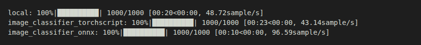
</p>
<p align="center"><em>The 35-class README classifier (512 pixels) with TensorRT FP32. With one image per request, Triton pays a gRPC call per image.</em></p>

### Serving Formats And Precision
Before a model goes to production, its serving path and [number format](#the-same-values-in-every-format) set its speed, its memory and its drift from the evaluated FP32 model. The numbers come from the [serving benchmark](documentation/architecture_benchmarking/serving_benchmark_plan.md) on the idle GPU of the DGX Spark, with Triton 26.01 (TensorRT 10.14.1).

#### What Is Exported Today
If you are looking for what deploys without new code, the table lists what `export_model.py` writes. Inputs and outputs stay float32 whatever the precision, which only changes the computation inside.

| Path | File, Triton platform | Computation | Status |
|---|---|---|---|
| In the process | checkpoint, eager PyTorch | FP32, convolutions in TF32 | the reference |
| TorchScript | `model.pt`, `pytorch_libtorch` | FP32 | exported, checked against eager |
| ONNX Runtime CUDA | `model.onnx`, `onnxruntime_onnx` | FP32 | `tensorrt_precision = None`, checked against eager |
| ONNX with TensorRT FP32 | same file, TensorRT accelerator | FP32, TF32 allowed | default, engine not checked |
| ONNX with TensorRT FP16 | same file | FP16 where TensorRT finds it faster | `"FP16"`, engine not checked |
| BF16 | none | | refused by Triton 26.01 |
| INT8, native TensorRT engine (`model.plan`) | none | | not implemented |

The figure below follows each file from its Triton configuration to what runs on the GPU, then shows the layer fusion of TensorRT:

<p align="center">
  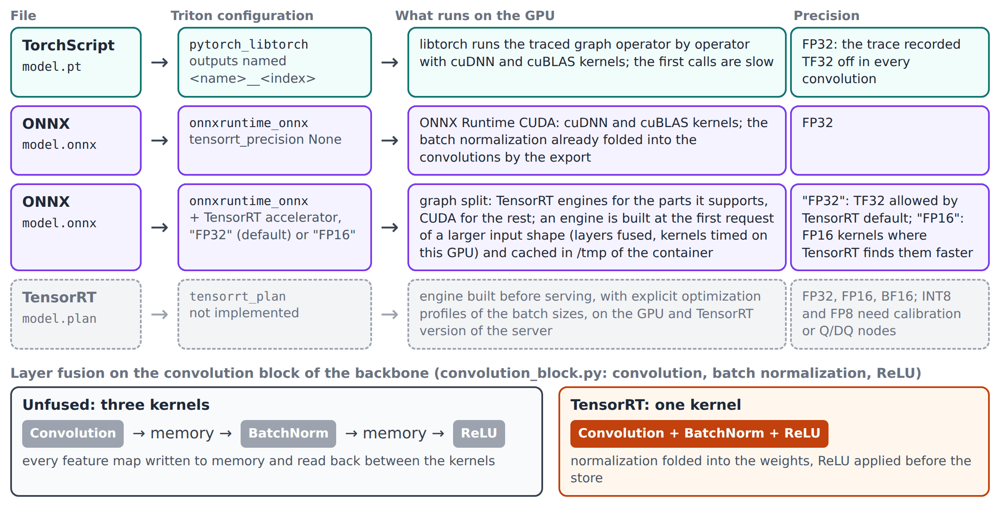
</p>

#### Triton Or The Model In The Process
Suppose several cameras or services query the same model at once: in the process each call runs alone, while Triton queues the requests, batches them and spreads them over its instances.

The table lists what Triton gives and what it costs:

| Triton gives | It costs |
|---|---|
| Dynamic batching: requests arriving within 1 millisecond run as one batch of up to 16 | up to 1 millisecond of queue time |
| Several instances of a model on the GPU (one exported) | weights and workspace once per instance |
| Every model of `served_models/` behind one endpoint | GPU memory of every loaded model |
| HTTP and gRPC clients in any language, without PyTorch | a container to run and upgrade |
| Metrics per model on port 8002 | nothing |

The figure below shows how the dynamic batcher groups requests over time:

<p align="center">
  
</p>

One request at a time, Triton adds latency: a 512-pixel CLS image takes 2.5 milliseconds with TensorRT FP16 against 2.2 eager. Dynamic batching helps none of the benchmark models: with it off and two instances, TensorRT FP16 serves more (CLS 1,747 against 1,168 images per second).

#### TensorRT Or TorchScript And ONNX Runtime CUDA
Whenever latency matters more than a portable file, TensorRT compiles the ONNX graph into an engine for this GPU:
- **Layer fusion**: convolution, batch normalization and ReLU become one kernel.
- **Kernel auto-tuning**: the fastest kernel of each layer is timed on this GPU.
- **Reduced precision**: FP16 kernels where faster, allowed but not forced.

At batch 16, CLS serves 646 images per second with TensorRT FP32 and 1,215 with FP16, against 435 with ONNX Runtime CUDA and 320 with TorchScript. DET serves 189 with TensorRT, 71 with ONNX Runtime CUDA and 11 with TorchScript.

TensorRT has these costs with the exported configuration:
- **Engines built at the first request**: up to 34 seconds for DET, and again for every larger batch.
- **Engines lost with the container**: the engine cache is not mounted, so a recreated container rebuilds them.
- **Engines tied to one GPU and TensorRT version**: `model.onnx` and `model.pt` run on any GPU.
- **Unchecked engines**: the export never runs them, and TensorRT allows TF32 in "FP32" engines.

#### Serving Benchmark Results
Should you need to pick a serving path, the table gives CLS / DET / M2M in each cell: the 9-class README classifier (512 pixels), the detection benchmark run_9 (1024 pixels) and the sequence labelling tutorial run (in frames). Triton rows use the exported configuration over shared memory; the test metric is in points against eager. To rerun the benchmark, see the [tools reference](documentation/reference/tools_reference.md#serving-benchmark).

| Path | Batch 1 p50 (milliseconds) | Batch 16 (images per second) | Memory (gigabytes) | Test metric against eager (points) |
|---|---|---|---|---|
| In the process, eager PyTorch | 2.2 / 16.0 / 3.6 | 349 / 11 / 1,841 | 1.74 / 6.73 / 2.23 | 82.73 % / 86.77 % / 77.15 % |
| In the process, TorchScript | 3.3 / 15.6 / 3.4 | 355 / 11 / 2,013 | 1.42 / 6.61 / 2.05 | not measured |
| Triton, TorchScript | 4.5 / 24.3 / 5.9 | 320 / 11 / 1,788 | 2.55 / 8.72 / 2.41 | 0.00 / 0.00 / +0.01 |
| Triton, ONNX Runtime CUDA | 3.6 / 17.0 / 5.3 | 435 / 30 / 2,207 | 3.93 / 13.66 / 5.49 | 0.00 / +0.01 / +0.01 |
| Triton, ONNX with TensorRT FP32 | 3.0 / 23.8 / 4.2 | 646 / 153 / 3,357 | 4.08 / 7.26 / 2.73 | -0.01 / -0.46 / 0.00 |
| Triton, ONNX with TensorRT FP16 | 2.5 / 17.6 / 3.1 | 1,215 / 246 / 6,249 | 3.98 / 5.99 / 2.47 | -0.03 / **-7.88** / +0.02 |

The DET cells of the ONNX rows predate a fix of the exported NMS (`suppress_stacked_groups` in `vision_training/models/detection/postprocessing.py`). Re-exported, run_9 reads:

| DET, exported NMS fixed | Batch 1 p50 (milliseconds) | Batch 16 (images per second) | Test metric against eager (points) |
|---|---|---|---|
| Triton, ONNX Runtime CUDA | 19.5 | 71 | +0.01 |
| Triton, ONNX with TensorRT FP32 | 7.5 | 189 | +0.01 |
| Triton, ONNX with TensorRT FP16 | 7.7 | 189 | +0.21 |

In short:
- **TensorRT FP16 is the fastest** for CLS and M2M: 3.5 (CLS) and 3.4 (M2M) times eager at batch 16, metric within 0.03 points.
- **DET in FP16 needed its NMS fixed**: box areas overflowed FP16. Fixed, TensorRT matches eager and serves 17 times faster at batch 16.
- **FP32 paths match eager** within 0.01 points; TorchScript through Triton is not faster than eager.
- **ONNX Runtime CUDA takes the most memory**: DET 13.66 GB against 5.99 with TensorRT FP16.

## Tests
After a change to the code, run the tests of `tests/`, whose folders mirror `vision_training/` and `scripts/` and include short trainings of every task on tiny synthetic datasets:

```bash
uv run pytest tests
```

In case you changed a single folder, run its mirror alone, e.g. `uv run pytest tests/configuration_processing`:

<p align="center">
  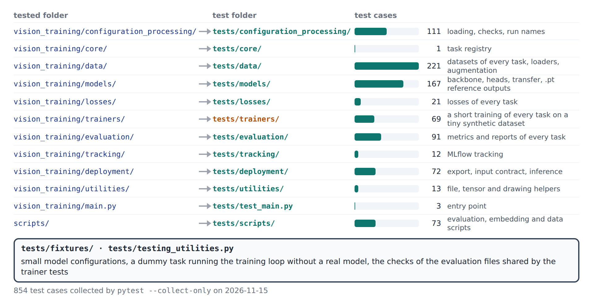
</p>

## Docker Image
Should a training run in a container, the `Dockerfile` builds the trainer for `linux/amd64` (cloud machines) and `linux/arm64` (DGX Spark). The CUDA libraries come with the torch wheels, so the image starts from Ubuntu 24.04.

### Building The Image
Each time the image is built, the machine builds its own architecture:

```bash
# Build the training image
docker buildx build --platform linux/arm64 --tag vision-trainer:local --load .

# Build the test stage, which runs the tests in the image
docker buildx build --platform linux/arm64 --target test --tag vision-trainer:test --load .
```

So that the cloud machines and the Spark pull the same tag, each architecture is pushed under its own tag, then both are joined:

```bash
# Push the image of this machine, labelled with its commit (on an amd64 machine: linux/amd64 and <tag>-amd64)
docker buildx build --platform linux/arm64 --build-arg GIT_COMMIT="$(git rev-parse HEAD)" --tag <registry>/vision-trainer:<tag>-arm64 --push .

# Join both architectures under one tag
docker buildx imagetools create --tag <registry>/vision-trainer:<tag> <registry>/vision-trainer:<tag>-amd64 <registry>/vision-trainer:<tag>-arm64
```

### Running A Training
Before a training starts in a container, it needs the GPU, shared memory for its loader workers, and the data and run folders mounted at the paths of its configuration:

```bash
# Train with the GPU, the data and run folders mounted, and the configurations of the checkout
docker run --rm --gpus all --ipc=host --user "$(id -u):$(id -g)" \
    -v "$HOME/Data:$HOME/Data" -v "$PWD/experiments:$PWD/experiments" \
    -v "$PWD/vision_training/configurations:/app/vision_training/configurations:ro" \
    vision-trainer:local python -m vision_training.main \
    --configuration_path=vision_training/configurations/classification/configuration_synthetic_shapes.yaml
```

Stop it with `docker stop --timeout 120 <container>`, so that the trainer saves its last checkpoint.

## Repository Structure
To find your way in the code, the diagram follows the packages along the path of a training and the tools reading its run folder, and the tree lists where each part lives:

<p align="center">
  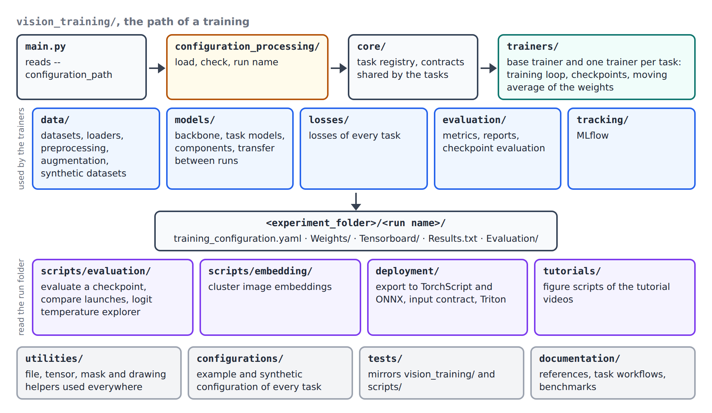
</p>

```text
.
├── README.md                          # This documentation file
├── README/                            # Images used in the documentation
├── pyproject.toml, uv.lock            # Dependencies and their locked versions
├── Dockerfile, .dockerignore          # Trainer image (stages uv, base, builder, test, runtime) and the files of its build
├── documentation/
│   ├── architecture_benchmarking/     # Experiment plans, copies of their results, stage figures, experiment_comparisons.yaml
│   ├── presentation/                  # Slide deck of the repository: deck.json, deck.css, one HTML file per slide and the figures made for it
│   ├── reference/                     # Training, tasks, configurations, tools and pretraining (ImageNet-22k, Open Images V7, order of the S, M and L sizes) in detail
│   ├── task workflows/                # One run of every task followed function by function
│   └── suggestions.md                 # Proposed improvements not implemented yet
├── vision_training/                   # Training framework
│   ├── main.py                        # Entry point of the trainings
│   ├── check_configuration.py         # Check of configuration files without training, for pipelines
│   ├── configurations/                # Example and synthetic configuration of every task
│   ├── configuration_processing/      # Loading, checks, run names and comparison of the configurations
│   ├── core/                          # Task registry and contracts shared by the tasks
│   ├── data/                          # Datasets of every task, loaders, preprocessing, augmentation, synthetic datasets
│   ├── models/                        # Backbone, task models, components and transfer between runs
│   ├── losses/                        # Losses of every task
│   ├── trainers/                      # Base trainer, trainer of every task, checkpoints, moving average, speed benchmark
│   ├── evaluation/                    # Metrics, reports and checkpoint evaluation
│   ├── tracking/                      # MLflow tracking
│   ├── deployment/                    # Export, export size estimates, input contract, Triton server, throughput measurement
│   └── utilities/                     # File, tensor, mask and visualization helpers
├── scripts/                           # Configuration, data, deployment (serving benchmark, export size check), embedding, evaluation and model drawing scripts
├── tests/                             # Tests, mirroring vision_training/ and scripts/
└── tutorials/                         # Narrated tutorial videos: storyboards, figure scripts, run snapshots, README.md of the build
```

Should you need to change what a task computes, the training code splits into a shared part and one part per task: `base_trainer.py` runs the loop of every task, and the trainer of the task, picked from `ExperimentConfiguration.task` by `vision_training/core/task_registry.py`, fills its hooks.

<p align="center">
  
</p>

## Metrics Explained
Whenever you compare two runs, the headline metric of the task picks the best checkpoint. Every metric of the reports is explained in the [metrics reference](documentation/reference/metrics_reference.md).

The table gives the headline metric of each task and what it evaluates:

| Task | Headline metric | What it evaluates |
|---|---|---|
| CLS | `Accuracy` | share of test images whose most probable class is the true one |
| M2O, CMP | `Accuracy` | the same over the test sequences or pairs |
| DET | `mAP@0.5/area` | boxes found and ranked well, a box counting when it overlaps its object at IoU 0.5 |
| INS | `Mask mAP@0.5/area` | the same with masks instead of boxes |
| KPT | `OKS mAP@0.5/area` | keypoints placed close to the true ones, measured by the object keypoint similarity |
| SEG | `Mean IoU` | overlap of the predicted and true pixels of each class, averaged over the classes |
| M2M | `Accuracy` | share of labelled frames given the right class |
| SEL | `<Decoding> Selection Accuracy` | share of the true frames of the wanted classes chosen for their class |
| SSL | `k-NN Accuracy` | share of test images given the right class by the vote of their nearest labelled training images |
