# Visual Language Model Spark

<p align="center">
  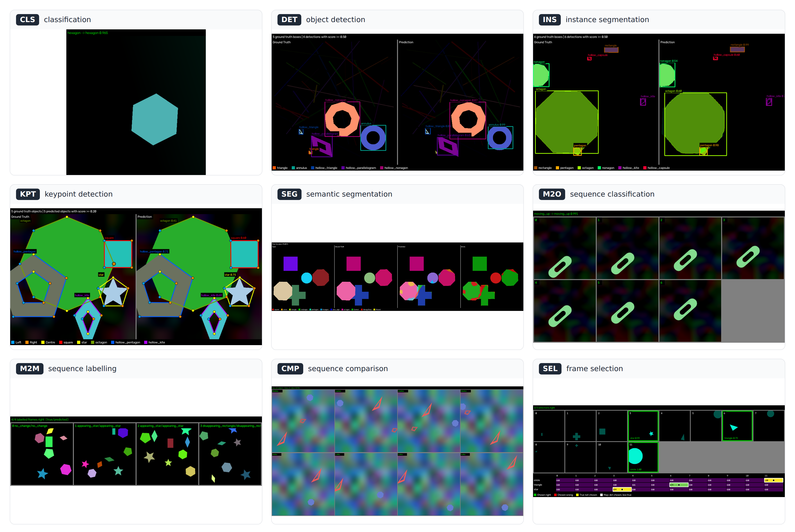
</p>
<p align="center"><em>One evaluation sample image of every supervised task, from short runs on the synthetic datasets; the semantic segmentation (9 classes) and sequence labelling samples come from runs trained on 2026-10-21 and 2026-11-15, on the datasets of those days.</em></p>

## Table Of Content
- [Description](#description)
- [Prerequisites](#prerequisites)
  - [Package Requirements](#package-requirements)
  - [Data Requirements](#data-requirements)
- [Quick Start With Synthetic Data](#quick-start-with-synthetic-data)
- [Training](#training)
  - [Launching A Run](#launching-a-run)
  - [Run Folder](#run-folder)
  - [Stopping And Resuming](#stopping-and-resuming)
  - [Console And TensorBoard](#console-and-tensorboard)
  - [Augmentation And Diagnosis Modes](#augmentation-and-diagnosis-modes)
  - [Moving Average Of The Weights](#moving-average-of-the-weights)
- [Tasks](#tasks)
  - [Label Files](#label-files)
- [Transfer Between Runs](#transfer-between-runs)
- [Evaluating Checkpoints](#evaluating-checkpoints)
- [Comparing Launches](#comparing-launches)
- [Clustering Image Embeddings](#clustering-image-embeddings)
- [Configurations](#configurations)
- [Run Names](#run-names)
- [MLflow Tracking](#mlflow-tracking)
- [Tutorials](#tutorials)
- [Deployment](#deployment)
  - [From A Checkpoint To A Served Model](#from-a-checkpoint-to-a-served-model)
  - [Number Formats](#number-formats)
  - [Export](#export)
  - [Input Contract](#input-contract)
  - [Triton Server](#triton-server)
  - [Serving Formats And Precision](#serving-formats-and-precision)
- [Tests](#tests)
- [Docker Image](#docker-image)
  - [Building The Image](#building-the-image)
  - [Running A Training](#running-a-training)
  - [Kubernetes Pods](#kubernetes-pods)
- [Repository Structure](#repository-structure)

## Description
If you are new to the repository, start from its tasks: it trains, evaluates and exports PyTorch models for nine vision tasks, plus a self-supervised task that pre-trains a backbone the other tasks can load. All tasks use the same backbone design (convolution blocks with optional residual, squeeze-and-excitation and inception modules), each run training its own weights unless it loads pre-trained ones, and share the training loop, the configuration format, the evaluation report and the export to Triton; each adds its own dataset, head, losses and metrics.

| Code | Task | Input | Output | Model |
|---|---|---|---|---|
| CLS | `classification` | one image | one class (multi-class) or several classes (multi-label) | backbone, global pooling, fully connected head |
| DET | `object_detection` | one image | boxes with their class and score | backbone, region proposal and RoI Align detection heads on several backbone levels |
| INS | `instance_segmentation` | one image | the boxes of DET and the mask of every object | the detector of DET with a RoI Align mask head on every level |
| KPT | `keypoint_detection` | one image | the objects of the image with their class, keypoints and score | backbone stem, HRNet, heatmap and tag head (HigherHRNet), keypoints grouped by their tags |
| SEG | `semantic_segmentation` | one image | one class per pixel | backbone as the encoder of a U-Net decoder |
| M2O | `sequence_classification` | a sequence of frames | one class per sequence | backbone on every frame, temporal module, fully connected head |
| M2M | `sequence_labelling` | a sequence of frames | one class per frame | backbone on every frame, temporal module, head on every frame |
| CMP | `sequence_comparison` | a before and an after sequence | one class per pair | backbone on every frame, temporal module on each member, fusion of both members (cross attention also before the temporal module), fully connected head |
| SEL | `frame_selection` | a sequence of frames | the frames of every wanted class | the model of M2M, Hungarian or greedy decoding |
| SSL | `self_supervised` | one unlabelled image (two random views of it) | a representation whose backbone initialises the other tasks | backbone, global pooling, projection head, SimCLR or Barlow Twins loss |

<p align="center">
  
</p>

Should you need to change what a task computes, the code splits the same way: `base_trainer.py` runs the loop of every task, and the trainer of the task, picked from `ExperimentConfiguration.task` by `vision_training/core/task_registry.py`, fills its hooks.

<p align="center">
  
</p>

This README gives the commands and the settings that matter most. The details are in `documentation/`:
- [Training reference](documentation/reference/training_reference.md): run folder, console output, resuming, augmentation strengths, input viewer, moving average of the weights, transfer between runs.
- [Tasks reference](documentation/reference/tasks_reference.md): synthetic datasets, data format, converters, losses and metrics of every task.
- [Configuration reference](documentation/reference/configuration_reference.md): keys and values of every task, evaluation outputs, run name tokens, MLflow metrics.
- [Tools reference](documentation/reference/tools_reference.md): checkpoint evaluation, launch comparison, embedding clustering, export, input contract and Triton.
- [Pretraining reference](documentation/reference/pretraining_reference.md): download of ImageNet-22k, on which the classification configurations pre-train the backbones, its validation and test splits, and the order in which the T to XL backbone sizes are pre-trained then fine-tuned for detection and instance segmentation.
- Task workflows: one run of every task followed function by function, such as the [classification](documentation/task%20workflows/classification_workflow.md) and [object detection](documentation/task%20workflows/object_detection_workflow.md) workflows; the Details column of the [Tasks](#tasks) table links the workflow of every task.

## Prerequisites

### Package Requirements
Before running any script, install Python 3.13+ and uv. An NVIDIA GPU with CUDA is expected (the CPU fallback is much slower), and Docker with the NVIDIA container runtime is only needed to serve the exported models with Triton and to train in the [Docker image](#docker-image).

```bash
uv sync
```

Besides the dependencies, `uv sync` installs the `dev` group (pytest) and the `datasets` group (FiftyOne, for `data_retriever.py`), both left out of the Docker image.

Every script runs as a module from the repository root. The training and the [configuration check](#configurations) (`vision_training.check_configuration`) take `--configuration_path`, the task being read from the file; the other scripts take no arguments, their settings being the variables of their `if __name__ == "__main__":` block.

<p align="center">
  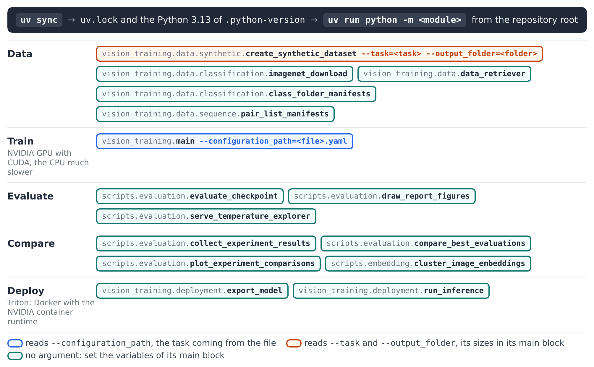
</p>

### Data Requirements
For a task to train, it needs a train, a validation and a test split folder, each holding its images in `data/` and a `labels.json` manifest, and a `label_mapping.json` file giving the class of every category ([Label Files](#label-files)). The [synthetic datasets](#quick-start-with-synthetic-data) need none of this.

<p align="center">
  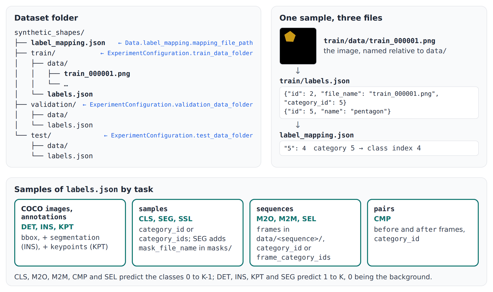
</p>

Should the backbones of classification, object detection or segmentation start from pre-trained weights, the [pretraining reference](documentation/reference/pretraining_reference.md) describes the download of ImageNet-22k, on which the classification configurations train the backbones the other tasks load.

## Quick Start With Synthetic Data
In order to check the installation or a configuration within minutes, every task has a synthetic shapes dataset:
1. Set `task` and its folder in `output_folders` in the main block of `vision_training/data/synthetic/create_synthetic_dataset.py`, then run `uv run python -m vision_training.data.synthetic.create_synthetic_dataset`.
2. Point `experiment_folder`, the three data folders and `Data.label_mapping.mapping_file_path` of the synthetic configuration of the task (table below, in `vision_training/configurations/`) to the generated dataset.
3. Train with that configuration:

```bash
uv run python -m vision_training.main --configuration_path="vision_training/configurations/classification/configuration_synthetic_shapes.yaml"
```

| Task | Synthetic dataset | Configuration |
|---|---|---|
| CLS | one of 35 shapes per image | `classification/configuration_synthetic_shapes.yaml` |
| CLS (multi-label) | 5 to 10 shapes per image labelled with their distinct classes (`task = "multi_label_classification"`) | `classification/configuration_synthetic_counted_shapes.yaml` |
| DET | the INS images (`task = "object_detection"` generates the 1024 pixel images of 5 to 12 shapes of the detection benchmark) | `object_detection/configuration_synthetic_shapes.yaml` |
| INS | 5 to 6 shapes per image with their masks | `instance_segmentation/configuration_synthetic_shapes.yaml` |
| KPT | 2 to 5 objects per image (shapes, stick figure, house) with their keypoints | `keypoint_detection/configuration_synthetic_shapes.yaml` |
| SEG | 5 to 6 shapes per image with their class mask | `semantic_segmentation/configuration_synthetic_shapes.yaml` |
| M2O | one shape moving left, right, up or down over 2 to 12 frames | `sequence_classification/configuration_synthetic_sequences.yaml` |
| M2M | 5 to 10 shapes per frame, at most one appearing or disappearing per frame | `sequence_labelling/configuration_synthetic_sequences.yaml` |
| CMP | a before and an after member, the after one having lost a shape or not | `sequence_comparison/configuration_synthetic_pairs.yaml` |
| SEL | one shape per frame, the largest circle, triangle and star to select | `frame_selection/configuration_synthetic_sequences.yaml` |
| SSL | the CLS dataset, or 5 to 10 counted shapes per image | `self_supervised/configuration_synthetic_shapes.yaml`, `configuration_counted_shapes_simclr.yaml`, `configuration_counted_shapes_barlow_twins.yaml` |

Should you need to know what a model of these datasets has to cope with, every task draws its shapes the same way: sizes from 16 pixels up to 80 % of the image side (as many per scale octave; the regular polygons from the size at which they stay distinct from the circle, 21 pixels for the pentagon to 67 for the nonagon, and the keypoint objects from 32 pixels), the small shapes over the large ones, shapes cut by the image border, half of the images and sequences on a textured background, and a fifth of the shapes of a flat background in a colour close to it. The labels follow what the image shows: the DET, INS and KPT labels leave out the shapes mostly hidden, and the other tasks keep 85 % of the pixels of every shape visible ([tasks reference](documentation/reference/tasks_reference.md#synthetic-datasets)).

<p align="center">
  
</p>
<p align="center"><em>Samples written by <code>create_synthetic_dataset.py</code>, drawn with their <code>labels.json</code> labels; the sequence tiles play their frames.</em></p>

## Training

### Launching A Run
Once a dataset is ready, copy the `configuration_example.yaml` of the task (`vision_training/configurations/<task>/`), fill `experiment_folder`, the three data folders and the label mapping file (every key is explained by its comment), and run:

```bash
uv run python -m vision_training.main --configuration_path="vision_training/configurations/classification/my_configuration.yaml"
```

The configuration is checked before anything starts: a missing key, an unusable value, an inconsistent combination, a removed setting (such as `resume_training`) or a key the task does not read (a misspelled key, a section of another task) stops the program with the list of every problem found.

<p align="center">
  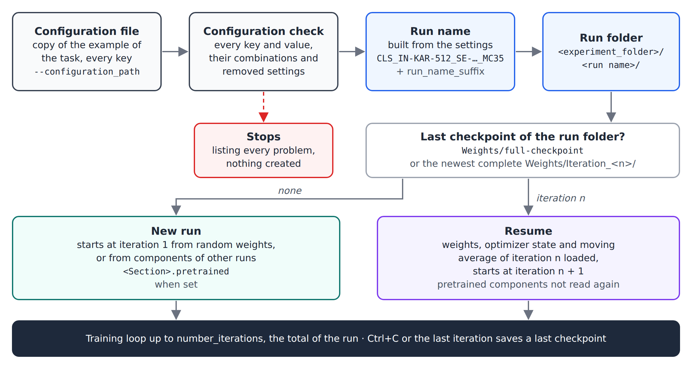
</p>
<p align="center"><em>The run name decides the folder, and the last checkpoint of that folder decides between a new run and a resume.</em></p>

### Run Folder
Whenever a training starts, it writes to `<experiment_folder>/<run name>/`, the name being built from its settings ([Run Names](#run-names)):

```text
<experiment_folder>/<run name>/
├── training_configuration.yaml        # Configuration of the last start of the run
├── data.json                          # Class counts, data folder and SHA-256 of labels.json and images of every split
├── label_dictionary.json              # Class index of every category, the classes of the run
├── Input_Samples/                     # First 10 samples of every split as fed to the network, and samples.json
├── Weights/Iteration_<n>/model_<n>.pt # Weights, optimizer state, moving average of the weights, metadata
├── Tensorboard/                       # Train, Validation, Test and Test_EMA curves
├── Results.txt                        # Report of every evaluated checkpoint
├── evaluation_curves.png              # Headline metric of every evaluation, drawn again after each one
├── Evaluation/evaluation_summary.csv  # Every test scalar of every evaluated iteration, one row each
├── Evaluation/Iteration_<n>/          # Evaluation files of iteration n, EMA/ for the averaged weights
├── Checkpoint_Evaluation/             # Evaluations of scripts/evaluation/evaluate_checkpoint.py, with the
│                                      # Report_Figures/ of scripts/evaluation/draw_report_figures.py
└── mlflow_run.json                    # MLflow run of the training, with the tracking on
```

So that the test results of a run can be followed at a glance, without TensorBoard, every evaluation adds the row of its iteration to `Evaluation/evaluation_summary.csv` (every test scalar, those of the averaged weights in `ema_` columns with their number of updates in `ema_number_updates`, a checkpoint evaluated again replacing its row) and draws `evaluation_curves.png` again from it: the headline metric of `Results.txt` for the trained and the averaged weights against the iteration, the best iteration of each ringed with its value and, with the moving average on, the iterations the averaged weights of the highest evaluated iteration look back over shaded up to it, 1/(1 − d) for the decay d of their last update given by their number of updates, with the configured 1/(1 − decay) in grey behind it while the warm-up still lowers d. Both files are sent to MLflow when the tracking is on. A run evaluated before these files existed starts its summary at its next evaluation from its TensorBoard test curves, whose values TensorBoard keeps in float32.

To be able to check afterwards what a run was fed, without a display, every launch that trains writes `Input_Samples/` before its first iteration: the first 10 samples of every split by identifier, the same at every launch, drawn as the input viewer draws them into `Training/`, `Validation/` and `Test/` (`sample_00.png` to `sample_09.png`), the training ones augmented on the device as the training step augments them, with `samples.json` giving the source file or sequence, the labels drawn, the augmentations and the input size of each. A resumed run keeps the folder unless its configuration or data changed, the previous one being then kept as `Input_Samples_until_iteration_<n>`; a training without validation loader has no `Validation/`, and the MLflow tracking receives the folder.

A checkpoint is saved every `intermediate_weight_saving_iterations` iterations (0 saves none), a checkpoint evaluated on the whole test split every `weight_saving_iterations` iterations and a console summary printed every `information_dump` iterations, here with the settings of the classification run of the README images:

<p align="center">
  
</p>

### Stopping And Resuming
In case a training has to stop, Ctrl+C saves a checkpoint of the last step, and launching the same configuration again resumes from the last checkpoint of its run folder with its optimizer state.

<p align="center">
  
</p>

- `number_iterations` is the total of the run, not the iterations left.
- The settings without a run name token (left box above) may change between resumptions: the changes are printed and the previous configuration is kept as `training_configuration_until_iteration_<n>.yaml`. A change of a setting with a run name token (right box) gives another run name, so a new run folder.
- Changed labels (another SHA-256 of a `labels.json`) stop the resume, unless `ExperimentConfiguration.allow_data_change_on_resume` is true.
- To train the same settings from scratch, give the run another `run_name_suffix` or `experiment_folder`, or move its run folder away.
- A failing iteration is reported in yellow, with the traceback of its error the first time that error occurs in the run, and skipped, as is an unreadable batch; a batch whose loss is NaN or infinite is reported in red and skipped without optimizer step, so the weights stay finite. More than 5 failing iterations in a row stop the training, saving a checkpoint.
- A failed save (a full disk, or weights holding NaN, which are never saved), a failed test evaluation (an unreadable test image) or more than 20 dropped batches among the last 200 of a split stop the training at once with status FAILED and the traceback of the error, instead of training on without checkpoints, evaluations or most of the data.

### Console And TensorBoard
So that a run can be followed live, the trainer prints at launch the run name, its folders as clickable links, the settings and data changed since the last start, the transferred components, the splits and the model summary.

<p align="center">
  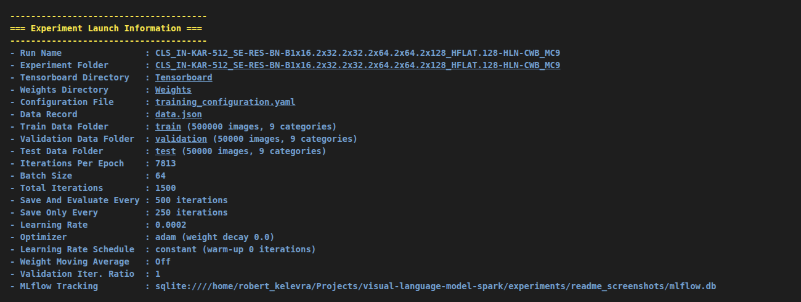
</p>

Every `information_dump` iterations it prints the averages of the interval for both splits, each with its change since the previous summary (green when better) and `Best` when it is the best of the run for its split.

<p align="center">
  
</p>

At every evaluation it prints the report appended to `Results.txt` (with `evaluation.per_class_report`, the classes worst first and their recall with its 95 % confidence interval). Every task writes its rates as percentages ("94.03 %") in the report and the interval summaries, their changes in percentage points ("+0.52 points" in the reports, "+0.52 %" in the interval summaries, aligned with the losses), while the thresholds, ranks, counts, pixel errors and losses keep their values; the files, TensorBoard and MLflow always keep 0 to 1.

<p align="center">
  
</p>
<p align="center"><em>The report of the synthetic shapes classifier of the README screenshots at iteration 2000, up to its per-class table of the 35 classes; the recall table with its intervals and the links to the files of the evaluation follow it.</em></p>

To follow the curves rather than the console, TensorBoard holds `Train` and `Validation` (every iteration), `Test` (scalars and sample images at every evaluation) and `Test_EMA` (the averaged weights, with the moving average on); open http://localhost:6006 after:

```bash
uv run tensorboard --logdir <experiment_folder>/<run name>/Tensorboard
```

<p align="center">
  
</p>
<p align="center"><em>The scalars of the same classifier with the smoothing set to 0 (TensorBoard smooths by 0.6 by default, pulling the last points towards the earlier ones): the accuracy and total loss of every training and validation iteration, and the accuracy and balanced accuracy of the four test evaluations, the last balanced accuracy being the 81.65 % of the report above.</em></p>

### Augmentation And Diagnosis Modes
Suppose a run learns nothing: look at what the network receives before blaming the model.

`Data.data_augmentation` augments the training images on the device right before the forward pass (`vision_training/data/augmentations.py`): a global `probability`, then 28 types with their own `activated` and `probability`. The strengths are hard-coded in `SUPERVISED_AUGMENTATION_STRENGTHS` (`SELF_SUPERVISED_AUGMENTATION_STRENGTHS` for the SSL views). The geometric types move the boxes, masks and keypoints with the image; `random_perspective` and `random_jigsaw` are refused for DET, INS, SEG and KPT. `uv run python -m scripts.data.visualize_augmentation_strengths` draws one figure per type.

<p align="center">
  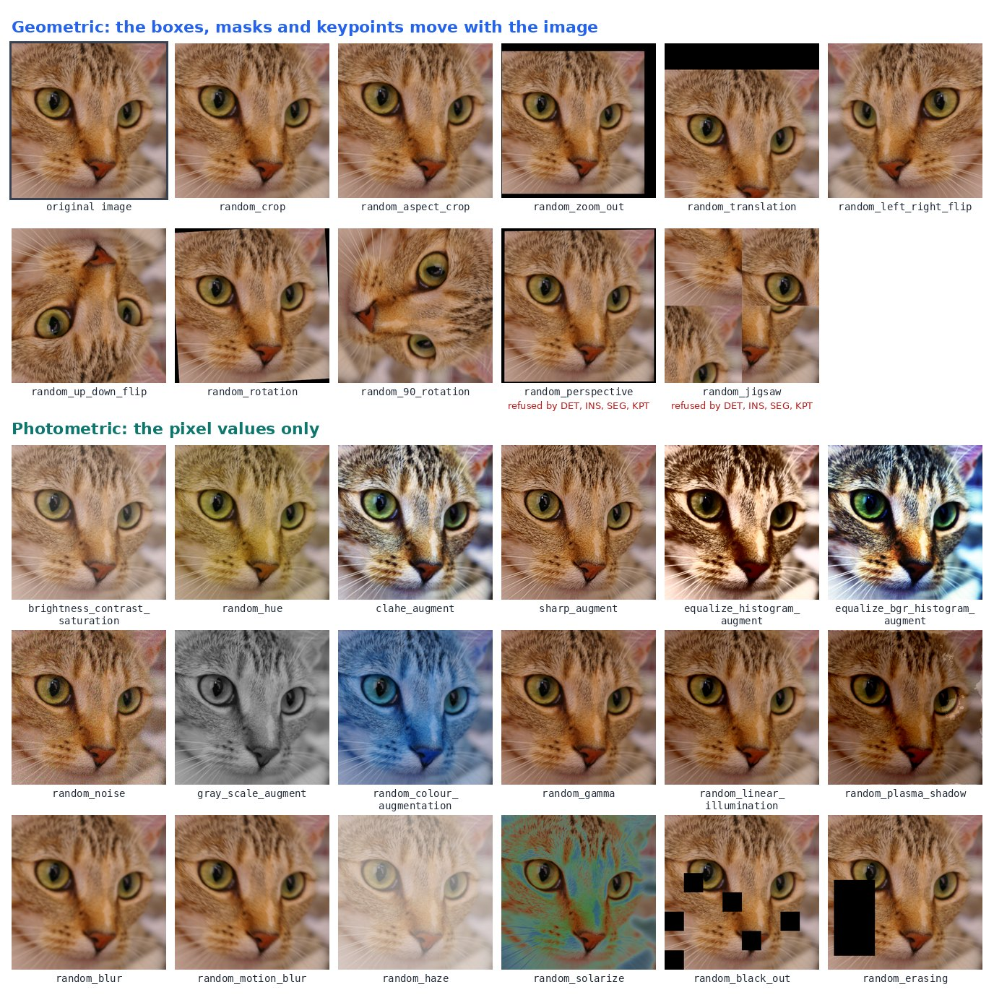
</p>
<p align="center"><em>Every type applied alone, at the strengths of the supervised tasks.</em></p>

Before a long training, `ExperimentConfiguration.diagnosis_modes.view_input_images: True` shows the training and validation samples as the network receives them, with their targets and drawn augmentations (SPACE for the next samples, ENTER to exit; needs a display).

<p align="center">
  
</p>

<p align="center">
  
</p>
<p align="center"><em>Draws of the augmentation of <code>object_detection/configuration_example.yaml</code> on one image, as the input viewer draws them: the boxes follow the flips, rotations and zoom-outs (unchanged draws skipped).</em></p>

Should you change the image size, the detection levels or their anchors, check that the anchors still reach the objects of every split before training: `diagnosis_modes.compute_anchor_coverage: { activated: True, iou_threshold: 0.5 }` (DET, INS) prints, for the training, validation and test splits, the share of the objects whose best anchor overlaps them by at least `iou_threshold`, in every level (`Block <n>`, the blocks of `DetectionLevels`) and in all of them (`All Levels`), for all the objects and every object size, by box area in network input pixels. It reads the annotations without loading any image.

<p align="center">
  
</p>
<p align="center"><em>The console of <code>vision_training.main</code> on a copy of <code>object_detection/configuration_synthetic_shapes.yaml</code> with the mode activated, on its synthetic shapes (512 pixels, shapes of 16 pixels to 80 % of the side, boxes of their visible parts): the anchors of blocks 5, 6 and 7 (strides 32, 64 and 64, scales 32 to 256) cover 64.04 % of the training objects, but 8.11 % of the small ones.</em></p>

Read the `All Levels` column size by size: the region proposal network makes an anchor foreground from `RegionProposal.foreground_iou_threshold.min`, and an object under it in every level only gets its single best anchor as foreground, so a size with a low share is learnt from few anchors. Small objects ask for smaller scales on a finer level (a lower block, of smaller stride), large ones for a larger scale on the last level, elongated ones for other `aspect_ratios`. The three splits should give close shares; a split covered differently holds objects of other sizes or shapes.

Say you have set an architecture and want its training time and serving speed before training it: `diagnosis_modes.benchmark_speed: True` times it on one batch of the training loader kept in memory, its samples repeated to every batch size, so that neither the loader nor the processor slows it down (`vision_training/trainers/speed_benchmark.py`).
- Inference first, with the weights of the last checkpoint of the run folder when there is one: the test evaluation (`predict_batch`), the inference model, TorchScript, ONNX Runtime CUDA and ONNX Runtime with TensorRT in FP32 and FP16, at a batch of 1, at the configured batch size and at the largest one that fits. The ONNX Runtime formats need the GPU build of ONNX Runtime (`onnxruntime-gpu`); without it they are reported as not available.
- Then the training step of the training loop (augmentation, bfloat16 forward pass, backward pass, optimizer step, moving average of the weights) at the configured batch size and at the largest one that fits, with the training time of `number_iterations` at the configured batch size.
- The largest batch sizes are searched up to 2048, in the memory left once 40 GB of the machine (integrated GPU such as the GB10) or 2 GB of the GPU (discrete GPU) are kept free; the benchmark refuses to start with less free memory.
- Every row gives the milliseconds per batch, the images (or sequences, pairs and frames) per second, the spread of its timing windows and its peak memory. Other processes on the GPU are named in the report, their work slowing the measured times down.

These diagnosis modes exit without training and create no run folder.

### Moving Average Of The Weights
If one wishes to score a smoothed model, `Optimization.exponential_moving_average` keeps a second copy of the weights, moved towards the trained ones after every optimizer step: `ema_weights = decay × ema_weights + (1 − decay) × current_weights`. Every test evaluation then scores both (`EMA Weights` report, `Evaluation/Iteration_<n>/EMA/`, `Test_EMA`). It gives no run name token, so it can be switched on or off when a run resumes.

Before choosing the decay, read it as a window: the average looks back about 1 / (1 − decay) iterations, which carry about 63 % of its weight, the older ones fading geometrically. A decay of 0.99 averages about the last 100 iterations, 0.999 the last 1,000 and 0.9998 the last 5,000. The n-th update uses the decay min(decay, (1 + n) / (10 + n)), so a short run averages fewer iterations than its decay says: 0.9998 is only reached after about 45,000 iterations, and the detection launches below, stopped at iteration 15,000, made their last update with a decay of 0.9994, a window of about 1,670 iterations.

<p align="center">
  
</p>
<p align="center"><em>How many trained weights one averaged model mixes, for the decay 0.9998 of the detection launches below. Left: the share of their averaged weights of iteration 15,000 held by every 100 iterations of the training. The warm-up lowered the decay of the last update to 0.9994, so the last 1,668 iterations carry 65 % of the average and the last 5,000 iterations 97 %; the same decay used from the first update would give the last 5,000 iterations 63 % and leave 5.0 % to the random starting weights. Right: the window 1 / (1 − decay) of the update of every iteration, which the warm-up grows by one iteration every 9 iterations until the configured window. Drawn by <code>documentation/presentation/figures/plot_moving_average_window.py</code>.</em></p>

<p align="center">
  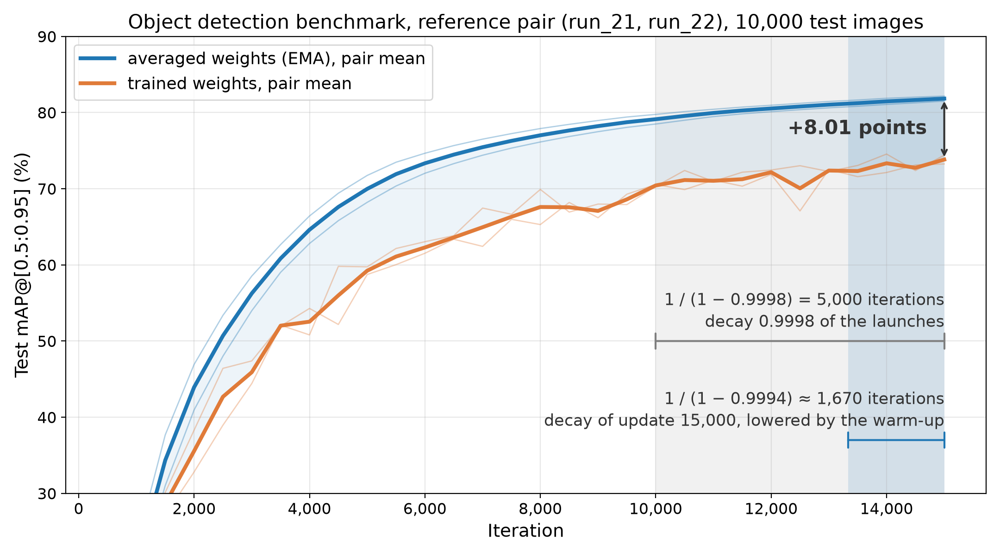
</p>
<p align="center"><em>The reference pair of the object detection benchmark (run_21 and run_22), test mAP@[0.5:0.95] of their trained and averaged weights on 10,000 test images: the mean of the averaged weights leads at all 30 evaluations, by 8.01 points at iteration 15,000. Shaded: the window 1 / (1 − decay) of their decay, 0.9998, and the shorter one of their last update. Drawn by <code>documentation/presentation/figures/plot_detection_moving_average.py</code>.</em></p>

## Tasks
Say you bring your own data: every task reads a folder per split with its images in `data/` and a `labels.json` manifest, and `label_mapping.json` maps every category identifier of the manifests to the class index the model predicts (from 1 for DET, INS, KPT and SEG, whose class 0 is the background), merging categories or leaving out those it does not name ([Label Files](#label-files) shows both files for every task). Each task starts from the `configuration_example.yaml` of its folder.

<p align="center">
  
</p>

| Task | Labels | Own sections | Evaluation | Details |
|---|---|---|---|---|
| CLS | `category_id`, or `category_ids` with `ClassificationHead.output_mode: "multi_label"`; `class_folder_manifests.py` converts one folder per class | `ClassificationHead` | accuracy, macro F1, top-5, per-class metrics and thresholds at `target_precision`, misclassified images in `Errors/` | [reference](documentation/reference/tasks_reference.md#classification-cls) · [workflow](documentation/task%20workflows/classification_workflow.md) |
| DET | COCO, boxes `[x, y, width, height]` in pixels | `DetectionLevels`, `Neck`, `RegionProposal`, `Detector` | mAP@[0.5:0.95] and by object size, anchor and proposal recall, confusion with a background class | [reference](documentation/reference/tasks_reference.md#object-detection-det) · [workflow](documentation/task%20workflows/object_detection_workflow.md) |
| INS | COCO `segmentation` (polygons or RLE) | the sections of DET, `MaskHead`, `Data.instance_index_maps` | mask and box mAP, `Mask mAP@0.5/area` comparing the checkpoints | [reference](documentation/reference/tasks_reference.md#instance-segmentation-ins) · [workflow](documentation/task%20workflows/instance_segmentation_workflow.md) |
| KPT | COCO `keypoints`, with the keypoint names and optional `skeleton` of every category | `Backbone` as the stem, `HRNet`, `KeypointHead` | OKS mAP, PCK@0.05, mean OKS | [reference](documentation/reference/tasks_reference.md#keypoint-detection-kpt) · [workflow](documentation/task%20workflows/keypoint_detection_workflow.md) |
| SEG | `masks/`: uint8 PNG, 0 for the background, 255 ignored | `SegmentationDecoder`, `SegmentationLoss`, `Data.tiling` | mean IoU and Dice, boundary IoU and F1 | [reference](documentation/reference/tasks_reference.md#semantic-segmentation-seg) · [workflow](documentation/task%20workflows/semantic_segmentation_workflow.md) |
| M2O | frames in `data/<sequence name>/`, one `category_id` per sequence | `Data.sequence_settings`, `TemporalModel` | the CLS metrics on the sequences | [reference](documentation/reference/tasks_reference.md#sequence-classification-m2o) · [workflow](documentation/task%20workflows/sequence_classification_workflow.md) |
| M2M | `frame_category_ids` | the sections of M2O, `TemporalModel.causal` for live streams | frame metrics, edit score, segment F1@10, @25 and @50 | [reference](documentation/reference/tasks_reference.md#sequence-labelling-m2m) · [workflow](documentation/task%20workflows/sequence_labelling_workflow.md) |
| CMP | a `before` and an `after` sequence; `pair_list_manifests.py` converts pair lists | the sections of M2O, `Fusion` | the CLS metrics on the pairs | [reference](documentation/reference/tasks_reference.md#sequence-comparison-cmp) · [workflow](documentation/task%20workflows/sequence_comparison_workflow.md) |
| SEL | the labels of M2M | the sections of M2M, `Selection` | selection accuracy of the Hungarian and greedy decodings, top-k, `selections.csv` | [reference](documentation/reference/tasks_reference.md#frame-selection-sel) · [workflow](documentation/task%20workflows/frame_selection_workflow.md) |
| SSL | the layout of CLS, the categories only serving the evaluation | `ProjectionHead` (SimCLR or Barlow Twins), `Data.grouped_batches` | k-NN accuracy, effective rank of the representations | [reference](documentation/reference/tasks_reference.md#self-supervised-learning-ssl) · [workflow](documentation/task%20workflows/self_supervised_workflow.md) |

A few behaviours are easy to miss:
- KPT: the geometric augmentations keep the keypoint names, so the flips and rotations only suit keypoints whose names depend neither on the side nor on the orientation.
- Sequences are fed whole: one longer than `Data.sequence_settings.maximum_sequence_length` is left out with a warning, and the batches are padded with masked frames. The `mean_pooling`, `max_pooling` and `attention_pooling` temporal modules ignore the frame order; `gru`, `lstm`, `transformer` and `temporal_convolution` follow it and are the only ones of M2M and SEL.
- M2O: a class given by a motion needs `ClassificationHead.global_pooling: flatten`, the other poolings removing the position of the objects.

<p align="center">
  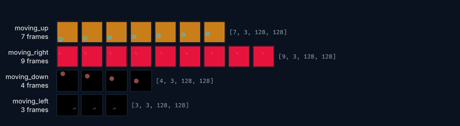
</p>
<p align="center"><em>Four synthetic moving-shape sequences padded to the longest one by <code>collate_padded_sequences</code>, and the <code>sequence_mask</code> of their real frames.</em></p>

To see why a class given by a motion needs flatten, follow one frame through the network. The backbone turns it into a feature map of C channels on an H × W grid, each cell describing the region of the frame under it, and `ClassificationHead.global_pooling` turns that map into the frame vector the temporal model reads:
- `average` keeps one mean per channel, which is the same wherever the shape is: the frames of a moving shape become the same vector, so the temporal model cannot tell a move to the left from a move to the right and stays at chance. `max` keeps one maximum per channel and loses the position the same way.
- `flatten` keeps the C × H × W values in their order, so the cells lit by the shape move from frame to frame and the vectors of frames far apart differ.

<p align="center">
  
</p>
<p align="center"><em>A triangle moving right over 8 frames of 128 pixels, turned into an 8 × 8 feature map by four fixed edge filters, a ReLU and a 16 × 16 average, as a backbone downsampling 16 times would. Average pooling hands the temporal model the same 4 values in every frame, every similarity being 1.00; flatten hands it 256 values whose lit cells follow the shape, the similarity being 0.42 to 0.57 between neighbouring frames and 0.00 between frames far apart. Drawn by <code>documentation/presentation/figures/draw_pooling_similarity_animation.py</code>.</em></p>

<p align="center">
  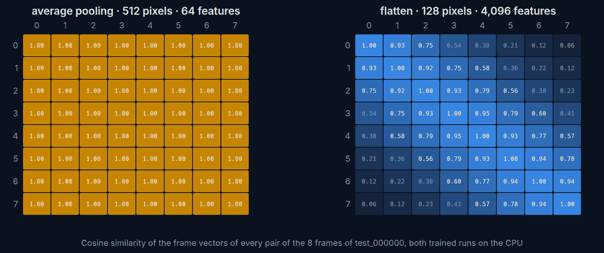
</p>
<p align="center"><em>The same on two trained M2O runs of the sequence classification tutorial, on the 8 frames of one test sequence: with average pooling (512 pixels, 64 features) every pair of frames scores 1.00, the frames being indistinguishable; with flatten (256 pixels, 16,384 features) the similarity is 0.79 to 0.91 between neighbouring frames and falls to 0.00 between the first and the last, the frame vector following the shape.</em></p>

### Label Files
Before a first launch on your own data, every split needs a `labels.json` listing its images, sequences or pairs with their categories, and the dataset needs one `label_mapping.json` turning these categories into the classes the model predicts. The `//` comments below only explain the examples: the JSON files take none. `class_folder_manifests.py` (one folder per class) and `pair_list_manifests.py` (CMP pair lists) write both files for you.

To turn the categories into classes, `label_mapping.json` (`Data.label_mapping.mapping_file_path`, `mode: "multi_class"`) gives every category identifier of `labels.json`, written as a string, its class index. The classes start at 0 for CLS, M2O, M2M, CMP and SEL, and at 1 for DET, INS, KPT and SEG, whose class 0 is the background; they must have no gaps.

```jsonc
{                 // CLS, M2O, M2M, CMP, SEL: classes from 0
  "1": 0,         // circle    -> class 0
  "2": 1,         // square    -> class 1
  "4": 1,         // rectangle -> class 1 too: merged with the
                  //   squares, the class named square+rectangle
  "5": 2          // triangle  -> class 2
}                 // star (3), not written, is left out
```

```jsonc
{                 // DET, INS, KPT, SEG: classes from 1,
                  //   class 0 being the background
  "1": 1,         // circle -> class 1
  "2": 2,         // square -> class 2
  "3": 0          // star   -> 0: left out like a category
}                 //   not written
```

A category left out skips its samples (CLS, M2O, CMP), leaves the classes of its multi-label samples, a sample of left-out categories only being skipped, makes its frames ignored (M2M) or unselected (SEL), its objects left out (DET, INS, KPT) and its pixels background (SEG). DET, INS and SEG also accept `mode: "binary"`, every category becoming class 1 without a mapping file.

If each image shows one class (CLS, and SSL, whose categories only serve its k-NN evaluation), `labels.json` gives one entry per image, its `file_name` relative to `data/`:

```jsonc
{
  "categories": [                     // every category,
    {"id": 1, "name": "circle"},      //   with an integer identifier
    {"id": 2, "name": "square"},
    {"id": 3, "name": "star"}
  ],
  "samples": [                        // one entry per image
    {
      "id": 1,
      "file_name": "image_0001.png",  // data/image_0001.png
      "category_id": 2                // shows a square
    },
    {
      "id": 2,
      "file_name": "image_0002.png",
      "category_id": 1
    },
    {
      "id": 3,
      "file_name": "night/image_0003.png",  // a subfolder of data/
      "category_id": 3                      //   stays in the name
    }
  ]
}
```

Should an image hold several classes at once (`ClassificationHead.output_mode: "multi_label"`), every sample lists all of them:

```jsonc
  "samples": [
    {
      "id": 1,
      "file_name": "image_0001.png",
      "category_ids": [1, 3]          // a circle and a star
    },
    {
      "id": 2,
      "file_name": "image_0002.png",
      "category_ids": [2]             // a square only
    },
    {
      "id": 3,
      "file_name": "image_0003.png",
      "category_ids": [1, 2, 3]
    }
  ]
```

For a segmentation (SEG), every image comes with its mask in `masks/`, a single-channel uint8 PNG of the same size holding the category identifier of every pixel, 0 for the background and 255 for the pixels to ignore:

```jsonc
{
  "categories": [
    {"id": 1, "name": "circle"},
    {"id": 2, "name": "square"},
    {"id": 3, "name": "star"}
  ],
  "samples": [
    {
      "id": 1,
      "file_name": "image_0001.png",
      "mask_file_name": "image_0001.png",  // masks/image_0001.png
      "category_ids": [1, 3]               // optional, for the
    },                                     //   class counts
    {
      "id": 2,
      "file_name": "image_0002.png",
      "mask_file_name": "image_0002.png",
      "category_ids": [2]
    }
  ]
}
```

Whenever objects are located by boxes (DET), `labels.json` is a COCO file: the images, one annotation per object, and the categories; the other keys of a COCO export, such as `area` and `iscrowd`, are not read:

```jsonc
{
  "images": [                         // one entry per image
    {
      "id": 1,
      "file_name": "image_0001.png",
      "width": 512,
      "height": 512
    },
    {
      "id": 2,
      "file_name": "image_0002.png",
      "width": 640,
      "height": 480
    }
  ],
  "annotations": [                    // one entry per object
    {
      "id": 1,
      "image_id": 1,
      "category_id": 2,
      "bbox": [120, 340, 64, 48]      // [x, y, width, height]
    },                                //   in pixels
    {
      "id": 2,
      "image_id": 1,                  // a second object of image 1
      "category_id": 1,
      "bbox": [300, 80, 90, 90]
    },
    {
      "id": 3,
      "image_id": 2,
      "category_id": 3,
      "bbox": [10, 200, 150, 120]
    }
  ],
  "categories": [                     // identifiers may have gaps
    {"id": 1, "name": "circle"},
    {"id": 2, "name": "square"},
    {"id": 3, "name": "star"},
    {"id": 5, "name": "triangle"}
  ]
}
```

In order to train masks (INS), every annotation also gives its `segmentation`, the box being the tight box of the mask:

```jsonc
  "annotations": [
    {
      "id": 1,
      "image_id": 1,
      "category_id": 5,               // a triangle
      "segmentation": [               // polygons, each a flat
        [120, 388, 152, 340, 184, 388]  // [x1, y1, x2, y2, ...]
      ]                               //   list in pixels
    },
    {
      "id": 2,
      "image_id": 1,
      "category_id": 2,
      "segmentation": {               // or a run length encoding,
        "size": [512, 512],           //   compressed or not
        "counts": "f\\i01o?1O001..."
      }
    }
  ]
```

Suppose the objects have named points (KPT). Every category lists the names of its keypoints, and every annotation gives one `x, y, v` triple per name, in the same order, so that the place of a triple in the list says which point it is. The flag `v` says what is known of the point:

- 2, visible: the point is seen in the image.
- 1, hidden: the point is in the image but covered, by another object for instance, and its position is still known; it is learned and scored like a visible point.
- 0, not labelled: the position is unknown (outside the image, or never annotated); the triple stays, written `0, 0, 0`, so that the next points keep their places, and the point is neither learned nor scored.

The `skeleton` of a category is optional and only draws lines between its points in the sample images; each pair gives the places of two names in its `keypoints` list, counted from 1:

```jsonc
  "annotations": [
    {
      "id": 1,
      "image_id": 1,
      "category_id": 2,               // a square: 4 named points
      "bbox": [65, 228, 206, 206],
      "keypoints": [                  // x, y, v of every name
        65, 228, 2,                   // top_left: visible
        271, 228, 2,                  // top_right: visible
        271, 434, 2,                  // bottom_right: visible
        65, 434, 1                    // bottom_left: hidden under
      ]                               //   another object, still learned
    },
    {
      "id": 2,
      "image_id": 1,
      "category_id": 5,               // a triangle: 3 named points
      "bbox": [300, 40, 120, 100],
      "keypoints": [
        360, 40, 2,                   // top: visible
        420, 140, 2,                  // bottom_right: visible
        0, 0, 0                       // bottom_left: not labelled,
      ]                               //   0, 0, 0 keeps its place
    }
  ],
  "categories": [
    {
      "id": 2,
      "name": "square",
      "keypoints": [                  // the names, in triple order
        "top_left",                   // 1
        "top_right",                  // 2
        "bottom_right",               // 3
        "bottom_left"                 // 4
      ],
      "skeleton": [                   // lines drawn between points:
        [1, 2],                       //   top_left to top_right
        [2, 3],                       //   top_right to bottom_right
        [3, 4],                       //   bottom_right to bottom_left
        [4, 1]                        //   bottom_left to top_left
      ]
    },
    {
      "id": 5,
      "name": "triangle",
      "keypoints": [
        "top",                        // 1
        "bottom_right",               // 2
        "bottom_left"                 // 3
      ],
      "skeleton": [
        [1, 2],                       // top to bottom_right
        [2, 3],                       // bottom_right to bottom_left
        [3, 1]                        // bottom_left to top
      ]
    }
  ]
```

Say a whole sequence has one class (M2O): its frames sit in `data/<sequence name>/`, listed in order, and the sequences may differ in length:

```jsonc
{
  "categories": [
    {"id": 1, "name": "moving_left"},
    {"id": 2, "name": "moving_right"}
  ],
  "sequences": [                      // one entry per sequence
    {
      "id": 1,
      "name": "sequence_0001",
      "category_id": 1,
      "frames": [                     // in order
        "sequence_0001/000000.png",
        "sequence_0001/000001.png",
        "sequence_0001/000002.png"
      ]
    },
    {
      "id": 2,
      "name": "sequence_0002",
      "category_id": 2,
      "frames": [                     // another length
        "sequence_0002/000000.png",
        "sequence_0002/000001.png"
      ]
    }
  ]
}
```

If every frame has its own class (M2M), `frame_category_ids` gives one category per frame, as long as `frames`:

```jsonc
{
  "categories": [
    {"id": 1, "name": "no_change"},
    {"id": 2, "name": "appearing_circle"},
    {"id": 3, "name": "disappearing_circle"}
  ],
  "sequences": [
    {
      "id": 1,
      "name": "sequence_0001",
      "frame_category_ids": [1, 2, 1],  // a circle appears
      "frames": [                       //   on the second frame
        "sequence_0001/000000.png",
        "sequence_0001/000001.png",
        "sequence_0001/000002.png"
      ]
    },
    {
      "id": 2,
      "name": "sequence_0002",
      "frame_category_ids": [1, 3],
      "frames": [
        "sequence_0002/000000.png",
        "sequence_0002/000001.png"
      ]
    }
  ]
}
```

So that the frame selection (SEL) knows which frames to choose, it reads the layout of M2M: every frame has the unselected category (`Selection.unselected_category`, which the mapping must map) or a wanted class, every sequence holding exactly `Selection.frames_per_class` frames of every wanted class:

```jsonc
{
  "categories": [
    {"id": 1, "name": "circle"},
    {"id": 3, "name": "star"},
    {"id": 6, "name": "unselected"}
  ],
  "sequences": [
    {
      "id": 1,
      "name": "sequence_0001",
      "frame_category_ids": [6, 3, 6, 1],  // frames_per_class 1:
      "frames": [                          //   the star, then
        "sequence_0001/000000.png",        //   the circle
        "sequence_0001/000001.png",
        "sequence_0001/000002.png",
        "sequence_0001/000003.png"
      ]
    },
    {
      "id": 2,
      "name": "sequence_0002",
      "frame_category_ids": [1, 3, 6],
      "frames": [
        "sequence_0002/000000.png",
        "sequence_0002/000001.png",
        "sequence_0002/000002.png"
      ]
    }
  ]
}
```

To compare a before and an after sequence (CMP), every pair has one category and two frame lists, which may differ in length:

```jsonc
{
  "categories": [
    {"id": 1, "name": "loss_of_object"},
    {"id": 2, "name": "same_number_of_objects"}
  ],
  "pairs": [                          // one entry per pair
    {
      "id": 1,
      "name": "pair_0001",
      "category_id": 1,
      "before": [
        "pair_0001/before/000000.png",
        "pair_0001/before/000001.png"
      ],
      "after": [                      // may differ in length
        "pair_0001/after/000000.png"
      ]
    },
    {
      "id": 2,
      "name": "pair_0002",
      "category_id": 2,
      "before": [
        "pair_0002/before/000000.png"
      ],
      "after": [
        "pair_0002/after/000000.png",
        "pair_0002/after/000001.png"
      ]
    }
  ]
}
```

## Transfer Between Runs
To be able to start from a trained component, such as a backbone trained on ImageNet for a detector, give its run in the `pretrained` block of the section, the source run being of the same task or of another one:

| Section | Component | From the tasks |
|---|---|---|
| `Backbone` | backbone | any task |
| `TemporalModel` | temporal module | M2O, M2M, CMP, SEL |
| `ClassificationHead` | classification head, with its class layer | CLS, M2O, M2M, CMP, SEL |
| `SegmentationDecoder` | U-Net decoder, with its class layers when `load_class_layers` is True | SEG |
| `RegionProposal` | region proposal heads of every detection level | DET, INS |
| `Detector` | detection heads of every detection level, with their classification and box regression layers | DET, INS |
| `MaskHead` | mask heads of every detection level, with their mask prediction layers | INS |
| `HRNet`, `KeypointHead` | high resolution network, heatmap and tag head | KPT |

<p align="center">
  
</p>

```yaml
Backbone:
  pretrained:
    # Run folder whose trained backbone initialises this run
    experiment_folder: "/path/to/experiments/CLS_IN-KAR-256_SE-RES-BN-B1x64.2x64.2x64.4x64.5x64.5x64_HFLAT.512.256-HLN-CWB_MC1000"
    # Checkpoint iteration of that run, null for its last saved checkpoint
    iteration: null
    # Keeps the loaded backbone fixed, only the other components learn
    freeze: False
    # Keeps the scale and shift of its normalization layers fixed while its convolutions learn
    freeze_normalization_parameters: False
    # Fine-tunes the loaded backbone ten times slower than the new layers
    learning_rate_multiplier: 0.1
```

The settings defining the layers of the component must be identical in both runs (checked before the training; the image size may differ), and the averaged weights of the source are loaded when both runs keep a moving average. A backbone may also be shorter than its source backbone, loading its first blocks (the stem of a keypoint detector), or deeper, its first blocks loaded from a shorter source backbone of the same blocks: the blocks after them start random and learn at the learning rate of the run, `freeze`, `freeze_normalization_parameters` and `learning_rate_multiplier` applying to the loaded blocks only. A component with class layers can initialise a run with more classes, the classes of the source coming first in the same order. The detection heads read the levels after the neck, which is not transferable, so they only move between runs whose `Neck.type` is `none`. Details: [training reference](documentation/reference/training_reference.md#transfer-between-runs).

## Evaluating Checkpoints
Each time the checkpoints of a trained run must be scored again (another labelled split, another batch size, or for DET and INS another final NMS), set the variables of the main block of `scripts/evaluation/evaluate_checkpoint.py` (`run_name`, `experiment_folder`, `iteration` as `None` for the last checkpoint, a number or `"all"`, `test_data_folder`, ...), then run:

```bash
uv run python -m scripts.evaluation.evaluate_checkpoint
```

It writes into `<run>/Checkpoint_Evaluation/` (`Checkpoint_Evaluation_split_<parent folder>_<split folder>/` for another split, such as `Checkpoint_Evaluation_split_synthetic_shapes_validation`, and `Checkpoint_Evaluation_nms_<criterion>[_<exponent>]/` for another NMS, so that two evaluations never mix), leaving the files of the training untouched: every evaluated checkpoint adds its row to `evaluation_summary.csv` and draws `evaluation_curves.png` again, as during the training, the rows of the earlier launches into the same folder being kept, and the best of the evaluated checkpoints is printed, `"all"` evaluating every checkpoint. A run without checkpoint, or an `iteration` without one, stops the script with a `FileNotFoundError` before it writes anything. A classifier evaluation also keeps `class_logits.npz` for its temperature explorer ([Export](#export)), and `save_predictions = True` writes the `predictions.csv` of every evaluated sample. Details: [tools reference](documentation/reference/tools_reference.md#evaluating-checkpoints).

<p align="center">
  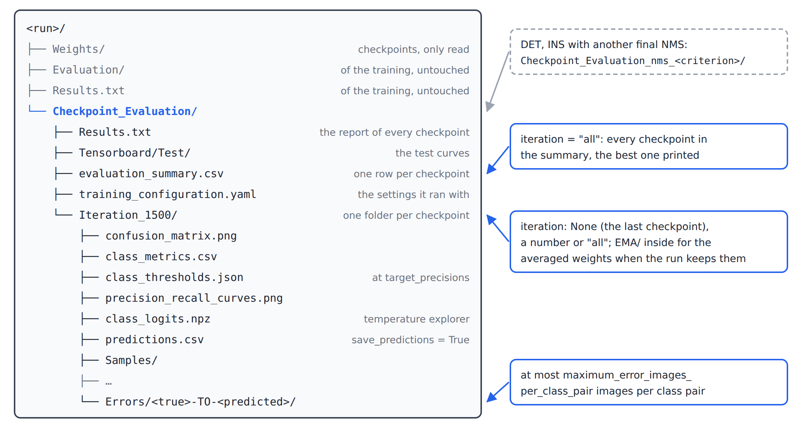
</p>

To find where a classifier fails, read its confusion matrix (counts coloured by their share of the true class, precision and recall in the margins; above 1,000 classes no image is drawn, and `confusion_cells.csv` lists the non-zero cells as `true_class,predicted_class,count` in place of `confusion_matrix.csv`), then the misclassified images saved in `Errors/<true>-TO-<predicted>/` (at most `maximum_error_images_per_class_pair` per pair), named after the sample and the probability of the predicted class.

<p align="center">
  
</p>

<p align="center">
  
</p>
<p align="center"><em>The confusion matrix of the 35 classes of the synthetic shapes classifier of the README screenshots, evaluated at iteration 2000 (accuracy 81.76 %), and the error folders of its three largest confusions: hollow parallelograms read as hollow trapezoids, trapezoids as parallelograms and rectangles as squares.</em></p>

Should a research report need the figures of its kept classifier again, set the run, iteration and weights of the main block of `scripts/evaluation/draw_report_figures.py`, then run the command below. It writes into `Checkpoint_Evaluation/Iteration_<n>[/EMA]/Report_Figures/` the confusion matrix, the precision-recall curves at the temperature saved from the temperature explorer with the threshold of every target precision, the training curves with the kept checkpoint and, given a manifest of the group of every image (such as the camera or vehicle it comes from) and the `predictions.csv` of the evaluation, the balanced accuracy on the groups seen and never seen in training, with `report_values.json`, the numbers they show. Details: [tools reference](documentation/reference/tools_reference.md#drawing-the-figures-of-a-research-report).

```bash
uv run python -m scripts.evaluation.draw_report_figures
```

<p align="center">
  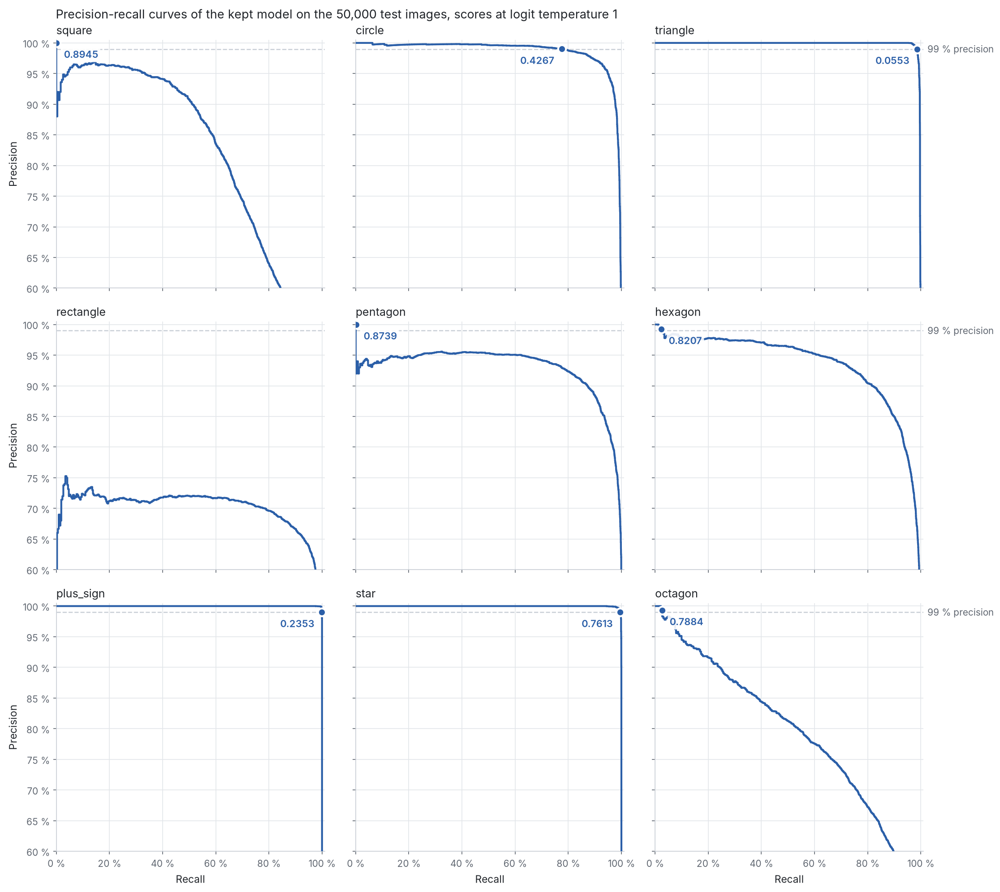
</p>

<p align="center">
  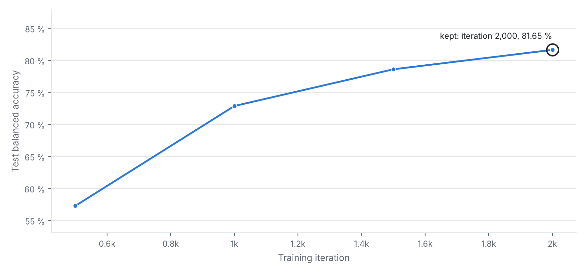
</p>
<p align="center"><em>The precision-recall curves and the training curves drawn for the classifier above at iteration 2000 (test balanced accuracy 81.65 %), the curves shown for the first nine of its 35 classes (the script draws one panel per class): a dot marks the threshold reaching 99 % precision, reached by these nine and never by trapezoid, hollow parallelogram and hollow kite, at a logit temperature of 1 since no temperature was saved. The confusion matrix of the report is the one shown above; the chart of the groups needs a group manifest, which the synthetic shapes do not have.</em></p>

## Comparing Launches
After the launches of a hyperparameter stage have trained, three scripts of `scripts/evaluation/` compare them:
- `collect_experiment_results.py` gathers the test curve and the swept settings of the `run_<n>` launches into one CSV file, with a `mean` row per setting.
- `compare_best_evaluations.py` prints Markdown tables of the best test evaluation of runs, over the trained and the averaged weights.
- `plot_experiment_comparisons.py` draws one figure per stage of the plans of `documentation/architecture_benchmarking`, from the stages of `experiment_comparisons.yaml`.

<p align="center">
  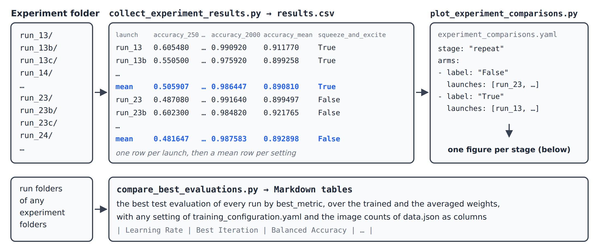
</p>

```bash
uv run python -m scripts.evaluation.collect_experiment_results
uv run python -m scripts.evaluation.compare_best_evaluations
uv run python -m scripts.evaluation.plot_experiment_comparisons
```

Before trusting a gap between two settings, compare it with the spread of the launches of each: in the repeated squeeze-and-excitation stage below, six launches per setting overlap, and the means differ by 0.21 points for a standard error of 1.11 points.

<p align="center">
  
</p>

Their settings: [tools reference](documentation/reference/tools_reference.md#comparing-launches).

## Clustering Image Embeddings
Faced with a dataset of video frames, many of them nearly identical, `scripts/embedding/cluster_image_embeddings.py` embeds the images with a trained run and clusters them (HDBSCAN, DBSCAN or k-means after a PCA). For every asked layer it writes the clusters, their mosaics and three folders of kept images to compare (chosen by the clustering, drawn at random, spread over the groups of `group_pattern`); the stored features are reused by a relaunch.

```bash
uv run python -m scripts.embedding.cluster_image_embeddings
```

<p align="center">
  
</p>
<p align="center"><em>A run on 720 synthetic shapes, one folder for each of nine of the 35 classes: the clusters follow what the layer of the classifier separates, one cluster for each of six shapes, the stars split in two and the rectangles shared between a cluster of their own and the cluster of the squares.</em></p>

Its settings and outputs: [tools reference](documentation/reference/tools_reference.md#clustering-image-embeddings).

## Configurations
Before writing a configuration of your own, start from a copy of the files of its task: every task has a `configuration_example.yaml` and a `configuration_synthetic_*.yaml` in `vision_training/configurations/<task>/`, holding only, and all, the keys the task reads, each explained by its comment. Four sections are shared by every task, the others belong to the task:

<p align="center">
  
</p>

`Data.image_settings.size` must be even and a multiple of 2 to the power of the number of max poolings of `Backbone`, so that no pooling drops a row or a column: with 5 poolings, 96, 224, 384 and 512 are accepted. Should a file break such a rule, the launch prints every problem at once and stops, here for a negative learning rate and a size of 500:

<p align="center">
  
</p>

For a pipeline to refuse a file before it launches a training, `vision_training/check_configuration.py` loads and checks one or several files as a training does, without training: an invalid file prints the list above, a valid one a green line with its run name, and the command exits with 0 when every file is valid, 1 otherwise. `--check_paths` also requires the data folders, the label mapping file and the pretrained runs a new training reads, not `experiment_folder`, which the training creates:

```bash
uv run python -m vision_training.check_configuration --configuration_path="vision_training/configurations/classification/configuration_synthetic_shapes.yaml" --check_paths
```

The keys and values of every task, and what the check reads, are in the [configuration reference](documentation/reference/configuration_reference.md#configurations).

## Run Names
To keep runs of different settings apart, `vision_training/configuration_processing/run_name.py` builds the run name from the configuration, so that the same settings resume in the same folder and changed settings start a new one. Sections are joined with `_` and their tokens with `-`; `ExperimentConfiguration.run_name_suffix` accepts letters, digits, `-` and `.`.

<p align="center">
  
</p>
<p align="center"><em>A classification run whose backbone starts from another run, decoded token by token with the setting each token comes from.</em></p>

Each name below is the one `build_run_name()` gives the configuration of its row (in `vision_training/configurations/`), the class count of a synthetic file being that of the label mapping `create_synthetic_dataset.py` writes:

| Task | Configuration | Run name |
|---|---|---|
| CLS | `classification/configuration_synthetic_shapes.yaml` | `CLS_IN-KAR-512_SE-RES-BN-B1x16.2x32.2x32.2x64.2x64.2x128_HFLAT.128-HLN-CWB_MC35` |
| DET | `object_detection/configuration_example.yaml` | `DET_IN-KAR-1024_SE-RES-BN-B1x16.2x32.2x32.4x64.4x64.6x128.6x128_L567-NFPN64BN_A9.32-512.598295_RBN-R2x64-RPL_DSE-DRES-DBN-D7.2x64.256.128_BIN` |
| M2O | `sequence_classification/configuration_synthetic_sequences.yaml` | `M2O_IN-KAR-128_SE-RES-BN-B1x16.2x32.2x32.2x64.2x64_T50_GRU1x128-BI_HFLAT.64_MC4` |

Every token and an example of every task are in the [configuration reference](documentation/reference/configuration_reference.md#run-names).

## MLflow Tracking
If you are looking for one table of every run, sorted and filtered by any setting, turn on `ExperimentConfiguration.tracking.activated`: each training is recorded in `<experiment_folder>/mlflow.db`, its files in `<experiment_folder>/mlartifacts/`, with its configuration, git commit, curves averaged every `information_dump` iterations and test metrics, a resumed training continuing its MLflow run. Open http://localhost:5000 after:

```bash
uv run mlflow ui --backend-store-uri sqlite:///<experiment_folder>/mlflow.db
```

<p align="center">
  
</p>
<p align="center"><em>The four learning rates of the 9-class synthetic shapes classifier of the README screenshots, sorted by test accuracy.</em></p>

Whenever a result needs explaining, open its run: the page keeps the last value of every metric and the tags of the run, among them its folder, its transferred components, the git commit, whether the tree held uncommitted changes and the best iteration.

<p align="center">
  
</p>
<p align="center"><em>The page of the best of the four, at the learning rate 0.0002.</em></p>

The per-iteration curves stay in TensorBoard, and the checkpoints and the sample and error images of the evaluations are not sent, unlike the input samples of a launch. The metrics and files of every task are in the [configuration reference](documentation/reference/configuration_reference.md#mlflow-tracking).

## Tutorials
If you would rather watch than read, narrated tutorial videos (the 13 series of `tutorials/storyboards/series.yaml`: an overview, a foundations series, one series per task and a deployment series) are rebuilt from the storyboards, figure scripts and builder of `tutorials/`, the videos being written outside the repository (`~/Data/tutorial_videos` by default).

<p align="center">
  
</p>
<p align="center"><em>Three scenes of the built videos: the receptive field of the backbone (Foundations), the anchors of block 5 then of blocks 6 and 7 (Object Detection) and the Hungarian decoding (Frame Selection), each naming the file and function it shows.</em></p>

To be able to rebuild the videos, `tutorials/README.md` describes the build and how to write a chapter:

```bash
# Rebuild every series, or one, or only check the storyboards against the repository
tutorials/build_tutorials.sh
tutorials/build_tutorials.sh --series object_detection
tutorials/build_tutorials.sh --check-references

# On a machine without the runs: build from their committed snapshots
tutorials/build_tutorials.sh --experiments-folder tutorials/run_snapshots
```

Before creating, updating or rebuilding a chapter, read `tutorials/MAINTAINING.md`: the writing rules, the review workflow, and how `tutorials/run_snapshots/` (small copies of the runs, their dataset files and the figures that need a checkpoint, at most 5 MB per file) keeps everything a rebuild needs in the repository.

Each time a build ends, it writes `index.html` next to the series folders: one player per series, with its chapters and their scenes as links to their start.

<p align="center">
  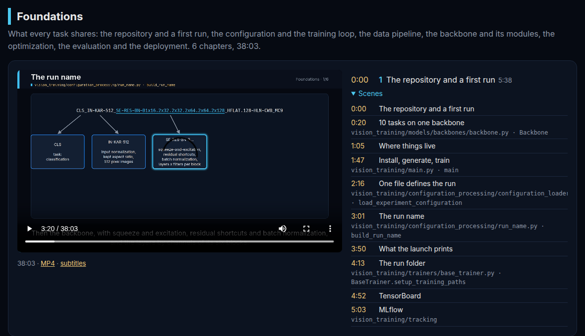
</p>

## Deployment
In order to serve a trained run to other programs, read the parts below in order: the words of deployment followed on one run ([From A Checkpoint To A Served Model](#from-a-checkpoint-to-a-served-model)), the number formats behind reduced precision ([Number Formats](#number-formats)), then the [export](#export), its [input contract](#input-contract), the [Triton server](#triton-server) and the measured [serving formats](#serving-formats-and-precision).

### From A Checkpoint To A Served Model
If words such as eager, ONNX or TensorRT stop you in the Deployment section, this part follows one trained run from its checkpoint to a served model: the 35-class synthetic shapes classifier of the README screenshots (512 pixels, iteration 2000), exported on 2026-11-19, from which every file, output and timing below comes unless the serving benchmark is named. The table gives each word in one line with a comparison, the subsections explain them on that run, and the [glossary](#glossary) defines the other terms.

| Word | What it is | Comparison |
|---|---|---|
| Eager | PyTorch running the Python classes of the repository line by line, each operation sent to the GPU when Python reaches it: how every training and evaluation runs, and the reference of every export | a cook reading the recipe step by step, free to change a step on the way |
| Export | `export_model.py` running the model once on an example batch, recording its operations and weights into `model.pt` and `model.onnx`, checking both against the eager model and writing them with their Triton configuration into `served_models/` | filming the cook once, so the film no longer needs the cook's notes |
| TorchScript (`model.pt`) | the graph format of PyTorch: the operations recorded by `torch.jit.trace` with the weights, run by PyTorch or its C++ library libtorch, in your process or in Triton | the film, playable only by PyTorch players |
| ONNX (`model.onnx`) | an open graph format of standard operators (opset 18): the graph in `model.onnx`, the weights in `model.onnx.data`, the input contract in its metadata, read by the runtimes of any framework | the recipe written in a universal language |
| ONNX Runtime | the library that runs `model.onnx`: on the CPU for the export check, on the GPU inside Triton through its CUDA or TensorRT execution provider | a kitchen that reads the universal recipe, on the stove plugged into it |
| TensorRT | the compiler of NVIDIA that turns `model.onnx` into an engine for one GPU model and one TensorRT version; ONNX Runtime builds the engines inside Triton at the first requests, and the export does not check them | the recipe rewritten for one specific kitchen, faster there and useless elsewhere |
| Precision (FP32 / FP16) | the bits of every computed value: the exports store FP32 (32 bits), and with `tensorrt_precision = "FP16"` TensorRT computes in FP16 (16 bits) where it is faster, the inputs and outputs staying FP32 | coarser measuring cups: quicker to use, every measure rounded more |
| Triton | the inference server of NVIDIA, a Docker container that loads `served_models/` and answers requests over HTTP and gRPC, batching those that arrive together | a restaurant taking orders from many tables at once |

<p align="center">
  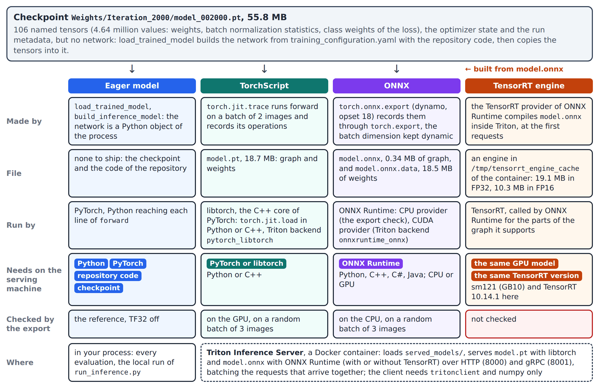
</p>
<p align="center"><em>The four ways to run the checkpoint of the README classifier, with the sizes of its export (model.pt, model.onnx) and of the TensorRT engines built from model.onnx in the Triton image (TensorRT 10.14.1, GB10).</em></p>

#### Training Versus Serving
Once a run has finished, what you hold is a run folder only this repository can read: `Weights/Iteration_2000/model_002000.pt` stores named tensors, and `load_trained_model` rebuilds the network from `training_configuration.yaml` with the Python classes of the repository before copying the tensors into it, the way every evaluation runs. Serving means another program, often on another machine, that receives images and returns predictions. It needs:
- **the operations and the weights in a file it can read** without this repository: which operation follows which, on which shapes, with which weights;
- **speed**: the latency of a request (the time until its answer) and the throughput (images answered per second when many arrive);
- **the same answers** as the model that was evaluated, within a tolerance.

#### The Eager Model
Each time you evaluate a run or call a model in a notebook, PyTorch runs it eagerly: it holds no plan of the network, Python executes `forward` line by line, and every PyTorch operation it reaches launches its kernel on the GPU at once. A kernel is one GPU program applied to a whole tensor by thousands of threads in parallel, such as the 3 x 3 convolution of the first block producing a [1, 16, 512, 512] feature map. Since Python decides what runs next, an `if`, a `print` or a breakpoint work as in any program; the price is that the serving machine needs Python, PyTorch, the code of the repository and the checkpoint. Kernel launches are asynchronous, Python moving to the next line while the GPU computes, so eager is not the slow path it may seem: on the 9-class README classifier, the serving benchmark measured 2.2 milliseconds for one image in the process, against 3.3 for TorchScript. The eager model is the reference of the repository: every evaluation, the in-process run of `run_inference.py` and the check of every export use it.

<p align="center">
  
</p>
<p align="center"><em>The forward of the README classifier, condensed: run eagerly (Python reaches each line, the False <code>if</code> is skipped), traced by the export (each operation recorded once on a batch of 2 images), then run from model.pt by libtorch without the Python code. Operations that only reshape a tensor (unsqueeze, flatten) and the dropout of the evaluation mode launch no kernel and are left out.</em></p>

#### Checkpoint Versus Model File
Should you try to load a checkpoint without this repository, you get named tensors and no network to put them in; an exported file holds the graph (the operations with their connections and shapes) and the weights:

| | Checkpoint | TorchScript | ONNX |
|---|---|---|---|
| File | `Weights/Iteration_2000/model_002000.pt`, 55.8 MB | `model.pt`, 18.7 MB | `model.onnx`, 0.34 MB, and `model.onnx.data`, 18.5 MB |
| Holds | 106 named tensors (4.64 million values: weights, batch normalization statistics, class weights of the loss, 18.6 MB), the Adam optimizer state (two values per trained weight, 37.1 MB) and the run metadata | the recorded operations and their weights | 125 nodes of standard operators, 50 weight tensors (4.64 million values) and 5 constants, such as the 255 and 0.5 of the input normalization |
| Read by | `load_trained_model`, with `training_configuration.yaml` and the code of the repository | PyTorch or libtorch alone | any ONNX runtime |

#### How The Export Records The Graph
To turn Python code into a file of operations, `export_experiment` (`vision_training/deployment/export_model.py`) runs the inference model on an example batch and writes down what it does:
- **TorchScript**: `torch.jit.trace` (`export_torchscript` in `export_formats.py`) runs `forward` on a random batch of 2 images and records every tensor operation it executes. Python itself is not recorded: an `if` is decided once and only the branch the example batch took stays. The README classifier keeps the division by 255 and the subtraction of 0.5 of `InputNormalizer`, and nothing of the per-image standardization behind `if self.per_sample_normalization:`, False for this run; a branch on the values of a tensor would be frozen to the example batch in the same way.
- **ONNX**: `torch.onnx.export(..., opset_version=18, dynamo=True, dynamic_shapes=...)` (`export_onnx`) captures the graph with `torch.export`, which follows the batch dimension as a symbol, `batch` from 1 to `maximum_batch_size`, instead of the number 2, so that `model.onnx` declares its input as [batch, 3, 512, 512]. The optimizer of the exporter then simplifies the graph and folds each batch normalization into the weights and bias of the convolution before it.
- **The check**: each file runs again on a random batch of 3 images, so that a batch dimension frozen to 2 fails at export rather than in Triton: `model.pt` with `torch.jit.load` on the GPU, `model.onnx` with ONNX Runtime on the CPU. Their outputs must match the eager model, TF32 off, within the tolerance of the task (1e-4 on probabilities, 0.01 pixel on boxes), and the served models are replaced only when every format matches ([Export](#export)).

#### TorchScript
Suppose the service that answers the requests already links PyTorch, in Python or in C++: TorchScript is the graph format of PyTorch itself, and `model.pt` holds the traced graph with its weights. libtorch, the C++ library at the core of PyTorch, runs it with the same kernels as the eager model, so that on the GPU `model.pt` gives the eager probabilities of the test image below to the last digit. `torch.jit.load` in Python, or `torch::jit::load` in C++, needs no code of the repository, and Triton serves the file with its PyTorch backend (`platform: "pytorch_libtorch"`, the output named `class_probabilities__0`). The graph keeps one operator per PyTorch call, 11 `aten::_convolution` and 11 `aten::batch_norm`, nothing folded. The trace also records the TF32 switch of every convolution, off during the export, as the `allow_tf32` argument of its `aten::_convolution`: libtorch runs these convolutions without TF32 whatever the switch of the process (`model.pt` run with both TF32 switches of PyTorch on stays within 1.2e-07 of the reference of the test image below, against 1.85e-05 for the eager model), and in Triton, whose PyTorch backend has no TF32 setting. PyTorch 2.14 warns that `torch.jit.trace` and `torch.jit.load` are deprecated and points to `torch.export`; `hide_known_export_warnings` hides these warnings during the export.

#### ONNX
Whenever the program that serves the model has no PyTorch, a service written in C# or Java, or TensorRT itself, it reads ONNX, the Open Neural Network Exchange format shared by the frameworks: a graph of standard operators (Conv, Relu, Gemm for a fully connected layer, Softmax...) whose behaviour the ONNX specification fixes for every opset version, 18 in this repository. Any runtime implementing opset 18 runs the file, ONNX Runtime, TensorRT or others, from Python, C++, C# or Java, on a CPU or a GPU. Read with the `onnx` package, the export of the README classifier holds 125 nodes: the input normalization inside the graph (its first Div and Sub, so a client sends pixels from 0 to 255), no BatchNormalization node, and the [input contract](#input-contract) in its metadata.

<p align="center">
  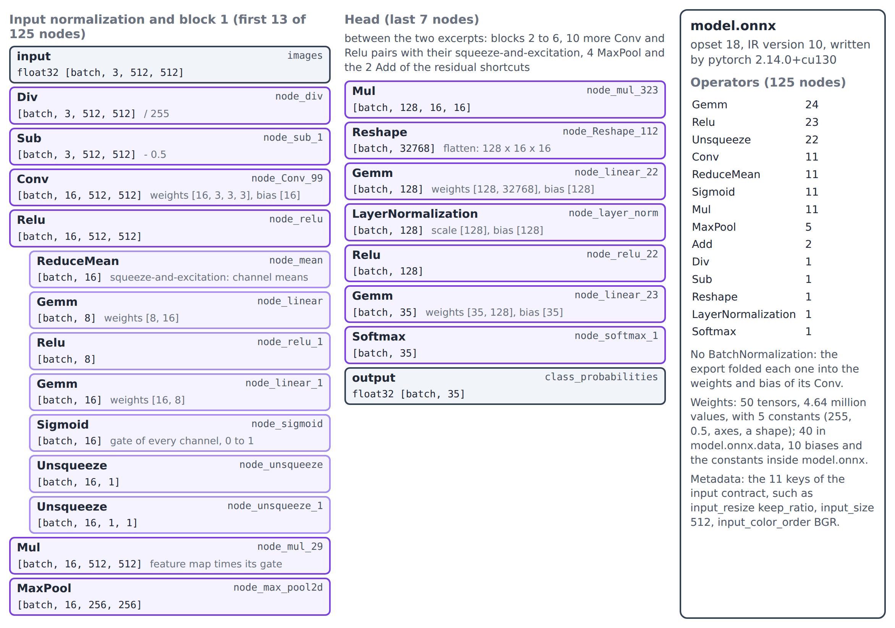
</p>
<p align="center"><em>The first 13 and last 7 of the 125 nodes of model.onnx, with the output shape of every node and the shapes of its weights, read from the export of 2026-11-19 with <code>onnx.load</code> and <code>onnx.shape_inference</code>; the squeeze-and-excitation branch is indented.</em></p>

#### ONNX Runtime And Its Execution Providers
For an ONNX file to compute anything, a runtime must execute its graph; the export check and Triton use ONNX Runtime. It loads the graph, simplifies it, then hands every node to an execution provider, the plug-in that decides on which hardware and with which kernels the node runs:

| Execution provider | How it runs the graph | In this repository |
|---|---|---|
| `CPUExecutionProvider` | every node on the CPU | the export check of `model.onnx` |
| `CUDAExecutionProvider` | the nodes on the GPU, one after the other, the convolutions with cuDNN and the matrix products with cuBLAS, the kernel libraries of NVIDIA that PyTorch calls too | Triton with `tensorrt_precision = None` |
| `TensorrtExecutionProvider` | hands the parts of the graph TensorRT supports to TensorRT, the rest to CUDA | Triton with `"FP32"` (default) or `"FP16"` |

Before you plan a GPU run of `model.onnx` in your own process, check which providers your installation offers, the `onnxruntime` package of `pyproject.toml` being the CPU build:

```python
import onnxruntime

print(onnxruntime.get_available_providers())
```

It prints `['AzureExecutionProvider', 'CPUExecutionProvider']` in the environment of the repository. The CUDA and TensorRT providers come with the `onnxruntime-gpu` package and with the Triton image, where this repository runs ONNX on the GPU.

#### TensorRT
In case the speed of one model on one GPU matters more than a portable file, TensorRT, the inference compiler of NVIDIA, turns the graph into an engine for that GPU. ONNX Runtime CUDA works mostly like an interpreter, running the nodes one after the other with library kernels after a few rewrites of the graph; TensorRT works like a compiler, reading the whole graph once and writing a program for one GPU. Built from `model.onnx` of the README classifier with `trtexec` in the Triton image (TensorRT 10.14.1, FP32, one image), its engine shows the three things it does:
- **Fusion**: several nodes computed in one kernel, their intermediate tensors never written to memory. The first convolution produces a [1, 16, 512, 512] float32 feature map, 16.8 MB, that a separate ReLU kernel would read back and write again; TensorRT runs the Conv and its Relu as one layer (`node_Conv_99_myl0_2` covers `node_Conv_99` and `node_relu`), as it does for the 8 other convolutions a Relu follows (the 2 left feed the squeeze-and-excitation of a residual block), the Div and Sub of the input normalization as another, and makes 79 layers of the 125 nodes.
- **Kernel auto-tuning**: for every layer, the builder times candidate kernels, called tactics, on the GPU itself and keeps the fastest; for that first convolution it timed 60, from 0.0859 milliseconds (TF32 on the Tensor Cores, the units of the GPU that multiply small matrices in reduced precision) to 0.2888.
- **Reduced precision**: with `"FP16"`, it takes FP16 kernels where they are faster; for the same convolution it kept one of 0.0217 milliseconds.

<p align="center">
  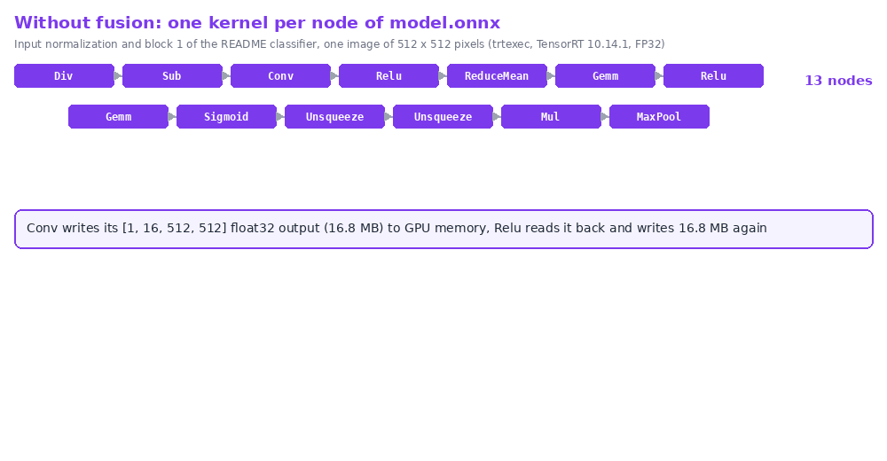
</p>
<p align="center"><em>The input normalization and block 1 of the README classifier: their 13 nodes in model.onnx, the 9 layers TensorRT made of them (layer names of the engine report of <code>trtexec --exportLayerInfo</code>), then the 60 candidate kernels its builder timed for the fused convolution on the GB10 and the one it kept, from its verbose log.</em></p>

The output, an engine (also called a plan), is valid for one GPU model (the cached engines carry `sm121`, the compute capability 12.1 of the GB10), one TensorRT version and the input shapes it was built for; it is slow to build and fast to run, `trtexec` building this one in 5.46 seconds. In this repository the TensorRT provider of ONNX Runtime builds the engines inside Triton at the first requests and caches them in `/tmp/tensorrt_engine_cache` of the container under a prefix naming the export, 19.1 MB in FP32 and 10.3 MB in FP16 for this classifier; a native engine built at export (`model.plan`) is not implemented. [TensorRT Or TorchScript And ONNX Runtime CUDA](#tensorrt-or-torchscript-and-onnx-runtime-cuda) lists what this costs.

#### Precision Of The Numbers
So that you can weigh a reduced precision before serving with it, note that every export stores FP32 (32-bit) weights, inputs and floating-point outputs, while the Tensor Cores compute faster on fewer bits: TF32 (eager PyTorch convolutions and TensorRT "FP32" by default), BF16 and FP16 (16 bits), FP8 and INT8 (8 bits), FP4 (4 bits), each value then rounded more or held in a narrower range. The detector of this repository lost 7.88 points of mAP@0.5 with TensorRT FP16 because the box coordinates its exported NMS offset went above 65,504, the largest FP16 value, until the NMS was fixed ([Serving Benchmark Results](#serving-benchmark-results)). [Number Formats](#number-formats) explains every format with examples.

#### Triton Inference Server
When other programs must query the model over the network rather than call it inside your own script, a server holds it: Triton Inference Server, the serving program of NVIDIA, started as a Docker container from `vision_training/deployment/triton/docker-compose.yml` ([Triton Server](#triton-server)). It loads the model folders of `served_models/`, each described by its `config.pbtxt`, receives requests over HTTP (port 8000) or gRPC (port 8001), waits up to 1 millisecond to group the requests that arrive together into one batch (dynamic batching), runs each file with its backend, the plug-in of one format (libtorch for `model.pt`, ONNX Runtime with or without TensorRT for `model.onnx`), and returns the outputs. "In the process" is the opposite: the model lives inside your own Python program (the eager model, `torch.jit.load` or an `onnxruntime.InferenceSession`), with no network and no queue.

In order to query Triton once it serves the export of the run, a client needs `tritonclient` and numpy (OpenCV here to read the test image of [One Image Through Every Path](#one-image-through-every-path)), not PyTorch; the calls are those of `run_triton_inference` in `deployment_utilities.py`:

```python
import cv2
import numpy as np
import tritonclient.grpc as triton_client

images = cv2.imread("<synthetic_shapes_folder>/test/data/test_000012.png").transpose(2, 0, 1)[None].astype(np.float32)
client = triton_client.InferenceServerClient(url="localhost:8001")
inference_input = triton_client.InferInput(name="images", shape=list(images.shape), datatype="FP32")
inference_input.set_data_from_numpy(input_tensor=images)
result = client.infer(model_name="image_classifier_onnx", inputs=[inference_input],
                      outputs=[triton_client.InferRequestedOutput(name="class_probabilities")])
print(result.as_numpy(name="class_probabilities").max())
```

Sent on 2026-11-19 to a Triton server holding the export of the README classifier, it printed 0.96520966, the hexagon probability of `model.onnx` run with the TensorRT FP32 accelerator the export writes by default, and 0.9652039 once the container was started again, its TensorRT engine being built again (below).

#### One Image Through Every Path
Say you want to see on one image what "the export checks each format against the eager model" means: take `test_000012.png` of the test split of the CLS synthetic shapes dataset the run was trained on (`<synthetic_shapes_folder>`, generated as in [Quick Start With Synthetic Data](#quick-start-with-synthetic-data)), a hexagon of 512 x 512 pixels, the input size, so that the `keep_ratio` resize of the input contract leaves it as it is.

If one wishes to run it through the three paths of a single process, run this snippet from the repository root once `export_model.py` has written the run into `served_models/`, `<experiment_folder>` being the folder that holds the run:

```python
import cv2
import numpy as np
import onnxruntime
import torch

from pathlib import Path

from vision_training.deployment.export_specifications import build_inference_model
from vision_training.models.model_loading import load_trained_model

# One test image of 512 x 512 pixels, the input size, so the keep_ratio resize of the input contract leaves it as it is
images = cv2.imread("<synthetic_shapes_folder>/test/data/test_000012.png").transpose(2, 0, 1)[None].astype(np.float32)
served_models = Path("vision_training/deployment/triton/served_models")

# Eager: the repository code builds the network from the configuration, then loads the checkpoint (TF32 off, as the
# export check runs it)
torch.backends.cudnn.allow_tf32 = False
run_folder = Path("<experiment_folder>/CLS_IN-KAR-512_SE-RES-BN-B1x16.2x32.2x32.2x64.2x64.2x128-PT_HFLAT.128-HLN-CWB_MC35")
model = load_trained_model(configuration_path=run_folder / "training_configuration.yaml", device=torch.device("cuda"),
                           checkpoint_path=run_folder / "Weights/Iteration_2000/model_002000.pt", use_averaged_weights=False)
eager_model = build_inference_model(task="classification", model=model)
with torch.no_grad():
    eager_probabilities = eager_model(images=torch.from_numpy(images).cuda()).cpu().numpy()

# TorchScript: PyTorch alone reads the graph and the weights of model.pt
torchscript_model = torch.jit.load(f=served_models / "image_classifier_torchscript/1/model.pt", map_location="cuda")
with torch.no_grad():
    torchscript_probabilities = torchscript_model(torch.from_numpy(images).cuda()).cpu().numpy()

# ONNX: ONNX Runtime alone reads model.onnx and the weights of model.onnx.data, here on the CPU
session = onnxruntime.InferenceSession(served_models / "image_classifier_onnx/1/model.onnx", providers=["CPUExecutionProvider"])
onnx_probabilities = session.run(output_names=["class_probabilities"], input_feed={"images": images})[0]

print(eager_probabilities.max(), np.abs(torchscript_probabilities - eager_probabilities).max(),
      np.abs(onnx_probabilities - eager_probabilities).max())
```

It printed `0.96520376 0.0 2.7418137e-06`: the hexagon probability of the eager model, then the largest difference of the 35 probabilities of TorchScript and of ONNX Runtime from it. With the served models of the Triton server above added, all on 2026-11-19:

| Path | hexagon | hollow_hexagon | pentagon | Largest difference from the eager model, over the 35 probabilities |
|---|---|---|---|---|
| Eager, TF32 off (reference of the export check) | 0.965204 | 0.013958 | 0.006539 | reference |
| Eager, PyTorch defaults (TF32 convolutions) | 0.965195 | 0.013976 | 0.006531 | 1.85e-05 |
| TorchScript, `torch.jit.load` on the GPU | 0.965204 | 0.013958 | 0.006539 | 0 |
| ONNX, ONNX Runtime on the CPU | 0.965207 | 0.013957 | 0.006538 | 2.74e-06 |
| Triton, TorchScript | 0.965204 | 0.013958 | 0.006539 | 1.25e-07 |
| Triton, ONNX Runtime CUDA | 0.965241 | 0.013953 | 0.006515 | 3.72e-05 |
| Triton, ONNX with TensorRT FP32 | 0.965210 | 0.013936 | 0.006542 | 2.16e-05 |
| Triton, ONNX with TensorRT FP32, container started again | 0.965204 | 0.013946 | 0.006541 | 1.22e-05 |
| Triton, ONNX with TensorRT FP16 | 0.965332 | 0.013985 | 0.006657 | 1.28e-04 |

Every path keeps the three classes in the same order. The export checks the TorchScript and ONNX files as the third and fourth rows run them, within 1e-4; the TensorRT FP16 engine, which it never checks, is the one path beyond that tolerance on this image. A TensorRT engine also depends on its build: the restarted container built its engines again, timing the candidate kernels again, and its new FP32 engine gave the digits of the row "container started again" (its new FP16 engine 0.006630 for pentagon), while every other path repeated its digits.

Where latency or throughput decides the path, the [serving benchmark](documentation/architecture_benchmarking/serving_benchmark_plan.md) measured these paths on 2026-11-17 on the idle GPU with the 9-class README classifier of that day (the same architecture with 9 classes, 512 pixels; Triton over shared memory, one client). The needs are those of the program that runs the model; a Triton client only needs a Triton client library (`tritonclient` and numpy in Python) or plain HTTP or gRPC calls:

| Path | File | Python needed | PyTorch needed | Repository code needed | Tied to one GPU model and TensorRT version | Checked by the export | Batch 1 p50 (milliseconds) | Batch 16 (images per second) |
|---|---|---|---|---|---|---|---|---|
| In the process, eager | checkpoint | yes | yes | yes | no | reference | 2.2 | 349 |
| In the process, TorchScript | `model.pt` | no, C++ loads it too | libtorch | no | no | yes, on the GPU | 3.3 | 355 |
| Triton, TorchScript | `model.pt` | no | libtorch, inside the container | no | no | yes, on the GPU | 4.5 | 320 |
| Triton, ONNX Runtime CUDA | `model.onnx` | no | no | no | no | yes, on the CPU | 3.6 | 435 |
| Triton, ONNX with TensorRT FP32 | `model.onnx`, engine built at the first requests | no | no | no | yes, the engine | the ONNX graph, not the engine | 3.0 | 646 |
| Triton, ONNX with TensorRT FP16 | the same | no | no | no | yes, the engine | no | 2.5 | 1,215 |

#### Which One When
To find your way among these paths, start from your situation:
- **Debugging, evaluating or changing the model**: the eager model, the reference of every other path.
- **A service in C++ or Python that already links PyTorch**: TorchScript, `torch.jit.load` on `model.pt`, with the kernels of the eager model; PyTorch 2.14 marks TorchScript as deprecated.
- **No PyTorch where the model runs, or another language such as C# or Java**: ONNX with ONNX Runtime, on a CPU or a GPU.
- **The most images per second on a known GPU**: ONNX with TensorRT FP16, after measuring its test metric through Triton with `scripts/deployment/evaluate_served_formats.py`, since the export never checks the engine.
- **Many cameras or services at once, several models or versions behind one endpoint**: Triton, which also batches the requests that arrive together.

#### Glossary
If you are looking for one word of the Deployment section, here it is in one line, with where it appears in this repository:

| Term | Meaning | In this repository |
|---|---|---|
| Kernel | one GPU program applied to a whole tensor by thousands of threads in parallel | the 3 x 3 convolution of block 1 over [1, 16, 512, 512] |
| CUDA | the platform of NVIDIA to program its GPUs | `torch.device("cuda")`, the CUDA execution provider |
| cuDNN, cuBLAS | the libraries of GPU kernels of NVIDIA for neural network layers (convolutions) and for matrix products | run by PyTorch, libtorch and ONNX Runtime CUDA |
| Tensor Cores | units of the GPU that multiply small matrices in reduced precision (TF32, BF16, FP16, FP8, INT8, FP4) faster than its regular cores | the TF32 kernel TensorRT kept for the first convolution |
| Eager | PyTorch running `forward` line by line, each operation launched when Python reaches it | every training and evaluation, the in-process run of `run_inference.py` |
| Graph | the operations of a network with their connections, shapes and weights, known before it runs | `model.pt`, `model.onnx` |
| Tracing | recording the operations a forward pass executes on an example batch | `torch.jit.trace` on a batch of 2 |
| `torch.export` | the graph capture of PyTorch that follows dynamic dimensions as symbols | the ONNX export, `dynamo=True` |
| TorchScript | the graph format of PyTorch, run by libtorch | `model.pt`, Triton `pytorch_libtorch` |
| libtorch | the C++ library at the core of PyTorch | runs `model.pt` in Python, C++ or Triton |
| ONNX | the framework-neutral graph format of standard operators | `model.onnx` and `model.onnx.data` |
| Opset | the version of the ONNX operators and of their definitions a file uses | 18 |
| ONNX Runtime | the library of Microsoft that runs ONNX files | the export check (CPU), Triton `onnxruntime_onnx` |
| Execution provider | the plug-in of ONNX Runtime that decides on which hardware and with which kernels each node runs | CPU, CUDA, TensorRT |
| TensorRT | the compiler and runtime of NVIDIA that turns a graph into an engine for one GPU | `tensorrt_precision` "FP32" or "FP16" |
| Engine, plan | the compiled network of TensorRT, valid for one GPU model, one TensorRT version and a range of input shapes | `/tmp/tensorrt_engine_cache` of the container |
| Fusion | several operations computed in one kernel, their intermediate tensors kept out of memory | 9 Conv and Relu pairs of the TensorRT engine |
| Tactic | a candidate kernel the TensorRT builder times for a layer | 60 for the first convolution |
| Triton Inference Server | the server of NVIDIA that loads model files and answers requests over HTTP and gRPC | `vision_training/deployment/triton/docker-compose.yml` |
| Model repository | the folder Triton reads: one folder per model, with its `config.pbtxt` and version folders | `served_models/` |
| Backend | the plug-in of Triton that runs one format | `pytorch_libtorch`, `onnxruntime_onnx` |
| Dynamic batching | Triton grouping the requests that arrive close together into one batch | `max_queue_delay_microseconds: 1000` |
| Instance | one copy of a model loaded by Triton, running requests in parallel with the other copies | `instance_group` count 1 |
| In the process | the model inside your own program, without a server | eager, `torch.jit.load`, `onnxruntime.InferenceSession` |
| Latency, p50 | the time from a request to its answer; p50 is its median over many requests, p99 the time 99 % of them stay under | the Batch 1 p50 columns |
| Throughput | the images answered per second | the Batch 16 columns |
| Warm-up | requests sent first and not timed, while CUDA initializes and TensorRT builds its engines | 20 in `run_inference.py` |
| Shared memory | a memory region client and server both map, so that an image is written once instead of sent inside the request | `use_shared_memory`, `/dev/shm` |
| Input contract | the preprocessing a client must apply, written with the model | `preprocessing.json`, the ONNX metadata |
| FP32 | 32-bit floating point: 8 exponent and 23 mantissa bits ([Number Formats](#number-formats)) | every export and evaluation |
| TF32 | Tensor Core mode with the range of FP32 and 10 mantissa bits ([Number Formats](#number-formats)) | eager PyTorch convolutions, TensorRT "FP32" |
| BF16 | 16 bits: the range of FP32 with 7 mantissa bits ([Number Formats](#number-formats)) | the forward passes of the training |
| FP16 | 16 bits: 5 exponent bits, largest value 65,504, and 10 mantissa bits ([Number Formats](#number-formats)) | `tensorrt_precision = "FP16"` |
| FP8 | 8 bits, E4M3 or E5M2 ([Number Formats](#number-formats)) | not implemented |
| INT8 | 8-bit integers times a scale ([Number Formats](#number-formats)) | not implemented |
| FP4 | 4 bits, E2M1 ([Number Formats](#number-formats)) | not implemented |

### Number Formats
Before you pick the precision of a served model (`tensorrt_precision` of the [export](#export)) or read why the trainings compute in BF16, this section shows what each number format stores, why it exists, where the repository uses it and what it does to the values of a classifier and a detector. A **bit** is a 0 or a 1, and a format packs every number into a fixed number of bits, from 32 for FP32 down to 4 for FP4: it holds a finite set of values and rounds every other number to the nearest of them. Fewer bits mean less memory to read and faster arithmetic, for a coarser rounding or a smaller range.

#### What A Floating-Point Number Is
To be able to read the tables of this section, start from how a floating-point format writes a number. Its bits form three fields:
- the **sign**, one bit: 0 for a positive number, 1 for a negative one;
- the **exponent**, which picks a power of two: its bits set the **range**, how large and how small a number can get;
- the **mantissa**, which places the number between that power of two and the next one in equal steps: its bits set the **precision**, how finely neighbouring numbers are spaced.

The value of a normal number is (-1)^sign x 2^(exponent - bias) x (1 + mantissa / 2^m), m being the number of mantissa bits and the bias (15 in FP16) letting the exponent field stand for negative powers too. The pixel coordinate 1000.3 of a 1024-pixel detector input, decoded from the FP16 bits PyTorch stores for it (0x63D1):

<p align="center">
  
</p>

The 10 mantissa bits of FP16 split the interval between two powers of two into 1,024 equal steps: from 512 to 1024 the **gap** between two neighbouring values is 512 / 1024 = 0.5, so 1000.3 is stored as 1000.5. The gap doubles at every power of two, so the rounding error stays below one part in 2,048 of the value at any magnitude, and the **gap after 1**, the distance from 1 to the next value, gives the precision of a format (0.000977 for FP16). Two limits close the range: a number above the largest value **overflows** to infinity (inf), and a number below the smallest normal value is stored as a **subnormal**, with fewer significant bits, then as 0.

#### The Formats One By One
If you are looking for what a name such as BF16 or E4M3 stands for, each format below gives its full name, its bits, its largest value and its gap after 1, why it exists, where the repository uses it and when to choose it. The bits are drawn to scale, one cell per bit:

<p align="center">
  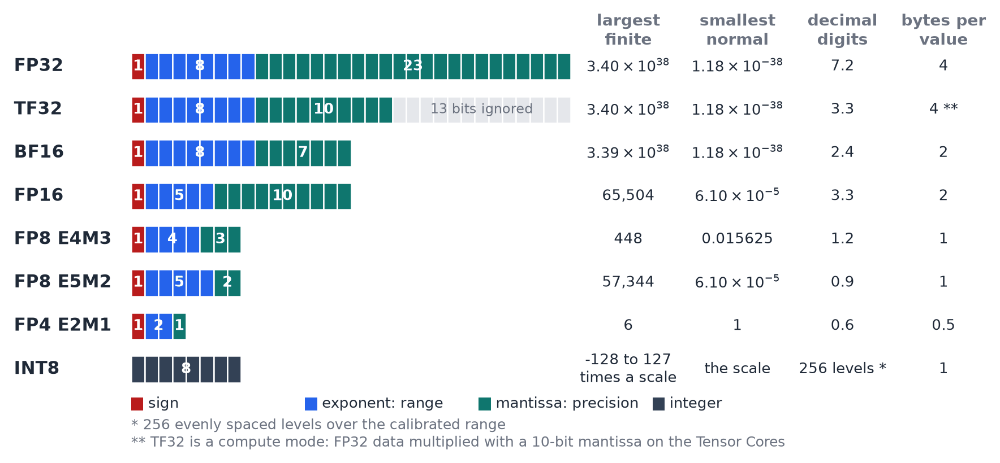
</p>

- **FP32, single precision** (1 + 8 + 23 bits, largest 3.40 x 10^38, gap after 1 1.19 x 10^-7). The default format of PyTorch and the reference of the repository: the weights of every model (`MODEL_DTYPE` of `vision_training/models/model_registry.py`), the test evaluation, and the inputs and floating-point outputs of every export (`TYPE_FP32` in `config.pbtxt`). It rounds too, at the eighth significant digit: 1000.3 is stored as 1000.29998779. Keep it for anything compared with a threshold.
- **TF32, TensorFloat-32** (1 + 8 + 10 bits, largest 3.40 x 10^38, gap after 1 0.000977). A compute mode of the NVIDIA **Tensor Cores**, the GPU units that multiply small blocks of matrices in one instruction, and not a storage type: the values stay FP32 in memory, the Tensor Cores read their sign, their exponent and the first 10 of their 23 mantissa bits, and add the products in FP32 (the **accumulation**, the running sum of a convolution or a matrix multiplication). It runs FP32 code on the Tensor Cores without a change, with the range of FP32 and the precision of FP16. PyTorch leaves it on for convolutions (`torch.backends.cudnn.allow_tf32` is True, `torch.backends.cuda.matmul.allow_tf32` False), so the eager model in the process computes its convolutions in TF32, and TensorRT allows it in "FP32" engines. Choose it for speed, not when two runtimes must match: `export_experiment` of `vision_training/deployment/export_model.py` turns both switches off while it exports and checks, then restores them, and the trace keeps the convolutions of `model.pt` without TF32 ([TorchScript](#torchscript)).
- **BF16, bfloat16 ("brain floating point")** (1 + 8 + 7 bits, largest 3.39 x 10^38, gap after 1 0.0078125). The first 16 bits of an FP32 number: the range of FP32 in 2 bytes, so a value that fits FP32 fits BF16, rounded to about 2.4 significant decimal digits. Every training and validation forward pass runs under `torch.autocast(..., dtype=torch.bfloat16)` in `run_model_iteration` of `vision_training/trainers/base_trainer.py`: **autocast** computes the convolutions and matrix multiplications in BF16 and keeps the weights, and the operations PyTorch lists as needing precision such as softmax and the losses, in FP32; the test evaluation runs in FP32. Between 512 and 1024 its gap is 4 pixels, so 1000.3 becomes 1000. It is not servable through the ONNX Runtime backend of Triton 26.01 ([What Is Exported Today](#what-is-exported-today)). Choose it for training; keep thresholds and post-processing in FP32.
- **FP16, half precision** (1 + 5 + 10 bits, largest 65,504, gap after 1 0.000977). Eight times finer than BF16 near any value, for 3 fewer exponent bits: it overflows above 65,504 and stores values below 6.10 x 10^-5 as subnormals. `tensorrt_precision = "FP16"` in the main block of `export_model.py` writes `precision_mode` "FP16" into `config.pbtxt` (`write_triton_configuration` of `triton_configuration.py`), TensorRT then running FP16 kernels where it finds them faster; the export check never runs that engine. 1000.3 becomes 1000.5 and the area of a 256 x 256 box, 65,536, becomes inf. Choose it to serve CLS and M2M (within 0.03 points of the eager model at 1.9 times the images of TensorRT FP32, [Serving Benchmark Results](#serving-benchmark-results)) once no value inside the model can pass 65,504.
- **FP8, E4M3 and E5M2** (1 + 4 + 3 bits: largest 448, gap after 1 0.125; 1 + 5 + 2 bits: largest 57,344, gap after 1 0.25). One byte per value, the name counting the exponent (E) and mantissa (M) bits: E4M3 keeps one more mantissa bit, E5M2 the range of FP16, and the TensorRT [quantized types](https://docs.nvidia.com/deeplearning/tensorrt/10.x.x/inference-library/work-quantized-types.html) list E4M3, through explicit quantization only. Without a [scale](#scales-for-int8-and-fp8), the values of a model fall outside or between their few steps: E4M3 has no infinity and PyTorch clamps 1000.3 to 448, E5M2 rounds it to 1,024, and both store 1e-6 as 0. Not implemented: FP8 is not a `precision_mode` of the ONNX Runtime backend.
- **INT8, 8-bit integer** (8 bits, -128 to 127). Not a floating-point format: 256 evenly spaced levels that a [scale](#scales-for-int8-and-fp8) turns into values, run by the integer Tensor Cores in 1 byte. Not implemented: TensorRT needs [Q/DQ nodes or a calibration table](#scales-for-int8-and-fp8), implicit calibration being deprecated since TensorRT 10.1.
- **FP4 E2M1** (1 + 2 + 1 bits: 0, 0.5, 1, 1.5, 2, 3, 4 and 6 and their negatives; gap after 1 0.5). Half a byte per value; the published 1 petaFLOP of the [DGX Spark](https://www.nvidia.com/en-us/products/workstations/dgx-spark/) is a theoretical FP4 figure with sparsity. Without a scale, 0.1 becomes 0 and 1000.3 becomes 6. Not implemented.

Block floating point (BFP), where one exponent is shared by a block of values as in the MX formats, is not BF16 and is not used in this repository.

#### The Same Values In Every Format
Suppose a class threshold, a detector coordinate, two box areas, a box offset and a weight update of the repository are stored in each format: PyTorch 2.14 holds them as follows, written with up to 6 significant digits, or 7 when that is exact (`torch.float16`, `torch.bfloat16`, `torch.float8_e4m3fn` and `torch.float8_e5m2`; the TF32 column rounds the FP32 mantissa to 10 bits, to the nearest value, ties to even).

| Value of the repository | FP32 | TF32 | BF16 | FP16 | FP8 E4M3 | FP8 E5M2 |
|---|---|---|---|---|---|---|
| Class threshold 0.999 | 0.999 | 0.999023 | **1** | 0.999023 | 1 | 1 |
| Pixel coordinate 1000.3 of a 1024-pixel input | 1,000.3 | 1,000.5 | 1,000 | 1,000.5 | 448 | 1,024 |
| Area of a 256 x 256 box, 65,536 | 65,536 | 65,536 | 65,536 | **inf** | 448 | inf |
| Area of a 300 x 300 box, 90,000 | 90,000 | 89,984 | 90,112 | inf | 448 | inf |
| Box offset 0.1 | 0.1 | 0.0999756 | 0.100098 | 0.0999756 | 0.1015625 | 0.09375 |
| Weight update 1e-6 | 1e-6 | 1.00024e-6 | 9.98378e-7 | 1.01328e-6 (subnormal) | 0 | 0 |
| Weight 0.1 after that update | **0.100001** | 0.0999756 | 0.100098 | 0.0999756 | 0.1015625 | 0.09375 |

The same values on the number line of every format, with the gap of the format around each one:

<p align="center">
  
</p>
<p align="center"><em>Every lane holds the values of one format (ticks, or a bar where they are too close to draw apart); the dot is the stored value, and an arrow marks a value stored outside the window: 448 for E4M3, which has no infinity, inf above the largest value, 0 below the smallest.</em></p>

The gap of each format at every magnitude, from 10^-6 to 10^7:

<p align="center">
  
</p>
<p align="center"><em>Gap between neighbouring representable values: a value is rounded by up to half of it, and the format overflows past the cross. The dotted lines mark values of this repository: a class threshold, a pixel coordinate of a 1024-pixel input and the area of a 256 x 256 box.</em></p>

#### What These Numbers Mean
Each time a model moves to a reduced precision, check its values against these cases of the repository:
- **BF16 turns the threshold 0.999 into 1.** Near 1 its values are 0.99609375 and 1, so the probabilities 0.9985 and 0.9995 both read 1 and a threshold of 0.999 can no longer separate them: thresholds, such as those of the logit temperature of the [export](#export), and post-processing stay in FP32, as the test evaluation does.
- **FP16 makes the area of a 256 x 256 box infinite.** The NMS exported inside the detector overflowed FP16 twice: its greedy NMS moved the boxes of every image and class apart by about 1,025 pixels per group, so the coordinates passed 65,504 from about the 64th group and duplicates stayed (run_9 lost 7.88 points of mAP@0.5 with TensorRT FP16), and its DIoU-NMS computed areas in pixels, infinite from 256 x 256 pixels. One NonMaxSuppression batch per group (`suppress_stacked_groups` of `vision_training/models/detection/postprocessing.py`) and boxes in fractions of the image fixed both, the FP16 engine then reading +0.21 points against the eager model ([Serving Benchmark Results](#serving-benchmark-results)). Every sum, area or offset computed inside a model served in FP16 must stay below 65,504.
- **TF32 moves detection scores by about 1e-3.** On eight test images of the DET tutorial run, the eager model with TF32 convolutions moved the scores by up to 9.8e-4 and the boxes by up to 0.15 pixel against the same model in FP32, ten times the 1e-4 and the 0.01 pixel the export accepts (`comparison_tolerances` of `vision_training/deployment/export_specifications.py`); the probabilities of the README classifier moved by up to 5e-5. `export_experiment` therefore turns TF32 off and compares the exports with an eager reference in exact FP32 (its comment on `allow_tf32`).
- **A weight update of 1e-6 vanishes in a 16-bit weight.** Added to a weight of 0.1, it leaves the BF16 and FP16 weight unchanged, their gaps there being 0.000488 and 0.000061, while FP32 holds 0.100001: autocast keeps the weights in FP32 and computes only the forward passes in BF16.
- **INT8 and FP8 need a scale.** Stored as they are, 0.1 becomes 0.1016 in E4M3 and 0 as an integer; with one scale for a tensor between -6 and 6, INT8 stores it as 2 and reads it back as 0.0945 ([Scales For INT8 And FP8](#scales-for-int8-and-fp8)).

#### Scales For INT8 And FP8
Should a model run in INT8 or FP8, every tensor first needs a **scale**, the number its stored values are multiplied by to give back real values:
- **Scale.** For a tensor whose values stay between -6 and 6, the scale 6 / 127 = 0.0472 maps 6 to the integer 127: 0.1 is stored as round(0.1 / 0.0472) = 2 and read back as 0.0945, 2.5 as 53 and read back as 2.504, every value moving by at most half the scale, 0.0236. TensorRT rounds to the nearest integer, ties to even, and clips to -128 and 127.
- **Zero point.** An integer added to the stored values so that a range not centred on 0, such as 0 to 6 after a ReLU, uses all 256 levels. TensorRT quantizes symmetrically, with a scale only.
- **Per tensor or per channel.** One scale for a whole tensor suits activations; weights get one scale per output channel, as TensorRT recommends. After folding its batch normalization into the weights, as the ONNX export does, the first convolution of the second backbone block of the README classifier (`backbone.convolution_blocks.1`, 32 output channels) has a largest weight of 0.285 in its narrowest channel and of 2.73 in its widest: one scale for the tensor leaves the narrowest channel 13 of the 127 positive levels, one scale per channel gives every channel all 127.
- **Calibration.** Choosing the scales of the activations from data: TensorRT runs representative images through the model, about 500 for an ImageNet classifier, and records the range of every tensor. This implicit quantization is deprecated since TensorRT 10.1.
- **Q/DQ nodes.** QuantizeLinear and DequantizeLinear nodes written into the ONNX graph, each with its scale, marking where a tensor becomes INT8 or FP8 and where it returns to a wider format; TensorRT converts exactly where they say (explicit quantization), the only path to FP8 and FP4.

None of this is implemented: the export writes neither Q/DQ nodes nor a calibration table, `tensorrt_precision` accepts only "FP32", "FP16" and None (the export refuses any other value), the ONNX Runtime backend of Triton has no FP8 `precision_mode`, and the export check never runs a TensorRT engine ([What Is Exported Today](#what-is-exported-today)).

#### Summary Of The Formats
In case you need the facts of one format again, here they are, computed by PyTorch (TF32 and FP4 from their bit layouts):

| Format | Full name | Bits (sign + exponent + mantissa) | Largest value | Gap after 1 | Used in this repository for |
|---|---|---|---|---|---|
| FP32 | single precision (IEEE 754 binary32) | 1 + 8 + 23 | 3.40 x 10^38 | 1.19 x 10^-7 | weights, test evaluation, post-processing, inputs and floating-point outputs of every export |
| TF32 | TensorFloat-32 | 1 + 8 + 10, read from FP32 values | 3.40 x 10^38 | 0.000977 | convolutions of the eager model (PyTorch default) and TensorRT "FP32" engines; off in the export |
| BF16 | bfloat16, "brain floating point" | 1 + 8 + 7 | 3.39 x 10^38 | 0.0078125 | training and validation forward passes (autocast of `base_trainer.py`) |
| FP16 | half precision (IEEE 754 binary16) | 1 + 5 + 10 | 65,504 | 0.000977 | `tensorrt_precision = "FP16"`, served without check |
| FP8 E4M3 | 8-bit floating point, 4 exponent bits, 3 mantissa bits | 1 + 4 + 3 | 448 | 0.125 | not implemented |
| FP8 E5M2 | 8-bit floating point, 5 exponent bits, 2 mantissa bits | 1 + 5 + 2 | 57,344 | 0.25 | not implemented |
| INT8 | 8-bit integer | 8 (integer) | 127 times the scale | the scale | not implemented |
| FP4 E2M1 | 4-bit floating point, 2 exponent bits, 1 mantissa bit | 1 + 2 + 1 | 6 | 0.5 | not implemented |

#### Weight Memory And Bandwidth
For a served model to read less memory at every request, a reduced precision also shrinks its weights and activations. The weights of four saved runs, counted from their model state (weights and batch normalization statistics):

<p align="center">
  
</p>

The DGX Spark gives its GPU 273 GB/s of memory bandwidth shared with the CPU ([specifications](https://www.nvidia.com/en-us/products/workstations/dgx-spark/)), so halving the bytes of weights and activations halves the traffic of a memory-bound layer; TensorRT FP16 serves 1.9 times the images of TensorRT FP32 at batch 16 on CLS and M2M, and DET serves 189 images per second with both since the fix of its exported NMS ([Serving Benchmark Results](#serving-benchmark-results)).

### Export
When a run is ready to be served, `vision_training/deployment/export_model.py` writes it to the Triton model repository as [TorchScript](#torchscript) and [ONNX](#onnx), with the Triton configuration of every model, and checks every export against the [eager](#the-eager-model) PyTorch model, the served models being replaced only once every format matches ([How The Export Records The Graph](#how-the-export-records-the-graph)). Set `experiment_folder`, `iteration`, `use_averaged_weights`, `formats` (`"torchscript"` and `"onnx"`), `maximum_batch_size` and `tensorrt_precision` (`"FP16"`, `"FP32"`, or `None` for ONNX Runtime CUDA only) in its main block, any other format or precision stopping the export before it starts, then run:

```bash
uv run python -m vision_training.deployment.export_model
```

<p align="center">
  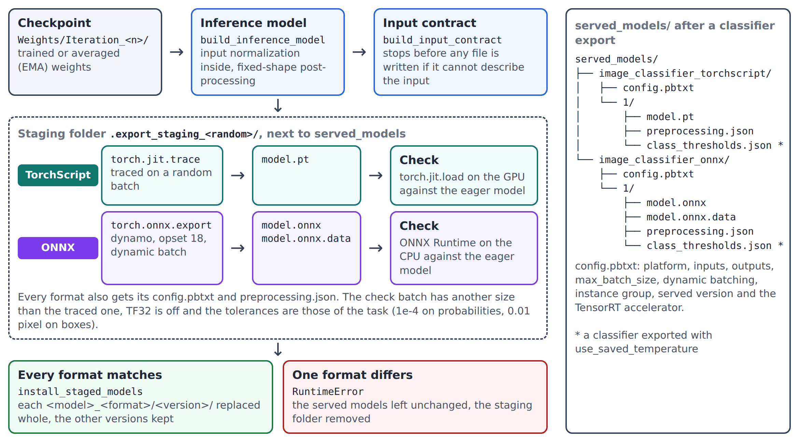
</p>

The models are written to `vision_training/deployment/triton/served_models/<model name>_<format>/<version>/` with their `config.pbtxt`:

| Task | Model name | Inputs | Outputs |
|---|---|---|---|
| CLS | `image_classifier` | `images` [B, 3, S, S] | `class_probabilities` [B, K] |
| DET | `object_detector` | `images` [B, 3, S, S] | `detection_boxes` [B, D, 4], `detection_scores` [B, D], `detection_labels` [B, D], `number_detections` [B] |
| INS | `instance_segmenter` | `images` [B, 3, S, S] | the outputs of DET, then `detection_masks` [B, D, M, M] |
| KPT | `keypoint_detector` | `images` [B, 3, S, S] | `candidate_positions` [B, C, N, 2], `candidate_scores` [B, C, N], `candidate_tags` [B, C, N] |
| SEG | `semantic_segmenter` | `images` [B, 3, S, S] | `class_map` [B, S, S], `class_probabilities` [B, K, S, S] |
| M2O | `sequence_classifier` | `images` [B, T, 3, S, S] | `class_probabilities` [B, K] |
| M2M | `sequence_labeller` | `images` [B, T, 3, S, S] | `class_probabilities` [B, T, K] |
| CMP | `sequence_comparator` | `before_images`, `after_images` [B, T, 3, S, S] | `class_probabilities` [B, K] |
| SEL | `frame_selector` | `images` [B, T, 3, S, S] | `class_probabilities` [B, T, K] |
| SSL | `image_encoder` | `images` [B, 3, S, S] | `representations` [B, F] |

S is `Data.image_settings.size`, K the number of classes, F the size of the L2 normalized representation (the pooled last feature map of the backbone), D the largest number of detections per image, M `MaskHead.mask_resolution`, T the number of frames, C the heatmap channels and N the candidates of every channel. The inputs are float32 BGR images in [0, 255], resized and padded as the [input contract](#input-contract) states, the input normalization being part of the model. The post-processing run by the client (SEG at the original resolution, INS masks, KPT grouping) and the SEL decoder and ensembles are in the [tools reference](documentation/reference/tools_reference.md#export).

A classifier that reaches its target precision only above a threshold such as 0.999 can be exported with a logit temperature chosen on its evaluation: start `uv run python -m scripts.evaluation.serve_temperature_explorer`, open `http://127.0.0.1:8091/`, pick a run, an iteration and **Trained** or **EMA**, then press **Save Thresholds At This Temperature** and **Export At T = …**. The export goes to `<run>/Exports/Iteration_<n>[_EMA]_T<temperature>/`, a Triton model repository of its own; from the script, `use_saved_temperature` builds the saved temperature and thresholds into the model. Details: [tools reference](documentation/reference/tools_reference.md#logit-temperature).

### Input Contract
Should a server build the input of an exported model from a photo, it reads the input contract written with the model instead of assuming a resize or a channel order. Every export writes it into the `metadata_props` of `model.onnx` and as `preprocessing.json` next to the model of both formats, with the keys of `vision_training/deployment/input_contract.py`: the BGR photo as `cv2.imread` decodes it, a `stretch`, `keep_ratio` or `tiles` resize with its OpenCV interpolation, the padding and the layout. The export stops before writing any file when a run uses an input the contract cannot describe.

<p align="center">
  
</p>
<p align="center"><em>The three resizes of a 640 x 359 photo for an input size of 256, computed by <code>preprocess_image</code>, <code>compute_letterbox_region</code> and <code>compute_tile_starts</code> (tiles with an overlap of 64). Photo: COCO 2017 validation image 288882, Flickr, CC BY 2.0.</em></p>

```python
session = onnxruntime.InferenceSession("model.onnx", providers=["CPUExecutionProvider"])
input_contract = session.get_modelmeta().custom_metadata_map
check_input_contract(input_contract=input_contract)
```

Every key and value is in the [tools reference](documentation/reference/tools_reference.md#input-contract). `build_input_from_contract` in `tests/deployment/test_input_contract.py` builds the inputs of a photo from the contract alone, checked pixel for pixel against `preprocess_image`.

### Triton Server
To serve every model of `served_models/`, start Triton from the folder of its compose file and keep it running; it listens on the ports 8000 (HTTP, `curl localhost:8000/v2/health/ready`), 8001 (gRPC) and 8002 (metrics):

```bash
cd vision_training/deployment/triton
docker compose up
```

<p align="center">
  
</p>

`uv run python -m vision_training.deployment.run_inference` then sends the images of `vision_training/deployment/inference_data/` to the model of a run, in the process and through Triton, and prints the throughput of each. It sends one request at a time from one client, so the dynamic batcher never forms a batch of more than one image, and its in-process reference is the eager PyTorch model on the GPU, not the TorchScript file. A SEG run trained on tiles is refused, since a photo needs many tile requests where the script would letterbox it into one.

<p align="center">
  
</p>
<p align="center"><em>The 9-class README classifier (512 pixels) exported with TensorRT FP32, measured on 2026-10-23 while three trainings shared the GPU (item 28 of <code>documentation/suggestions.md</code>): lower than the model gives alone, to measure again on an idle GPU.</em></p>

### Serving Formats And Precision
Before a model goes to production, its serving path and its number format decide its latency, its throughput, its memory and how far its outputs move from the FP32 model that was evaluated. This part states what the repository exports today, what Triton, TensorRT and the [reduced precisions](#number-formats) add and cost on the DGX Spark of the measurements (GB10 GPU; the Triton image `26.01-py3` ships Triton 2.65.0, CUDA 13.1.1 and TensorRT 10.14.1, [release notes](https://docs.nvidia.com/deeplearning/triton-inference-server/archives/triton-inference-server-2670/release-notes/rel-26-01.html)), and what the [serving benchmark](documentation/architecture_benchmarking/serving_benchmark_plan.md) of 2026-11-17 measured on the idle GPU.

#### What Is Exported Today
If you are looking for what can be deployed without new code, here is what `export_model.py` and `triton_configuration.py` write. The inputs and the floating-point outputs of every served model stay float32 (`TYPE_FP32` in `config.pbtxt`, labels and counts `TYPE_INT64`) whatever the precision: it only changes the computation inside the engine, so a request keeps its size.

| Path | File and Triton platform | Computation | Checked by the export | Status |
|---|---|---|---|---|
| In the process | checkpoint, eager PyTorch (`run_inference.py`) | FP32, convolutions in TF32 (PyTorch default) | reference | measured by `run_inference.py` |
| TorchScript | `model.pt`, `pytorch_libtorch` | FP32 by libtorch, the convolutions traced with TF32 off | `torch.jit.load` on the GPU against the eager model, TF32 off | exported |
| ONNX Runtime CUDA | `model.onnx`, `onnxruntime_onnx` | FP32 | ONNX Runtime on the CPU against the eager model | `tensorrt_precision = None` |
| ONNX with TensorRT, FP32 | the same file, TensorRT accelerator | FP32, TF32 allowed by TensorRT by default | the ONNX graph on the CPU, never the TensorRT engine | default (`"FP32"`) |
| ONNX with TensorRT, FP16 | the same file, `precision_mode` FP16 | FP16 where TensorRT picks it, FP32 elsewhere | not checked | `"FP16"`, served unchecked |
| INT8 | `precision_mode` value the [ONNX Runtime backend](https://github.com/triton-inference-server/onnxruntime_backend) documents | | | not offered: the export documents `"FP32"`, `"FP16"` and `None` (the temperature explorer refuses any other value) and has no calibration |
| BF16 | none: not a `precision_mode` of the ONNX Runtime backend of Triton 26.01 (later versions of the backend list it) | | | not servable through this backend: Triton 26.01 refuses `precision_mode` "BF16" and the `trt_bf16_enable` parameter, and ONNX Runtime ignores `ORT_TENSORRT_BF16_ENABLE` (serving benchmark, row 7) |
| Native TensorRT engine | `model.plan`, `tensorrt_plan` | FP32 to FP8 | | not implemented |
| FP8, FP4 | Q/DQ nodes of explicit quantization | | | not implemented |

<p align="center">
  
</p>

#### Triton Or The Model In The Process
Suppose several cameras or services query the same model at once: in the process every call runs alone, while Triton queues the requests, batches them and spreads them over its instances.

| Triton gives | Set by the export | It costs |
|---|---|---|
| [Dynamic batching](https://docs.nvidia.com/deeplearning/triton-inference-server/user-guide/docs/user_guide/batcher.html): requests arriving within the queue delay run as one batch | `dynamic_batching { max_queue_delay_microseconds: 1000 }`, `max_batch_size` 16 | up to 1 millisecond of queue time; a batch only forms when requests overlap |
| Several [instances](https://docs.nvidia.com/deeplearning/triton-inference-server/user-guide/docs/user_guide/model_configuration.html) of a model running requests in parallel on the GPU | `instance_group [ { kind: KIND_GPU count: 1 } ]` | the weights and workspace of the model once per instance |
| Every model and format of `served_models/` behind one endpoint, the frame selector chaining its GPU network and CPU decoder in an ensemble | one folder per model | the GPU memory of every loaded model at once |
| HTTP and gRPC for any language: the client needs `tritonclient` and numpy, not PyTorch nor a CUDA context | ports 8000 and 8001 | a container to run and upgrade (`nvcr.io/nvidia/tritonserver:26.01-py3`, NVIDIA container runtime) |
| Versions side by side in the repository, the served one chosen by `version_policy` | `version_policy: { specific: { versions: [ 1 ] } }` | the compose file starts Triton without a model control mode, so a new export is loaded at the next start |
| [Metrics](https://docs.nvidia.com/deeplearning/triton-inference-server/user-guide/docs/user_guide/metrics.html) of every model on port 8002: requests, queue time, compute time, GPU use | on by default in Triton | |
| The photo prepared by the client, the network run by the server | the input contract, `preprocessing.json` | every request carries its float32 tensor through gRPC, 3.1 MB per 512 x 512 image and 12.6 MB at 1024, unless `use_shared_memory` passes it through `/dev/shm` |

<p align="center">
  
</p>

With one client and one request at a time, Triton adds latency: the CLS answers one 512-pixel image in 4.5 milliseconds through TorchScript and 2.5 with TensorRT FP16 over shared memory (6.5 and 3.9 over gRPC), against 2.2 for the eager model in the process, the queue delay of the dynamic batcher taking about 1.2 milliseconds of each request. Dynamic batching pays only when requests overlap, and on none of these models: with TensorRT FP16, single images and 16 concurrent requests over shared memory, CLS and M2M run faster with it off and two instances (CLS 1,747 against 1,168 images per second, M2M 6,594 against 5,436 frames per second), and DET serves 166 images per second without it against 153 with it since the fix of its exported NMS (the 171 against 64 of the benchmark came from the NMS broken in batches). The tables are in [Serving Benchmark Results](#serving-benchmark-results).

#### TensorRT Or TorchScript And ONNX Runtime CUDA
Whenever the latency of a model matters more than the portability of its file, TensorRT compiles the ONNX graph into an engine for this GPU instead of running it operator by operator:
- **Layer and tensor fusion.** The convolution, batch normalization and ReLU of `convolution_block.py` become one kernel ([TensorRT](#tensorrt)). The ONNX export already folds the batch normalization into the weights and bias of the convolution, `model.onnx` holding no BatchNormalization node; ONNX Runtime lists its fusion of a convolution with its activation for the CPU provider only ([graph optimizations](https://onnxruntime.ai/docs/performance/model-optimizations/graph-optimizations.html)), and libtorch runs the traced operators one by one, the batch normalization included.
- **Kernel auto-tuning.** The builder times the candidate kernels of every layer on the GPU itself and keeps the fastest.
- **Reduced precision.** FP16 kernels on the Tensor Cores where TensorRT finds them faster, the FP16 flag allowing them without forcing them ([precision control, TensorRT 10](https://docs.nvidia.com/deeplearning/tensorrt/10.x.x/inference-library/precision-control.html)).

With one client sending batches of 16 images over shared memory, TensorRT FP32 serves 646 CLS images per second against 435 with ONNX Runtime CUDA and 320 with TorchScript, and FP16 1,215; DET gains most, 189 images per second with TensorRT FP32 or FP16 since the fix of its exported NMS, against 71 with ONNX Runtime CUDA (30 before the fix) and 11 with TorchScript. What it costs with the configuration the export writes ([TensorRT execution provider](https://onnxruntime.ai/docs/execution-providers/TensorRT-ExecutionProvider.html)):
- **Engines built while serving.** ONNX Runtime builds an engine at the first request, a build its documentation warns can be very long (every kernel is profiled): the first DET requests at batch 1, 4 and 16 waited 11.94, 17.06 and 34.40 seconds with FP32, against at most 3.77 seconds without TensorRT. The 20 warm-up requests of `run_inference.py` absorb it for batches of one image only.
- **A new engine for every larger batch.** `config.pbtxt` gives no `trt_profile_min_shapes`, `trt_profile_opt_shapes` or `trt_profile_max_shapes`, so ONNX Runtime builds for the shapes seen so far and rebuilds when a request falls outside them: every batch larger than all the earlier ones, as the dynamic batcher forms them, waits for a build.
- **A cache lost with the container, named after the export.** `trt_engine_cache_path` is `/tmp/tensorrt_engine_cache` inside the container, which `docker-compose.yml` does not mount, so a recreated container builds every engine again. The engines of an export are named after its `trt_engine_cache_prefix`, `<model name>_<version>_<precision>_<hash>`, the hash being the first 16 hexadecimal characters of the SHA-256 of `model.onnx` and `model.onnx.data` (`build_tensorrt_engine_cache_prefix` of `triton_configuration.py`): ONNX Runtime names a cached engine after the graph, its documentation asking to delete the cache whenever the model changes, so that without the prefix an export of another checkpoint into the same version could be served with the engines of the earlier weights by a container that kept its cache (`docker compose restart`). Each export of other files builds its own engines; the cache is still stale after a change of ONNX Runtime, of TensorRT or of the GPU.
- **Engines tied to the GPU and the TensorRT version.** An engine built on the GB10 (compute capability 12.1) with TensorRT 10.14.1 runs on no other GPU or TensorRT version, unless built in the hardware and version compatibility modes of TensorRT; `model.onnx` and `model.pt` run on any GPU. TensorRT 11 keeps only strongly typed networks ([current precision control](https://docs.nvidia.com/deeplearning/tensorrt/latest/inference-library/precision-control.html)), to check before upgrading the image.
- **Unsupported operators.** ONNX Runtime gives TensorRT only the subgraphs it supports and runs the rest with CUDA, every boundary adding a copy; whether the post-processing of DET, INS and KPT (NMS, top-k, RoI Align) runs inside TensorRT is not checked yet.
- **Workspace memory.** `max_workspace_size_bytes` lets every engine take up to 4294967296 bytes (4 GiB, the backend default being 1 GB), out of the 128 GB of memory the GPU shares with the CPU and the trainings on a DGX Spark.
- **"FP32" is not exact FP32.** TensorRT allows TF32 Tensor Cores by default, as eager PyTorch does for convolutions; the export turns TF32 off for its reference and its trace, so that `model.pt` keeps its convolutions in FP32 ([TorchScript](#torchscript)), but it never runs the TensorRT engine.

Native engines (`model.plan` served by `tensorrt_plan`) are not implemented: they would be built at export with explicit optimization profiles of the batch sizes, instead of at the first requests, but on the GPU and with the TensorRT version of the server.

#### Serving Benchmark Results
Should you pick a serving path for a model, the [serving benchmark](documentation/architecture_benchmarking/serving_benchmark_plan.md) measured each one on 2026-11-17 on the idle GPU, every cell giving CLS / DET / M2M: the 9-class README classifier (512 pixels), the detection benchmark run_9 (1024 pixels, NMS inside the model) and the sequence labelling tutorial run (counted in frames, 7 per sequence). The Triton rows use the exported configuration (dynamic batching on, one instance) and system shared memory; "Best" is the highest throughput over batches of 1, 4 and 16 and 1, 4 and 16 requests in flight (one caller in the process); the memory is the drop of available memory of the whole server or process; the test metric is the headline metric of the test split (CLS and M2M accuracy, DET mAP@0.5 of the detections above the deployment score threshold 0.5) in points against the eager model. To run the two drivers again, `scripts/deployment/benchmark_serving_formats.py` and `scripts/deployment/evaluate_served_formats.py`, see their settings in the [tools reference](documentation/reference/tools_reference.md#serving-benchmark).

| Path | Batch 1 p50 (milliseconds) | Batch 16, one client (images per second) | Best (images per second) | Memory (gigabytes) | First requests at batch 1, 4 and 16 (seconds) | Test metric against eager (points) |
|---|---|---|---|---|---|---|
| In the process, eager PyTorch | 2.2 / 16.0 / 3.6 | 349 / 11 / 1,841 | 432 / 62 / 1,918 | 1.74 / 6.73 / 2.23 | none / none / none | 82.73 % / 86.77 % / 77.15 % |
| In the process, TorchScript (`torch.jit.load`) | 3.3 / 15.6 / 3.4 | 355 / 11 / 2,013 | 355 / 63 / 2,125 | 1.42 / 6.61 / 2.05 | none / none / none | not measured (the file of the next row) |
| Triton, TorchScript | 4.5 / 24.3 / 5.9 | 320 / 11 / 1,788 | 394 / 41 / 1,988 | 2.55 / 8.72 / 2.41 | 1.1 / 5.9 / 1.4 | 0.00 / 0.00 / +0.01 |
| Triton, ONNX Runtime CUDA | 3.6 / 17.0 / 5.3 | 435 / 30 / 2,207 | 498 / 58 / 2,269 | 3.93 / 13.66 / 5.49 | 0.9 / 1.9 / 0.5 | 0.00 / +0.01 / +0.01 |
| Triton, ONNX with TensorRT FP32 | 3.0 / 23.8 / 4.2 | 646 / 153 / 3,357 | 677 / 158 / 3,483 | 4.08 / 7.26 / 2.73 | 21.5 / 63.4 / 29.0 | -0.01 / -0.46 / 0.00 |
| Triton, ONNX with TensorRT FP16 | 2.5 / 17.6 / 3.1 | 1,215 / 246 / 6,249 | 1,326 / 253 / 6,623 | 3.98 / 5.99 / 2.47 | 23.2 / 60.2 / 34.6 | -0.03 / **-7.88** / +0.02 |
| Triton, ONNX with TensorRT BF16 | refused by the ONNX Runtime backend (row 7 of the plan) | | | | | |
| Triton, native TensorRT engine | not implemented | | | | | |
| INT8 or FP8 | not implemented | | | | | |

Since the benchmark, the exported NMS of the detectors runs without coordinate offsets (`suppress_stacked_groups` of `vision_training/models/detection/postprocessing.py`, one `NonMaxSuppression` batch per group in ONNX) and on boxes in fractions of the image for DIoU-NMS. In place of the DET cells of the ONNX rows above, run_9 exported again reads (`serving_benchmark_nms_fix_test_metrics.csv` and the `perf_analyzer` reports of `serving_benchmark_nms_fix_loads/`, committed next to the plan with the two results files of the sweep, `serving_benchmark_results.csv` and `serving_benchmark_test_metrics.csv`):

| DET, exported NMS fixed | Batch 1 p50 (milliseconds) | Batch 16, one client (images per second) | Test metric against eager (points) |
|---|---|---|---|
| Triton, ONNX Runtime CUDA | 19.5 | 71 | +0.01 |
| Triton, ONNX with TensorRT FP32 | 7.5 | 189 | +0.01 |
| Triton, ONNX with TensorRT FP16 | 7.7 | 189 | +0.21 |

The plan gives the gRPC loads, the four server settings and the queue and compute times of the server. In short:
- **TensorRT FP16 is the fastest path for CLS and M2M** from batches of 4 up: at batch 16, 3.5 (CLS) and 3.4 (M2M) times the eager model and 1.9 times TensorRT FP32, their test metric within 0.03 points.
- **DET needed its exported NMS fixed for TensorRT.** It lost 7.88 points of mAP@0.5 in FP16 (5.73 of mAP@[0.5:0.95], 9.23 on large objects) for the same recall: the group offsets of its NMS overflowed FP16 from the second image of a batch and duplicates stayed, and DIoU-NMS overflowed its areas in pixels. With one NonMaxSuppression batch per group and DIoU on boxes in fractions of the image, its FP16 and FP32 engines match the eager model (+0.21 and +0.01 points) and serve 189 images per second at batch 16, 17 times the eager model, the NMS taking as long in both precisions.
- **The FP32 paths match the eager model** within 0.01 points, TensorRT FP32 on DET too since the NMS fix (-0.46 points before it).
- **TorchScript through Triton is not faster than the eager model**, and ONNX Runtime CUDA takes the most memory (DET 13.66 GB against 5.99 with TensorRT FP16).
- **TensorRT engines cost about a minute of first requests for DET** (FP32 and FP16), paid again in every recreated container since `docker-compose.yml` does not mount the engine cache.
- **The exported dynamic batching suits none of these models**: CLS and M2M serve more with it off and two instances, DET as much or more with it off since the NMS fix (166 against 153 images per second at 16 requests in flight), and over gRPC a client sending batches of large float32 images is bound by the request (CLS 109 images per second at batch 16 against 1,215 over shared memory).
- **The eager and TorchScript DET do not gain from batches** (16 milliseconds for one image, 1.4 seconds for 16), unlike its TensorRT engines.

## Tests
After a change to the code, run the tests of `tests/`, whose folders mirror `vision_training/` and `scripts/` and include short trainings of every task on tiny synthetic datasets:

```bash
uv run pytest tests
```

In case you changed a single folder, run its mirror alone, e.g. `uv run pytest tests/configuration_processing`:

<p align="center">
  
</p>

## Docker Image
Should a training run on the GPU pods of a cloud Kubernetes cluster, or in a container on a development machine, the `Dockerfile` of the repository root builds the trainer for `linux/amd64` (cloud nodes) and `linux/arm64` (DGX Spark). The CUDA 13 libraries come with the torch wheels of `uv.lock` and the GPU driver from the machine, so the image starts from Ubuntu 24.04, not from a CUDA image. `.dockerignore` sends only `pyproject.toml`, `uv.lock`, `vision_training/`, `scripts/` and `tests/` to the build.

| Stage | Holds | Built by |
|---|---|---|
| `uv` | the uv binary | the builder |
| `base` | Ubuntu 24.04, the architecture check, the libraries OpenCV loads at import, tini, the user 10001 | every stage |
| `builder` | Python 3.13 in `/opt/python`, the environment of `uv.lock` without its default groups in `/opt/venv`, the code in `/app` | the test and runtime stages |
| `test` | the builder with the `dev` group and `tests/`, running `pytest tests` | `--target test` |
| `runtime` | base with the interpreter, the environment and the code of the builder | default |

### Building The Image
Each time the image is built, the machine builds its own architecture natively: the Spark for its local trainings, an amd64 machine for the cloud.

```bash
docker buildx build --platform linux/arm64 --tag vision-trainer:local --load .
docker buildx build --platform linux/arm64 --target test --tag vision-trainer:test --load .
```

So that the cloud nodes and the Spark pull the same tag, each architecture is pushed under its own tag and the two are joined, the registry being `<region>-docker.pkg.dev/<project>/<repository>` (`gcloud auth configure-docker <region>-docker.pkg.dev` once per machine):

```bash
# On the Spark, then the same with linux/amd64 and <tag>-amd64 on an amd64 machine (e.g. Cloud Build)
docker buildx build --platform linux/arm64 --build-arg GIT_COMMIT="$(git rev-parse HEAD)" \
    --tag <registry>/vision-trainer:<tag>-arm64 --push .
# One tag for both: each machine pulls its architecture
docker buildx imagetools create --tag <registry>/vision-trainer:<tag> \
    <registry>/vision-trainer:<tag>-amd64 <registry>/vision-trainer:<tag>-arm64
```

A builder with QEMU registered for the other architecture builds both in one command (`--platform linux/amd64,linux/arm64 --push`), the emulated one being several times slower. `GIT_COMMIT` becomes the `org.opencontainers.image.revision` and `org.opencontainers.image.version` labels: the image holds no git history, so the MLflow runs of a container carry no commit tag.

### Running A Training
Before a training starts in a container, it needs the GPU, the shared memory of its loader workers (64 MB by default in Docker) and the folders its configuration names, mounted at the same absolute paths. `--user` makes the run folders yours instead of the user 10001 of the image, and the mounted configurations replace those of the image, so that an edit needs no rebuild:

```bash
docker run --rm --gpus all --ipc=host --user "$(id -u):$(id -g)" \
    -v "$HOME/Data:$HOME/Data" -v "$PWD/experiments:$PWD/experiments" \
    -v "$PWD/vision_training/configurations:/app/vision_training/configurations:ro" \
    vision-trainer:local python -m vision_training.main \
    --configuration_path=vision_training/configurations/classification/configuration_synthetic_shapes.yaml
```

In case a pipeline checks the configuration before the training starts, the same image and mounts run `python -m vision_training.check_configuration --configuration_path=<file> --check_paths` in place of `python -m vision_training.main`, without `--gpus`, its exit code 1 stopping the pipeline ([Configurations](#configurations)).

The image stops with SIGINT, which the trainer handles as Ctrl+C: it saves the checkpoint of its last steps and closes its MLflow run, so give it the time with `docker stop --timeout 120 <container>`. The pre-trained ImageNet backbones are not in the image yet: a configuration loading one mounts its run folder.

### Kubernetes Pods
For a pod to train as the Spark does, its specification sets:
- `args`, not `command`, for the training command: `command` would replace tini, which forwards the stop signal and reaps the loader workers.
- `resources.limits` with `nvidia.com/gpu: 1`, on nodes whose driver runs CUDA 13 (R580 or newer) and whose GPU is a Turing or newer one (T4, L4, A100, H100); the image puts `/usr/local/nvidia`, where GKE mounts the driver, on its paths.
- An `emptyDir` volume with `medium: Memory` mounted at `/dev/shm`, the loader workers passing their batches through it.
- `terminationGracePeriodSeconds` long enough for the final checkpoint, the stop of the pod sending SIGINT.
- `securityContext` with `runAsNonRoot: true`, `runAsUser: 10001` and `fsGroup: 10001`, so that the user of the image writes into the mounted volumes of the datasets and run folders, at the paths of the configuration (given by a `ConfigMap`).

## Repository Structure
To find your way in the code, the diagram follows the packages along the path of a training and the tools reading its run folder, and the tree lists where each part lives:

<p align="center">
  
</p>

```text
.
├── README.md                          # This documentation file
├── README/                            # Images used in the documentation
├── pyproject.toml, uv.lock            # Dependencies and their locked versions
├── Dockerfile, .dockerignore          # Trainer image (stages uv, base, builder, test, runtime) and the files of its build
├── documentation/
│   ├── architecture_benchmarking/     # Experiment plans, copies of their results, stage figures, experiment_comparisons.yaml
│   ├── presentation/                  # Slide deck of the repository: deck.json, deck.css, one HTML file per slide and the figures made for it
│   ├── reference/                     # Training, tasks, configurations, tools and pretraining (ImageNet-22k, order of the T to XL sizes) in detail
│   ├── task workflows/                # One run of every task followed function by function
│   └── suggestions.md                 # Proposed improvements not implemented yet
├── vision_training/                   # Training framework
│   ├── main.py                        # Entry point of the trainings
│   ├── check_configuration.py         # Check of configuration files without training, for pipelines
│   ├── configurations/                # Example and synthetic configuration of every task
│   ├── configuration_processing/      # Loading, checks, run names and comparison of the configurations
│   ├── core/                          # Task registry and contracts shared by the tasks
│   ├── data/                          # Datasets of every task, loaders, preprocessing, augmentation, synthetic datasets
│   ├── models/                        # Backbone, task models, components and transfer between runs
│   ├── losses/                        # Losses of every task
│   ├── trainers/                      # Base trainer, trainer of every task, checkpoints, moving average, speed benchmark
│   ├── evaluation/                    # Metrics, reports and checkpoint evaluation
│   ├── tracking/                      # MLflow tracking
│   ├── deployment/                    # Export, input contract, Triton server, throughput measurement
│   └── utilities/                     # File, tensor, mask and visualization helpers
├── scripts/                           # Configuration, data, deployment (serving benchmark), embedding, evaluation and model drawing scripts
├── tests/                             # Tests, mirroring vision_training/ and scripts/
└── tutorials/                         # Narrated tutorial videos: storyboards, figure scripts, run snapshots, MAINTAINING.md
```
