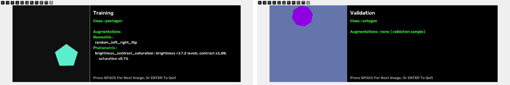
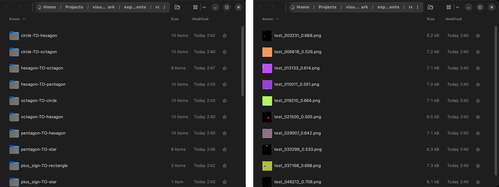
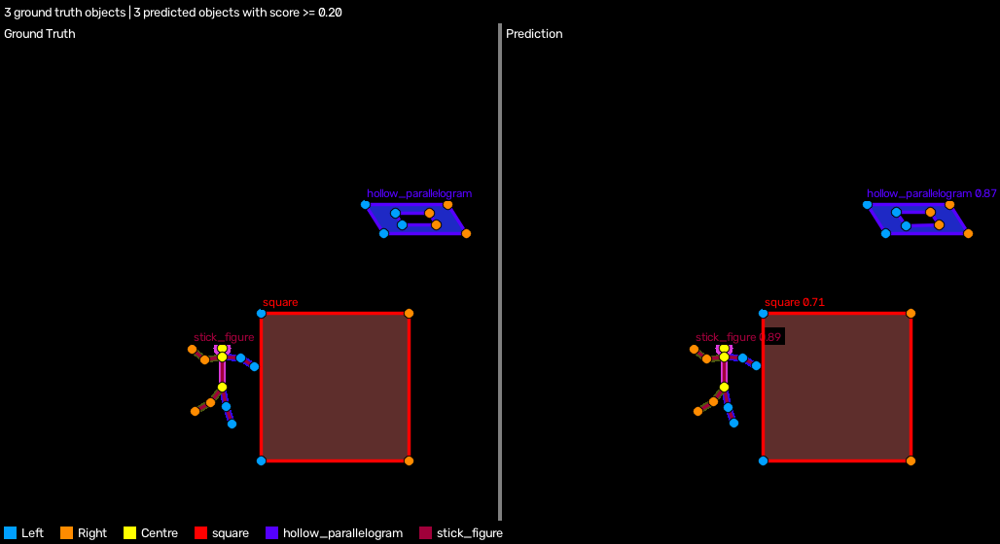
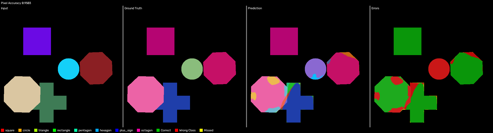
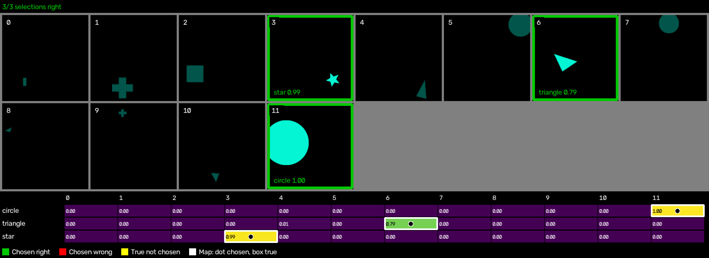
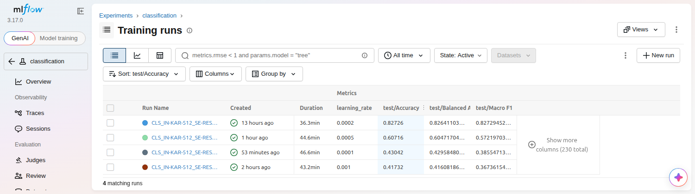

# Visual Language Model Spark

<p align="center">
  
</p>

## Table Of Content
- [Description](#description)
- [Prerequisites](#prerequisites)
  - [Package Requirements](#package-requirements)
  - [Data Requirements](#data-requirements)
- [Quick Start With Synthetic Data](#quick-start-with-synthetic-data)
- [Training](#training)
  - [Launching A Run](#launching-a-run)
  - [Run Folder](#run-folder)
  - [Console Output](#console-output)
  - [Stopping And Resuming](#stopping-and-resuming)
  - [Data Augmentation](#data-augmentation)
  - [Viewing The Input Images](#viewing-the-input-images)
  - [Checking The Anchor Coverage](#checking-the-anchor-coverage)
  - [TensorBoard Monitoring](#tensorboard-monitoring)
  - [Moving Average Of The Weights](#moving-average-of-the-weights)
- [Tasks](#tasks)
  - [Classification (CLS)](#classification-cls)
  - [Object Detection (DET)](#object-detection-det)
  - [Instance Segmentation (INS)](#instance-segmentation-ins)
  - [Keypoint Detection (KPT)](#keypoint-detection-kpt)
  - [Semantic Segmentation (SEG)](#semantic-segmentation-seg)
  - [Sequence Tasks (M2O, M2M, CMP, SEL)](#sequence-tasks-m2o-m2m-cmp-sel)
  - [Sequence Classification (M2O)](#sequence-classification-m2o)
  - [Sequence Labelling (M2M)](#sequence-labelling-m2m)
  - [Sequence Comparison (CMP)](#sequence-comparison-cmp)
  - [Frame Selection (SEL)](#frame-selection-sel)
  - [Self-Supervised Learning (SSL)](#self-supervised-learning-ssl)
- [Transfer Between Runs](#transfer-between-runs)
- [Evaluating Checkpoints](#evaluating-checkpoints)
- [Comparing Launches](#comparing-launches)
- [Clustering Image Embeddings](#clustering-image-embeddings)
- [Deployment](#deployment)
  - [Export](#export)
  - [Triton Server](#triton-server)
  - [Throughput Measurement](#throughput-measurement)
- [Configurations](#configurations)
- [Run Names](#run-names)
- [MLflow Tracking](#mlflow-tracking)
- [Tests](#tests)
- [Tutorials](#tutorials)
- [Repository Structure](#repository-structure)
- [TODO](#todo)

## Description
This repository trains, evaluates and exports PyTorch models for nine vision tasks, and pre-trains their shared backbone without labels with a tenth, self-supervised task. The tasks share the backbone (convolution blocks with optional residual, squeeze-and-excitation and inception modules), the training loop, the configuration format, the evaluation report and the export to Triton. Each task adds its own dataset, model head, losses and metrics.

| Code | Task | Input | Output | Model |
|---|---|---|---|---|
| CLS | `classification` | one image | one class (multi-class) or several classes (multi-label) | backbone, global pooling, fully connected head |
| DET | `object_detection` | one image | boxes with their class and score | backbone, region proposal and RoI Align detection heads on several backbone levels |
| INS | `instance_segmentation` | one image | the boxes of DET and the mask of every object | the detector of DET with a RoI Align mask head on every level |
| KPT | `keypoint_detection` | one image | the objects of the image with their class, keypoints and score | backbone stem, HRNet, heatmap and tag head (HigherHRNet), keypoints grouped by their tags |
| SEG | `semantic_segmentation` | one image | one class per pixel | backbone as the encoder of a U-Net decoder |
| M2O | `sequence_classification` | a sequence of frames | one class per sequence | backbone on every frame, temporal module, fully connected head |
| M2M | `sequence_labelling` | a sequence of frames | one class per frame | backbone on every frame, temporal module, head on every frame |
| CMP | `sequence_comparison` | a before and an after sequence | one class per pair | backbone on every frame, fusion of both members, temporal module, fully connected head |
| SEL | `frame_selection` | a sequence of frames | the frames of every wanted class | the model of M2M, Hungarian or greedy decoding |
| SSL | `self_supervised` | one unlabelled image (two random views of it) | a representation whose backbone initialises the other tasks | backbone, global pooling, projection head, SimCLR or Barlow Twins loss |

<p align="center">
  
</p>

This README gives the commands and the main settings. The details are in `documentation/`:
- [Training reference](documentation/reference/training_reference.md): run folder, console output, resuming, augmentation strengths, input viewer, moving average of the weights, transfer between runs.
- [Tasks reference](documentation/reference/tasks_reference.md): synthetic datasets, data format, converters, losses and metrics of every task.
- [Configuration reference](documentation/reference/configuration_reference.md): keys and values of every task, evaluation outputs, run name tokens, MLflow metrics.
- [Tools reference](documentation/reference/tools_reference.md): checkpoint evaluation, launch comparison, embedding clustering, export and Triton.
- [Task workflows](documentation/task%20workflows/): one run of every task followed function by function.

## Prerequisites

### Package Requirements
- Python 3.13+ and uv.
- An NVIDIA GPU with CUDA. Without one, the trainings fall back on the CPU, much slower.
- Docker with the NVIDIA container runtime, only to serve the exported models with Triton.

The Python packages are listed in `pyproject.toml`. To install them, run from the repository root:

```bash
uv sync
```

Every script is run as a module from the repository root. The training takes the path of its configuration file (`--configuration_path`, in the Script parameters of a PyCharm run configuration), the task being the one of the file. The other scripts have no command line arguments: their settings are the variables of their `if __name__ == "__main__":` block.

```bash
# Run a training from a configuration file, given by its path (absolute or relative to the current folder)
uv run python -m vision_training.main --configuration_path="vision_training/configurations/classification/configuration_synthetic_shapes.yaml"
```

### Data Requirements
Every task reads a train, a validation and a test split folder, each holding its images in `data/` and their labels in a `labels.json` manifest, and a `label_mapping.json` file giving the class of every category ([Tasks](#tasks)). To try the repository without a dataset, generate a synthetic one.

## Quick Start With Synthetic Data
Every task has a synthetic shapes dataset, generated and learned within minutes, to check the installation and a configuration before training on real data.

1. Open `vision_training/data/synthetic/create_synthetic_dataset.py`, set `task` and the output folder of that task in `output_folders` in its main block, then run:

```bash
# Generate the train, validation and test splits and the label_mapping.json file of the task
uv run python -m vision_training.data.synthetic.create_synthetic_dataset
```

2. In the synthetic configuration of the task (table below, in `vision_training/configurations/`), set `experiment_folder`, the three data folders and `Data.label_mapping.mapping_file_path` to the generated dataset.
3. Train with that configuration:

```bash
uv run python -m vision_training.main --configuration_path="vision_training/configurations/classification/configuration_synthetic_shapes.yaml"
```

| Task | Synthetic dataset | Configuration |
|---|---|---|
| CLS | one of 35 shapes per image | `classification/configuration_synthetic_shapes.yaml` |
| CLS (multi-label) | 5 to 10 shapes per image labelled with their distinct classes, drawn like the M2M frames to pretrain their backbone (`task = "multi_label_classification"`) | `classification/configuration_synthetic_counted_shapes.yaml` |
| DET | the INS dataset | `object_detection/configuration_synthetic_shapes.yaml` |
| INS | up to 6 shapes per image with their masks | `instance_segmentation/configuration_synthetic_shapes.yaml` |
| KPT | 2 to 4 objects per image (shapes, stick figure, house) with their keypoints | `keypoint_detection/configuration_synthetic_shapes.yaml` |
| SEG | up to 6 shapes per image with their class mask | `semantic_segmentation/configuration_synthetic_shapes.yaml` |
| M2O | one shape moving left, right, up or down over 2 to 12 frames | `sequence_classification/configuration_synthetic_sequences.yaml` |
| M2M | 5 to 10 shapes per frame, at most one appearing or disappearing per frame | `sequence_labelling/configuration_synthetic_sequences.yaml` |
| CMP | a before and an after member, the after one having lost a shape or not | `sequence_comparison/configuration_synthetic_pairs.yaml` |
| SEL | one shape per frame, the largest circle, triangle and star to select | `frame_selection/configuration_synthetic_sequences.yaml` |
| SSL | the CLS dataset, or 5 to 10 counted shapes per image | `self_supervised/configuration_synthetic_shapes.yaml`, `configuration_counted_shapes_simclr.yaml`, `configuration_counted_shapes_barlow_twins.yaml` |

The classes and shape rules of every dataset are in the [tasks reference](documentation/reference/tasks_reference.md#synthetic-datasets).

## Training

### Launching A Run
1. Copy the `configuration_example.yaml` of the task, in `vision_training/configurations/<task>/`, and fill it: `experiment_folder` (the root folder receiving the runs), the three data folders and the label mapping file. Every key is explained by its comment in the file.
2. Run the training with the path of the configuration file:

```bash
uv run python -m vision_training.main --configuration_path="vision_training/configurations/classification/my_configuration.yaml"
```

The configuration is checked before anything starts: a missing key, a value the task cannot use or an inconsistent combination stops the program with the list of every problem found. A setting removed from the configuration files, such as `resume_training` or `mixed_precision` now fixed in the code, is refused with a message naming what replaced it.

### Run Folder
A run is saved in `<experiment_folder>/<run name>/`, the run name being built from its settings ([Run Names](#run-names)):

```text
<experiment_folder>/<run name>/
├── training_configuration.yaml        # Copy of the configuration of the last start of the run
├── data.json                          # Classes counted in every split, data folder, SHA-256 of labels.json and images of every split
├── label_dictionary.json              # Class index of every category of the label mapping, the classes of the run
├── Weights/Iteration_<n>/model_<n>.pt # Weights, optimizer state, moving average of the weights and metadata of iteration n
├── Tensorboard/                       # Train, Validation, Test and Test_EMA curves
├── Results.txt                        # Report of every evaluated checkpoint
├── Evaluation/Iteration_<n>/          # Files of the evaluation of iteration n, EMA/ for the averaged weights
└── mlflow_run.json                    # MLflow run of the training, with the tracking on
```

A checkpoint is saved every `intermediate_weight_saving_iterations` iterations (0 saves none), and a checkpoint evaluated on the whole test split every `weight_saving_iterations` iterations. The full tree and the content of `data.json` are in the [training reference](documentation/reference/training_reference.md#run-folder).

### Console Output
At launch, the trainer prints the run name, its folders and files as clickable links, the settings and data changed since the last start of a resumed run, the components initialised by another run, every split with its number of samples and the summary of the model.

<p align="center">
  
</p>

Every `information_dump` iterations, it prints the averages of the interval: the samples seen, the throughput, the training and validation losses and metrics. A batch whose loading fails (e.g. an unreadable image) is dropped with a yellow warning, and the training goes on.

<p align="center">
  
</p>

Every `weight_saving_iterations` iterations, the checkpoint is evaluated on the test split, and its report is printed and appended to `Results.txt`: the global metrics, the notes and, with `evaluation.per_class_report`, the table of the classes sorted worst first, followed by the recall of every class with its 95% confidence interval, worst recall first (the bounds are also written to `class_metrics.csv`).

<p align="center">
  
</p>

### Stopping And Resuming
- Ctrl+C stops the training and saves a checkpoint of the last training step.
- Launching the same configuration again always resumes from the last checkpoint of its run folder, with its optimizer state. `number_iterations` is the total of the run, not the iterations left.
- The settings that give no run name token, such as the augmentation, batch size, learning rate and its schedule, gradient clipping, moving average of the weights and dropout rates, can change between two resumptions. The changed settings are printed, and the previous configuration is kept as `training_configuration_until_iteration_<n>.yaml`. Any other change gives another run name, so a new run folder.
- Changed labels (another SHA-256 of a `labels.json`) stop the resume, unless `ExperimentConfiguration.allow_data_change_on_resume` is true.
- To train the same settings from scratch, give the run another `run_name_suffix` or `experiment_folder`, or move its run folder away.
- A failing iteration is reported in yellow and the training goes on; more than 5 failing iterations in a row stop it, saving a checkpoint.

The rules of every case are in the [training reference](documentation/reference/training_reference.md#stopping-and-resuming).

### Data Augmentation
`Data.data_augmentation` augments the training images on the device right before the forward pass (`vision_training/data/augmentations.py`). `activated` turns it on, `probability` is the share of the training images augmented, and each of the 28 types has its own `activated` flag and `probability`. The strengths are hard-coded in `SUPERVISED_AUGMENTATION_STRENGTHS` and in the stronger `SELF_SUPERVISED_AUGMENTATION_STRENGTHS` of the SSL views. The geometric types move the boxes, masks and keypoints with the image; `random_perspective` and `random_jigsaw` move the image only and are refused for DET, INS, SEG and KPT.

The strength of every type is in the [training reference](documentation/reference/training_reference.md#data-augmentation). `scripts/data/visualize_augmentation_strengths.py` writes one figure per type to review them by eye:

```bash
uv run python -m scripts.data.visualize_augmentation_strengths
```

### Viewing The Input Images
`ExperimentConfiguration.diagnosis_modes.view_input_images: True` shows the training and validation samples as the network receives them, with their targets and the augmentations drawn for them with their values (the two views of every image for SSL). SPACE shows the next samples, ENTER exits without training. It needs a display and creates no run folder.

<p align="center">
  
</p>

### Checking The Anchor Coverage
`ExperimentConfiguration.diagnosis_modes.compute_anchor_coverage: { activated: True, iou_threshold: 0.5 }` (object detection and instance segmentation) prints, for the training, validation and test splits, the share of the objects whose best anchor overlaps them by at least `iou_threshold`, per detection level and object size, then exits without training. It reads the annotations only, with a progress bar per split, and creates no run folder.

### TensorBoard Monitoring
Start TensorBoard on the folder of a run and open http://localhost:6006:

```bash
uv run tensorboard --logdir <experiment_folder>/<run name>/Tensorboard
```

The `Train` and `Validation` curves are written every iteration, the `Test` scalars and sample images at every evaluation, and `Test_EMA` holds the same tags for the moving average of the weights.

<p align="center">
  
</p>

### Moving Average Of The Weights
`Optimization.exponential_moving_average` keeps a second copy of the model, moved towards the trained weights after every optimizer step:

```text
ema_weights = decay × ema_weights + (1 − decay) × current_weights
```

The average follows roughly the last 1 / (1 − decay) iterations, about 1,000 at 0.999. Every test evaluation scores the trained weights, then the averaged weights of the same checkpoint (`EMA Weights` report, `Evaluation/Iteration_<n>/EMA/`, `Test_EMA`). It gives no run name token, so it can be turned on or off when a run resumes. Details: [training reference](documentation/reference/training_reference.md#moving-average-of-the-weights).

## Tasks
A dataset is a folder per split, each holding its images in `data/` and a `labels.json` manifest. `label_mapping.json` maps every category identifier of the manifests to the class index predicted by the model:

```json
{"1": 0, "2": 1, "3": 1}
```

CLS, M2O, M2M, CMP and SEL predict the classes 0 to K-1; DET, INS, KPT and SEG predict 1 to K, class 0 being their background. Categories mapped to the same class are merged into it, and a category missing from the mapping is left out. The manifest format, converters, losses and metrics of every task are in the [tasks reference](documentation/reference/tasks_reference.md), and one run of every task is followed function by function in its [task workflow](documentation/task%20workflows/).

### Classification (CLS)
Predicts the class of an image (`ClassificationHead.output_mode: "multi_class"`, softmax) or every class present in it (`"multi_label"`, sigmoid). The manifest lists every image with its `category_id` (or `category_ids`). `vision_training/data/classification/class_folder_manifests.py` converts one folder of images per class without copying them, and `imagenet_download.py` downloads ImageNet-1k.
- **Configuration**: `classification/configuration_example.yaml`, with `ClassificationHead` (global pooling, fully connected layers and their normalization, label smoothing, class weighting, decorrelation of the hidden features) and the evaluation keys `target_precision`, `save_predictions` and `error_dumps`.
- **Evaluation**: accuracy, balanced accuracy, macro F1, top-5 accuracy, the precision, recall, F1, ROC AUC and average precision of every class, the confusion matrix, the score threshold of every class reaching `target_precision` (a number, or a list such as `[0.99, 0.95, 0.90]` giving the threshold and recall of every class at each precision, written on `precision_recall_thresholds.png`), and the misclassified images in `Errors/<TRUE>-TO-<PREDICTED>/`.

<p align="center">
  
</p>

<p align="center">
  
</p>

<p align="center">
  
</p>

Details: [reference](documentation/reference/tasks_reference.md#classification-cls) · [workflow](documentation/task%20workflows/classification_workflow.md)

### Object Detection (DET)
A two-stage detector predicting the box, class and score of every object, its region proposal and detection heads running on several backbone levels, read directly or through a feature pyramid or path aggregation neck. The splits hold a COCO `labels.json`, the boxes being `[x, y, width, height]` in pixels; `vision_training/data/data_retriever.py` downloads COCO 2017.
- **Configuration**: `object_detection/configuration_example.yaml`, with `DetectionLevels` (one entry per backbone block feeding a level, with its anchors, region proposal head and detection head), `Neck` (`none`, `feature_pyramid` or `path_aggregation` between the blocks and the heads), `RegionProposal`, `Detector`, `Optimization.loss_weights` and the evaluation keys `score_threshold`, `target_precision` and `error_dumps`.
- **Evaluation**: the mAP at IoU 0.5, 0.75, 0.95 and 0.5:0.95, the mAP and mean average recall by object size, the anchor and proposal recall, a confusion matrix with a `background` row and column, the score threshold of every class and the images of the false positives, missed objects and wrong classes.

<p align="center">
  
</p>

Details: [reference](documentation/reference/tasks_reference.md#object-detection-det) · [workflow](documentation/task%20workflows/object_detection_workflow.md)

### Instance Segmentation (INS)
The detector of DET with a mask head on every detection level, as in Mask R-CNN: every detection also gets the mask of its object. Every object of the COCO `labels.json` has a `segmentation` (polygons or run length encoding), its box being the tight box of its mask.
- **Configuration**: `instance_segmentation/configuration_example.yaml`, with the keys of DET, a `mask_head` in every level of `DetectionLevels`, the `MaskHead` section, the weight of the `mask_loss` and `evaluation.original_resolution`.
- **Evaluation**: the mask mAP and the box mAP of the same detections, at the network or the original resolution, with the size, recall, confusion and error outputs of DET. `Mask mAP@0.5/area` compares the checkpoints.

<p align="center">
  
</p>

Details: [reference](documentation/reference/tasks_reference.md#instance-segmentation-ins) · [workflow](documentation/task%20workflows/instance_segmentation_workflow.md)

### Keypoint Detection (KPT)
A bottom-up keypoint detector, as in HigherHRNet: the stem of the backbone, a high resolution network (`HRNet`) and a keypoint head giving one heatmap and one tag map per keypoint of every class, the keypoints being grouped into objects by their tags. Several classes can have different keypoints. The heatmaps are trained with the focal loss of CornerNet, the tags with the pull and push losses of associative embedding. Every object of the COCO `labels.json` has its `keypoints`, and every category its keypoint names and `skeleton`. The geometric augmentations keep the names of the keypoints, so the flips and rotations only suit keypoints whose names depend neither on the side nor on the orientation.
- **Configuration**: `keypoint_detection/configuration_example.yaml` (COCO persons, HigherHRNet-W32), with `HRNet`, `KeypointHead` and the evaluation keys `default_keypoint_sigma` and `keypoint_sigmas`. `Backbone` is the stem: 3 blocks, or 2 with `last_max_pooling: True`.
- **Evaluation**: the OKS mAP by size and per class (`OKS mAP@0.5/area` compares the checkpoints), the matched objects, PCK@0.05, the mean OKS and the mean keypoint error, per class and per keypoint.

<p align="center">
  
</p>

Details: [reference](documentation/reference/tasks_reference.md#keypoint-detection-kpt) · [workflow](documentation/task%20workflows/keypoint_detection_workflow.md)

### Semantic Segmentation (SEG)
A U-Net predicting the class of every pixel, the backbone being its encoder. Every split holds its images in `data/` and their masks in `masks/`: single-channel uint8 PNG files holding the category of every pixel, 0 for the background and 255 for the unlabelled pixels.
- **Configuration**: `semantic_segmentation/configuration_example.yaml`, with `SegmentationDecoder` (decoder levels, upsampling, deep supervision), `SegmentationLoss` (cross entropy, Dice, Lovász and boundary losses), `Data.tiling` (training on tiles of large images) and the evaluation keys `save_predicted_masks`, `original_resolution` and `boundary_tolerance`.
- **Evaluation**: mean IoU, mean Dice, boundary IoU and boundary F1, pixel accuracy, frequency weighted IoU, and the metrics, ROC AUC and average precision of every class.

<p align="center">
  
</p>

Details: [reference](documentation/reference/tasks_reference.md#semantic-segmentation-seg) · [workflow](documentation/task%20workflows/semantic_segmentation_workflow.md)

### Sequence Tasks (M2O, M2M, CMP, SEL)
Every sequence holds its frames in `data/<sequence name>/`, listed in order in `labels.json`. The backbone runs on every frame, then the temporal module (`TemporalModel.type`) combines them: `mean_pooling`, `max_pooling` and `attention_pooling` ignore their order, `gru`, `lstm`, `transformer` and `temporal_convolution` follow it. Every sequence is fed whole, a sequence longer than `Data.sequence_settings.maximum_sequence_length` being left out with a warning, and the batches are padded with masked black frames. `Data.data_augmentation.independent_frames` draws the photometric augmentations frame by frame, and `shuffle_frames` shuffles the frames of sequences whose order carries no information. Details: [reference](documentation/reference/tasks_reference.md#sequence-tasks-m2o-m2m-cmp-sel).

### Sequence Classification (M2O)
Predicts one class per sequence (many to one), every sequence giving its `category_id`.
- **Configuration**: `sequence_classification/configuration_example.yaml`, with `Data.sequence_settings`, `TemporalModel` (all 7 types) and `ClassificationHead`. A class given by a motion needs `ClassificationHead.global_pooling: flatten`, the other poolings removing the position of the objects.
- **Evaluation**: the metrics and files of CLS, computed on the sequences.

<p align="center">
  
</p>

Details: [reference](documentation/reference/tasks_reference.md#sequence-classification-m2o) · [workflow](documentation/task%20workflows/sequence_classification_workflow.md)

### Sequence Labelling (M2M)
Predicts one class per frame (many to many), every sequence giving the category of each frame in `frame_category_ids`. With `TemporalModel.causal: True`, every frame only sees the frames before it, as in a live stream.
- **Configuration**: `sequence_labelling/configuration_example.yaml`, with the keys of M2O and the temporal types `gru`, `lstm`, `transformer` and `temporal_convolution` only.
- **Evaluation**: the metrics of CLS on the frames, the sequence exact match, and the segment metrics scoring the events: the edit score and the segment F1@10, @25 and @50.

<p align="center">
  
</p>

Details: [reference](documentation/reference/tasks_reference.md#sequence-labelling-m2m) · [workflow](documentation/task%20workflows/sequence_labelling_workflow.md)

### Sequence Comparison (CMP)
Predicts one class per pair of a `before` and an `after` sequence, e.g. whether an object was lost between two visits. Both members go through the same backbone and temporal module, and `Fusion.type` combines them (`concatenation`, `difference` or `cross_attention`). `vision_training/data/sequence/pair_list_manifests.py` converts pair list files.
- **Configuration**: `sequence_comparison/configuration_example.yaml`, with the keys of M2O and `Fusion`.
- **Evaluation**: the metrics and files of CLS, computed on the pairs.

<p align="center">
  
</p>

Details: [reference](documentation/reference/tasks_reference.md#sequence-comparison-cmp) · [workflow](documentation/task%20workflows/sequence_comparison_workflow.md)

### Frame Selection (SEL)
Chooses in every sequence the `Selection.frames_per_class` frames of every wanted class, the other frames being unselected (`Selection.unselected_category`), e.g. the sharpest view of each side of an object. The model of M2M is trained with the per-frame loss and a selection loss, and its probabilities are decoded by the `hungarian` assignment or the `greedy` rule.
- **Configuration**: `frame_selection/configuration_example.yaml`, with the keys of M2M and `Selection`.
- **Evaluation**: the selection accuracy of both decodings, the fully right sequences, the top-k selection accuracy and mean rank of the true frames, the frame metrics before decoding and `selections.csv`. The export adds a Triton decoder running the decoding.

<p align="center">
  
</p>

Details: [reference](documentation/reference/tasks_reference.md#frame-selection-sel) · [workflow](documentation/task%20workflows/frame_selection_workflow.md)

### Self-Supervised Learning (SSL)
Trains the backbone without labels: two random views of every image (`Data.data_augmentation` at the self-supervised strengths) go through the backbone, the global pooling and a projection head, and the loss pulls the two views of an image together, with SimCLR (InfoNCE) or Barlow Twins (`ProjectionHead.method`). The data has the layout of CLS, its categories only serving the evaluation. `Data.grouped_batches` builds the batches from groups of related images given by the `groups` of every sample, so that their negatives are harder.
- **Configuration**: `self_supervised/configuration_example.yaml` (Barlow Twins), with `ProjectionHead`, `Data.grouped_batches` and the evaluation key `number_neighbours`.
- **Evaluation**: without training any classifier, the k-NN accuracy of the labelled test images, the effective rank and the standard deviation of the representations, which fall when they collapse.

A run of any task then loads the backbone with `Backbone.pretrained` ([Transfer Between Runs](#transfer-between-runs)).

Details: [reference](documentation/reference/tasks_reference.md#self-supervised-learning-ssl) · [workflow](documentation/task%20workflows/self_supervised_workflow.md)

## Transfer Between Runs
A component of a trained run initialises the same component of a new run, of the same task or of another one, through the `pretrained` block of its section:

| Section | Component | From the tasks |
|---|---|---|
| `Backbone` | backbone | any task |
| `TemporalModel` | temporal module | M2O, M2M, CMP, SEL |
| `ClassificationHead` | classification head, with its class layer | CLS, M2O, M2M, CMP, SEL |
| `SegmentationDecoder` | U-Net decoder, with its class layers when `load_class_layers` is True | SEG |
| `RegionProposal` | region proposal heads of every detection level | DET, INS |
| `Detector` | detection heads of every detection level, with their classification and box regression layers | DET, INS |
| `MaskHead` | mask heads of every detection level, with their mask prediction layers | INS |

The heads of the detection tasks read the levels after the neck, which is not transferable, so they only move between runs whose `Neck.type` is `none`.

For example, a backbone trained on ImageNet classification initialises a detector, a segmenter or a sequence model:

```yaml
Backbone:
  pretrained:
    # Run folder whose trained backbone initialises this run
    experiment_folder: "/path/to/experiments/CLS_IN-KAR-256_SE-RES-BN-B1x64.2x64.2x64.4x64.5x64.5x64_HFLAT.512.256-CWB_MC1000"
    # Checkpoint iteration of that run, null for its last saved checkpoint
    iteration: null
    # Keeps the loaded backbone fixed, only the other components learn
    freeze: False
    # Keeps the scale and shift of its normalization layers fixed while its convolutions learn
    freeze_normalization_parameters: False
    # Fine-tunes the loaded backbone ten times slower than the new layers
    learning_rate_multiplier: 0.1
```

The settings defining the layers of the component must be identical in both runs, which is checked before the training starts; the image size may differ. The averaged weights of the source are loaded when both runs keep a moving average of the weights. A component with class layers can also initialise a run with more classes, the classes of the source run coming first in the same order. Details: [training reference](documentation/reference/training_reference.md#transfer-between-runs).

## Evaluating Checkpoints
`scripts/evaluation/evaluate_checkpoint.py` evaluates the checkpoints of a trained run again, e.g. on another labelled split or with a larger batch size, without modifying the run folder. Set `run_name`, `experiment_folder`, `iteration` (`None` for the last checkpoint, an iteration, or `"all"`), `test_data_folder`, `batch_size`, `track_evaluation`, `maximum_error_images_per_class_pair` and `output_folder` in its main block, then run:

```bash
uv run python -m scripts.evaluation.evaluate_checkpoint
```

It writes `Results.txt`, `Tensorboard/Test` and `Evaluation/` in `<output_folder>/<run name>/`. With `iteration = "all"`, `Evaluation/evaluation_summary.csv` compares every checkpoint and the best one is printed. For a classifier, a temperature dividing the class logits before the softmax spreads probabilities squeezed against 1: choose it on `Evaluation/Iteration_<n>/temperature_explorer.html`, opened with `scripts/evaluation/serve_temperature_explorer.py`, whose save button writes the thresholds at that temperature next to the page. Details: [tools reference](documentation/reference/tools_reference.md#evaluating-checkpoints).

## Comparing Launches
- `scripts/evaluation/collect_experiment_results.py` gathers the test curve and the swept settings of the `run_<n>` launches of a hyperparameter experiment into one CSV file, the launches of the same settings followed by a `mean` row.
- `scripts/evaluation/compare_best_evaluations.py` prints Markdown tables of the best test evaluation of runs, over the trained and the averaged weights, with chosen curves, settings and class counts.

```bash
uv run python -m scripts.evaluation.collect_experiment_results
uv run python -m scripts.evaluation.compare_best_evaluations
```

Their settings: [tools reference](documentation/reference/tools_reference.md#comparing-launches).

## Clustering Image Embeddings
`scripts/embedding/cluster_image_embeddings.py` embeds the images of datasets with a trained run and clusters them (HDBSCAN, DBSCAN or k-means after a PCA), to choose diverse images from a dataset of video frames, many of them nearly identical. It stores the features of the asked convolution blocks and hidden layers, which a relaunch reuses, and writes for every layer the clusters, their mosaics and three folders of kept images to compare: chosen by the clustering, drawn at random, and spread evenly over the groups of `group_pattern`.

```bash
uv run python -m scripts.embedding.cluster_image_embeddings
```

Its settings and outputs: [tools reference](documentation/reference/tools_reference.md#clustering-image-embeddings).

## Deployment

### Export
`vision_training/deployment/export_model.py` exports a trained run to the Triton model repository as TorchScript and ONNX, writes the Triton configuration of every model and checks every export against the PyTorch model. Set `experiment_folder`, `iteration`, `use_averaged_weights`, `formats`, `maximum_batch_size`, `tensorrt_precision` (`"FP16"`, `"FP32"`, or `None` for ONNX Runtime CUDA only) and, for a classifier, `use_saved_temperature` (builds the temperature saved from the temperature explorer of the exported checkpoint into the model, with its thresholds) in its main block, then run:

```bash
uv run python -m vision_training.deployment.export_model
```

The models are written to `vision_training/deployment/triton/served_models/<model name>_<format>/<version>/` with their `config.pbtxt`:

| Task | Model name | Inputs | Outputs |
|---|---|---|---|
| CLS | `image_classifier` | `images` [B, 3, S, S] | `class_probabilities` [B, K] |
| DET | `object_detector` | `images` [B, 3, S, S] | `detection_boxes` [B, D, 4], `detection_scores` [B, D], `detection_labels` [B, D], `number_detections` [B] |
| INS | `instance_segmenter` | `images` [B, 3, S, S] | the outputs of DET, then `detection_masks` [B, D, M, M] |
| KPT | `keypoint_detector` | `images` [B, 3, S, S] | `candidate_positions` [B, C, N, 2], `candidate_scores` [B, C, N], `candidate_tags` [B, C, N] |
| SEG | `semantic_segmenter` | `images` [B, 3, S, S] | `class_map` [B, S, S], `class_probabilities` [B, K, S, S] |
| M2O | `sequence_classifier` | `images` [B, T, 3, S, S] | `class_probabilities` [B, K] |
| M2M | `sequence_labeller` | `images` [B, T, 3, S, S] | `class_probabilities` [B, T, K] |
| CMP | `sequence_comparator` | `before_images`, `after_images` [B, T, 3, S, S] | `class_probabilities` [B, K] |
| SEL | `frame_selector` | `images` [B, T, 3, S, S] | `class_probabilities` [B, T, K] |

S is `Data.image_settings.size`, K the number of classes, D the largest number of detections per image, M `MaskHead.mask_resolution`, T the number of frames (1 to `maximum_sequence_length`, the CMP members may differ), C the heatmap channels and N the candidates of every channel (`KeypointHead.inference.maximum_candidates`). The inputs are float32 BGR images in [0, 255], resized and padded like the data loaders do; the input normalization is part of the exported model. The post-processing run by the client (SEG at the original resolution, INS masks, KPT grouping) and the SEL decoder and ensembles are in the [tools reference](documentation/reference/tools_reference.md#export).

### Triton Server
Start the Triton server from the folder of its compose file, and keep it running:

```bash
cd vision_training/deployment/triton
docker compose up
```

It serves every model of `served_models/`, on the ports 8000 (HTTP, health check with `curl localhost:8000/v2/health/ready`), 8001 (gRPC) and 8002 (metrics).

### Throughput Measurement
`vision_training/deployment/run_inference.py` sends the images of `vision_training/deployment/inference_data/` to the model of a run, in this process and through Triton (TorchScript, then ONNX with TensorRT), and prints the throughput of each. Set the run folder in its main block, then run:

```bash
uv run python -m vision_training.deployment.run_inference
```

<p align="center">
  
</p>

## Configurations
Every task has a `configuration_example.yaml` and a `configuration_synthetic_*.yaml` in `vision_training/configurations/<task>/`, with the same keys. A configuration file holds only the keys its task reads, every one of them required, so a new run starts from a copy of the file of its task. Every key is explained by its comment in the file.

`Data.image_settings.size` must be a positive even integer and a multiple of 2 to the power of the number of max poolings of `Backbone`, so that no pooling drops a row or a column: with 5 poolings, 96, 224, 384 and 512 are accepted.

The keys of every task and the values they accept are tabled in the [configuration reference](documentation/reference/configuration_reference.md#configurations).

## Run Names
The run name is built from the configuration by `vision_training/configuration_processing/run_name.py`, so that the same settings resume in the same folder and changed settings start a new one. It is made of sections joined with `_`, the tokens of a section being joined with `-`. The settings that can change between two resumptions give no token, such as the augmentation, batch size, learning rate and its schedule, gradient clipping, moving average of the weights, dropout rates and loss weights. `ExperimentConfiguration.run_name_suffix` (letters, digits, `-` and `.`) ends the name, to start a run of its own with the same settings.

| Task | Run name |
|---|---|
| DET | `DET_IN-KAR-1024_SE-RES-BN-B1x16.2x32.2x32.4x64.4x64.6x128.6x128_L567_A9.32-512.598295_RBN-R2x64_DSE-DRES-DBN-D7.2x64.256.128_BIN` |
| INS | `INS_IN-KAR-1024_SE-RES-BN-B1x16.2x32.2x32.4x64.4x64.6x128.6x128_L567_A9.32-512.598295_RBN-R2x64_DSE-DRES-DBN-D7.2x64.256.128_MRES-MBN-MUTC-M14.4x64-MR28_BIN` |
| CLS | `CLS_IN-KAR-512_SE-RES-BN-B1x16.2x32.2x32.2x64.2x64.2x128_HAVG.128_MC4` |
| M2O | `M2O_IN-KAR-512_SE-RES-BN-B1x16.2x32.2x32.2x64.2x64_T8_GRU1x128-BI_HFLAT.64_MC4` |
| CMP | `CMP_IN-KAR-512_SE-RES-BN-B1x16.2x32.2x32.2x64.2x64_T8_MEAN_FDIF_HAVG.64_MC2` |
| SEG | `SEG_IN-KAR-512_SE-RES-BN-B1x16.2x32.2x32.2x64.2x64.2x128_UTC-DBN-D2x64.2x64.2x32.2x32.1x16_MC9` |
| SEL | `SEL_IN-KAR-256_SE-RES-BN-B1x16.2x32.2x32.2x64.2x64_T12_GRU1x128-BI_HAVG.64_MC4_FPC1-SLW1` |
| SSL | `SSL_IN-KAR-256_SE-RES-BN-B1x16.2x32.2x32.2x64.2x64.2x128_PAVG.512.128-PBN_SIMCLR-T0.2` |
| KPT | `KPT_IN-KAR-512_SE-RES-BN-B1x64.2x64.2x64_HRSE-HRRES-HRBN-HR32.1.4.3x4_K17-HH_MC1` |

Every token and the settings giving none are listed in the [configuration reference](documentation/reference/configuration_reference.md#run-names).

## MLflow Tracking
With `ExperimentConfiguration.tracking.activated: True`, every training run is recorded in `<experiment_folder>/mlflow.db` and its files in `<experiment_folder>/mlartifacts/`, next to TensorBoard and `Results.txt`: its configuration and git commit, its curves averaged every `information_dump` iterations, and its test metrics and evaluation files. A resumed training continues the same MLflow run, and an unavailable database only prints a warning. To browse the runs, start the interface and open http://localhost:5000:

```bash
uv run mlflow ui --backend-store-uri sqlite:///<experiment_folder>/mlflow.db
```

<p align="center">
  
</p>

The per-iteration curves stay in TensorBoard, and the checkpoints and images are not sent. The metrics and files logged for every task are in the [configuration reference](documentation/reference/configuration_reference.md#mlflow-tracking).

## Tests
The tests are in `tests/`, in folders mirroring `vision_training/` and `scripts/`. They include short trainings of every task on tiny synthetic datasets. To run them all:

```bash
uv run pytest tests
```

## Tutorials
Narrated tutorial videos of the repository, an overview video, a foundations series then one series per task, are rebuilt from the storyboards, figure scripts and builder of `tutorials/`, the videos being written outside the repository (`~/Data/tutorial_videos` by default). `tutorials/README.md` describes the build, its options and how to write a chapter:

```bash
# Rebuild every series, or one, or only check the storyboards against the repository
tutorials/build_tutorials.sh
tutorials/build_tutorials.sh --series object_detection
tutorials/build_tutorials.sh --check-references
```

## Repository Structure

```text
.
├── README.md                          # This documentation file
├── README/                            # Images used in the documentation
├── pyproject.toml                     # Project package and dependency configuration
├── uv.lock                            # Locked dependencies for reproducible environments
├── documentation/                     # Notes kept next to the code
│   ├── architecture_benchmarking/     # Classification experiment plan and results of all its launches
│   ├── reference/                     # Details of the training, the tasks, the configurations and the tools
│   ├── task workflows/                # One run of every task followed function by function
│   ├── self_supervised.md             # State of the self-supervised task: tests, export checks, trainings to run
│   └── suggestions.md                 # Proposed improvements, repository audit, foundation model data downloader
├── vision_training/                   # Training framework
│   ├── main.py                        # Entry point of the trainings
│   ├── configurations/                # Example and synthetic configuration of every task
│   ├── configuration_processing/      # Loading, checks, run names and comparison of the configurations
│   ├── core/                          # Task registry and contracts shared by the tasks
│   ├── data/                          # Datasets, loaders, preprocessing, augmentation, label mapping
│   │   ├── classification/            # Classification dataset (every image kept for the self-supervised task), class folder converter, ImageNet download
│   │   ├── detection/                 # COCO dataset, decoding of the COCO segmentations into instance masks
│   │   ├── keypoints/                 # Keypoint categories, heatmap and tag targets
│   │   ├── segmentation/              # Segmentation dataset
│   │   ├── sequence/                  # Sequence and pair datasets, pair list converter
│   │   └── synthetic/                 # Synthetic shapes datasets of every task
│   ├── models/                        # Backbone, task models, components and transfer between runs
│   ├── losses/                        # Losses of every task
│   ├── trainers/                      # Base trainer, trainer of every task, checkpoints, metric tracking, moving average of the weights
│   ├── evaluation/                    # Metrics, reports and checkpoint evaluation
│   ├── tracking/                      # MLflow tracking
│   ├── deployment/                    # Export, Triton configuration and server, frame selection decoder, throughput measurement
│   └── utilities/                     # File, tensor, mask morphology and visualization helpers
├── scripts/                           # Checkpoint evaluation, launch comparison and image embedding clustering scripts
│   ├── configuration_processing/      # Removal of the fixed settings from the configuration files written before
│   ├── data/                          # Random subset of the sequences of a split, figures of the augmentation strengths
│   ├── embedding/                     # Clustering of the image embeddings of a run, kept diverse images
│   └── evaluation/                    # Checkpoint evaluation, launch comparison, best evaluations of runs
├── tests/                             # Tests, mirroring vision_training/ and scripts/
└── tutorials/                         # Narrated tutorial videos: storyboards, builder and figure scripts
```

## TODO
