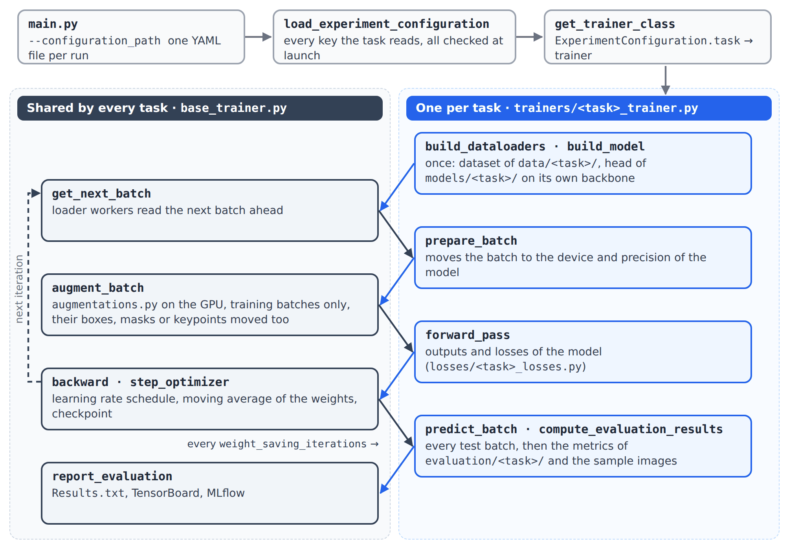
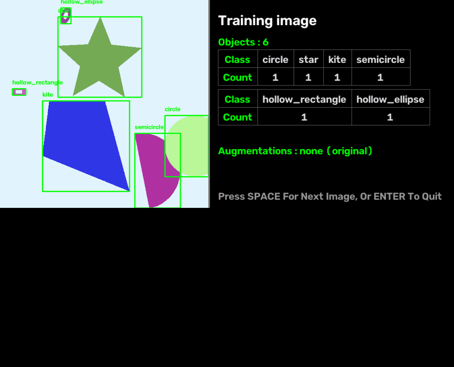
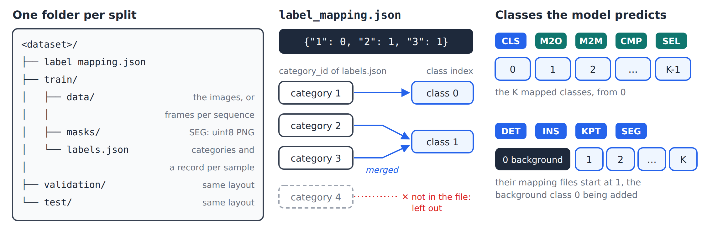
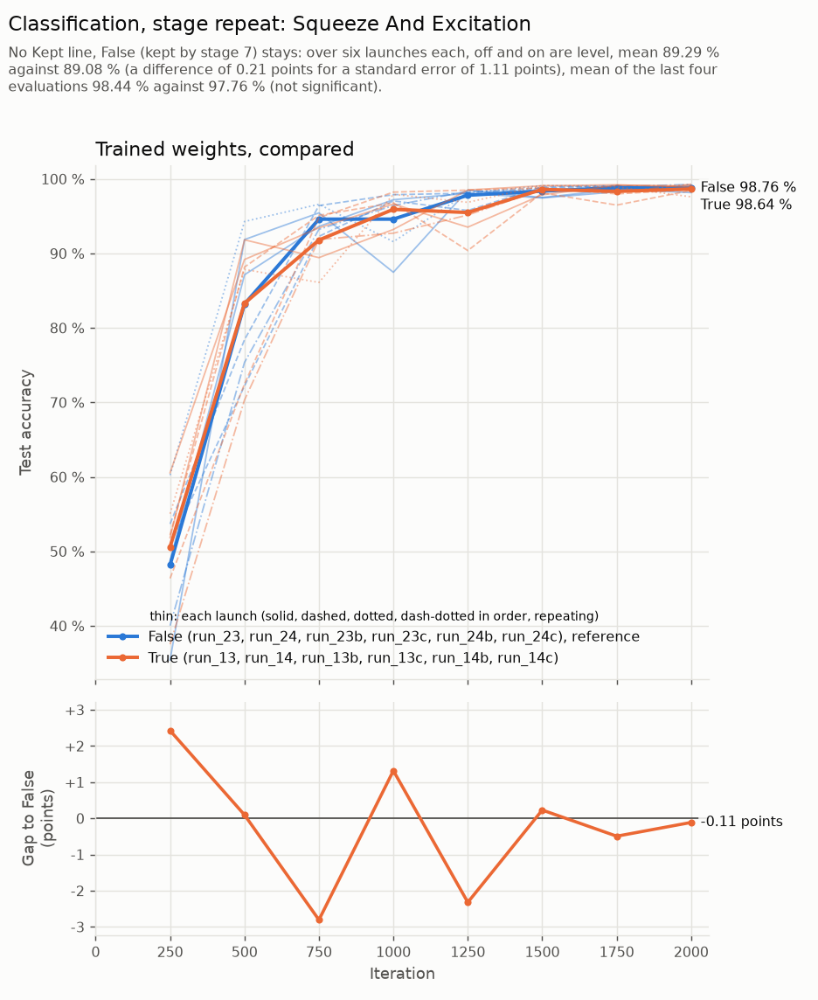
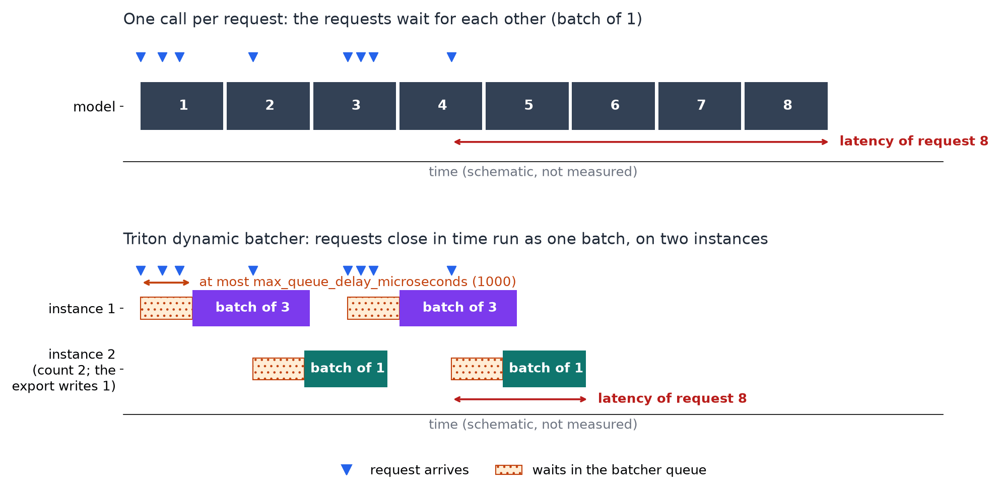
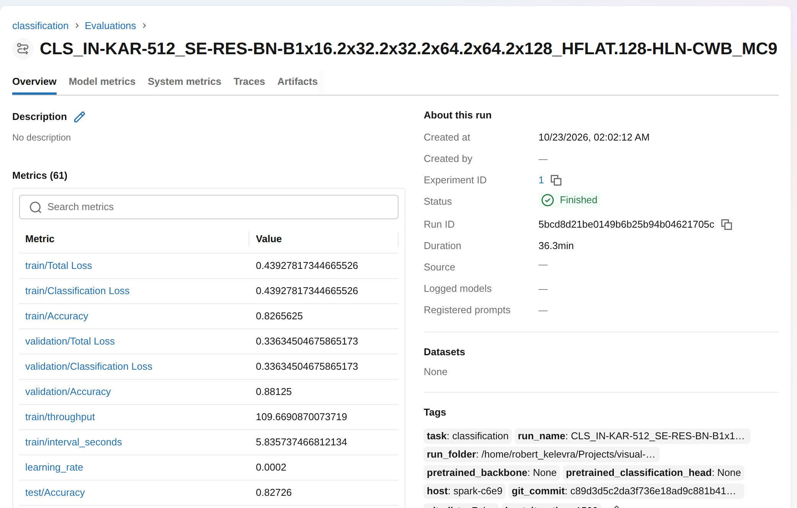

# Visual Language Model Spark

<p align="center">
  
</p>
<p align="center"><em>One evaluation sample image of every supervised task, from short runs on the synthetic datasets.</em></p>

## Table Of Content
- [Description](#description)
- [Prerequisites](#prerequisites)
  - [Package Requirements](#package-requirements)
  - [Data Requirements](#data-requirements)
- [Quick Start With Synthetic Data](#quick-start-with-synthetic-data)
- [Training](#training)
  - [Launching A Run](#launching-a-run)
  - [Run Folder](#run-folder)
  - [Stopping And Resuming](#stopping-and-resuming)
  - [Console And TensorBoard](#console-and-tensorboard)
  - [Augmentation And Diagnosis Modes](#augmentation-and-diagnosis-modes)
  - [Moving Average Of The Weights](#moving-average-of-the-weights)
- [Tasks](#tasks)
- [Transfer Between Runs](#transfer-between-runs)
- [Evaluating Checkpoints](#evaluating-checkpoints)
- [Comparing Launches](#comparing-launches)
- [Clustering Image Embeddings](#clustering-image-embeddings)
- [Deployment](#deployment)
  - [Export](#export)
  - [Input Contract](#input-contract)
  - [Triton Server](#triton-server)
  - [Serving Formats And Precision](#serving-formats-and-precision)
- [Configurations](#configurations)
- [Run Names](#run-names)
- [MLflow Tracking](#mlflow-tracking)
- [Tests](#tests)
- [Docker Image](#docker-image)
  - [Building The Image](#building-the-image)
  - [Running A Training](#running-a-training)
  - [Kubernetes Pods](#kubernetes-pods)
- [Tutorials](#tutorials)
- [Repository Structure](#repository-structure)
- [TODO](#todo)

## Description
If you are new to the repository, start from its tasks: it trains, evaluates and exports PyTorch models for nine vision tasks, plus a self-supervised task that pre-trains a backbone the other tasks can load. All tasks use the same backbone design (convolution blocks with optional residual, squeeze-and-excitation and inception modules), each run training its own weights unless it loads pre-trained ones, and share the training loop, the configuration format, the evaluation report and the export to Triton; each adds its own dataset, head, losses and metrics.

| Code | Task | Input | Output | Model |
|---|---|---|---|---|
| CLS | `classification` | one image | one class (multi-class) or several classes (multi-label) | backbone, global pooling, fully connected head |
| DET | `object_detection` | one image | boxes with their class and score | backbone, region proposal and RoI Align detection heads on several backbone levels |
| INS | `instance_segmentation` | one image | the boxes of DET and the mask of every object | the detector of DET with a RoI Align mask head on every level |
| KPT | `keypoint_detection` | one image | the objects of the image with their class, keypoints and score | backbone stem, HRNet, heatmap and tag head (HigherHRNet), keypoints grouped by their tags |
| SEG | `semantic_segmentation` | one image | one class per pixel | backbone as the encoder of a U-Net decoder |
| M2O | `sequence_classification` | a sequence of frames | one class per sequence | backbone on every frame, temporal module, fully connected head |
| M2M | `sequence_labelling` | a sequence of frames | one class per frame | backbone on every frame, temporal module, head on every frame |
| CMP | `sequence_comparison` | a before and an after sequence | one class per pair | backbone on every frame, fusion of both members, temporal module, fully connected head |
| SEL | `frame_selection` | a sequence of frames | the frames of every wanted class | the model of M2M, Hungarian or greedy decoding |
| SSL | `self_supervised` | one unlabelled image (two random views of it) | a representation whose backbone initialises the other tasks | backbone, global pooling, projection head, SimCLR or Barlow Twins loss |

<p align="center">
  
</p>

Should you need to change what a task computes, the code splits the same way: `base_trainer.py` runs the loop of every task, and the trainer of the task, picked from `ExperimentConfiguration.task` by `vision_training/core/task_registry.py`, fills its hooks.

<p align="center">
  
</p>

This README gives the commands and the settings that matter most. The details are in `documentation/`:
- [Training reference](documentation/reference/training_reference.md): run folder, console output, resuming, augmentation strengths, input viewer, moving average of the weights, transfer between runs.
- [Tasks reference](documentation/reference/tasks_reference.md): synthetic datasets, data format, converters, losses and metrics of every task.
- [Configuration reference](documentation/reference/configuration_reference.md): keys and values of every task, evaluation outputs, run name tokens, MLflow metrics.
- [Tools reference](documentation/reference/tools_reference.md): checkpoint evaluation, launch comparison, embedding clustering, export, input contract and Triton.
- [Pretraining reference](documentation/reference/pretraining_reference.md): download of ImageNet-22k, on which the classification configurations pre-train the backbones, and its validation and test splits.
- Task workflows: one run of every task followed function by function, such as the [classification](documentation/task%20workflows/classification_workflow.md) and [object detection](documentation/task%20workflows/object_detection_workflow.md) workflows; the Details column of the [Tasks](#tasks) table links the workflow of every task.

## Prerequisites

### Package Requirements
Before running any script, install Python 3.13+ and uv. An NVIDIA GPU with CUDA is expected (the CPU fallback is much slower), and Docker with the NVIDIA container runtime is only needed to serve the exported models with Triton and to train in the [Docker image](#docker-image).

```bash
uv sync
```

Besides the dependencies, `uv sync` installs the `dev` group (pytest) and the `datasets` group (FiftyOne, for `data_retriever.py`), both left out of the Docker image.

Every script runs as a module from the repository root. The training takes `--configuration_path`, the task being read from the file; the other scripts take no arguments, their settings being the variables of their `if __name__ == "__main__":` block.

<p align="center">
  
</p>

### Data Requirements
For a task to train, it needs a train, a validation and a test split folder, each holding its images in `data/` and a `labels.json` manifest, and a `label_mapping.json` file giving the class of every category ([Tasks](#tasks)). The [synthetic datasets](#quick-start-with-synthetic-data) need none of this.

<p align="center">
  
</p>

Should the backbones of classification, object detection or segmentation start from pre-trained weights, the [pretraining reference](documentation/reference/pretraining_reference.md) describes the download of ImageNet-22k, on which the classification configurations train the backbones the other tasks load.

## Quick Start With Synthetic Data
In order to check the installation or a configuration within minutes, every task has a synthetic shapes dataset:
1. Set `task` and its folder in `output_folders` in the main block of `vision_training/data/synthetic/create_synthetic_dataset.py`, then run `uv run python -m vision_training.data.synthetic.create_synthetic_dataset`.
2. Point `experiment_folder`, the three data folders and `Data.label_mapping.mapping_file_path` of the synthetic configuration of the task (table below, in `vision_training/configurations/`) to the generated dataset.
3. Train with that configuration:

```bash
uv run python -m vision_training.main --configuration_path="vision_training/configurations/classification/configuration_synthetic_shapes.yaml"
```

| Task | Synthetic dataset | Configuration |
|---|---|---|
| CLS | one of 35 shapes per image | `classification/configuration_synthetic_shapes.yaml` |
| CLS (multi-label) | 5 to 10 shapes per image labelled with their distinct classes (`task = "multi_label_classification"`) | `classification/configuration_synthetic_counted_shapes.yaml` |
| DET | the INS images (`task = "object_detection"` generates the harder images of the detection benchmark) | `object_detection/configuration_synthetic_shapes.yaml` |
| INS | up to 6 shapes per image with their masks | `instance_segmentation/configuration_synthetic_shapes.yaml` |
| KPT | 2 to 5 objects per image (shapes, stick figure, house) with their keypoints | `keypoint_detection/configuration_synthetic_shapes.yaml` |
| SEG | up to 6 shapes per image with their class mask | `semantic_segmentation/configuration_synthetic_shapes.yaml` |
| M2O | one shape moving left, right, up or down over 2 to 12 frames | `sequence_classification/configuration_synthetic_sequences.yaml` |
| M2M | 5 to 10 shapes per frame, at most one appearing or disappearing per frame | `sequence_labelling/configuration_synthetic_sequences.yaml` |
| CMP | a before and an after member, the after one having lost a shape or not | `sequence_comparison/configuration_synthetic_pairs.yaml` |
| SEL | one shape per frame, the largest circle, triangle and star to select | `frame_selection/configuration_synthetic_sequences.yaml` |
| SSL | the CLS dataset, or 5 to 10 counted shapes per image | `self_supervised/configuration_synthetic_shapes.yaml`, `configuration_counted_shapes_simclr.yaml`, `configuration_counted_shapes_barlow_twins.yaml` |

<p align="center">
  
</p>
<p align="center"><em>Samples written by <code>create_synthetic_dataset.py</code>, drawn with their <code>labels.json</code> labels; the sequence tiles play their frames.</em></p>

## Training

### Launching A Run
Once a dataset is ready, copy the `configuration_example.yaml` of the task (`vision_training/configurations/<task>/`), fill `experiment_folder`, the three data folders and the label mapping file (every key is explained by its comment), and run:

```bash
uv run python -m vision_training.main --configuration_path="vision_training/configurations/classification/my_configuration.yaml"
```

The configuration is checked before anything starts: a missing key, an unusable value, an inconsistent combination or a removed setting (such as `resume_training`) stops the program with the list of every problem found.

<p align="center">
  
</p>
<p align="center"><em>The run name decides the folder, and the last checkpoint of that folder decides between a new run and a resume.</em></p>

### Run Folder
Whenever a training starts, it writes to `<experiment_folder>/<run name>/`, the name being built from its settings ([Run Names](#run-names)):

```text
<experiment_folder>/<run name>/
├── training_configuration.yaml        # Configuration of the last start of the run
├── data.json                          # Class counts, data folder and SHA-256 of labels.json and images of every split
├── label_dictionary.json              # Class index of every category, the classes of the run
├── Input_Samples/                     # First 10 samples of every split as fed to the network, and samples.json
├── Weights/Iteration_<n>/model_<n>.pt # Weights, optimizer state, moving average of the weights, metadata
├── Tensorboard/                       # Train, Validation, Test and Test_EMA curves
├── Results.txt                        # Report of every evaluated checkpoint
├── evaluation_curves.png              # Headline metric of every evaluation, drawn again after each one
├── Evaluation/evaluation_summary.csv  # Every test scalar of every evaluated iteration, one row each
├── Evaluation/Iteration_<n>/          # Evaluation files of iteration n, EMA/ for the averaged weights
├── Checkpoint_Evaluation/             # Evaluations of scripts/evaluation/evaluate_checkpoint.py, with the
│                                      # Report_Figures/ of scripts/evaluation/draw_report_figures.py
└── mlflow_run.json                    # MLflow run of the training, with the tracking on
```

So that the test results of a run can be followed at a glance, without TensorBoard, every evaluation adds the row of its iteration to `Evaluation/evaluation_summary.csv` (every test scalar, those of the averaged weights in `ema_` columns with their number of updates in `ema_number_updates`, a checkpoint evaluated again replacing its row) and draws `evaluation_curves.png` again from it: the headline metric of `Results.txt` for the trained and the averaged weights against the iteration, the best iteration of each ringed with its value and, with the moving average on, the iterations the averaged weights of the highest evaluated iteration look back over shaded up to it, 1/(1 − d) for the decay d of their last update given by their number of updates, with the configured 1/(1 − decay) in grey behind it while the warm-up still lowers d. Both files are sent to MLflow when the tracking is on. A run evaluated before these files existed starts its summary at its next evaluation from its TensorBoard test curves, whose values TensorBoard keeps in float32.

To be able to check afterwards what a run was fed, without a display, every launch that trains writes `Input_Samples/` before its first iteration: the first 10 samples of every split by identifier, the same at every launch, drawn as the input viewer draws them into `Training/`, `Validation/` and `Test/` (`sample_00.png` to `sample_09.png`), the training ones augmented on the device as the training step augments them, with `samples.json` giving the source file or sequence, the labels drawn, the augmentations and the input size of each. A resumed run keeps the folder unless its configuration or data changed, the previous one being then kept as `Input_Samples_until_iteration_<n>`; a training without validation loader has no `Validation/`, and the MLflow tracking receives the folder.

A checkpoint is saved every `intermediate_weight_saving_iterations` iterations (0 saves none), a checkpoint evaluated on the whole test split every `weight_saving_iterations` iterations and a console summary printed every `information_dump` iterations, here with the settings of the classification run of the README images:

<p align="center">
  
</p>

### Stopping And Resuming
In case a training has to stop, Ctrl+C saves a checkpoint of the last step, and launching the same configuration again resumes from the last checkpoint of its run folder with its optimizer state.

<p align="center">
  
</p>

- `number_iterations` is the total of the run, not the iterations left.
- The settings without a run name token (left box above) may change between resumptions: the changes are printed and the previous configuration is kept as `training_configuration_until_iteration_<n>.yaml`. Any other change gives another run name, so a new run folder.
- Changed labels (another SHA-256 of a `labels.json`) stop the resume, unless `ExperimentConfiguration.allow_data_change_on_resume` is true.
- To train the same settings from scratch, give the run another `run_name_suffix` or `experiment_folder`, or move its run folder away.
- A failing iteration is reported in yellow, with the traceback of its error the first time that error occurs in the run, and skipped, as is an unreadable batch; more than 5 failing iterations in a row stop the training, saving a checkpoint.

### Console And TensorBoard
So that a run can be followed live, the trainer prints at launch the run name, its folders as clickable links, the settings and data changed since the last start, the transferred components, the splits and the model summary.

<p align="center">
  
</p>

Every `information_dump` iterations it prints the averages of the interval for both splits, each with its change since the previous summary (green when better) and `Best` when it is the best of the run for its split.

<p align="center">
  
</p>

At every evaluation it prints the report appended to `Results.txt` (with `evaluation.per_class_report`, the classes worst first and their recall with its 95 % confidence interval). Every task writes its rates as percentages ("94.03 %") in the report and the interval summaries, their changes in percentage points ("+0.52 points" in the reports, "+0.52 %" in the interval summaries, aligned with the losses), while the thresholds, ranks, counts, pixel errors and losses keep their values; the files, TensorBoard and MLflow always keep 0 to 1.

<p align="center">
  
</p>

TensorBoard holds `Train` and `Validation` (every iteration), `Test` (scalars and sample images at every evaluation) and `Test_EMA` (the averaged weights); open http://localhost:6006 after:

```bash
uv run tensorboard --logdir <experiment_folder>/<run name>/Tensorboard
```

<p align="center">
  
</p>

### Augmentation And Diagnosis Modes
Suppose a run learns nothing: look at what the network receives before blaming the model.

`Data.data_augmentation` augments the training images on the device right before the forward pass (`vision_training/data/augmentations.py`): a global `probability`, then 28 types with their own `activated` and `probability`. The strengths are hard-coded in `SUPERVISED_AUGMENTATION_STRENGTHS` (`SELF_SUPERVISED_AUGMENTATION_STRENGTHS` for the SSL views). The geometric types move the boxes, masks and keypoints with the image; `random_perspective` and `random_jigsaw` are refused for DET, INS, SEG and KPT. `uv run python -m scripts.data.visualize_augmentation_strengths` draws one figure per type.

<p align="center">
  
</p>
<p align="center"><em>Every type applied alone, at the strengths of the supervised tasks.</em></p>

Before a long training, `ExperimentConfiguration.diagnosis_modes.view_input_images: True` shows the training and validation samples as the network receives them, with their targets and drawn augmentations (SPACE for the next samples, ENTER to exit; needs a display).

<p align="center">
  
</p>

<p align="center">
  
</p>
<p align="center"><em>Draws of the augmentation of <code>object_detection/configuration_example.yaml</code> on one image, as the input viewer draws them: the boxes follow the flips, rotations and zoom-outs (unchanged draws skipped).</em></p>

`diagnosis_modes.compute_anchor_coverage: { activated: True, iou_threshold: 0.5 }` (DET, INS) prints, per split, level and object size, the share of the objects whose best anchor overlaps them by at least `iou_threshold`.

Say you have set an architecture and want its training time and serving speed before training it: `diagnosis_modes.benchmark_speed: True` times it on one batch of the training loader kept in memory, its samples repeated to every batch size, so that neither the loader nor the processor slows it down (`vision_training/trainers/speed_benchmark.py`).
- Inference first, with the weights of the last checkpoint of the run folder when there is one: the test evaluation (`predict_batch`), the inference model, TorchScript, ONNX Runtime CUDA and ONNX Runtime with TensorRT in FP32 and FP16, at a batch of 1, at the configured batch size and at the largest one that fits. The ONNX Runtime formats need the GPU build of ONNX Runtime (`onnxruntime-gpu`); without it they are reported as not available.
- Then the training step of the training loop (augmentation, bfloat16 forward pass, backward pass, optimizer step, moving average of the weights) at the configured batch size and at the largest one that fits, with the training time of `number_iterations` at the configured batch size.
- The largest batch sizes are searched up to 2048, in the memory left once 40 GB of the machine (integrated GPU such as the GB10) or 2 GB of the GPU (discrete GPU) are kept free; the benchmark refuses to start with less free memory.
- Every row gives the milliseconds per batch, the images (or sequences, pairs and frames) per second, the spread of its timing windows and its peak memory. Other processes on the GPU are named in the report, their work slowing the measured times down.

These diagnosis modes exit without training and create no run folder.

### Moving Average Of The Weights
If one wishes to score a smoothed model, `Optimization.exponential_moving_average` keeps a second copy of the weights, moved towards the trained ones after every optimizer step: `ema_weights = decay × ema_weights + (1 − decay) × current_weights`. Every test evaluation then scores both (`EMA Weights` report, `Evaluation/Iteration_<n>/EMA/`, `Test_EMA`). It gives no run name token, so it can be switched on or off when a run resumes.

Before choosing the decay, read it as a window: the average looks back about 1 / (1 − decay) iterations, which carry about 63 % of its weight, the older ones fading geometrically. A decay of 0.99 averages about the last 100 iterations, 0.999 the last 1,000 and 0.9998 the last 5,000. The n-th update uses the decay min(decay, (1 + n) / (10 + n)), so a short run averages fewer iterations than its decay says: 0.9998 is only reached after about 45,000 iterations, and the detection launches below, stopped at iteration 15,000, made their last update with a decay of 0.9994, a window of about 1,670 iterations.

<p align="center">
  
</p>
<p align="center"><em>The reference pair of the object detection benchmark (run_21 and run_22), test mAP@[0.5:0.95] of their trained and averaged weights on 10,000 test images: the mean of the averaged weights leads at all 30 evaluations, by 8.01 points at iteration 15,000. Shaded: the window 1 / (1 − decay) of their decay, 0.9998, and the shorter one of their last update. Drawn by <code>documentation/presentation/figures/plot_detection_moving_average.py</code>.</em></p>

## Tasks
Say you bring your own data: every task reads a folder per split with its images in `data/` and a `labels.json` manifest, and `label_mapping.json` maps every category identifier of the manifests to the class index the model predicts (from 1 for DET, INS, KPT and SEG, whose class 0 is the background), merging categories or leaving out those it does not name. Each task starts from the `configuration_example.yaml` of its folder.

<p align="center">
  
</p>

| Task | Labels | Own sections | Evaluation | Details |
|---|---|---|---|---|
| CLS | `category_id`, or `category_ids` with `ClassificationHead.output_mode: "multi_label"`; `class_folder_manifests.py` converts one folder per class | `ClassificationHead` | accuracy, macro F1, top-5, per-class metrics and thresholds at `target_precision`, misclassified images in `Errors/` | [reference](documentation/reference/tasks_reference.md#classification-cls) · [workflow](documentation/task%20workflows/classification_workflow.md) |
| DET | COCO, boxes `[x, y, width, height]` in pixels | `DetectionLevels`, `Neck`, `RegionProposal`, `Detector` | mAP@[0.5:0.95] and by object size, anchor and proposal recall, confusion with a background class | [reference](documentation/reference/tasks_reference.md#object-detection-det) · [workflow](documentation/task%20workflows/object_detection_workflow.md) |
| INS | COCO `segmentation` (polygons or RLE) | the sections of DET, `MaskHead`, `Data.instance_index_maps` | mask and box mAP, `Mask mAP@0.5/area` comparing the checkpoints | [reference](documentation/reference/tasks_reference.md#instance-segmentation-ins) · [workflow](documentation/task%20workflows/instance_segmentation_workflow.md) |
| KPT | COCO `keypoints`, with the keypoint names and `skeleton` of every category | `Backbone` as the stem, `HRNet`, `KeypointHead` | OKS mAP, PCK@0.05, mean OKS | [reference](documentation/reference/tasks_reference.md#keypoint-detection-kpt) · [workflow](documentation/task%20workflows/keypoint_detection_workflow.md) |
| SEG | `masks/`: uint8 PNG, 0 for the background, 255 ignored | `SegmentationDecoder`, `SegmentationLoss`, `Data.tiling` | mean IoU and Dice, boundary IoU and F1 | [reference](documentation/reference/tasks_reference.md#semantic-segmentation-seg) · [workflow](documentation/task%20workflows/semantic_segmentation_workflow.md) |
| M2O | frames in `data/<sequence name>/`, one `category_id` per sequence | `Data.sequence_settings`, `TemporalModel` | the CLS metrics on the sequences | [reference](documentation/reference/tasks_reference.md#sequence-classification-m2o) · [workflow](documentation/task%20workflows/sequence_classification_workflow.md) |
| M2M | `frame_category_ids` | the sections of M2O, `TemporalModel.causal` for live streams | frame metrics, edit score, segment F1@10, @25 and @50 | [reference](documentation/reference/tasks_reference.md#sequence-labelling-m2m) · [workflow](documentation/task%20workflows/sequence_labelling_workflow.md) |
| CMP | a `before` and an `after` sequence; `pair_list_manifests.py` converts pair lists | the sections of M2O, `Fusion` | the CLS metrics on the pairs | [reference](documentation/reference/tasks_reference.md#sequence-comparison-cmp) · [workflow](documentation/task%20workflows/sequence_comparison_workflow.md) |
| SEL | the labels of M2M | the sections of M2M, `Selection` | selection accuracy of the Hungarian and greedy decodings, top-k, `selections.csv` | [reference](documentation/reference/tasks_reference.md#frame-selection-sel) · [workflow](documentation/task%20workflows/frame_selection_workflow.md) |
| SSL | the layout of CLS, the categories only serving the evaluation | `ProjectionHead` (SimCLR or Barlow Twins), `Data.grouped_batches` | k-NN accuracy, effective rank of the representations | [reference](documentation/reference/tasks_reference.md#self-supervised-learning-ssl) · [workflow](documentation/task%20workflows/self_supervised_workflow.md) |

A few behaviours are easy to miss:
- KPT: the geometric augmentations keep the keypoint names, so the flips and rotations only suit keypoints whose names depend neither on the side nor on the orientation.
- Sequences are fed whole: one longer than `Data.sequence_settings.maximum_sequence_length` is left out with a warning, and the batches are padded with masked frames. The `mean_pooling`, `max_pooling` and `attention_pooling` temporal modules ignore the frame order; `gru`, `lstm`, `transformer` and `temporal_convolution` follow it and are the only ones of M2M and SEL.
- M2O: a class given by a motion needs `ClassificationHead.global_pooling: flatten`, the other poolings removing the position of the objects.

<p align="center">
  
</p>
<p align="center"><em>Four synthetic moving-shape sequences padded to the longest one by <code>collate_padded_sequences</code>, and the <code>sequence_mask</code> of their real frames.</em></p>

<p align="center">
  
</p>
<p align="center"><em>Similarity of the frame vectors of one moving-shape sequence: after average pooling every frame looks the same, flatten keeps where the shape is.</em></p>

## Transfer Between Runs
To be able to start from a trained component, such as a backbone trained on ImageNet for a detector, give its run in the `pretrained` block of the section, the source run being of the same task or of another one:

| Section | Component | From the tasks |
|---|---|---|
| `Backbone` | backbone | any task |
| `TemporalModel` | temporal module | M2O, M2M, CMP, SEL |
| `ClassificationHead` | classification head, with its class layer | CLS, M2O, M2M, CMP, SEL |
| `SegmentationDecoder` | U-Net decoder, with its class layers when `load_class_layers` is True | SEG |
| `RegionProposal` | region proposal heads of every detection level | DET, INS |
| `Detector` | detection heads of every detection level, with their classification and box regression layers | DET, INS |
| `MaskHead` | mask heads of every detection level, with their mask prediction layers | INS |
| `HRNet`, `KeypointHead` | high resolution network, heatmap and tag head | KPT |

<p align="center">
  
</p>

```yaml
Backbone:
  pretrained:
    # Run folder whose trained backbone initialises this run
    experiment_folder: "/path/to/experiments/CLS_IN-KAR-256_SE-RES-BN-B1x64.2x64.2x64.4x64.5x64.5x64_HFLAT.512.256-HLN-CWB_MC1000"
    # Checkpoint iteration of that run, null for its last saved checkpoint
    iteration: null
    # Keeps the loaded backbone fixed, only the other components learn
    freeze: False
    # Keeps the scale and shift of its normalization layers fixed while its convolutions learn
    freeze_normalization_parameters: False
    # Fine-tunes the loaded backbone ten times slower than the new layers
    learning_rate_multiplier: 0.1
```

The settings defining the layers of the component must be identical in both runs (checked before the training; the image size may differ), and the averaged weights of the source are loaded when both runs keep a moving average. A backbone may also be shorter than its source backbone, loading its first blocks (the stem of a keypoint detector), or deeper, its first blocks loaded from a shorter source backbone of the same blocks: the blocks after them start random and learn at the learning rate of the run, `freeze`, `freeze_normalization_parameters` and `learning_rate_multiplier` applying to the loaded blocks only. A component with class layers can initialise a run with more classes, the classes of the source coming first in the same order. The detection heads read the levels after the neck, which is not transferable, so they only move between runs whose `Neck.type` is `none`. Details: [training reference](documentation/reference/training_reference.md#transfer-between-runs).

## Evaluating Checkpoints
Each time the checkpoints of a trained run must be scored again (another labelled split, another batch size, or for DET and INS another final NMS), set the variables of the main block of `scripts/evaluation/evaluate_checkpoint.py` (`run_name`, `experiment_folder`, `iteration` as `None` for the last checkpoint, a number or `"all"`, `test_data_folder`, ...), then run:

```bash
uv run python -m scripts.evaluation.evaluate_checkpoint
```

It writes into `<run>/Checkpoint_Evaluation/` (`Checkpoint_Evaluation_nms_<criterion>[_<exponent>]/` for another NMS), leaving the files of the training untouched: every evaluated checkpoint adds its row to `evaluation_summary.csv` and draws `evaluation_curves.png` again, as during the training, the rows of the earlier launches into the same folder being kept, and the best of the evaluated checkpoints is printed, `"all"` evaluating every checkpoint. A classifier evaluation also keeps `class_logits.npz` for its temperature explorer ([Export](#export)), and `save_predictions = True` writes the `predictions.csv` of every evaluated sample. Details: [tools reference](documentation/reference/tools_reference.md#evaluating-checkpoints).

<p align="center">
  
</p>

To find where a classifier fails, read its confusion matrix (percent of every true class, precision and recall in the margins; above 1,000 classes no image is drawn, and `confusion_cells.csv` lists the non-zero cells as `true_class,predicted_class,count` in place of `confusion_matrix.csv`), then the misclassified images saved in `Errors/<true>-TO-<predicted>/` (at most `maximum_error_images_per_class_pair` per pair), named after the sample and the probability of the predicted class.

<p align="center">
  
</p>

<p align="center">
  
</p>
<p align="center"><em>The confusion matrix and three error folders of the synthetic shapes classifier of the README screenshots, evaluated at iteration 1500.</em></p>

Should a research report need the figures of its kept classifier again, set the run, iteration and weights of the main block of `scripts/evaluation/draw_report_figures.py`, then run the command below. It writes into `Checkpoint_Evaluation/Iteration_<n>[/EMA]/Report_Figures/` the confusion matrix, the precision-recall curves at the temperature saved from the temperature explorer with the threshold of every target precision, the training curves with the kept checkpoint and, given a manifest of the group of every image (such as the camera or vehicle it comes from) and the `predictions.csv` of the evaluation, the balanced accuracy on the groups seen and never seen in training, with `report_values.json`, the numbers they show. Details: [tools reference](documentation/reference/tools_reference.md#drawing-the-figures-of-a-research-report).

```bash
uv run python -m scripts.evaluation.draw_report_figures
```

## Comparing Launches
After the launches of a hyperparameter stage have trained, three scripts of `scripts/evaluation/` compare them:
- `collect_experiment_results.py` gathers the test curve and the swept settings of the `run_<n>` launches into one CSV file, with a `mean` row per setting.
- `compare_best_evaluations.py` prints Markdown tables of the best test evaluation of runs, over the trained and the averaged weights.
- `plot_experiment_comparisons.py` draws one figure per stage of the plans of `documentation/architecture_benchmarking`, from the stages of `experiment_comparisons.yaml`.

<p align="center">
  
</p>

```bash
uv run python -m scripts.evaluation.collect_experiment_results
uv run python -m scripts.evaluation.compare_best_evaluations
uv run python -m scripts.evaluation.plot_experiment_comparisons
```

Before trusting a gap between two settings, compare it with the spread of the launches of each: in the repeated squeeze-and-excitation stage below, six launches per setting overlap, and the means differ by 0.21 points for a standard error of 1.11 points.

<p align="center">
  
</p>

Their settings: [tools reference](documentation/reference/tools_reference.md#comparing-launches).

## Clustering Image Embeddings
Faced with a dataset of video frames, many of them nearly identical, `scripts/embedding/cluster_image_embeddings.py` embeds the images with a trained run and clusters them (HDBSCAN, DBSCAN or k-means after a PCA). For every asked layer it writes the clusters, their mosaics and three folders of kept images to compare (chosen by the clustering, drawn at random, spread over the groups of `group_pattern`); the stored features are reused by a relaunch.

```bash
uv run python -m scripts.embedding.cluster_image_embeddings
```

<p align="center">
  
</p>
<p align="center"><em>A run on 720 synthetic shapes, one folder per shape: the clusters follow what the layer of the classifier separates, squares with rectangles and the four round shapes together.</em></p>

Its settings and outputs: [tools reference](documentation/reference/tools_reference.md#clustering-image-embeddings).

## Deployment

### Export
When a run is ready to be served, `vision_training/deployment/export_model.py` writes it to the Triton model repository as TorchScript and ONNX, with the Triton configuration of every model, and checks every export against the PyTorch model, the served models being replaced only once every format matches. Set `experiment_folder`, `iteration`, `use_averaged_weights`, `formats`, `maximum_batch_size` and `tensorrt_precision` (`"FP16"`, `"FP32"`, or `None` for ONNX Runtime CUDA only) in its main block, then run:

```bash
uv run python -m vision_training.deployment.export_model
```

<p align="center">
  
</p>

The models are written to `vision_training/deployment/triton/served_models/<model name>_<format>/<version>/` with their `config.pbtxt`:

| Task | Model name | Inputs | Outputs |
|---|---|---|---|
| CLS | `image_classifier` | `images` [B, 3, S, S] | `class_probabilities` [B, K] |
| DET | `object_detector` | `images` [B, 3, S, S] | `detection_boxes` [B, D, 4], `detection_scores` [B, D], `detection_labels` [B, D], `number_detections` [B] |
| INS | `instance_segmenter` | `images` [B, 3, S, S] | the outputs of DET, then `detection_masks` [B, D, M, M] |
| KPT | `keypoint_detector` | `images` [B, 3, S, S] | `candidate_positions` [B, C, N, 2], `candidate_scores` [B, C, N], `candidate_tags` [B, C, N] |
| SEG | `semantic_segmenter` | `images` [B, 3, S, S] | `class_map` [B, S, S], `class_probabilities` [B, K, S, S] |
| M2O | `sequence_classifier` | `images` [B, T, 3, S, S] | `class_probabilities` [B, K] |
| M2M | `sequence_labeller` | `images` [B, T, 3, S, S] | `class_probabilities` [B, T, K] |
| CMP | `sequence_comparator` | `before_images`, `after_images` [B, T, 3, S, S] | `class_probabilities` [B, K] |
| SEL | `frame_selector` | `images` [B, T, 3, S, S] | `class_probabilities` [B, T, K] |

S is `Data.image_settings.size`, K the number of classes, D the largest number of detections per image, M `MaskHead.mask_resolution`, T the number of frames, C the heatmap channels and N the candidates of every channel. The inputs are float32 BGR images in [0, 255], resized and padded as the [input contract](#input-contract) states, the input normalization being part of the model. The post-processing run by the client (SEG at the original resolution, INS masks, KPT grouping) and the SEL decoder and ensembles are in the [tools reference](documentation/reference/tools_reference.md#export).

A classifier that reaches its target precision only above a threshold such as 0.999 can be exported with a logit temperature chosen on its evaluation: start `uv run python -m scripts.evaluation.serve_temperature_explorer`, open `http://127.0.0.1:8091/`, pick a run, an iteration and **Trained** or **EMA**, then press **Save Thresholds At This Temperature** and **Export At T = …**. The export goes to `<run>/Exports/Iteration_<n>[_EMA]_T<temperature>/`, a Triton model repository of its own; from the script, `use_saved_temperature` builds the saved temperature and thresholds into the model. Details: [tools reference](documentation/reference/tools_reference.md#logit-temperature).

### Input Contract
Should a server build the input of an exported model from a photo, it reads the input contract written with the model instead of assuming a resize or a channel order. Every export writes it into the `metadata_props` of `model.onnx` and as `preprocessing.json` next to the model of both formats, with the keys of `vision_training/deployment/input_contract.py`: the BGR photo as `cv2.imread` decodes it, a `stretch`, `keep_ratio` or `tiles` resize with its OpenCV interpolation, the padding and the layout. The export stops before writing any file when a run uses an input the contract cannot describe.

<p align="center">
  
</p>
<p align="center"><em>The three resizes of a 640 x 359 photo for an input size of 256, computed by <code>preprocess_image</code>, <code>compute_letterbox_region</code> and <code>compute_tile_starts</code> (tiles with an overlap of 64). Photo: COCO 2017 validation image 288882, Flickr, CC BY 2.0.</em></p>

```python
session = onnxruntime.InferenceSession("model.onnx", providers=["CPUExecutionProvider"])
input_contract = session.get_modelmeta().custom_metadata_map
check_input_contract(input_contract=input_contract)
```

Every key and value is in the [tools reference](documentation/reference/tools_reference.md#input-contract). `build_input_from_contract` in `tests/deployment/test_input_contract.py` builds the inputs of a photo from the contract alone, checked pixel for pixel against `preprocess_image`.

### Triton Server
To serve every model of `served_models/`, start Triton from the folder of its compose file and keep it running; it listens on the ports 8000 (HTTP, `curl localhost:8000/v2/health/ready`), 8001 (gRPC) and 8002 (metrics):

```bash
cd vision_training/deployment/triton
docker compose up
```

<p align="center">
  
</p>

`uv run python -m vision_training.deployment.run_inference` then sends the images of `vision_training/deployment/inference_data/` to the model of a run, in the process and through Triton, and prints the throughput of each. It sends one request at a time from one client, so the dynamic batcher never forms a batch of more than one image, and its in-process reference is the eager PyTorch model on the GPU, not the TorchScript file.

<p align="center">
  
</p>
<p align="center"><em>The README classifier (512 pixels) exported with TensorRT FP32, measured on 2026-10-23 while three trainings shared the GPU (item 28 of <code>documentation/suggestions.md</code>): lower than the model gives alone, to measure again on an idle GPU.</em></p>

### Serving Formats And Precision
Before a model goes to production, its serving path and its number format decide its latency, its throughput, its memory and how far its outputs move from the FP32 model that was evaluated. This part states what the repository exports today, what Triton, TensorRT and the reduced precisions add and cost on the DGX Spark of the measurements (GB10 GPU; the Triton image `26.01-py3` ships Triton 2.65.0, CUDA 13.1.1 and TensorRT 10.14.1, [release notes](https://docs.nvidia.com/deeplearning/triton-inference-server/archives/triton-inference-server-2670/release-notes/rel-26-01.html)), and what the [serving benchmark](documentation/architecture_benchmarking/serving_benchmark_plan.md) of 2026-11-17 measured on the idle GPU.

#### What Is Exported Today
If you are looking for what can be deployed without new code, here is what `export_model.py` and `triton_configuration.py` write. The inputs and outputs of every served model stay float32 (`TYPE_FP32` in `config.pbtxt`) whatever the precision: it only changes the computation inside the engine, so a request keeps its size.

| Path | File and Triton platform | Computation | Checked by the export | Status |
|---|---|---|---|---|
| In the process | checkpoint, eager PyTorch (`run_inference.py`) | FP32, convolutions in TF32 (PyTorch default) | reference | measured by `run_inference.py` |
| TorchScript | `model.pt`, `pytorch_libtorch` | FP32 by libtorch | `torch.jit.load` on the GPU against the eager model, TF32 off | exported |
| ONNX Runtime CUDA | `model.onnx`, `onnxruntime_onnx` | FP32 | ONNX Runtime on the CPU against the eager model | `tensorrt_precision = None` |
| ONNX with TensorRT, FP32 | the same file, TensorRT accelerator | FP32, TF32 allowed by TensorRT by default | the ONNX graph on the CPU, never the TensorRT engine | default (`"FP32"`) |
| ONNX with TensorRT, FP16 | the same file, `precision_mode` FP16 | FP16 where TensorRT picks it, FP32 elsewhere | not checked | `"FP16"`, served unchecked |
| INT8 | `precision_mode` value the [ONNX Runtime backend](https://github.com/triton-inference-server/onnxruntime_backend) documents | | | not offered: the export documents `"FP32"`, `"FP16"` and `None` (the temperature explorer refuses any other value) and has no calibration |
| BF16 | none: not a `precision_mode` of the ONNX Runtime backend | | | not servable through this backend: Triton 26.01 refuses `precision_mode` "BF16" and the `trt_bf16_enable` parameter, and ONNX Runtime ignores `ORT_TENSORRT_BF16_ENABLE` (serving benchmark, row 7) |
| Native TensorRT engine | `model.plan`, `tensorrt_plan` | FP32 to FP8 | | not implemented |
| FP8, FP4 | Q/DQ nodes of explicit quantization | | | not implemented |

<p align="center">
  
</p>

#### Triton Or The Model In The Process
Suppose several cameras or services query the same model at once: in the process every call runs alone, while Triton queues the requests, batches them and spreads them over its instances.

| Triton gives | Set by the export | It costs |
|---|---|---|
| [Dynamic batching](https://docs.nvidia.com/deeplearning/triton-inference-server/user-guide/docs/user_guide/batcher.html): requests arriving within the queue delay run as one batch | `dynamic_batching { max_queue_delay_microseconds: 1000 }`, `max_batch_size` 16 | up to 1 millisecond of queue time; a batch only forms when requests overlap |
| Several [instances](https://docs.nvidia.com/deeplearning/triton-inference-server/user-guide/docs/user_guide/model_configuration.html) of a model running requests in parallel on the GPU | `instance_group [ { kind: KIND_GPU count: 1 } ]` | the weights and workspace of the model once per instance |
| Every model and format of `served_models/` behind one endpoint, the frame selector chaining its GPU network and CPU decoder in an ensemble | one folder per model | the GPU memory of every loaded model at once |
| HTTP and gRPC for any language: the client needs `tritonclient` and numpy, not PyTorch nor a CUDA context | ports 8000 and 8001 | a container to run and upgrade (`nvcr.io/nvidia/tritonserver:26.01-py3`, NVIDIA container runtime) |
| Versions side by side in the repository, the served one chosen by `version_policy` | `version_policy: { specific: { versions: [ 1 ] } }` | the compose file starts Triton without a model control mode, so a new export is loaded at the next start |
| [Metrics](https://docs.nvidia.com/deeplearning/triton-inference-server/user-guide/docs/user_guide/metrics.html) of every model on port 8002: requests, queue time, compute time, GPU use | on by default in Triton | |
| The photo prepared by the client, the network run by the server | the input contract, `preprocessing.json` | every request carries its float32 tensor through gRPC, 3.1 MB per 512 x 512 image and 12.6 MB at 1024, unless `use_shared_memory` passes it through `/dev/shm` |

<p align="center">
  
</p>

With one client and one request at a time, Triton adds latency: the CLS answers one 512-pixel image in 4.5 milliseconds through TorchScript and 2.5 with TensorRT FP16 over shared memory (6.5 and 3.9 over gRPC), against 2.2 for the eager model in the process, the queue delay of the dynamic batcher taking about 1.2 milliseconds of each request. Dynamic batching pays only when requests overlap, and on none of these models: with TensorRT FP16, single images and 16 concurrent requests over shared memory, CLS and M2M run faster with it off and two instances (CLS 1,747 against 1,168 images per second, M2M 6,594 against 5,436 frames per second), and DET serves 166 images per second without it against 153 with it since the fix of its exported NMS (the 171 against 64 of the benchmark came from the NMS broken in batches). The tables are in [Serving Benchmark Results](#serving-benchmark-results).

#### TensorRT Or TorchScript And ONNX Runtime CUDA
Whenever the latency of a model matters more than the portability of its file, TensorRT compiles the ONNX graph into an engine for this GPU instead of running it operator by operator:
- **Layer and tensor fusion.** The convolution, batch normalization and ReLU of `convolution_block.py` become one kernel. ONNX Runtime CUDA folds the batch normalization into the convolution at load but keeps the ReLU apart (its convolution and activation fusion is listed for the CPU provider only, [graph optimizations](https://onnxruntime.ai/docs/performance/model-optimizations/graph-optimizations.html)), and libtorch runs the traced operators one by one.
- **Kernel auto-tuning.** The builder times the candidate kernels of every layer on the GPU itself and keeps the fastest.
- **Reduced precision.** FP16 kernels on the Tensor Cores where TensorRT finds them faster, the FP16 flag allowing them without forcing them ([precision control, TensorRT 10](https://docs.nvidia.com/deeplearning/tensorrt/10.x.x/inference-library/precision-control.html)).

With one client sending batches of 16 images over shared memory, TensorRT FP32 serves 646 CLS images per second against 435 with ONNX Runtime CUDA and 320 with TorchScript, and FP16 1,215; DET gains most, 189 images per second with TensorRT FP32 or FP16 since the fix of its exported NMS, against 71 with ONNX Runtime CUDA (30 before the fix) and 11 with TorchScript. What it costs with the configuration the export writes ([TensorRT execution provider](https://onnxruntime.ai/docs/execution-providers/TensorRT-ExecutionProvider.html)):
- **Engines built while serving.** ONNX Runtime builds an engine at the first request, a build its documentation warns can be very long (every kernel is profiled): the first DET requests at batch 1, 4 and 16 waited 11.94, 17.06 and 34.40 seconds with FP32, against at most 3.77 seconds without TensorRT. The 20 warm-up requests of `run_inference.py` absorb it for batches of one image only.
- **A new engine for every larger batch.** `config.pbtxt` gives no `trt_profile_min_shapes`, `trt_profile_opt_shapes` or `trt_profile_max_shapes`, so ONNX Runtime builds for the shapes seen so far and rebuilds when a request falls outside them: every batch larger than all the earlier ones, as the dynamic batcher forms them, waits for a build.
- **A cache lost with the container.** `trt_engine_cache_path` is `/tmp/tensorrt_engine_cache` inside the container, which `docker-compose.yml` does not mount, so a recreated container builds every engine again. The cache is also stale after a change of the model, of ONNX Runtime, of TensorRT or of the GPU.
- **Engines tied to the GPU and the TensorRT version.** An engine built on the GB10 (compute capability 12.1) with TensorRT 10.14.1 runs on no other GPU or TensorRT version, unless built in the hardware and version compatibility modes of TensorRT; `model.onnx` and `model.pt` run on any GPU. TensorRT 11 keeps only strongly typed networks ([current precision control](https://docs.nvidia.com/deeplearning/tensorrt/latest/inference-library/precision-control.html)), to check before upgrading the image.
- **Unsupported operators.** ONNX Runtime gives TensorRT only the subgraphs it supports and runs the rest with CUDA, every boundary adding a copy; whether the post-processing of DET, INS and KPT (NMS, top-k, RoI Align) runs inside TensorRT is not checked yet.
- **Workspace memory.** `max_workspace_size_bytes` lets every engine take up to 4294967296 bytes (4 GiB, the backend default being 1 GB), out of the 128 GB of memory the GPU shares with the CPU and the trainings on a DGX Spark.
- **"FP32" is not exact FP32.** TensorRT allows TF32 Tensor Cores by default, as PyTorch does for convolutions; the export turns TF32 off for its reference only.

Native engines (`model.plan` served by `tensorrt_plan`) are not implemented: they would be built at export with explicit optimization profiles of the batch sizes, instead of at the first requests, but on the GPU and with the TensorRT version of the server.

#### Number Formats
In case you consider FP16 or a lower precision for a served model, the bits of each format decide the range it holds (exponent) and its rounding (mantissa); every value below follows from the format.

<p align="center">
  
</p>

| Format | In the repository | Gains | Risks |
|---|---|---|---|
| FP32 | weights, inputs and outputs of every export; every evaluation | the reference | 4 bytes per value |
| TF32 | PyTorch convolutions and TensorRT "FP32" engines by default; off in the export check | FP32 range on the Tensor Cores, nothing to change in the model | 10-bit mantissa: scores about 1e-3 from exact FP32 (comment of `export_experiment`) |
| BF16 | forward passes of every training (autocast of `base_trainer.py`); not servable through the ONNX Runtime backend of Triton | range of FP32, no overflow; the models already trained with BF16 activations; 2 bytes | 2.4 decimal digits: pixel coordinates on a grid of 4 pixels between 512 and 1024 and of 8 pixels from 1024 to 2048; probabilities near 1 in steps of 0.0039, so a threshold of 0.999 falls between 0.996 and 1: post-processing must stay FP32 |
| FP16 | `tensorrt_precision = "FP16"`, served without check | 2 bytes on the Tensor Cores, 3.3 digits against 2.4 for BF16 | overflow above 65,504: computed in FP16, the area of a box of 256 x 256 pixels or more is infinite, as were the areas and the group offsets of the exported detector NMS before the serving benchmark had them fixed; values below 6.1e-5 lose precision; coordinates on a grid of 0.5 pixel between 512 and 1024 and of 1 pixel from 1024 to 2048 |
| FP8 E4M3, E5M2 | not implemented: explicit quantization only, not a `precision_mode` of the ONNX Runtime backend | 1 byte | E4M3 overflows above 448 and keeps 1.2 digits: needs a scale per tensor |
| INT8 | not implemented: needs Q/DQ nodes or a calibration table, implicit calibration being deprecated since TensorRT 10.1 ([quantized types](https://docs.nvidia.com/deeplearning/tensorrt/10.x.x/inference-library/work-quantized-types.html); about 500 images calibrate an ImageNet classifier) | 1 byte, integer Tensor Cores | 256 levels per tensor or channel: wide ranges such as heatmaps and box offsets lose resolution |
| FP4 E2M1 | not implemented | half a byte; the published 1 petaFLOP of the [DGX Spark](https://www.nvidia.com/en-us/products/workstations/dgx-spark/) is a theoretical FP4 figure with sparsity | 8 values per sign, from 0 to 6 |

<p align="center">
  
</p>
<p align="center"><em>Gap between neighbouring representable values: a value is rounded by up to half of it, and the format overflows past the cross. The dotted lines mark values of this repository: a class threshold, a pixel coordinate of a 1024-pixel input and the area of a 256 x 256 box.</em></p>

A reduced precision also shrinks the memory the model reads at every request. The weights of four saved runs, counted from their model state (weights and batch normalization statistics):

<p align="center">
  
</p>

The DGX Spark gives its GPU 273 GB/s of memory bandwidth shared with the CPU ([specifications](https://www.nvidia.com/en-us/products/workstations/dgx-spark/)), so halving the bytes of weights and activations halves the traffic of a memory-bound layer; on these models TensorRT FP16 serves 1.6 to 1.9 times the images of TensorRT FP32 at batch 16 (table below).

#### Serving Benchmark Results
Should you pick a serving path for a model, the [serving benchmark](documentation/architecture_benchmarking/serving_benchmark_plan.md) measured each one on 2026-11-17 on the idle GPU, every cell giving CLS / DET / M2M: the README classifier (512 pixels), the detection benchmark run_9 (1024 pixels, NMS inside the model) and the sequence labelling tutorial run (counted in frames, 7 per sequence). The Triton rows use the exported configuration (dynamic batching on, one instance) and system shared memory; "Best" is the highest throughput over batches of 1, 4 and 16 and 1, 4 and 16 requests in flight (one caller in the process); the memory is the drop of available memory of the whole server or process; the test metric is the headline metric of the test split (CLS and M2M accuracy, DET mAP@0.5 of the detections above the deployment score threshold 0.5) in points against the eager model. To run the two drivers again, `scripts/deployment/benchmark_serving_formats.py` and `scripts/deployment/evaluate_served_formats.py`, see their settings in the [tools reference](documentation/reference/tools_reference.md#serving-benchmark).

| Path | Batch 1 p50 (milliseconds) | Batch 16, one client (images per second) | Best (images per second) | Memory (gigabytes) | First requests at batch 1, 4 and 16 (seconds) | Test metric against eager (points) |
|---|---|---|---|---|---|---|
| In the process, eager PyTorch | 2.2 / 16.0 / 3.6 | 349 / 11 / 1,841 | 432 / 62 / 1,918 | 1.74 / 6.73 / 2.23 | none / none / none | 82.73 % / 86.77 % / 77.15 % |
| In the process, TorchScript (`torch.jit.load`) | 3.3 / 15.6 / 3.4 | 355 / 11 / 2,013 | 355 / 63 / 2,125 | 1.42 / 6.61 / 2.05 | none / none / none | not measured (the file of the next row) |
| Triton, TorchScript | 4.5 / 24.3 / 5.9 | 320 / 11 / 1,788 | 394 / 41 / 1,988 | 2.55 / 8.72 / 2.41 | 1.1 / 5.9 / 1.4 | 0.00 / 0.00 / +0.01 |
| Triton, ONNX Runtime CUDA | 3.6 / 17.0 / 5.3 | 435 / 30 / 2,207 | 498 / 58 / 2,269 | 3.93 / 13.66 / 5.49 | 0.9 / 1.9 / 0.5 | 0.00 / +0.01 / +0.01 |
| Triton, ONNX with TensorRT FP32 | 3.0 / 23.8 / 4.2 | 646 / 153 / 3,357 | 677 / 158 / 3,483 | 4.08 / 7.26 / 2.73 | 21.5 / 63.4 / 29.0 | -0.01 / -0.46 / 0.00 |
| Triton, ONNX with TensorRT FP16 | 2.5 / 17.6 / 3.1 | 1,215 / 246 / 6,249 | 1,326 / 253 / 6,623 | 3.98 / 5.99 / 2.47 | 23.2 / 60.2 / 34.6 | -0.03 / **-7.88** / +0.02 |
| Triton, ONNX with TensorRT BF16 | refused by the ONNX Runtime backend (row 7 of the plan) | | | | | |
| Triton, native TensorRT engine | not implemented | | | | | |
| INT8 or FP8 | not implemented | | | | | |

Since the benchmark, the exported NMS of the detectors runs without coordinate offsets (`suppress_stacked_groups` of `vision_training/models/detection/postprocessing.py`, one `NonMaxSuppression` batch per group in ONNX) and on boxes in fractions of the image for DIoU-NMS. In place of the DET cells of the ONNX rows above, run_9 exported again reads (`serving_benchmark_nms_fix_test_metrics.csv` and the `perf_analyzer` reports of `serving_benchmark_nms_fix_loads/`, committed next to the plan with the two results files of the sweep, `serving_benchmark_results.csv` and `serving_benchmark_test_metrics.csv`):

| DET, exported NMS fixed | Batch 1 p50 (milliseconds) | Batch 16, one client (images per second) | Test metric against eager (points) |
|---|---|---|---|
| Triton, ONNX Runtime CUDA | 19.5 | 71 | +0.01 |
| Triton, ONNX with TensorRT FP32 | 7.5 | 189 | +0.01 |
| Triton, ONNX with TensorRT FP16 | 7.7 | 189 | +0.21 |

The plan gives the gRPC loads, the four server settings and the queue and compute times of the server. In short:
- **TensorRT FP16 is the fastest path for CLS and M2M** from batches of 4 up: at batch 16, 3.5 (CLS) and 3.4 (M2M) times the eager model and 1.9 times TensorRT FP32, their test metric within 0.03 points.
- **DET needed its exported NMS fixed for TensorRT.** It lost 7.88 points of mAP@0.5 in FP16 (5.73 of mAP@[0.5:0.95], 9.23 on large objects) for the same recall: the group offsets of its NMS overflowed FP16 from the second image of a batch and duplicates stayed, and DIoU-NMS overflowed its areas in pixels. With one NonMaxSuppression batch per group and DIoU on boxes in fractions of the image, its FP16 and FP32 engines match the eager model (+0.21 and +0.01 points) and serve 189 images per second at batch 16, 17 times the eager model, the NMS taking as long in both precisions.
- **The FP32 paths match the eager model** within 0.01 points, TensorRT FP32 on DET too since the NMS fix (-0.46 points before it).
- **TorchScript through Triton is not faster than the eager model**, and ONNX Runtime CUDA takes the most memory (DET 13.66 GB against 5.99 with TensorRT FP16).
- **TensorRT engines cost about a minute of first requests for DET** (FP32 and FP16), paid again in every recreated container since `docker-compose.yml` does not mount the engine cache.
- **The exported dynamic batching suits none of these models**: CLS and M2M serve more with it off and two instances, DET as much or more with it off since the NMS fix (166 against 153 images per second at 16 requests in flight), and over gRPC a client sending batches of large float32 images is bound by the request (CLS 109 images per second at batch 16 against 1,215 over shared memory).
- **The eager and TorchScript DET do not gain from batches** (16 milliseconds for one image, 1.4 seconds for 16), unlike its TensorRT engines.

## Configurations
Before writing a configuration of your own, start from a copy of the files of its task: every task has a `configuration_example.yaml` and a `configuration_synthetic_*.yaml` in `vision_training/configurations/<task>/`, holding only, and all, the keys the task reads, each explained by its comment. Four sections are shared by every task, the others belong to the task:

<p align="center">
  
</p>

`Data.image_settings.size` must be even and a multiple of 2 to the power of the number of max poolings of `Backbone`, so that no pooling drops a row or a column: with 5 poolings, 96, 224, 384 and 512 are accepted. Should a file break such a rule, the launch prints every problem at once and stops, here for a negative learning rate and a size of 500:

<p align="center">
  
</p>

For a pipeline to refuse a file before it launches a training, `vision_training/check_configuration.py` loads and checks one or several files as a training does, without training: an invalid file prints the list above, a valid one a green line with its run name, and the command exits with 0 when every file is valid, 1 otherwise. `--check_paths` also requires the data folders, the label mapping file and the pretrained runs a new training reads, not `experiment_folder`, which the training creates:

```bash
uv run python -m vision_training.check_configuration --configuration_path="vision_training/configurations/classification/configuration_synthetic_shapes.yaml" --check_paths
```

The keys and values of every task, and what the check reads, are in the [configuration reference](documentation/reference/configuration_reference.md#configurations).

## Run Names
To keep runs of different settings apart, `vision_training/configuration_processing/run_name.py` builds the run name from the configuration, so that the same settings resume in the same folder and changed settings start a new one. Sections are joined with `_` and their tokens with `-`; `ExperimentConfiguration.run_name_suffix` accepts letters, digits, `-` and `.`.

<p align="center">
  
</p>
<p align="center"><em>A classification run whose backbone starts from another run, decoded token by token with the setting each token comes from.</em></p>

| Task | Run name |
|---|---|
| CLS | `CLS_IN-KAR-512_SE-RES-BN-B1x16.2x32.2x32.2x64.2x64.2x128_HAVG.128_MC4` |
| DET | `DET_IN-KAR-1024_SE-RES-BN-B1x16.2x32.2x32.4x64.4x64.6x128.6x128_L567-NFPN64BN_A9.32-512.598295_RBN-R2x64-RPL_DSE-DRES-DBN-D7.2x64.256.128_BIN` |
| M2O | `M2O_IN-KAR-512_SE-RES-BN-B1x16.2x32.2x32.2x64.2x64_T8_GRU1x128-BI_HFLAT.64_MC4` |

Every token and an example of every task are in the [configuration reference](documentation/reference/configuration_reference.md#run-names).

## MLflow Tracking
If you are looking for one table of every run, sorted and filtered by any setting, turn on `ExperimentConfiguration.tracking.activated`: each training is recorded in `<experiment_folder>/mlflow.db`, its files in `<experiment_folder>/mlartifacts/`, with its configuration, git commit, curves averaged every `information_dump` iterations and test metrics, a resumed training continuing its MLflow run. Open http://localhost:5000 after:

```bash
uv run mlflow ui --backend-store-uri sqlite:///<experiment_folder>/mlflow.db
```

<p align="center">
  
</p>

Whenever a result needs explaining, open its run: the page keeps the last value of every metric and the tags of the run, among them its folder, its transferred components, the git commit, whether the tree held uncommitted changes and the best iteration.

<p align="center">
  
</p>

The per-iteration curves stay in TensorBoard, and the checkpoints and the sample and error images of the evaluations are not sent, unlike the input samples of a launch. The metrics and files of every task are in the [configuration reference](documentation/reference/configuration_reference.md#mlflow-tracking).

## Tests
After a change to the code, run the tests of `tests/`, whose folders mirror `vision_training/` and `scripts/` and include short trainings of every task on tiny synthetic datasets:

```bash
uv run pytest tests
```

In case you changed a single folder, run its mirror alone, e.g. `uv run pytest tests/configuration_processing`:

<p align="center">
  
</p>

## Docker Image
Should a training run on the GPU pods of a cloud Kubernetes cluster, or in a container on a development machine, the `Dockerfile` of the repository root builds the trainer for `linux/amd64` (cloud nodes) and `linux/arm64` (DGX Spark). The CUDA 13 libraries come with the torch wheels of `uv.lock` and the GPU driver from the machine, so the image starts from Ubuntu 24.04, not from a CUDA image. `.dockerignore` sends only `pyproject.toml`, `uv.lock`, `vision_training/`, `scripts/` and `tests/` to the build.

| Stage | Holds | Built by |
|---|---|---|
| `uv` | the uv binary | the builder |
| `base` | Ubuntu 24.04, the architecture check, the libraries OpenCV loads at import, tini, the user 10001 | every stage |
| `builder` | Python 3.13 in `/opt/python`, the environment of `uv.lock` without its default groups in `/opt/venv`, the code in `/app` | the test and runtime stages |
| `test` | the builder with the `dev` group and `tests/`, running `pytest tests` | `--target test` |
| `runtime` | base with the interpreter, the environment and the code of the builder | default |

### Building The Image
Each time the image is built, the machine builds its own architecture natively: the Spark for its local trainings, an amd64 machine for the cloud.

```bash
docker buildx build --platform linux/arm64 --tag vision-trainer:local --load .
docker buildx build --platform linux/arm64 --target test --tag vision-trainer:test --load .
```

So that the cloud nodes and the Spark pull the same tag, each architecture is pushed under its own tag and the two are joined, the registry being `<region>-docker.pkg.dev/<project>/<repository>` (`gcloud auth configure-docker <region>-docker.pkg.dev` once per machine):

```bash
# On the Spark, then the same with linux/amd64 and <tag>-amd64 on an amd64 machine (e.g. Cloud Build)
docker buildx build --platform linux/arm64 --build-arg GIT_COMMIT="$(git rev-parse HEAD)" \
    --tag <registry>/vision-trainer:<tag>-arm64 --push .
# One tag for both: each machine pulls its architecture
docker buildx imagetools create --tag <registry>/vision-trainer:<tag> \
    <registry>/vision-trainer:<tag>-amd64 <registry>/vision-trainer:<tag>-arm64
```

A builder with QEMU registered for the other architecture builds both in one command (`--platform linux/amd64,linux/arm64 --push`), the emulated one being several times slower. `GIT_COMMIT` becomes the `org.opencontainers.image.revision` and `org.opencontainers.image.version` labels: the image holds no git history, so the MLflow runs of a container carry no commit tag.

### Running A Training
Before a training starts in a container, it needs the GPU, the shared memory of its loader workers (64 MB by default in Docker) and the folders its configuration names, mounted at the same absolute paths. `--user` makes the run folders yours instead of the user 10001 of the image, and the mounted configurations replace those of the image, so that an edit needs no rebuild:

```bash
docker run --rm --gpus all --ipc=host --user "$(id -u):$(id -g)" \
    -v "$HOME/Data:$HOME/Data" -v "$PWD/experiments:$PWD/experiments" \
    -v "$PWD/vision_training/configurations:/app/vision_training/configurations:ro" \
    vision-trainer:local python -m vision_training.main \
    --configuration_path=vision_training/configurations/classification/configuration_synthetic_shapes.yaml
```

In case a pipeline checks the configuration before the training starts, the same image and mounts run `python -m vision_training.check_configuration --configuration_path=<file> --check_paths` in place of `python -m vision_training.main`, without `--gpus`, its exit code 1 stopping the pipeline ([Configurations](#configurations)).

The image stops with SIGINT, which the trainer handles as Ctrl+C: it saves the checkpoint of its last steps and closes its MLflow run, so give it the time with `docker stop --timeout 120 <container>`. The pre-trained ImageNet backbones are not in the image yet: a configuration loading one mounts its run folder.

### Kubernetes Pods
For a pod to train as the Spark does, its specification sets:
- `args`, not `command`, for the training command: `command` would replace tini, which forwards the stop signal and reaps the loader workers.
- `resources.limits` with `nvidia.com/gpu: 1`, on nodes whose driver runs CUDA 13 (R580 or newer) and whose GPU is a Turing or newer one (T4, L4, A100, H100); the image puts `/usr/local/nvidia`, where GKE mounts the driver, on its paths.
- An `emptyDir` volume with `medium: Memory` mounted at `/dev/shm`, the loader workers passing their batches through it.
- `terminationGracePeriodSeconds` long enough for the final checkpoint, the stop of the pod sending SIGINT.
- `securityContext` with `runAsNonRoot: true`, `runAsUser: 10001` and `fsGroup: 10001`, so that the user of the image writes into the mounted volumes of the datasets and run folders, at the paths of the configuration (given by a `ConfigMap`).

## Tutorials
If you would rather watch than read, narrated tutorial videos (the 13 series of `tutorials/storyboards/series.yaml`: an overview, a foundations series, one series per task and a deployment series) are rebuilt from the storyboards, figure scripts and builder of `tutorials/`, the videos being written outside the repository (`~/Data/tutorial_videos` by default).

<p align="center">
  
</p>
<p align="center"><em>Three scenes of the built videos: the receptive field of the backbone (Foundations), the anchors of two detection levels (Object Detection) and the Hungarian decoding (Frame Selection), each naming the file and function it shows.</em></p>

`tutorials/README.md` describes the build and how to write a chapter:

```bash
# Rebuild every series, or one, or only check the storyboards against the repository
tutorials/build_tutorials.sh
tutorials/build_tutorials.sh --series object_detection
tutorials/build_tutorials.sh --check-references

# On a machine without the runs: build from their committed snapshots
tutorials/build_tutorials.sh --experiments-folder tutorials/run_snapshots
```

Before creating, updating or rebuilding a chapter, read `tutorials/MAINTAINING.md`: the writing rules, the review workflow, and how `tutorials/run_snapshots/` (small copies of the runs, their dataset files and the figures that need a checkpoint, at most 5 MB per file) keeps everything a rebuild needs in the repository.

Each time a build ends, it writes `index.html` next to the series folders: one player per series, with its chapters and their scenes as links to their start.

<p align="center">
  
</p>

Should you look for what the videos do not show yet, `documentation/tutorial_backlog.md` lists implemented features the built videos leave out or show only in part, where each one is documented and which chapter could take it; the list is not exhaustive.

## Repository Structure
To find your way in the code, the diagram follows the packages along the path of a training and the tools reading its run folder, and the tree lists where each part lives:

<p align="center">
  
</p>

```text
.
├── README.md                          # This documentation file
├── README/                            # Images used in the documentation
├── pyproject.toml, uv.lock            # Dependencies and their locked versions
├── Dockerfile, .dockerignore          # Trainer image (stages uv, base, builder, test, runtime) and the files of its build
├── documentation/
│   ├── architecture_benchmarking/     # Experiment plans, copies of their results, stage figures, experiment_comparisons.yaml
│   ├── presentation/                  # Slide deck of the repository: deck.json, deck.css, one HTML file per slide and the figures made for it
│   ├── pretraining_strategy.md        # Order of the classification, detection and instance segmentation pretraining of the T to XL sizes
│   ├── reference/                     # Training, tasks, configurations, tools and pretraining (ImageNet-22k) in detail
│   ├── task workflows/                # One run of every task followed function by function
│   ├── suggestions.md                 # Proposed improvements and repository audit
│   └── tutorial_backlog.md            # Implemented features the tutorials do not show yet (not exhaustive)
├── vision_training/                   # Training framework
│   ├── main.py                        # Entry point of the trainings
│   ├── check_configuration.py         # Check of configuration files without training, for pipelines
│   ├── configurations/                # Example and synthetic configuration of every task
│   ├── configuration_processing/      # Loading, checks, run names and comparison of the configurations
│   ├── core/                          # Task registry and contracts shared by the tasks
│   ├── data/                          # Datasets of every task, loaders, preprocessing, augmentation, synthetic datasets
│   ├── models/                        # Backbone, task models, components and transfer between runs
│   ├── losses/                        # Losses of every task
│   ├── trainers/                      # Base trainer, trainer of every task, checkpoints, moving average, speed benchmark
│   ├── evaluation/                    # Metrics, reports and checkpoint evaluation
│   ├── tracking/                      # MLflow tracking
│   ├── deployment/                    # Export, input contract, Triton server, throughput measurement
│   └── utilities/                     # File, tensor, mask and visualization helpers
├── scripts/                           # Configuration, data, deployment (serving benchmark), embedding, evaluation and model drawing scripts
├── tests/                             # Tests, mirroring vision_training/ and scripts/
└── tutorials/                         # Narrated tutorial videos: storyboards, figure scripts, run snapshots, MAINTAINING.md
```

## TODO
In case you pick up open work, these entries are still to do:
- **Batches of the detector outside TensorRT.** The inference detector runs two torchvision NMS calls over the whole batch, one on the proposals of every image (`suppress_overlapping_proposals` of `region_proposer.py`) and one on every (proposal, foreground class) pair (`postprocess_detections` of `postprocessing.py`), each moving its groups apart in one call (`suppress_groups_apart` of `vision_training/models/detection/postprocessing.py`, through `suppress_stacked_groups`), so that their pairwise work grows with the square of the batch: the eager and TorchScript DET take 16 milliseconds for one image and 1.4 seconds for 16, the TensorRT engines 82 milliseconds with their NMS of one batch per group. Profiled on run_9 in the process, the two `nms` calls (proposals and detections) take 4.2 milliseconds at batch 1 and 1,313 milliseconds at batch 16 (89 % of the GPU time), the backbone and neck 9.1 and 140.7. Candidates: the score threshold before the NMS of the evaluation (`suppress_candidates_only`) in the process, a fixed top-k of the pairs per image before the NMS in the exports.
- **Serving defaults of the export**, from the [Serving Benchmark Results](#serving-benchmark-results):
  - Dynamic batching off for the three models, with two instances for CLS and M2M (CLS 1,747 against 1,168 images per second at 16 requests in flight, twice the throughput at one client; DET 166 against 153 without it since the NMS fix).
  - The TensorRT engine cache mounted by `docker-compose.yml`, or native engines built at export with optimization profiles of the batch sizes, the only route to BF16 since the ONNX Runtime backend refuses it.
  - Inputs smaller than float32 tensors over gRPC (uint8 images normalized in the model), a batch of 16 large images being bound by the request.
- **Capture `README/run_inference_output.png` again** on the idle GPU (the figure of [Triton Server](#triton-server) was measured while three trainings shared the GPU).
