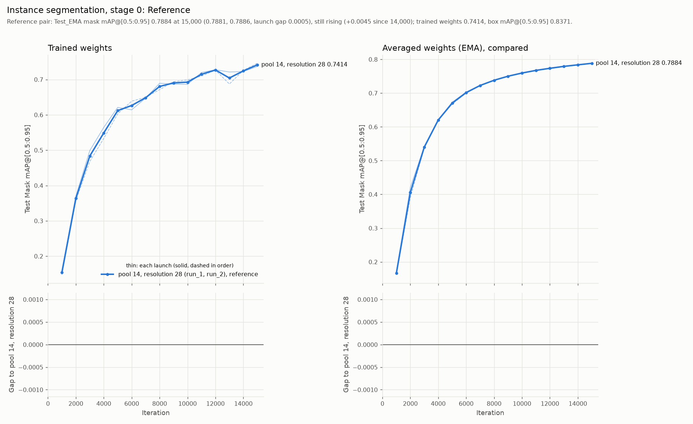
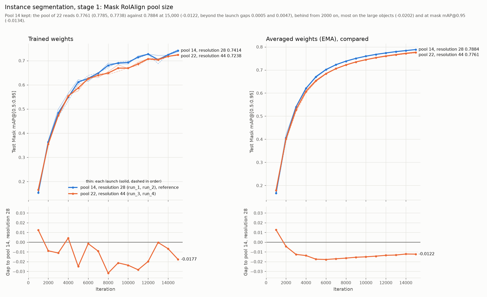
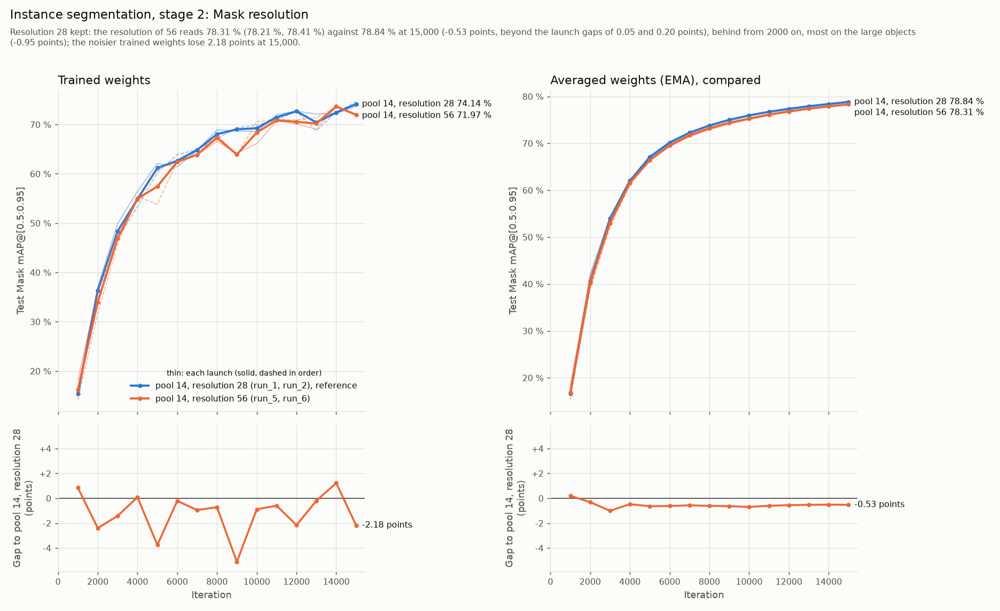
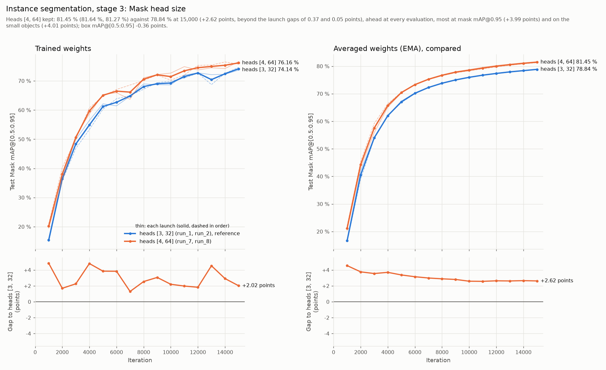
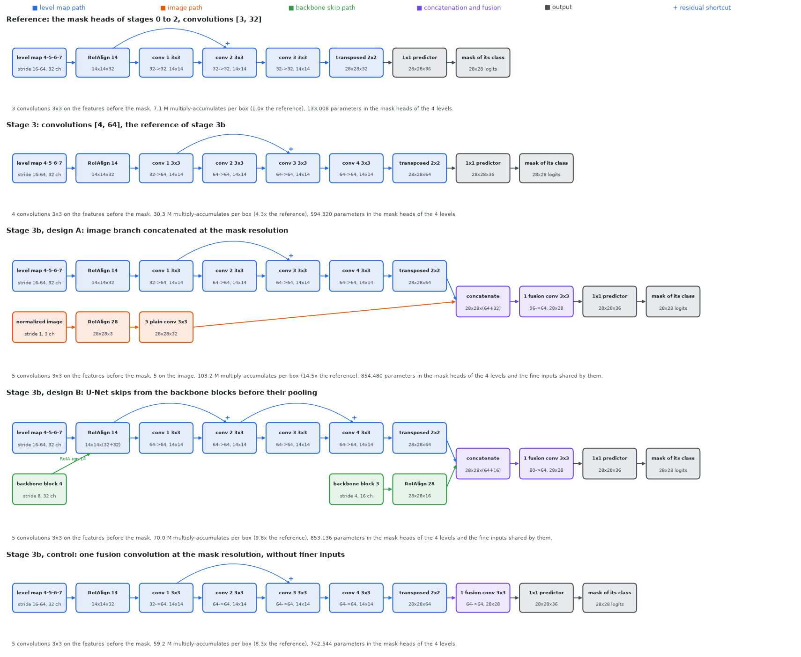
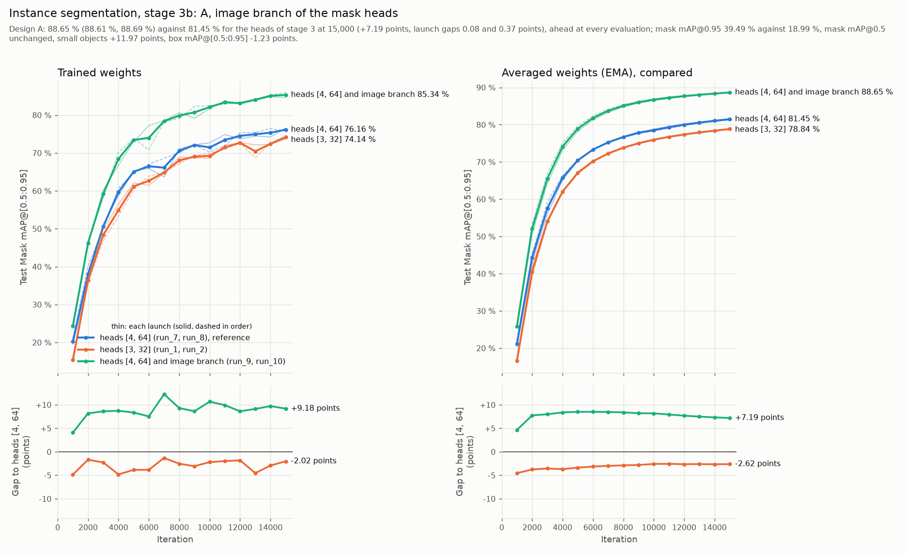

# Instance Segmentation Experiment Plan

- **Configurations:** `vision_training/configurations/instance_segmentation/run-<n>.yaml`, one per launch. `run-1.yaml` is written before the first launch from the base of the detection benchmark (`vision_training/configurations/object_detection/run-1.yaml`) with the values its stages kept, the `MaskHead` section and a `mask_head` in every detection level. Each run is launched with `uv run python -m vision_training.main --configuration_path=vision_training/configurations/instance_segmentation/run-<n>.yaml`, the later files written by a copy of the detection driver (`hyperparameter_experiments/object_detection/run_benchmark_stages.py`) whose setting keys include the mask head settings
- **Dataset:** synthetic hard shapes for instance segmentation (`create_synthetic_dataset(task="instance_segmentation", hard_objects=True)`, generated on 2026-11-04 with the settings of the detection dataset), `/home/robert_kelevra/Data/instance_segmentation_data/synthetic_hard_shapes`: 512,000 train / 50,000 validation / 10,000 test images of 1024 pixels, 5 to 12 of the 35 shape classes per image (8.5 on average), the boxes being those of the visible part of every shape, 11.8 % of the visible parts in several pieces. The masks are compressed COCO RLE strings (a train `labels.json` of 3.8 GB, 10.9 GB at the peak of its loading). The test split was generated with 50,000 images and cut on 2026-11-13 to its first 10,000 (84,922 objects), the 40,000 others deleted, so that the dataset keeps one train, one validation and one test split (the user: "I just want one 10k dataset and that's it")
- **Launch folders:** `hyperparameter_experiments/instance_segmentation/run_<n>` at the repository root, set as `ExperimentConfiguration.experiment_folder` before every launch

Suppose you hold a value of these tables against a figure: the scales differ. The tables and text of this plan, like `instance_segmentation_results.csv` from which the figures are drawn, give the mask mAP@[0.5:0.95] between 0 and 1, while the verdicts of `experiment_comparisons.yaml` and the figures of `figures/instance_segmentation/` write it as a percentage with two decimals (0.7884 as 78.84 %) and the gap between two settings in points (-0.0122 as -1.22 points).

## Table Of Content
- [Strategy](#strategy)
- [Fixed Settings](#fixed-settings)
- [Starting Values](#starting-values)
- [Stages](#stages)
- [The Stages](#the-stages)
  - [Stage 0: Reference And Preflight](#stage-0-reference-and-preflight)
    - [Box Detection On The Same Images](#box-detection-on-the-same-images)
  - [Stage 0b: Mask Threshold And Final NMS (evaluation only)](#stage-0b-mask-threshold-and-final-nms-evaluation-only)
  - [Stage 1: Mask RoIAlign Pool Size](#stage-1-mask-roialign-pool-size)
  - [Stage 2: Mask Resolution](#stage-2-mask-resolution)
  - [Stage 3: Mask Head Size](#stage-3-mask-head-size)
  - [Stage 3b: Finer Inputs Of The Mask Heads](#stage-3b-finer-inputs-of-the-mask-heads)
  - [Stage 4: Upsampling](#stage-4-upsampling)
  - [Stage 5: One Mask Head Shared By The Levels](#stage-5-one-mask-head-shared-by-the-levels)
  - [Stage 6: Mask Level Chosen By The Box Size](#stage-6-mask-level-chosen-by-the-box-size)
  - [Stage 7: A Finer Map For The Masks](#stage-7-a-finer-map-for-the-masks)
  - [Stage 8: Mask Scoring](#stage-8-mask-scoring)
  - [Not Planned](#not-planned)

## Strategy

So that the stages can be read like those of the detection benchmark (`object_detection_experiment_plan.md`), the method is the same, the user's choice of 2026-11-12 ("we will proceed in the same manner but the defaults will be our best one for the object detection"):

- one parameter changes at a time, and the best value of a stage is kept for all the following stages;
- every value is trained twice, A and B, two launches side by side sharing the GPU through the MPS daemon, without random seed;
- the score of a value is the test mask mean average precision over the IoU thresholds 0.5 to 0.95 of the averaged weights (`Tensorboard/Test_EMA`, `Mask mAP@[0.5:0.95]/area`) at the last iteration, averaged over its two launches. The mask mAP by object size, the mask mAP@0.75 and the box `mAP@[0.5:0.95]/area` are read next to it, so that a mask gain bought with worse boxes is seen;
- the values are searched one pair at a time. A challenger whose pair mean differs from the best value so far by less than the larger gap between the two launches of either value is a tie, which keeps the earlier value;
- a stage that needs code has its code merged right before its pair and reverted when it is not better, unless the user keeps it.

## Fixed Settings

To compare the instance segmentation with the detection benchmark, the settings of that benchmark stay fixed (its Fixed Settings section):

- `batch_size` 64 images of 1024 pixels, `number_iterations` 15,000, `weight_saving_iterations` 1000 (the evaluation of the 10,000 test images every 1000 iterations, 15 evaluations per launch, the user's choice of 2026-11-13 once the mask overlaps were made faster, stage 0 having found one evaluation too slow at every 500), `intermediate_weight_saving_iterations` 250, `information_dump` 1000, `validation_iteration_ratio` 0;
- the backbone, the detection levels 4 to 7 (strides 16, 32, 64 and 64), their anchors (16 and 32, 48 and 96, 128 and 256, 384 and 768 pixels, aspect ratios 0.5, 1 and 2) and their region proposal and detection heads;
- the region proposal counts and thresholds, 128 positives of 256 sampled anchors, 64 positive proposals of 128 for the detection heads, the ground truth boxes written into the proposals;
- Adam without weight decay, a constant learning rate without warm-up, a moving average of the weights with a decay of 0.9998, MLflow tracking;
- the augmentation of the user's `detection-run-configuration-defaults.yaml` (probability 0.25, the zoom-out, the left-right flip at 0.5 and the photometric types), the masks moving with the geometric ones;
- one loader worker per loader, the loss weights 1 for the five losses (`mask_loss` included);
- from stage 1 on, batches not pinned on the integrated GPU of the DGX Spark (`uses_pinned_memory` of `vision_training/data/loaders.py`): five launches of 200 iterations after stage 0 trained at the same speed with and without pinned memory (40.17 and 39.85 images per second, the two launches with it 0.88 apart), and the unpinned ones left 0.8 GB more free memory at iteration 180, the pinned blocks of the stage 0 launches having reached 2.54 GB each at iteration 9000. The same launches measured the packed manifest parsed once (main 6d88179) against the code before it (main 9b45896): 200 instead of 247 seconds to the first iteration and 5.4 GB more free memory, at 39.7 to 40.6 images per second against 42.1 for the one launch of the code before, a gap that reading the packed records (0.26 ms per batch of 64 images) cannot explain;
- `Data.instance_index_maps: True`: the masks of an image travel as one uint8 map numbering its objects, expanded on the GPU, the same masks, labels and boxes as one mask per object on 1,000 test images. The first reference launch, with one mask per object, was loader-bound (3.16 s per iteration, the GPU at 3 to 7 %), and the user stopped it on 2026-11-13 ("I really want something that's fast"); with the faster decoding of the run lengths and the maps, a batch of 64 reaches the GPU in 1.20 s instead of 2.22 s with one worker.

## Starting Values

Before stage 0 is launched, every detection setting is set at the value kept by the detection benchmark, and the mask heads at those of the shipped instance segmentation configurations:

| Parameter | Value |
|---|---|
| `learning_rate` | 1e-3 (detection stage 1) |
| `RegionProposal.background_iou_threshold.min` | 0.1 (detection stage 2) |
| `Neck` | `feature_pyramid`, 32 channels, batch normalization (detection stage 3), read by the mask heads as well |
| `Detector.box_loss` | `smooth_l1` (detection stage 5) |
| `Detector.nms_criterion`, `nms_distance_exponent` | `distance_iou`, 0.6 (detection stage 5b, never measured on masks: stage 0b checks it) |
| `Detector.normalization.feature_map_normalization` | batch (detection stage 6) |
| `RegionProposal.proposal_selection` | `per_level` (detection stage 7) |
| Anchor centres | cell corners, the centring removed after the tie of detection stage 8 |
| `DetectionLevels.<4, 5, 6, 7>.mask_head` | `roi_align_pool_size: 14`, `convolutions: [3, 32]` |
| `MaskHead.mask_resolution` | 28 (one doubling of the pool of 14) |
| `MaskHead.upsampling` | `transposed` |
| `MaskHead.normalization`, `modules` | batch, residual |
| `MaskHead.inference.mask_threshold` | 0.5 |

## Stages

So that the order and the cost of the benchmark are seen at once, the table lists every stage:

| Stage | Parameter | Values | Code | Status |
|---|---|---|---|---|
| 0 | Reference and preflight | the starting values | none | done, Test_EMA mask mAP 0.7884 at 15,000 (launch gap 0.0005) |
| 0b | Mask threshold and final NMS, evaluation only | `mask_threshold` 0.4, 0.5, 0.6; greedy NMS against DIoU-NMS 0.6 | none | done, 0.5 and DIoU-NMS 0.6 kept (0.4 -0.0095, 0.6 -0.0170, greedy NMS +0.0001, a tie) |
| 1 | Mask RoIAlign pool size (the user's stage) | 14, 22, with `mask_resolution` twice the pool (28, 44); the pool of 18 dropped by the user on 2026-11-14 | none | done, pool 14 kept (pool 22 -0.0122, beyond the launch gaps) |
| 2 | Mask resolution | one doubling against two (`mask_resolution` 2 or 4 times the pool kept by stage 1) | none | done, resolution 28 kept (56 -0.0053, beyond the launch gaps) |
| 3 | Mask head size | `convolutions` `[3, 32]`, `[4, 64]` | none | done, `[4, 64]` kept (+0.0262, beyond the launch gaps) |
| 3b | Finer inputs of the mask heads (the user's designs A and B) | on the `[4, 64]` heads of stage 3: A, an image branch; B, U-Net skips from the backbone; the control, the fusion convolution alone | `MaskHead.image_branch_convolutions`, `skip_blocks_at_pool_size`, `skip_blocks_at_mask_resolution`, `fusion_convolutions` (main 0ef5cbd) | A done, +0.0719 over stage 3 (0.8865); B (run_11, run_12) and the control (run_13, run_14), due since A won, wait for the user |
| 4 | Upsampling | `transposed`, `bilinear` | none | planned |
| 5 | One mask head shared by the levels (`suggestions.md` item 7) | per level, shared | `MaskHead.shared` | planned |
| 6 | Mask level chosen by the box size (`suggestions.md` item 2) | level of the proposal, level of the box size | level rule | planned |
| 7 | A finer map for the masks (`suggestions.md` item 5) | the levels of the detection, a level 3 of the feature pyramid (stride 8) for the masks | neck level | planned |
| 8 | Mask scoring (Mask Scoring R-CNN) | class score, class score times the predicted mask IoU | mask IoU head | planned |

Stages 0 to 4 change settings only; stage 3b needs the finer inputs of the mask heads, merged on 2026-11-15 and off by default; stages 5 to 8 need code, merged right before their pair. Every training pair is expected to take at least the 14 hours of a detection pair, the mask heads and targets adding a share that stage 0 measures. On 2026-11-12 the user kept every stage of the table (stage 4 trains both upsamplings, the transposed convolution as the reference), the pools of 18 and 22 for stage 1 (on 2026-11-14, with the pool of 22 behind the reference by 0.0155 at iteration 9000, the user dropped the pool of 18 to save its 15 hours), and the launch of stage 0 as soon as stage 8 of the detection benchmark ends.

## The Stages

For a stage to be read without the git-ignored run folders, the copy of the driver gathers the test mask mAP of every launch at every evaluation, trained and averaged weights, in `hyperparameter_experiments/instance_segmentation/results.csv` (`refresh_results`, one column per swept setting, from stage 3 on also the convolutions of the mask heads and the four settings of their finer inputs, lists that `collect_experiment_results.py` groups by their values). A copy is kept next to this plan and committed after every stage, `instance_segmentation_results.csv`, from which `scripts/evaluation/plot_experiment_comparisons.py` draws the figure of every stage of `experiment_comparisons.yaml` (`figures/instance_segmentation/`): the launches and pair means of the trained and averaged weights, and the gap of every value to the reference below.

### Stage 0: Reference And Preflight

Before any comparison, the reference pair (run_1 and run_2) trains with the starting values, and the launch is checked first:

- 40 iterations alone, then two launches side by side: images per second, peak GPU memory and the free memory of the machine, which must stay above 25 GB (the trainings slow down two to three times below it), the 3.8 GB `labels.json` being loaded by every launch;
- the two evaluations of one checkpoint (trained and averaged weights, 10,000 images each, every mask pasted at 1024 pixels): if they take much more than the 8.3 minutes of a detection checkpoint, the evaluation runs less often than every 500 iterations. Measured on 2026-11-13 at iteration 500 of run_1, beside run_2 training: 157 batches of 64 images at about 13.4 seconds each, 35 minutes per weight set and 70 minutes per checkpoint, the main process at a full CPU core, against 16 minutes of training between two checkpoints (1.9 seconds per iteration, measured while the other launch was starting or evaluating, so with the GPU nearly to itself). The user stopped the pair (run_1 at 500, run_2 at 474) and deleted it. Profiled on test images with the GPU free, 96 of the milliseconds of an image went to the mask overlaps, 85 of them to one float32 product of 16 pasted masks with the ground truth masks over the million pixels of the image, which left most of the GPU idle; `compute_mask_intersection_over_union` now multiplies segments of 1024 pixels in float16, exact, and the mask part takes 16 ms per image, the overlaps equal bit for bit on 64 test images. The user then set the evaluation every 1000 iterations and relaunched the pair from scratch on 2026-11-13 at 10:16. Measured at its first checkpoint: 2.7 seconds per iteration for each launch training side by side (1000 iterations in 45 minutes), and the evaluation of iteration 1000 in about 20 minutes, the trained weights in 8 minutes 45 seconds and the averaged ones in 8 minutes 15 seconds, both launches evaluating at once, instead of 70 minutes. A pair therefore takes about 16 hours (15 cycles of 45 minutes of training and 20 of evaluation);
- the anchor recall of the dataset (`anchor_recall.csv`, written at the launch), against that of the detection dataset.

Once both launches had ended, on 2026-11-14 at 01:12 (14 hours 56 minutes after the launch, both at 15,000), the reference read:

| Launch | Test_EMA mask mAP@[0.5:0.95] at 15,000 | Trained weights | Test_EMA box mAP@[0.5:0.95] |
|---|---|---|---|
| run_1 | 0.7881 | 0.7368 | 0.8380 |
| run_2 | 0.7886 | 0.7461 | 0.8361 |
| Pair | 0.7884 | 0.7414 | 0.8371 |

The two launches agree within 0.0005, and the mask mAP is still rising at 15,000 (+0.0045 since 14,000). Next to the score, the pair reads a mask mAP@0.5 of 0.9559, @0.75 of 0.9027 and @0.95 of 0.1500, and 0.7166, 0.8263 and 0.8070 for the small, medium and large objects: the large objects, whose 28 x 28 masks are stretched over up to 800 pixels, score below the medium ones, which stage 2 addresses. The anchor recall of the training objects is that of the detection dataset (0.8140 against 0.8141 over all levels, 0.4458 against 0.4459 for the small objects), so the boxes of the visible parts need no other anchors. Each launch held about 18 GB of GPU memory (18,067 MiB for run_2 during its last evaluation), and its training loader worker copied the parsed training manifest (9.55 GB of private memory at iteration 9000); the packed manifests, the single parse of every `labels.json` and the validation loader left out at a `validation_iteration_ratio` of 0, merged during the pair, remove that copy from the next stages.

#### Box Detection On The Same Images

Suppose one wishes to know whether learning the masks costs the boxes anything: on 2026-11-14 the user asked for the detection reference to be evaluated on the test images of this benchmark ("running our best object detector on the 10 000 images, we know their boxes, that will be a fair comparison"). `hyperparameter_experiments/instance_segmentation/cross_evaluation/run_cross_evaluations.py` evaluates the 15,000 checkpoints of run_21 and run_22 (detection stage 7, 0.8183 on the detection test split) on the 10,000 test images as `scripts/evaluation/evaluate_checkpoint.py` does with its `test_data_folder`, writing to `<run>/Checkpoint_Evaluation_instance_segmentation_test/`. The two datasets do not label a covered shape alike, the detection with the box of the whole shape clipped to the image, this dataset with the box of its visible part (`keep_visible_objects` of `create_synthetic_dataset.py`), and 35 % of the 84,922 test objects have a box meeting the box of a later shape or the image border, where the two boxes may differ. `select_box_identical_images.py` therefore keeps the 418 test images (2,590 objects) whose every shape keeps its whole box (no later box within one pixel, no image border), on which the four launches were also evaluated (`<run>/Checkpoint_Evaluation_box_identical_test/`). The values are the box mAP@[0.5:0.95] of the averaged weights at 15,000 unless named, gathered with those of the trained weights by `compare_box_detection.py` in `instance_segmentation_box_detection_comparison.csv` next to this plan:

| Test images | Detection (run_21, run_22) | Instance segmentation (run_1, run_2) | Gap |
|---|---|---|---|
| Own test split of each benchmark | 0.8183 (0.8216, 0.8151) | 0.8371 (0.8380, 0.8361) | other images |
| 10,000 instance segmentation test images | 0.8174 (0.8204, 0.8144) | 0.8371 (0.8380, 0.8361) | +0.0196 |
| Same 10,000 images, mAP@0.5 / @0.75 / @0.95 | 0.9629 / 0.9343 / 0.1304 | 0.9593 / 0.9385 / 0.1910 | -0.0036 / +0.0041 / +0.0606 |
| 418 images with the same boxes in both labellings | 0.8753 (0.8791, 0.8715) | 0.8956 (0.8972, 0.8941) | +0.0203 |
| Same 418 images, mAP@0.5 / @0.75 / @0.95 | 0.9912 / 0.9841 / 0.1940 | 0.9901 / 0.9861 / 0.2704 | -0.0011 / +0.0020 / +0.0763 |
| Same 418 images, small / medium / large | 0.7922 / 0.8916 / 0.9272 | 0.8129 / 0.9131 / 0.9414 | +0.0207 / +0.0214 / +0.0141 |
| Same 418 images, trained weights | 0.7872 | 0.8106 | +0.0234 |

On the same images, the instance segmentation pair draws better boxes than the detection reference: +0.0196 on the 10,000 images and +0.0203 on the 418 whose boxes agree, beyond the launch gaps (0.0060 and 0.0019 on the 10,000 images, 0.0076 and 0.0031 on the 418), so the gap does not come from the labelling, and the detection reference scores almost the same on its own test split and on this one (0.8183 and 0.8174). Both find the objects alike (mAP@0.5 within 0.0036), the gain coming from tighter boxes (mAP@0.95 +0.0606 on the 10,000 images, +0.0763 on the 418). The comparison cannot tell the mask loss apart from the training boxes: the detection reference learned the whole boxes of partly hidden shapes, whose hidden extent the image does not show, where the instance segmentation launches learn the pixel exact boxes of what is visible. A detection pair trained on the boxes of this dataset, without masks, would tell them apart.

### Stage 0b: Mask Threshold And Final NMS (evaluation only)

Since `MaskHead.inference.mask_threshold` and the final NMS act in evaluation only, `scripts/evaluation/evaluate_checkpoint.py` evaluates the 15,000 checkpoints of run_1 and run_2 again, as for detection stage 5b, without training:

- `mask_threshold` 0.4 and 0.6 against 0.5, the probability from which a pixel of a pasted mask belongs to its object;
- the greedy NMS against DIoU-NMS 0.6, which the detection benchmark kept on boxes (+0.0034 on its occlusion split) but never measured on masks.

After the pair had ended, `hyperparameter_experiments/instance_segmentation/run_stage_0b_evaluations.py` evaluated both launches side by side on 2026-11-14 from 02:13 to 03:02 (16 minutes per setting and launch, trained and averaged weights), each setting in its own folder of the run (`Checkpoint_Evaluation_mask_threshold_0.4`, `Checkpoint_Evaluation_mask_threshold_0.6`, `Checkpoint_Evaluation_nms_iou`), the values gathered by `compare_stage_0b.py` in `instance_segmentation_stage_0b_results.csv` next to this plan:

| Setting | Test_EMA mask mAP@[0.5:0.95] at 15,000 | Gap | Mask mAP@0.75 / @0.95 |
|---|---|---|---|
| `mask_threshold` 0.5, DIoU-NMS 0.6 (the reference) | 0.7884 (0.7881, 0.7886) | | 0.9027 / 0.1500 |
| `mask_threshold` 0.4 | 0.7789 (0.7784, 0.7793) | -0.0095 | 0.9007 / 0.1215 |
| `mask_threshold` 0.6 | 0.7714 (0.7714, 0.7713) | -0.0170 | 0.8919 / 0.1169 |
| greedy NMS | 0.7885 (0.7882, 0.7887) | +0.0001 | 0.9028 / 0.1500 |

The mask threshold of 0.5 is kept: 0.4 and 0.6 lose on both launches, beyond the launch gaps (0.0005 for the reference, 0.0009 and 0.0001 for 0.4 and 0.6), on every object size, most at the strict thresholds (mask mAP@0.95 -0.0285 and -0.0331). The greedy NMS ties with DIoU-NMS 0.6 (+0.0001, within the launch gap 0.0006, the box mAP unchanged at 0.8371), so DIoU-NMS 0.6 stays, the strategy keeping the earlier value of a tie. As on the detection test split (stage 5b), the objects of this test split are drawn with a box IoU of 0.3 at most, so the greedy NMS at 0.5 can hardly merge two of them: the stage shows that DIoU-NMS does no harm to the masks, its gain on occluded objects having been measured on the occlusion split of the detection. `run-1.yaml` is unchanged for stage 1.

### Stage 1: Mask RoIAlign Pool Size

At the user's request ("increasing the size of the 11x11 feature map for segmentation trying out 15x15 and 19x19"), the RoIAlign grid of the mask heads grows from its current side. Every instance segmentation configuration pools 14 x 14 (`DetectionLevels.<level>.mask_head.roi_align_pool_size: 14`, the size of Mask R-CNN), and no setting of the repository holds 11, so on 2026-11-12 the user chose the same steps from 14: pools of 18 and 22 against 14.

The pool size is tied to `MaskHead.mask_resolution` by `count_mask_upsamplings` (`mask_head.py`): the pooled features are doubled only while twice their side fits in the mask resolution. At a resolution of 28, a pool of 18 or 22 would get no doubling, its 18 x 18 or 22 x 22 logits being resized bilinearly to 28 and the learned transposed convolution lost. Every pool therefore trains with a mask resolution of twice its side (36 for 18, 44 for 22, the user's choice), keeping its one learned doubling, the mask targets following the resolution (`build_mask_targets`), the run name its `M<pool>` and `MR<resolution>` tokens.

The pool of 22 is trained first, the larger change. The pool of 18 was planned next, but on 2026-11-14 the user dropped it ("drop pool 18"), the pool of 22 trailing the reference by 0.0155 in Test_EMA mask mAP@[0.5:0.95] at iteration 9000, so stage 1 keeps 14 or 22 by the rule of the strategy and stage 2 follows it. The cost grows with the square of the side: the mask head convolutions, and the logits of the 35 classes of up to 4096 positive proposals per batch (64 images, 64 positives each), 0.45 GB in float32 at 28 x 28, 0.74 GB at 36 x 36 and 1.11 GB at 44 x 44, before their gradients.

A larger grid may bring little: RoIAlign samples the feature map of the level of the proposal, and the square anchors span one to four strides on levels 4 to 6 (16 to 256 pixels at strides 16 to 64) and six to twelve on level 7, so the box of an object covers a few cells of its map, rarely as many as the 14 of the grid that already samples it. Mask R-CNN assigns a box of 224 pixels to its stride 16 level (the level rule of the feature pyramid paper), where it covers 14 cells, the side of its grid. Stages 6 and 7 act on that limit.

Once both launches had ended, on 2026-11-14 at 17:26 and 17:53 (run_3 and run_4, 14 hours 24 and 14 hours 20 minutes after their launches, both at 15,000), the pool of 22 read, against the reference:

| Pool, mask resolution | Test_EMA mask mAP@[0.5:0.95] at 15,000 | Gap | Trained weights | Mask mAP@0.5 / @0.75 / @0.95 | Small / medium / large | Box mAP@[0.5:0.95] |
|---|---|---|---|---|---|---|
| 14, 28 (run_1, run_2) | 0.7884 (0.7881, 0.7886) | reference | 0.7414 | 0.9559 / 0.9027 / 0.1500 | 0.7166 / 0.8263 / 0.8070 | 0.8371 |
| 22, 44 (run_3, run_4) | 0.7761 (0.7785, 0.7738) | -0.0122 | 0.7238 | 0.9526 / 0.8918 / 0.1366 | 0.7132 / 0.8150 / 0.7868 | 0.8282 |

The pool of 14 is kept: the pool of 22 loses 0.0122, beyond the launch gaps (0.0005 and 0.0047), and was behind from iteration 2000 on (-0.0178 at 6000, -0.0155 at 9000). It loses on every object size, most on the large objects (-0.0202), at every threshold, most at the strict ones (mask mAP@0.95 -0.0134), with the trained weights (-0.0177) and on the boxes (-0.0088), so the larger grid only spreads the few cells of the map of a proposal over more samples, as expected above. The pool of 18 was dropped by the user, so `run-1.yaml` is unchanged for stage 2. Each launch held about 18.9 GB of GPU memory (18,831 and 18,931 MiB, against 18,067 for the reference), and with the packed manifests parsed once, no validation loader and no pinned batches, the training loader worker stayed at 4.1 to 4.4 GB of private memory from iteration 1000 to 9000 (9.55 GB for the reference at 9000), the main process at 2.0 to 2.5 GB (5.6), the machine keeping 45 to 48 GB free with both launches training (19.4 GB for the reference at 9000).

### Stage 2: Mask Resolution

With the pool kept by stage 1, a second doubling (`mask_resolution` four times the pool, 56 for 14) gives the large objects finer borders: a 28 x 28 mask pasted on an object of 800 pixels is stretched about 29 times. The pooled features stay the same, so a gain would show on the large objects and at the high IoU thresholds (mask mAP@0.75 to @0.95). The logits take four times the memory of one doubling (1.8 GB in float32 at 56 x 56 for 4096 proposals, 4.4 GB at 88 x 88 after a pool of 22), measured before the pair.

Once both launches had ended, on 2026-11-15 at 08:35 (run_5 and run_6, launched on 2026-11-14 at 17:55, 14 hours 40 minutes, both at 15,000), the resolution of 56 read, against the reference:

| Pool, mask resolution | Test_EMA mask mAP@[0.5:0.95] at 15,000 | Gap | Trained weights | Mask mAP@0.5 / @0.75 / @0.95 | Small / medium / large | Box mAP@[0.5:0.95] / @0.95 |
|---|---|---|---|---|---|---|
| 14, 28 (run_1, run_2) | 0.7884 (0.7881, 0.7886) | reference | 0.7414 | 0.9559 / 0.9027 / 0.1500 | 0.7166 / 0.8263 / 0.8070 | 0.8371 / 0.1910 |
| 14, 56 (run_5, run_6) | 0.7831 (0.7821, 0.7841) | -0.0053 | 0.7197 | 0.9541 / 0.8981 / 0.1452 | 0.7214 / 0.8196 / 0.7975 | 0.8305 / 0.1701 |

The resolution of 28 is kept: the resolution of 56 loses 0.0053, beyond the launch gaps (0.0005 and 0.0020), and was behind from iteration 2000 on (-0.0064 at 5000 and 9000, -0.0053 at 13,000), with the trained weights by 0.0218 at 15,000 (a noisier gap, between +0.0123 and -0.0511 over the evaluations) and on the boxes by 0.0065 (box mAP@0.95 -0.0209). It loses most on the large objects (-0.0095), the objects the second doubling was meant to serve, and at mask mAP@0.75 and @0.95 (-0.0046 and -0.0048), the small objects alone gaining within their launch gaps (+0.0048, launch gaps 0.0131 and 0.0077). As with the pool of 22, a finer output does not help while the features stay those of a few cells of the level map, so `run-1.yaml` is unchanged for stage 3. Each launch held about 18.1 GB of GPU memory at the start of its training (18,093 and 18,029 MiB), as much as the reference, and the training loader worker 4.2 to 4.4 GB of private memory at iterations 3500 and 9000, the machine keeping 46 to 47 GB free.

### Stage 3: Mask Head Size

To find out whether small heads limit the masks, a larger head is trained: the mask heads of the synthetic configuration have three convolutions of 32 channels, those of `configuration_example.yaml` four of 64, and those of Mask R-CNN four of 256 (Detectron2 `configs/Base-RCNN-FPN.yaml`: `ROI_MASK_HEAD.NUM_CONV: 4`, `POOLER_RESOLUTION: 14`, with `CONV_DIM = 256` of `detectron2/config/defaults.py`). The stage trains `[4, 64]` against `[3, 32]`.

The pair is run_7 and run_8, written and started by `launch_stage_3_mask_head_size.py 7 8` next to the driver (or `7`, then `8`, one launch at a time): the mask head of every level is `{ roi_align_pool_size: 14, convolutions: [4, 64] }`, every other setting that of `run-1.yaml`, the run name ending `M14.4x64-MR28_MC35`. Since the block goes from 32 to 64 channels, its first convolution changes the channels without a shortcut, the second and third form a residual pair and the fourth is plain (`residual_parity` of `ConvolutionBlock`). Counted on its layers, the mask branch of a box takes 30.3 M multiply-accumulates instead of 7.1 M, and the mask heads of the four levels hold 594,320 parameters instead of 133,008, yet a training step costs only 2 % more (the costs of stage 3b below), the backbone and the detection dominating the step. Whatever its result, the pair is the reference of stage 3b, whose designs the user asked on heads of four convolutions ("i feel like there were too little convolutions before the mask").

Since another training held the GPU, the user had the launches started one at a time, each only when 30 % of the memory of the machine stayed available after it: run_7 on 2026-11-16 at 01:30, next to a tutorial training, and run_8 at 04:00, once that training had ended. They ended at 16:07 and 18:19 (14 hours 36 minutes and 14 hours 19 minutes), and the heads of four convolutions of 64 channels read, against the reference:

| Mask heads | Test_EMA mask mAP@[0.5:0.95] at 15,000 | Gap | Trained weights | Mask mAP@0.5 / @0.75 / @0.95 | Small / medium / large | Box mAP@[0.5:0.95] / @0.95 |
|---|---|---|---|---|---|---|
| `[3, 32]` (run_1, run_2) | 0.7884 (0.7881, 0.7886) | reference | 0.7414 | 0.9559 / 0.9027 / 0.1500 | 0.7166 / 0.8263 / 0.8070 | 0.8371 / 0.1910 |
| `[4, 64]` (run_7, run_8) | 0.8145 (0.8164, 0.8127) | +0.0262 | 0.7616 | 0.9611 / 0.9231 / 0.1899 | 0.7567 / 0.8508 / 0.8245 | 0.8335 / 0.1614 |

The heads `[4, 64]` are kept: they gain 0.0262, seven times the larger launch gap (0.0037, the reference 0.0005), and were ahead at every evaluation, from +0.045 at 1000 to +0.026 to +0.030 from 7000 on; run_7 alone passed the final value of the reference at 11,000 (0.7958). The trained weights gain 0.0202. The gain grows with the IoU threshold (+0.0052 at mask mAP@0.5, +0.0204 at @0.75, +0.0399 at @0.95), so the larger heads draw finer borders rather than find more objects, and it is largest on the small objects (+0.0401, medium +0.0245, large +0.0175), where the second doubling of stage 2, which changed the output only, had gained within its launch gaps. The boxes lose a little: box mAP@[0.5:0.95] 0.8335 against 0.8371 (-0.0036, beyond the launch gaps of 0.0001 and 0.0019) and box mAP@0.95 0.1614 against 0.1910, the larger mask heads sending their larger gradients into the backbone and the feature pyramid that the box branch shares. From stage 3b on the mask heads of every level are `[4, 64]`, the base of the following stages. The training loader worker held 4.0 to 4.5 GB of private memory at iteration 3500, as in the reference, and the machine kept 41 to 54 GB available while both launches trained.

### Stage 3b: Finer Inputs Of The Mask Heads

Faced with borders that can only follow the few cells a box covers on its level map, a finer grid (stage 1) and a finer output (stage 2) having both lost, the user asked on 2026-11-15 for mask heads that read finer inputs, both on the heads of stage 3: design A runs RoIAlign on the input image itself ("is it possible to run roialign on the imange itself ? Then concatenate, then run 5 convolution layers to then concatenate with our roi align then we proceed as usal"), design B adds U-Net skips from the early backbone blocks. A variant of A with residual convolutions on the image (A2) was dropped by the user. Each arm is a pair compared with run_7 and run_8:

| Arm | Finer inputs | `MaskHead` settings | Run name | Launches |
|---|---|---|---|---|
| A | the box crop of the normalized input image at 28 x 28 (RoIAlign at stride 1), five plain 3 x 3 convolutions of 32 channels, concatenated after the doubling, then one fusion convolution from 96 to 64 channels | `image_branch_convolutions: [5, 32]`, `fusion_convolutions: [1, 64]` | `...-MR28-MIB5x32-MF1x64_MC35` | run_9, run_10 |
| B | block 4 before its pooling (stride 8, 32 channels) pooled at 14 and concatenated to the level features before the four convolutions; block 3 before its pooling (stride 4, 16 channels) pooled at 28 and concatenated after the doubling; one fusion convolution from 80 to 64 channels | `skip_blocks_at_pool_size: [4]`, `skip_blocks_at_mask_resolution: [3]`, `fusion_convolutions: [1, 64]` | `...-MR28-MSP4-MSM3-MF1x64_MC35` | run_11, run_12 |
| Control | none, one fusion convolution from 64 to 64 channels at 28 | `fusion_convolutions: [1, 64]` | `...-MR28-MF1x64_MC35` | run_13, run_14 |

`scripts/models/instance_segmentation/draw_mask_head_designs.py` draws the figure from the layers the code builds for every design (`run-1.yaml` with the settings of the design), counting their multiply-accumulates for one box with forward hooks. The predictor has 36 maps, the 35 shapes and the background.

The code (main 0ef5cbd, every setting off by default) works as follows. The backbone returns the normalized input image (block 0) and the listed blocks before their pooling under `skip_<block>` keys, which the detector separates from the levels before the neck. `MaskFineInputs`, shared by the levels, computes the image branch and the skips at the mask resolution once for all the positive proposals of a batch, so that the batch statistics of the image branch cover every box, and gives every level the rows of its own proposals. Every `MaskHead` concatenates the skips at the pool size to its pooled features before its convolutions and the fine features after its doublings, then runs its fusion convolutions before the predictor. The TorchScript and ONNX exports carry them, tested equal to the eager model.

B takes every block before its pooling, as U-Net copies its encoder maps before their max pooling. Since 2026-11-18 the configuration check holds the skips to this layout, as the user asked: every skip finer than the finest detection level, every skip at 28 finer than every skip at 14, and no block at both sizes, which B meets (blocks 4 and 3 at strides 8 and 4, below the stride 16 of level 4). Block 4 before its pooling has the stride 8 of block 3 after it, with 32 channels and three more convolutions instead of 16 channels; block 3 before its pooling has the stride 4 and the 16 channels of block 2 after it, with two more convolutions. Its first convolution then reads 64 channels (32 of the level, 32 of the skip), as many as it writes, so its block has two residual pairs where the block of stage 3 has one pair between two plain layers: B changes the shortcuts as well as the inputs.

The image is cropped at 28 because of what the test objects need, measured on the 84,922 of them on 2026-11-15:

- a box covers few cells of its level map: a ring of 250 pixels covers 3.9 x 3.9 cells of its stride 64 map, spread by RoIAlign over the 14 x 14 grid, where its crop of the image at 28 holds about 9 pixels per cell;
- 84.5 % of the objects are shrunk by the crop at 28, the median object (107 pixels long) at 3.82 pixels per cell, and the smallest are enlarged (5 % are under 19 pixels long);
- the crop squeezes every box into a square (8.9 % of the objects stretched more than twice, 0.3 % more than three times, a median of 1.16), as the 28 x 28 mask target is squeezed, so that every image cell stays aligned with its mask cell;
- the image alone cannot tell which of two overlapping shapes a pixel belongs to: the features of the level map, concatenated with it, carry the instance.

Since A and B both add a convolution at 28, the control tells the gain of the finer inputs from the gain of that convolution: a gain of A or B over run_7 and run_8 is credited to the finer inputs only if it also beats the control. To save its hours, the control is trained only if A or B beats the reference. The shapes of this dataset are flat colours with sharp edges, which the image branch reads directly: on photographs, where colour edges and object borders part more often, A would gain less than here, B reading learned features instead of colours.

The costs were counted on the layers for one box, and measured on 2026-11-15 on a batch of 64 test images with the trained weights of run_1 at 15,000 (the new layers random), so that the proposals are those of a trained detector (1,704 positive proposals reach the mask heads, against about 600 for an untrained one): a training step in bfloat16 (forward and backward of the five losses), its peak GPU memory, and an evaluation pass of the 64 images.

| Design | Multiply-accumulates per box | Parameters of the 4 heads and the fine inputs | Training step | Peak GPU memory | Evaluation of 64 images |
|---|---|---|---|---|---|
| Reference `[3, 32]` | 7.1 M | 133,008 | 1.317 s | 17.18 GB | 0.444 s |
| Stage 3 `[4, 64]` | 30.3 M | 594,320 | 1.345 s (+2.1 %) | 17.18 GB | 0.383 s |
| A | 103.2 M | 854,480 | 1.493 s (+13.4 %) | 18.96 GB | 0.402 s |
| B | 70.0 M | 853,136 | 1.439 s (+9.3 %) | 17.35 GB | 0.397 s |
| Control | 59.2 M | 742,544 | 1.372 s (+4.2 %) | 17.18 GB | 0.390 s |

If the whole training scales like the step, from the 14 hours 40 minutes of the stage 2 pair, a pair takes about 15 hours for stage 3, 16 hours 40 minutes for A, 16 hours for B and 15 hours 20 minutes for the control; the evaluations cost the same for every design. A keeps 1.8 GB more GPU memory per launch, well within the 46 GB the machine kept free during stage 2. The arms are started by `launch_stage_3b_mask_fine_inputs.py A 9 10` (B 11 12, control 13 14) next to the driver, after stage 3.

The designs follow the published refinements of the Mask R-CNN mask head:

- Mask R-CNN (He et al., ICCV 2017, https://arxiv.org/abs/1703.06870), Figure 4: "All convs are 3×3, except the output conv which is 1×1, deconvs are 2×2 with stride 2", "'×4' denotes a stack of four consecutive convs" (the FPN head, four convolutions of 256 channels at 14 x 14, a deconvolution to 28 x 28). Detectron2 builds the same head in `MaskRCNNConvUpsampleHead` (`detectron2/modeling/roi_heads/mask_head.py` of the main branch, lines 214 to 290: the 3 x 3 convolutions line 245, the transposed convolution of kernel 2 and stride 2 lines 256 and 257, the 1 x 1 predictor line 262).
- PointRend (Kirillov et al., CVPR 2020, https://arxiv.org/abs/1912.08193) refines the coarse masks with "fine-grained features" (section 3.2) read from "the P2 level of the FPN. This level has a stride of 4 w.r.t. the input image" (section 4), the stride of the skip of B at 28.
- RefineMask (Zhang et al., CVPR 2021, https://arxiv.org/abs/2104.08569), the closest to B, attaches a semantic head "to P2 (the highest resolution feature map of FPN)" (section 3.1), whose features join the mask head at 28, 56 and 112 after "the 14×14 RoIAlign operation" and "two 3×3 convolutional layers" (section 3.2), and reports "gains of 2.6, 3.4, 3.8 AP over Mask R-CNN on COCO, LVIS, and Cityscapes" (abstract).
- BPR (Tang et al., CVPR 2021, https://arxiv.org/abs/2104.05239), the closest to A, refines the masks of a trained model with a separate network reading RGB patches along their borders with the mask patches ("modifying the input channels to 4 (3 for the RGB image patch and 1 for the binary mask patch)", section 3.2), and found that "the model trained with image patches solely yielded a terrible result, even worse than the segmentation results before refinement. However, together with mask patches, we achieved a significant improvement (+3.4% in AP, +11.9% in AF)" (section 4.2). A reads the pixels inside the mask head, trained with it, always next to the features of the instance.

Design A was trained first, run_9 and run_10 started together on 2026-11-16 at 18:45 once 30 % of the memory of the machine would stay available after both (109 GB available before, 49.2 GB 20 minutes after), and ended on 2026-11-17 at 11:27 (16 hours 42 minutes, as the step measured above predicted). Against the heads of stage 3 and the reference of stages 0 to 2:

| Mask heads | Test_EMA mask mAP@[0.5:0.95] at 15,000 | Gap to stage 3 | Trained weights | Mask mAP@0.5 / @0.75 / @0.95 | Small / medium / large | Box mAP@[0.5:0.95] / @0.95 |
|---|---|---|---|---|---|---|
| `[3, 32]` (run_1, run_2) | 0.7884 (0.7881, 0.7886) | -0.0262 | 0.7414 | 0.9559 / 0.9027 / 0.1500 | 0.7166 / 0.8263 / 0.8070 | 0.8371 / 0.1910 |
| `[4, 64]`, stage 3 (run_7, run_8) | 0.8145 (0.8164, 0.8127) | reference | 0.7616 | 0.9611 / 0.9231 / 0.1899 | 0.7567 / 0.8508 / 0.8245 | 0.8335 / 0.1614 |
| `[4, 64]` and design A (run_9, run_10) | 0.8865 (0.8861, 0.8869) | +0.0719 | 0.8534 | 0.9610 / 0.9519 / 0.3949 | 0.8764 / 0.9100 / 0.8700 | 0.8212 / 0.1396 |

Design A gains 0.0719, about twenty times the larger launch gap (0.0037 for stage 3, 0.0008 for A), nearly three times the gain of stage 3 over the reference (0.0262), and was ahead at every evaluation: +0.047 at 1000, +0.085 at 5000 and 6000, then a slow narrowing to +0.072 at 15,000, while the gain of stage 3 over the reference settled at 0.026 from 10,000 on. The trained weights gain 0.0918. The masks find the same objects (mask mAP@0.5 0.9610 against 0.9611) and draw far finer borders: mask mAP@0.75 +0.0288 and mask mAP@0.95 0.3949 against 0.1899, twice stage 3 and 2.6 times the reference; the small objects gain the most (+0.1197, medium +0.0592, large +0.0455). The boxes lose again, more than with stage 3: box mAP@[0.5:0.95] 0.8212 against 0.8335 (-0.0123, launch gaps 0.0010 and 0.0001) and box mAP@0.95 0.1396 against 0.1614; the image branch gives no gradient to the backbone, so the loss comes through the features the mask path still shares with the boxes, a cause not measured. Two cautions before the design is kept: the gain may come in part from the fusion convolution at 28 that A adds, which the control (run_13, run_14) measures alone, and the flat colours and sharp edges of these shapes make the image branch read the borders more easily than on real images. Each launch kept the training loader worker at 4.2 GB of private memory at iteration 3500, as stage 3, and the machine 39 to 49 GB available while both trained. As the user asked, B and the control wait for the user.

### Stage 4: Upsampling

In case the transposed convolution marks the borders, the stage trains `MaskHead.upsampling: "bilinear"` (a bilinear doubling followed by a 3 x 3 convolution) against the transposed convolution of Mask R-CNN, whose 2 x 2 kernel of stride 2 can leave a checkerboard pattern on the borders. A tie is likely, but the user kept the stage ("we try transposed and bilinear upsampling right ?").

### Stage 5: One Mask Head Shared By The Levels

Whenever a level holds few positives, its own mask head learns from few examples (`suggestions.md` item 7): with the feature pyramid, every level already has 32 channels, so a single mask head can read every level and train on every positive of the batch, where each per-level head sees only the positives of its level (`compute_proposal_mask_loss`), and the export runs that single head once on all the detections instead of every head on every detection. Code: a `MaskHead.shared` switch, its run name token, and a transfer that refuses to load per-level heads into a shared one.

### Stage 6: Mask Level Chosen By The Box Size

For the medium and large boxes to be pooled from enough cells, the level can follow the box size (`suggestions.md` item 2): every mask is pooled from the level of its proposal, whose anchors match the box, so a box covers a few cells of its map (stage 1). The rule of the feature pyramid paper, level k = k0 + log2(sqrt(w h) / 224) with k0 = 4, pools every box from the level where it covers about 14 cells: the finest level (stride 16) for the boxes up to about 224 pixels, level 5 (stride 32) around 448 pixels. A box of 128 to 256 pixels, now pooled from 2 to 4 cells of level 6, would get 8 to 16 cells of level 4. It works best with the shared head of stage 5, every head otherwise seeing boxes of other sizes than before. Code: the level rule in the mask loss, the mask prediction and the export, and a setting to choose it.

### Stage 7: A Finer Map For The Masks

If one wishes to give the small objects finer masks, a finer map is needed (`suggestions.md` item 5): the finest level of the detection has a stride of 16, where Mask R-CNN pools its small boxes from a stride of 4. The feature pyramid can add a level 3 (stride 8, block 3 of the backbone) read by the mask heads only, the detection keeping its levels and anchors. The small objects, 1 to 2 cells wide on level 4, would get 2 to 4 cells. Code: a neck level outside `DetectionLevels`, the mask head of that level, its memory and time measured before the pair.

### Stage 8: Mask Scoring

Suppose a detection with a sure class has a poor mask: the score of a mask is the class score of its box, whatever the quality of the mask. Mask Scoring R-CNN (Huang et al., CVPR 2019, https://arxiv.org/abs/1903.00241) adds a head predicting the IoU of every mask with its object and scores the mask with the class score times that IoU, so that the better masks rank first in the mask AP; its abstract reports a "consistent and noticeable gain" on COCO. Code: the mask IoU head, its loss against the IoU of the predicted and target masks, the score in the evaluation and the export.

### Not Planned

Should the time allow more stages later, these were considered and set aside:

- A boundary refinement in the style of PointRend (https://arxiv.org/abs/1912.08193), whose abstract reports crisp borders and significant gains on COCO, the largest code of all, kept for after stages 2 and 7.
- Ground truth masks cropped to their boxes (`suggestions.md` item 8): the instance index maps already cut the masks through the loader to a ninth on this dataset.
- Detections clipped to the image window (`suggestions.md` item 9): the images of the dataset are square, so it changes nothing here.
- The normalization of the mask heads: detection stage 6 kept batch normalization for its stability.
