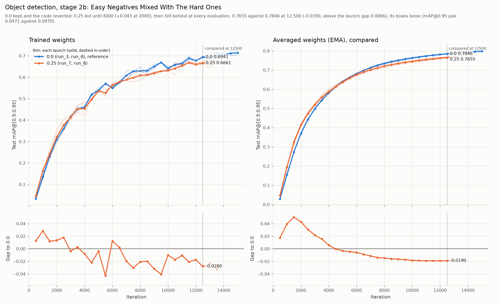
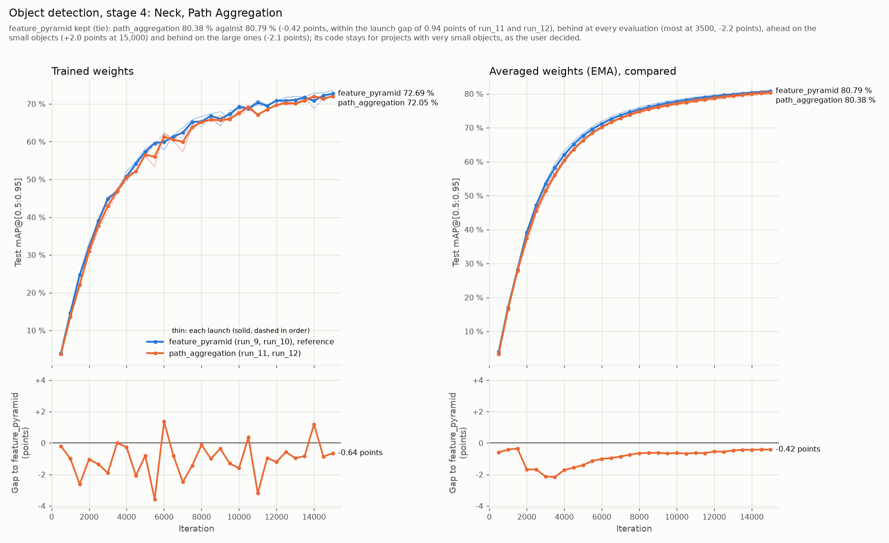
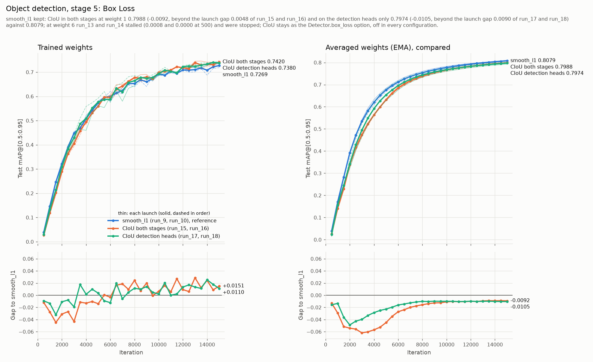
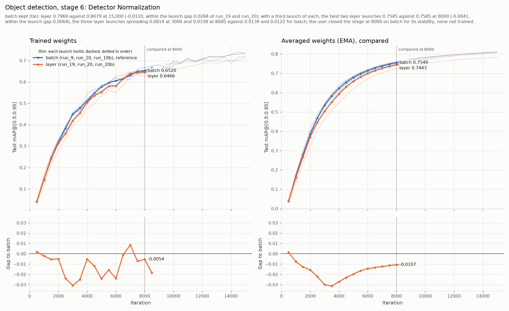
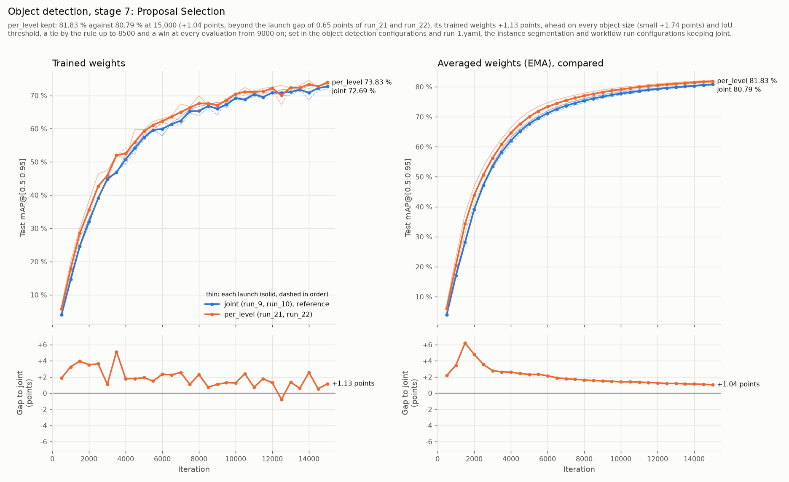

# Object Detection Experiment Plan

- **Configurations:** `vision_training/configurations/object_detection/run-<n>.yaml`, one per launch, launched with `uv run python -m vision_training.main --configuration_path=vision_training/configurations/object_detection/run-<n>.yaml`; the files after `run-1.yaml` are copies of it with the settings kept by the previous stages and the changed parameter, written by the driver `hyperparameter_experiments/object_detection/run_benchmark_stages.py`
- **Dataset:** synthetic hard shapes (`create_synthetic_dataset(task="object_detection", hard_objects=True)`), `/home/robert_kelevra/Data/object_detection_data/synthetic_hard_shapes`: 512,000 train / 50,000 validation / 50,000 test images of 1024 pixels, 5 to 12 shapes of the 35 shape classes per image (8.5 on average), from 16 pixels to 80% of the image side with log-uniform sizes (as many objects per scale octave), drawn from the largest to the smallest so that small shapes lie over large ones, up to 30% of a shape outside the image (box clipped, 19% of the boxes touching the border), on a flat background (20% of its shapes in a colour 20 to 40 levels from the background) or, for half of the images, a textured one (gradient, smooth noise or clutter lines changing the background by up to 40 levels). Below about 64 pixels the round polygons (heptagon, octagon, nonagon) are hard to tell from each other and from the circle
- **Launch folders:** `hyperparameter_experiments/object_detection/run_<n>` at the repository root, set as `ExperimentConfiguration.experiment_folder` before every launch. The learning rate stage is archived in `hyperparameter_experiments/object_detection/learning_rate_stage/` (its launches, state, results and a copy of its driver), the stages from 2026-11-05 numbering their launches from run_1 again

## Strategy

One parameter changes at a time. The best value of a stage is kept for all the following stages, and its launches serve as the reference of the next stage, reused when an earlier stage trained launches with the same settings for as many iterations (or more, under the constant learning rate schedule).

Every setting is launched twice, A and B, to smooth out the noise of a single training (stage 6 added a third launch to each of its two values, the stages after it going back to two). Two launches train at the same time, the next launch starting as soon as one ends, the kernels of the two launches sharing the GPU through the MPS daemon. The training sets no random seed, so the two launches start from different weights, data order and augmentations.

Every launch keeps a moving average of its weights, and the settings are compared on the averaged weights (`Tensorboard/Test_EMA`): the score of a setting is the test mean average precision over the intersection over union thresholds 0.5 to 0.95 (`mAP@[0.5:0.95]/area`, the area under the precision recall curves) at the last iteration of the stage, averaged over its two launches. The mean average precision by object size (small, medium, large) and the proposal recall by detection level are read next to it.

The values of a stage are searched one pair at a time (the user's choice of 2026-11-02), so that no pair is trained once the answer is known. A challenger whose pair mean differs from the best value so far by less than the larger gap between the two launches of either value is a tie, within the noise of a single training: the search then ends on the earlier value, unless the stage says otherwise.

## Fixed Settings

- `batch_size`: 64 images of 1024 pixels (two launches side by side reach about 63 Gigabytes above the idle machine, of its 121; one launch at 128 images would take about 49 alone)
- `number_iterations`: 15,000 (960,000 images, 1.9 epochs of the 512,000 training images) from 2026-11-04, the user's choice for every detection stage. The learning rate stage was launched for 20,000 and read at 15,000 under its constant learning rate
- `weight_saving_iterations`: 500, the test evaluation running every 500 iterations (30 tested models) on `test_10000`, the first 10,000 of the 50,000 test images (85,143 objects), its images read from the `test` split through a link; `intermediate_weight_saving_iterations`: 250
- `information_dump`: 1000, `validation_iteration_ratio`: 0 (no validation during the training)
- Backbone `{"1": [1, 16], "2": [2, 16], "3": [2, 16], "4": [3, 32], "5": [3, 32], "6": [5, 32], "7": [5, 32]}`, residual blocks with squeeze and excite, input normalization, batch normalization
- Detection levels 4 to 7 (strides 16, 32, 64 and 64, block 7 keeping the 16 x 16 map of block 6 without last max pooling) with anchors of 16 and 32, 48 and 96, 128 and 256, 384 and 768 pixels, aspect ratios 0.5, 1 and 2, so that every size of the dataset has an anchor; region proposal heads `[2, 32]`, detection heads with a 7 x 7 RoIAlign grid, `[2, 32]` convolutions and `[64, 32]` fully connected layers, each level with its own heads (no feature pyramid network)
- Region proposals: 1000 before and 500 after the non-maximum suppression in training, 500 and 250 in inference, foreground intersection over union 0.5, background up to 0.3, 128 positive of 256 sampled anchors
- Adam, no weight decay, constant learning rate without warm-up, moving average of the weights with a decay of 0.9998
- Data augmentation:
  - learning rate stage: probability 0.4, the haze alone;
  - from 2026-11-05 (the user's `detection-run-configuration-defaults.yaml`): probability 0.25, the zoom-out, the left-right flip (0.5) and the photometric types (brightness, contrast and saturation, hue, CLAHE, sharpening, both histogram equalizations, noise, grayscale, colour swap, gamma, linear illumination, blur, motion blur, haze), each at 0.25
- MLflow tracking from 2026-11-05

## Starting Values

| Parameter | Value |
|---|---|
| `learning_rate` | 1e-3 (kept by stage 1) |
| `RegionProposal.background_iou_threshold.min` | 0.0 |
| `Detector.normalization.feature_map_normalization` | batch |
| Anchor centres | cell corners, `RegionProposal.anchor_centres: "cell_corners"` (`"cell_centres"` for audit L1, stage 8) |
| Proposal selection | `RegionProposal.proposal_selection: "joint"`, one top-k and one NMS over every level, zero-area boxes kept (`"per_level"` for audits M3 and L7, kept by stage 7) |
| Box loss | smooth L1 on the offsets, beta 1/9 (`Detector.box_loss: "smooth_l1"`, the region proposal network always using the smooth L1 since 2026-11-10) |
| Neck | none |

## Stages

| Stage | Parameter | Values | Iterations | Status |
|---|---|---|---|---|
| 1 | `learning_rate` | 1e-3, 2e-3, 2e-4 (1e-4 not needed) | 15,000 | done, 1e-3 kept |
| 2 | `RegionProposal.background_iou_threshold.min` | 0.0, 0.1, 0.15 (0.2 dropped) | 15,000 | done, 0.1 kept |
| 2b | `RegionProposal.easy_negative_fraction` | 0.0, 0.25 | 15,000 | done, not conclusive (0.25 worse), code reverted |
| 3 | `Neck.type`, feature pyramid (`suggestions.md` item 1) | none, feature_pyramid | 15,000 | done, feature_pyramid kept (+0.0096) |
| 4 | `Neck.type`, path aggregation (`suggestions.md` item 37) | path_aggregation against feature_pyramid (run_9, run_10) | 15,000 | done, tie (-0.0042), feature_pyramid kept, path aggregation code kept for very small objects |
| 5 | Box loss (`suggestions.md` item 36) | smooth L1, CIoU in both stages, CIoU on the detection heads only | 15,000 | done, smooth L1 kept (CIoU -0.0092 and -0.0105), CIoU kept as the `Detector.box_loss` option |
| 5b | Final NMS (`suggestions.md` item 38) | greedy, DIoU-NMS with the exponents 1.0 and 0.6, on test_10000 and an occlusion split | none, evaluation of the checkpoints of stage 5 | done, DIoU-NMS 0.6 kept (occlusion split +0.0034), exported and set in the object detection configurations |
| 6 | `Detector.normalization.feature_map_normalization` | batch, layer (none not trained) | 15,000, the third launches 8000 | done, tie, batch kept (layer -0.0110 at 15,000, -0.0041 for the best two of three launches at 8000, its launches far more spread) |
| 7 | `RegionProposal.proposal_selection` (audit M3, with L7) | joint, per_level | 15,000 | done, per_level kept (+0.0104, beyond the launch gap 0.0065), set in the object detection configurations and run-1.yaml |
| 8 | `RegionProposal.anchor_centres` (audit L1) | cell_corners (run_21, run_22), cell_centres (run_23, run_24) | 15,000 | running |

On 2026-11-07 the user reordered the stages after stage 2b by the gains the literature makes most likely (the neck, then the CIoU box loss, the detector normalization, the proposal selection per level and the anchor centres last). Every code stage is merged right before its pair, which trains against the reference kept so far on the earlier code, and is reverted when it is not better, a tie keeping the earlier code (the easy negatives of stage 2b, merged before run_7 and reverted after run_8, left the draws of a share of 0.0 unchanged). The path aggregation of stage 4 is the exception: before its end the user kept its code whatever the outcome, for projects with very small objects ("either way if PAN does not win we will not revert the implementation because i might have some projects that might have very smal ojbects"), so after its tie `Neck.type: "path_aggregation"` stays available while the later stages train with the feature pyramid. `RegionProposal.foreground_iou_threshold.max`, read by the checks but never by the model, is removed from the configuration files with the code of a later stage (no number changes). On 2026-11-08 the user added DIoU-NMS after the CIoU box loss ("Add diounms as something to be tested too. After ciou box loss"), as stage 5b, without renumbering the later stages.

## Launches

Every launch gives its test mean average precision at every evaluation (every 500 iterations) for its trained and averaged weights, all gathered in `hyperparameter_experiments/object_detection/results.csv` by the driver (one column per swept setting), launches and mean rows as in the tables below. Since that folder is not versioned, a copy is kept next to this plan and committed after every stage: `object_detection_results.csv` for the stages from 2026-11-05, `object_detection_learning_rate_stage_results.csv` for stage 1. The figure of every stage (`figures/object_detection/`, drawn from these copies by `scripts/evaluation/plot_experiment_comparisons.py` with the stages of `experiment_comparisons.yaml`) shows the launches and pair means of the trained and averaged weights, and the gap of every value to the reference below.

### Stage 1: Learning Rate (6 launches, done)

The learning rates were searched one pair at a time: 2e-3 first, kept if better than 1e-3; otherwise 2e-4, then 1e-4 if 2e-4 were better. On 2026-11-03 the user stopped the 2e-3 pair at 15,000, tied with 1e-3 there, and asked for 2e-4 anyway, which was stopped at 7500 (2026-11-04), far behind.

| Value | Launches | Test_EMA mAP@[0.5:0.95] at 15,000 | Pair |
|---|---|---|---|
| 1e-3 | run_1, run_2 | 0.7905, 0.7628 | 0.7766 |
| 2e-3 | run_3, run_4 | 0.7853, 0.7244 | 0.7549 (tie: -0.0218 within the launch gap 0.0609) |
| 2e-4 | run_5, run_6 | 0.4714, 0.4570 at 7500 | 0.4642 against 0.7010 for 1e-3 at 7500 |

1e-3 was kept. At 20,000 its pair reached 0.7956 (run_1 0.8088, run_2 0.7823), the averaged weights ahead of the trained ones at every evaluation (0.7102 for the trained weights at 20,000). At 15,000, run_1 found almost every object (proposal recall at 0.5 of 0.998, 0.995 for the small objects) with a mAP@0.5 of 0.97, but its boxes are not tight: mAP@0.75 0.93 and mAP@0.95 0.05, which stages 3 to 8 address.


### Stage 2: Background IoU Minimum (6 launches, done)

The anchors whose best overlap is below `RegionProposal.background_iou_threshold.min` are ignored by the region proposal loss: 0.0 samples every anchor below 0.3 as background, 0.1 leaves out those touching no object, the region proposal network then learning from the hard negatives only. 0.1 beat 0.0 (+0.0194, above the launch gap 0.0105), mostly by tighter boxes (mAP@0.95 doubled), and 0.15 tied with 0.1 (-0.0027 within the launch gap 0.0044), so the user dropped 0.2 and kept 0.1.

| Value | Launches | Test_EMA mAP@[0.5:0.95] at 15,000 | Pair | mAP@0.95 pair |
|---|---|---|---|---|
| 0.0 | run_1, run_2 | 0.7737, 0.7842 | 0.7789 | 0.0504 |
| 0.1 | run_3, run_4 | 0.7964, 0.8001 | 0.7983 | 0.1078 |
| 0.15 | run_5, run_6 | 0.7978, 0.7934 | 0.7956 | 0.1073 |

The comparison of run_1 and run_2 with run_1 and run_2 of stage 1 (same settings, but the haze alone) measures the augmentation of the defaults, without any training.


### Stage 2b: Easy Negatives Mixed With The Hard Ones (2 launches, done, reverted)

With the minimum 0.1, `RegionProposal.easy_negative_fraction` (merged in c3068e3, reverted after the stage) drew a share of the sampled negatives of every image among the easy anchors below the minimum, the rest among the hard ones of [0.1, 0.3). At 0.25, the 64 first images of `test_10000` with the anchors of run_3 sample a median of 66.5 positives, 142 hard and 47.5 easy negatives per image (256 in all, the easy ones overlapping their objects by 0.04 at most); at 0.0 the samples and the loss are those of the previous code under the same seed, so that run_3 and run_4 are the reference.

0.25 led until 4000 (+0.043 at 2000), then fell behind at every evaluation, its boxes staying loose (mAP@0.95 about half that of 0.0): at 12,500 the pair was 0.0190 behind, above the launch gap 0.0066, and the user stopped run_7 and run_8 there (2026-11-07 13:29) and had the code reverted.

| Value | Launches | Test_EMA mAP@[0.5:0.95] at 12,500 | Pair | mAP@0.95 pair |
|---|---|---|---|---|
| 0.0 | run_3, run_4 | 0.7827, 0.7865 | 0.7846 | 0.0970 |
| 0.25 | run_7, run_8 | 0.7688, 0.7622 | 0.7655 | 0.0471 |



### Stages 3 And 4: Neck (4 launches, done)

Until now every detection level has its own region proposal and detection heads reading their backbone block directly, without any path between the levels. The neck (`Neck` section of the configuration, `vision_training/models/detection/feature_neck.py`) sits between the blocks and the heads, with 32 channels on every level (those of the blocks, so that the heads keep their size) and batch normalization, as the user chose: stage 3 compares no neck with the feature pyramid (1x1 laterals and the top-down path), stage 4 path aggregation (the bottom-up path after the pyramid) with the better of the two. Both types are merged with stage 3, so that stage 4 needs no other code.

| Stage | Order | Value | Launches |
|---|---|---|---|
| 3 | reference | none | run_3, run_4 |
| 3 | 1 | feature_pyramid | run_9, run_10 |
| 4 | reference | feature_pyramid | run_9, run_10 |
| 4 | 1 | path_aggregation | run_11, run_12 |

The neck was merged on 2026-11-07 (main 35aa62a), and run_9 and run_10 were launched by hand at 14:51:40 and 14:52:10 with the settings of run_3 and run_4 (background IoU minimum 0.1, detector batch normalization, learning rate 1e-3, 15,000 iterations, 1 loader worker), their configuration files differing from those of run_3 and run_4 only by `Neck.type: "feature_pyramid"` (run name token `L4567-NFPN32BN`). Before the launch, 40 iterations of the same configuration on the Spark gave 43.5 and 43.7 images per second alone without neck at iterations 20 and 40, 41.0 and 45.2 with the feature pyramid, 41.6 and 42.6 with path aggregation (no measurable cost over so few iterations), and a peak GPU memory of 17.2 GB without neck against 17.3 GB with either neck, whose 41,728 parameters (feature pyramid) add 0.17 MB to the model.

Stage 3 ended on 2026-11-08, both launches with their 15,000 checkpoint. The feature pyramid beat no neck by +0.0096, more than twice the launch gaps (0.0038 for run_9 and run_10, 0.0037 for run_3 and run_4), and was kept: it gained most on the tight boxes (mAP@0.75 +0.008, mAP@0.95 +0.018) and on the medium and large objects (+0.012, +0.013), the small ones about even (+0.002) and mAP@0.5 +0.001. Its lead peaked at +0.039 at 3500 and held at +0.0096 from 14,000 on; the trained weights led as well, with more noise (0.727 against 0.714 at 15,000).

| Value | Launches | Test_EMA mAP@[0.5:0.95] at 15,000 | Pair | mAP@0.95 pair | Test (trained) pair |
|---|---|---|---|---|---|
| none | run_3, run_4 | 0.7964, 0.8001 | 0.7983 | 0.108 | 0.714 |
| feature_pyramid | run_9, run_10 | 0.8098, 0.8060 | 0.8079 | 0.126 | 0.727 |

A launch with the feature pyramid took 14.45 hours from its first to its last iteration, against 13.85 for run_3 and run_4 (+4.3 %), both pairs trained side by side. Most of that came from the first 4000 iterations, 15 to 20 % slower than the reference while the machine was busier (2.7 seconds per iteration, against 2.4 later in the same launches); from 5000 on an iteration cost 1.5 % more on average (from 2 % less to 4 % more over each 1000 iterations, median 2.39 seconds against 2.37). The two test evaluations of every checkpoint (10,000 images each, trained and averaged weights) took about 4.1 of those hours, 8.3 minutes per checkpoint, the neck adding 2 %.


Stage 4 started on 2026-11-08 at 12:50 (run_11 and run_12, the MPS daemon restarted after a reboot first), at the pace of stage 3 (500 iterations in 19 and 20 minutes). On 2026-11-08 the path aggregation was checked against the PANet paper, its official code, the PAFPN of mmdetection, YOLOv4 and EfficientDet: the neck is the bottom-up path of the released PANet model with batch normalization in place of group normalization, so it needs no other code, and `test_path_aggregation_follows_the_panet_building_block` holds its order. The git-ignored launcher `launch_runs_11_and_12_path_aggregation.py` was dry-run the same day, its configuration files differing from those of run_9 and run_10 by `Neck.type: "path_aggregation"` only (run name token `L4567-NPAN32BN`). The published gains of the bottom-up path are about one point of box AP on COCO, largest on the large objects (PANet Table 3: +0.9, large +2.3), so the stage reads mAP@0.75, mAP@0.95 and the large objects beside the decision metric; path aggregation is kept if its pair beats 0.8079 by more than the larger launch gap (0.0038 for run_9 and run_10).

Stage 4 ended on 2026-11-09 at about 02:30, both launches with their 15,000 checkpoint. Path aggregation tied with the feature pyramid, 0.8038 against 0.8079 (-0.0042, within the launch gap 0.0094 of run_11 and run_12), so the feature pyramid stays the reference of the later stages (run_9 and run_10). Path aggregation was behind at every evaluation, most at 3500 (-0.022), the gap closing to -0.004 from 13,500 on. Against the published gain, it lost on the large objects at every evaluation (-0.021 at 15,000, -0.038 at 3500) and on the tight boxes (mAP@0.75 -0.005, mAP@0.95 -0.007), while it led on the small objects at every evaluation from 1000 on (+0.029 at 1000, +0.020 at 15,000), the medium objects and mAP@0.5 even (-0.001 and +0.0004). The trained weights tied as well (0.7205 against 0.7269, within the launch gap 0.0171 of run_9 and run_10). The user had kept the path aggregation code whatever the outcome, for projects with very small objects (see the rule after the table of stages).

| Value | Launches | Test_EMA mAP@[0.5:0.95] at 15,000 | Pair | mAP@0.95 pair | Small, medium, large pairs | Test (trained) pair |
|---|---|---|---|---|---|---|
| feature_pyramid | run_9, run_10 | 0.8098, 0.8060 | 0.8079 | 0.126 | 0.710, 0.835, 0.827 | 0.7269 |
| path_aggregation | run_11, run_12 | 0.8084, 0.7991 | 0.8038 | 0.119 | 0.730, 0.834, 0.806 | 0.7205 |

A launch with path aggregation took 13.43 and 13.57 hours from its first to its last iteration, against 14.43 and 14.48 for the feature pyramid, whose first iterations ran on a busier machine; from 5000 on an iteration took the same time (median 2.38 and 2.36 seconds, against 2.39 for both launches of the feature pyramid), so the bottom-up path, 55,872 parameters more than the feature pyramid, costs no measurable time.



### Stage 5: Box Loss (6 launches, done)

The CIoU loss (`suggestions.md` item 36) takes 1 - CIoU between the decoded boxes of the sampled positives and their targets instead of the smooth L1 on the offsets, aimed at the mAP@0.75 to @0.95. `compute_complete_iou_loss` of `detection_losses.py` was merged on 2026-11-08, checked against the AAAI 2020 and journal papers of Zheng et al., their Faster R-CNN code, darknet, torchvision and mmdetection: boxes in image pixels, alpha 0 below an IoU of 0.5 (journal Eq. 10) and constant in the gradient, the sum over the positives divided by their number as for the smooth L1. The published Faster R-CNN applies it to the detection heads only with a loss weight of 12, about 6 under the normalization here (12 x 64 positives over 128 sampled proposals), the weight the user chose on 2026-11-09. The reference is the feature pyramid (run_9 and run_10).

| Value | Launches | Test_EMA mAP@[0.5:0.95] at 15,000 | Pair |
|---|---|---|---|
| smooth L1 (reference) | run_9, run_10 | 0.8098, 0.8060 | 0.8079 |
| CIoU, both stages, weight 6 | run_13, run_14 | 0.0008, 0.0000 at 500, stopped at 725 and 686 | |
| CIoU, both stages, weight 1 | run_15, run_16 | 0.8012, 0.7964 | 0.7988 (-0.0092) |
| CIoU, detection heads only, weight 1 | run_17, run_18 | 0.7929, 0.8019 | 0.7974 (-0.0105) |

Both CIoU pairs ended below the smooth L1, by more than their launch gaps (0.0048 and 0.0090), so the smooth L1 stays the reference of the later stages. On 2026-11-10 the user kept a single CIoU option, on the detection heads only as in the published Faster R-CNN (`Detector.box_loss: "complete_iou"`, off in every configuration): `RegionProposal.box_loss` was removed, the region proposal network always using the smooth L1, and run_13 to run_16 stay as records, their folders keeping the `RCIOU` token.



### Stage 5b: DIoU-NMS (24 evaluations, done)

DIoU-NMS (`suggestions.md` item 38) suppresses by the IoU minus the squared distance of the centres over the squared diagonal of the enclosing box, to the power of `Detector.nms_distance_exponent` (AAAI 2020 Eq. 13; 1.0 in the paper, 0.6 in YOLOv4), instead of the IoU, at the same threshold (0.5), the region proposals keeping the greedy NMS. The final NMS runs in evaluation and inference only, so the stage trains nothing: `evaluate_checkpoint.py` evaluated the 15,000 checkpoints of run_9 and run_10 (smooth L1) and run_15 and run_16 (CIoU in both stages) again with the exponents 1.0 and 0.6 and with the greedy NMS, each NMS in a folder of its own.

The generator places objects overlapping by an IoU of 0.3 at most, so on test_10000 no pair of objects is merged by the greedy NMS at 0.5: test_10000 can show the absence of harm, not the published gain on occluded objects. At the threshold 0.5 the distance term can keep apart only pairs below an IoU of 0.5505 (exponent 1.0) or 0.6314 (0.6), since it stays below (1 - IoU)² / 4. The user therefore added an occlusion test split, generated on 2026-11-08 with part of the objects placed next to an object of their class (`same_class_neighbour_probability`):

```python
create_synthetic_dataset(output_folder="/home/robert_kelevra/Data/object_detection_data/synthetic_hard_shapes_occlusion", image_size=1024, split_sizes={"test": 5000}, maximum_objects=12, minimum_frames=1, maximum_frames=1, number_workers=2, task="object_detection", hard_objects=True, maximum_object_intersection_over_union=0.6, same_class_neighbour_probability=0.3)
```

Its 5,000 images hold 42,151 objects and 8,675 pairs of a class above an IoU of 0.5, 1,728 and 7,079 of which the exponents 1.0 and 0.6 can keep apart, with the label mapping of the benchmark. DIoU-NMS was to be kept if it raised the Test_EMA mAP@[0.5:0.95] of both launches on the occlusion split without lowering that of either launch on test_10000 by more than 0.001.

| Pair | Split | Greedy | DIoU-NMS 1.0 | DIoU-NMS 0.6 |
|---|---|---|---|---|
| run_9, run_10 | test_10000 | 0.8079 | 0.8080 (+0.0000) | 0.8078 (-0.0001) |
| run_9, run_10 | occlusion | 0.5649 | 0.5656 (+0.0007) | 0.5683 (+0.0034) |
| run_15, run_16 | test_10000 | 0.7988 | 0.7988 (+0.0000) | 0.7984 (-0.0004) |
| run_15, run_16 | occlusion | 0.5504 | 0.5513 (+0.0009) | 0.5539 (+0.0035) |

Both exponents raised every launch on the occlusion split (0.6: run_9 +0.0030, run_10 +0.0038, run_15 +0.0031, run_16 +0.0039) and lowered none on test_10000 by more than 0.0004, so the rule kept both; 0.6 gained the most (mAP@0.5 on the occlusion split from 0.7229 to 0.7284 for the reference pair), and the user chose it on 2026-11-10. The object detection configurations hold `nms_criterion: "distance_iou"` and `nms_distance_exponent: 0.6` since, while the instance segmentation configurations (DIoU-NMS never measured on masks) and `run-1.yaml` keep the greedy NMS. The `InferenceDetector` and the TorchScript and ONNX exports run the same suppression with static shapes (`suppress_every_pair_by_distance`), checked against the evaluation path on the averaged weights of run_9.

### Stage 6: Detector Normalization (4 launches, done)

`Detector.normalization.feature_map_normalization` sets the normalization of the convolutions of the detection heads (run name token `DBN` for batch, `DLN` for layer), batch being the reference (run_9 and run_10) and the search of the stage going from batch to layer, then to none unless layer were clearly worse. `stage_6_detector_normalization_chain.py` started run_19 and run_20 (layer, every other setting of run_9 and run_10) on 2026-11-10 at 16:20:57 and 16:21:27, right after run_17 and run_18. On 2026-11-11 at 03:30 the user held the none pair ("No need to chain 21 and 22 yet", `stage_6_chain.log`), so run_21 and run_22 were never trained with none.

Layer tied with batch at 15,000: 0.7969 against 0.8079 (-0.0110, within the launch gap 0.0284 of run_19 and run_20), run_19 reaching 0.8111, the best single launch of the benchmark at 15,000, and run_20 0.7827. Layer was behind on the large objects (-0.030) and the tight boxes (mAP@0.75 -0.013, mAP@0.95 -0.005), the small and medium objects about even (+0.006, +0.005), and its trained weights tied as well (0.7205 against 0.7269). Its two launches lay far apart where those of batch did not: 0.0855 apart at 2000 and still 0.0284 at 15,000, against 0.0062 and 0.0038 for run_9 and run_10.

So that the tie did not rest on one launch of each, the user asked on 2026-11-11 for a third launch of each value trained side by side ("Stop 21 I want it called 20b and a run with batch norm both in parallel ... 3 for each comparison", `launch_runs_20b_and_10b_third_launches.py`): a third layer launch started alone at 07:02 as run_21 was stopped and its folder removed, and run_20b (layer) and run_10b (batch) started at 07:06:02 and 07:06:32 with 15,000 iterations, each value then scored by the mean of its best two launches of three. The user closed the stage the same day at 8000 on batch ("cut it at 8000 iteration, and keep the batch, it has the advantage of being more stable"): at 8000 the best two layer launches (run_19, run_20b) were 0.0041 behind the best two batch launches (run_9, run_10b), within their launch gap 0.0064, as at 5000, 6000 and 7000 (-0.0046 at each), a tie, while the three layer launches spread 0.0814 at 3000 and 0.0338 at 8000, against 0.0139 and 0.0122 for batch. run_20b and run_10b were stopped by the user the same day at 15:58, at iterations 8778 and 8637, after their 8500 evaluations, which the results copied next to this plan hold, and are read at 8000 only.

| Value | Launches | Test_EMA mAP@[0.5:0.95] at 15,000 | Pair | At 8000 | Best two of three at 8000 | Spread of the three at 3000, 8000 | Test (trained) pair at 15,000 |
|---|---|---|---|---|---|---|---|
| batch | run_9, run_10, run_10b | 0.8098, 0.8060 | 0.8079 | 0.7599, 0.7478, 0.7571 | 0.7585 | 0.0139, 0.0122 | 0.7269 |
| layer | run_19, run_20, run_20b | 0.8111, 0.7827 | 0.7969 (-0.0110) | 0.7577, 0.7239, 0.7512 | 0.7545 (-0.0041) | 0.0814, 0.0338 | 0.7205 |

Layer normalization cost no measurable time: run_19 and run_20 took 14.20 and 14.33 hours from their first to their last iteration, against 14.43 and 14.48 for run_9 and run_10, and from 5000 on an iteration took the same time (median 2.39 and 2.40 seconds, against 2.39 for both batch launches); run_20b and run_10b, trained side by side, reached 8000 in 8.01 and 8.07 hours.



### Stage 7: Proposal Selection (2 launches, done)

Proposal selection per level (audit M3 with L7, `suggestions.md` item 3, design and sources in `documentation/detection_proposal_selection_design.md`): `RegionProposal.proposal_selection: "per_level"` takes the `pre_nms_proposals` best of every level, suppresses every level on its own, leaves out the proposals clamped to a box narrower than 1e-3 pixel, then keeps the `post_nms_proposals` best over all the levels, as torchvision and Detectron2, in the proposal filter and in `InferenceDetector` (`select_best_proposals`). `"joint"`, the selection of every earlier run, keeps their numbers; the final detections get no size filter, none measured on run_9 being empty. run_21 and run_22 trained with the settings of run_9 and run_10 (batch normalization in the detection heads) and `"per_level"` (run name token `RPL`), the driver getting `RegionProposal.proposal_selection` among its setting keys and swept settings. Level 7 had the lowest proposal recall at 0.5 of stage 1 (0.29, against 0.37 to 0.43 for levels 4 to 6).

So that the effect of the selection alone was known before the pair, the 15,000 checkpoint of run_9 (trained with `"joint"`) was evaluated again on test_10000 on 2026-11-11 with `"per_level"` at inference only and its greedy final NMS (`run_9/evaluations/<run name>_proposal_selection_per_level`):

| Selection at inference | Test_EMA mAP@[0.5:0.95] | Small / medium / large | Proposal recall at 0.5 / 0.7 | Proposals per image, levels 4 / 5 / 6 / 7 | Test (trained) |
|---|---|---|---|---|---|
| joint (stage 5b evaluation) | 0.8098 | 0.7110 / 0.8359 / 0.8317 | 0.9881 / 0.9722 | 213.2 / 3.3 / 3.2 / 5.1 | 0.7355 |
| per level | 0.8116 (+0.0018) | 0.7123 / 0.8362 / 0.8355 | 0.9894 / 0.9740 | 235.2 / 4.3 / 4.6 / 5.8 | 0.7360 (+0.0005) |

The 250 slots are all filled (224.8 jointly), and the share of the objects covered at 0.5 by a proposal of level 5 rises from 0.271 to 0.383, of level 6 from 0.271 to 0.405, of level 7 from 0.226 to 0.261. The gain is below the launch gap of run_9 and run_10 (0.0038). The same evaluation with `"joint"` gave 0.8098 again with the code of the stage and with that of the commit before it, the GPU evaluations differing by about 1e-5 from run to run. The exported TorchScript and ONNX files of the same weights with `"per_level"` gave the detections of the evaluation path on real test images (`detection_proposal_selection_design.md`, Preview And Export Checks).

run_21 and run_22 started on 2026-11-11 at 23:09:58 and 23:10:28 (`launch_runs_21_and_22_proposal_selection.py`), side by side, with 15,000 iterations. Per level won: 0.8183 against 0.8079 at 15,000 (+0.0104, beyond the launch gap 0.0065 of run_21 and run_22 and the 0.0038 of run_9 and run_10), its trained weights by +0.0113, on every object size (the small objects most, +0.0174) and every IoU threshold. The pair led at every evaluation, a tie by the rule up to 8500, its two launches lying further apart than the lead (0.0620 against 0.0665 at 1500, 0.0155 against 0.0160 at 8500), and a win at every evaluation from 9000 on; from 5500 on both launches with per level were above both with joint. All 250 slots were filled (220.5 jointly), levels 5 to 7 getting 6.1, 4.8 and 6.3 proposals per image against 3.6, 3.3 and 5.3, and the share of the objects covered at 0.5 by a proposal of level 5 rose from 0.274 to 0.390, of level 6 from 0.271 to 0.409. Trained with per level, the pair gained +0.0104, against +0.0018 for the weights of run_9 evaluated with it.

| Selection | Launches | Test_EMA mAP@[0.5:0.95] at 15,000 | Pair | mAP@0.5 / 0.75 / 0.95, pair | Small / medium / large, pair | Proposal recall at 0.5 / 0.7, pair | Test (trained) pair |
|---|---|---|---|---|---|---|---|
| joint | run_9, run_10 | 0.8098, 0.8060 | 0.8079 | 0.9549 / 0.9250 / 0.1260 | 0.7103 / 0.8347 / 0.8274 | 0.9898 / 0.9736 | 0.7269 |
| per level | run_21, run_22 | 0.8216, 0.8151 | 0.8183 (+0.0104) | 0.9625 / 0.9343 / 0.1338 | 0.7276 / 0.8397 / 0.8389 | 0.9931 / 0.9780 | 0.7383 (+0.0113) |

The selection per level cost no measurable time: run_21 and run_22 took 13.98 and 14.11 hours from their first to their last iteration, against 14.43 and 14.48 for run_9 and run_10. On 2026-11-12 the user kept `"per_level"` in the object detection configurations and in `run-1.yaml`, the base of the later stages; the instance segmentation configurations (never trained with it) and the workflow run configurations (which produced the documented outputs) keep `"joint"`.



### Stage 8: Anchor Centres (2 launches, running)

The anchors are centred on the cell corners (`anchors.py`, `shifts = arange(F) * stride`) while RoIAlign (`aligned=True`) and the convolutions place cell j at (j + 0.5) x stride, a constant half-stride offset the regressor has to learn, and the grid stops one stride before the right and bottom borders while its first row and column straddle the top and left ones (audit L1, `suggestions.md`). The sources do not settle it: torchvision's `AnchorGenerator` of Faster R-CNN and Mask R-CNN (`torchvision/models/detection/anchor_utils.py:102-103`, `arange(0, grid_width) * stride_width`) and the Matterport Mask R-CNN (`utils.py:603-604`) use the corners, the SSD `DefaultBoxGenerator` of torchvision the centres (`anchor_utils.py:221-222`, `(arange(0, f_k) + 0.5) / f_k`), and Detectron2 keeps `MODEL.ANCHOR_GENERATOR.OFFSET = 0.0` by default while its comment reads "Recommend to use 0.5, which means half stride. The value is not expected to affect model accuracy." (`detectron2/config/defaults.py`, `_create_grid_offsets` of `detectron2/modeling/anchor_generator.py` starting its grid at `offset * stride`). A tie is therefore the expected outcome; a win would come from the borders and the small objects of level 4.

`RegionProposal.anchor_centres` sets the grid since 2026-11-12: `"cell_corners"` (the anchors of every earlier run, kept in every configuration and in `run-1.yaml`, bit for bit the same numbers) or `"cell_centres"`, `(arange(F) + 0.5) * stride`, every anchor moved by half the stride of its level on both axes (8, 16, 32 and 32 pixels on levels 4 to 7), the grid symmetric in the image. The anchors are not saved in the checkpoints, the configuration rebuilding them, so that the export, the evaluation and the anchor recall (`Anchors.compute_best_overlaps`, the nearest grid anchor of every object) follow the setting. `"cell_centres"` adds `AC` to the anchors token of the run name (`A6.16-768.d8ffba-AC`), and `convert_fixed_settings.py` writes `"cell_corners"` into the saved runs and launch files missing it (backups `_before_anchor_centres`).

run_23 and run_24 take the settings of run_21 and run_22 (learning rate 1e-3, background IoU minimum 0.1, the feature pyramid, the batch normalization of the detection heads, the proposal selection per level) with `RegionProposal.anchor_centres: "cell_centres"`, 15,000 iterations, two side by side (`launch_runs_23_and_24_anchor_centres.py`), in about 14 hours, against run_21 and run_22 (0.8183 Test_EMA mAP@[0.5:0.95] at 15,000, launch gap 0.0065). The centres are kept if the pair leads by more than the larger gap between the two launches of a value; a tie keeps the corners.
