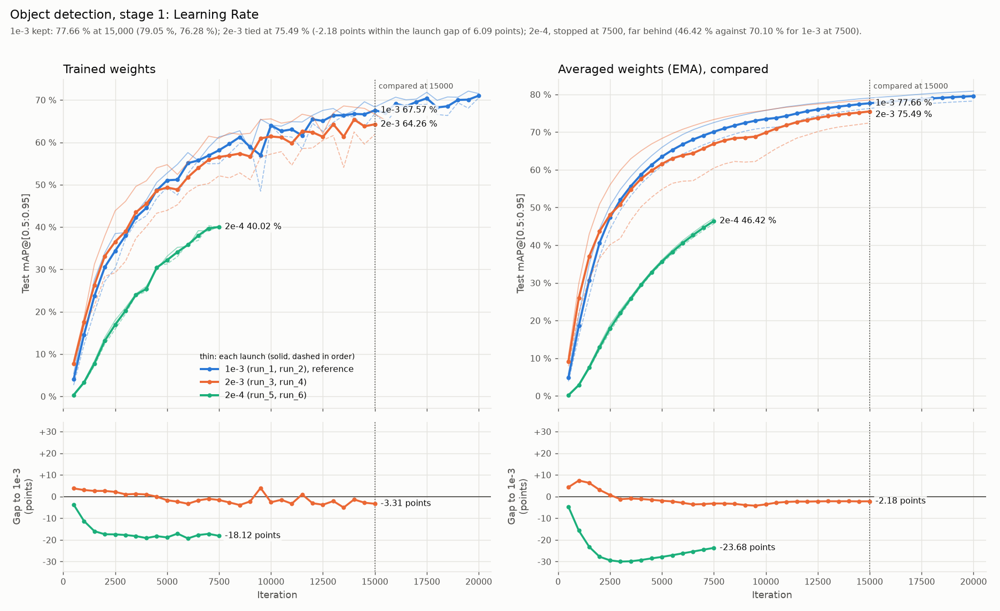
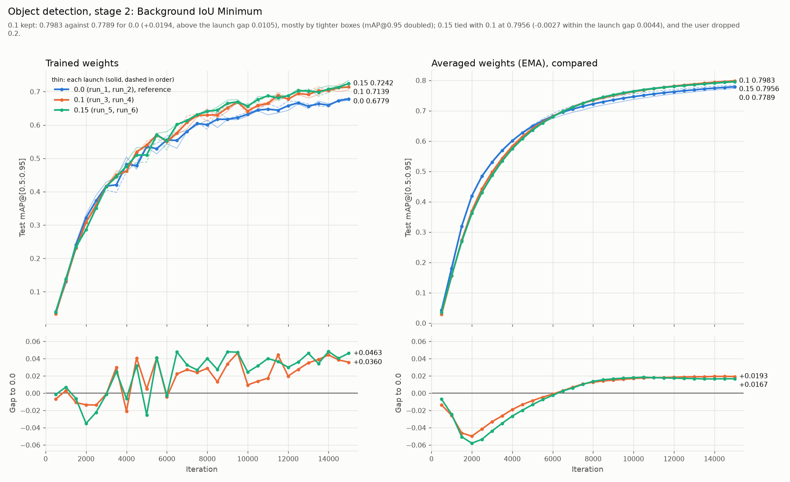
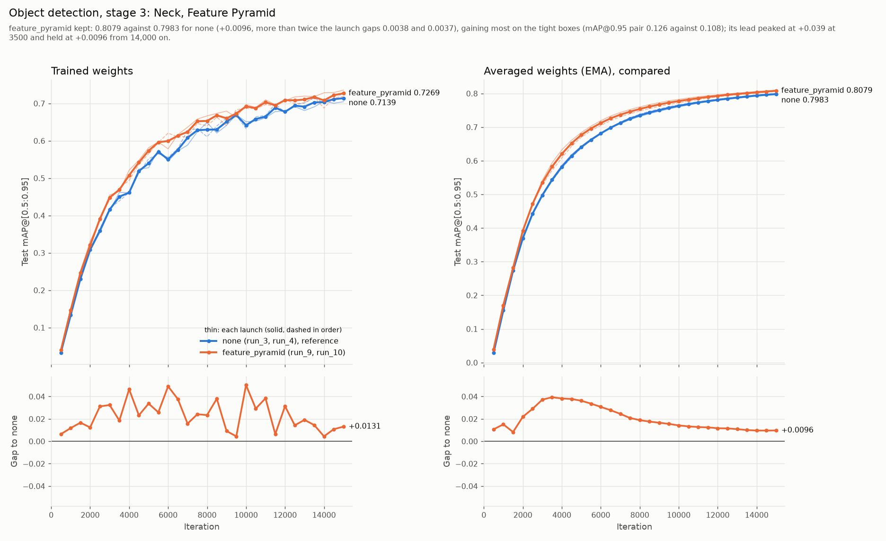

# Object Detection Experiment Plan

- **Configurations:** `vision_training/configurations/object_detection/run-<n>.yaml`, one per launch, launched with `uv run python -m vision_training.main --configuration_path=vision_training/configurations/object_detection/run-<n>.yaml`; the files after `run-1.yaml` are copies of it with the settings kept by the previous stages and the changed parameter, written by the driver `hyperparameter_experiments/object_detection/run_benchmark_stages.py`
- **Dataset:** synthetic hard shapes (`create_synthetic_dataset(task="object_detection", hard_objects=True)`), `/home/robert_kelevra/Data/object_detection_data/synthetic_hard_shapes`: 512,000 train / 50,000 validation / 50,000 test images of 1024 pixels, 5 to 12 shapes of the 35 shape classes per image (8.5 on average), from 16 pixels to 80% of the image side with log-uniform sizes (as many objects per scale octave), drawn from the largest to the smallest so that small shapes lie over large ones, up to 30% of a shape outside the image (box clipped, 19% of the boxes touching the border), on a flat background (20% of its shapes in a colour 20 to 40 levels from the background) or, for half of the images, a textured one (gradient, smooth noise or clutter lines changing the background by up to 40 levels). Below about 64 pixels the round polygons (heptagon, octagon, nonagon) are hard to tell from each other and from the circle
- **Launch folders:** `hyperparameter_experiments/object_detection/run_<n>` at the repository root, set as `ExperimentConfiguration.experiment_folder` before every launch. The learning rate stage is archived in `hyperparameter_experiments/object_detection/learning_rate_stage/` (its launches, state, results and a copy of its driver), the stages from 2026-11-05 numbering their launches from run_1 again

## Strategy

One parameter changes at a time. The best value of a stage is kept for all the following stages, and its launches serve as the reference of the next stage, reused when an earlier stage trained launches with the same settings for as many iterations (or more, under the constant learning rate schedule).

Every setting is launched twice, A and B, to smooth out the noise of a single training. Two launches train at the same time, the next launch starting as soon as one ends, the kernels of the two launches sharing the GPU through the MPS daemon. The training sets no random seed, so the two launches start from different weights, data order and augmentations.

Every launch keeps a moving average of its weights, and the settings are compared on the averaged weights (`Tensorboard/Test_EMA`): the score of a setting is the test mean average precision over the intersection over union thresholds 0.5 to 0.95 (`mAP@[0.5:0.95]/area`, the area under the precision recall curves) at the last iteration of the stage, averaged over its two launches. The mean average precision by object size (small, medium, large) and the proposal recall by detection level are read next to it.

The values of a stage are searched one pair at a time (the user's choice of 2026-11-02), so that no pair is trained once the answer is known. A challenger whose pair mean differs from the best value so far by less than the larger gap between the two launches of either value is a tie, within the noise of a single training: the search then ends on the earlier value, unless the stage says otherwise.

## Fixed Settings

- `batch_size`: 64 images of 1024 pixels (two launches side by side reach about 63 Gigabytes above the idle machine, of its 121; one launch at 128 images would take about 49 alone)
- `number_iterations`: 15,000 (960,000 images, 1.9 epochs of the 512,000 training images) from 2026-11-04, the user's choice for every detection stage. The learning rate stage was launched for 20,000 and read at 15,000 under its constant learning rate
- `weight_saving_iterations`: 500, the test evaluation running every 500 iterations (30 tested models) on `test_10000`, the first 10,000 of the 50,000 test images (85,143 objects), its images read from the `test` split through a link; `intermediate_weight_saving_iterations`: 250
- `information_dump`: 1000, `validation_iteration_ratio`: 0 (no validation during the training)
- Backbone `{"1": [1, 16], "2": [2, 16], "3": [2, 16], "4": [3, 32], "5": [3, 32], "6": [5, 32], "7": [5, 32]}`, residual blocks with squeeze and excite, input normalization, batch normalization
- Detection levels 4 to 7 (strides 16 to 128) with anchors of 16 and 32, 48 and 96, 128 and 256, 384 and 768 pixels, aspect ratios 0.5, 1 and 2, so that every size of the dataset has an anchor; region proposal heads `[2, 32]`, detection heads with a 7 x 7 RoIAlign grid, `[2, 32]` convolutions and `[64, 32]` fully connected layers, each level with its own heads (no feature pyramid network)
- Region proposals: 1000 before and 500 after the non-maximum suppression in training, 500 and 250 in inference, foreground intersection over union 0.5, background up to 0.3, 128 positive of 256 sampled anchors
- Adam, no weight decay, constant learning rate without warm-up, no gradient clipping, moving average of the weights with a decay of 0.9998
- Data augmentation:
  - learning rate stage: probability 0.4, the haze alone;
  - from 2026-11-05 (the user's `detection-run-configuration-defaults.yaml`): probability 0.25, the zoom-out, the left-right flip (0.5) and the photometric types (brightness, contrast and saturation, hue, CLAHE, sharpening, both histogram equalizations, noise, grayscale, colour swap, gamma, linear illumination, blur, motion blur, haze), each at 0.25
- MLflow tracking from 2026-11-05

## Starting Values

| Parameter | Value |
|---|---|
| `learning_rate` | 1e-3 (kept by stage 1) |
| `RegionProposal.background_iou_threshold.min` | 0.0 |
| `Detector.normalization.feature_map_normalization` | batch |
| Anchor centres | cell corners (audit L1 open) |
| Proposal selection | one top-k and one NMS over every level (audit M3 open), zero-area boxes kept (audit L7 open) |
| Box loss | smooth L1 on the offsets, beta 1/9 (`box_loss: "smooth_l1"` in both stages) |
| Neck | none |

## Stages

| Stage | Parameter | Values | Iterations | Status |
|---|---|---|---|---|
| 1 | `learning_rate` | 1e-3, 2e-3, 2e-4 (1e-4 not needed) | 15,000 | done, 1e-3 kept |
| 2 | `RegionProposal.background_iou_threshold.min` | 0.0, 0.1, 0.15 (0.2 dropped) | 15,000 | done, 0.1 kept |
| 2b | `RegionProposal.easy_negative_fraction` | 0.0, 0.25 | 15,000 | done, not conclusive (0.25 worse), code reverted |
| 3 | `Neck.type`, feature pyramid (`suggestions.md` item 1) | none, feature_pyramid | 15,000 | done, feature_pyramid kept (+0.0096) |
| 4 | `Neck.type`, path aggregation (`suggestions.md` item 37) | path_aggregation against feature_pyramid (run_9, run_10) | 15,000 | next, prepared (code of stage 3, launcher dry-run), waiting for the user's go |
| 5 | Box loss (`suggestions.md` item 36) | smooth L1, CIoU | 15,000 | after stage 4, code merged (off in every configuration) |
| 6 | `Detector.normalization.feature_map_normalization` | batch, layer, none | 15,000 | after stage 5 |
| 7 | Proposal selection (audit M3, with L7) | over every level, per level | 15,000 | after stage 6, code |
| 8 | Anchor centres (audit L1) | cell corners, cell centres | 15,000 | after stage 7, code |

On 2026-11-07 the user reordered the stages after stage 2b by the gains the literature makes most likely (the neck, then the CIoU box loss, the detector normalization, the proposal selection per level and the anchor centres last). Every code stage is merged right before its pair, which trains against the reference kept so far on the earlier code, and is reverted when it is not better, a tie keeping the earlier code (the easy negatives of stage 2b, merged before run_7 and reverted after run_8, left the draws of a share of 0.0 unchanged). `RegionProposal.foreground_iou_threshold.max`, read by the checks but never by the model, is removed from the configuration files with the code of a later stage (no number changes).

## Launches

Every launch gives its test mean average precision at every evaluation (every 500 iterations) for its trained and averaged weights, all gathered in `hyperparameter_experiments/object_detection/results.csv` by the driver (one column per swept setting), launches and mean rows as in the tables below. Since that folder is not versioned, a copy is kept next to this plan and committed after every stage: `object_detection_results.csv` for the stages from 2026-11-05, `object_detection_learning_rate_stage_results.csv` for stage 1. The figure of every stage (`figures/object_detection/`, drawn from these copies by `scripts/evaluation/plot_experiment_comparisons.py` with the stages of `experiment_comparisons.yaml`) shows the launches and pair means of the trained and averaged weights, and the gap of every value to the reference below.

### Stage 1: Learning Rate (6 launches, done)

The learning rates were searched one pair at a time: 2e-3 first, kept if better than 1e-3; otherwise 2e-4, then 1e-4 if 2e-4 were better. On 2026-11-03 the user stopped the 2e-3 pair at 15,000, tied with 1e-3 there, and asked for 2e-4 anyway, which was stopped at 7500 (2026-11-04), far behind.

| Value | Launches | Test_EMA mAP@[0.5:0.95] at 15,000 | Pair |
|---|---|---|---|
| 1e-3 | run_1, run_2 | 0.7905, 0.7628 | 0.7766 |
| 2e-3 | run_3, run_4 | 0.7853, 0.7244 | 0.7549 (tie: -0.0218 within the launch gap 0.0609) |
| 2e-4 | run_5, run_6 | 0.4714, 0.4570 at 7500 | 0.4642 against 0.7010 for 1e-3 at 7500 |

1e-3 was kept. At 20,000 its pair reached 0.7956 (run_1 0.8088, run_2 0.7823), the averaged weights ahead of the trained ones at every evaluation (0.7102 for the trained weights at 20,000). At 15,000, run_1 found almost every object (proposal recall at 0.5 of 0.998, 0.995 for the small objects) with a mAP@0.5 of 0.97, but its boxes are not tight: mAP@0.75 0.93 and mAP@0.95 0.05, which stages 3 to 8 address.

### Stage 2: Background IoU Minimum (6 launches, done)

The anchors whose best overlap is below `RegionProposal.background_iou_threshold.min` are ignored by the region proposal loss: 0.0 samples every anchor below 0.3 as background, 0.1 leaves out those touching no object, the region proposal network then learning from the hard negatives only. 0.1 beat 0.0 (+0.0194, above the launch gap 0.0105), mostly by tighter boxes (mAP@0.95 doubled), and 0.15 tied with 0.1 (-0.0027 within the launch gap 0.0044), so the user dropped 0.2 and kept 0.1.

| Value | Launches | Test_EMA mAP@[0.5:0.95] at 15,000 | Pair | mAP@0.95 pair |
|---|---|---|---|---|
| 0.0 | run_1, run_2 | 0.7737, 0.7842 | 0.7789 | 0.0504 |
| 0.1 | run_3, run_4 | 0.7964, 0.8001 | 0.7983 | 0.1078 |
| 0.15 | run_5, run_6 | 0.7978, 0.7934 | 0.7956 | 0.1073 |

The comparison of run_1 and run_2 with run_1 and run_2 of stage 1 (same settings, but the haze alone) measures the augmentation of the defaults, without any training.

### Stage 2b: Easy Negatives Mixed With The Hard Ones (2 launches, done, reverted)

With the minimum 0.1, `RegionProposal.easy_negative_fraction` (merged in c3068e3, reverted after the stage) drew a share of the sampled negatives of every image among the easy anchors below the minimum, the rest among the hard ones of [0.1, 0.3). At 0.25, the 64 first images of `test_10000` with the anchors of run_3 sample a median of 66.5 positives, 142 hard and 47.5 easy negatives per image (256 in all, the easy ones overlapping their objects by 0.04 at most); at 0.0 the samples and the loss are those of the previous code under the same seed, so that run_3 and run_4 are the reference.

0.25 led until 4000 (+0.043 at 2000), then fell behind at every evaluation, its boxes staying loose (mAP@0.95 about half that of 0.0): at 12,500 the pair was 0.0190 behind, above the launch gap 0.0066, and the user stopped run_7 and run_8 there (2026-11-07 13:29) and had the code reverted.

| Value | Launches | Test_EMA mAP@[0.5:0.95] at 12,500 | Pair | mAP@0.95 pair |
|---|---|---|---|---|
| 0.0 | run_3, run_4 | 0.7827, 0.7865 | 0.7846 | 0.0970 |
| 0.25 | run_7, run_8 | 0.7688, 0.7622 | 0.7655 | 0.0471 |

### Stages 3 And 4: Neck (2 or 4 launches, 15,000 iterations)

Until now every detection level has its own region proposal and detection heads reading their backbone block directly, without any path between the levels. The neck (design in `../detection_neck_design.md`, `Neck` section of the configuration) sits between the blocks and the heads, with 32 channels on every level (those of the blocks, so that the heads keep their size) and batch normalization, as the user chose: stage 3 compares no neck with the feature pyramid (1x1 laterals and the top-down path), stage 4 path aggregation (the bottom-up path after the pyramid) with the better of the two. Both types are merged with stage 3, so that stage 4 needs no other code.

| Stage | Order | Value | Launches |
|---|---|---|---|
| 3 | reference | none | run_3, run_4 |
| 3 | 1 | feature_pyramid | run_9, run_10 |
| 4 | reference | feature_pyramid | run_9, run_10 |
| 4 | 1 | path_aggregation | run_11, run_12 |

The neck was merged on 2026-11-07 (main 35aa62a), and run_9 and run_10 were launched by hand at 14:51:40 and 14:52:10 with the settings of run_3 and run_4 (background IoU minimum 0.1, detector batch normalization, learning rate 1e-3, 15,000 iterations, 1 loader worker), their configuration files differing from those of run_3 and run_4 only by `Neck.type: "feature_pyramid"` (run name token `L4567-NFPN32BN`). Before the launch, 40 iterations of the same configuration on the Spark gave 43.5 and 43.7 images per second alone without neck at iterations 20 and 40, 41.0 and 45.2 with the feature pyramid, 41.6 and 42.6 with path aggregation (no measurable cost over so few iterations), and a peak GPU memory of 17.2 GB without neck against 17.3 GB with either neck, whose 41,728 parameters (feature pyramid) add 0.17 MB to the model.

Stage 3 ended on 2026-11-08, both launches with their 15,000 checkpoint. The feature pyramid beat no neck by +0.0096, more than twice the launch gaps (0.0038 for run_9 and run_10, 0.0037 for run_3 and run_4), and was kept: it gained most on the tight boxes (mAP@0.75 +0.008, mAP@0.95 +0.018) and on the medium and large objects (+0.012, +0.013), the small ones about even (+0.002) and mAP@0.5 +0.001. Its lead peaked at +0.039 at 3500 and held at +0.0096 from 14,000 on; the trained weights led as well, with more noise (0.727 against 0.714 at 15,000).

| Value | Launches | Test_EMA mAP@[0.5:0.95] at 15,000 | Pair | mAP@0.95 pair | Test (trained) pair |
|---|---|---|---|---|---|
| none | run_3, run_4 | 0.7964, 0.8001 | 0.7983 | 0.108 | 0.714 |
| feature_pyramid | run_9, run_10 | 0.8098, 0.8060 | 0.8079 | 0.126 | 0.727 |

A launch with the feature pyramid took 14.45 hours from its first to its last iteration, against 13.85 for run_3 and run_4 (+4.3 %), both pairs trained side by side. Most of that came from the first 4000 iterations, 15 to 20 % slower than the reference while the machine was busier (2.7 seconds per iteration, against 2.4 later in the same launches); from 5000 on an iteration cost 1.5 % more on average (from 2 % less to 4 % more over each 1000 iterations, median 2.39 seconds against 2.37). The two test evaluations of every checkpoint (10,000 images each, trained and averaged weights) took about 4.1 of those hours, 8.3 minutes per checkpoint, the neck adding 2 %.

Stage 4 is prepared and waits for the user's go. On 2026-11-08 the path aggregation was checked against the PANet paper, its official code, the PAFPN of mmdetection, YOLOv4 and EfficientDet (`../detection_neck_design.md`, Path Aggregation Design): the neck is the bottom-up path of the released PANet model with batch normalization in place of group normalization, so it needs no other code, and `test_path_aggregation_follows_the_panet_building_block` holds its order. The git-ignored launcher `launch_runs_11_and_12_path_aggregation.py` was dry-run the same day, its configuration files differing from those of run_9 and run_10 by `Neck.type: "path_aggregation"` only (run name token `L4567-NPAN32BN`). The published gains of the bottom-up path are about one point of box AP on COCO, largest on the large objects (PANet Table 3: +0.9, large +2.3), so the stage reads mAP@0.75, mAP@0.95 and the large objects beside the decision metric; path aggregation is kept if its pair beats 0.8079 by more than the larger launch gap (0.0038 for run_9 and run_10).

### Stages 5 To 8: Box Loss, Detector Normalization, Proposal Selection, Anchor Centres

Each pair trains against the reference kept so far, the detector normalization needing no code:

- **Stage 5, CIoU box loss (`suggestions.md` item 36):** 1 - CIoU between the decoded boxes of the sampled positives and their targets, in both stages, against the smooth L1 on the offsets; aimed at the mAP@0.75 to @0.95. The loss is merged since 2026-11-08 (`RegionProposal.box_loss` and `Detector.box_loss`, `"smooth_l1"` in every configuration, stage 4 included), checked against the papers and their code in `detection_box_loss_design.md`. The published Faster R-CNN applies it to the detection heads only, with a loss weight of 12 (`detection_box_loss_design.md`, Stage 5 Pair): the stages and the weight are decided before the launch.
- **Stage 6, detector normalization:** the normalization of the convolutions of the detection heads, batch (the reference) then layer then none, layer clearly worse than batch ending the search.
- **Stage 7, proposal selection per level (audit M3 with L7, `suggestions.md` item 3):** the pre-NMS top-k taken per level, `batched_nms` grouped by level, then the global top `post_nms`, in the proposal filter and in `InferenceDetector`, the zero-area proposals and detections removed. Level 7 had the lowest proposal recall at 0.5 of stage 1 (0.29, against 0.37 to 0.43 for levels 4 to 6).
- **Stage 8, anchor centres (audit L1, `suggestions.md`):** the anchors are centred on the cell corners (`anchors.py`, `shifts = arange(F) * stride`) while RoIAlign and the convolutions place the cells at their centres, a constant half-stride offset the regressor has to learn: `(arange(F) + 0.5) * stride`, in the training and in the export.

A pair trains in about 15 hours at 15,000 iterations (two launches side by side, test evaluations included), so stages 3 to 8 take six or seven pairs (3.5 to 4 days of training).
