# Sequence Labelling Experiment Plan

- **Configurations:** `vision_training/configurations/sequence_labelling/run-<n>.yaml`, one per launch (`run-1.yaml` to `run-8.yaml` for stage 1), launched with `uv run python -m vision_training.main --configuration_path=vision_training/configurations/sequence_labelling/run-<n>.yaml`; the files of the later stages are copies of `run-1.yaml` with the settings kept by the previous stages and the changed parameter
- **Dataset:** synthetic changing shapes (`create_synthetic_dataset(task="sequence_labelling")`), frames of 5 to 10 shapes drawn again at every frame, every frame from the second one adding a shape, removing one or keeping them; 71 labels (`appearing_<class>` and `disappearing_<class>` for the 35 shape classes, and `no_change`, always the label of the first frame); 250,000 train / 50,000 validation / 50,000 test sequences of 2 to 12 frames of 512 pixels, resized to 256 pixels
- **Launch folders:** `hyperparameter_experiments/sequence_labelling/run_<n>` at the repository root, set as `ExperimentConfiguration.experiment_folder` before every launch

## Strategy

One parameter changes at a time. The best value of a stage is kept for all the following stages, and its launches serve as the reference of the next stage, so they are not trained again when that stage trains as many iterations. A stage training another number of iterations trains its reference again from scratch (two new launches, never a resumed one), so that every compared launch starts from a new initialisation. The short learning rate stage (2000 iterations) chooses the learning rate, and the following stages train 6000 iterations: the class weighting stage trains both of its values, and the later stages reuse its kept launches.

Every setting is launched twice, A and B, to smooth out the noise of a single training, the two launches of a setting training at the same time on the GPU. The training sets no random seed, so the two launches start from different weights, data order and augmentations.

Every launch keeps a moving average of its weights, and the settings are compared on the averaged weights (`Tensorboard/Test_EMA`). Up to the direction stage, the score of a setting was the mean of the test Macro F1 of the averaged weights over all the evaluations of the launch, at iterations 250 to 2000 for the learning rate stage and 250 to 6000 for the following stages, averaged over the two launches. From the temporal module stage on, as the user decided on 2026-10-30 ("We will keep lstm it kept going up in terms of metrics, there is a clear difference"), the score is the test Macro F1 of the averaged weights at the last iteration of the stage (6000), averaged over the two launches: the mean over all the evaluations favours the settings that learn early over those still rising at the end. The learning rate, class weighting and direction stages keep the same winners under both scores (at iteration 2000, 1e-3 gives 0.0244 against 0.0181 for 2e-3; at iteration 6000, balanced gives 0.1207 against 0.0233 for none, and bidirectional 0.1936 against 0.1207 for unidirectional). The Macro F1 weighs the frames of every change as much as the far more frequent frames without change, whose share makes the frame accuracy high for a model that never finds a change.

## Fixed Settings

- `batch_size`: 64 sequences
- `number_iterations`: 2000 for the learning rate stage (128,000 sequences, about half an epoch of the 250,000 training sequences), 6000 for the following stages (384,000 sequences, about 1.5 epochs)
- `weight_saving_iterations`: 250, the test evaluation running every 250 iterations (8 tested models at 2000 iterations, 24 at 6000) on `test_10000`, a fixed subset of 10,000 of the 50,000 test sequences (69,918 frames, every label present) drawn with the seed 0 by `scripts/data/create_sequence_split_subset.py`, the evaluation of the whole test split taking 26 minutes
- `intermediate_weight_saving_iterations`: 125, as many more checkpoints saved without a test evaluation
- `number_workers`: 2 per loader, `prefetch_batches`: 2, the expandable segments of the CUDA allocator turned on by the training launch (two launches side by side stay at about 55 Gigabytes of the 121 of the machine); `Data.loading` has since been removed from the configurations, every loader now using 4 workers each prefetching 2 batches
- `information_dump`: 250, `validation_iteration_ratio`: 0 (no validation during the training)
- `maximum_sequence_length`: 50, every sequence fed whole, the sequences of a batch padded to the longest one
- Backbone `{"1": [1, 16], "2": [2, 16], "3": [2, 16], "4": [4, 32], "5": [5, 32], "6": [5, 32]}`, residual blocks with squeeze and excite, input normalization
- Temporal module: hidden size 96, dropout 0, positional embedding (transformer), 4 heads (transformer), kernel size 3 (temporal convolution)
- Classification head `[96, 96]` with layer normalization, dropout 0.2, no label smoothing
- Adam, no weight decay, constant learning rate without warm-up, no gradient clipping
- Mixed precision (bfloat16), moving average of the weights with a decay of 0.9998
- Data augmentation with a probability of 0.4: left-right flip (0.5), and with a probability of 0.3 each brightness, contrast and saturation, CLAHE, sharpening, luminance histogram equalization, histogram equalization of the BGR channels, noise, grayscale and the swap of the blue and red channels, the same for all the frames of a sequence
- Every augmentation type added after the start of the experiment kept off, the haze included (on by default since 2026-10-20), so that the launches from run_11 on, restarted on 2026-10-29, train with the augmentations of run_1 to run_10
- `top_k`: 5 (now fixed in the code, no longer a setting), no per-class report, no saved predictions, 8 sample sequences

## Starting Values

| Parameter | Value |
|---|---|
| `learning_rate` | 1e-3 |
| Direction | unidirectional (`causal: True`, `bidirectional: False`) |
| `TemporalModel.type` | lstm |
| `TemporalModel.number_layers` | 1 |
| `global_pooling` | flatten |
| `feature_map_normalization` | batch |
| `class_weighting` | balanced |

## Stages

| Stage | Parameter | Values | Iterations |
|---|---|---|---|
| 1 | `learning_rate` | 1e-3, 1e-4, 2e-4, 2e-3 | 2000 |
| 2 | `class_weighting` | balanced, none | 6000 |
| 3 | Direction | unidirectional, bidirectional | 6000 |
| 4 | `TemporalModel.type` | lstm, gru, transformer, temporal_convolution | 6000 |
| 5 | `TemporalModel.number_layers` | 1, 2 | 6000 |
| 6 | `global_pooling` | flatten, average, max | 6000 |
| 7 | `feature_map_normalization` | batch, sequence | 6000 |
| 8 | Pretraining | none, fine_tuned, fine_tuned_slow | 6000 |
| 9 | `learning_rate`, pretrained | 1e-3, 1e-4, 2e-4, 2e-3 | 4000 |
| 10 | `class_weighting`, pretrained | balanced, none | 6000 |
| 11 | `TemporalModel.type`, pretrained | lstm, gru, transformer | 6000 |
| 12 | `TemporalModel.number_layers`, pretrained | 1, 2 | 6000 |
| 13 | `global_pooling`, pretrained | max, flatten | 6000 |

Stages 9 to 13, asked by the user on 2026-10-31 after stage 8, train stages 1 to 6 again from the settings kept by the 8 stages, the backbone of every launch loaded from the multi-label shape classifier and fine-tuned at the learning rate of the other components, the best value of a stage being kept for the following stages as before. On 2026-10-31, after stage 10, the user dropped the settings far behind from scratch that the pretrained backbone is not expected to bring back: the unidirectional direction (the direction stage, whose launches run_41 and run_42 were stopped after 250 iterations and deleted), the temporal convolution and the average pooling. The feature map normalization stays batch, the normalization of the pretrained backbone. The learning rate stage trains 4000 iterations, as the user chose. A reference is reused whenever an earlier stage trained launches with the same settings for as many iterations, or for more iterations under the constant learning rate schedule of every launch, its evaluation at the last iteration of the stage being then that of a launch stopped there: run_29 and run_30 (stage 8) are the reference of stage 9 at iteration 4000 and of the following stages while their values are kept. From 2026-10-31 the launches share the GPU through NVIDIA MPS, and launches started by the driver after its restart run in two slots, the two launches of a setting no longer always side by side.

The direction is written as the flags of the temporal module: unidirectional is `causal: True` and `bidirectional: False` for every type; bidirectional is `bidirectional: True` and `causal: False` for the GRU and the LSTM, and `causal: False` (attention over every frame, centred convolutions) for the transformer and the temporal convolution.

## Launches

Every launch gives its test Macro F1 at every evaluation (every 250 iterations up to the last one of its stage) for its trained and averaged weights, all gathered in `hyperparameter_experiments/sequence_labelling/results.csv` by `uv run python -m scripts.evaluation.collect_experiment_results` (`task = "sequence_labelling"`), launches and mean rows as in the tables below. Since that folder is not versioned, a copy is kept next to this plan, `sequence_labelling_results.csv`, and the figure of every stage (`figures/sequence_labelling/`, drawn from it by `scripts/evaluation/plot_experiment_comparisons.py` with the stages of `experiment_comparisons.yaml`) shows the launches and means of the trained and averaged weights, with the gap of every value to the reference below. The mean row of a setting averages its two launches, and the setting with the highest score of the averaged weights is kept (the mean over all the evaluations up to the direction stage, the value at iteration 6000 from the temporal module stage on).

### Stage 1: Learning Rate (8 launches, 2000 iterations)

| `learning_rate` | Launch | 250 | 500 | 750 | 1000 | 1250 | 1500 | 1750 | 2000 | Mean |
|---|---|---|---|---|---|---|---|---|---|---|
| 1e-4 | run_3 | 0.0032 | 0.0034 | 0.0066 | 0.0089 | 0.0103 | 0.0114 | 0.0123 | 0.0132 | 0.0087 |
| 1e-4 | run_4 | 0.0042 | 0.0050 | 0.0069 | 0.0092 | 0.0102 | 0.0107 | 0.0103 | 0.0118 | 0.0086 |
| 1e-4 | **Mean** | 0.0037 | 0.0042 | 0.0067 | 0.0091 | 0.0102 | 0.0111 | 0.0113 | 0.0125 | 0.0086 |
| 2e-4 | run_5 | 0.0024 | 0.0091 | 0.0108 | 0.0116 | 0.0112 | 0.0117 | 0.0185 | 0.0193 | 0.0118 |
| 2e-4 | run_6 | 0.0026 | 0.0028 | 0.0093 | 0.0102 | 0.0145 | 0.0131 | 0.0146 | 0.0174 | 0.0106 |
| 2e-4 | **Mean** | 0.0025 | 0.0059 | 0.0101 | 0.0109 | 0.0128 | 0.0124 | 0.0166 | 0.0183 | 0.0112 |
| 1e-3 | run_1 | 0.0012 | 0.0074 | 0.0069 | 0.0138 | 0.0173 | 0.0207 | 0.0226 | 0.0274 | 0.0147 |
| 1e-3 | run_2 | 0.0073 | 0.0071 | 0.0070 | 0.0080 | 0.0138 | 0.0174 | 0.0183 | 0.0215 | 0.0125 |
| 1e-3 | **Mean** | 0.0042 | 0.0073 | 0.0069 | 0.0109 | 0.0155 | 0.0191 | 0.0205 | 0.0244 | **0.0136** |
| 2e-3 | run_7 | 0.0022 | 0.0063 | 0.0133 | 0.0177 | 0.0202 | 0.0242 | 0.0250 | 0.0294 | 0.0173 |
| 2e-3 | run_8 | 0.0006 | 0.0069 | 0.0067 | 0.0068 | 0.0068 | 0.0070 | 0.0068 | 0.0068 | 0.0061 |
| 2e-3 | **Mean** | 0.0014 | 0.0066 | 0.0100 | 0.0122 | 0.0135 | 0.0156 | 0.0159 | 0.0181 | 0.0117 |

Kept: **1e-3** (run_1 and run_2), the highest mean (0.0136 against 0.0117 for 2e-3, 0.0112 for 2e-4 and 0.0086 for 1e-4); the configuration files of the next stages are copies of `run-1.yaml` with the changed parameter and 6000 iterations.

- The higher the learning rate, the faster the launches learn up to 1e-3: at iteration 2000 the means are 0.0125 (1e-4), 0.0183 (2e-4) and 0.0244 (1e-3).
- 2e-3 gives the best single launch (run_7, 0.0294 at iteration 2000), but run_8 stays at about 0.0068 from iteration 500 to 2000, the score of a model that only learns that the first frame of a sequence is `no_change`: 2e-3 lies at the edge of the usable learning rates.
- Every launch that learns is still rising at iteration 2000, so the following stages train 6000 iterations.

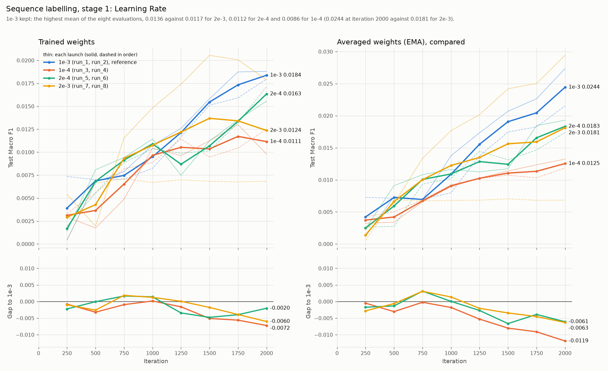

### Stage 2: Class Weighting (4 launches, 6000 iterations)

The columns give every second evaluation, the mean is taken over all 24 evaluations (250 to 6000).

| `class_weighting` | Launch | 500 | 1000 | 1500 | 2000 | 2500 | 3000 | 3500 | 4000 | 4500 | 5000 | 5500 | 6000 | Mean |
|---|---|---|---|---|---|---|---|---|---|---|---|---|---|---|
| balanced | run_9 | 0.0068 | 0.0164 | 0.0221 | 0.0262 | 0.0341 | 0.0536 | 0.0624 | 0.0629 | 0.0714 | 0.0745 | 0.0760 | 0.0686 | 0.0465 |
| balanced | run_10 | 0.0069 | 0.0154 | 0.0194 | 0.0302 | 0.0430 | 0.0657 | 0.0885 | 0.1131 | 0.1374 | 0.1593 | 0.1712 | 0.1727 | 0.0824 |
| balanced | **Mean** | 0.0068 | 0.0159 | 0.0208 | 0.0282 | 0.0386 | 0.0596 | 0.0754 | 0.0880 | 0.1044 | 0.1169 | 0.1236 | 0.1207 | 0.0645 |
| none | run_11 | 0.0090 | 0.0090 | 0.0090 | 0.0155 | 0.0168 | 0.0189 | 0.0200 | 0.0189 | 0.0208 | 0.0254 | 0.0298 | 0.0375 | 0.0187 |
| none | run_12 | 0.0090 | 0.0090 | 0.0090 | 0.0090 | 0.0090 | 0.0090 | 0.0090 | 0.0090 | 0.0090 | 0.0090 | 0.0090 | 0.0090 | 0.0090 |
| none | **Mean** | 0.0090 | 0.0090 | 0.0090 | 0.0123 | 0.0129 | 0.0140 | 0.0145 | 0.0140 | 0.0149 | 0.0172 | 0.0194 | 0.0233 | 0.0139 |

Kept: **balanced** (run_9 and run_10), the highest mean (0.0645 against 0.0139 for none); the direction stage trains bidirectional (run_13 and run_14) against the unidirectional run_9 and run_10.

- Without class weighting the launches barely learn a change: run_12 stays at 0.0090 from the first to the last evaluation, the score of a model that only predicts `no_change`, and run_11 only starts rising after iteration 1500 (0.0375 at iteration 6000).
- The two balanced launches part after iteration 3000 (0.0686 and 0.1727 at iteration 6000), run_10 still rising at iteration 6000 while run_9 levels off at about 0.07.

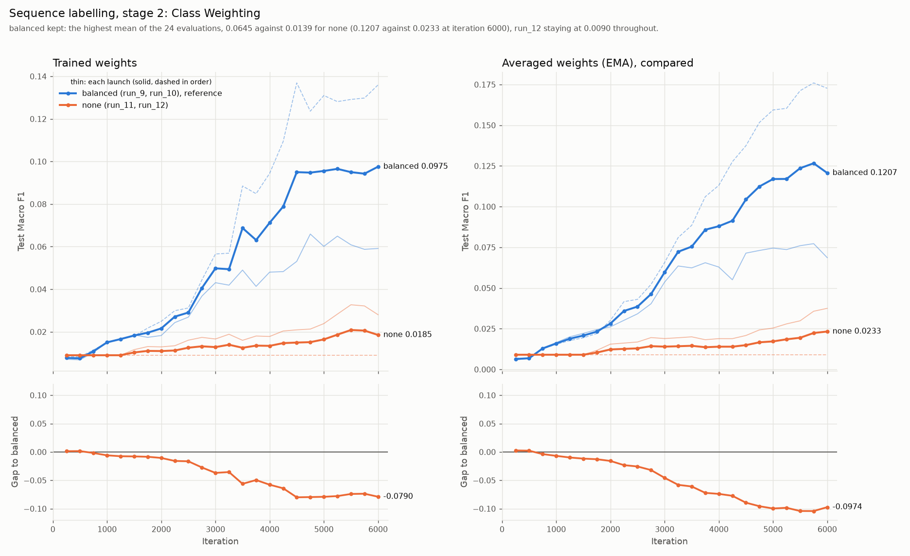

### Stage 3: Direction (2 new launches, 6000 iterations)

The unidirectional launches are run_9 and run_10 of the class weighting stage. The columns give every second evaluation, the mean is taken over all 24 evaluations (250 to 6000).

| Direction | Launch | 500 | 1000 | 1500 | 2000 | 2500 | 3000 | 3500 | 4000 | 4500 | 5000 | 5500 | 6000 | Mean |
|---|---|---|---|---|---|---|---|---|---|---|---|---|---|---|
| uni | run_9 | 0.0068 | 0.0164 | 0.0221 | 0.0262 | 0.0341 | 0.0536 | 0.0624 | 0.0629 | 0.0714 | 0.0745 | 0.0760 | 0.0686 | 0.0465 |
| uni | run_10 | 0.0069 | 0.0154 | 0.0194 | 0.0302 | 0.0430 | 0.0657 | 0.0885 | 0.1131 | 0.1374 | 0.1593 | 0.1712 | 0.1727 | 0.0824 |
| uni | **Mean** | 0.0068 | 0.0159 | 0.0208 | 0.0282 | 0.0386 | 0.0596 | 0.0754 | 0.0880 | 0.1044 | 0.1169 | 0.1236 | 0.1207 | 0.0645 |
| bidirectional | run_13 | 0.0114 | 0.0193 | 0.0175 | 0.0243 | 0.0395 | 0.0643 | 0.0793 | 0.0961 | 0.1196 | 0.1486 | 0.1916 | 0.2411 | 0.0818 |
| bidirectional | run_14 | 0.0078 | 0.0072 | 0.0201 | 0.0230 | 0.0253 | 0.0338 | 0.0427 | 0.0532 | 0.0719 | 0.0925 | 0.1189 | 0.1461 | 0.0500 |
| bidirectional | **Mean** | 0.0096 | 0.0133 | 0.0188 | 0.0236 | 0.0324 | 0.0491 | 0.0610 | 0.0746 | 0.0957 | 0.1206 | 0.1553 | 0.1936 | 0.0659 |

Kept: **bidirectional** (run_13 and run_14), the highest mean (0.0659 against 0.0645 for unidirectional); the temporal module stage trains the bidirectional GRU (run_15 and run_16), the non-causal transformer (run_17 and run_18) and the non-causal temporal convolution (run_19 and run_20) against the bidirectional LSTM of run_13 and run_14.

- The means over all the evaluations lie within the spread of the launches (0.0818 and 0.0500 against 0.0465 and 0.0824), so the gap of 0.0014 alone would not tell the two directions apart.
- The bidirectional launches end far higher, 0.1936 at iteration 6000 against 0.1207, both still rising at a steeper slope (0.2411 for run_13), the advantage showing after iteration 4500, once every launch has learned to find the changes.

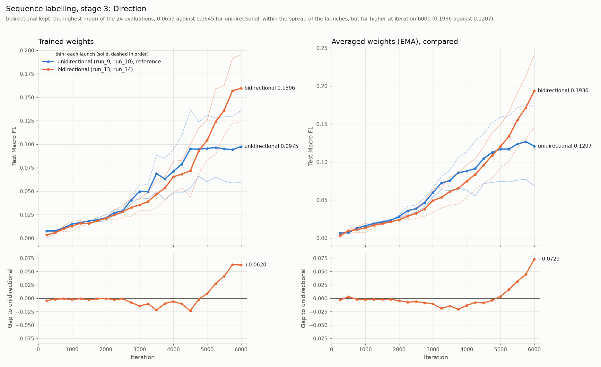

### Stage 4: Temporal Module (6 new launches, 6000 iterations)

The bidirectional LSTM launches are run_13 and run_14 of the direction stage; the transformer and the temporal convolution are non-causal, attending to or convolving over every frame. The columns give every second evaluation, the mean is taken over all 24 evaluations (250 to 6000), and the setting is kept on its value at iteration 6000.

| `TemporalModel.type` | Launch | 500 | 1000 | 1500 | 2000 | 2500 | 3000 | 3500 | 4000 | 4500 | 5000 | 5500 | 6000 | Mean |
|---|---|---|---|---|---|---|---|---|---|---|---|---|---|---|
| lstm | run_13 | 0.0114 | 0.0193 | 0.0175 | 0.0243 | 0.0395 | 0.0643 | 0.0793 | 0.0961 | 0.1196 | 0.1486 | 0.1916 | 0.2411 | 0.0818 |
| lstm | run_14 | 0.0078 | 0.0072 | 0.0201 | 0.0230 | 0.0253 | 0.0338 | 0.0427 | 0.0532 | 0.0719 | 0.0925 | 0.1189 | 0.1461 | 0.0500 |
| lstm | **Mean** | 0.0096 | 0.0133 | 0.0188 | 0.0236 | 0.0324 | 0.0491 | 0.0610 | 0.0746 | 0.0957 | 0.1206 | 0.1553 | 0.1936 | 0.0659 |
| gru | run_15 | 0.0096 | 0.0171 | 0.0214 | 0.0334 | 0.0371 | 0.0474 | 0.0702 | 0.0998 | 0.1243 | 0.1494 | 0.1518 | 0.1554 | 0.0725 |
| gru | run_16 | 0.0082 | 0.0151 | 0.0245 | 0.0275 | 0.0420 | 0.0500 | 0.0499 | 0.0730 | 0.0937 | 0.1252 | 0.1373 | 0.1470 | 0.0628 |
| gru | **Mean** | 0.0089 | 0.0161 | 0.0229 | 0.0305 | 0.0396 | 0.0487 | 0.0600 | 0.0864 | 0.1090 | 0.1373 | 0.1445 | 0.1512 | 0.0677 |
| transformer | run_17 | 0.0006 | 0.0026 | 0.0134 | 0.0177 | 0.0237 | 0.0331 | 0.0428 | 0.0553 | 0.0751 | 0.0866 | 0.0980 | 0.1133 | 0.0442 |
| transformer | run_18 | 0.0004 | 0.0014 | 0.0072 | 0.0164 | 0.0213 | 0.0270 | 0.0312 | 0.0458 | 0.0603 | 0.0858 | 0.1261 | 0.1572 | 0.0453 |
| transformer | **Mean** | 0.0005 | 0.0020 | 0.0103 | 0.0171 | 0.0225 | 0.0300 | 0.0370 | 0.0506 | 0.0677 | 0.0862 | 0.1120 | 0.1353 | 0.0448 |
| temporal_convolution | run_19 | 0.0123 | 0.0230 | 0.0361 | 0.0497 | 0.0743 | 0.1157 | 0.1082 | 0.0858 | 0.0962 | 0.1047 | 0.0973 | 0.1012 | 0.0734 |
| temporal_convolution | run_20 | 0.0118 | 0.0181 | 0.0331 | 0.0454 | 0.0623 | 0.1138 | 0.1229 | 0.1146 | 0.1137 | 0.1044 | 0.1029 | 0.1098 | 0.0788 |
| temporal_convolution | **Mean** | 0.0121 | 0.0205 | 0.0346 | 0.0475 | 0.0683 | 0.1147 | 0.1156 | 0.1002 | 0.1050 | 0.1046 | 0.1001 | 0.1055 | 0.0761 |

Kept: **lstm** (run_13 and run_14), the highest value at iteration 6000 (0.1936 against 0.1512 for the GRU, 0.1353 for the transformer and 0.1055 for the temporal convolution); the temporal layers stage trains 2 layers (run_21 and run_22) against the single layer of run_13 and run_14.

- The mean over all the evaluations, the score of the previous stages, would have kept the temporal convolution (0.0761, against 0.0677 for the GRU, 0.0659 for the LSTM and 0.0448 for the transformer): it learns fastest, its launches agreeing closely, but levels off at about 0.10 to 0.11 from iteration 3000, below every other module at iteration 6000.
- The GRU leads the LSTM up to iteration 5000 (0.1373 against 0.1206), then levels off at about 0.15 while the LSTM keeps rising (run_13 at 0.2411).
- The transformer learns slowest (0.0020 at iteration 1000 against 0.0133 to 0.0205 for the other modules), but is still rising steeply at iteration 6000 (run_18 from 0.1261 to 0.1572 over its last 500 iterations), so it may overtake the GRU with a longer training.

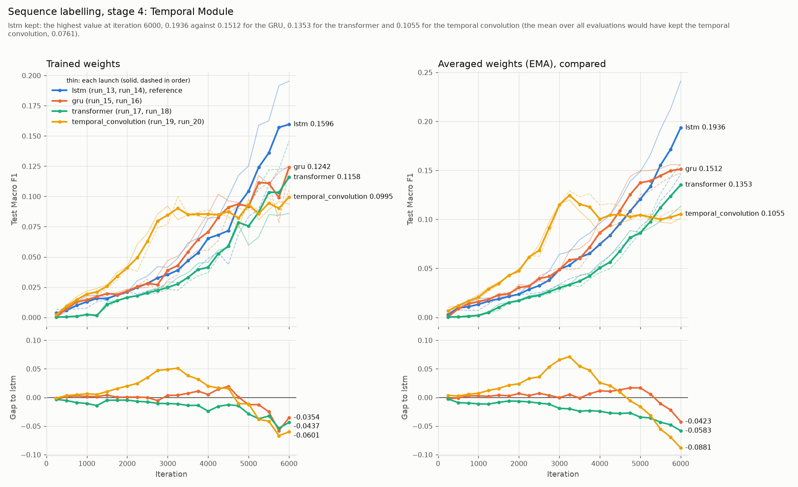

### Stage 5: Temporal Layers (2 new launches, 6000 iterations)

The single layer launches are run_13 and run_14 of the direction stage. The columns give every second evaluation, the mean is taken over all 24 evaluations (250 to 6000), and the setting is kept on its value at iteration 6000.

| `TemporalModel.number_layers` | Launch | 500 | 1000 | 1500 | 2000 | 2500 | 3000 | 3500 | 4000 | 4500 | 5000 | 5500 | 6000 | Mean |
|---|---|---|---|---|---|---|---|---|---|---|---|---|---|---|
| 1 | run_13 | 0.0114 | 0.0193 | 0.0175 | 0.0243 | 0.0395 | 0.0643 | 0.0793 | 0.0961 | 0.1196 | 0.1486 | 0.1916 | 0.2411 | 0.0818 |
| 1 | run_14 | 0.0078 | 0.0072 | 0.0201 | 0.0230 | 0.0253 | 0.0338 | 0.0427 | 0.0532 | 0.0719 | 0.0925 | 0.1189 | 0.1461 | 0.0500 |
| 1 | **Mean** | 0.0096 | 0.0133 | 0.0188 | 0.0236 | 0.0324 | 0.0491 | 0.0610 | 0.0746 | 0.0957 | 0.1206 | 0.1553 | 0.1936 | 0.0659 |
| 2 | run_21 | 0.0071 | 0.0070 | 0.0069 | 0.0092 | 0.0185 | 0.0247 | 0.0371 | 0.0443 | 0.0580 | 0.0703 | 0.0842 | 0.0884 | 0.0368 |
| 2 | run_22 | 0.0068 | 0.0087 | 0.0188 | 0.0224 | 0.0343 | 0.0377 | 0.0395 | 0.0453 | 0.0582 | 0.0704 | 0.0893 | 0.0898 | 0.0414 |
| 2 | **Mean** | 0.0070 | 0.0078 | 0.0129 | 0.0158 | 0.0264 | 0.0312 | 0.0383 | 0.0448 | 0.0581 | 0.0703 | 0.0867 | 0.0891 | 0.0391 |

Kept: **1** layer (run_13 and run_14), the highest value at iteration 6000 (0.1936 against 0.0891 for 2 layers); the frame pooling stage trains the average pooling (run_23 and run_24) and the max pooling (run_25 and run_26) against the flattened feature maps of run_13 and run_14.

- The second layer slows the start: run_21 stays at about 0.007, the score of a model that only predicts `no_change`, up to iteration 1750, and only rises from iteration 2000.
- Both 2 layer launches end at about 0.089 and level off from iteration 5500, while the single layer keeps rising, so the second layer is behind at every evaluation from iteration 2500 and by more than half at iteration 6000.

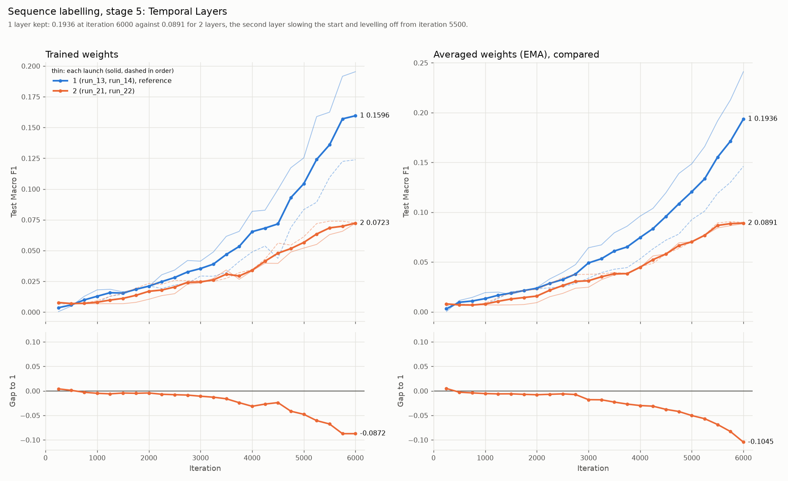

### Stage 6: Frame Pooling (4 new launches, 6000 iterations)

The flattened feature map launches are run_13 and run_14 of the direction stage. The columns give every second evaluation, the mean is taken over all 24 evaluations (250 to 6000), and the setting is kept on its value at iteration 6000.

| `ClassificationHead.global_pooling` | Launch | 500 | 1000 | 1500 | 2000 | 2500 | 3000 | 3500 | 4000 | 4500 | 5000 | 5500 | 6000 | Mean |
|---|---|---|---|---|---|---|---|---|---|---|---|---|---|---|
| flatten | run_13 | 0.0114 | 0.0193 | 0.0175 | 0.0243 | 0.0395 | 0.0643 | 0.0793 | 0.0961 | 0.1196 | 0.1486 | 0.1916 | 0.2411 | 0.0818 |
| flatten | run_14 | 0.0078 | 0.0072 | 0.0201 | 0.0230 | 0.0253 | 0.0338 | 0.0427 | 0.0532 | 0.0719 | 0.0925 | 0.1189 | 0.1461 | 0.0500 |
| flatten | **Mean** | 0.0096 | 0.0133 | 0.0188 | 0.0236 | 0.0324 | 0.0491 | 0.0610 | 0.0746 | 0.0957 | 0.1206 | 0.1553 | 0.1936 | 0.0659 |
| average | run_23 | 0.0139 | 0.0239 | 0.0361 | 0.0411 | 0.0561 | 0.0728 | 0.0929 | 0.0967 | 0.1070 | 0.1580 | 0.1904 | 0.2197 | 0.0871 |
| average | run_24 | 0.0071 | 0.0069 | 0.0070 | 0.0068 | 0.0068 | 0.0071 | 0.0068 | 0.0071 | 0.0069 | 0.0070 | 0.0070 | 0.0068 | 0.0070 |
| average | **Mean** | 0.0105 | 0.0154 | 0.0216 | 0.0239 | 0.0315 | 0.0400 | 0.0498 | 0.0519 | 0.0570 | 0.0825 | 0.0987 | 0.1132 | 0.0471 |
| max | run_25 | 0.0135 | 0.0203 | 0.0322 | 0.0559 | 0.0932 | 0.1254 | 0.1459 | 0.1656 | 0.1645 | 0.1829 | 0.2105 | 0.2397 | 0.1162 |
| max | run_26 | 0.0076 | 0.0216 | 0.0309 | 0.0416 | 0.0648 | 0.0920 | 0.1193 | 0.1396 | 0.1536 | 0.1698 | 0.1870 | 0.1896 | 0.0986 |
| max | **Mean** | 0.0106 | 0.0209 | 0.0315 | 0.0488 | 0.0790 | 0.1087 | 0.1326 | 0.1526 | 0.1590 | 0.1763 | 0.1988 | 0.2147 | 0.1074 |

Kept: **max** (run_25 and run_26), the highest value at iteration 6000 (0.2147 against 0.1936 for flatten and 0.1132 for average), also the highest mean over all the evaluations (0.1074 against 0.0659 and 0.0471); the feature map normalization stage trains the normalization of every sequence by its own frames (run_27 and run_28) against the batch normalization of run_25 and run_26.

- The max pooling leads from iteration 1000 to the end, both its launches learning from the start (0.0559 and 0.0416 at iteration 2000 against 0.0243 and 0.0230 for flatten), the maximum of every channel over the frame telling whether a shape is present wherever it lies, in 32 values instead of the 32 x 8 x 8 of the flattened map.
- run_24 (average) stays at about 0.007, the score of a model that only predicts `no_change`, for all 6000 iterations, while run_23 reaches 0.2197, close to the best flatten launch: the average pooling loses on that collapsed launch. It is the fourth launch held at that score (run_8, run_12, run_21 and run_24), a single collapse deciding a setting of two launches.

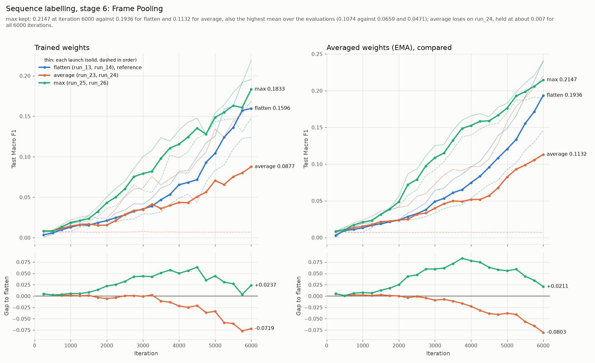

### Stage 7: Feature Map Normalization (2 new launches, 6000 iterations)

The batch normalization launches are run_25 and run_26 of the frame pooling stage. The columns give every second evaluation, the mean is taken over all 24 evaluations (250 to 6000), and the setting is kept on its value at iteration 6000.

| `Backbone.normalization.feature_map_normalization` | Launch | 500 | 1000 | 1500 | 2000 | 2500 | 3000 | 3500 | 4000 | 4500 | 5000 | 5500 | 6000 | Mean |
|---|---|---|---|---|---|---|---|---|---|---|---|---|---|---|
| batch | run_25 | 0.0135 | 0.0203 | 0.0322 | 0.0559 | 0.0932 | 0.1254 | 0.1459 | 0.1656 | 0.1645 | 0.1829 | 0.2105 | 0.2397 | 0.1162 |
| batch | run_26 | 0.0076 | 0.0216 | 0.0309 | 0.0416 | 0.0648 | 0.0920 | 0.1193 | 0.1396 | 0.1536 | 0.1698 | 0.1870 | 0.1896 | 0.0986 |
| batch | **Mean** | 0.0106 | 0.0209 | 0.0315 | 0.0488 | 0.0790 | 0.1087 | 0.1326 | 0.1526 | 0.1590 | 0.1763 | 0.1988 | 0.2147 | 0.1074 |
| sequence | run_27 | 0.0177 | 0.0283 | 0.0371 | 0.0347 | 0.0588 | 0.0896 | 0.0992 | 0.1147 | 0.1234 | 0.1626 | 0.1772 | 0.1982 | 0.0905 |
| sequence | run_28 | 0.0170 | 0.0308 | 0.0325 | 0.0364 | 0.0579 | 0.0880 | 0.1161 | 0.1256 | 0.1349 | 0.1527 | 0.1603 | 0.1821 | 0.0912 |
| sequence | **Mean** | 0.0173 | 0.0295 | 0.0348 | 0.0355 | 0.0584 | 0.0888 | 0.1077 | 0.1202 | 0.1292 | 0.1577 | 0.1687 | 0.1901 | 0.0909 |

Kept: **batch** (run_25 and run_26), the highest value at iteration 6000 (0.2147 against 0.1901 for sequence), also the highest mean over all the evaluations (0.1074 against 0.0909). The experiment over the 7 stages keeps a learning rate of 1e-3, the balanced class weighting, a bidirectional single layer LSTM, the max pooling of the frames and the batch normalization.

- The normalization of every sequence by its own frames learns faster up to iteration 1500 (0.0348 against 0.0315), both its launches rising together, but stays behind from iteration 2000 to the end.
- It is far slower: its two launches took 7 hours 20 minutes side by side against about 3 hours 25 minutes for a batch normalization pair, each using 14.6 Gigabytes of GPU memory against about 9.

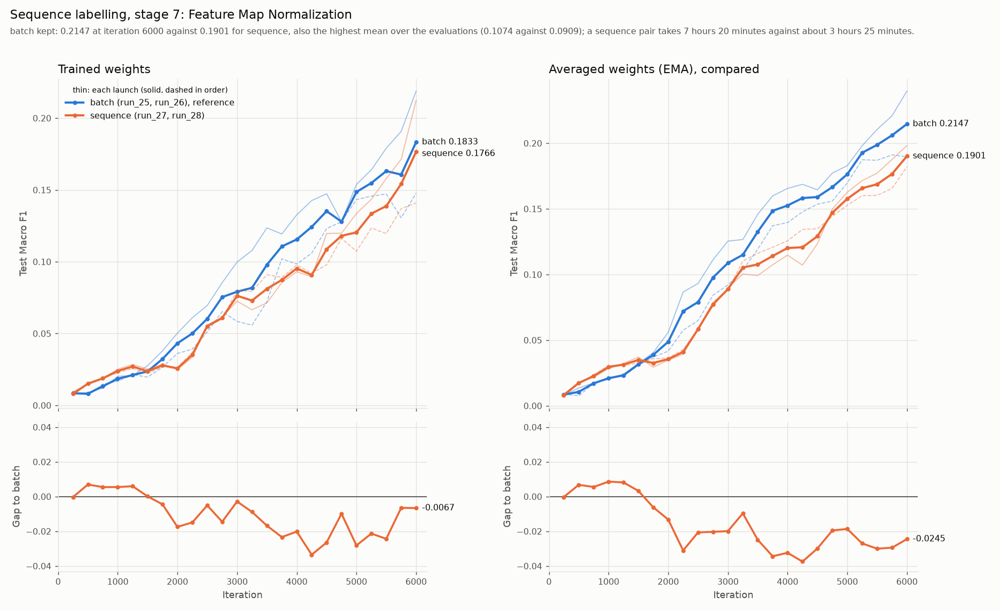

### Stage 8: Pretraining (4 new launches, 6000 iterations)

The settings kept by the 7 stages, with the backbone loaded from the averaged weights at iteration 10000 of the multi-label shape classifier (`classification/configuration_synthetic_counted_shapes.yaml`, the same backbone trained on recognising the 35 shapes of frames drawn like these, test Macro F1 0.718, the triangle, parallelogram, rhombus, kite and trapezoid with their hollow versions not learned), compared with the launches trained from scratch (run_25 and run_26): fine-tuned at the learning rate of the other components (`fine_tuned`, run_29 and run_30) and fine-tuned ten times slower (`fine_tuned_slow`, `Backbone.pretrained.learning_rate_multiplier` 0.1, run_31 and run_32). A frozen backbone was dropped by the user to save a pair.

The launches trained from scratch are run_25 and run_26. The columns give every second evaluation, the mean is taken over all 24 evaluations (250 to 6000), and the setting is kept on its value at iteration 6000.

| Pretraining | Launch | 500 | 1000 | 1500 | 2000 | 2500 | 3000 | 3500 | 4000 | 4500 | 5000 | 5500 | 6000 | Mean |
|---|---|---|---|---|---|---|---|---|---|---|---|---|---|---|
| none | run_25 | 0.0135 | 0.0203 | 0.0322 | 0.0559 | 0.0932 | 0.1254 | 0.1459 | 0.1656 | 0.1645 | 0.1829 | 0.2105 | 0.2397 | 0.1162 |
| none | run_26 | 0.0076 | 0.0216 | 0.0309 | 0.0416 | 0.0648 | 0.0920 | 0.1193 | 0.1396 | 0.1536 | 0.1698 | 0.1870 | 0.1896 | 0.0986 |
| none | **Mean** | 0.0106 | 0.0209 | 0.0315 | 0.0488 | 0.0790 | 0.1087 | 0.1326 | 0.1526 | 0.1590 | 0.1763 | 0.1988 | 0.2147 | 0.1074 |
| fine_tuned | run_29 | 0.3102 | 0.5104 | 0.5708 | 0.6117 | 0.6382 | 0.6632 | 0.6883 | 0.7038 | 0.7195 | 0.7295 | 0.7406 | 0.7444 | 0.6195 |
| fine_tuned | run_30 | 0.3221 | 0.5087 | 0.5898 | 0.6275 | 0.6658 | 0.6910 | 0.7114 | 0.7261 | 0.7348 | 0.7432 | 0.7419 | 0.7491 | 0.6337 |
| fine_tuned | **Mean** | 0.3162 | 0.5096 | 0.5803 | 0.6196 | 0.6520 | 0.6771 | 0.6998 | 0.7149 | 0.7271 | 0.7364 | 0.7413 | 0.7467 | 0.6266 |
| fine_tuned_slow | run_31 | 0.3037 | 0.4740 | 0.5171 | 0.5379 | 0.5597 | 0.5711 | 0.5862 | 0.6028 | 0.6175 | 0.6294 | 0.6390 | 0.6494 | 0.5419 |
| fine_tuned_slow | run_32 | 0.3137 | 0.4760 | 0.5052 | 0.5320 | 0.5517 | 0.5660 | 0.5778 | 0.5926 | 0.6082 | 0.6190 | 0.6296 | 0.6386 | 0.5356 |
| fine_tuned_slow | **Mean** | 0.3087 | 0.4750 | 0.5111 | 0.5349 | 0.5557 | 0.5685 | 0.5820 | 0.5977 | 0.6128 | 0.6242 | 0.6343 | 0.6440 | 0.5388 |

Kept: **fine_tuned** (run_29 and run_30), the highest value at iteration 6000 (0.7467 against 0.6440 for fine_tuned_slow and 0.2147 from scratch), also the highest mean over all the evaluations (0.6266 against 0.5388 and 0.1074).

- The pretrained backbone multiplies the score at iteration 6000 by 3.5: from iteration 500 the fine-tuned launches (0.3162) are above the launches from scratch at iteration 6000, both launches agreeing closely (0.7444 and 0.7491) and none held at the score of a model that only predicts `no_change`.
- Fine-tuning ten times slower stays behind at every evaluation from iteration 750, so adapting the backbone to the sequences matters more than keeping its pretrained features.
- At iteration 6000 of run_30, the 50 labels of the 25 shapes the classifier recognises reach a mean F1 of 0.982 (0.31 for run_25 from scratch), and the 20 labels of the triangle, parallelogram, rhombus, kite and trapezoid with their hollow versions, which the classifier did not learn, 0.156 (0.026 from scratch): these 10 shapes now bound the score.

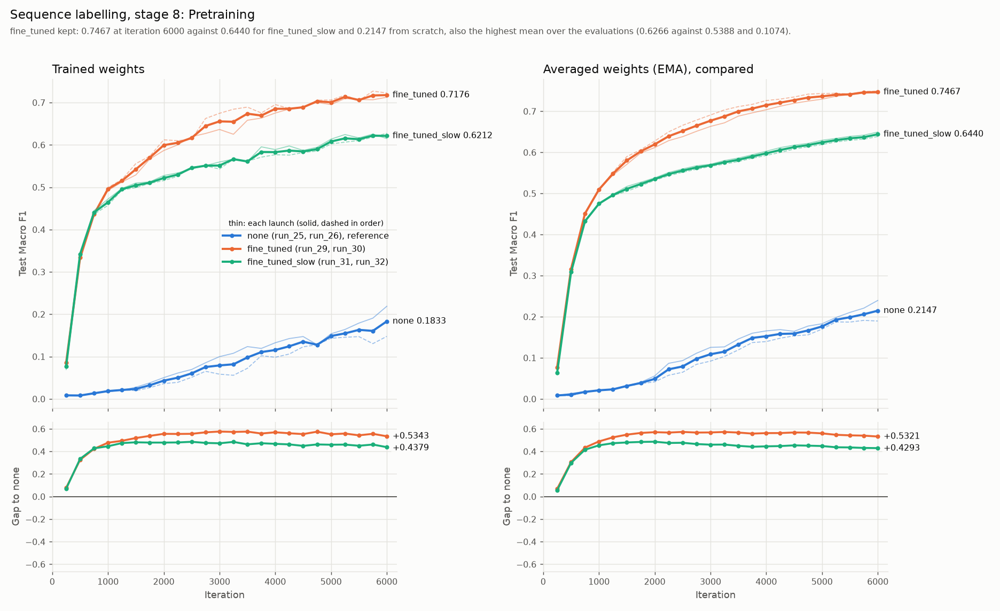

### Stage 9: Learning Rate, Pretrained (6 new launches, 4000 iterations)

The settings kept by the 8 stages, the pretrained backbone fine-tuned, with the learning rate changed. The reference 1e-3 is run_29 and run_30 (stage 8) read at iteration 4000. The columns give every second evaluation, the mean is taken over the 16 evaluations from 250 to 4000, and the setting is kept on its value at iteration 4000.

| `learning_rate` | Launch | 500 | 1000 | 1500 | 2000 | 2500 | 3000 | 3500 | 4000 | Mean |
|---|---|---|---|---|---|---|---|---|---|---|
| 1e-3 | run_29 | 0.3102 | 0.5104 | 0.5708 | 0.6117 | 0.6382 | 0.6632 | 0.6883 | 0.7038 | 0.5635 |
| 1e-3 | run_30 | 0.3221 | 0.5087 | 0.5898 | 0.6275 | 0.6658 | 0.6910 | 0.7114 | 0.7261 | 0.5798 |
| 1e-3 | **Mean** | 0.3162 | 0.5096 | 0.5803 | 0.6196 | 0.6520 | 0.6771 | 0.6998 | 0.7149 | 0.5717 |
| 2e-3 | run_37 | 0.3532 | 0.4571 | 0.5054 | 0.5300 | 0.5485 | 0.5648 | 0.5942 | 0.6152 | 0.4985 |
| 2e-3 | run_38 | 0.3546 | 0.4953 | 0.5544 | 0.5855 | 0.6190 | 0.6534 | 0.6824 | 0.7024 | 0.5582 |
| 2e-3 | **Mean** | 0.3539 | 0.4762 | 0.5299 | 0.5578 | 0.5838 | 0.6091 | 0.6383 | 0.6588 | 0.5283 |
| 2e-4 | run_35 | 0.0288 | 0.1028 | 0.2236 | 0.3309 | 0.4088 | 0.4675 | 0.5049 | 0.5305 | 0.3083 |
| 2e-4 | run_36 | 0.0256 | 0.0889 | 0.2286 | 0.3450 | 0.4053 | 0.4474 | 0.4791 | 0.5055 | 0.3004 |
| 2e-4 | **Mean** | 0.0272 | 0.0958 | 0.2261 | 0.3380 | 0.4071 | 0.4574 | 0.4920 | 0.5180 | 0.3044 |
| 1e-4 | run_33 | 0.0213 | 0.0305 | 0.0530 | 0.0897 | 0.1480 | 0.2160 | 0.2789 | 0.3254 | 0.1354 |
| 1e-4 | run_34 | 0.0188 | 0.0357 | 0.0660 | 0.1065 | 0.1617 | 0.2309 | 0.2949 | 0.3400 | 0.1465 |
| 1e-4 | **Mean** | 0.0201 | 0.0331 | 0.0595 | 0.0981 | 0.1548 | 0.2235 | 0.2869 | 0.3327 | 0.1410 |

Kept: **1e-3** (run_29 and run_30), the highest value at iteration 4000 (0.7149 against 0.6588 for 2e-3, 0.5180 for 2e-4 and 0.3327 for 1e-4), also the highest mean over the evaluations.

- 2e-3 starts close to 1e-3 (0.4762 against 0.5096 at iteration 1000) but its launches spread apart (0.6152 and 0.7024 at iteration 4000) and stay behind.
- The smaller learning rates, ten and five times lower, learn far slower with the pretrained backbone too, 1e-4 reaching at iteration 4000 less than half of 1e-3.

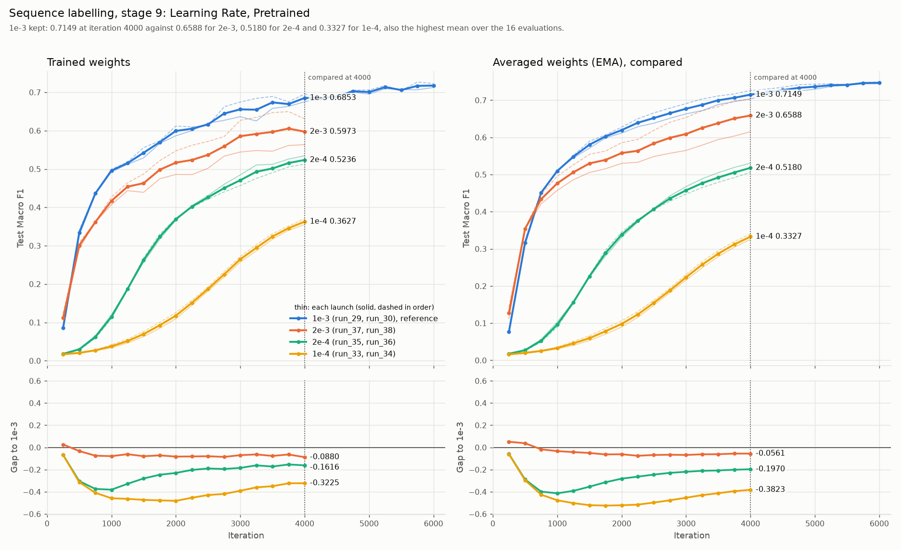

### Stage 10: Class Weighting, Pretrained (2 new launches, 6000 iterations)

The settings kept by stage 9, with the class weighting changed. The reference balanced is run_29 and run_30 (stage 8). The columns give every second evaluation, the mean is taken over all 24 evaluations (250 to 6000), and the setting is kept on its value at iteration 6000.

| `class_weighting` | Launch | 500 | 1000 | 1500 | 2000 | 2500 | 3000 | 3500 | 4000 | 4500 | 5000 | 5500 | 6000 | Mean |
|---|---|---|---|---|---|---|---|---|---|---|---|---|---|---|
| balanced | run_29 | 0.3102 | 0.5104 | 0.5708 | 0.6117 | 0.6382 | 0.6632 | 0.6883 | 0.7038 | 0.7195 | 0.7295 | 0.7406 | 0.7444 | 0.6195 |
| balanced | run_30 | 0.3221 | 0.5087 | 0.5898 | 0.6275 | 0.6658 | 0.6910 | 0.7114 | 0.7261 | 0.7348 | 0.7432 | 0.7419 | 0.7491 | 0.6337 |
| balanced | **Mean** | 0.3162 | 0.5096 | 0.5803 | 0.6196 | 0.6520 | 0.6771 | 0.6998 | 0.7149 | 0.7271 | 0.7364 | 0.7413 | 0.7467 | 0.6266 |
| none | run_39 | 0.0090 | 0.1506 | 0.2160 | 0.3025 | 0.4151 | 0.4655 | 0.5203 | 0.5388 | 0.5408 | 0.5397 | 0.5503 | 0.5550 | 0.3896 |
| none | run_40 | 0.0090 | 0.0508 | 0.1054 | 0.1433 | 0.1682 | 0.1915 | 0.1974 | 0.2183 | 0.2339 | 0.2400 | 0.2581 | 0.2638 | 0.1687 |
| none | **Mean** | 0.0090 | 0.1007 | 0.1607 | 0.2229 | 0.2916 | 0.3285 | 0.3588 | 0.3785 | 0.3873 | 0.3898 | 0.4042 | 0.4094 | 0.2791 |

Kept: **balanced** (run_29 and run_30), the highest value at iteration 6000 (0.7467 against 0.4094 for none), also the highest mean over all the evaluations (0.6266 against 0.2791).

- Without class weighting, the far more frequent frames without change dominate the loss: the two launches learn slower and spread apart (0.5550 and 0.2638 at iteration 6000), as in stage 2 from scratch (0.0233 against 0.1207 for balanced).

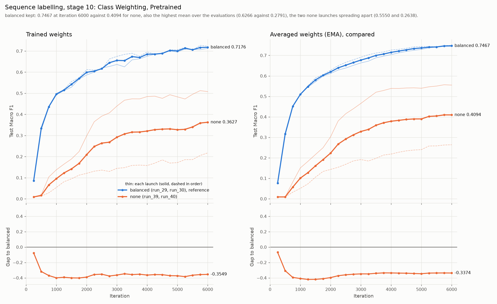

### Stage 11: Temporal Module, Pretrained (4 new launches, 6000 iterations)

The settings kept by stage 10, with the temporal module changed, all bidirectional. The reference lstm is run_29 and run_30 (stage 8). The columns give every second evaluation, the mean is taken over all 24 evaluations (250 to 6000), and the setting is kept on its value at iteration 6000.

| `temporal_type` | Launch | 500 | 1000 | 1500 | 2000 | 2500 | 3000 | 3500 | 4000 | 4500 | 5000 | 5500 | 6000 | Mean |
|---|---|---|---|---|---|---|---|---|---|---|---|---|---|---|
| lstm | run_29 | 0.3102 | 0.5104 | 0.5708 | 0.6117 | 0.6382 | 0.6632 | 0.6883 | 0.7038 | 0.7195 | 0.7295 | 0.7406 | 0.7444 | 0.6195 |
| lstm | run_30 | 0.3221 | 0.5087 | 0.5898 | 0.6275 | 0.6658 | 0.6910 | 0.7114 | 0.7261 | 0.7348 | 0.7432 | 0.7419 | 0.7491 | 0.6337 |
| lstm | **Mean** | 0.3162 | 0.5096 | 0.5803 | 0.6196 | 0.6520 | 0.6771 | 0.6998 | 0.7149 | 0.7271 | 0.7364 | 0.7413 | 0.7467 | 0.6266 |
| gru | run_43 | 0.3683 | 0.4853 | 0.5468 | 0.5952 | 0.6349 | 0.6698 | 0.6931 | 0.7164 | 0.7272 | 0.7353 | 0.7363 | 0.7446 | 0.6206 |
| gru | run_44 | 0.3655 | 0.5315 | 0.5802 | 0.6082 | 0.6359 | 0.6586 | 0.6776 | 0.7018 | 0.7101 | 0.7179 | 0.7292 | 0.7422 | 0.6213 |
| gru | **Mean** | 0.3669 | 0.5084 | 0.5635 | 0.6017 | 0.6354 | 0.6642 | 0.6854 | 0.7091 | 0.7187 | 0.7266 | 0.7327 | 0.7434 | 0.6210 |
| transformer | run_45 | 0.3426 | 0.5854 | 0.6699 | 0.7000 | 0.7174 | 0.7263 | 0.7324 | 0.7359 | 0.7327 | 0.7407 | 0.7407 | 0.7449 | 0.6644 |
| transformer | run_46 | 0.3685 | 0.5965 | 0.6666 | 0.6931 | 0.7085 | 0.7232 | 0.7165 | 0.7244 | 0.7361 | 0.7403 | 0.7372 | 0.7401 | 0.6630 |
| transformer | **Mean** | 0.3556 | 0.5909 | 0.6683 | 0.6966 | 0.7130 | 0.7247 | 0.7244 | 0.7302 | 0.7344 | 0.7405 | 0.7389 | 0.7425 | 0.6637 |

Kept: **lstm** (run_29 and run_30), the highest value at iteration 6000 (0.7467 against 0.7434 for gru and 0.7425 for transformer).

- The three modules end within 0.005, less than the gap between two launches of one setting: with the pretrained backbone, the temporal module barely matters at iteration 6000.
- The transformer learns fastest (0.6966 at iteration 2000 against 0.6196 for lstm) and has the highest mean over all the evaluations (0.6637 against 0.6266), but flattens from iteration 3000 and is passed by the lstm at iteration 6000.

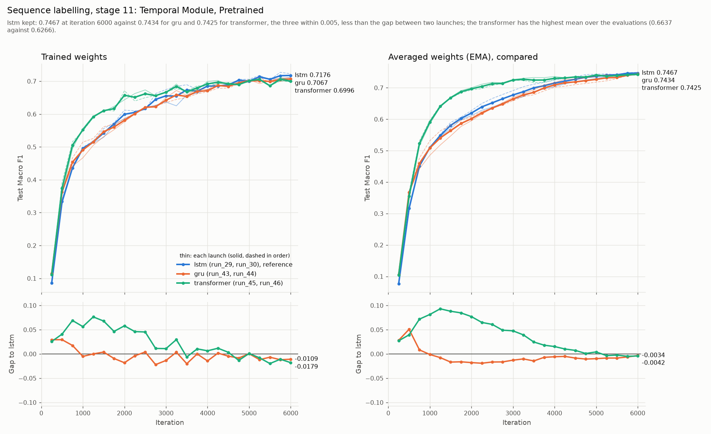

### Stage 12: Temporal Layers, Pretrained (2 new launches, 6000 iterations)

The settings kept by stage 11, with the number of layers of the LSTM changed. The reference 1 is run_29 and run_30 (stage 8). The columns give every second evaluation, the mean is taken over all 24 evaluations (250 to 6000), and the setting is kept on its value at iteration 6000.

| `number_layers` | Launch | 500 | 1000 | 1500 | 2000 | 2500 | 3000 | 3500 | 4000 | 4500 | 5000 | 5500 | 6000 | Mean |
|---|---|---|---|---|---|---|---|---|---|---|---|---|---|---|
| 1 | run_29 | 0.3102 | 0.5104 | 0.5708 | 0.6117 | 0.6382 | 0.6632 | 0.6883 | 0.7038 | 0.7195 | 0.7295 | 0.7406 | 0.7444 | 0.6195 |
| 1 | run_30 | 0.3221 | 0.5087 | 0.5898 | 0.6275 | 0.6658 | 0.6910 | 0.7114 | 0.7261 | 0.7348 | 0.7432 | 0.7419 | 0.7491 | 0.6337 |
| 1 | **Mean** | 0.3162 | 0.5096 | 0.5803 | 0.6196 | 0.6520 | 0.6771 | 0.6998 | 0.7149 | 0.7271 | 0.7364 | 0.7413 | 0.7467 | 0.6266 |
| 2 | run_47 | 0.3281 | 0.5702 | 0.6326 | 0.6896 | 0.7319 | 0.7410 | 0.7501 | 0.7541 | 0.7553 | 0.7569 | 0.7594 | 0.7564 | 0.6675 |
| 2 | run_48 | 0.3125 | 0.5541 | 0.6041 | 0.6484 | 0.6990 | 0.7256 | 0.7459 | 0.7487 | 0.7546 | 0.7517 | 0.7538 | 0.7567 | 0.6540 |
| 2 | **Mean** | 0.3203 | 0.5621 | 0.6183 | 0.6690 | 0.7155 | 0.7333 | 0.7480 | 0.7514 | 0.7549 | 0.7543 | 0.7566 | 0.7565 | 0.6607 |

Kept: **2** (run_47 and run_48), the highest value at iteration 6000 (0.7565 against 0.7467 for 1), also the highest mean over all the evaluations (0.6607 against 0.6266), the first change of a kept setting in the pretrained rerun.

- From scratch the second layer halved the score (0.0891 against 0.1936 in stage 5); with the pretrained backbone it is ahead from iteration 1000 to the end, both launches agreeing (0.7564 and 0.7567), but it levels off from iteration 4500.

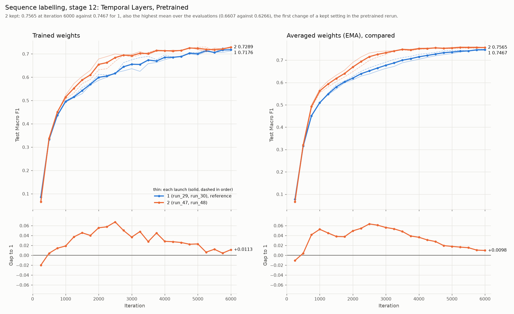

### Stage 13: Frame Pooling, Pretrained (2 new launches, 6000 iterations)

The settings kept by stage 12 (two LSTM layers), with the frame pooling changed. The reference max is run_47 and run_48 (stage 12). The columns give every second evaluation, the mean is taken over all 24 evaluations (250 to 6000), and the setting is kept on its value at iteration 6000.

| `global_pooling` | Launch | 500 | 1000 | 1500 | 2000 | 2500 | 3000 | 3500 | 4000 | 4500 | 5000 | 5500 | 6000 | Mean |
|---|---|---|---|---|---|---|---|---|---|---|---|---|---|---|
| max | run_47 | 0.3281 | 0.5702 | 0.6326 | 0.6896 | 0.7319 | 0.7410 | 0.7501 | 0.7541 | 0.7553 | 0.7569 | 0.7594 | 0.7564 | 0.6675 |
| max | run_48 | 0.3125 | 0.5541 | 0.6041 | 0.6484 | 0.6990 | 0.7256 | 0.7459 | 0.7487 | 0.7546 | 0.7517 | 0.7538 | 0.7567 | 0.6540 |
| max | **Mean** | 0.3203 | 0.5621 | 0.6183 | 0.6690 | 0.7155 | 0.7333 | 0.7480 | 0.7514 | 0.7549 | 0.7543 | 0.7566 | 0.7565 | 0.6607 |
| flatten | run_49 | 0.1876 | 0.5293 | 0.6202 | 0.6802 | 0.7266 | 0.7437 | 0.7459 | 0.7538 | 0.7591 | 0.7542 | 0.7569 | 0.7562 | 0.6519 |
| flatten | run_50 | 0.1652 | 0.4886 | 0.5706 | 0.6398 | 0.7000 | 0.7365 | 0.7495 | 0.7531 | 0.7555 | 0.7570 | 0.7598 | 0.7607 | 0.6381 |
| flatten | **Mean** | 0.1764 | 0.5089 | 0.5954 | 0.6600 | 0.7133 | 0.7401 | 0.7477 | 0.7535 | 0.7573 | 0.7556 | 0.7584 | 0.7584 | 0.6450 |

Kept: **flatten** (run_49 and run_50), the highest value at iteration 6000 (0.7584 against 0.7565 for max), while max keeps the highest mean over all the evaluations (0.6607 against 0.6450).

- The gap at iteration 6000 (0.0019) is smaller than the gap between the two launches of flatten (0.7562 and 0.7607): both poolings end level, flatten starting slower (0.1764 against 0.3203 at iteration 500) and catching up from iteration 3000.

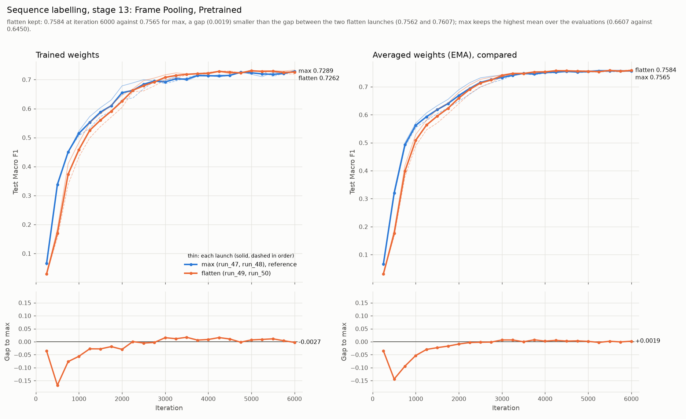

## Outcome of the Pretrained Rerun

The settings kept after stage 13: learning rate 1e-3, balanced class weighting, bidirectional LSTM of two layers, flatten frame pooling, batch normalization, and the backbone of the multi-label shape classifier fine-tuned at the learning rate of the other components, with a test Macro F1 of the averaged weights of 0.7584 at iteration 6000 (run_49 and run_50), against 0.7467 for the settings kept by stage 8 and 0.2147 from scratch. Only the number of layers and the frame pooling changed, by 0.0098 and 0.0019, the other compared settings ending at most 0.005 behind (gru, transformer) or far behind (the smaller learning rates, no class weighting). The 10 shapes the pretrained classifier does not separate (triangle, parallelogram, rhombus, kite, trapezoid and their hollow versions) keep bounding the score, so a better pretrained backbone is the next lever rather than the settings of the sequence labeller.
