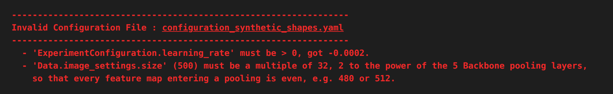
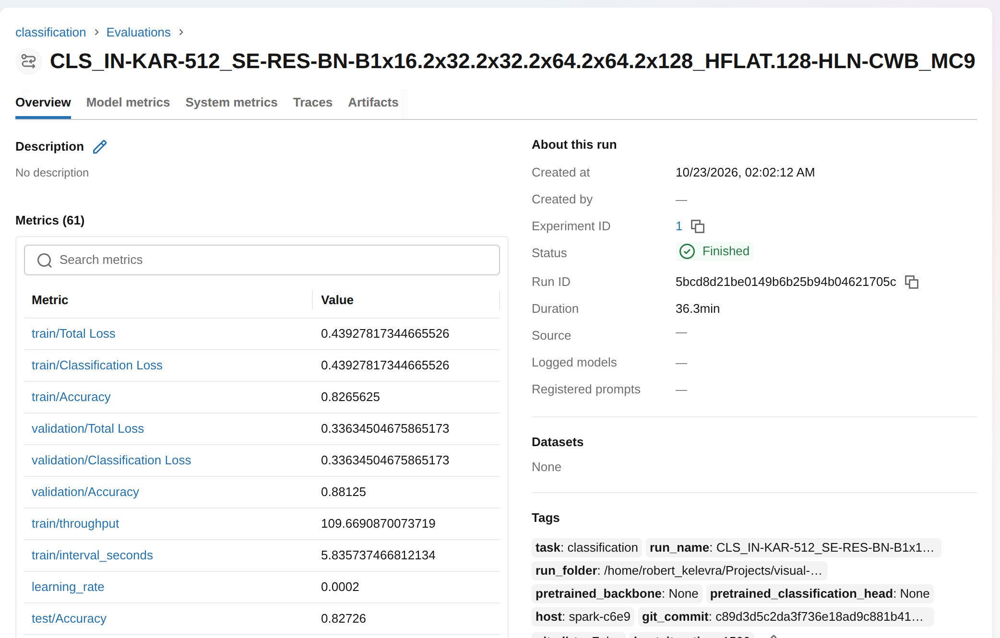

# Configuration Reference

If you are looking for the keys, values and outputs of the configurations, this reference completes the [Configurations](../../README.md#configurations), [Run Names](../../README.md#run-names) and [MLflow Tracking](../../README.md#mlflow-tracking) sections of the README. Every key is also explained by its comment in the files of `vision_training/configurations/<task>/`.

## Table Of Content
To find your way in this reference, the sections are:
- [Configurations](#configurations)
  - [Keys Per Task](#keys-per-task)
  - [Values Per Task](#values-per-task)
  - [Fixed Settings](#fixed-settings)
  - [Checking Without Training](#checking-without-training)
  - [Evaluation Outputs](#evaluation-outputs)
- [Run Names](#run-names)
- [MLflow Tracking](#mlflow-tracking)

## Configurations
Before editing a configuration, know that every task has a `configuration_example.yaml` and a `configuration_synthetic_*.yaml` with the same keys. A file holds only the keys of its task, all required. The check stops at the first missing key and names its path. It refuses the [fixed settings](#fixed-settings), then every key the task does not read ([Keys Per Task](#keys-per-task)).

The task codes are DET `object_detection`, INS `instance_segmentation`, CLS `classification`, M2O `sequence_classification`, M2M `sequence_labelling`, CMP `sequence_comparison`, SEG `semantic_segmentation`, SEL `frame_selection`, SSL `self_supervised`, KPT `keypoint_detection`.

### Keys Per Task
Every task has `ExperimentConfiguration` (with `evaluation.per_class_report`, `evaluation.number_sample_images` and `tracking`), `Optimization`, `Data` and `Backbone`. The table lists the keys that belong to some tasks only, `evaluation` standing for `ExperimentConfiguration.evaluation`.

| Key | Tasks |
|---|---|
| `DetectionLevels`, `Neck`, `RegionProposal`, `Detector`, `Optimization.loss_weights`, `evaluation.score_threshold`, `diagnosis_modes.compute_anchor_coverage`, `diagnosis_modes.view_training_targets` | DET, INS |
| `MaskHead`, `Data.instance_index_maps` | INS |
| `evaluation.original_resolution` | INS, SEG |
| `evaluation.target_precision`, `evaluation.error_dumps` | DET, INS, CLS, M2O, M2M, CMP, SEL (`target_precision` a list, the first the main target, for CLS, M2O, M2M, CMP) |
| `ClassificationHead`, `evaluation.save_predictions` | CLS, M2O, M2M, CMP, SEL |
| `ClassificationHead.decorrelation` | CLS |
| `TemporalModel`, `Data.sequence_settings`, `Data.data_augmentation.independent_frames` and `shuffle_frames` | M2O, M2M, CMP, SEL |
| `Fusion` | CMP |
| `SegmentationDecoder`, `SegmentationLoss`, `Data.tiling`, `evaluation.save_predicted_masks`, `evaluation.boundary_tolerance` | SEG |
| `Selection`, `evaluation.top_k` | SEL |
| `ProjectionHead`, `Data.grouped_batches`, `evaluation.number_neighbours`, `evaluation.number_reference_images_per_class` | SSL |
| `HRNet`, `KeypointHead`, `evaluation.default_keypoint_sigma`, `evaluation.keypoint_sigmas` | KPT |

In case a file holds a key its task does not read, the loading lists every such key by its path in one error. The known keys are in `KNOWN_KEY_PATHS` of `vision_training/configuration_processing/configuration_keys.py`. The two messages are:
- Unknown key: `'ExperimentConfiguration.bach_size' is not a configuration key (did you mean 'batch_size'?): no code reads it, so its value would be ignored. Correct it or delete it from the configuration file.`
- Key of another task: `'RegionProposal' is not read by the task 'classification', only by ['instance_segmentation', 'object_detection']: its value would be ignored. Delete it from the configuration file.`

Sections keyed by names (blocks, levels, losses, keypoints) are left to the checks of their task.

### Values Per Task
Whenever a task cannot use a value, its check refuses it. Keys not listed accept the same values in every task.

**All tasks**
- Iteration counts: integers, also written `1e10` or `4.0e3`. `31.7` is refused, not truncated.
- `Data.image_settings.size`: a positive even integer, multiple of 2 to the power of the number of max poolings of `Backbone`. With 5 poolings, 96, 224, 384 and 512 pass and 100 is refused.
- `Data.label_mapping.mode`: `binary` or `multi_class` for DET, INS and SEG, `multi_class` for the others.
- `Data.data_augmentation.activated`: `True` for SSL, with `random_crop.probability` at `1.0`.
- `random_perspective` and `random_jigsaw`, which move the image without its targets: off for DET, INS, SEG and KPT.
- `Backbone.normalization.feature_map_normalization: sequence`: M2O, M2M, CMP and SEL only.

**Classification heads and temporal modules**
- `ClassificationHead.global_pooling`: `average`, `max` or `flatten`.
- `ClassificationHead.output_mode`: `multi_label` for CLS only.
- `TemporalModel.type`: `mean_pooling`, `max_pooling`, `attention_pooling`, `gru`, `lstm`, `transformer` or `temporal_convolution` for M2O and CMP. M2M and SEL need one output per frame and take the last four only.
- `TemporalModel.causal`: `True` for M2M and SEL only. A causal module (or a GRU or LSTM that is not bidirectional) refuses `sequence` normalization, whose statistics come from the whole sequence.

**DET and INS**
- Every level of `DetectionLevels` holds exactly `anchors`, `region_proposal` and `detector`; INS adds `mask_head`.
- `Neck.type`: `none`, `feature_pyramid` or `path_aggregation`. With a neck, every level is a whole multiple of the next coarser one.
- `Neck.pretrained.experiment_folder`: null when `Neck.type` is `none`, a run without neck having no layer to load.
- `Detector.box_loss`: `smooth_l1` or `complete_iou`. The region proposal network always uses smooth L1.
- `Detector.nms_criterion`: `iou` or `distance_iou`, with `nms_distance_exponent` a finite positive number. Neither enters the run name.
- `RegionProposal.proposal_selection`: `joint` or `per_level`. `per_level` makes `pre_nms_proposals` a count per level.

**INS mask heads**
- `roi_align_pool_size` must not exceed `MaskHead.mask_resolution`.
- `Data.instance_index_maps`: one uint8 map per image instead of one mask per object. It needs non-overlapping run length encodings and at most 255 objects per image (`True` in the synthetic configuration, `False` for COCO).
- `fusion_convolutions` and `image_branch_convolutions`: `[layers, channels]`, or `[0, 0]` when unused. The image branch must be `[0, 0]` when `MaskHead.pretrained.experiment_folder` is set.
- `skip_blocks_at_pool_size` and `skip_blocks_at_mask_resolution`: distinct backbone blocks from 0 (the input image), block b at stride 2 ** (b - 1). Every skip is finer than the finest detection level, mask-resolution skips finer than pool-size skips, no block in both.
- `MaskHead.shared: True` needs the same `mask_head` and the same channels on every level.

**SEG**
- The keys of `SegmentationDecoder.convolutions` are the skip blocks 1 to N-1 of N blocks (and N with `last_max_pooling: True`).
- The keys of `deep_supervision_weights` are keys of `convolutions` other than the finest level.
- The categories of a `multi_class` mapping are the mask values 1 to 254.

**KPT**
- The classes are indexed 0 (background) to K-1 without gaps.
- `Backbone` ends at 1/4 of the image, and `Data.image_settings.size` is a multiple of 4 x 2 to the power of the length of `HRNet.modules_per_stage`.
- `inference.keypoint_threshold` is within ]0, 1[ and `inference.object_score_threshold` within [0, 1].
- The entries of `evaluation.keypoint_sigmas` must exist in the training split.

### Fixed Settings
Should a file still hold one of these removed settings, it is refused before any other check (`REMOVED_SETTINGS` of `vision_training/configuration_processing/common_checks.py`). The table shows the behaviour the code now always uses.

| Removed setting | Fixed behaviour |
|---|---|
| `ExperimentConfiguration.resume_training` | A run always resumes from its last checkpoint. To start over, change `run_name_suffix` or `experiment_folder`, or move the run folder. |
| `ExperimentConfiguration.evaluation.top_k` | Top-k accuracy counts 5 classes (`TOP_K_ACCURACY_CLASSES`). SEL keeps the key. |
| `tracking.log_artifacts`, `diagnosis_modes.compute_model_size`, `diagnosis_modes.verbose` | Files always sent to MLflow, model size always printed. |
| `Optimization.mixed_precision` | Always on: forward passes in bfloat16, weights and test evaluation in float32. |
| `Optimization.gradient_clipping_norm` | Gradients are never clipped. |
| `Data.loading` | Every loader uses 1 worker (`NUMBER_LOADER_WORKERS` of `vision_training/data/loaders.py`) and 2 prefetched batches (`PREFETCH_BATCHES`). The validation loader exists only when `validation_iteration_ratio` is above 0. |
| `Backbone.modules.inception_starting_block` | Inception modules start at block 3 (`INCEPTION_STARTING_BLOCK`). |
| `batch_normalization_momentum` of every section | 0.1 (`BATCH_NORMALIZATION_MOMENTUM`). |
| `RegionProposal.strict_fallback_assignment` | Fallback anchors target the object they overlap most, as in torchvision. |
| `localisation_loss_beta` of `RegionProposal` and `Detector`, `RegionProposal.box_loss` | Smooth L1 with beta 1/9 (`LOCALISATION_LOSS_BETA`, `REGION_PROPOSAL_BOX_LOSS`). |
| `RegionProposal.anchor_centres` | Anchors centred on the cell corners, as in torchvision. |
| `MaskHead.mask_scoring` | Masks are ranked by the class scores of their detections. |
| `Data.data_augmentation.independent_frames`, `shuffle_frames` | Kept in M2O, M2M, CMP and SEL only. |

`Data.view_augmentation`, `ClassificationHead.view_losses` and `SegmentationDecoder.pretrained.load_class_layers` (renamed `class_layers`) are refused the same way.

If one wishes to update older files, `scripts/configuration_processing/convert_fixed_settings.py` removes the fixed settings from the run folders under its `--run_roots` and the launch files under its `--configuration_folders`, at least one folder being needed. It adds the keys a task now requires, with the values its runs trained with (`ADDED_SECTIONS`, `ADDED_SETTINGS`, `RENAMED_SETTINGS`).
- Each converted file is first copied to a backup named with `--backup_suffix`, the latest suffix by default.
- A file with another value than the fixed one is listed with the values its runs change to.
- A setting the code no longer trains (`RECORD_ONLY_SETTINGS`) is reported and the file left as it is.
- Without `--write_files`, it only lists the files to convert.

```bash
# List the files to convert in a folder of runs and a launch folder
uv run python -m scripts.configuration_processing.convert_fixed_settings --run_roots ~/Data/<runs> --configuration_folders vision_training/configurations/object_detection

# Convert them, each copied to its backup first
uv run python -m scripts.configuration_processing.convert_fixed_settings --run_roots ~/Data/<runs> --configuration_folders vision_training/configurations/object_detection --write_files
```

The figure shows a refused configuration.

<p align="center">
  
</p>

### Checking Without Training
Whenever a pipeline has to decide whether a file can start a training, `vision_training/check_configuration.py` runs the loading and checks of a training without building a model or a loader.

```bash
# Check one or more files, --check_paths also checks the data and pretrained paths
uv run python -m vision_training.check_configuration --configuration_path=<file> [--configuration_path=<file> ...] [--check_paths]
```

- A valid file prints its run name; an invalid one prints one line per problem.
- The exit code is 0 when every file is valid, 1 otherwise, 2 for a malformed command line.
- Without `--check_paths`, it reads what the loading reads: the label mapping file (and the training `labels.json` for KPT).
- `--check_paths` also requires the three split folders, the mapping file, and every `pretrained.experiment_folder` with its configuration and checkpoint. `experiment_folder` may not exist yet.

### Evaluation Outputs
Each time a checkpoint is evaluated, it is reported in the console and in `<run>/Results.txt`. Its files go to `<run>/Evaluation/Iteration_<n>/`, the moving average to `EMA/`. `scripts/evaluation/evaluate_checkpoint.py` writes to `<run>/Checkpoint_Evaluation/` instead. Reports show rates as percentages; files keep them between 0 and 1.

The table lists every output, the tasks writing it and when.

| Output | Tasks | Written |
|---|---|---|
| Global metrics and notes, global Test scalars | all | always |
| Per-class table and per-class Test scalars | all | `per_class_report` |
| `Per Class Recall` table with 95 % intervals, worst first | all | `per_class_report` |
| `class_metrics.csv` (table below) | all, SSL with labelled test images | always |
| `keypoint_metrics.csv`, OKS size and recall tables | KPT | always |
| Mean average precision by size, mean average recall, `Proposal Recall`, `proposal_recall.csv` | DET, INS | always |
| `class_thresholds.json` | DET, INS, CLS, M2O, M2M, CMP, SEL | always |
| `confusion_matrix.csv` | DET, INS, CLS multi-class, M2O, M2M, CMP, SEG, SEL | always, up to 1,000 classes |
| `confusion_cells.csv`, the non-zero cells | CLS, M2O, M2M, CMP above 1,000 classes | always |
| `confusion_matrix.png`, `roc_curves.png`, `precision_recall_curves.png`, `precision_recall_thresholds.png` | tasks with these metrics | `per_class_report` |
| `predictions.csv` (`selections.csv` for SEL) | CLS, M2O, M2M, CMP, SEL | `save_predictions` |
| `Errors/<TRUE>-TO-<PREDICTED>/` (also `FALSE-POSITIVE/` and `MISSED/` for DET, INS; `<CLASS>/` for SEL) | DET, INS, CLS, M2O, M2M, CMP, SEL | `error_dumps.activated` |
| `Samples/<sample>.png` (table below) | all | `number_sample_images` above 0 |
| `Predicted_Masks/<image>.png` | SEG | `save_predicted_masks` |
| `evaluation_summary.csv` (one row per iteration, `ema_` columns) and `evaluation_curves.png` ([Run Folder](training_reference.md#run-folder)) | all | always |

The table shows the columns of `class_metrics.csv` per task.

| Tasks | Columns |
|---|---|
| CLS, M2O, M2M, CMP | samples, precision, recall with 95 % interval (`recall_lower`, `recall_upper`), F1, ROC AUC, average precision, threshold and recall at every target precision |
| SEL | true frames, accuracy of both decodings with interval, top-k accuracy, mean rank, threshold and recall at the target precision |
| DET, INS | ground truths, average precisions by size, recall at 0.5 and 0.75 with interval (`recall_50`, `recall_75`, …), `mask_` columns for INS, threshold and recall at the target precision |
| SEG | pixels, IoU, Dice, boundary IoU, boundary F1, precision, recall with interval, ROC AUC, average precision |
| SSL | labelled test images, k-NN precision, recall with interval, F1 |
| KPT | objects, OKS average precisions, OKS recall at 0.5 and 0.75 with interval, PCK, mean OKS, mean error |

The recall intervals (`vision_training/evaluation/recall_intervals.py`) are Clopper-Pearson for independent samples, and Korn-Graubard over sequences or images for M2M, SEL and SEG.

The table shows what each task draws in its sample images.

| Tasks | Sample image |
|---|---|
| CLS, M2O, CMP | the input, captioned `true -> predicted probability`, green when right, red when wrong |
| M2M | the frame grid, each frame captioned `true/predicted`, `X` on the wrong ones |
| SEL | the thumbnail grid with the selection, and the probability heat map |
| DET, INS | ground truth boxes next to the detections above `Detector.inference.score_threshold`, each captioned `class score IoU` with its IoU to the object the evaluation matches it with (box and mask IoU for INS), else to its closest object followed by `no match` |
| SEG | input, true mask, predicted mask and error map |
| SSL | the image next to two random views, with their cosine similarity |
| KPT | ground truth objects next to the found objects, with their skeletons |

Every evaluation shows the same test samples.

## Run Names
So that the same settings resume in the same folder and changed settings start a new one, `vision_training/configuration_processing/run_name.py` builds the run name from the configuration.
- Sections are joined with `_` and tokens with `-`, in the order of the table below.
- A flag token is left out when its setting is off. The optimizer section is left out for plain Adam without weight decay.
- A setting identical on every detection level is written once; otherwise the levels are joined with `+`.
- Class counts are the foreground classes, merged categories counting once.

Settings without a token may change between two resumptions; two runs differing only by them share a folder. They are the augmentation, batch size, learning rate and schedule, `learning_rate_multiplier`, moving average, dropout rates, loss weights, NMS and inference settings, `SegmentationLoss`, `Selection.decoding`, `Data.grouped_batches`, and the evaluation settings. The optimizer keeps its token, as one optimizer cannot resume the state of another.

The table lists every token, the setting it comes from and its tasks.

| Section | Token | Setting | Tasks |
|---|---|---|---|
| Task | `DET`, `INS`, `CLS`, `M2O`, `M2M`, `CMP`, `SEG`, `SEL`, `SSL`, `KPT` | `ExperimentConfiguration.task` | all |
| Input | `IN`, `PSN`, `KAR`, `<size>` | `input_normalization`, `per_sample_normalization`, `keep_ratio`, `Data.image_settings.size` | all |
| Backbone | `SE`, `RES`, `RES2` (pre-activation), `INC3` | `Backbone.modules` | all |
| Backbone | `BN`, `LN`, `NN`, `SN` | `feature_map_normalization`: batch, layer, none, sequence | all (`SN`: M2O, M2M, CMP, SEL) |
| Backbone | `B<layers>x<filters>.…`, `LMP` | `Backbone.convolutions`, `last_max_pooling` | all |
| Backbone | `PT`, `FRZ`, `FBN` | `Backbone.pretrained`, `freeze`, `freeze_normalization_parameters` | all |
| Levels | `L<blocks>` | the keys of `DetectionLevels` | DET, INS |
| Levels | `NFPN<channels><BN, LN or NN>`, `NPAN…` | `Neck.type`, `output_channels`, `normalization` | DET, INS |
| Levels | `NPT`, `NFRZ` | `Neck.pretrained`, `freeze` | DET, INS |
| Anchors | `A<anchors>.<smallest>-<largest>.<hash>` | anchors per position, scale range, first 6 characters of the SHA-256 of scales and ratios | DET, INS |
| Region proposal | `RBN`, `RLN`, `RNN`, `R<layers>x<filters>`, `RPL`, `RPT`, `RFRZ` | normalization, convolutions, `per_level` selection, pretrained, frozen | DET, INS |
| Detector | `DSE`, `DRES`, `DINC`, `DBN`, `DLN`, `DNN` | `Detector.modules`, normalization | DET, INS |
| Detector | `D<pool>.<layers>x<filters>.<fully connected>`, `DCIOU` | `DetectionLevels.<level>.detector`, `complete_iou` box loss | DET, INS |
| Detector | `DPT`, `DRCL`, `DFRZ` | pretrained, without class layers (`class_layers` False), frozen | DET, INS |
| Mask heads | `MSE`, `MRES`, `MINC`, `MBN`, `MLN`, `MNN`, `MUTC`, `MUBL` | `MaskHead.modules`, normalization, upsampling transposed or bilinear | INS |
| Mask heads | `M<pool>.<layers>x<channels>`, `MSH`, `MR<resolution>` | `mask_head` of the level, `shared`, `mask_resolution` | INS |
| Mask heads | `MSP<blocks>`, `MIB<layers>x<channels>`, `MSM<blocks>`, `MF<layers>x<channels>` | `skip_blocks_at_pool_size`, `image_branch_convolutions`, `skip_blocks_at_mask_resolution`, `fusion_convolutions` | INS |
| Mask heads | `MPT`, `MRCL`, `MFRZ` | pretrained, without class layers, frozen | INS |
| Tiling | `TL<scale>` | `Data.tiling` | SEG |
| Decoder | `UTC`, `UBL`, `DSE`, `DRES`, `DBN`, `DLN`, `DNN` | `SegmentationDecoder` upsampling, modules, normalization | SEG |
| Decoder | `D<layers>x<channels>.…`, `AUX<level>.…` | convolutions and deep supervision levels, deepest first | SEG |
| Decoder | `DPT`, `DCL`, `DFRZ` | pretrained, with class layers (`class_layers` True), frozen | SEG |
| Classes | `BIN` or `MC<classes>` | `Data.label_mapping.mode` | DET, INS, SEG |
| Sequence length | `T<frames>` | `maximum_sequence_length` (of a member for CMP) | M2O, M2M, CMP, SEL |
| Temporal module | `MEAN`, `MAX`, `ATT<hidden size>` | mean, max, attention pooling | M2O, CMP |
| Temporal module | `GRU<layers>x<hidden size>`, `LSTM…`, `TRF<layers>x<hidden size>.<heads>`, `TCN<layers>x<hidden size>.<kernel size>` | gru, lstm, transformer, temporal_convolution | M2O, M2M, CMP, SEL |
| Temporal module | `BI`, `CAU`, `NPE`, `TPT`, `TFRZ` | bidirectional, causal (M2M, SEL), no positional embedding, pretrained, frozen | M2O, M2M, CMP, SEL |
| Fusion | `FCAT`, `FDIF`, `FXA<heads>`, `SNP` | concatenation, difference, cross_attention, pair normalization scope | CMP |
| Head | `HAVG.<fully connected>`, `HMAX.<…>`, `HFLAT.<…>`, `HBN`, `HLN` | `global_pooling`, `fully_connected`, normalization | CLS, M2O, M2M, CMP, SEL |
| Head | `LS<rate>`, `CWB` | label smoothing above 0, balanced class weighting | CLS, M2O, M2M, CMP, SEL |
| Head | `HPT`, `HRCL`, `HFRZ` | pretrained, without class layer, frozen | CLS, M2O, M2M, CMP, SEL |
| Classes | `MC<classes>`, `ML<classes>` (multi-label) | `ClassificationHead.output_mode` | CLS, M2O, M2M, CMP, SEL (`ML`: CLS) |
| Selection | `FPC<frames>`, `SLW<weight>` | `frames_per_class`, `selection_loss_weight` above 0 | SEL |
| Projection head | `PAVG.<layers>`, `PMAX.<…>`, `PFLAT.<…>`, `PBN`, `PLN` | `ProjectionHead` pooling, layers, normalization | SSL |
| Method | `SIMCLR-T<temperature>`, `BT-OD<weight>` | `ProjectionHead.method` and its parameter | SSL |
| High resolution network | `HRSE`, `HRRES`, `HRBN`, `HRLN`, `HRNN` | `HRNet` modules, normalization | KPT |
| High resolution network | `HR<width>.<modules of every stage>x<blocks>`, `HRPT`, `HRFRZ` | `base_width`, `modules_per_stage`, `blocks_per_branch`, pretrained, frozen | KPT |
| Keypoint head | `K<channels>`, `KH<width>`, `HH` | heatmap channels, `hidden_width` above 0, `higher_resolution` | KPT |
| Keypoint head | `KHPT`, `KHRCL`, `KHFRZ` | pretrained, without keypoint channel layers, frozen | KPT |
| Classes | `MC<classes>` | the foreground classes | KPT |
| Optimizer | `ADAMW`, `SGD`, `WD<decay>` | optimizer other than adam, weight decay above 0 | all |
| Suffix | `<suffix>` | `ExperimentConfiguration.run_name_suffix` | all |

The suffix starts a run of its own, and resuming it needs the same suffix. It holds letters, digits, `-` and `.` only. With `run_name_suffix: "v1"`, the synthetic SSL file trains in `SSL_IN-KAR-256_SE-RES-BN-B1x16.2x32.2x32.2x64.2x64.2x128_PAVG.512.128-PBN_SIMCLR-T0.2_v1`.

To see the result, the table gives the run name `build_run_name()` produces for the example (DET, INS, KPT) or synthetic configuration of every task.

| Task | Configuration | Run name |
|---|---|---|
| DET | `object_detection/configuration_example.yaml` | `DET_IN-KAR-1024_SE-RES-BN-B1x16.2x32.2x32.4x64.4x64.6x128.6x128_L567-NFPN64BN_A9.32-512.598295_RBN-R2x64-RPL_DSE-DRES-DBN-D7.2x64.256.128_BIN` |
| INS | `instance_segmentation/configuration_example.yaml` | `INS_IN-KAR-1024_SE-RES-BN-B1x16.2x32.2x32.4x64.4x64.6x128.6x128_L567-NFPN64BN_A9.32-512.598295_RBN-R2x64-RPL_DSE-DRES-DBN-D7.2x64.256.128_MRES-MBN-MUBL-M14.4x64-MSH-MR28-MIB5x32-MF1x64_BIN` |
| CLS | `classification/configuration_synthetic_shapes.yaml` | `CLS_IN-KAR-512_SE-RES-BN-B1x16.2x32.2x32.2x64.2x64.2x128_HFLAT.128-HLN-CWB_MC35` |
| M2O | `sequence_classification/configuration_synthetic_sequences.yaml` | `M2O_IN-KAR-128_SE-RES-BN-B1x16.2x32.2x32.2x64.2x64_T50_GRU1x128-BI_HFLAT.64_MC4` |
| M2M | `sequence_labelling/configuration_synthetic_sequences.yaml` | `M2M_IN-KAR-512_SE-RES-BN-B1x16.2x32.2x32.2x64.2x64_T50_GRU1x128_HAVG.64_MC71` |
| CMP | `sequence_comparison/configuration_synthetic_pairs.yaml` | `CMP_IN-KAR-512_SE-RES-BN-B1x16.2x32.2x32.2x64.2x64_T50_MEAN_FDIF_HAVG.64_MC2` |
| SEG | `semantic_segmentation/configuration_synthetic_shapes.yaml` | `SEG_IN-KAR-512_SE-RES-BN-B1x16.2x32.2x32.2x64.2x64.2x128_UTC-DBN-D2x64.2x64.2x32.2x32.1x16_MC35` |
| SEL | `frame_selection/configuration_synthetic_sequences.yaml` | `SEL_IN-KAR-256_SE-RES-BN-B1x16.2x32.2x32.2x64.2x64_T50_GRU1x128-BI_HAVG.64_MC4_FPC1-SLW1` |
| SSL | `self_supervised/configuration_synthetic_shapes.yaml` | `SSL_IN-KAR-256_SE-RES-BN-B1x16.2x32.2x32.2x64.2x64.2x128_PAVG.512.128-PBN_SIMCLR-T0.2` |
| KPT | `keypoint_detection/configuration_example.yaml` | `KPT_IN-KAR-512_SE-RES-BN-B1x64.2x64.2x64_HRSE-HRRES-HRBN-HR32.1.4.3x4_K17-HH_MC1` |

## MLflow Tracking
In order to compare runs in one table, set `ExperimentConfiguration.tracking.activated: True`. Every run is then recorded in `<experiment_folder>/mlflow.db`, its files in `<experiment_folder>/mlartifacts/`.
- A resumed training continues its MLflow run.
- An unavailable database only prints a warning.
- Curves are averaged over `information_dump` iterations. Checkpoints and sample images are not sent.

The table shows what is logged per task.

| Logged | Tasks |
|---|---|
| Configuration as parameters, number of parameters and samples | all |
| `train/<metric>`, `validation/<metric>`, `learning_rate`, `train/throughput` | all |
| `train/frame_throughput` | M2O, M2M, CMP, SEL |
| `test/best_<headline metric>`, `Results.txt`, the configuration, `evaluation_summary.csv`, `evaluation_curves.png` | all |
| Input samples under `Input_Samples/<split>/` | all |
| `test_ema/` and `test_ema_class/` metrics | all, with the moving average on |
| The test metrics of the task under `test/` and `test_class/` ([Metrics Reference](metrics_reference.md)), `class_metrics.csv`, `class_thresholds.json` and the curve images | all |

- `test_class/` metrics and the curve and confusion images need `evaluation.per_class_report: True`.
- MLflow writes `@` as `_at_` and `[0.5:0.95]` as `0.5-0.95`.
- `scripts/evaluation/evaluate_checkpoint.py` logs into a run of its own, `<run name>-evaluation`.

Whenever a result needs explaining, open its run page, shown below. It keeps the last value of every metric and the tags: folder, transferred components, git commit, uncommitted changes and best iteration.

<p align="center">
  
</p>
<p align="center"><em>The page of the best of the four, at the learning rate 0.0002.</em></p>
