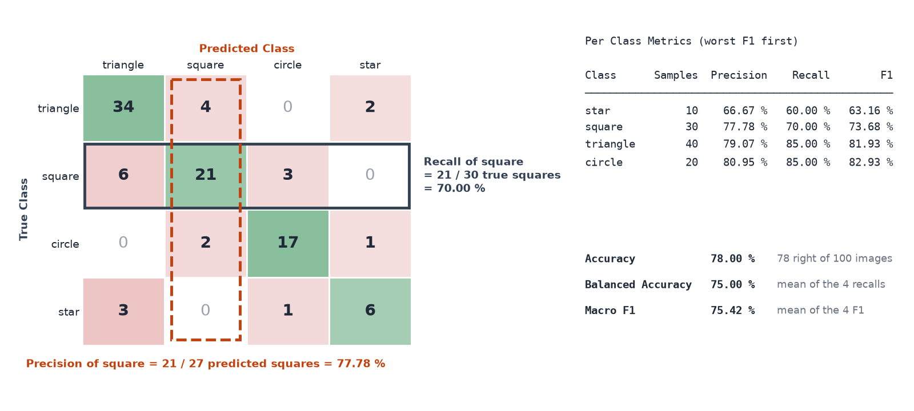
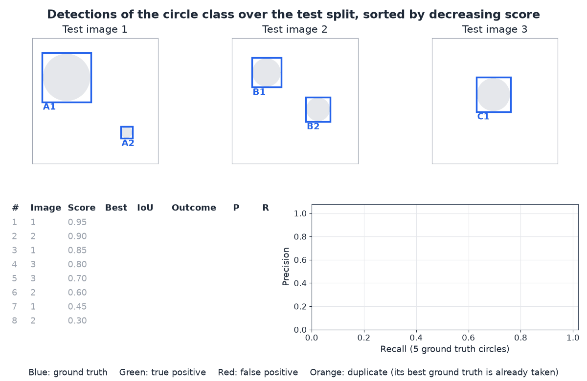
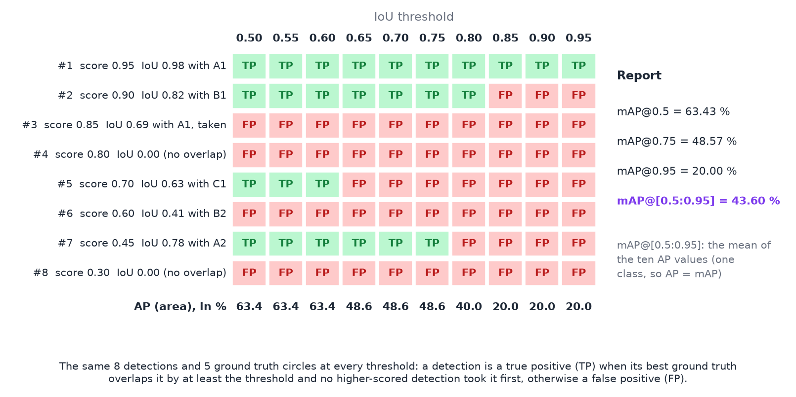
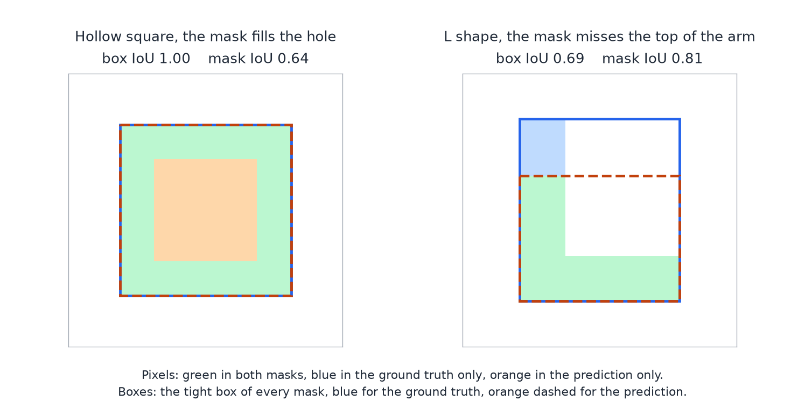
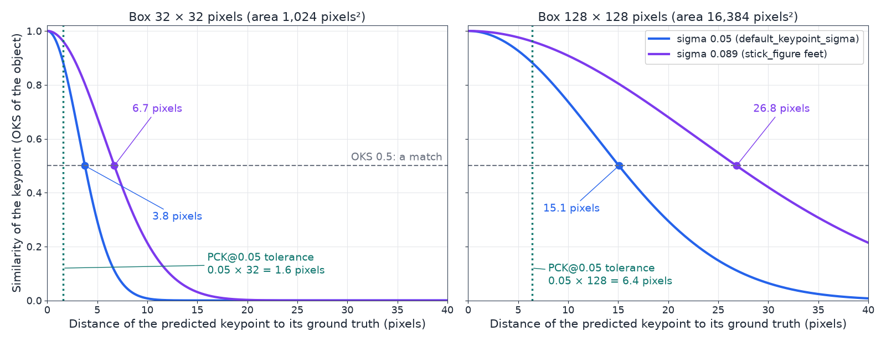
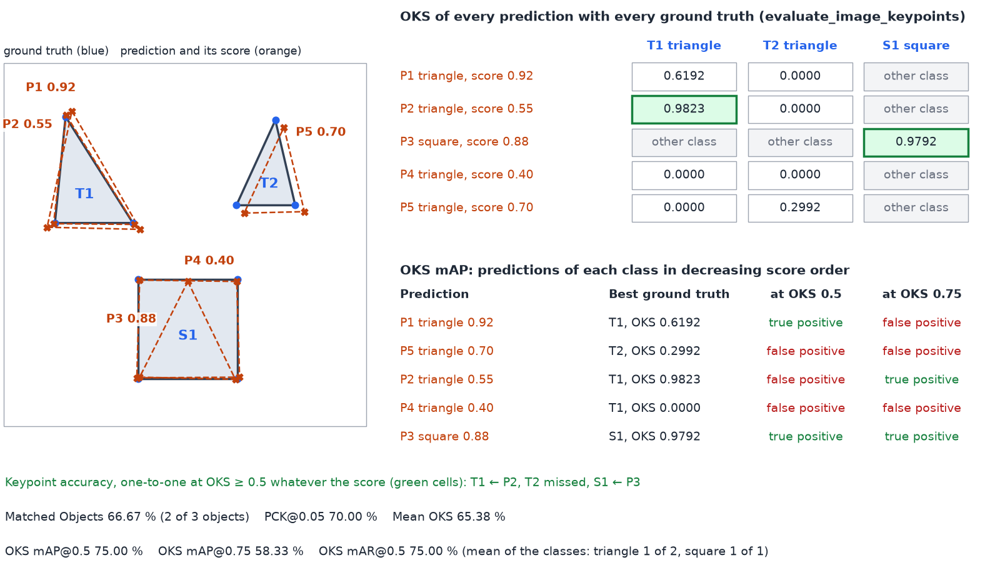
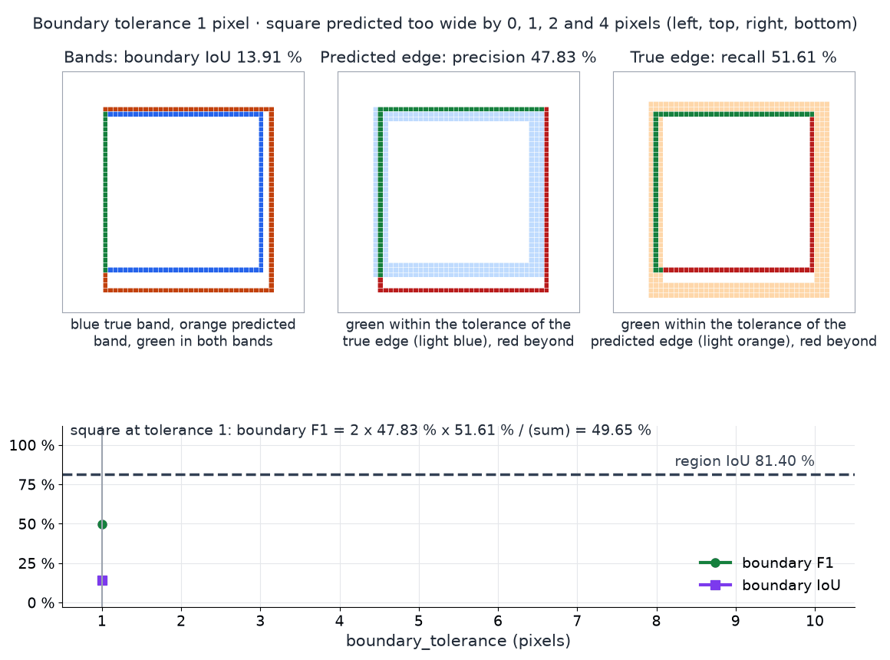
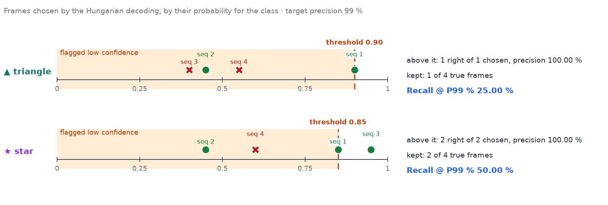
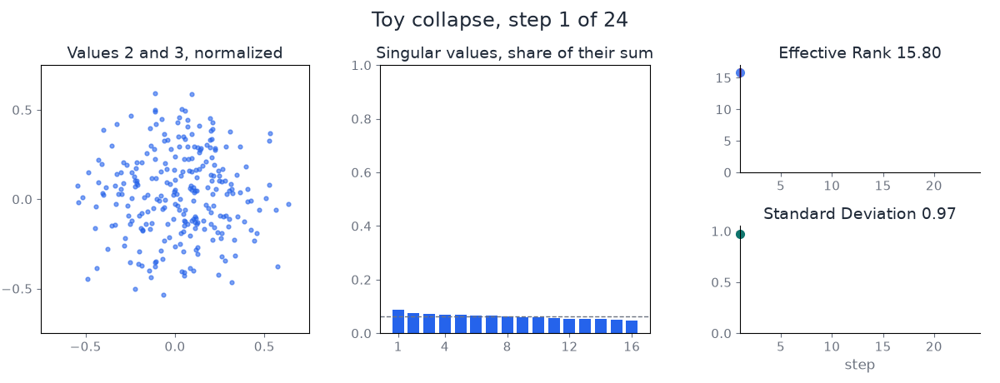
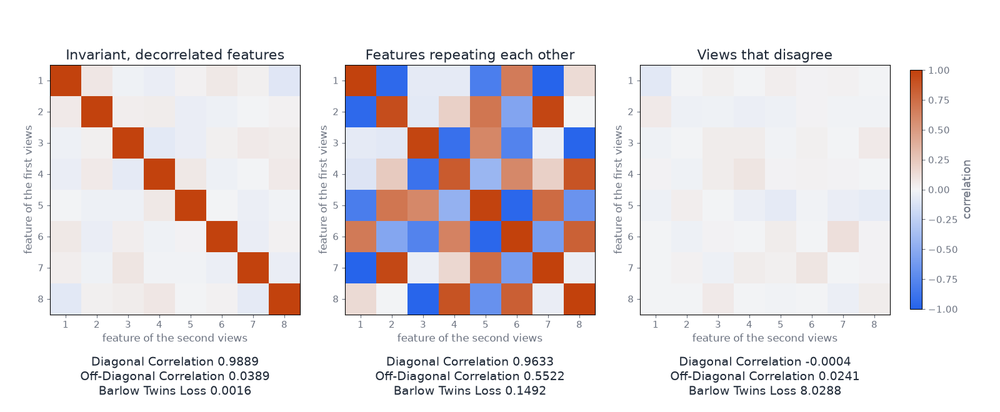

# Metrics Reference

If you are looking for what every metric of the evaluation reports measures, this reference completes the [Metrics Explained](../../README.md#metrics-explained) section of the README. Every rate is a percentage with two decimals in the reports (`81.76 %`) and a value between 0 and 1 in `class_metrics.csv`, TensorBoard and MLflow.

## Table Of Content
To find your way in this reference, the sections are:
- [Classification (CLS, M2O, CMP)](#classification-cls-m2o-cmp)
  - [Confusion Matrix](#confusion-matrix)
  - [Precision, Recall And F1](#precision-recall-and-f1)
  - [Accuracy](#accuracy)
  - [Balanced Accuracy](#balanced-accuracy)
  - [Macro And Micro Averages](#macro-and-micro-averages)
  - [Top-k Accuracy](#top-k-accuracy)
  - [ROC Curve And ROC AUC](#roc-curve-and-roc-auc)
  - [Average Precision Of A Class](#average-precision-of-a-class)
  - [Threshold And Recall At A Target Precision](#threshold-and-recall-at-a-target-precision)
  - [Multi-Label Metrics](#multi-label-metrics)
  - [Logit Temperature](#logit-temperature)
  - [Recall Intervals](#recall-intervals)
  - [Sequences, Pairs And Frames](#sequences-pairs-and-frames)
- [Object Detection And Instance Segmentation (DET, INS)](#object-detection-and-instance-segmentation-det-ins)
  - [Intersection Over Union Of Two Boxes](#intersection-over-union-of-two-boxes)
  - [Matching Detections To Ground Truths](#matching-detections-to-ground-truths)
  - [Precision-Recall Curve And Average Precision Of A Class](#precision-recall-curve-and-average-precision-of-a-class)
  - [mAP@0.5, mAP@0.75, mAP@0.95 And mAP@[0.5:0.95]](#map05-map075-map095-and-map05095)
  - [AP And mAP By Object Size](#ap-and-map-by-object-size)
  - [Mean Average Recall](#mean-average-recall)
  - [Per-Class Recall At IoU 0.5 And 0.75](#per-class-recall-at-iou-05-and-075)
  - [Detection Confusion Matrix](#detection-confusion-matrix)
  - [Proposal Recall](#proposal-recall)
  - [Anchor Recall](#anchor-recall)
  - [Mask IoU And Mask mAP](#mask-iou-and-mask-map)
  - [Evaluation At The Original Resolution](#evaluation-at-the-original-resolution)
- [Keypoint Detection (KPT)](#keypoint-detection-kpt)
  - [Object Keypoint Similarity (OKS)](#object-keypoint-similarity-oks)
  - [Matched Objects](#matched-objects)
  - [OKS mAP And mAR](#oks-map-and-mar)
  - [PCK@0.05](#pck005)
  - [Mean OKS](#mean-oks)
  - [Mean Keypoint Error](#mean-keypoint-error)
  - [Keypoint Accuracy Per Class And Per Keypoint](#keypoint-accuracy-per-class-and-per-keypoint)
- [Semantic Segmentation (SEG)](#semantic-segmentation-seg)
  - [Pixel Confusion Matrix And Unlabelled Pixels](#pixel-confusion-matrix-and-unlabelled-pixels)
  - [Pixel Accuracy](#pixel-accuracy)
  - [IoU Of A Class And Mean IoU](#iou-of-a-class-and-mean-iou)
  - [Dice And Mean Dice](#dice-and-mean-dice)
  - [Frequency Weighted IoU](#frequency-weighted-iou)
  - [Boundary IoU And Boundary F1](#boundary-iou-and-boundary-f1)
  - [Evaluated Resolution](#evaluated-resolution)
  - [Per Class Table](#per-class-table)
  - [Pixel Recall Interval](#pixel-recall-interval)
- [Sequence Labelling (M2M)](#sequence-labelling-m2m)
  - [Frame Accuracy And The Frame Metrics](#frame-accuracy-and-the-frame-metrics)
  - [Sequence Exact Match](#sequence-exact-match)
  - [Edit Score](#edit-score)
  - [Segment F1@10, @25 And @50](#segment-f110-25-and-50)
- [Frame Selection (SEL)](#frame-selection-sel)
  - [Hungarian And Greedy Decodings](#hungarian-and-greedy-decodings)
  - [Selection Accuracy](#selection-accuracy)
  - [Fully Right Sequences](#fully-right-sequences)
  - [Background And Swapped Picks](#background-and-swapped-picks)
  - [Top-k Selection Accuracy And Mean True Frame Rank](#top-k-selection-accuracy-and-mean-true-frame-rank)
  - [Frame Accuracy, Frame Balanced Accuracy And Frame Macro F1](#frame-accuracy-frame-balanced-accuracy-and-frame-macro-f1)
  - [Per Class Selection Table](#per-class-selection-table)
  - [Low-Confidence Thresholds](#low-confidence-thresholds)
- [Self-Supervised Evaluation (SSL)](#self-supervised-evaluation-ssl)
  - [The k-NN Evaluation](#the-k-nn-evaluation)
  - [k-NN Accuracy, Balanced Accuracy And Macro F1](#k-nn-accuracy-balanced-accuracy-and-macro-f1)
  - [Per Class k-NN Metrics](#per-class-k-nn-metrics)
  - [Effective Rank](#effective-rank)
  - [Representation Standard Deviation](#representation-standard-deviation)
- [Self-Supervised Training Metrics (SSL)](#self-supervised-training-metrics-ssl)
  - [Positive Pair Accuracy (SimCLR)](#positive-pair-accuracy-simclr)
  - [Diagonal And Off-Diagonal Correlation (Barlow Twins)](#diagonal-and-off-diagonal-correlation-barlow-twins)
  - [Embedding Standard Deviation](#embedding-standard-deviation)

## Classification (CLS, M2O, CMP)
Before reading a classification report, know that CLS reports on images, M2O on sequences, CMP on pairs and M2M on labelled frames ([Sequences, Pairs And Frames](#sequences-pairs-and-frames)).

Every metric is computed once per checkpoint over the whole test split, by `compute_evaluation_results` of `vision_training/trainers/classification_trainer.py`. Probabilities are the softmax of the logits (`multi_class`) or one sigmoid per class (`multi_label`), at temperature 1. The headline metric, `Accuracy` (`Subset Accuracy` in multi-label mode), picks the best checkpoint. Per-class tables, ROC AUC, average precision and images need `evaluation.per_class_report: True`.

### Confusion Matrix
Every multi-class rate below is a ratio of the cells of this matrix.
- **What it holds**: the test samples of every true class (rows) predicted as every class (columns), counted by `compute_confusion_matrix` of `vision_training/evaluation/classification/classification_metrics.py`.
- **Where**: `confusion_matrix.csv`, or `confusion_cells.csv` above 1,000 classes. `confusion_matrix.png` adds row recalls and column precisions ([Evaluating Checkpoints](../../README.md#evaluating-checkpoints)). Multi-label mode has none.
- **How to read it**: a strong off-diagonal cell is a pair of classes the model mixes up, with error images in `Errors/<TRUE>-TO-<PREDICTED>/`.

The figure shows the matrix and metrics of a toy classifier of four shapes.

<p align="center">
  
</p>
<p align="center"><em>100 test images (40 triangles, 30 squares, 20 circles, 10 stars): square recall 21 / 30 = 70.00 %, precision 21 / 27 = 77.78 %.</em></p>

### Precision, Recall And F1
Precision tells how many predictions of a class are right; recall how many samples of the class are found.

```
precision(k) = matrix[k, k] / sum of column k
recall(k)    = matrix[k, k] / sum of row k
F1(k)        = 2 × precision(k) × recall(k) / (precision(k) + recall(k))
```

- **Report and code**: the `Per Class Metrics` table and `class_metrics.csv`; `compute_precision_recall_f1`.
- **How to read it**: the F1 stays close to the lower of the two. A precision far below the recall means the class takes samples of other classes. Read the recall with its [interval](#recall-intervals).

### Accuracy
Accuracy is the headline metric of CLS, M2O, CMP and M2M: the diagonal over the whole matrix (`test/Accuracy` in MLflow).

Every sample weighs the same, so frequent classes decide it. On 90 circles and 10 stars, always answering circle scores 90.00 %. Read it next to the balanced accuracy and the macro F1.

### Balanced Accuracy
Balanced accuracy gives every class the same weight: the mean recall over the classes present in the test split. Chance is 1 / K for K classes. It ignores precision, so read the macro F1 with it.

The figure compares two classifiers on an imbalanced test split.

<p align="center">
  
</p>
<p align="center"><em>Always answering circle: 90.00 % accuracy, 50.00 % balanced accuracy, 47.37 % macro F1. Finding 8 of 10 stars at the cost of 10 circles: 88.00 %, 84.44 % and 75.08 %.</em></p>

### Macro And Micro Averages
A per-class metric is averaged in one of two ways.
- **Macro**: the plain mean over the classes (`Macro F1`, `Macro ROC AUC`, `Macro Average Precision`).
- **Micro**: counts pooled first. With one class per sample it equals the accuracy, so only the multi-label report gives it (`Micro F1`).

A low macro F1 next to a high accuracy points at a few weak classes, listed first in the per-class table.

### Top-k Accuracy
Top-k accuracy tells whether the true class is among the first guesses: `Top-5 Accuracy`, `compute_top_k_accuracy`, k being `TOP_K_ACCURACY_CLASSES` = 5. A large gap with the accuracy means errors between close classes. With 5 classes or fewer it is always 100.00 %.

### ROC Curve And ROC AUC
The ROC AUC tells how well the scores of one class separate its samples from all others, whatever the threshold. It appears in `roc_curves.png`, the `ROC AUC` column and `Macro ROC AUC` (`vision_training/evaluation/classification/score_curves.py`). 50 % is chance, 100 % a perfect ranking. It ignores how rare the class is; read the average precision for a rare class.

### Average Precision Of A Class
The average precision judges the scores of a class on its precision-recall curve, as scikit-learn's `average_precision_score`. It appears in `precision_recall_curves.png`, the `Average Precision` column and `Macro Average Precision`. Chance is the share of the class in the test split, not 50 %.

The animation sweeps the star threshold down the scored test images and builds both curves.

<p align="center">
  
</p>
<p align="center"><em>32 toy images, 8 stars. The last frame stops at the 99 % precision threshold, 0.4414, keeping 6 of 8 stars; average precision 93.81 %, ROC AUC 97.40 %.</em></p>

### Threshold And Recall At A Target Precision
For every class, the evaluation finds the score threshold that keeps the precision at a target, and the recall left at it.
- **Report and code**: `Threshold @ P99 %` and `Recall @ P99 %` columns, `class_thresholds.json` (read by the deployment) and `precision_recall_thresholds.png`; `find_class_thresholds` of `vision_training/evaluation/classification/threshold_finder.py`, for every target of `evaluation.target_precision`.
- **How to read it**: `Recall @ P99 %` is the share of the class a deployment keeps at that precision. A class that never reaches the target gets `—` (`null` in the file). A threshold only holds at the temperature it was found at.

### Multi-Label Metrics
When an image holds several classes (`output_mode: "multi_label"`), a class is predicted when its sigmoid reaches 0.5 (`MULTI_LABEL_THRESHOLD`). `compute_multi_label_metrics` gives `Subset Accuracy` (every decision of a sample right, the headline), `Micro F1` and `Macro F1`. There is no confusion matrix and no top-k accuracy. The micro F1 follows frequent classes, the macro F1 rare ones.

The table shows four toy images decided at 0.5.

| Image | True classes | Probabilities (triangle, square, circle, star) | Predicted classes | Every decision right |
|---|---|---|---|---|
| 1 | triangle, square | 0.9, 0.6, 0.2, 0.1 | triangle, square | yes |
| 2 | circle | 0.1, 0.4, 0.8, 0.2 | circle | yes |
| 3 | square, circle | 0.3, 0.7, 0.4, 0.1 | square | no, circle missed |
| 4 | triangle, star | 0.8, 0.1, 0.6, 0.3 | triangle, circle | no, star missed and circle added |

Subset accuracy 50.00 %, micro F1 76.92 %, macro F1 62.50 %.

### Logit Temperature
Should the scores be too squeezed, the probabilities become `softmax(logits / T)` (`compute_temperature_probabilities` of `vision_training/evaluation/classification/temperature_explorer.py`). Evaluations use T = 1; the explorer saves the thresholds of a chosen T ([Export](../../README.md#export)). T keeps the most probable class, so accuracy, confusion matrix, F1 and top-k never change. Thresholds move, and above two classes ROC AUC, average precision and `Recall @ P99 %` can change too. The server must divide by the same T.

The figure shows one image and the star scores at three temperatures.

<p align="center">
  
</p>
<p align="center"><em>Left: logits 6, 3 and 0 at T 0.5, 1 and 3; square stays first (0.998, 0.950, 0.665). Right: the star threshold moves from 0.6294 to 0.4414 to 0.3829, its recall falling to 50.00 % at T = 3.</em></p>

### Recall Intervals
So that a recall on few samples is not read as exact, every task writes its 95 % confidence interval (`95 % Lower`, `95 % Upper`; `recall_lower`, `recall_upper`), from `vision_training/evaluation/recall_intervals.py`.
- **Independent samples**: `compute_clopper_pearson_intervals` gives the exact interval for CLS images, M2O sequences, CMP pairs, SSL k-NN images and DET, INS and KPT objects.
- **Correlated samples**: `compute_bootstrap_recall_intervals` gives a Korn-Graubard interval by bootstrap over M2M and SEL sequences and SEG images.
- **How to read it**: overlapping intervals may differ by chance alone. For correlated samples, the number of groups holding the class matters, not the frames or pixels.

The figure shows how the interval of a 90 % recall narrows with more samples, and widens when misses are grouped.

<p align="center">
  
</p>
<p align="center"><em>Left: 55.50 % to 99.75 % at 10 samples, 89.13 % to 90.82 % at 5,000. Right: 1,000 frames of 100 sequences; effective size 976 for scattered misses, 227 for 5 misses in 20 sequences, 100 for 10 sequences missed whole.</em></p>

### Sequences, Pairs And Frames
The sequence tasks use the same code; only the sample changes.
- **M2O**: one test sequence, Clopper-Pearson intervals.
- **CMP**: one test pair. With 2 classes, `Top-5 Accuracy` is always 100.00 % and both classes share one ROC AUC.
- **M2M**: one labelled frame, padding left out, Korn-Graubard intervals over the sequences. The segment metrics are in [Sequence Labelling (M2M)](#sequence-labelling-m2m).

## Object Detection And Instance Segmentation (DET, INS)
Should your model draw boxes or masks, its report rests on the overlap measure and the matching rule below.

### Intersection Over Union Of Two Boxes
Before reading any detection number, know the IoU: 1 for identical boxes, 0 for disjoint ones (`get_intersection_over_union` of `vision_training/models/detection/box_operations.py`).

```
IoU(A, B) = area(A ∩ B) / (area(A) + area(B) - area(A ∩ B))
```

The figure shows one ground truth box against four detections.

<p align="center">
  
</p>
<p align="center"><em>One 120 x 120 ground truth box (blue) against four detections (orange): IoU 0.33, 0.50, 0.75 and 0.95.</em></p>

An IoU of 0.5 still allows a box shifted by a third of its width. The same pixel error costs more on a small object.

### Matching Detections To Ground Truths
Before any precision or recall is counted, each detection is declared right or wrong (`match_detections_to_ground_truth` of `vision_training/evaluation/detection/mean_average_precision.py`).
- A detection is compared only with the ground truths of its class in its image.
- In decreasing score order, a detection is a true positive when its best ground truth overlaps it by the threshold and is still free.
- This is the PASCAL VOC rule: a detection whose best ground truth is taken is a false positive. The COCO tools would match it, so numbers differ.
- Only detections scored at least `evaluation.score_threshold` (0.05) enter.

Duplicates lower the precision. A box below the threshold counts twice, as a false positive and a missed object.

### Precision-Recall Curve And Average Precision Of A Class
If one wishes to judge a detector of one class across all thresholds at once, use this curve and its area (`compute_average_precision`). Each detection, in score order, adds one point. Three summaries are printed:
- `Area` (PASCAL VOC 2010, the headline): the area under the envelope of the curve.
- `11 Point` (VOC 2007) and `101 Point` (COCO): the mean envelope precision at 11 or 101 recalls.

A class without ground truth has no AP ("—") and is left out of every mean. The animation matches eight detections to five circles.

<p align="center">
  
</p>
<p align="center"><em>Greedy matching at IoU 0.5 (green true positive, red false positive, orange duplicate): area 63.43 %, 11 point 66.75 %, 101 point 63.79 %.</em></p>

The `Per Class Average Precision (Area)` table lists each class's AP at 0.5, 0.75, 0.95 and 0.5 to 0.95, worst first, with its [threshold at a target precision](#threshold-and-recall-at-a-target-precision). A class with high recall and low AP is found but ranked among false positives.

### mAP@0.5, mAP@0.75, mAP@0.95 And mAP@[0.5:0.95]
To be able to tell whether a detector also draws tight boxes, read its mAP at several IoU thresholds: the mean AP over the classes with ground truth. `evaluate_detections` matches at ten thresholds from 0.50 to 0.95, averaged into mAP@[0.5:0.95]. `mAP@0.5/area` picks the best checkpoint.

The figure shows the eight toy detections judged at each threshold.

<p align="center">
  
</p>
<p align="center"><em>mAP@[0.5:0.95] 43.60 % against mAP@0.5 63.43 %.</em></p>

mAP@0.5 measures finding and classifying; the gap to mAP@0.75 measures localisation. With VOC matching, mAP@[0.5:0.95] is not the COCO number.

### AP And mAP By Object Size
In case you suspect the detector of missing only small objects, read the mAP per size. Sizes are those of COCO (`OBJECT_SIZE_RANGES`): small under 1,024 square pixels, medium up to 9,216, large above, on the box area in network input pixels (mask area for the mask mAP). A weak size points at its levels and anchors; read the `Objects` column first.

### Mean Average Recall
Should you need to know whether objects are found at all, whatever the score, read the mAR: the recall of each class averaged, at each threshold, overall and per size. A high mAR with a low mAP means objects found but ranked below false positives. A low mAR is to be compared with the [proposal recall](#proposal-recall).

### Per-Class Recall At IoU 0.5 And 0.75
If you are looking for the share of each class found, with its uncertainty, read the `Per Class Recall` table (`recall_50`, `recall_75` and their [intervals](#recall-intervals)). A recall at 0.75 far below the one at 0.5 means a class found but poorly boxed.

### Detection Confusion Matrix
Suppose the deployed detector keeps only detections above `Detector.inference.score_threshold`: this matrix shows its outcomes there (`vision_training/evaluation/detection/detection_confusion.py`, IoU 0.5). False positives go to the `background` row, missed objects to the `background` column. With `error_dumps.activated`, images go to `Errors/FALSE-POSITIVE/<class>/`, `Errors/MISSED/<class>/` and `Errors/<TRUE>-TO-<PREDICTED>/`.

The figure shows the four outcomes on one toy image.

<p align="center">
  
</p>
<p align="center"><em>At threshold 0.50: 2 right, 1 wrong class, 2 false positives, 1 missed. Right: the AP@0.5 of the same detections from 0.05 (62.50 %).</em></p>

Right + wrong class + missed equals the test objects. Many missed objects with a high mAR mean detections scored under the threshold.

### Proposal Recall
After a change to the anchors or proposal settings, check that proposals still cover the test objects: Recall@0.5 and Recall@0.7 overall, per size and per block, in `proposal_recall.csv` (`vision_training/evaluation/detection/region_recall.py`). A proposal recall far above the [mean average recall](#mean-average-recall) points at the heads; a low one at anchors, proposal counts or selection.

### Anchor Recall
For the region proposal network to learn an object, an anchor must overlap it by `RegionProposal.foreground_iou_threshold.min`. Printed at every launch as `Anchor Recall Of The Training Objects` and saved in `anchor_recall.csv`, it gives the share of training objects that have one. `diagnosis_modes.compute_anchor_coverage` measures it on every split ([Augmentation And Diagnosis Modes](../../README.md#augmentation-and-diagnosis-modes)).

The figure shows five toy objects and the best anchor of each over two levels.

<p align="center">
  
</p>
<p align="center"><em>Green above 0.5, red under: the 10-pixel square is too small for 16-pixel anchors, the 112-pixel square too large for 64-pixel ones.</em></p>

Read `All Levels` size by size: smaller scales help small objects, larger ones large objects, other aspect ratios elongated ones.

### Mask IoU And Mask mAP
Whenever an instance segmentation run is evaluated, its detections are scored by masks and by boxes. The mask IoU is the pixels in both masks over the pixels in either, after pasting the 28 x 28 masks into their boxes. The mask mAP uses the same matching and thresholds. `Mask mAP@0.5/area` picks the best checkpoint.

The figure compares mask IoU and box IoU on two toy shapes.

<p align="center">
  
</p>
<p align="center"><em>A mask filling a hole keeps a box IoU of 1.00 with a mask IoU of 0.64; a mask missing a thin arm has box IoU 0.69 and mask IoU 0.81.</em></p>

A box mAP close to the mask mAP, with a low mask IoU on hollow or thin classes, points at the mask head.

### Evaluation At The Original Resolution
So that an instance segmentation run is measured on images as they arrive in deployment, turn on `ExperimentConfiguration.evaluation.original_resolution`. Objects are rebuilt at the original size and boxes restored (`restore_detection_boxes`). Object sizes move between rows, so compare runs at the same resolution only.

## Keypoint Detection (KPT)
To find your way in a keypoint report, start from the object keypoint similarity (OKS). The OKS mAP uses it where detection uses the box IoU, and the keypoint accuracy uses it to pair objects. Everything is computed on the test split by `compute_evaluation_results` of `vision_training/trainers/keypoint_trainer.py`, in network input pixels, every grouped object kept.

Every evaluation of the keypoint tutorial run opens with these four values:

```text
Iteration 6000 · 1024 Test Images · 2026-11-19 07:28 ──────────────────────────────────
  Matched Objects   97.32 %   PCK@0.05                       93.47 %
  Mean OKS          92.99 %   Mean Keypoint Error (pixels)   4.7397
```

### Object Keypoint Similarity (OKS)
The OKS tells how close the predicted keypoints of an object are to the labelled ones, between 0 and 1 (`compute_object_keypoint_similarity` of `vision_training/evaluation/keypoints/object_keypoint_similarity.py`):

```text
OKS = sum over the labelled keypoints of exp(-d² / (2 · area · (2σ)²)) / number of labelled keypoints
```

- `d` is the distance in pixels. A keypoint not found adds 0 but still counts in the denominator.
- `area` is the ground truth box area. COCO uses the segment area, so values do not compare with published COCO results.
- `σ` is `evaluation.keypoint_sigmas.<category>.<keypoint>`, or `default_keypoint_sigma` (0.05).
- Only keypoints of visibility 1 or 2 count. Objects of different classes get 0.

Should a keypoint be loosely labelled, raise its sigma. Sigmas change every OKS-based value, so compare runs with the same sigmas. The figure plots the similarity of one keypoint against its distance.

<p align="center">
  
</p>
<p align="center"><em>With sigma 0.05 the similarity falls to 0.5 at 3.8 pixels on a 32 × 32 box and at 15.1 pixels on a 128 × 128 box. The dotted line is the PCK@0.05 tolerance.</em></p>

The figure shows one stick figure prediction with the similarity of every keypoint.

<p align="center">
  
</p>
<p align="center"><em>OKS 0.8652, PCK@0.05 70.00 %, mean keypoint error 6.4961 pixels.</em></p>

### Matched Objects
`Matched Objects` tells how many ground truth objects were found with usable keypoints, at any score. `match_ground_truth_objects` pairs objects one to one per image with `scipy.optimize.linear_sum_assignment` on the OKS, a pair needing at least `MINIMUM_MATCH_SIMILARITY` (0.5). It ignores scores and false positives, so read it with the OKS mAP.

The figure shows how this matching and the one of the OKS mAP can disagree.

<p align="center">
  
</p>
<p align="center"><em>Two triangles and a square with five predicted objects: Matched Objects 66.67 %, OKS mAP@0.5 75.00 %.</em></p>

### OKS mAP And mAR
`OKS mAP@0.5/area` (`KEYPOINT_HEADLINE_METRIC`) ranks the checkpoints. It is the mAP of [object detection](#object-detection-and-instance-segmentation-det-ins) (`summarise_average_precisions(overlap_type="keypoints")`) with these differences:
- The overlap is the OKS.
- Test objects without labelled keypoints are ignored, as in pycocotools.
- Objects are ranked by their score, the mean of their keypoint scores.

The names carry `OKS` (`OKS Mean Average Precision`, `OKS Per Class Recall`). The tutorial run reaches 96.58 % at 0.5 and 72.79 % at 0.95 at iteration 6000: once objects are found, strict thresholds tell checkpoints apart.

### PCK@0.05
PCK@0.05 tells how many keypoints land close enough to be used: within `CORRECT_KEYPOINT_FRACTION` (0.05) of the longest box side. It is pooled over keypoints, so classes with more keypoints weigh more. It says nothing of how far the wrong ones are; read the [mean keypoint error](#mean-keypoint-error).

### Mean OKS
Mean OKS averages the OKS of every ground truth object with its match, a missed object scoring 0. It equals `Matched Objects` times the mean OKS of the matched objects. When it drops, `Matched Objects` tells whether objects were missed or placed worse.

### Mean Keypoint Error
`Mean Keypoint Error (pixels)` averages the distances of keypoints found in matched objects, missed ones left out. It can fall when the detector gets worse, as a drifting object leaves the mean once unmatched, so read it with `Matched Objects` and PCK@0.05.

The animation shows a predicted triangle turning away until it is no longer matched.

<p align="center">
  
</p>
<p align="center"><em>At 8.4° the OKS is 0.5026 and the error 13.9012 pixels. At 9.0° the OKS is 0.4699, the object is missed and the error has no value.</em></p>

### Keypoint Accuracy Per Class And Per Keypoint
Whenever global values hide which shapes or keypoints fail, two tables (`per_class_report: True`) give the same values per class (`class_metrics.csv`) and per keypoint (`keypoint_metrics.csv`), worst PCK@0.05 first. The excerpt shows the worst keypoints of the tutorial run.

```text
  Keypoint Accuracy Per Keypoint
                                                                             Mean Error
   Class                            Keypoint   Labelled   Found   PCK@0.05     (pixels)
  ──────────────────────────────────────────────────────────────────────────────────────
   stick_figure                   right_knee        104      99    80.77 %      18.3462
   hollow_triangle                 inner_top         95      90    81.05 %      20.1602
   …
```

`Found` well below `Labelled` points to misses; a large error with `Found` close to `Labelled` to misplaced keypoints.

## Semantic Segmentation (SEG)
Before comparing segmenters, know that every SEG metric pools the labelled pixels of the whole test split before any ratio. Region metrics come from one pixel confusion matrix (`compute_segmentation_metrics` of `vision_training/evaluation/segmentation/segmentation_metrics.py`), contour metrics from `compute_boundary_metrics`. **Mean IoU** is the headline metric.

The table shows where each metric appears.

| Metric | `Results.txt` | `class_metrics.csv` | TensorBoard and MLflow |
|---|---|---|---|
| Pixel accuracy | `Pixel Accuracy` | | `Pixel Accuracy` |
| IoU, mean IoU | `IoU`, `Mean IoU` | `iou` | `IoU/<class>`, `Mean IoU` |
| Dice, mean Dice | `Dice`, `Mean Dice` | `dice` | `Dice/<class>`, `Mean Dice` |
| Frequency weighted IoU | `Frequency Weighted IoU` | | `Frequency Weighted IoU` |
| Boundary IoU and F1 | `Boundary IoU`, `Boundary F1` and their means | `boundary_iou`, `boundary_f1` | per class and mean |
| Pixel precision and recall | `Precision`, `Recall`, `Per Class Recall` | `precision`, `recall`, `recall_lower`, `recall_upper` | `Precision/<class>`, `Recall/<class>` |

The pixel accuracy and mean IoU shown during training are batch averages, not the test number.

### Pixel Confusion Matrix And Unlabelled Pixels
Mask value 255 means unlabelled and becomes `IGNORED_LABEL_INDEX` (-100), like the letterbox padding. `compute_pixel_confusion_matrix` counts every labelled pixel at its true and predicted class; predictions on ignored pixels count nowhere.

The figure scores a toy image with an unlabelled strip at the bottom.

<p align="center">
  
</p>
<p align="center"><em>The strip is left out. IoU 89.10 %, 77.01 % and 67.09 %, mean IoU 77.73 %, pixel accuracy 90.85 %.</em></p>

Keep 255 for pixels nobody can classify: a wide unlabelled area hides the errors made there.

### Pixel Accuracy
Pixel accuracy is the share of labelled pixels given their class. The background dominates it: a model missing a small class entirely can still score 97.36 %. Read it as a sanity check.

### IoU Of A Class And Mean IoU
The IoU scores each class on its own: `right pixels / (true pixels + predicted pixels - right pixels)`. The **Mean IoU** averages it over the classes present or predicted, background included. A class painted without true pixels counts 0.

The figure shows how missed and wrongly painted classes move the mean.

<p align="center">
  
</p>
<p align="center"><em>Missing the small star gives a mean IoU of 64.46 % while pixel accuracy stays at 97.36 %. Painting an absent circle gives 64.77 %.</em></p>

A class predicted but absent costs a 0, yet shows `—` in the per-class table: find it in `confusion_matrix.csv`.

### Dice And Mean Dice
Dice is given for comparison with papers. It is the pixel F1 of a class, and `Dice = 2 x IoU / (1 + IoU)`, so it ranks like the IoU but sits higher. Never compare one run's Dice with another's IoU.

### Frequency Weighted IoU
It weighs each class IoU by its true pixels, so the background dominates it and it never sees classes painted without true pixels.

### Boundary IoU And Boundary F1
Read these when contours matter: a region a few pixels too wide keeps a high IoU. Both score the pixels within `evaluation.boundary_tolerance` (2 pixels) of the contours.
- **Boundary IoU**: overlap of the true and predicted bands ([Boundary IoU](https://arxiv.org/abs/2103.16562)).
- **Boundary F1**: harmonic mean of edge precision and recall within the tolerance.

The animation grows the tolerance around a square predicted too wide.

<p align="center">
  
</p>
<p align="center"><em>Tolerance 1 to 10 pixels: boundary F1 49.65 % to 100.00 %, boundary IoU 13.91 % to 70.56 %, region IoU 81.40 %.</em></p>

Compare runs only at the same tolerance and resolution.

### Evaluated Resolution
The `Labelled Pixels` note names the resolution:
- `network resolution` (default): objects thinner than a pixel vanish from the ground truth.
- `images scaled by <scale>, segmented tile by tile` (`Data.tiling.activated`).
- `original resolution of the images` (`evaluation.original_resolution: True`), as deployed.

`boundary_tolerance` counts pixels, so scale it with the resolution before comparing runs.

### Per Class Table
Open it to find the class that pulls the mean IoU down. It lists every class, worst IoU first, with `ROC AUC` and `Average Precision` columns under `per_class_report`. Precision below recall means the class is painted where it is not; recall below precision means it is missed.

### Pixel Recall Interval
The 95 % interval tells whether a recall change is beyond noise. Pixels of one image are correlated, so it is a Korn-Graubard interval over the test images ([Recall Intervals](#recall-intervals)). Its width depends on the images holding the class, not on its pixels.

## Sequence Labelling (M2M)
Whenever you read an M2M report, it scores frames, whole sequences and runs of frames. Checkpoints are compared on `Accuracy`, the frame accuracy.

### Frame Accuracy And The Frame Metrics
These are the [classification metrics](#classification-cls-m2o-cmp) on labelled frames, padding and unmapped frames left out. The [recall intervals](#recall-intervals) bootstrap over sequences. The frame accuracy follows the most frequent class (`no_change`, 46.97 % of tutorial test frames), so read `Balanced Accuracy` and `Macro F1` first.

### Sequence Exact Match
`Sequence Exact Match` is the share of sequences with every frame right (`compute_sequence_exact_matches`). It is the strictest metric (tutorial run: 77.16 % of frames right, 24.00 % of sequences exact). The edit score and segment F1 tell a shifted boundary from a missed event.

### Edit Score
The edit score measures fragmentation: a flicker costs one frame but cuts an event in three. A segment is a run of frames of one class (`compute_segment_metrics` of `vision_training/evaluation/sequence/segment_metrics.py`).

```
edit score of a sequence = 1 − edit distance / max(predicted segments, true segments)
```

The edit distance is the Levenshtein distance between segment class orders, averaged over sequences. The figure compares predictions with the same frame accuracy.

<p align="center">
  
</p>
<p align="center"><em>Boundary one frame early versus a flickering frame: both 90.00 % of frames right, edit scores 100.00 % and 50.00 %, segment F1@50 100.00 % and 33.33 %.</em></p>

It ignores positions and lengths, so read it with `Segment F1@50`.

### Segment F1@10, @25 And @50
Segment F1 tells whether every true event is found, like detections along time (`count_segment_matches`). Each predicted segment is matched to the true segment of its class it overlaps most, right when the IoU reaches the threshold and that segment is free.

The animation scores the [tasks reference](tasks_reference.md#sequence-labelling-m2m) example.

<p align="center">
  
</p>
<p align="center"><em>Edit score 33.33 %, segment F1 50.00 % at 0.10 and 0.25, 0.00 % at 0.50.</em></p>

A gap between `@10` and `@50` points to shifted events; a low `@10` to fragmentation or missed short events.

## Frame Selection (SEL)
In case you read a frame selector's report, it picks `Selection.frames_per_class` frames per wanted class in every sequence, compared on the selection accuracy of `Selection.decoding`. The toy examples use four sequences, classes triangle and star, one frame per class, `top_k` 2 and a target precision of 99 %.

### Hungarian And Greedy Decodings
Both decodings of `vision_training/models/sequence/frame_selection_decoding.py` run at every evaluation:
- `hungarian`: the most probable labelling with exactly `frames_per_class` frames per class (`scipy.optimize.linear_sum_assignment`).
- `greedy`: every frame takes its most probable class, then classes are trimmed or completed.

The animation shows both on the tasks reference example.

<p align="center">
  
</p>
<p align="center"><em>Greedy step by step (0.00 %), then the Hungarian assignment (100.00 %), true classes dashed.</em></p>

The Hungarian decoding maximises the labelling probability, not the right picks, so greedy can win on a sequence.

### Selection Accuracy
`Hungarian Selection Accuracy` and `Greedy Selection Accuracy` give the share of true frames picked for their class (`compute_selection_metrics`). It is both recall and precision, since as many frames are picked as are true. The figure shows the toy test split.

<p align="center">
  
</p>
<p align="center"><em>Hungarian 62.50 %, greedy 50.00 %; sequence 3 a background pick, sequence 4 a swap.</em></p>

### Fully Right Sequences
`<Decoding> Fully Right Sequences` counts sequences needing no human correction. Against the selection accuracy, it shows whether wrong picks gather in few sequences.

### Background And Swapped Picks
`<Decoding> Background Picks` and `<Decoding> Swapped Picks` split the wrong picks. With the selection accuracy they add up to 100 %. In the README run, most wrong picks took an unselected frame (3.50 % against 0.67 %).

### Top-k Selection Accuracy And Mean True Frame Rank
These tell whether a wrong pick was a near miss, before decoding (`compute_ranking_metrics`). The rank is 1 plus the frames with a higher probability for the class; `k` (`evaluation.top_k`) is also the number of candidates the deployed decoder returns.

The figure orders the toy frames by class probability.

<p align="center">
  
</p>
<p align="center"><em>True frames in blue with their rank: top-2 selection accuracy 87.50 %, mean true frame rank 1.5000.</em></p>

### Frame Accuracy, Frame Balanced Accuracy And Frame Macro F1
These judge the per-frame classifier before decoding ([classification](#classification-cls-m2o-cmp)). The unselected class dominates (61.56 % of README run frames), so read the balanced accuracy first.

### Per Class Selection Table
The `Per Class Selection` table (`per_class_report`, also in `class_metrics.csv`) has one row per wanted class, worst first. Here it is on the toy split:

```
                         Hungarian     Greedy      Top-2     Mean   Threshold    Recall
 Class      True Frames   Accuracy   Accuracy   Accuracy     Rank     @ P99 %   @ P99 %
 triangle             4    50.00 %    50.00 %    75.00 %   1.7500      0.9000   25.00 %
 star                 4    75.00 %    50.00 %   100.00 %   1.2500      0.8500   50.00 %
```

### Low-Confidence Thresholds
So that a human checks uncertain picks, `find_selection_thresholds` finds per class the probability from which picks reach `evaluation.target_precision`. Thresholds go to `class_thresholds.json`; `flag_low_confidence` flags picks below them.

<p align="center">
  
</p>
<p align="center"><em>Right picks green, wrong red; thresholds 0.90 and 0.85 keep 25.00 % and 50.00 % of the true frames.</em></p>

`Recall @ P99 %` is the share of true frames that pass unchecked. A confident wrong pick still passes.

## Self-Supervised Evaluation (SSL)
If one wishes to judge a self-supervised backbone, the evaluation scores the pooled representation of every test image. It asks whether images of a class lie close (k-NN) and whether representations use many directions (effective rank, standard deviation).

### The k-NN Evaluation
Each labelled test image is classified by its nearest reference images, without training a classifier (`vision_training/evaluation/self_supervised/representation_metrics.py`).
- **Reference images**: per training class, the `number_reference_images_per_class` images with the smallest file name MD5 hashes, the same at every evaluation.
- **Vote**: cosine similarity on L2-normalized representations. The `number_neighbours` most similar vote with weight `exp(similarity / 0.07)`.

The picture shows one vote: three circles outnumber two stars, but the stars hold 82.56 % of the weight.

<p align="center">
  
</p>
<p align="center"><em>5 neighbours, temperature 0.07: 17.44 % circle against 82.56 % star.</em></p>

### k-NN Accuracy, Balanced Accuracy And Macro F1
`k-NN Accuracy` is the headline metric when the test split has labels, with the definitions of [classification](#classification-cls-m2o-cmp). Without labelled test images, the effective rank becomes the headline.
- Chance is one over the classes. The tutorial run (9 classes) goes from 12.33 % at iteration 500 to 54.83 % at 20,000.
- The value depends on `number_neighbours`, `number_reference_images_per_class` and the reference images; compare runs with the same settings.

### Per Class k-NN Metrics
When the k-NN accuracy stalls, the per-class precision, recall (with [interval](#recall-intervals)) and F1 in `class_metrics.csv` show which classes stay mixed, with the `Per Class k-NN Metrics` and `Per Class k-NN Recall` tables under `per_class_report`.

### Effective Rank
The `Effective Rank` (RankMe, `compute_effective_rank`) tells in how many directions the representations spread: the exponential of the entropy of the normalized singular values. It needs no labels.

The figure shows four toy sets, from evenly spread to collapsed.

<p align="center">
  
</p>
<p align="center"><em>512 representations of 16 values (effective rank, standard deviation): spread 15.93 and 1.00, non-negative 15.03 and 0.82, 3 directions 3.77 and 0.46, one vector 1.29 and 0.01.</em></p>

About 1 means a collapse; the tutorial run goes from 23.90 to 46.18. The first checkpoints can sit near 1 while batch normalization settles. It counts directions, not class separation.

The animation shows a collapse step by step.

<p align="center">
  
</p>
<p align="center"><em>24 steps: effective rank 15.80 to 1.08, standard deviation 0.97 to 0.003.</em></p>

### Representation Standard Deviation
A simpler collapse signal: the mean standard deviation of the L2-normalized representations times sqrt(F) (`compute_embedding_standard_deviation`). Points spread over the sphere give about 1, one vector 0. After the ReLU it stays well below 1 (0.5703 at iteration 20,000 of the tutorial run); only a fall towards 0 means collapse.

## Self-Supervised Training Metrics (SSL)
To watch the training, these batch metrics come from the embeddings of the two views (`METHOD_TRACKED_METRICS` of `vision_training/trainers/self_supervised_trainer.py`).

### Positive Pair Accuracy (SimCLR)
The share of views whose most similar other view is their partner (`compute_info_nce_loss`). Chance is 1 / (2N - 1) for N images per batch.

The figure compares two toy encoders that both reach 100.00 %.

<p align="center">
  
</p>
<p align="center"><em>The encoder that sees only colour scores 45.00 % in the k-NN by shape, the other 100.00 %.</em></p>

- Near 100 % long before the k-NN accuracy rises shows a shortcut (colour, position).
- The tutorial run ends at 34.82 % with a k-NN accuracy of 54.83 %: a moderate value can go with a good representation.
- It depends on batch size and view strength.

### Diagonal And Off-Diagonal Correlation (Barlow Twins)
`Diagonal Correlation` is the mean of the diagonal of the cross-correlation matrix (target 1, invariance); `Off-Diagonal Correlation` the mean absolute value off it (target 0, redundancy).

The figure shows three toy cross-correlation matrices.

<p align="center">
  
</p>
<p align="center"><em>(diagonal, off-diagonal): invariant and decorrelated 0.9889 and 0.0389; repeating features 0.9633 and 0.5522; disagreeing views -0.0004 and 0.0241.</em></p>

A diagonal near 0 means disagreeing views or a collapse; near 1 with a high off-diagonal, a partial collapse.

### Embedding Standard Deviation
This applies the [representation standard deviation](#representation-standard-deviation) to the embeddings of the first views. A healthy run sits near 1 (0.9751 at the end of the tutorial run). A fall towards 0 with a stuck loss is a collapse.
