# Metrics Reference

What every metric of the evaluation reports measures, completing the [Metrics Explained](../../README.md#metrics-explained) section of the README. Every rate is a percentage with two decimals in the reports (`81.76 %`) and a value between 0 and 1 in `class_metrics.csv`, TensorBoard and MLflow.

## Table Of Content
- [Classification (CLS, M2O, CMP)](#classification-cls-m2o-cmp)
  - [Confusion Matrix](#confusion-matrix)
  - [Precision, Recall And F1](#precision-recall-and-f1)
  - [Accuracy](#accuracy)
  - [Balanced Accuracy](#balanced-accuracy)
  - [Macro And Micro Averages](#macro-and-micro-averages)
  - [Top-k Accuracy](#top-k-accuracy)
  - [ROC Curve And ROC AUC](#roc-curve-and-roc-auc)
  - [Average Precision Of A Class](#average-precision-of-a-class)
  - [Threshold And Recall At A Target Precision](#threshold-and-recall-at-a-target-precision)
  - [Multi-Label Metrics](#multi-label-metrics)
  - [Logit Temperature](#logit-temperature)
  - [Recall Intervals](#recall-intervals)
  - [Sequences, Pairs And Frames](#sequences-pairs-and-frames)
- [Object Detection And Instance Segmentation (DET, INS)](#object-detection-and-instance-segmentation-det-ins)
  - [Intersection Over Union Of Two Boxes](#intersection-over-union-of-two-boxes)
  - [Matching Detections To Ground Truths](#matching-detections-to-ground-truths)
  - [Precision-Recall Curve And Average Precision Of A Class](#precision-recall-curve-and-average-precision-of-a-class)
  - [mAP@0.5, mAP@0.75, mAP@0.95 And mAP@[0.5:0.95]](#map05-map075-map095-and-map05095)
  - [AP And mAP By Object Size](#ap-and-map-by-object-size)
  - [Mean Average Recall](#mean-average-recall)
  - [Per-Class Recall At IoU 0.5 And 0.75](#per-class-recall-at-iou-05-and-075)
  - [Detection Confusion Matrix](#detection-confusion-matrix)
  - [Proposal Recall](#proposal-recall)
  - [Anchor Recall](#anchor-recall)
  - [Mask IoU And Mask mAP](#mask-iou-and-mask-map)
  - [Evaluation At The Original Resolution](#evaluation-at-the-original-resolution)
- [Keypoint Detection (KPT)](#keypoint-detection-kpt)
  - [Object Keypoint Similarity (OKS)](#object-keypoint-similarity-oks)
  - [Matched Objects](#matched-objects)
  - [OKS mAP And mAR](#oks-map-and-mar)
  - [PCK@0.05](#pck005)
  - [Mean OKS](#mean-oks)
  - [Mean Keypoint Error](#mean-keypoint-error)
  - [Keypoint Accuracy Per Class And Per Keypoint](#keypoint-accuracy-per-class-and-per-keypoint)
- [Semantic Segmentation (SEG)](#semantic-segmentation-seg)
  - [Pixel Confusion Matrix And Unlabelled Pixels](#pixel-confusion-matrix-and-unlabelled-pixels)
  - [Pixel Accuracy](#pixel-accuracy)
  - [IoU Of A Class And Mean IoU](#iou-of-a-class-and-mean-iou)
  - [Dice And Mean Dice](#dice-and-mean-dice)
  - [Frequency Weighted IoU](#frequency-weighted-iou)
  - [Boundary IoU And Boundary F1](#boundary-iou-and-boundary-f1)
  - [Evaluated Resolution](#evaluated-resolution)
  - [Per Class Table](#per-class-table)
  - [Pixel Recall Interval](#pixel-recall-interval)
- [Sequence Labelling (M2M)](#sequence-labelling-m2m)
  - [Frame Accuracy And The Frame Metrics](#frame-accuracy-and-the-frame-metrics)
  - [Sequence Exact Match](#sequence-exact-match)
  - [Edit Score](#edit-score)
  - [Segment F1@10, @25 And @50](#segment-f110-25-and-50)
- [Frame Selection (SEL)](#frame-selection-sel)
  - [Hungarian And Greedy Decodings](#hungarian-and-greedy-decodings)
  - [Selection Accuracy](#selection-accuracy)
  - [Fully Right Sequences](#fully-right-sequences)
  - [Background And Swapped Picks](#background-and-swapped-picks)
  - [Top-k Selection Accuracy And Mean True Frame Rank](#top-k-selection-accuracy-and-mean-true-frame-rank)
  - [Frame Accuracy, Frame Balanced Accuracy And Frame Macro F1](#frame-accuracy-frame-balanced-accuracy-and-frame-macro-f1)
  - [Per Class Selection Table](#per-class-selection-table)
  - [Low-Confidence Thresholds](#low-confidence-thresholds)
- [Self-Supervised Evaluation (SSL)](#self-supervised-evaluation-ssl)
  - [The k-NN Evaluation](#the-k-nn-evaluation)
  - [k-NN Accuracy, Balanced Accuracy And Macro F1](#k-nn-accuracy-balanced-accuracy-and-macro-f1)
  - [Per Class k-NN Metrics](#per-class-k-nn-metrics)
  - [Effective Rank](#effective-rank)
  - [Representation Standard Deviation](#representation-standard-deviation)
- [Self-Supervised Training Metrics (SSL)](#self-supervised-training-metrics-ssl)
  - [Positive Pair Accuracy (SimCLR)](#positive-pair-accuracy-simclr)
  - [Diagonal And Off-Diagonal Correlation (Barlow Twins)](#diagonal-and-off-diagonal-correlation-barlow-twins)
  - [Embedding Standard Deviation](#embedding-standard-deviation)

## Classification (CLS, M2O, CMP)

This part lists the metrics of the classification report. CLS reports them on images, M2O on sequences, CMP on pairs and M2M on labelled frames ([Sequences, Pairs And Frames](#sequences-pairs-and-frames)).

Every metric is computed once per evaluated checkpoint over the whole test split. The class probabilities are the softmax of the logits (`ClassificationHead.output_mode: "multi_class"`) or one sigmoid per class (`"multi_label"`), at a logit temperature of 1. The predicted class is the most probable one. `compute_evaluation_results` of `vision_training/trainers/classification_trainer.py` gathers the metrics. The headline metric, `Accuracy` (`Subset Accuracy` in multi-label mode), picks the best checkpoint. `Results.txt` writes rates as percentages; `class_metrics.csv`, `evaluation_summary.csv`, TensorBoard and MLflow keep them between 0 and 1. The per-class tables, ROC AUC, average precision and images need `evaluation.per_class_report: True`.

### Confusion Matrix

Every multi-class rate below is a ratio of the cells of this matrix.

- **What it holds**: the test samples of every true class (rows) predicted as every class (columns). `compute_confusion_matrix` of `vision_training/evaluation/classification/classification_metrics.py` counts them.
- **Where**: `confusion_matrix.csv`, or `confusion_cells.csv` above 1,000 classes. With the per-class report, `confusion_matrix.png` adds the recall of every row and the precision of every column ([Evaluating Checkpoints](../../README.md#evaluating-checkpoints)). Multi-label mode has none.
- **How to read it**: a strong off-diagonal cell is a pair of classes the model mixes up. Its error images are in `Errors/<TRUE>-TO-<PREDICTED>/`.

The figure shows the matrix and metrics of a toy classifier of four shapes.

<p align="center">
  
</p>
<p align="center"><em>A toy classifier on 100 test images (40 triangles, 30 squares, 20 circles, 10 stars): square recall 21 / 30 = 70.00 %, precision 21 / 27 = 77.78 %. The table is sorted worst F1 first.</em></p>

### Precision, Recall And F1

Precision tells how many predictions of a class are right. Recall tells how many test samples of the class are found.

```
precision(k) = matrix[k, k] / sum of column k
recall(k)    = matrix[k, k] / sum of row k
F1(k)        = 2 × precision(k) × recall(k) / (precision(k) + recall(k))
```

- **Report and code**: the `Per Class Metrics` table and `class_metrics.csv`; `compute_precision_recall_f1` of `classification_metrics.py`.
- **How to read it**: the F1 stays close to the lower of the two. A precision far below the recall means the class takes samples of other classes. Read the recall with its number of samples and its [interval](#recall-intervals).

### Accuracy

Accuracy is the headline metric that compares the checkpoints of CLS, M2O, CMP and M2M.

- **Report and code**: `Accuracy` (`test/Accuracy` in MLflow), the diagonal over the whole matrix, in `compute_metrics_from_confusion_matrix`.
- **How to read it**: every sample weighs the same, so frequent classes decide it. On 90 circles and 10 stars, always answering circle scores 90.00 %. Read it next to the balanced accuracy and the macro F1.

### Balanced Accuracy

Balanced accuracy gives every class the same weight.

- **Report and code**: `Balanced Accuracy`, the mean recall over the classes present in the test split, in `compute_metrics_from_confusion_matrix`.
- **How to read it**: chance is 1 / K for K classes. It ignores precision, so read the macro F1 with it.

The figure compares two classifiers on an imbalanced test split.

<p align="center">
  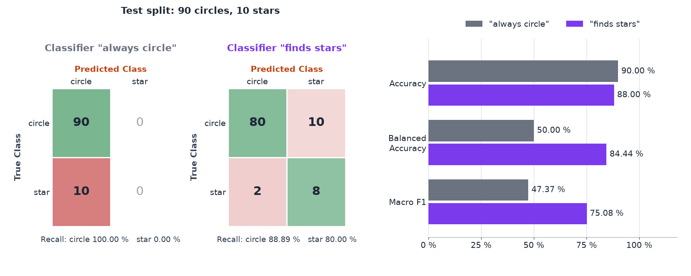
</p>
<p align="center"><em>On 90 circles and 10 stars, always answering circle gives 90.00 % accuracy but 50.00 % balanced accuracy and 47.37 % macro F1. Finding 8 of the 10 stars at the cost of 10 circles gives 88.00 %, 84.44 % and 75.08 %.</em></p>

### Macro And Micro Averages

A per-class metric is averaged in one of two ways.

- **Macro**: the plain mean over the classes. The report gives `Macro F1`, `Macro ROC AUC` and `Macro Average Precision`.
- **Micro**: the counts are pooled first. With one class per sample it equals the accuracy, so only the multi-label report gives it (`Micro F1`).
- **How to read it**: a low macro F1 next to a high accuracy points at a few weak classes. The per-class table lists them first.

### Top-k Accuracy

Top-k accuracy tells whether the true class is among the first guesses of the model.

- **Report and code**: `Top-5 Accuracy`, `compute_top_k_accuracy` of `classification_metrics.py`. k is `TOP_K_ACCURACY_CLASSES` = 5, clipped to the number of classes.
- **How to read it**: a large gap with the accuracy means the errors are between close classes. With 5 classes or fewer it is always 100.00 %.

### ROC Curve And ROC AUC

The ROC AUC tells how well the scores of one class separate its samples from all others, whatever the threshold.

- **Report and code**: `roc_curves.png`, the `ROC AUC` column and `Macro ROC AUC` (per-class report only). `compute_class_score_curves`, `compute_curves_from_score_counts` and `compute_macro_curve_metrics` of `vision_training/evaluation/classification/score_curves.py`.
- **How to read it**: 50 % is chance, 100 % a perfect ranking. It ignores how rare the class is, so read the average precision for a rare class.

### Average Precision Of A Class

The average precision judges the scores of a class on its precision-recall curve.

- **Report and code**: `precision_recall_curves.png`, the `Average Precision` column and `Macro Average Precision` (per-class report only). `compute_curves_from_score_counts` and `compute_macro_curve_metrics` of `score_curves.py`, as scikit-learn's `average_precision_score`.
- **How to read it**: chance is the share of the class in the test split, not 50 %. A high value means the precision stays high while the recall rises.

The animation sweeps the star threshold down the scored test images and builds both curves.

<p align="center">
  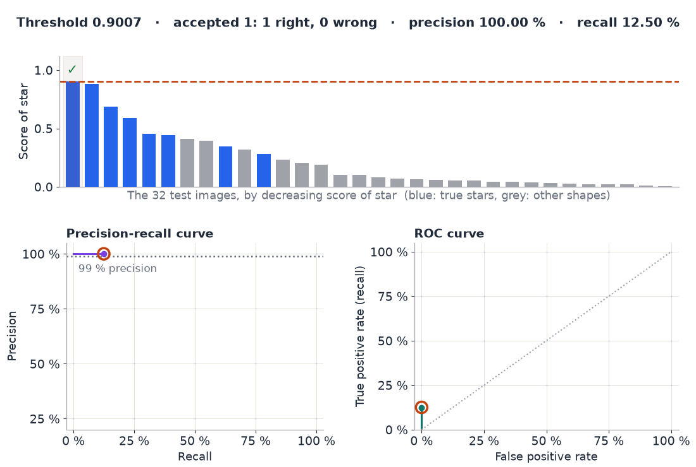
</p>
<p align="center"><em>32 toy test images, 8 stars in blue. Every cut adds one point to the precision-recall curve (left) and the ROC curve (right). The last frame stops at the 99 % precision threshold, 0.4414, keeping 6 of 8 stars; average precision 93.81 %, ROC AUC 97.40 %.</em></p>

### Threshold And Recall At A Target Precision

The evaluation finds, for every class, the score threshold that keeps the precision at a target, and the recall left at it.

- **Report and code**: the `Threshold @ P99 %` and `Recall @ P99 %` columns, `class_thresholds.json` (read by the deployment) and `precision_recall_thresholds.png`. `find_score_threshold` and `find_class_thresholds` of `vision_training/evaluation/classification/threshold_finder.py`, for every target of `evaluation.target_precision`.
- **How to read it**: `Recall @ P99 %` is the share of the class a deployment keeps at that precision. A class that never reaches the target gets `—` in the report and `null` in the file. A threshold only holds at the temperature it was found at.

### Multi-Label Metrics

When an image holds several classes (`ClassificationHead.output_mode: "multi_label"`), the report scores class decisions instead.

- **Report and code**: a class is predicted when its sigmoid reaches 0.5 (`MULTI_LABEL_THRESHOLD`). `compute_multi_label_metrics` of `classification_metrics.py` gives `Subset Accuracy` (every decision of a sample right, the headline metric), `Micro F1` and `Macro F1`. There is no confusion matrix and no top-k accuracy.
- **How to read it**: the subset accuracy is strict. The micro F1 follows the frequent classes and the macro F1 the rare ones.

The table shows four toy images decided at 0.5.

| Image | True classes | Probabilities (triangle, square, circle, star) | Predicted classes | Every decision right |
|---|---|---|---|---|
| 1 | triangle, square | 0.9, 0.6, 0.2, 0.1 | triangle, square | yes |
| 2 | circle | 0.1, 0.4, 0.8, 0.2 | circle | yes |
| 3 | square, circle | 0.3, 0.7, 0.4, 0.1 | square | no, circle missed |
| 4 | triangle, star | 0.8, 0.1, 0.6, 0.3 | triangle, circle | no, star missed and circle added |

Subset accuracy 50.00 %, micro F1 76.92 %, macro F1 62.50 %.

### Logit Temperature

The probabilities become `softmax(logits / T)`, which changes the scores and the thresholds of an export.

- **Report and code**: `compute_temperature_probabilities` of `vision_training/evaluation/classification/temperature_explorer.py`. Evaluations use T = 1. `temperature_explorer.html`, served by `scripts/evaluation/serve_temperature_explorer.py`, saves the thresholds of a chosen temperature ([Export](../../README.md#export)).
- **How to read it**: T keeps the most probable class, so the accuracy, confusion matrix, F1 and top-k accuracy never change. The thresholds move, and above two classes the ROC AUC, average precision and `Recall @ P99 %` can change too. The server must divide the logits by the same T.

The figure shows one image and the star scores at three temperatures.

<p align="center">
  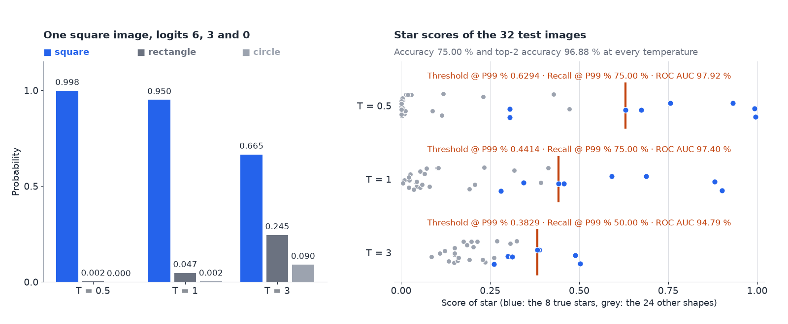
</p>
<p align="center"><em>Left: logits 6, 3 and 0 divided by 0.5, 1 and 3; square stays first (0.998, 0.950, 0.665). Right: the star scores of the 32 toy images. The accuracy never changes; the star threshold moves from 0.6294 to 0.4414 to 0.3829 and its recall falls to 50.00 % at T = 3.</em></p>

### Recall Intervals

Every task writes a 95 % confidence interval next to the recall of every class, so that a recall on few samples is not read as exact.

- **Where**: the `Per Class Recall` table (`95 % Lower`, `95 % Upper`) and `recall_lower`, `recall_upper` in `class_metrics.csv`. The code is in `vision_training/evaluation/recall_intervals.py`.
- **Independent samples**: `compute_clopper_pearson_intervals` gives the exact interval for CLS images, M2O sequences, CMP pairs, SSL k-NN images and DET, INS and KPT objects.
- **Correlated samples**: `compute_bootstrap_recall_intervals` gives a Korn-Graubard interval over whole groups, by bootstrap. Groups are M2M and SEL test sequences and SEG test images.
- **How to read it**: overlapping intervals may differ by chance alone. For correlated samples, the number of groups holding the class matters, not the number of frames or pixels.

The figure shows how the interval of a 90 % recall narrows with more samples, and widens when misses are grouped.

<p align="center">
  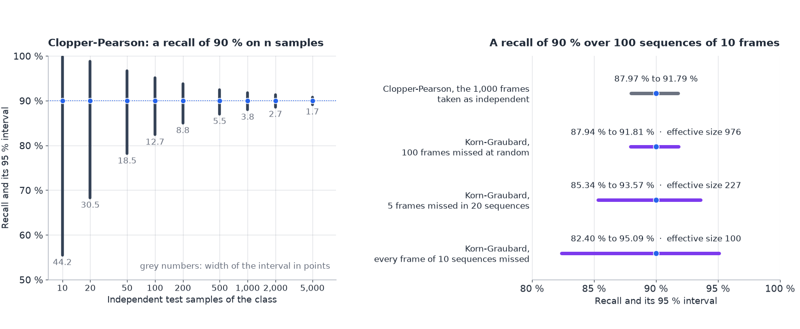
</p>
<p align="center"><em>Left: Clopper-Pearson interval of a 90 % recall, 55.50 % to 99.75 % at 10 samples, 89.13 % to 90.82 % at 5,000. Right: 1,000 frames of 100 sequences; scattered misses give an effective size of 976, 5 misses in each of 20 sequences 227, 10 sequences missed whole 100.</em></p>

### Sequences, Pairs And Frames

The sequence tasks use the same code; only what counts as one sample changes.

- **M2O**: one test sequence is one sample. Intervals are Clopper-Pearson over the sequences.
- **CMP**: one test pair is one sample. With 2 classes, `Top-5 Accuracy` is always 100.00 % and both classes share one ROC AUC.
- **M2M**: one labelled frame is one sample, padding frames left out. Intervals are Korn-Graubard over the test sequences (`compute_recall_intervals` of `vision_training/trainers/sequence_labelling_trainer.py`). The edit score and segment F1 are explained in [Sequence Labelling (M2M)](#sequence-labelling-m2m).

## Object Detection And Instance Segmentation (DET, INS)
Should your model draw boxes or masks, its report rests on the overlap measure and the matching rule below.

### Intersection Over Union Of Two Boxes
Before reading any detection number, know the overlap measure every one of them rests on.

The IoU answers "how well does this box sit on this object": 1 for identical boxes, 0 for disjoint ones. It is computed by `get_intersection_over_union` of `vision_training/models/detection/box_operations.py`, on `[x1, y1, x2, y2]` boxes in pixels:
```
IoU(A, B) = area(A ∩ B) / (area(A) + area(B) - area(A ∩ B))
```
The figure shows one ground truth box against four detections and whether each matches at 0.5, 0.75 and 0.95.

<p align="center">
  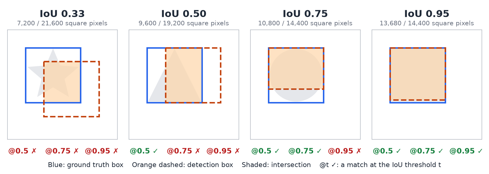
</p>
<p align="center"><em>One 120 x 120 ground truth box (blue) against four detections (orange): IoU 0.33, 0.50, 0.75 and 0.95.</em></p>

How to read it: an IoU of 0.5 still allows a box shifted by a third of its width. The same pixel error costs more on a small object, so small objects fall first at strict thresholds.

### Matching Detections To Ground Truths
Before any precision or recall is counted, each detection is declared right or wrong by this rule.

The matching is done by `gather_class_detections`, `find_best_ground_truth` and `match_detections_to_ground_truth` of `vision_training/evaluation/detection/mean_average_precision.py`:
- A detection is compared only with the ground truths of its own class in its own image. A wrong class detection is a false positive of its class.
- The detections are sorted by decreasing score. A detection is a true positive when its best ground truth overlaps it by at least the threshold and is still free. A ground truth is taken at most once.
- This is the PASCAL VOC rule: a detection whose best ground truth is taken is a false positive, even if another free one overlaps it. The COCO tools would match it, so the numbers differ from theirs.
- Only detections scored at least `evaluation.score_threshold` (0.05) enter.

How to read it: duplicates lower the precision. A box below the threshold counts twice, as a false positive and as a missed object.

### Precision-Recall Curve And Average Precision Of A Class
If one wishes to judge a detector of one class across all score thresholds at once, use this curve and its area.

The AP answers "how well are the true positives of a class ranked above the false positives, and how many objects are reached". It is built by `compute_precision_recall` and `compute_average_precision` of `mean_average_precision.py`. Each detection, in score order, adds one precision-recall point. Three summaries are printed:
- `Area` (PASCAL VOC 2010, the headline): the area under the envelope of the curve.
- `11 Point` (PASCAL VOC 2007): the mean envelope precision at recalls 0, 0.1, ..., 1.0.
- `101 Point` (COCO): the same at recalls 0, 0.01, ..., 1.0.

A class without ground truth has no AP ("—") and is left out of every mean.

The GIF shows the matching of eight detections to five circles, step by step, and the three summaries.

<p align="center">
  
</p>
<p align="center"><em>Greedy matching at IoU 0.5, one point per detection (green true positive, red false positive, orange duplicate): area 63.43 %, 11 point 66.75 %, 101 point 63.79 %.</em></p>

The report table `Per Class Average Precision (Area)` (with `evaluation.per_class_report`) lists each class's AP at 0.5, 0.75, 0.95 and 0.5 to 0.95, worst first. It adds `Threshold @ P99 %` and `Recall @ P99 %`, see [the threshold at a target precision](#threshold-and-recall-at-a-target-precision).

How to read it: a class with high recall and low AP is found but ranked among many false positives. Compare runs with the same method, the area one.

### mAP@0.5, mAP@0.75, mAP@0.95 And mAP@[0.5:0.95]
To be able to tell whether a detector also draws tight boxes, read its mAP at several IoU thresholds.

The mAP at a threshold is the mean AP over the classes with ground truth. `evaluate_detections` matches at the ten thresholds 0.50 to 0.95, and `summarise_thresholds` averages them into mAP@[0.5:0.95]. Every class weighs the same. The report table is `Mean Average Precision`. `mAP@0.5/area` picks the best checkpoint of an object detection run (`headline_metric` of `compute_evaluation_results` in `vision_training/trainers/detection_trainer.py`).

The figure shows the eight toy detections judged at each of the ten thresholds.

<p align="center">
  
</p>
<p align="center"><em>The stricter the threshold, the fewer true positives: mAP@[0.5:0.95] 43.60 % against mAP@0.5 63.43 %.</em></p>

How to read it: mAP@0.5 measures finding and classifying. The gap to mAP@0.75 measures localisation. The repository uses the VOC matching at every threshold, so mAP@[0.5:0.95] is not the COCO number.

### AP And mAP By Object Size
In case you suspect the detector of missing only small objects, read the mAP per size.

The sizes are those of COCO, `OBJECT_SIZE_RANGES` of `vision_training/evaluation/detection/object_sizes.py`: small under 1,024 square pixels, medium up to 9,216, large above. The area is the box area in network input pixels, or the mask area for the mask mAP. `select_object_size_detections` applies the COCO size rule. The table is `Mean Average Precision By Object Size (Area)`.

How to read it: a weak size points at the levels and anchors serving it. A row with few objects is noisy; read its `Objects` column first.

### Mean Average Recall
Should you need to know whether the objects are found at all, whatever the score, read the mAR.

The mAR answers "which share of the objects has a kept detection of the right class on it". `compute_mean_average_precision` of `mean_average_precision.py` averages the recall of each class, at each threshold. The table `Mean Average Recall` has one row for all objects and one per size.

How to read it: the mAR is the ceiling of the recall the curve reaches. A high mAR with a low mAP means objects found but ranked below false positives. A low mAR is to be compared with the [proposal recall](#proposal-recall).

### Per-Class Recall At IoU 0.5 And 0.75
If you are looking for the share of each class that is found, with its uncertainty, read this table.

It is the recall of each class at 0.5 and 0.75, from the same matching as the mAR, with an exact 95 % interval. `build_class_average_precision_rows` of `vision_training/evaluation/detection/average_precision_report.py` computes it, see [the recall intervals](#recall-intervals). The table is `Per Class Recall`; `class_metrics.csv` holds `recall_50`, `recall_75` and their bounds.

How to read it: two classes with overlapping intervals are not shown apart by the test split. A recall at 0.75 far below the one at 0.5 means a class found but poorly boxed.

### Detection Confusion Matrix
Suppose the deployed detector keeps only detections above `Detector.inference.score_threshold`: the confusion matrix shows what it gets right and wrong at that threshold.

It counts four outcomes: right, wrong class, false positive and missed. It is built per image by `vision_training/evaluation/detection/detection_confusion.py`, at the deployment threshold (0.50) and an IoU of at least 0.5. `add_to_confusion_matrix` puts false positives in the `background` row and missed objects in the `background` column. The matrix is in `confusion_matrix.csv` and `confusion_matrix.png`. With `error_dumps.activated`, the images go to `Errors/FALSE-POSITIVE/<class>/`, `Errors/MISSED/<class>/` and `Errors/<TRUE>-TO-<PREDICTED>/`.

The figure shows the four outcomes on one toy image, and the AP of the same detections next to them.

<p align="center">
  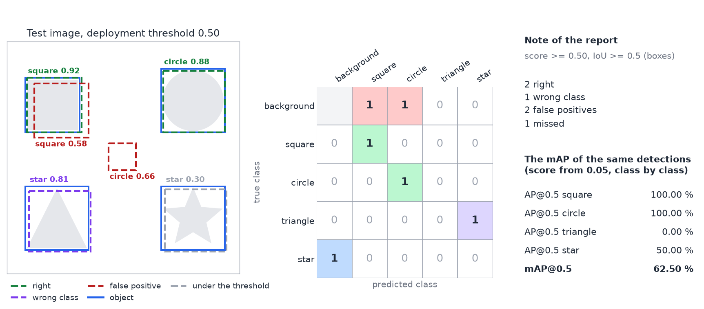
</p>
<p align="center"><em>One toy image at the threshold 0.50: 2 right, 1 wrong class, 2 false positives, 1 missed. On the right, the AP@0.5 of the same detections from the threshold 0.05 (mAP@0.5 62.50 %).</em></p>

How to read it: right + wrong class + missed equals the number of test objects. Many missed objects with a high mAR mean detections scored under the threshold. The largest off-diagonal cells name the class pairs to inspect.

### Proposal Recall
After a change to the anchors or the proposal settings, check that the proposals still cover the test objects.

The proposal recall answers "which share of the test objects has a proposal close enough for the heads". `accumulate_proposal_recall` and `summarise_proposal_recall` of `vision_training/evaluation/detection/region_recall.py` give Recall@0.5 and Recall@0.7. Rows cover all objects, each size and each block alone, saved in `proposal_recall.csv`.

How to read it: the 0.7 column tells whether proposals can be refined into tight boxes. A proposal recall far above the [mean average recall](#mean-average-recall) points at the heads; a low one at the anchors, proposal counts or selection.

### Anchor Recall
For the region proposal network to learn an object, an anchor must overlap it by its foreground threshold. The anchor recall, printed at every launch, gives the share of training objects that have one.

`Anchors.compute_best_overlaps` of `vision_training/models/detection/anchors.py` gives the best anchor IoU of each object per level. `summarise_anchor_recall` of `region_recall.py` counts the objects reaching `RegionProposal.foreground_iou_threshold.min`. The console table is `Anchor Recall Of The Training Objects`, saved in `anchor_recall.csv`. The diagnosis mode `diagnosis_modes.compute_anchor_coverage` measures it on every split ([Augmentation And Diagnosis Modes](../../README.md#augmentation-and-diagnosis-modes)).

The figure shows five toy objects and the best anchor of each over two levels.

<p align="center">
  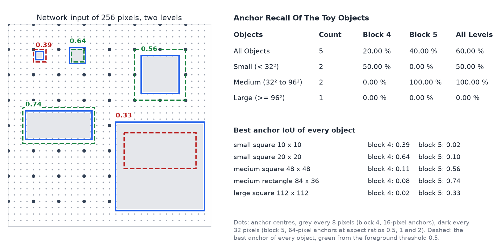
</p>
<p align="center"><em>Best anchors computed by <code>compute_best_anchor_overlaps</code> (green above the threshold 0.5, red under): the 10-pixel square is too small for the 16-pixel anchors, the 112-pixel square too large for the 64-pixel ones.</em></p>

How to read it: read `All Levels` size by size. Smaller scales help small objects, a larger scale large ones, other aspect ratios elongated ones.

### Mask IoU And Mask mAP
Whenever an instance segmentation run is evaluated, its detections are scored by masks and by boxes.

The mask IoU is the pixels in both masks over the pixels in either mask. It is computed by `compute_mask_intersection_over_union` of `vision_training/models/instance_segmentation/mask_operations.py`, after pasting the 28 x 28 masks into their boxes (`paste_instance_masks`). The mask mAP is `evaluate_detections` with these overlaps: same matching, curves and thresholds. The `Mask` tables come before the `Box` tables. `Mask mAP@0.5/area` picks the best checkpoint.

The figure compares mask IoU and box IoU on two toy shapes.

<p align="center">
  
</p>
<p align="center"><em>A mask filling a hole keeps a perfect box (1.00) with a mask IoU of 0.64; a mask missing a thin arm loses more box IoU (0.69) than mask IoU (0.81).</em></p>

How to read it: a box mAP close to the mask mAP, with a low mask IoU on hollow or thin classes, points at the mask head. The mask and box size tables hold different objects, since a mask covers less than its box.

### Evaluation At The Original Resolution
So that an instance segmentation run is measured on the images as they arrive in deployment, turn on `ExperimentConfiguration.evaluation.original_resolution`.

Off (the default), boxes and masks are scored at the network resolution. On, the objects are rebuilt at the original size (`add_original_instances` of `vision_training/data/detection/coco_dataset.py`), and the boxes are restored to the original image (`restore_detection_boxes`). Object sizes are then in original image pixels.

How to read it: compare runs evaluated at the same resolution only. The original resolution moves objects between size rows and counts tiny objects the resize erased.

## Keypoint Detection (KPT)

To find your way in a keypoint detection report, start from the object keypoint similarity (OKS). The OKS mAP uses it where detection uses the box IoU. The keypoint accuracy uses it to pair each ground truth object with one predicted object. Everything is computed on the test split by `compute_evaluation_results` of `vision_training/trainers/keypoint_trainer.py`, in network input pixels. Every grouped object is kept, whatever its score. Objects without any labelled keypoint are removed by the loader (`add_keypoints` of `vision_training/data/detection/coco_dataset.py`).

Every evaluation of the keypoint tutorial run opens with these four values:

```text
Iteration 6000 · 1024 Test Images · 2026-11-19 07:28 ──────────────────────────────────
  Matched Objects   97.32 %   PCK@0.05                       93.47 %
  Mean OKS          92.99 %   Mean Keypoint Error (pixels)   4.7397
```

### Object Keypoint Similarity (OKS)

The OKS answers how close the predicted keypoints of an object are to the labelled ones, as one number between 0 and 1. It is computed by `compute_object_keypoint_similarity` of `vision_training/evaluation/keypoints/object_keypoint_similarity.py`:

```text
OKS = sum over the labelled keypoints of exp(-d² / (2 · area · (2σ)²)) / number of labelled keypoints
```

- `d` is the distance in pixels to the ground truth keypoint. A keypoint not found adds 0 but still counts in the denominator.
- `area` is the area of the ground truth box. COCO uses the segment area, so values are not comparable with published COCO results.
- `σ` is `evaluation.keypoint_sigmas.<category>.<keypoint>`, or `evaluation.default_keypoint_sigma` (0.05).
- Only keypoints of visibility 1 or 2 count. Objects of different classes get an OKS of 0.

Should you need to loosen the tolerance of a loosely labelled keypoint, raise its sigma in `evaluation.keypoint_sigmas`. The sigmas change every OKS-based value, so compare runs with the same sigmas. The tolerance grows with the square root of the box area. An object missing half of its keypoints has an OKS of 0.5 at most.

The figure below plots the similarity of one keypoint against its distance, for two box sizes and two sigmas.

<p align="center">
  
</p>
<p align="center"><em>With sigma 0.05 the similarity falls to 0.5 at 3.8 pixels on a 32 × 32 box and at 15.1 pixels on a 128 × 128 box. The dotted line is the PCK@0.05 tolerance.</em></p>

The figure below shows one stick figure prediction with the similarity of every keypoint.

<p align="center">
  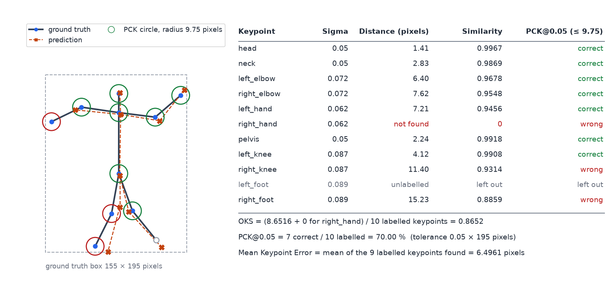
</p>
<p align="center"><em>A stick figure and its prediction: OKS 0.8652, PCK@0.05 70.00 %, mean keypoint error 6.4961 pixels, computed by evaluate_image_keypoints and summarise_keypoint_accuracy.</em></p>

### Matched Objects

`Matched Objects` answers how many ground truth objects the detector found with usable keypoints, at any score. `match_ground_truth_objects` pairs ground truth and predicted objects one to one per image. It uses `scipy.optimize.linear_sum_assignment` on the OKS matrix, and a pair needs an OKS of at least `MINIMUM_MATCH_SIMILARITY` (0.5). Scores play no part.

It is the share of ground truth objects with a partner. It is `matched_objects` in `class_metrics.csv`.

It ignores scores and false positives, so it is more generous than what a client sees. Read it with the OKS mAP.

The figure below shows how the two matchings, this one and the one of the OKS mAP, can disagree on one image.

<p align="center">
  
</p>
<p align="center"><em>Two triangles and a square with five predicted objects: the one-to-one matches (green) and the true and false positives of the OKS mAP at 0.5 and 0.75. Matched Objects 66.67 %, OKS mAP@0.5 75.00 %.</em></p>

### OKS mAP And mAR

`OKS mAP@0.5/area` (`KEYPOINT_HEADLINE_METRIC`) ranks the checkpoints of a keypoint run. It is the mean average precision of [object detection](#object-detection-and-instance-segmentation-det-ins), run by `summarise_average_precisions(overlap_type="keypoints")` of `vision_training/evaluation/detection/average_precision_report.py`. Only these points differ:

- The overlap is the OKS instead of the box IoU.
- Test objects without labelled keypoints are ignored, as in pycocotools.
- Objects are ranked by their object score, the mean of their keypoint scores.
- Object sizes follow the COCO ranges on the ground truth box. Small objects are kept.

The names carry `OKS`, for example the tables `OKS Mean Average Precision` and `OKS Per Class Recall` (with [the recall intervals](#recall-intervals)). In MLflow it is `test/OKS mAP_at_0.5/area`.

The tutorial run reaches 96.58 % at 0.5 and 72.79 % at 0.95 at iteration 6000. Once the objects are found, the stricter thresholds tell checkpoints apart. Compare runs only with the same `evaluation` section.

### PCK@0.05

PCK@0.05 answers how many keypoints land close enough to be used. `measure_keypoint_accuracy` counts a labelled keypoint as correct when it is within `CORRECT_KEYPOINT_FRACTION` (0.05) of the longest side of its ground truth box. The value is pooled over all labelled keypoints, so classes with more keypoints weigh more.

It is `Keypoint Accuracy/PCK@0.05` in TensorBoard and `percentage_correct_keypoints` in `class_metrics.csv` and `keypoint_metrics.csv`. It does not say how far the wrong keypoints are; read the [mean keypoint error](#mean-keypoint-error) for that.

### Mean OKS

Mean OKS answers how well keypoints are placed, following every pixel and every sigma. `measure_keypoint_accuracy` averages the OKS of every ground truth object with its matched object; a missed object scores 0. It equals `Matched Objects` times the mean OKS of the matched objects.

It is `Keypoint Accuracy/Mean OKS` in TensorBoard and `mean_object_keypoint_similarity` in `class_metrics.csv`. When it drops, `Matched Objects` tells whether objects were missed or placed worse.

### Mean Keypoint Error

`Mean Keypoint Error (pixels)` answers how far, in pixels, the found keypoints are from their labelled position. `summarise_keypoint_accuracy` averages the distances of keypoints found in matched objects. Missed keypoints and objects are left out. Distances are in network input pixels.

It is `Mean Error (pixels)` in the keypoint tables and `mean_error_pixels` in the CSV files. It can fall when the detector gets worse, as a drifting object leaves the mean once unmatched. Read it with `Matched Objects` and PCK@0.05.

The animation below shows a predicted triangle turning away from its ground truth until it is no longer matched.

<p align="center">
  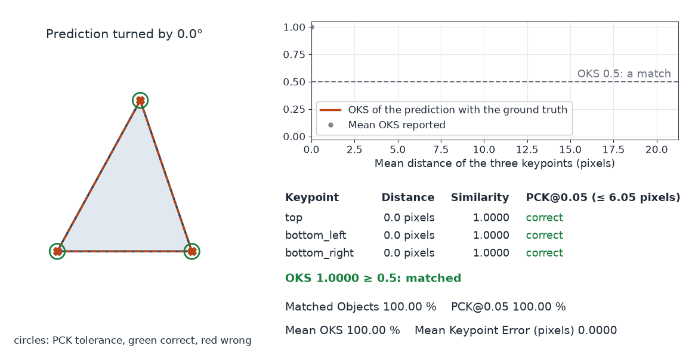
</p>
<p align="center"><em>At 8.4° the OKS is 0.5026 and the mean keypoint error 13.9012 pixels. At 9.0° the OKS is 0.4699, the object is missed and the mean keypoint error has no value.</em></p>

### Keypoint Accuracy Per Class And Per Keypoint

Whenever global values hide which shapes or keypoints fail, two tables of the per-class report (`evaluation.per_class_report: True`) give the same values per class and per keypoint, worst PCK@0.05 first. `Keypoint Accuracy Per Class` is saved in `class_metrics.csv`. `Keypoint Accuracy Per Keypoint` is saved in `keypoint_metrics.csv`.

The excerpt below shows the worst keypoints of the tutorial run at iteration 6000.

```text
  Keypoint Accuracy Per Keypoint
                                                                             Mean Error
   Class                            Keypoint   Labelled   Found   PCK@0.05     (pixels)
  ──────────────────────────────────────────────────────────────────────────────────────
   stick_figure                   right_knee        104      99    80.77 %      18.3462
   hollow_triangle                 inner_top         95      90    81.05 %      20.1602
   stick_figure                   right_hand        102      97    82.35 %      19.1068
```

`Found` well below `Labelled` points to misses. `Found` close to `Labelled` with a large error points to misplaced keypoints. The tables give no interval.

## Semantic Segmentation (SEG)

Every SEG metric counts the labelled pixels of the whole test split, pooled before any ratio is taken. The region metrics come from one pixel confusion matrix (`compute_segmentation_metrics` of `../../vision_training/evaluation/segmentation/segmentation_metrics.py`). The contour metrics come from `compute_boundary_metrics` of `boundary_metrics.py`. The **Mean IoU** is the headline metric: it picks the best checkpoint and is followed as `test/best_Mean IoU` in MLflow.

The table below shows where each metric appears.

| Metric | `Results.txt` | `class_metrics.csv` | TensorBoard `Test` writer (MLflow `test/...`) |
|---|---|---|---|
| Pixel accuracy | `Pixel Accuracy` | | `Pixel Accuracy` |
| IoU of a class, mean IoU | `IoU` column, `Mean IoU` | `iou` | `IoU/<class>`, `Mean IoU` |
| Dice of a class, mean Dice | `Dice` column, `Mean Dice` | `dice` | `Dice/<class>`, `Mean Dice` |
| Frequency weighted IoU | `Frequency Weighted IoU` | | `Frequency Weighted IoU` |
| Boundary IoU | `Boundary IoU` column, `Mean Boundary IoU` | `boundary_iou` | `Boundary IoU/<class>`, `Mean Boundary IoU` |
| Boundary F1 | `Boundary F1` column, `Mean Boundary F1` | `boundary_f1` | `Boundary F1/<class>`, `Mean Boundary F1` |
| Pixel precision and recall | `Precision`, `Recall` columns, `Per Class Recall` table | `precision`, `recall`, `recall_lower`, `recall_upper` | `Precision/<class>`, `Recall/<class>` |

The per-class scalars are written only with `per_class_report`. The `Pixel Accuracy` and `Mean IoU` shown during training are batch averages (`compute_batch_metrics`). They follow the trend but are not the test number.

### Pixel Confusion Matrix And Unlabelled Pixels

This answers which pixels the metrics count. Mask value 255 means unlabelled. `build_class_lookup_table` of `../../vision_training/data/segmentation/segmentation_dataset.py` turns it into `IGNORED_LABEL_INDEX` (-100), like the letterbox padding. `compute_pixel_confusion_matrix` counts every labelled pixel at its true class (row) and predicted class (column). Predictions on ignored pixels count nowhere. The counts go to `confusion_matrix.csv`, and `confusion_matrix.png` is drawn with `per_class_report`.

The figure below scores a toy image with an unlabelled strip at the bottom.

<p align="center">
  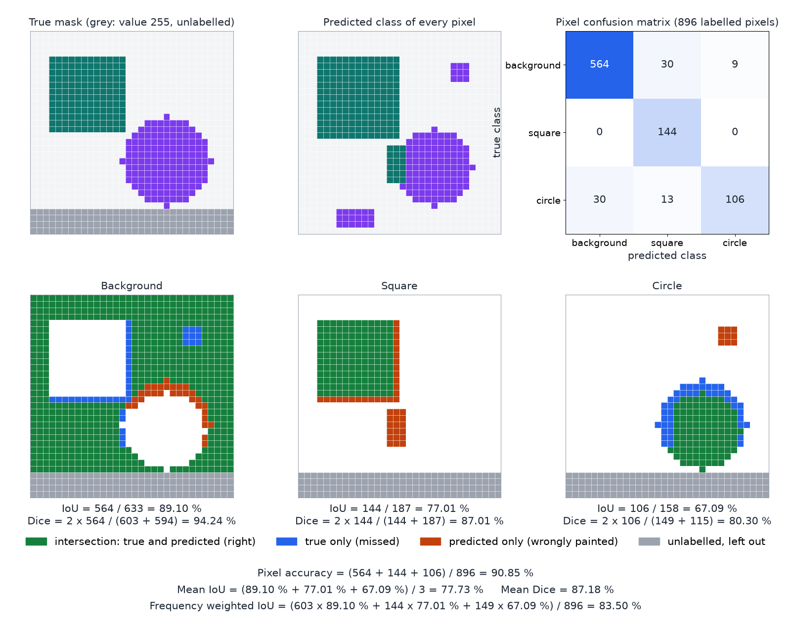
</p>
<p align="center"><em>The unlabelled strip (value 255) is left out. Each class is scored on its right pixels (green) over the union of its true (blue) and predicted (orange) pixels: IoU 89.10 %, 77.01 % and 67.09 %, mean IoU 77.73 %, pixel accuracy 90.85 %.</em></p>

Keep 255 for pixels nobody can classify. A wide unlabelled area hides the errors made there.

### Pixel Accuracy

It answers what share of the labelled pixels got their class. It is the `accuracy` of `compute_metrics_from_confusion_matrix` ([classification metrics](#classification-cls-m2o-cmp)) on the pixel matrix. The background dominates it: a model missing a small class entirely can still score 97.36 %. Read it as a sanity check next to the mean IoU.

### IoU Of A Class And Mean IoU

The IoU scores each class on its own, whatever its area: `right pixels / (true pixels + predicted pixels - right pixels)`. The **Mean IoU** averages it over the classes present in the masks or predicted, background included. A class painted without true pixels counts 0. A class neither present nor predicted is left out.

The figure below shows how missed and wrongly painted classes move the mean.

<p align="center">
  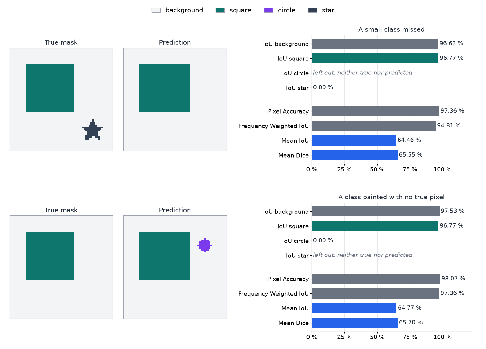
</p>
<p align="center"><em>Missing the small star gives it IoU 0 and a mean IoU of 64.46 %, while pixel accuracy stays at 97.36 %. Painting a circle where there is none puts a circle IoU of 0 in the mean (64.77 %).</em></p>

Every class weighs the same in the mean, so small classes matter. A class predicted but absent from the test split costs a 0, yet shows `—` in the per-class table: find it in `confusion_matrix.csv`.

### Dice And Mean Dice

Dice is given for comparison with papers that report it. It is the pixel F1 of a class (`f1` of `compute_metrics_from_confusion_matrix`), and the **Mean Dice** is `macro_f1` over the same classes as the mean IoU. `Dice = 2 x IoU / (1 + IoU)`, so it ranks classes like the IoU but sits higher. Never compare one run's Dice with another's IoU. The soft Dice of `SegmentationLoss.dice_weight` is a training loss, not this metric.

### Frequency Weighted IoU

It answers how well the large areas are segmented. It weighs each class IoU by its true pixels. The background dominates it, like the pixel accuracy. It never sees classes painted without true pixels.

### Boundary IoU And Boundary F1

Read these when the contours matter. A region a few pixels too wide keeps a high IoU while its contour is wrong. Both score the pixels within `ExperimentConfiguration.evaluation.boundary_tolerance` (2 pixels by default) of the contours. Bands come from `compute_contour_bands` of `../../vision_training/utilities/mask_morphology.py`.
- **Boundary IoU**: overlap of the true and predicted bands, as in [Boundary IoU](https://arxiv.org/abs/2103.16562).
- **Boundary F1**: harmonic mean of the edge precision and edge recall within the tolerance.

`compute_boundary_counts` sums the counts over the split, then `compute_boundary_metrics` gives the ratios and the means. A class without true edges shows `—` and is left out of the means.

The animation below grows the tolerance around a square predicted too wide.

<p align="center">
  
</p>
<p align="center"><em>The tolerance grows from 1 to 10 pixels. Boundary F1 goes from 49.65 % to 100.00 % (from 4 pixels), boundary IoU from 13.91 % to 70.56 %. The region IoU stays at 81.40 %.</em></p>

The boundary F1 reaches 100 % once every contour pixel is within the tolerance. The boundary IoU keeps rewarding a closer contour. Compare runs only at the same tolerance and resolution.

### Evaluated Resolution

The report names the resolution in its `Labelled Pixels` note:
- `network resolution` (default): images and masks resized to the network input. Objects thinner than a pixel vanish from the ground truth.
- `images scaled by <scale>, segmented tile by tile` (`Data.tiling.activated`): scored tile by tile with `segment_image_by_tiles`.
- `original resolution of the images` (`ExperimentConfiguration.evaluation.original_resolution: True`): predictions resized back with `restore_prediction_to_original_image`, as deployed.

Scaling leaves region metrics unchanged, but `boundary_tolerance` counts pixels. Scale the tolerance with the resolution before comparing runs.

### Per Class Table

Open it to find the class that pulls the mean IoU down. `build_segmentation_class_table` of `../../vision_training/evaluation/segmentation/segmentation_report.py` lists every class, worst IoU first. It is shown with `per_class_report: True`, which adds `ROC AUC` and `Average Precision` columns ([classification metrics](#classification-cls-m2o-cmp)). `class_metrics.csv` holds the same rows at every evaluation. Precision below recall means the class is painted where it is not. Recall below precision means it is missed.

### Pixel Recall Interval

The 95 % interval tells whether a recall change is beyond the noise of the test split. Pixels of one image are correlated, so the interval is taken over the test images. `compute_image_class_pixel_counts` and `compute_bootstrap_recall_intervals` of `../../vision_training/evaluation/recall_intervals.py` give a Korn-Graubard interval ([Recall Intervals](#recall-intervals)). The bounds are `recall_lower` and `recall_upper` in `class_metrics.csv` and the `Per Class Recall` table. Its width depends on the number of test images holding the class, not on its pixels.

## Sequence Labelling (M2M)

The M2M report scores frames, whole sequences and runs of frames. Checkpoints are compared on `Accuracy`, the frame accuracy (`headline_metric` of `compute_evaluation_results` in `vision_training/trainers/classification_trainer.py`). MLflow adds the prefix `test/` (`test_ema/` for averaged weights).

### Frame Accuracy And The Frame Metrics

These answer how many frames get their class. Padding and unmapped frames (`-100`, `IGNORED_LABEL_INDEX`) are left out.

The report gives the [classification metrics](#classification-cls-m2o-cmp) on frames: `Accuracy`, `Balanced Accuracy`, `Macro F1`, `Top-5 Accuracy`, and with `per_class_report` the per-class tables and files. The [recall intervals](#recall-intervals) bootstrap over sequences, not frames. Batches print `compute_frame_accuracy` of `vision_training/evaluation/sequence/sequence_metrics.py`.

The frame accuracy follows the most frequent class (`no_change`, 46.97 % of tutorial test frames), so read `Balanced Accuracy` and `Macro F1` first. It ignores where the wrong frames are (see the [edit score](#edit-score)).

### Sequence Exact Match

It answers how many test sequences have every labelled frame right. Report name `Sequence Exact Match`, computed by `compute_sequence_exact_matches` of `vision_training/evaluation/sequence/sequence_metrics.py`.

It is the strictest metric (tutorial run: 77.16 % of frames right, 24.00 % of sequences exact). A shifted boundary and a missed event both fail it; the edit score and segment F1 tell them apart.

### Edit Score

It measures fragmentation: a flicker costs one frame but cuts an event in three. Report name `Edit Score`, computed by `compute_segment_metrics` of `vision_training/evaluation/sequence/segment_metrics.py`. A segment is a run of labelled frames of one class (`extract_segments`).

```
edit score of a sequence = 1 − edit distance / max(predicted segments, true segments)
```

The edit distance is the Levenshtein distance between segment class orders (`compute_edit_distance`), averaged over sequences.

The figure compares predictions with the same frame accuracy but different segment scores.

<p align="center">
  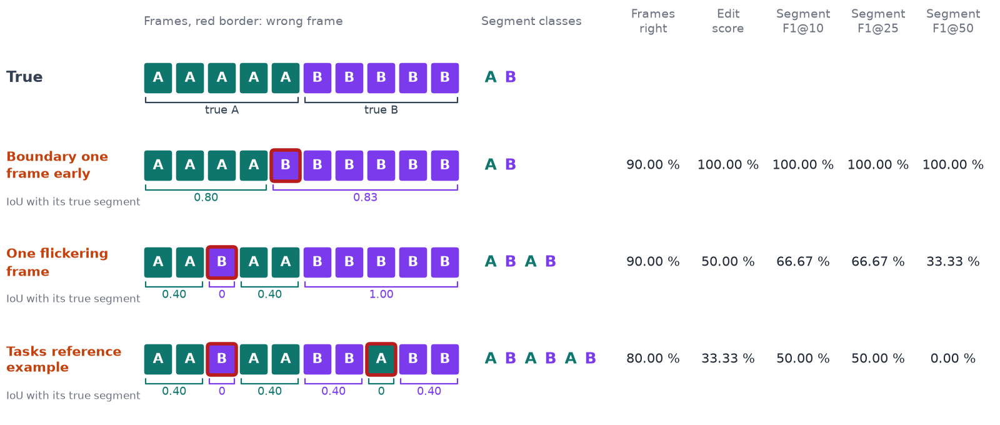
</p>
<p align="center"><em>Boundary one frame early versus a flickering frame: both 90.00 % of frames right, edit scores 100.00 % and 50.00 %, segment F1@50 100.00 % and 33.33 %.</em></p>

A low edit score means too many predicted segments. It ignores positions and lengths, so read it with `Segment F1@50`.

### Segment F1@10, @25 And @50

They answer whether every true event is found, like detections along time. Report names `Segment F1@10`, `Segment F1@25` and `Segment F1@50` (`SEGMENT_OVERLAP_THRESHOLDS`), computed by `count_segment_matches` of `vision_training/evaluation/sequence/segment_metrics.py`.

Each predicted segment is matched to the true segment of its class it overlaps most (IoU of frames), right when the overlap reaches the threshold and that true segment is free. Counts over all sequences give precision, recall and F1.

The animation scores the [tasks reference](tasks_reference.md#sequence-labelling-m2m) example step by step.

<p align="center">
  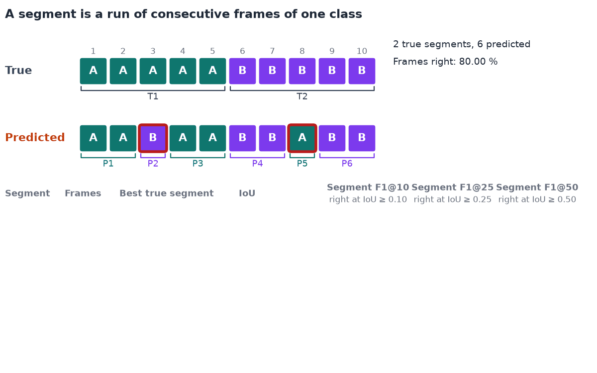
</p>
<p align="center"><em>Edit score 33.33 %, then segment matching in order: segment F1 of 50.00 % at 0.10 and 0.25, 0.00 % at 0.50.</em></p>

A gap between `@10` and `@50` points to shifted or wrongly sized events. A low `@10` with good frame accuracy points to fragmentation or missed short events.

## Frame Selection (SEL)

A frame selector picks `Selection.frames_per_class` frames per wanted class (every class but `Selection.unselected_category`) in every sequence. Checkpoints are compared on the selection accuracy of `Selection.decoding` (`headline_metric` of `compute_evaluation_results` in `vision_training/trainers/frame_selection_trainer.py`). The toy examples use four sequences, classes triangle and star, one frame per class, `top_k` 2 and a target precision of 99 %.

### Hungarian And Greedy Decodings

The picks come from decoding the per-frame class probabilities. Both decodings of `vision_training/models/sequence/frame_selection_decoding.py` run at every evaluation:

- `hungarian` (`decode_hungarian_selection`): the most probable labelling with exactly `frames_per_class` frames per wanted class (`scipy.optimize.linear_sum_assignment`).
- `greedy` (`decode_greedy_selection`): every frame takes its most probable class, then classes are trimmed or completed.

The decoding of `Selection.decoding` drives the images, thresholds and deployment. The animation shows both decodings on the tasks reference example.

<p align="center">
  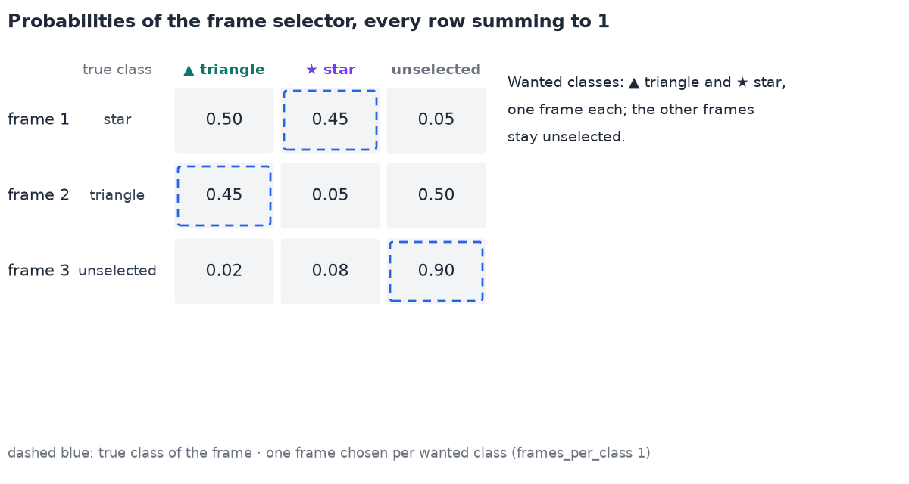
</p>
<p align="center"><em>Greedy step by step (selection accuracy 0.00 %), then the Hungarian gains and assignment (100.00 %), true classes dashed.</em></p>

The Hungarian decoding maximises the labelling probability, not the right picks, so greedy can win on a sequence.

### Selection Accuracy

It answers how many true frames are picked for their class. Report names `Hungarian Selection Accuracy` and `Greedy Selection Accuracy`, computed by `compute_selection_metrics` of `vision_training/evaluation/sequence/frame_selection_metrics.py`.

It is both recall and precision, since the decodings pick as many frames as there are true ones. Its [recall intervals](#recall-intervals) appear in the `Per Class Recall` table.

The figure shows the toy test split and both decodings' picks.

<p align="center">
  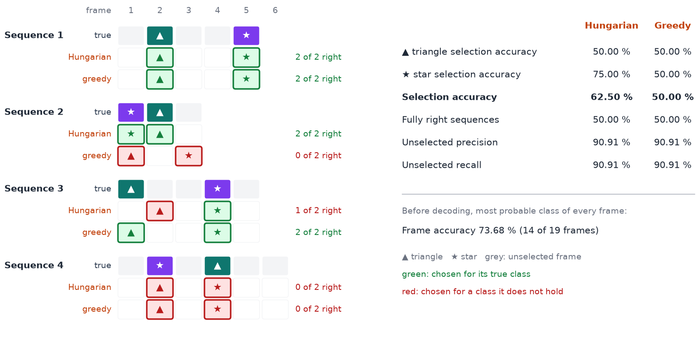
</p>
<p align="center"><em>Toy test split scored by compute_selection_metrics: Hungarian 62.50 %, greedy 50.00 %; sequence 3 a background pick, sequence 4 a swap.</em></p>

### Fully Right Sequences

It answers how many sequences need no human correction. Report name `<Decoding> Fully Right Sequences`, computed by `compute_selection_metrics`. Against the selection accuracy, it shows whether wrong picks gather in few sequences.

### Background And Swapped Picks

They split wrong picks into background frames taken and wanted classes swapped. Report names `<Decoding> Background Picks` and `<Decoding> Swapped Picks`, computed by `compute_selection_metrics`. Selection accuracy plus these two shares add up to 100 %.

In the README run, most wrong picks took an unselected frame (3.50 % against 0.67 %).

### Top-k Selection Accuracy And Mean True Frame Rank

They tell whether a wrong pick was a near miss, before decoding. Report names `Top-<k> Selection Accuracy` and `Mean True Frame Rank`, computed by `compute_ranking_metrics` of `frame_selection_metrics.py` and `compute_frame_ranks` of `frame_selection_decoding.py`.

The rank is 1 plus the frames with a higher probability for the class. `k` (`evaluation.top_k`) is also the number of candidates the deployed decoder returns.

The figure orders the toy frames by class probability.

<p align="center">
  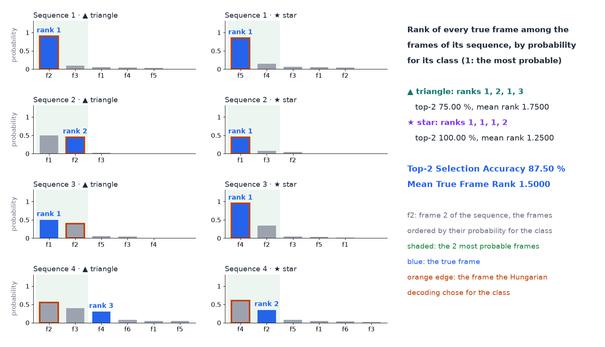
</p>
<p align="center"><em>True frames in blue with their rank, Hungarian picks outlined: top-2 selection accuracy 87.50 %, mean true frame rank 1.5000.</em></p>

A top-k well above the selection accuracy means near misses. Ties take the best rank, so read both with the selection accuracy.

### Frame Accuracy, Frame Balanced Accuracy And Frame Macro F1

They judge the per-frame classifier alone, before decoding. Report names `Frame Accuracy`, `Frame Balanced Accuracy` and `Frame Macro F1`, computed by `compute_metrics_from_confusion_matrix` (see [classification](#classification-cls-m2o-cmp)).

The unselected class dominates (61.56 % of README run frames), so read the balanced accuracy first.

### Per Class Selection Table

The `Per Class Selection` table (with `per_class_report`, saved in `class_metrics.csv`) has one row per wanted class, worst first. Here it is on the toy test split:

```
                         Hungarian     Greedy      Top-2     Mean   Threshold    Recall
 Class      True Frames   Accuracy   Accuracy   Accuracy     Rank     @ P99 %   @ P99 %
 triangle             4    50.00 %    50.00 %    75.00 %   1.7500      0.9000   25.00 %
 star                 4    75.00 %    50.00 %   100.00 %   1.2500      0.8500   50.00 %
```

### Low-Confidence Thresholds

They flag picks a human should check. `find_selection_thresholds` of `vision_training/evaluation/sequence/frame_selection_metrics.py` finds, per class, the probability from which picks reach `evaluation.target_precision` (null if never). Thresholds go to `class_thresholds.json`; `flag_low_confidence` flags picks below them.

The figure places the toy picks on their class probability axis.

<p align="center">
  
</p>
<p align="center"><em>Right picks green, wrong red; thresholds 0.90 and 0.85 keep 25.00 % and 50.00 % of the true frames; shaded picks are flagged by flag_low_confidence.</em></p>

`Recall @ P99 %` is the share of true frames that pass unchecked. A confident wrong pick still passes.

## Self-Supervised Evaluation (SSL)

A self-supervised evaluation judges the representation of every test image: the pooled backbone features, before the projection head. It asks whether images of a class lie close together (k-NN) and whether the representations use many directions (effective rank, standard deviation).

### The k-NN Evaluation

Each labelled test image is classified by its nearest reference images. No classifier is trained, and labels never reach the training.

- **Reference images** (`select_reference_samples` of `vision_training/evaluation/self_supervised/representation_metrics.py`): per training class, the `number_reference_images_per_class` images with the smallest MD5 hashes of their file names. The same images are chosen at every evaluation.
- **Vote** (`compute_nearest_neighbour_predictions`): representations are L2 normalized and compared by cosine similarity. The `number_neighbours` most similar reference images vote for their class with weight `exp(similarity / 0.07)`. The largest total wins.

The picture below shows one vote. Three circles outnumber two stars, but the stars hold 82.56 % of the weight, so the prediction is star.

<p align="center">
  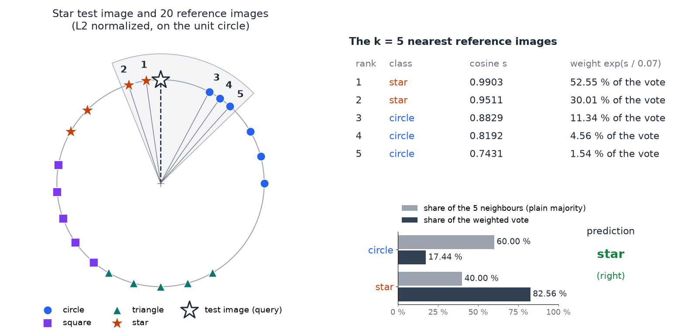
</p>
<p align="center"><em>The vote of compute_nearest_neighbour_predictions for one star test image, 5 neighbours, temperature 0.07: 17.44 % circle against 82.56 % star by weight.</em></p>

### k-NN Accuracy, Balanced Accuracy And Macro F1

The k-NN Accuracy answers whether the representation places images of a class closer to each other than to other classes. It is the headline metric when the test split has labels, and the highest value marks the best checkpoint (`test/best_k-NN Accuracy` in MLflow).

Reports: `k-NN Accuracy`, `k-NN Balanced Accuracy`, `k-NN Macro F1`. Computed by `compute_confusion_matrix` and `compute_metrics_from_confusion_matrix` of `vision_training/evaluation/classification/classification_metrics.py`, with the definitions of [classification](#classification-cls-m2o-cmp). Without labelled test images, the k-NN is skipped and the effective rank becomes the headline.

How to read them:
- Chance is one over the number of classes. The tutorial run (9 classes, chance 11.11 %) goes from 12.33 % at iteration 500 to 54.83 % at 20,000.
- A gap between accuracy and balanced accuracy means imbalanced test classes. A macro F1 well below balanced accuracy can come from classes absent from the test split that the vote still predicts.
- The value depends on `number_neighbours`, `number_reference_images_per_class` and the reference images. Compare runs with the same settings only.

### Per Class k-NN Metrics

When the k-NN accuracy stalls, the per-class metrics show which classes stay mixed. Every evaluation writes precision, recall, F1 and the 95 % recall interval ([recall intervals](#recall-intervals)) into `class_metrics.csv`. With `per_class_report: True`, `Results.txt` also shows the `Per Class k-NN Metrics` and `Per Class k-NN Recall` tables.

### Effective Rank

The Effective Rank answers in how many directions the test representations spread. It needs no labels, so it is the headline metric of an unlabelled test split.

Report name `Effective Rank`, computed by `compute_effective_rank` of `representation_metrics.py` (RankMe). It is the exponential of the entropy of the normalized singular values: r for representations spread evenly over r directions, 1 for a single direction.

The figure below shows the singular values of four toy sets, from evenly spread to collapsed.

<p align="center">
  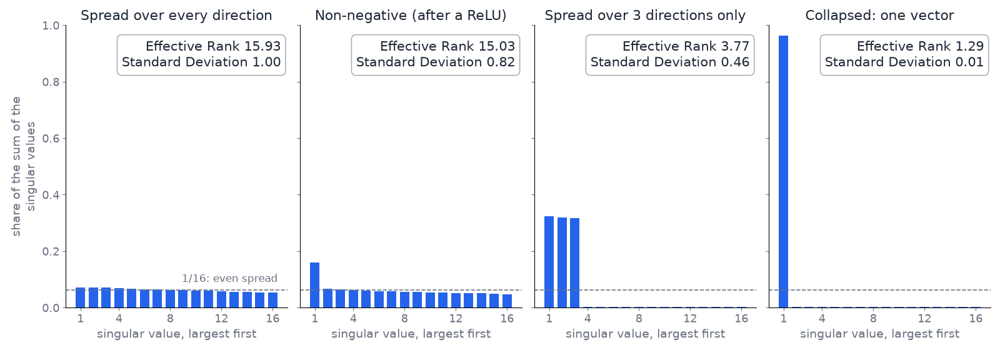
</p>
<p align="center"><em>Four toy sets of 512 representations of 16 values (effective rank, standard deviation): spread 15.93 and 1.00, non-negative 15.03 and 0.82, 3 directions 3.77 and 0.46, one vector 1.29 and 0.01.</em></p>

How to read it:
- About 1 means a collapse. The tutorial run goes from 23.90 at iteration 500 to 46.18 at 20,000. The first checkpoints can sit near 1 without collapse, because batch normalization statistics are not settled yet.
- It counts directions used, not whether they separate classes. Compare checkpoints with the same representation size, and read the k-NN accuracy when labels exist.

The animation below shows a collapse step by step.

<p align="center">
  
</p>
<p align="center"><em>A toy collapse in 24 steps: effective rank falls from 15.80 to 1.08, standard deviation from 0.97 to 0.003.</em></p>

### Representation Standard Deviation

The Representation Standard Deviation answers how spread the test representations are. It is a simpler collapse signal next to the effective rank.

Report name `Representation Standard Deviation`, computed by `compute_embedding_standard_deviation` of `vision_training/losses/self_supervised_losses.py`. It is the mean standard deviation of the L2-normalized representations, times sqrt(F). Points spread over the whole sphere give about 1, one vector for every image gives 0.

How to read it: only a fall towards 0 means collapse. Representations are non-negative after the ReLU, so they stay well below 1 (0.5703 at iteration 20,000 of the tutorial run).

## Self-Supervised Training Metrics (SSL)

These batch metrics watch the training, computed on every batch from the embeddings of the two views. They are listed in `METHOD_TRACKED_METRICS` of `vision_training/trainers/self_supervised_trainer.py`.

### Positive Pair Accuracy (SimCLR)

The Positive Pair Accuracy answers whether the InfoNCE loss finds the two views of an image. It is computed by `compute_info_nce_loss` of `self_supervised_losses.py`. It is the share of views whose most similar other view is their partner. Chance is 1 / (2N - 1) for N images per batch.

The figure below compares two toy encoders that both reach 100.00 % positive pair accuracy.

<p align="center">
  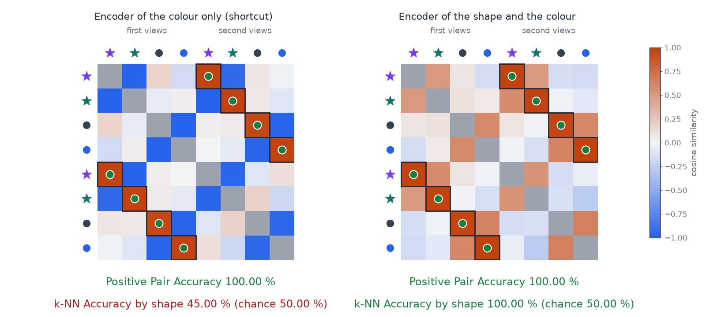
</p>
<p align="center"><em>Cosine similarities of 8 views of 4 toy images, partners outlined. The encoder that sees only colour scores 45.00 % in the k-NN by shape, the other 100.00 %.</em></p>

How to read it:
- A value near 100 % long before the k-NN accuracy rises shows a shortcut, a cue both views share (colour, position).
- The tutorial run ends at 34.82 % while its k-NN accuracy reaches 54.83 %. A moderate value can go with a good representation.
- It depends on batch size and view strength. Compare runs with the same batch and augmentations only.

### Diagonal And Off-Diagonal Correlation (Barlow Twins)

These two values answer whether the features agree across views (invariance) and repeat each other (redundancy). They are computed by `compute_feature_cross_correlation`, read by `compute_barlow_twins_loss` of `self_supervised_losses.py`. `Diagonal Correlation` is the mean of the diagonal of the cross-correlation matrix (target 1). `Off-Diagonal Correlation` is the mean absolute value off the diagonal (target 0).

The figure below shows three toy cross-correlation matrices.

<p align="center">
  
</p>
<p align="center"><em>Three toy pairs of views, 512 images, 8 features (diagonal, off-diagonal): invariant and decorrelated 0.9889 and 0.0389; repeating features 0.9633 and 0.5522; disagreeing views -0.0004 and 0.0241.</em></p>

How to read them:
- A diagonal near 0 means the views disagree, or a collapse: a constant feature gives 0, not 1.
- A diagonal near 1 with a high off-diagonal means a partial collapse to few directions.

### Embedding Standard Deviation

The Embedding Standard Deviation tells a collapse from a slow start during training, for both methods. It applies the formula of the [representation standard deviation](#representation-standard-deviation) to the embeddings of the first views (`SelfSupervisedModel.forward`).

How to read it: a healthy run sits near 1 (0.9751 at the end of the tutorial run). A fall towards 0 with a stuck loss is a collapse. The first validation batches can sit near 0 without one, because batch normalization statistics are not settled yet.
