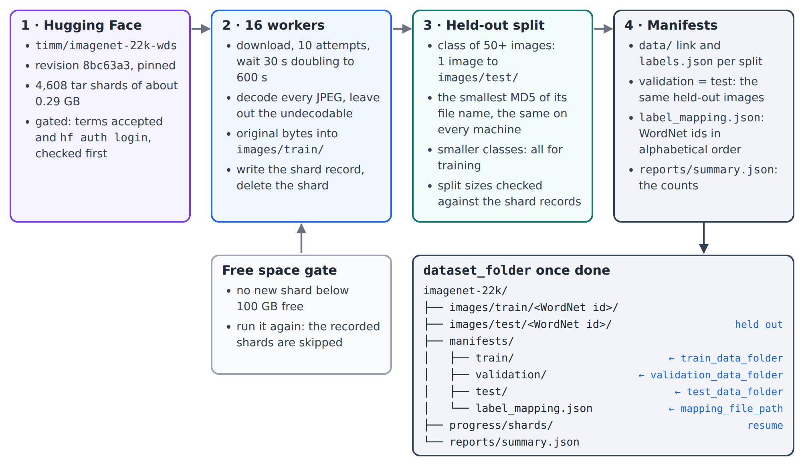

# Pretraining Reference

If one wishes to start a backbone from pre-trained weights instead of random ones, this reference describes the download of the dataset the classification configurations train on, completing the [Data Requirements](../../README.md#data-requirements) section of the README. A classification, object detection or segmentation run then loads the trained backbone through `Backbone.pretrained` ([Transfer Between Runs](../../README.md#transfer-between-runs)), and the [Pretraining Strategy](#pretraining-strategy) sets the order in which the backbone sizes are pre-trained.

## Table Of Content
To find your way in this reference, the sections are:
- [ImageNet-22k](#imagenet-22k)
  - [Downloading ImageNet-22k](#downloading-imagenet-22k)
  - [Validation And Test Splits](#validation-and-test-splits)
- [Pretraining Strategy](#pretraining-strategy)
  - [Model Sizes](#model-sizes)
  - [Classification Pretraining On ImageNet-22k](#classification-pretraining-on-imagenet-22k)
  - [Object Detection](#object-detection)
  - [Instance Segmentation](#instance-segmentation)
  - [Order And Resources](#order-and-resources)
  - [Open Questions](#open-questions)

## ImageNet-22k
Should you need the pre-trained backbones of the classification configurations (`configuration_example.yaml` and the `*_model.yaml` files of `vision_training/configurations/classification/`) or of the self-supervised example, download ImageNet-22k with `vision_training/data/classification/imagenet_download.py`. It reads `timm/imagenet-22k-wds` from Hugging Face at a pinned revision (fall11 release, 21,841 classes, 4,608 shards of about 0.29 GB), and writes the `labels.json` manifests and the `label_mapping.json` these configurations read.

### Downloading ImageNet-22k
Before the first shard is fetched, the script checks that this machine is logged in with an account that accepted the terms of the dataset, and it stops when the disk runs low:
1. Accept the terms of [timm/imagenet-22k-wds](https://huggingface.co/datasets/timm/imagenet-22k-wds) (non-commercial research and education only), then log in with `uv run hf auth login`.
2. Keep about 1.3 TB free on the disk of `dataset_folder` (main block of the script, `~/Data/classifier_data/imagenet-22k` by default); the download stops below 100 GB free.
3. Run it. It resumes shard by shard after an interruption, at about 1,500 shards an hour with 16 workers on a DGX Spark.

```bash
uv run python -m vision_training.data.classification.imagenet_download
```

<p align="center">
  
</p>

So that a configuration trains on the download, point its `train_data_folder`, `validation_data_folder`, `test_data_folder` and `Data.label_mapping.mapping_file_path` to `manifests/train`, `manifests/validation`, `manifests/test` and `manifests/label_mapping.json` of `dataset_folder`, and its `experiment_folder` to the folder of your runs.

### Validation And Test Splits
In case you compare its scores with other results, the held-out images (18,846) are both the validation and the test split, so a setting chosen on the validation curves is chosen on the test images, and the scores cannot be compared with published ImageNet-1k accuracies (shorter side of the images at most 600 pixels in the source, person classes kept). The split sizes and the retries of the download are in the [tasks reference](tasks_reference.md#classification-cls).

## Pretraining Strategy
Before training the production models, this plan sets the order in which five backbone sizes are pretrained on classification, then fine-tuned for object detection and instance segmentation, so that every size ends with the same three models and one comparison table.

### Model Sizes
If one wishes to pick the size of a production model, the five candidates below all have 6 backbone blocks, written as convolutions x filters per block; S to XL already have their classification configuration in `vision_training/configurations/classification/`, and T needs a new one.

| Size | Backbone | Configuration |
|---|---|---|
| T | 1x16 · 2x16 · 2x16 · 4x32 · 5x32 · 5x32 | `configuration_tiny_model.yaml`, to write from a copy of `configuration_small_model.yaml` |
| S | 1x32 · 2x32 · 2x32 · 16x32 · 20x32 · 20x32 | `configuration_small_model.yaml` |
| M | 1x64 · 2x64 · 2x64 · 4x64 · 5x64 · 5x64 | `configuration_classic_model.yaml`, the backbone of `configuration_example.yaml` |
| L | 1x64 · 2x64 · 2x64 · 16x64 · 20x64 · 20x64 | `configuration_long_model.yaml` |
| XL | 1x64 · 2x64 · 2x64 · 16x128 · 20x128 · 20x128 | `configuration_large_model.yaml` |

### Classification Pretraining On ImageNet-22k
For the five sizes to compare, each first learns general features on ImageNet-22k (21,841 classes, 256 pixels) with the same recipe, the dataset being downloaded by `vision_training/data/classification/imagenet_download.py` ([Downloading ImageNet-22k](#downloading-imagenet-22k)).

1. Start each size from random weights, or from the backbone of an earlier classification run of the same backbone when one exists (`Backbone.pretrained`), the head of the 21,841 classes starting random.
2. Train with the moving average of the weights, and keep the averaged weights.
3. Choose the checkpoint on the accuracy of the test evaluations, with the same rule for every size. The 18,846 test images are also the validation split, so the choice is made on the test images and the accuracy does not compare with published ImageNet-1k results; a k-NN check would need new code, the k-NN evaluation belonging to the self-supervised trainer only.
4. Record accuracy, model size and speed (`diagnosis_modes.benchmark_speed`) of each size in the final table.

### Object Detection
Whenever a size has its pretrained backbone, the detector loads it into its 7-block backbone, the 7th block starting random (a deeper backbone loaded from a shorter one), with the settings kept by the detection benchmark (feature pyramid, learning rate 1e-3, DIoU-NMS, per-level proposal selection).

1. Convert Open Images V7 (1.74 million training images, 601 classes, boxes in `detections.csv`) into the COCO `labels.json` the loader reads, and decide how its group-of boxes are handled: the loader reads every box as an ordinary object, as it does for the COCO crowd boxes.
2. Pretrain the detector of each size on Open Images.
3. Fine-tune it on COCO 2017 (118,287 training images, 80 classes, every object labelled), the score compared with published results being the COCO validation box mAP.
4. Keep the Open Images detector as well, as the start of detection projects whose classes are not in COCO.

### Instance Segmentation
So that the backbone, pyramid and proposal network are not trained twice, each instance segmentation model starts from the COCO detector of its size, only the mask head starting random.

1. Fine-tune on the COCO masks, with the mask head kept by the instance segmentation benchmark.
2. Record the mask and box mAP on the COCO validation set.

### Order And Resources
To find problems on cheap runs first, T and S go through every stage before M, L and XL start.

1. T and S: classification, Open Images detection, COCO detection, instance segmentation, then a check of the whole chain.
2. M, L and XL: the same chain, at most 2 trainings at a time on a DGX Spark, with 25 GB of its memory left free.
3. Final table per size: classification accuracy, Open Images and COCO box mAP, COCO mask mAP, speed per export format, memory and parameters.

### Open Questions
In case you pick up the plan, these choices are still open:
- Number of iterations of each stage and size.
- The common recipe of the classification stage: the configurations differ today in learning rate (5e-5 for S and M, 2e-4 for L and XL), moving average of the weights (off for L) and share of augmented images (0.2 for S and M, 0.3 for XL, 0.4 for L).
- Image size of the detection stages (1024 pixels in the detection benchmark).
- Whether Open Images detection keeps its 601 classes or a subset close to the production use cases.
- Whether COCO crowd boxes and Open Images group-of boxes should become ignored regions instead of objects.
