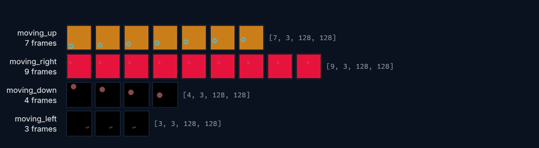
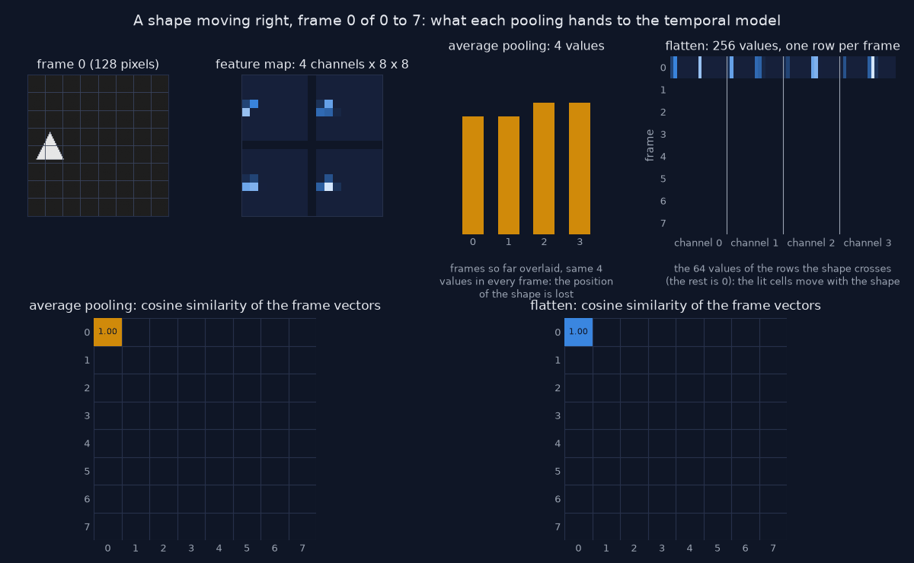
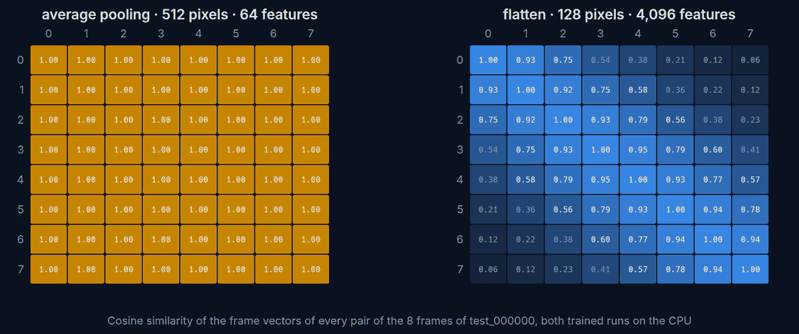

# Tasks Reference

If you are looking for the details of a task, this reference completes the [Tasks](../../README.md#tasks) section of the README. The task workflows, such as the [classification](../task%20workflows/classification_workflow.md) and [object detection](../task%20workflows/object_detection_workflow.md) workflows, follow one run function by function; the Details column of the README Tasks table links each one.

## Table Of Content
To find your way in this reference, the sections are:
- [Synthetic Datasets](#synthetic-datasets)
- [Common Dataset Layout](#common-dataset-layout)
- [Classification (CLS)](#classification-cls)
- [Object Detection (DET)](#object-detection-det)
- [Instance Segmentation (INS)](#instance-segmentation-ins)
- [Keypoint Detection (KPT)](#keypoint-detection-kpt)
- [Semantic Segmentation (SEG)](#semantic-segmentation-seg)
- [Sequence Tasks (M2O, M2M, CMP, SEL)](#sequence-tasks-m2o-m2m-cmp-sel)
- [Sequence Classification (M2O)](#sequence-classification-m2o)
- [Sequence Labelling (M2M)](#sequence-labelling-m2m)
- [Sequence Comparison (CMP)](#sequence-comparison-cmp)
- [Frame Selection (SEL)](#frame-selection-sel)
- [Self-Supervised Learning (SSL)](#self-supervised-learning-ssl)

## Synthetic Datasets
Before using real data, `vision_training/data/synthetic/create_synthetic_dataset.py` generates a dataset for every task, chosen by the required `--task`, into the required `--output_folder`. `--split_sizes` writes other sizes or only some splits (`train=300 validation=30 test=30`, `test=5000`). The image size, shapes per image and frames of every task are its `TASK_*` constants. Its configurations are listed in the [Quick Start](../../README.md#quick-start-with-synthetic-data). The table shows what each dataset holds.

| Task | Content | Classes |
|---|---|---|
| CLS | one shape per image | the 35 shapes |
| CLS | 5 to 10 shapes per image, multi-label (`--task=multi_label_classification`) | the 35 shapes |
| DET | the INS dataset, boxes around the visible part of every shape | the 35 shapes |
| DET | 5 to 12 shapes per 1024 pixel image, whole boxes (`--task=object_detection`) | the 35 shapes |
| INS | 5 to 6 shapes per image, compressed run length encoding of their visible part | the 35 shapes |
| KPT | 2 to 5 upright objects per image, some keypoints hidden (v = 1) or outside | 33 classes: shapes with keypoints, `stick_figure`, `house` |
| SEG | 5 to 6 shapes per image, with the class mask | the 35 shapes and the background |
| M2O | one shape crossing 2 to 12 frames | `moving_left`, `moving_right`, `moving_up`, `moving_down` |
| M2M | 5 to 10 shapes over 2 to 12 frames, at most one appearing or disappearing per frame | `no_change`, `appearing_<shape>`, `disappearing_<shape>` (71 labels) |
| CMP | before and after members of 2 to 12 frames, 2 to 6 shapes before | `loss_of_object`, `same_number_of_objects` |
| SEL | one shape per frame over 4 to 12 frames, the largest circle, triangle and star to select | `unselected`, `circle`, `triangle`, `star` |
| SSL | the CLS dataset, classes used by the k-NN evaluation only | the 35 shapes |
| SSL | 5 to 10 shapes per image labelled by their count (`--task=self_supervised`) | `5_shapes` to `10_shapes` |

The generation rules are:
- **The 35 shapes**: square, circle, triangle, rectangle, pentagon, hexagon, plus sign, star, octagon, rhombus, parallelogram, trapezoid, kite, heptagon, nonagon, ellipse, semicircle, annulus, capsule, L-shape, and the `hollow_<shape>` of square, triangle, rectangle, pentagon, hexagon, octagon, rhombus, parallelogram, trapezoid, kite, heptagon, nonagon, ellipse, semicircle and capsule.
- **Sizes**: log-uniform from 16 pixels (`OBJECT_MINIMUM_SIZE`) to 80 % of the image side (`OBJECT_MAXIMUM_SIZE_FRACTION`), small shapes drawn over large ones. KPT objects start at 32 pixels. A hollow shape's hole is the shape scaled by 0.4 to 0.6.
- **Backgrounds**: half textured, half flat, a fifth of the shapes on flat ones being of low contrast.
- **Border and overlaps**: up to 30 % of a shape may lie outside the image, and two boxes overlap by an IoU of 0.3 at most. DET, INS and KPT labels leave out a shape showing fewer than 64 pixels and less than half of itself (`keep_visible_objects`).
- **KPT keypoints**: polygon corners, star and plus tips, capsule ends, the 11 joints of the stick figure, hole corners after outer ones. `circle`, `ellipse`, `annulus` and `hollow_ellipse` have none and are left out of `label_mapping.json`.
- **Category identifiers**: hollow shapes are 21 to 35, `stick_figure` and `house` 36 and 37.
- **Console**: a panel per split and one for the dataset give samples, class counts and generation speed, so a small run tells how long a full one takes.

## Common Dataset Layout
To bring your own data, give every split this layout.

```text
<dataset>/
├── label_mapping.json
├── train/
│   ├── data/
│   └── labels.json
├── validation/
│   └── …
└── test/
    └── …
```

- `train_data_folder`, `validation_data_folder` and `test_data_folder` point to the splits. Validation gives the validation curves (`validation_iteration_ratio`, not built at 0); test is evaluated whole at every `weight_saving_iterations` checkpoint. Both may be the same folder.
- `labels.json` names the images relative to `data/`, with integer category identifiers.
- `label_mapping.json` (`Data.label_mapping.mapping_file_path`, `mode: "multi_class"`) maps every category identifier, as a string, to a class index.

The two examples show a mapping for classifiers and one for detectors. The `//` comments only explain them; JSON files take none.

```jsonc
{                 // CLS, M2O, M2M, CMP, SEL: classes from 0
  "1": 0,         // circle    -> class 0
  "2": 1,         // square    -> class 1
  "4": 1,         // rectangle -> class 1 too, named square+rectangle
  "5": 2          // triangle  -> class 2
}                 // star (3), not written, is left out
```

```jsonc
{                 // DET, INS, KPT, SEG: classes from 1, 0 is background
  "1": 1,         // circle -> class 1
  "2": 2,         // square -> class 2
  "3": 0          // star   -> 0: left out
}
```

- CLS, M2O, M2M, CMP and SEL predict classes 0 to K-1. DET, INS, KPT and SEG predict 1 to K, 0 being `background`. Class indices have no gaps.
- Categories mapped to one class are merged, named `name_2+name_3` and counted once.
- DET and INS warn about a category mapped to 0, since a mapping numbered from 0 drops its first category.
- DET, INS and SEG accept `mode: "binary"`, mapping every category to class 1 without a file.

A category missing from the mapping is left out. The table shows the effect per task.

| Task | Effect |
|---|---|
| CLS multi-class, M2O, CMP | its samples are skipped |
| CLS multi-label | it is dropped from its samples' classes |
| M2M | its frames are ignored |
| SEL | its frames become unselected |
| DET, INS, KPT | its objects are left out (listed at launch) |
| SEG | its pixels become background |

## Classification (CLS)
If one wishes to predict the class of an image, use `ClassificationHead.output_mode: "multi_class"` (softmax); for every class present, `"multi_label"` (sigmoid).

**Data.** Every sample gives its `category_id`, or its `category_ids` when multi-label:

```jsonc
{
  "categories": [{"id": 1, "name": "circle"}, {"id": 2, "name": "square"}, {"id": 3, "name": "star"}],
  "samples": [
    {"id": 1, "file_name": "image_0001.png", "category_id": 2},
    {"id": 3, "file_name": "night/image_0003.png", "category_id": 3},  // a subfolder of data/
    {"id": 4, "file_name": "image_0004.png", "category_ids": [1, 3]}   // multi-label: a circle and a star
  ]
}
```

**Converting a dataset.** In order to pre-train the backbones, `imagenet_download.py` downloads ImageNet-22k (14.1M images, 21,841 classes, about 1.2 TB), as the [pretraining reference](pretraining_reference.md#downloading-imagenet-22k) explains. Its splits are `train` 14,127,545 images and `test` 18,846 (one per class of at least 50 images), `validation` being the `test` images. It resumes shard by shard after an interruption.

**Configuration** (`ClassificationHead`)
- `global_pooling`: `average`, `max` or `flatten`.
- `fully_connected`: the hidden layers. With `fully_connected_normalization` `"batch"` or `"layer"`, each is linear, normalization, ReLU. Batch normalization needs a `batch_size` of at least 2.
- `output_mode`, `label_smoothing`, `class_weighting`.
- `pretrained.class_layer`: False (default) loads only the hidden layers of the source head; True also loads the class layer ([transfer](training_reference.md#transfer-between-runs)). The sequence tasks share it.
- `decorrelation`: adds the DeCov penalty ([Cogswell et al., 2016](https://arxiv.org/abs/1511.06068)), `weight` times the squared correlations of the units of layer `hidden_layer`. Tracked as `Decorrelation Loss` and `Hidden Feature Correlation`. No run name token.

**Evaluation**
- Accuracy, balanced accuracy, macro F1 and top-5 accuracy (multi-label: subset accuracy, micro and macro F1), and per-class precision, recall (with Clopper-Pearson 95 % interval) and F1.
- `class_thresholds.json`: the threshold of every class reaching `target_precision`, with its recall. With a list such as `[0.99, 0.95, 0.90]`, the first is the main target read by the deployment, the others in `additional_targets`.
- With `per_class_report`: per-class ROC AUC and average precision, `roc_curves.png`, `precision_recall_curves.png`, and `precision_recall_thresholds.png`, which writes every threshold so it can be read from the image.
- `predictions.csv` (`save_predictions`) gives probabilities with 9 significant digits.
- Probabilities are the softmax of the logits at temperature 1. The temperature explorer and its export are in the [tools reference](tools_reference.md#logit-temperature).
- Confusion matrix (`confusion_cells.csv` above 1,000 classes), and misclassified images in `Errors/<TRUE>-TO-<PREDICTED>/` (`error_dumps`).

## Object Detection (DET)
Suppose you need boxes around objects: DET is a two-stage detector. Every entry of `DetectionLevels` is a backbone level with its own anchors, region proposal head and detection head, reading the block directly or through a neck. In training, the ground truth boxes are added to the proposals.

**Data.** A COCO `labels.json`, boxes `[x, y, width, height]` in pixels of the original image. Other COCO keys, such as `area` and `iscrowd`, are not read.

```jsonc
{
  "images": [{"id": 1, "file_name": "image_0001.png", "width": 512, "height": 512}, …],
  "annotations": [                                                  // one entry per object
    {"id": 1, "image_id": 1, "category_id": 2, "bbox": [120, 340, 64, 48]},
    {"id": 2, "image_id": 1, "category_id": 1, "bbox": [300, 80, 90, 90]}
  ],
  "categories": [{"id": 1, "name": "circle"}, {"id": 2, "name": "square"}, {"id": 5, "name": "triangle"}]  // gaps allowed
}
```

**Augmentation**
- An object keeping less than 25 % of its box after a crop, translation or rotation is removed (`MINIMUM_VISIBLE_AREA_FRACTION`).
- `random_zoom_out` shrinks the image to 50 to 100 % of each side, so the finest levels also see large objects. It is on in the DET and INS example configurations (probability 0.25).
- `random_translation` leaves a black border, ignored in class masks and background in instance masks.

**Converting a dataset.** Should you need COCO 2017, `vision_training/data/data_retriever.py` downloads it with FiftyOne (about 25 GB, `datasets` dependency group). It writes into the repository `datasets` folder unless `--dataset_directory` is given, and keeps 1,000 images per split unless `--maximum_samples` changes it.

```bash
# Download every image of COCO 2017
uv run python -m vision_training.data.data_retriever --dataset_name coco-2017 --maximum_samples None
```

**Configuration**
- `DetectionLevels`: keyed by the quoted number of the backbone block, finest first. Each level holds its `anchors` (scales in input pixels, aspect ratios height / width), `region_proposal` convolutions and `detector` head.
- `Neck`: `none`, `feature_pyramid` (top-down path) or `path_aggregation` (plus the bottom-up path of PANet), with `output_channels` per level. `Neck.pretrained` loads the neck of another DET or INS run, from the run of the heads loaded behind it ([transfer](training_reference.md#transfer-between-runs)).
- `RegionProposal.background_iou_threshold.min`: above 0.0, only hard negatives touching an object are sampled as background.
- `RegionProposal.proposal_selection` (`select_best_proposals`): `joint` takes one top-k and one NMS over all levels; `per_level` suppresses each level alone, as torchvision.
- `Detector.box_loss`: `smooth_l1` on the offsets, or `complete_iou` (1 - CIoU, https://arxiv.org/abs/2005.03572), off in every configuration.
- `Detector.pretrained.class_layers`: False (default) loads the heads without classifier and per-class box regressor ([transfer](training_reference.md#transfer-between-runs)). INS shares it.
- `Detector.nms_criterion` and `nms_distance_exponent`: final NMS `iou` (greedy) or `distance_iou` (DIoU-NMS, https://arxiv.org/abs/1911.08287). The exports run the same NMS (`vision_training/models/detection/postprocessing.py`).

The DET example and synthetic configurations hold the detection benchmark winners: `feature_pyramid`, background IoU 0.1, `per_level`, and `distance_iou` at 0.6. INS configurations, workflow runs and `run-1.yaml` hold `none`, 0.0, `joint` and `iou`.
- `Optimization.loss_weights`: weights of `region_proposal_classification_loss`, `region_proposal_localisation_loss`, `detection_classification_loss` and `detection_regression_loss`, not all 0.

The excerpt shows two detection levels.

```yaml
DetectionLevels:
  "5":
    anchors: { scales: [32, 64, 128], aspect_ratios: [0.5, 1.0, 2.0] }
    region_proposal: { convolutions: [2, 64] }
    detector: { roi_align_pool_size: 7, convolutions: [2, 64], fully_connected: [256, 128] }
  "6":
    anchors: { scales: [64, 128, 256], aspect_ratios: [0.5, 1.0, 2.0] }
    region_proposal: { convolutions: [2, 64] }
    detector: { roi_align_pool_size: 7, convolutions: [2, 64], fully_connected: [256, 128] }
```

**Evaluation**
- **mAP** at IoU 0.5, 0.75, 0.95 and 0.5:0.95, with the area, 11-point and 101-point methods, and the AP@0.5 of every class. Detections below `evaluation.score_threshold` are ignored.
- **By object size**: five sizes on the object side as a share of the image side, doubling from under 1/16 to 1/2 and above, with their pixels at the network input.
- **Mean average recall** per IoU and size, and **per-class recall** at IoU 0.5 and 0.75 with its 95 % interval.
- **Anchor recall** of the training and test objects at the first launch (`anchor_recall.csv`, `anchor_recall.png`), and **proposal recall** at every evaluation (`proposal_recall.csv`).
- **Class thresholds**: `class_thresholds.json`, the threshold of every class reaching `target_precision`.
- **Confusion matrix** of the deployed detections (score from `Detector.inference.score_threshold`) at IoU 0.5, with a `background` row and column.
- **Error images**: `Errors/FALSE-POSITIVE/<class>/`, `Errors/MISSED/<class>/` and `Errors/<TRUE>-TO-<PREDICTED>/`.

## Instance Segmentation (INS)
Should you need a mask per object, INS is the DET detector with one mask head per level, as in Mask R-CNN ([He et al., 2017](https://arxiv.org/abs/1703.06870)).
- The mask head pools every box with RoI Align (`roi_align_pool_size`, 14 by default), applies convolutions, and doubles the resolution up to `MaskHead.mask_resolution` (28) with `MaskHead.upsampling`, one mask per class.
- `MaskHead.shared: True` builds one head for all levels, as Mask R-CNN, so the export runs it once. It needs the same `mask_head` and channels on every level (a neck), and adds the `MSH` token.
- For finer masks, the heads can read finer inputs, all off by default: U-Net skips at the pool size (`skip_blocks_at_pool_size`), an image branch on the input crop (`image_branch_convolutions`), skips at the mask resolution (`skip_blocks_at_mask_resolution`), mixed by `fusion_convolutions` (`MaskFineInputs` of `vision_training/models/instance_segmentation/mask_head.py`).

**Data.** The COCO `labels.json` of DET, every object having a `segmentation`: polygons (flat `[x1, y1, x2, y2, ...]` lists in pixels) or a run length encoding, compressed or not.

```jsonc
  "annotations": [
    {"id": 1, "image_id": 1, "category_id": 5, "segmentation": [[120, 388, 152, 340, 184, 388]]},           // polygons
    {"id": 2, "image_id": 1, "category_id": 2, "segmentation": {"size": [512, 512], "counts": "f\\i01o?1O001..."}}  // run length encoding
  ]
```

- Masks are built at the network resolution. The box of every object is the tight box of its mask, so no `bbox` is needed.
- `Data.instance_index_maps: True` sends one uint8 map per image, expanded on the GPU: about a ninth of the bytes and a faster loader. It needs non-overlapping run length encodings; keep it `False` for COCO.
- An object without `segmentation` stops the loading. After augmentation, an object keeping less than 25 % of its mask pixels is removed.

**Configuration.** The keys of DET, and:
- a `mask_head` in every level, e.g. `mask_head: { roi_align_pool_size: 14, convolutions: [4, 64] }`;
- `MaskHead`: resolution, upsampling, finer inputs, `shared`, normalization, modules, and `inference.mask_threshold`, the probability from which a pixel belongs to its object;
- `MaskHead.pretrained.class_layers`, as `Detector.pretrained.class_layers`;
- the `mask_loss` weight in `Optimization.loss_weights`, raised when masks lag behind boxes;
- `Data.instance_index_maps` and `evaluation.original_resolution`.

**Evaluation**
- Mask mAP and box mAP of the same detections. `Mask mAP@0.5/area` compares checkpoints. Box metrics keep the DET names, so INS and DET runs compare; mask columns of `class_metrics.csv` start with `mask_`.
- Masks are compared at the network resolution or, with `evaluation.original_resolution`, at the original resolution as COCO does.
- The other DET outputs are given for masks and boxes (`Mask Per Class Recall`, `Box Per Class Recall`), detections matched by their masks.

## Keypoint Detection (KPT)
If one wishes to find the keypoints of objects without boxes, KPT is a bottom-up detector, as in HigherHRNet ([Cheng et al., 2020](https://arxiv.org/abs/1908.10357)). It finds all keypoints of an image at once and groups them with the tags of associative embedding ([Newell et al., 2017](https://arxiv.org/abs/1611.05424)).

**Network**
- **Stem**: the first backbone blocks, down to 1/4 of the image (3 blocks, or 2 with `last_max_pooling: True`).
- **`HRNet`**: keeps a 1/4 branch, adds one at half resolution and twice the width per stage, and mixes them. The excerpt below is HRNet-W32.
- **`KeypointHead`**: a 1x1 convolution giving one heatmap and one tag map per keypoint of every class, at 1/4. `higher_resolution: True` adds second heatmaps at 1/2 for small objects.
- **`hidden_width`**: above 0, adds a 3x3 convolution before the 1x1. Set it to at least the number of heatmap channels when they outnumber `HRNet.base_width` (243 channels and `hidden_width: 256` in `configuration_synthetic_shapes.yaml`).

**Training**
- Heatmap targets are Gaussians of `heatmap_sigma` cells. The heatmap loss is the focal loss of CornerNet ([Law and Deng, 2018](https://arxiv.org/abs/1808.01244)).
- With `ignore_unlabelled_objects`, pixels of objects without labelled keypoints are left out of the heatmap loss.
- The pull loss gathers the tags of one object; the push loss separates objects of one class. They are weighted by `tag_pull_weight` and `tag_push_weight`.

**Grouping**, at inference, by `group_keypoint_candidates` (`vision_training/models/keypoints/keypoint_grouping.py`):
1. The candidates of every channel are its `inference.maximum_candidates` highest local maxima, refined as in DARK ([Zhang et al., 2020](https://arxiv.org/abs/1910.06278)).
2. Candidates above `keypoint_threshold` are matched to objects by tag distance (Hungarian matching). One farther than `tag_threshold` starts a new object.
3. An object scores the sum of its keypoint scores over the keypoints of its class. Evaluation keeps every object; samples and deployment keep those at or above `object_score_threshold`.

**Data.** The COCO `labels.json` of DET. Every object has `keypoints`, a flat `[x1, y1, v1, ...]` list in pixels. v is 2 (visible), 1 (hidden but known, learned and scored like visible) or 0 (not labelled, written `0, 0, 0` to keep its place). Every category has its `keypoints` names and its `skeleton`, the 1-based pairs drawn as lines.

```jsonc
  "annotations": [
    {"id": 1, "image_id": 1, "category_id": 2, "bbox": [65, 228, 206, 206],
     "keypoints": [65, 228, 2,  271, 228, 2,  271, 434, 2,  65, 434, 1]},   // bottom_left hidden
    {"id": 2, "image_id": 1, "category_id": 5, "bbox": [300, 40, 120, 100],
     "keypoints": [360, 40, 2,  420, 140, 2,  0, 0, 0]}                     // bottom_left not labelled
  ],
  "categories": [
    {"id": 2, "name": "square", "keypoints": ["top_left", "top_right", "bottom_right", "bottom_left"],
     "skeleton": [[1, 2], [2, 3], [3, 4], [4, 1]]},
    {"id": 5, "name": "triangle", "keypoints": ["top", "bottom_right", "bottom_left"], "skeleton": [[1, 2], [2, 3], [3, 1]]}
  ]
```

- Objects without labelled keypoints are left out; with `ignore_unlabelled_objects`, each needs its `segmentation`.
- Categories merged into one class must have the same keypoint names.
- For COCO 2017 persons, each split folder links the images as `data/` and `person_keypoints_<split>2017.json` as `labels.json`. The example evaluates on validation, test keypoints being withheld.

**Augmentation**
- Geometric types move the keypoints; `random_perspective` and `random_jigsaw` are refused.
- A keypoint leaving the image becomes unlabelled. An object is removed when less than 25 % of its box and none of its keypoints stay inside.
- A keypoint keeps its name: a flipped `left_wrist` stays `left_wrist`. Both keypoint configurations turn the flips and 90 degree rotations off.

**Configuration.** `keypoint_detection/configuration_example.yaml` trains HigherHRNet-W32 on COCO persons at 512x512. `Data.image_settings.size` is a multiple of 4 x 2 to the power of the stages (32 for 3). `Backbone.pretrained` loads the first blocks of any backbone; `HRNet.pretrained` and `KeypointHead.pretrained` load those of a KPT run. `KeypointHead.pretrained.class_layers` False (default) leaves out the last heatmap and tag convolutions; True needs the same keypoints of the same classes in the same order. The excerpt shows the network keys.

```yaml
HRNet:
  base_width: 32
  modules_per_stage: [1, 4, 3]
  blocks_per_branch: 4
  modules: { squeeze_and_excite: True, residual_nets: True }
  normalization: { feature_map_normalization: "batch" }
KeypointHead:
  higher_resolution: True
  hidden_width: 0
  heatmap_sigma: 2.0
  ignore_unlabelled_objects: True
  tag_pull_weight: 0.1
  tag_push_weight: 0.1
  inference: { maximum_candidates: 30, keypoint_threshold: 0.1, tag_threshold: 1.0, object_score_threshold: 0.2 }
```

**Evaluation.** Every found object is matched to the ground truth objects of its class with the object keypoint similarity (OKS) of COCO, which replaces the IoU:

OKS = Σ exp(-d² / (2 s² k²)) δ(v > 0) / Σ δ(v > 0)

d is the distance to the ground truth keypoint, s² the box area, k = 2 x sigma. The sigma is `evaluation.keypoint_sigmas.<category>.<keypoint>`, or `default_keypoint_sigma` (0.05).
- **OKS mAP** by size and per class, OKS mean average recall and per-class OKS recall with intervals, as the DET box metrics. `OKS mAP@0.5/area` compares checkpoints. As in pycocotools, a detection on a test object without labelled keypoints is neither true nor false positive.
- **Matched Objects**, **PCK@0.05** (keypoints within 0.05 of the longest box side), **Mean OKS** and **mean keypoint error** in pixels, per class and per keypoint in `class_metrics.csv` and `keypoint_metrics.csv`.

In the sample images, left keypoints are blue, right ones orange, the others yellow, hidden ones drawn as rings.

## Semantic Segmentation (SEG)
Suppose every pixel needs a class: SEG is a U-Net whose encoder is the backbone, the decoder merging a backbone skip connection at every level.

**Data.** Every split holds images in `data/` and masks in `masks/`. A mask is a single-channel uint8 PNG of the image size: 0 for background, 255 for unlabelled pixels, which are ignored. The optional `category_ids` of a sample feed the class counts of `data.json`.

```jsonc
{
  "categories": [{"id": 1, "name": "circle"}, {"id": 2, "name": "square"}, {"id": 3, "name": "star"}],
  "samples": [
    {"id": 1, "file_name": "image_0001.png", "mask_file_name": "image_0001.png", "category_ids": [1, 3]}  // masks/image_0001.png
  ]
}
```

**Losses.** Every loss has its weight in `SegmentationLoss`, 0 turning it off; cross entropy, Dice or Lovász must be on.
- `cross_entropy_weight`: cross entropy of the labelled pixels, with `focal_gamma`, `label_smoothing` and `class_weighting`.
- `dice_weight`: one minus the mean soft Dice of the classes in the batch.
- `lovasz_weight`: the Lovász-Softmax loss, which optimizes the mean IoU, usually to fine-tune.
- `boundary_weight`: cross entropy of pixels within `boundary_distance` pixels of a class edge.

**Deep supervision.** `SegmentationDecoder.deep_supervision_weights`, e.g. `{ "5": 0.1, "4": 0.2, "3": 0.3, "2": 0.4 }`, adds a class layer to the listed levels, trained with the losses times the level weight (`deep_supervision_loss`). These layers serve training only and transfer only with `class_layers` ([Adding Classes](training_reference.md#adding-classes)). `{}` turns it off.

**Training on tiles.** With `Data.tiling.activated: True`, images and masks are scaled by `Data.tiling.scale` and cut into tiles of `Data.image_settings.size`, so large images keep their small objects.
- Training tiles are cut at random places every epoch, validation tiles at a fixed place.
- Test images are segmented whole, tile by tile, probabilities averaged where tiles overlap by `Data.tiling.overlap` pixels.

**Evaluation**
- Mean IoU, mean Dice, boundary IoU and F1 (pixels within `boundary_tolerance` of the contours), pixel accuracy, frequency weighted IoU, and per-class metrics with Korn-Graubard recall intervals.
- With `per_class_report`: per-class ROC AUC and average precision from pixel probability histograms, and their curves.
- With `original_resolution: True`, predictions are compared at the original size of every test image.
- `save_predicted_masks` writes predicted masks to `Predicted_Masks/`.

## Sequence Tasks (M2O, M2M, CMP, SEL)
Whenever the input is a sequence of frames, these rules apply to all four sequence tasks.
- Every sequence holds its frames in `data/<sequence name>/`, listed in order in `labels.json`.
- The backbone runs on every frame, `ClassificationHead.global_pooling` turns each feature map into a frame vector, and `TemporalModel.type` combines the frames. `mean_pooling`, `max_pooling` and `attention_pooling` ignore the order; `gru`, `lstm`, `transformer` and `temporal_convolution` follow it.
- Every sequence is fed whole. One longer than `Data.sequence_settings.maximum_sequence_length` is left out with a red warning. Batches are padded with masked black frames, which never change the outputs.
- `independent_frames` draws the photometric augmentations frame by frame. `shuffle_frames` shuffles frames whose order carries no information, with `TemporalModel.positional_embedding: False` for the transformer.
- `feature_map_normalization: "sequence"` normalizes over the real frames of every sequence.

The animation shows four sequences padded by `collate_padded_sequences`, with the `sequence_mask` of their real frames.

<p align="center">
  
</p>

To see why a class given by a motion needs `flatten`, follow one frame through the network. The backbone gives C channels on an H × W grid, and the global pooling turns it into the frame vector.
- `average` keeps one mean per channel, the same wherever the shape is. A move to the left and to the right become the same vectors, and the model stays at chance. `max` loses the position the same way.
- `flatten` keeps the C × H × W values in order, so the lit cells move from frame to frame.

The animation and the figure show this on a drawn example and on two trained M2O runs.

<p align="center">
  
</p>
<p align="center"><em>A triangle moving right over 8 frames: average pooling gives the same 4 values in every frame (similarity 1.00); flatten gives 256 values following the shape (0.42 to 0.57 between neighbours, 0.00 between far frames). Drawn by <code>documentation/presentation/figures/draw_pooling_similarity_animation.py</code>.</em></p>

<p align="center">
  
</p>
<p align="center"><em>Two trained M2O runs on one test sequence: with average pooling every pair of frames scores 1.00; with flatten the similarity is 0.79 to 0.91 between neighbours and 0.00 between the first and last frame.</em></p>

## Sequence Classification (M2O)
If one wishes to predict one class per sequence (many to one), give every sequence its `category_id` and frames in order:

```jsonc
{
  "categories": [{"id": 1, "name": "moving_left"}, {"id": 2, "name": "moving_right"}],
  "sequences": [
    {"id": 1, "name": "sequence_0001", "category_id": 1,
     "frames": ["sequence_0001/000000.png", "sequence_0001/000001.png", "sequence_0001/000002.png"]},
    {"id": 2, "name": "sequence_0002", "category_id": 2,
     "frames": ["sequence_0002/000000.png", "sequence_0002/000001.png"]}   // another length
  ]
}
```

- **Configuration**: `Data.sequence_settings`, `TemporalModel` (all 7 types) and `ClassificationHead`, with the evaluation keys of CLS. A class given by a motion needs `global_pooling: flatten`, as in both configurations.
- **Evaluation**: the metrics and files of CLS, on the sequences, without the temperature explorer.

## Sequence Labelling (M2M)
Should you need one class per frame (many to many), use M2M. With `TemporalModel.causal: True` (transformer, temporal convolution), every frame sees only the frames before it, as in a live stream; `sequence` normalization is then refused.

```jsonc
{
  "categories": [{"id": 1, "name": "no_change"}, {"id": 2, "name": "appearing_circle"}, {"id": 3, "name": "disappearing_circle"}],
  "sequences": [
    {"id": 1, "name": "sequence_0001", "frame_category_ids": [1, 2, 1],   // a circle appears on the second frame
     "frames": ["sequence_0001/000000.png", "sequence_0001/000001.png", "sequence_0001/000002.png"]}
  ]
}
```

- **Data**: `frame_category_ids` gives one category per frame. A length mismatch with `frames` stops the launch.
- **Configuration**: the keys of M2O, with `gru`, `lstm`, `transformer` and `temporal_convolution` only.
- **Evaluation**: the CLS metrics on the frames (recall intervals Korn-Graubard over the sequences), the sequence exact match (every frame right), and two segment metrics, a segment being a run of frames of one class:
  - **Edit Score**: 1 minus the segment edits needed to turn the predicted order into the true one, over the larger segment count. Low when the prediction is fragmented.
  - **Segment F1@10, @25 and @50**: a predicted segment is right when it overlaps an unmatched true segment of its class by at least 10, 25 or 50 % IoU (`count_segment_matches`).

For example, true `A A A A A B B B B B` predicted `A A B A A B B A B B` has 80.00 % of its frames right, an edit score of 33.33 %, a segment F1@10 of 50.00 % and a segment F1@50 of 0.00 %.

## Sequence Comparison (CMP)
Suppose you must tell whether an object was lost between two visits: CMP predicts one class per pair of a before and an after sequence. Both members go through the same backbone and temporal module, combined by `Fusion.type`: `concatenation`, `difference` or `cross_attention`.

```jsonc
{
  "categories": [{"id": 1, "name": "loss_of_object"}, {"id": 2, "name": "same_number_of_objects"}],
  "pairs": [
    {"id": 1, "name": "pair_0001", "category_id": 1,
     "before": ["pair_0001/before/000000.png", "pair_0001/before/000001.png"],
     "after": ["pair_0001/after/000000.png"]}                                   // members may differ in length
  ]
}
```

- **Configuration**: the keys of M2O and `Fusion`. `Fusion.sequence_normalization_scope` normalizes each member alone (`"member"`) or both together (`"pair"`).
- **Evaluation**: the metrics and files of CLS, on the pairs.

## Frame Selection (SEL)
In case you need the best `Selection.frames_per_class` frames of every wanted class in a sequence, e.g. the sharpest view of each side of an object, use SEL. Every class except `Selection.unselected_category` is wanted.

**Model.** The M2M model, trained with the per-frame loss and a selection loss (`Selection.selection_loss_weight`) making the frames compete for every class.

**Decoding**
- `hungarian`: the most probable labelling with every wanted class chosen `frames_per_class` times, every frame at most once.
- `greedy`: every frame takes its most probable class; extra frames are dropped and missing ones completed with the best unselected frames.

For example, with three frames of probabilities (A, B, unselected) (0.50, 0.45, 0.05), (0.45, 0.05, 0.50) and (0.02, 0.08, 0.90), greedy gives A to frame 1 and B to frame 3. Hungarian gives B to frame 1 and A to frame 2, about nine times more probable. Both are scored; `Selection.decoding` is the one drawn, thresholded and deployed.

**Data.** The M2M layout, `frame_category_ids` giving the unselected or a wanted category per frame. A sequence without exactly `frames_per_class` frames of every wanted class stops the training.

```jsonc
{
  "categories": [{"id": 1, "name": "circle"}, {"id": 3, "name": "star"}, {"id": 6, "name": "unselected"}],
  "sequences": [
    {"id": 1, "name": "sequence_0001", "frame_category_ids": [6, 3, 6, 1],   // frames_per_class 1: the star, then the circle
     "frames": ["sequence_0001/000000.png", "sequence_0001/000001.png", "sequence_0001/000002.png", "sequence_0001/000003.png"]}
  ]
}
```

**Configuration.** The keys of M2M and `Selection` (`unselected_category`, `decoding`, `frames_per_class`, `selection_loss_weight`).

**Evaluation**
- `Hungarian Selection Accuracy` and `Greedy Selection Accuracy`: the share of true frames chosen for their class; the one of `Selection.decoding` is the headline metric, with Korn-Graubard intervals per class.
- `<Decoding> Fully Right Sequences`, `<Decoding> Background Picks` and `<Decoding> Swapped Picks`: wrong picks that took a frame to leave unselected, or a true frame of another class.
- `Top-<k> Selection Accuracy` and `Mean True Frame Rank`: whether a wrong choice was close.
- `Frame Accuracy`, `Frame Balanced Accuracy` and `Frame Macro F1`, before decoding.
- `class_thresholds.json`: the probability from which every class reaches `target_precision`; the deployed model flags lower choices as low confidence.
- `selections.csv` (`save_predictions`) and `Errors/<CLASS>/<sequence>.png` (`error_dumps.activated`).

The sample images show a thumbnail grid: green for a right choice, red for a wrong one, dashed yellow for a missed true frame, with a probability heat map below.

## Self-Supervised Learning (SSL)
If one wishes to train a backbone without labels, use SSL. Two random views of every image go through the backbone, global pooling and a projection head, and the loss pulls them together.
- `ProjectionHead.method: "simclr"`: InfoNCE, every view finding its partner among the batch by cosine similarity over `simclr.temperature`. Larger batches help.
- `ProjectionHead.method: "barlow_twins"`: the cross-correlation of both views' features is pushed to the identity, off-diagonal terms weighted by `barlow_twins.off_diagonal_weight`. It works with smaller batches.

The evaluated and exported representation is the pooled feature map before the projection head.

**Data.** The CLS layout. Every image is trained on; categories serve only the k-NN evaluation. A dataset without labels uses an empty mapping file (`{}`).

**Grouped batches.** So that the negatives of an image are hard ones, `Data.grouped_batches` builds batches from related images (same camera, site or device type), read from the optional `groups` of every sample:

```json
{"id": 17, "file_name": "data/abc.jpg", "groups": {"camera": "c042", "camera_type": "type_a", "site": "s3"}}
```

- `activated`: grouped batches when True.
- `block_key`: the attribute shared by a block of `images_per_block` images (at least 2, dividing the batch size).
- `batch_key`: the attribute shared by a whole batch, or `null`.

`GroupedBatchSampler` (`vision_training/data/grouped_batch_sampler.py`) rebuilds batches at every pass. A split with none of the keys keeps random batches with a warning; one where only some samples hold them stops the launch. The test split is not grouped.

**Views.** Both views are drawn by `Data.data_augmentation`, which must be on, at `SELF_SUPERVISED_AUGMENTATION_STRENGTHS` ([Data Augmentation](training_reference.md#data-augmentation)).
- `random_crop` is the random resized crop of SimCLR, at probability 1.0. The counted shapes configurations turn it off, a crop changing the count.
- `random_solarize` and `random_black_out` apply to the second view only (`SECOND_VIEW_ONLY_TYPES`), as in BYOL and Barlow Twins.
- A cue shared by both views, such as colour or position, lets the backbone match them without learning the content.

**Configuration.** `self_supervised/configuration_example.yaml` (Barlow Twins) or `configuration_synthetic_shapes.yaml` (SimCLR).
- `ProjectionHead`: pooling, `fully_connected` with the embedding size last, normalization, `method` and its parameter. SimCLR uses `[2048, 128]`, Barlow Twins `[2048, 2048, 2048]` or more.
- `batch_size` is at least 2, and each used split holds at least one full batch.

**Training metrics**, next to the loss:
- `Positive Pair Accuracy` (SimCLR): views whose most similar view is their partner. Near 100 % quickly while the evaluation stays poor shows a shortcut.
- `Diagonal Correlation` and `Off-Diagonal Correlation` (Barlow Twins), towards 1 and 0; `Embedding Standard Deviation`, 0 when the embeddings collapse.

**Evaluation**, without training a classifier:
- `k-NN Accuracy` (headline), `k-NN Balanced Accuracy` and `k-NN Macro F1`: every labelled test image is classified by its `number_neighbours` nearest reference images, at most `number_reference_images_per_class` labelled training images per class. Test images are never compared with each other.
- Per-class k-NN precision, recall with Clopper-Pearson interval, and F1 in `class_metrics.csv`.
- `Effective Rank`: the number of directions the representations spread in, about 1 when they collapse; the headline metric without labels.
- `Representation Standard Deviation`: a fall towards 0 shows a collapse.

The sample images show every test image next to two views, with the cosine similarity of their representations.

**Using the backbone.** A run of any task sets `Backbone.pretrained.experiment_folder` to the SSL run ([Transfer Between Runs](training_reference.md#transfer-between-runs)). To measure the gain, compare with a run from random weights on 1 %, 10 % and 100 % of the labels.
