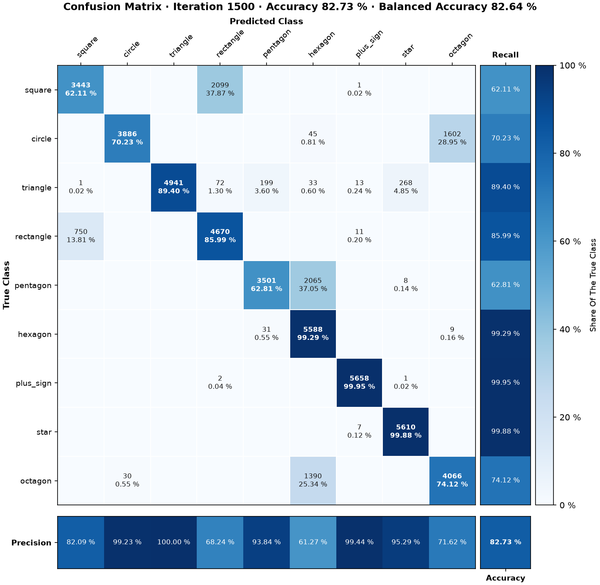
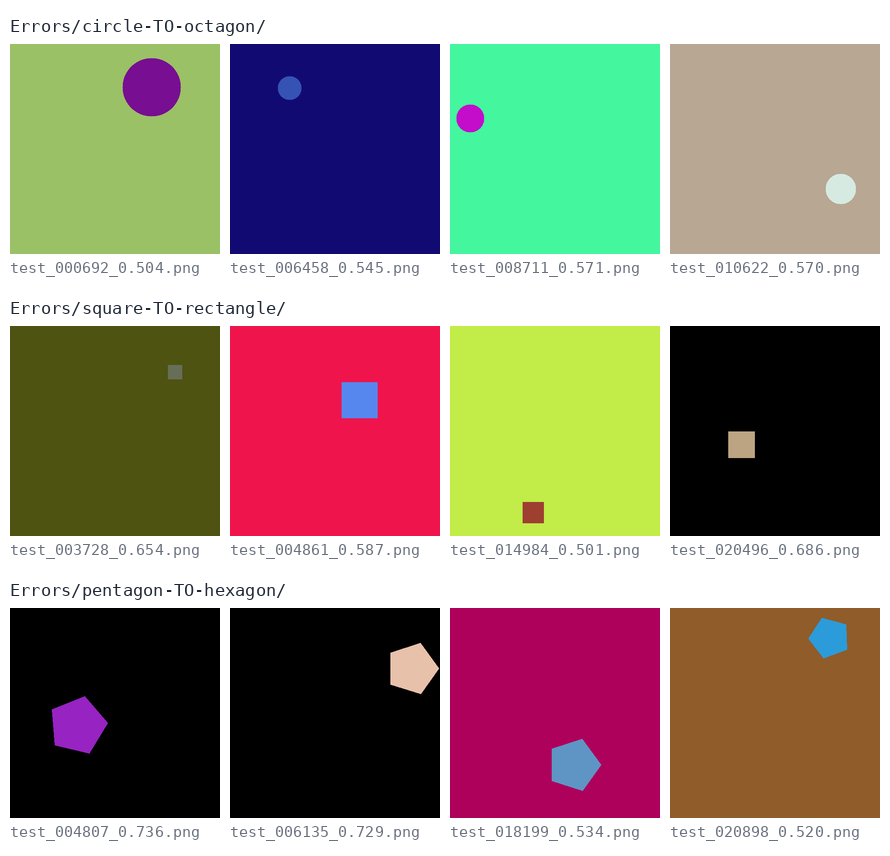
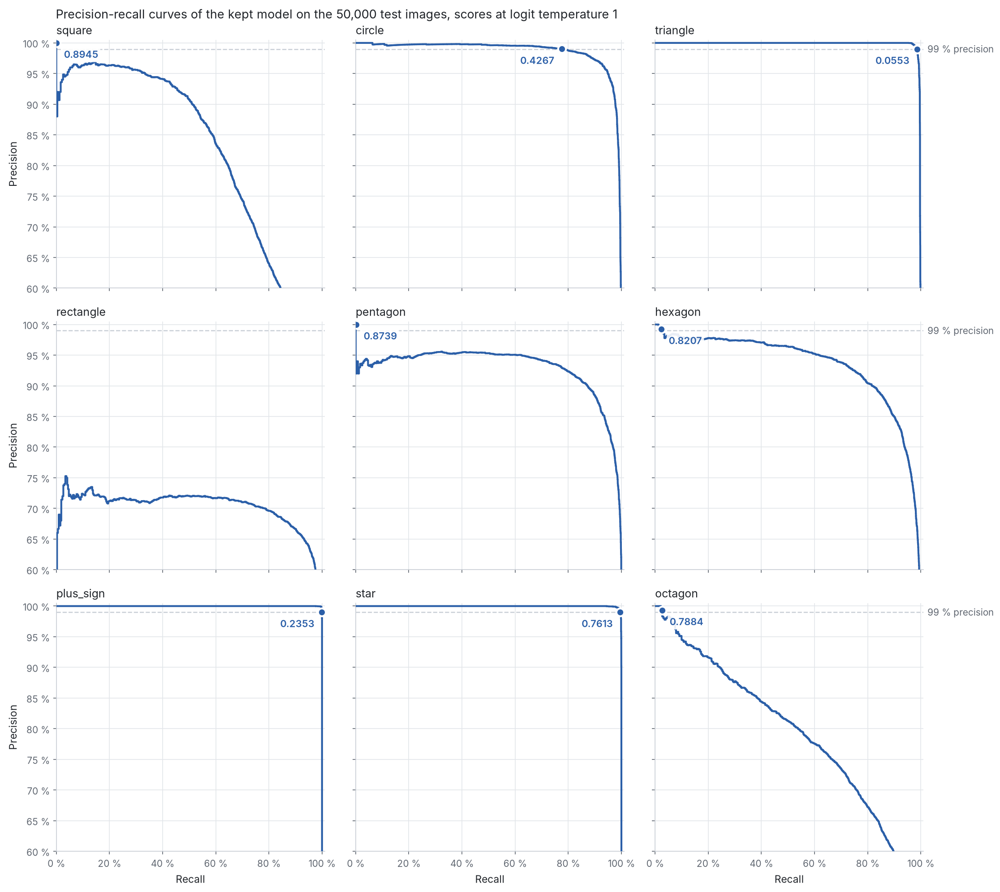
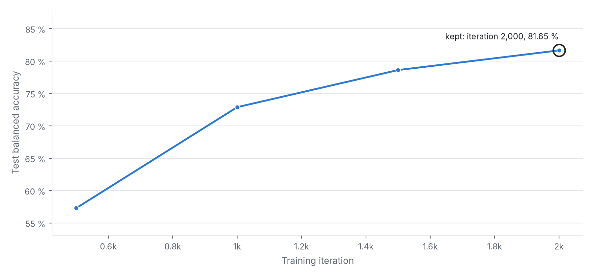
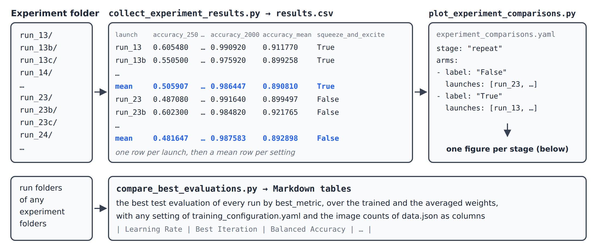
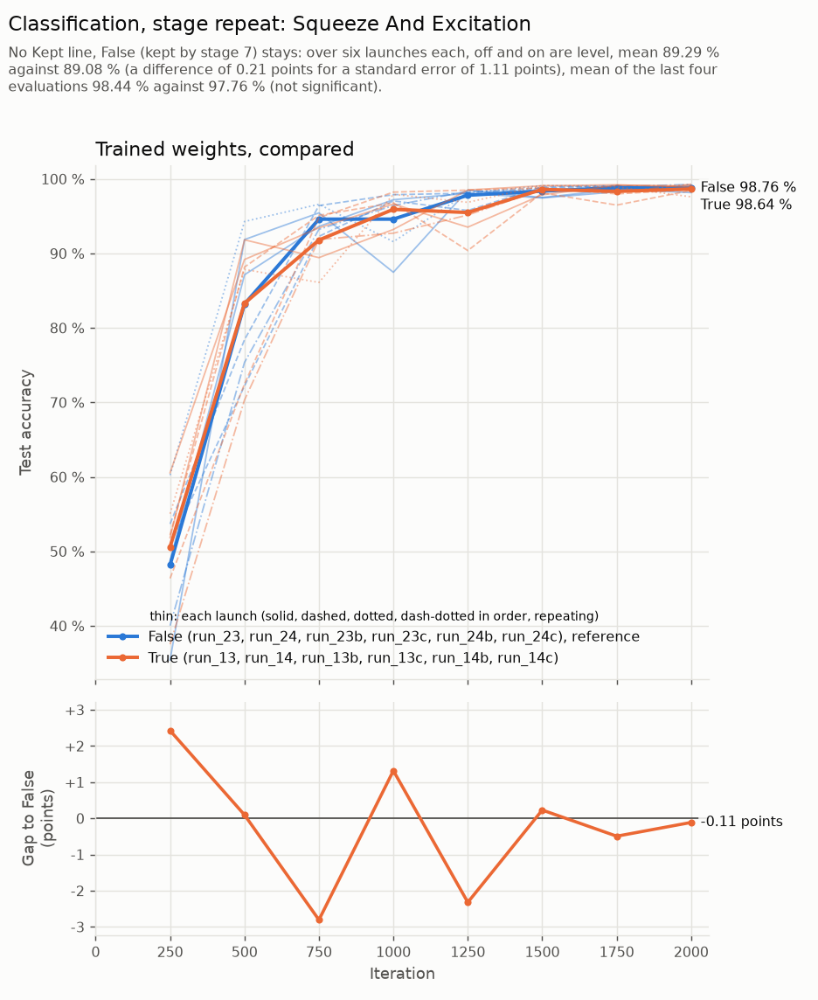
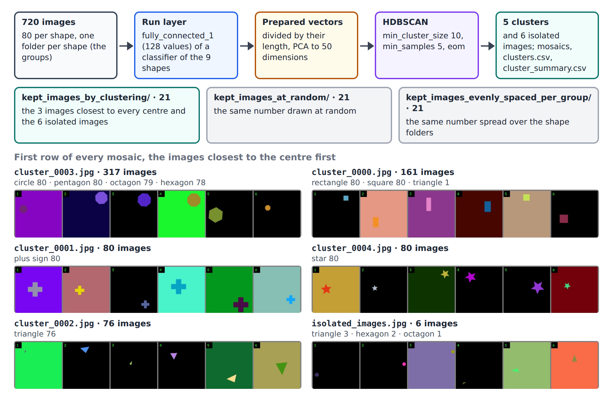
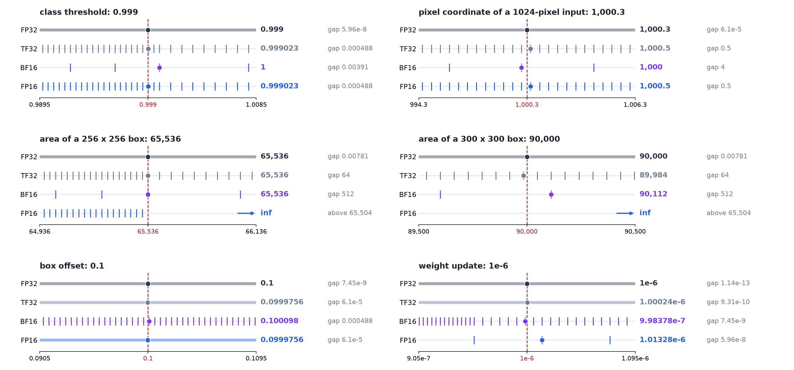

# Tools Reference

If you are looking for the settings and outputs of the scripts run after a training, this reference completes the [Evaluating Checkpoints](../../README.md#evaluating-checkpoints) and [Deployment](../../README.md#deployment) sections of the README. Every setting is a command line argument of its script; `--help` lists them with their defaults.

## Table Of Content
To find your way in this reference, the sections are:
- [Evaluating Checkpoints](#evaluating-checkpoints)
  - [Logit Temperature](#logit-temperature)
  - [Drawing The Figures Of A Research Report](#drawing-the-figures-of-a-research-report)
  - [Scoring A Large Split](#scoring-a-large-split)
- [Comparing Launches](#comparing-launches)
  - [Comparing The Best Evaluations Of Runs](#comparing-the-best-evaluations-of-runs)
  - [Drawing The Comparison Of Every Stage](#drawing-the-comparison-of-every-stage)
  - [Drawing The Mask Head Designs](#drawing-the-mask-head-designs)
- [Clustering Image Embeddings](#clustering-image-embeddings)
  - [Stored Features And Relaunch](#stored-features-and-relaunch)
  - [Clusters And Kept Images](#clusters-and-kept-images)
  - [Group Pattern](#group-pattern)
- [Deployment](#deployment)
  - [Export](#export)
  - [TensorRT Check](#tensorrt-check)
  - [The Same Values In Every Format](#the-same-values-in-every-format)
  - [Input Contract](#input-contract)
  - [Test Split Parity](#test-split-parity)
  - [FP16 TorchScript Trial](#fp16-torchscript-trial)
  - [Throughput Measurement](#throughput-measurement)
  - [Serving Benchmark](#serving-benchmark)

## Evaluating Checkpoints
Whenever the checkpoints of a trained run must be judged again, on another split, with other target precisions or another NMS, use `scripts/evaluation/evaluate_checkpoint.py`. It writes into `<run>/Checkpoint_Evaluation/` and leaves the training files untouched. The table lists its arguments; one left out keeps the value of the run, and the two with a default keep it with `None`.

| Argument | Meaning |
|---|---|
| `--experiment_folder` | the evaluated run folder (required) |
| `--iteration` | an iteration, or `all`, the last checkpoint by default; a missing checkpoint raises `FileNotFoundError` before anything is written |
| `--test_data_folder` | another labelled split, written to `<run>/Checkpoint_Evaluation_split_<parent folder>_<split folder>/` so that two splits never mix |
| `--batch_size` | the evaluation batch size, `128` by default |
| `--track_evaluation` | `True` sends the evaluation to MLflow, in a run named `<run name>-evaluation` |
| `--save_predictions` | `True` writes `predictions.csv` (CLS, M2O, M2M, CMP) or `selections.csv` (SEL) |
| `--maximum_error_images_per_class_pair` | turns the error images on, at most this number per pair of classes, `100000` by default (not SEG, KPT, SSL) |
| `--target_precisions` | one precision, or several such as `0.99 0.95 0.90`, targeted by the class thresholds |
| `--nms_criterion`, `--nms_distance_exponent` | another final NMS for DET or INS, `iou` or `distance_iou`, written to `<run>/Checkpoint_Evaluation_nms_<criterion>[_<exponent>]/` |

The folder is laid out as the `Evaluation/` folder of the training ([Run Folder](training_reference.md#run-folder)). Every checkpoint adds its row to `evaluation_summary.csv` and redraws `evaluation_curves.png`. With `--iteration all`, the best iteration is printed for both weights: `Best Checkpoint : iteration 2000 (Accuracy 81.76 %)`.

To find where a classifier fails, read its confusion matrix, then the misclassified images in `Errors/<true>-TO-<predicted>/`. Above 1,000 classes no image is drawn, and `confusion_cells.csv` lists the non-zero cells. The figures show the matrix and the error folders of the 35-class synthetic shapes classifier.

<p align="center">
  
</p>

<p align="center">
  
</p>
<p align="center"><em>Iteration 2000 (accuracy 81.76 %): hollow parallelograms read as hollow trapezoids, trapezoids as parallelograms and rectangles as squares.</em></p>

### Logit Temperature
Suppose a classifier is overconfident, its thresholds at high precision ending at 0.999 or above. Dividing the logits by a temperature T above 1 before the softmax spreads the probabilities without changing the predicted class. With two classes (or multi-label) the recall at a target precision stays the same and only the threshold moves.

1. With `per_class_report`, every evaluation writes `temperature_explorer.html` in its iteration folder. Its slider tries temperatures from 0.5 to 10 and shows, per class, the score histogram, thresholds and recalls. Up to 100 classes, it also keeps `class_logits.npz`.
2. Start the explorer server and open `http://127.0.0.1:8091/`. Its optional arguments are `--experiments_roots`, by default the folders of the repository root whose name holds `experiments`, and `--port`, 8091 by default. The index lists every evaluation with a page, grouped by run and iteration. With `class_logits.npz`, any temperature from 0.05 to 100 can be typed (**Show T**). Each page opens on the global metrics of the checkpoint and the best iteration of its summary. The **Score Ranges** section counts, per class, the images whose score falls between 1 to 10 cut points (default `0.5, 0.6, 0.7, 0.8, 0.9, 0.95, 0.99`).
3. Press **Save Thresholds At This Temperature**. `saved_temperature_thresholds.json` is written next to the page, in the format of `class_thresholds.json`, with `logit_temperature`. A save replaces the earlier one.
4. In the **Export** panel, choose formats, version, batch size and precisions, then press **Export At T = …**. `vision_training/deployment/explorer_export.py` exports into `<run>/Exports/Iteration_<n>[_EMA]_T<temperature>/`, a Triton model repository with `class_thresholds.json`, `export_record.json` and `export_log.txt`. One export runs at a time; a failed one leaves its `.partial` folder.
5. Without the page, export with `--use_saved_temperature` ([Export](#export)).

```bash
# Serve the temperature explorer on port 8091
uv run python -m scripts.evaluation.serve_temperature_explorer
```

### Drawing The Figures Of A Research Report
Should a research report need its figures again, after a new evaluation or a new saved temperature, `scripts/evaluation/draw_report_figures.py` draws them into `<run>/Checkpoint_Evaluation/Iteration_<n>[/EMA]/Report_Figures/`. It checks every input before drawing, so a wrong input writes nothing.

```bash
# Figures of the trained weights of iteration 2000, evaluated by evaluate_checkpoint.py
uv run python -m scripts.evaluation.draw_report_figures --experiment_folder ~/Data/<run> --iteration 2000
```

| Argument | Meaning |
|---|---|
| `--experiment_folder`, `--iteration` | required: the run of the kept classifier and its kept checkpoint |
| `--weights` | `trained` (default) or `ema` |
| `--evaluation_folder_name` | `Checkpoint_Evaluation` (default) or `Evaluation` |
| `--class_display_names` | the name shown for every class as `CLASS=NAME`, the class names by default |
| `--sample_kind`, `--split_name` | written in the titles, e.g. "on the 50,000 test images" (`images` and `test` by default) |
| `--minimum_recall` | the left end of the recall axis, 0 by default |
| `--group_manifest_path` | a JSON Lines manifest giving the group (camera, vehicle) of every sample; without it, no groups chart |
| `--file_name_key`, `--group_key`, `--group_plural` | the manifest keys and the plural of the group (`file_name`, `camera`, `cameras` by default) |
| `--training_labels_path`, `--predictions_path` | the run's training `labels.json` and `predictions.csv` by default |

It writes these files:
- `confusion_matrix.png`, titled with the accuracy and balanced accuracy.
- `precision_recall_curves.png`: every class with its threshold at every target precision, at the saved temperature (1 with a warning when none is saved).
- `training_curves.png`: the balanced accuracy of both weights at every evaluated checkpoint, the kept one ringed.
- `seen_and_never_seen_groups.png`, with a manifest: the balanced accuracy on groups seen and never seen in training.
- `report_values.json`: every number shown, to fill the tables of the report.

The figures show the curves drawn for the classifier above at iteration 2000.

<p align="center">
  
</p>

<p align="center">
  
</p>
<p align="center"><em>First nine of the 35 classes; a dot marks the threshold reaching 99 % precision, at temperature 1 since none was saved.</em></p>

### Scoring A Large Split
Say a rare class must be mined from a split far larger than a test split: `scripts/evaluation/score_image_split.py` scores every image with one checkpoint, without metrics or error images.

| Option | Meaning |
|---|---|
| `--experiment_folder`, `--iteration` | the run folder and the scored checkpoint |
| `--use_averaged_weights` | scores with the moving average |
| `--test_data_folder` | the scored split, a `labels.json` and its `data/` folder (a placeholder class for unlabelled images) |
| `--output_path` | the predictions file, appended to when it exists |
| `--precision` | `float32` (default) or `bfloat16` |
| `--batch_size`, `--number_workers` | 128 images per pass, 12 loader workers |
| `--time_budget_hours` | the time after which no new batch is scored |
| `--compare_precisions` | first scores the test split of the run in both precisions and prints their differences |

The predictions file has the columns of `predictions.csv`: `sample` and one `probability_<class>` per class. A relaunch scores only the missing images, after checking the columns and that the last row is complete. The trainer files go to `<run>/Checkpoint_Evaluation_split_<parent folder>_<split folder>/`, so no file of the run changes.

## Comparing Launches
To decide which setting of a hyperparameter stage to keep, `scripts/evaluation/collect_experiment_results.py` gathers every launch into one CSV file. Each launch trains in its own `run_<n>` folder, a repeat in `run_<n><letters>` (`run_23b`).

```bash
# List every argument with its default
uv run python -m scripts.evaluation.collect_experiment_results

# Write the results.csv of the sequence labelling experiment
uv run python -m scripts.evaluation.collect_experiment_results --task sequence_labelling
```

Say you collect another experiment, or launches kept elsewhere: the arguments set them.

| Argument | Meaning |
|---|---|
| `--task` | required: `classification`, `sequence_labelling` or `object_detection`, choosing folder, swept settings and compared curve (`Accuracy`, `Macro F1`, `mAP@[0.5:0.95]/area`) |
| `--experiment_folder` | the folder of the `run_<n>` folders, by default `<repository>/hyperparameter_experiments`, its `<task>/` subfolder for the other tasks |
| `--number_last_evaluations` | the last evaluations averaged in a second mean column, 4 by default |
| `--output_path` | `<experiment_folder>/results.csv` by default |

Every row is a launch and its weights (`trained` or `ema`). It gives the metric at every iteration, its mean, the mean of the last evaluations, whether the launch finished, the swept settings (`TASK_SWEPT_SETTINGS`) and the folder. Launches of the same settings are grouped and followed by a `mean` row. A launch still training leaves its future cells empty.

The figure shows the flow from launches to the results file.

<p align="center">
  
</p>

Before trusting a gap between two settings, compare it with the spread of each. In the repeated squeeze-and-excitation stage below, six launches per setting overlap: the means differ by 0.21 points for a standard error of 1.11 points.

<p align="center">
  
</p>

### Comparing The Best Evaluations Of Runs
In order to compare the best test evaluation of several runs, `scripts/evaluation/compare_best_evaluations.py` prints Markdown tables over the trained and averaged weights. The table lists its arguments.

| Argument | Meaning |
|---|---|
| `--experiment_folders` | required: experiment folders or run folders |
| `--best_metric`, `--lower_is_better` | the test curve choosing the best evaluation, `Balanced Accuracy` by default, its highest value kept unless `--lower_is_better` is given |
| `--evaluated_weights` | `trained ema` (default) or one of them; an EMA win is marked ` (EMA)` |
| `--columns` | `experiment`, `run`, `best_iteration`; a test curve (`Recall/{class}` gives one column per class); a setting (`configuration:Data.image_settings.size`); a `data.json` count `<split>_<unit>`; `DEFAULT_COLUMNS` by default |
| `--column_titles` | titles as `COLUMN=TITLE`, `{class}` replaced by the class name; each replaces the title of its column only, the others keeping `DEFAULT_COLUMN_TITLES` |
| `--table_grouping` | `run` (default) or `columns` |
| `--rates_as_decimals`, `--number_decimals`, `--output_path` | rates as decimals instead of percentages, decimals of the other curves (3 by default), and a Markdown output file |

Say you compare two runs of the 9-class synthetic shapes classifier at two learning rates, in one table:

```bash
# Two runs in one table, with the columns and titles of the comparison
uv run python -m scripts.evaluation.compare_best_evaluations \
    --experiment_folders ~/Data/<experiments>/<run> ~/Data/<experiments>/<run>_lr-0.001 \
    --table_grouping columns \
    --columns configuration:ExperimentConfiguration.learning_rate best_iteration "Balanced Accuracy" \
        Recall/square Recall/circle validation_images train_images \
    --column_titles "configuration:ExperimentConfiguration.learning_rate=Learning Rate" \
        "Recall/square=Recall square" "Recall/circle=Recall circle"
```

It prints:

```text
| Learning Rate | Best Iteration | Balanced Accuracy | Recall square | Recall circle | Validation Images | Train Images |
|---|---|---|---|---|---|---|
| 0.0002 | 1500 | 82.64 % | 62.11 % | 70.23 % | 50,000 | 500,000 |
| 0.001 | 600 | 41.61 % | 87.35 % | 100.00 % | 50,000 | 500,000 |
```

A run not evaluated yet is printed in yellow and left out. A missing curve or count stops the script.

### Drawing The Comparison Of Every Stage
After a stage of a hyperparameter experiment, `scripts/evaluation/plot_experiment_comparisons.py` draws its figure from the results file in `documentation/architecture_benchmarking` and its entry in `experiment_comparisons.yaml`.

```bash
# Draw every stage of every experiment again
uv run python -m scripts.evaluation.plot_experiment_comparisons

# Draw one stage alone
uv run python -m scripts.evaluation.plot_experiment_comparisons --experiment instance_segmentation --stage 3
```

Should you need another registry, figures folder or stage, the arguments name them:

| Argument | Meaning |
|---|---|
| `--registry_path` | `documentation/architecture_benchmarking/experiment_comparisons.yaml` by default |
| `--output_folder` | `documentation/architecture_benchmarking/figures` by default, one subfolder per experiment |
| `--experiment`, `--stage` | the stage to draw alone (`3`, `2b`, `repeat`), every stage by default |

Each registry entry gives the results file, stage, title, compared iteration and weights, verdict, and compared settings (`arms`). Each launch is a thin line, the mean of each setting a thick one, and a lower panel gives the gap to the reference in points. A stage without exactly one reference stops the script.

### Drawing The Mask Head Designs
If one wishes to see every convolution of the mask head designs of stages 3 and 3b of the instance segmentation benchmark, with their cost, run `scripts/models/instance_segmentation/draw_mask_head_designs.py`.

```bash
# Draw the mask head designs of a configuration
uv run python -m scripts.models.instance_segmentation.draw_mask_head_designs --configuration_path=vision_training/configurations/instance_segmentation/configuration_synthetic_shapes.yaml --output_path=/tmp/mask_head_designs.png
```

Any instance segmentation configuration works. Each design of `DESIGNS` is built from it as the training builds it. Multiply-accumulates per box are counted with forward hooks. The figure of the [instance segmentation plan](../architecture_benchmarking/instance_segmentation_experiment_plan.md) was drawn this way.

## Clustering Image Embeddings
Suppose a dataset of video frames holds many near-identical images: `scripts/embedding/cluster_image_embeddings.py` embeds them with a trained run and clusters them, to keep diverse ones.

```bash
# Block 6 and the first hidden layer of a classifier on one split, one group per subfolder, clustered with DBSCAN
uv run python -m scripts.embedding.cluster_image_embeddings --experiment_folder ~/Data/<run> --iteration 2000 \
    --output_root ~/Data/embeddings --convolution_block_indices 6 --fully_connected_layer_indices 1 \
    --data_sources ~/Data/<split> --group_pattern '^([^/]+)/'
```

| Argument | Meaning |
|---|---|
| `--experiment_folder`, `--iteration`, `--use_averaged_weights` | the embedding run, the first two required: any task for blocks, a classification run for fully connected layers |
| `--output_root` | the root folder of the extractions (required) |
| `--data_sources` | `run` (default), a configuration file, a split folder, or a folder of plain images |
| `--convolution_block_indices` | blocks counted from 1, whole output before pooling, at most 32,768 values per image (`MAXIMUM_BLOCK_VALUES`) |
| `--fully_connected_layer_indices` | hidden layers of the classification head, after their ReLU; at least one index here or in `--convolution_block_indices` |
| `--batch_size`, `--number_workers` | the extraction loader |
| `--normalize_vectors`, `--no-normalize_vectors` | divides every vector by its length (default), or not |
| `--pca_dimensions` | dimensions kept before clustering (200 by default) |
| `--clustering_algorithm` | `dbscan` (default; `--eps`, `--min_samples`), `hdbscan` (`--min_cluster_size`, `--min_samples`, `--cluster_selection_method`) or `kmeans` (`--number_clusters`, `--number_initializations`); a parameter of another algorithm is refused |
| `--number_representatives_per_cluster`, `--isolated_image_selection` | images kept per cluster, and isolated images kept (`all`, `none` or a number) |
| `--group_pattern` | the regular expression giving the group of every image ([Group Pattern](#group-pattern)), no group by default |
| `--seed`, `--mosaic_grid_size` | draws and k-means, mosaic row size |

HDBSCAN runs on a single core. On 31,805 images of block 6, it took 116 seconds at 200 dimensions and 487 at 800. The figure shows a run on 720 synthetic shapes of nine classes.

<p align="center">
  
</p>
<p align="center"><em>One cluster for each of six shapes, the stars split in two, the rectangles shared with the squares.</em></p>

### Stored Features And Relaunch
So that a relaunch does not run the model again, the features are stored in `<output_root>/<run name>/Iteration_<n>[_EMA]/<source>/`:
- `images.csv`: file name and category of every image.
- `features_block_<b>.npy`, `features_fully_connected_<l>.npy`, and `predictions.npy` for a classification run.
- `extraction.json`: checkpoint, weights, preprocessing, source SHA-256 and progress.

A relaunch with the same layers only clusters again; an interrupted extraction continues. Another checkpoint or changed images stop the script: delete the folder or change `--output_root`. Read files are released from the page cache (`posix_fadvise`), so they do not take the unified memory of the DGX Spark.

### Clusters And Kept Images
Each time it runs, every layer is clustered again in `<source>/clusters/<layer>/<clustering>/`. A classification split is clustered per category.
- `clusters.csv`: every image with its cluster (-1 when isolated), distance, rank, predicted class and group.
- `cluster_summary.csv`: every cluster with its images, kept images, error rate and groups.
- `<category>/cluster_<k>/` and `<category>/isolated_images/`: links to the images, with a mosaic.
- Three folders of kept images to compare by training on each: `kept_images_by_clustering/`, `kept_images_at_random/`, and `kept_images_evenly_spaced_per_group/`.

Each kept folder lists its images in `kept_images.csv`. For a labelled split it forms a split to train on, with its `labels.json`.

### Group Pattern
To keep frames of one video together, `--group_pattern` is a regular expression searched in every file name. The group is the first capturing group, or the whole match; unmatched images form `(no group)`. The table shows examples, quoted as on the command line.

| Pattern | File name | Group |
|---|---|---|
| `'^(camera_\d+_\d{4}-\d{2}-\d{2})_'` | `camera_3_2026-09-25_frame_0040.jpg` | `camera_3_2026-09-25` |
| `'^([^/]+)/'` (the subfolder) | `test_000012/000003.png` | `test_000012` |
| `'^(video_\d+)_\|^(camera_\d+)/'` | `video_3_frame_1.png`, `camera_2/frame_1.png` | `video_3`, `camera_2` |
| `'video_\d+'` | `camera_2/video_7_frame_1.png` | `video_7` |

## Deployment
Before serving a model, these sections give the export details the README leaves out.

### Export
Each time `vision_training/deployment/export_model.py` runs, it first checks the settings (`check_export_settings`). Formats are `torchscript` and `onnx`, `tensorrt_precision` "FP32", "FP16" or None, `torchscript_precision` "FP32" or "FP16". A misspelled format is never served as plain ONNX Runtime.
- **Staging**: models are written into `.export_staging_<random>/` and checked against the PyTorch model, a TensorRT engine too ([TensorRT Check](#tensorrt-check)). They move into the repository only once every format matches. A checked export replaces its `<model>/<version>/` folder whole.
- **FP16 TorchScript**: `convert_to_half_precision` (`export_formats.py`) converts convolution, linear and attention weights to FP16, keeps normalization layers in FP32 and runs LSTM, GRU and RNN layers in FP32. The file is `model_fp16.pt`, so it can sit next to `model.pt`. Its check uses tolerances multiplied by `HALF_PRECISION_TOLERANCE_FACTOR` (100).
- **TensorRT cache**: engines are cached under `<model>_<version>_<precision>_<hash>` (`build_tensorrt_engine_cache_prefix`), so new weights never reuse old engines.
- **Averaged weights**: `use_averaged_weights` exports the moving average, an error without one.
- **Temperature**: for a classifier, `use_saved_temperature` builds the temperature of `saved_temperature_thresholds.json` ([Logit Temperature](#logit-temperature)) into the graphs and copies the file to `<model>/<version>/class_thresholds.json`. The file is searched in `Evaluation/` and `Checkpoint_Evaluation/` of the iteration; the export stops when it is in neither or both. `saved_thresholds_path` names it instead.
- **ONNX metadata**: `strip_exporter_metadata` removes the debugging metadata of the exporter, so `model.onnx` holds no local path and is 8 to 17 times smaller.
- **Input contract**: written into every model ([Input Contract](#input-contract)).

The inputs and outputs of every model are listed in the [README](../../README.md#export). Some tasks need client steps:

**Semantic segmentation (SEG).** `restore_prediction_to_original_image` (`vision_training/data/preprocessing.py`) brings outputs back to the original image. A run trained on tiles takes one tile: the client scales the image and calls `segment_image_by_tiles` (`vision_training/models/segmentation/sliding_window.py`).

**Instance segmentation (INS).** The client restores the boxes with `restore_boxes_to_original_image(..., clip=False)`, pastes the masks with `paste_instance_masks` (`vision_training/models/instance_segmentation/mask_operations.py`), and keeps pixels at or above `MaskHead.inference.mask_threshold`.

**Keypoint detection (KPT).** The model gives keypoint candidates per channel, which the client groups:
1. Preprocess the image with `preprocess_image` and send it.
2. Build the channel table with `build_keypoint_channel_table` (`vision_training/models/keypoints/keypoint_detector.py`) from `Data.keypoint_categories`.
3. Group the candidates with `group_keypoint_candidates` (`vision_training/models/keypoints/keypoint_grouping.py`) and the `KeypointHead.inference` settings.
4. Restore the keypoints with `restore_boxes_to_original_image`, as boxes of zero size.

**Frame selection (SEL).** The export adds `frame_selector_decoder`, a Triton Python backend decoding with `Selection.decoding` and the thresholds of `class_thresholds.json`. One ensemble per format, `frame_selector_<format>_ensemble`, chains network and decoder. The table gives its outputs, W being the wanted classes, N `Selection.frames_per_class` and k `evaluation.top_k`.

| Output | Type | Shape | Content |
|---|---|---|---|
| `selected_frames` | INT64 | [B, W, N] | chosen frames, -1 when the sequence is too short |
| `selected_probabilities` | FP32 | [B, W, N] | probability of every chosen frame |
| `low_confidence` | BOOL | [B, W, N] | choice below its class threshold, or no frame |
| `candidate_frames` | INT64 | [B, W, k] | the k most probable frames of every class |
| `candidate_probabilities` | FP32 | [B, W, k] | their probabilities |

### TensorRT Check
Whenever `--tensorrt_precision` is FP32 or FP16, the export also checks `model.onnx` as Triton will run it (`check_tensorrt_export` of `export_model.py`, `vision_training/deployment/tensorrt_check.py`). It runs once the ONNX Runtime check passed. A failure blocks the installation like a mismatch.
- **FP16 overflow scan**: ONNX Runtime runs the graph on the CPU with every floating point node output exposed, one sample of the check batches at a time (`find_half_precision_overflows`). A finite value above 65,504, the largest FP16 value, stops the export. The error names the nodes, their op types and largest magnitudes, and suggests `--tensorrt_precision FP32` or `None`. It always runs for FP16.
- **Engine check**: a temporary Triton container (`export-tensorrt-check-triton-<process>`, free ports) serves the staged model with its `config.pbtxt`, builds the engine and answers the check batches (`check_tensorrt_engine`). An FP32 engine is compared with the eager model at the FP32 tolerances of `comparison_tolerances`. An FP16 engine is compared with the eager FP16 copy (`convert_to_half_precision`) at those tolerances times `HALF_PRECISION_TOLERANCE_FACTOR`. Any infinity or NaN fails. A model Triton cannot build or run fails with the error and crash lines of its log.
- **Before**: without a GPU, Docker or the Triton image, the export stops before reading the run (`check_triton_available`). The error names `--skip_tensorrt_check` and `--tensorrt_precision None`.
- **Opt-out**: `--skip_tensorrt_check` installs the model without the engine check, with a yellow line. The FP16 scan still runs. The serving benchmark skips it, since it serves every engine itself.
- **Console**: one line per step with what was checked and its duration, e.g. `TensorRT FP16 Engine Matches The Eager FP16 Model : 3 samples served by Triton, engine built and checked in 47.9 seconds, Triton started in 4.8 seconds` for the README classifier.
- **Engines**: built into `tensorrt_engine_cache/` of the staging folder, which the test split parity reuses.

```bash
# Export with TensorRT FP16, the engine built and checked by a temporary Triton container
uv run python -m vision_training.deployment.export_model --experiment_folder ~/Data/<run> --tensorrt_precision FP16

# Same export on a machine without Docker, the FP16 overflow scan only
uv run python -m vision_training.deployment.export_model --experiment_folder ~/Data/<run> --tensorrt_precision FP16 --skip_tensorrt_check
```

### The Same Values In Every Format
Before you pick the precision of a served model ([export](#export)), see what FP32, TF32, BF16 and FP16 store for typical values of the repository (PyTorch 2.14, up to 6 significant digits; TF32 rounds the FP32 mantissa to 10 bits, ties to even):

| Value of the repository | FP32 | TF32 | BF16 | FP16 |
|---|---|---|---|---|
| Class threshold 0.999 | 0.999 | 0.999023 | **1** | 0.999023 |
| Pixel coordinate 1000.3 of a 1024-pixel input | 1,000.3 | 1,000.5 | 1,000 | 1,000.5 |
| Area of a 256 x 256 box, 65,536 | 65,536 | 65,536 | 65,536 | **inf** |
| Area of a 300 x 300 box, 90,000 | 90,000 | 89,984 | 90,112 | inf |
| Box offset 0.1 | 0.1 | 0.0999756 | 0.100098 | 0.0999756 |
| Weight update 1e-6 | 1e-6 | 1.00024e-6 | 9.98378e-7 | 1.01328e-6 (subnormal) |
| Weight 0.1 after that update | **0.100001** | 0.0999756 | 0.100098 | 0.0999756 |

The figure below puts the same values on the number line of each format:

<p align="center">
  
</p>
<p align="center"><em>One lane per format: the ticks are the values it holds, the dot the stored value, and an arrow a value stored as inf (FP16 above 65,504).</em></p>

### Input Contract
Should a server need to build the input of an exported model from a photo, it reads the input contract instead of assuming a resize or channel order. Every export writes it into the `metadata_props` of `model.onnx` and as `preprocessing.json` next to each model. The table gives its keys, defined in `vision_training/deployment/input_contract.py`.

| Key | Values | Meaning |
|---|---|---|
| `input_contract_version` | `2` | A server refuses a version it does not know. |
| `input_color_order` | `BGR` | As `cv2.imread` decodes it, 8 bits, rotated by its EXIF orientation; 16 bit files are divided by 256. |
| `input_resize` | `stretch`, `keep_ratio`, `tiles` | `stretch`: both sides to the input size. `keep_ratio`: longest side to the input size, the other to `max(1, round(side * size / longest side))`, then padded. `tiles` (SEG with tiling): scaled, padded, cut into overlapping tiles. |
| `input_size` | a positive integer | Side of the square input or tile, `Data.image_settings.size`. |
| `input_interpolation` | `linear`, `area`, `none` | OpenCV resize: `cv2.INTER_LINEAR`, `cv2.INTER_AREA` (tiles shrunk), or none. Pillow gives other pixels. |
| `input_padding_value` | `0` | Value of the padding pixels. |
| `input_padding_placement` | `centred`, `bottom_right` | `centred` (`keep_ratio`): odd pixel at the bottom or right. `bottom_right` (`tiles`). |
| `input_tile_scale` | a positive number, `none` | `Data.tiling.scale` (`tiles` only). |
| `input_tile_overlap` | a non-negative integer, `none` | `Data.tiling.overlap`, pixels shared by two tiles (`tiles` only). |
| `input_layout` | `NCHW`, `NTCHW` | Frames after the batch for M2O, M2M, CMP, SEL; tiles form the batch. |
| `input_value_range` | `0-255` | uint8 pixels cast to float32 without scaling. |

Every value is read from the run configuration or the preprocessing code, never by hand. When a run uses an input the contract cannot describe, the export stops before writing any file and names the setting.

To read the contract of an ONNX model, get its custom metadata; `check_input_contract` refuses a missing key, an unknown key or a bad value.

```python
session = onnxruntime.InferenceSession("model.onnx", providers=["CPUExecutionProvider"])
input_contract = session.get_modelmeta().custom_metadata_map
check_input_contract(input_contract=input_contract)
```

If you are looking for a server-side implementation, `build_input_from_contract` in `tests/deployment/test_input_contract.py` builds inputs from the contract alone. The tests check them pixel for pixel against `preprocess_image`.

### Test Split Parity
Should you need to know what an export costs in test metrics before it is served, `--test_split_parity` of `export_model.py` scores every exported format on the whole test split (`run_test_split_parity` of `vision_training/deployment/export_parity.py`). The usual export check uses random inputs, the [TensorRT check](#tensorrt-check) running the engine on them only.
- **Before**: the export stops when no Triton container can start (`check_triton_available`).
- **Rows**: the eager inference model first, as reference, then every format served by its own container on free ports (`export-parity-triton-<process>`). Every row runs even when a format failed the random check.
- **Requests**: the task's test evaluation with `predict_batch` replaced by `predict_exported_batch`, in batches of `maximum_batch_size`. Detectors are scored at `Detector.inference.score_threshold`, the deployment threshold.
- **Samples**: each request also goes through the eager model, and each sample is compared with the tolerances of the random check (`compare_request_outputs`).
- **Stored evaluation**: the `evaluation_summary.csv` row of the iteration is shown next to the rows, except for DET, INS, and a classifier exported at a temperature other than 1.
- **Failed rows**: a model Triton cannot load or run is recorded with its error and server log, and the server restarts for the other rows.
- **Outputs**: `<run>/Export_Parity/Iteration_<n>[_EMA][_T<temperature>]_<precisions>/` (e.g. `Iteration_5000_EMA_T3_TorchScript-FP16_TensorRT-FP32`) holds `parity_summary.md`, `parity_summary.json`, `parity_samples.csv`, `row_evaluations/<row>/` and `triton_server.log`. The console prints the headline metric of every row, a change of 0.5 points or more in yellow. Both summaries are copied next to every installed model.
- **Installation**: decided by the random batch check and the TensorRT check alone. A precision drop on the test split never stops an export.

### FP16 TorchScript Trial
In case you want the cost of an FP16 TorchScript classifier without starting Triton, `scripts/deployment/check_half_precision_parity.py` converts it as the export does, traces it and scores it on the test split against the eager FP32 model. Its arguments are named and default as those of `export_model.py`: `--experiment_folder` (required), `--iteration`, `--use_averaged_weights`, `--use_saved_temperature`, `--saved_thresholds_path` and `--maximum_batch_size`.

```bash
# List every argument with its default
uv run python -m scripts.deployment.check_half_precision_parity

# Trace iteration 2000 of a classifier in FP16 and score it against the eager model
uv run python -m scripts.deployment.check_half_precision_parity --experiment_folder ~/Data/<run> --iteration 2000
```

- **Model**: the FP16 logits meet the FP32 temperature of `--use_saved_temperature`, so division and softmax run in FP32.
- **Rows**: the eager FP32 model, then the FP16 file, each scored by `evaluate_parity_row`.
- **Outputs**: `<run>/Half_Precision_Parity/Iteration_<n>[_EMA]/` with both models, their evaluation files, and `half_precision_parity.md` and `.json`. These give both rows' metrics, the images whose class or threshold decision changed, and the file sizes.

### Throughput Measurement
So that the served models of the run of `--experiment_folder` (required) can be timed, `vision_training/deployment/run_inference.py` sends them the images of `--image_folder`, `vision_training/deployment/inference_data/` by default. Image tasks send one request per image; a SEG run trained on tiles is refused. Sequence tasks send the folder as one sequence of 2 to `maximum_sequence_length` images, CMP splitting it in two halves. SEL queries Triton through its ensembles.

### Serving Benchmark
Should you need to compare the serving paths of trained runs on an idle GPU, run the two drivers of `scripts/deployment/` one after the other. Both require `--benchmark_folder`, their output folder outside the repository, and `--runs_folder` and `--data_folder`, which the runs and test splits of `BENCHMARKED_MODELS` are relative to. The plan of the sweep stays in the constants of `benchmark_serving_formats.py`, and the [serving benchmark plan](../architecture_benchmarking/serving_benchmark_plan.md) records the results.

```bash
# Export and time every format, in the process and through Triton
uv run python -m scripts.deployment.benchmark_serving_formats --benchmark_folder ~/Data/serving_benchmark --runs_folder ~/Data/tutorial_runs --data_folder ~/Data

# Score every served format on the test split
uv run python -m scripts.deployment.evaluate_served_formats --benchmark_folder ~/Data/serving_benchmark --runs_folder ~/Data/tutorial_runs --data_folder ~/Data
```

The table gives what each driver does.

| Script | What it does | Output |
|---|---|---|
| `benchmark_serving_formats.py` | exports every run of `BENCHMARKED_MODELS` per precision setting, times eager and TorchScript in the process, then serves each model alone in Triton and times it with `perf_analyzer` and over gRPC. Constants: `BENCHMARKED_MODELS`, `PRECISION_SETTINGS` (ONNX Runtime CUDA, TensorRT FP32 and FP16, `torchscript_fp16`; BF16 is refused by Triton), `BATCH_SIZES`, `LOAD_GROUPS`, `MAXIMUM_BATCH_SIZE`; `--phases` (`exports`, `in_process`, `triton`, all by default) runs some phases only | `results.csv`, read again so a stopped sweep restarts where it stopped |
| `evaluate_served_formats.py` | scores the test split through the eager model, then every served model, with the requests of the [test split parity](#test-split-parity) | evaluation files of every row and `test_metrics.csv` |

In case you rerun them, note that the three test splits of `BENCHMARKED_MODELS` were drawn again after the benchmark of 2026-11-17, so new scores are not those of the plan.
