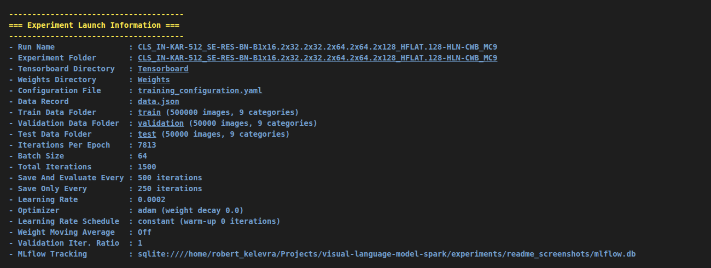
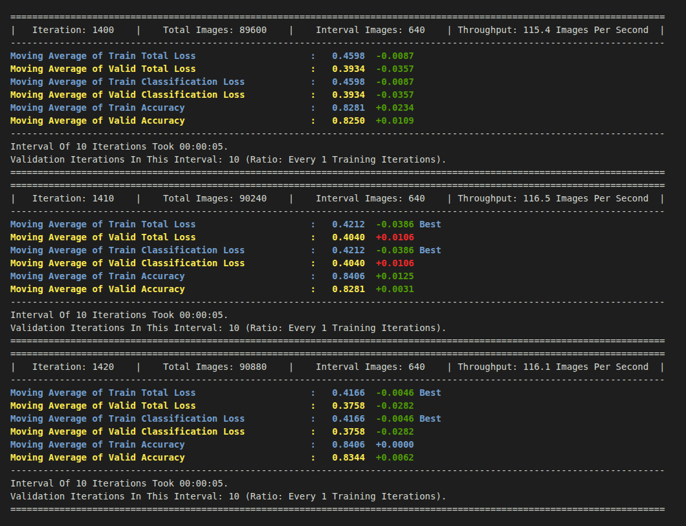
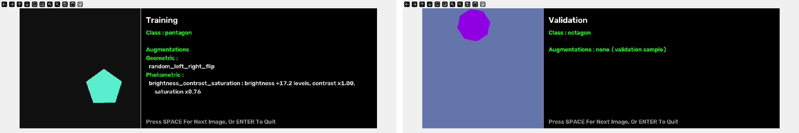
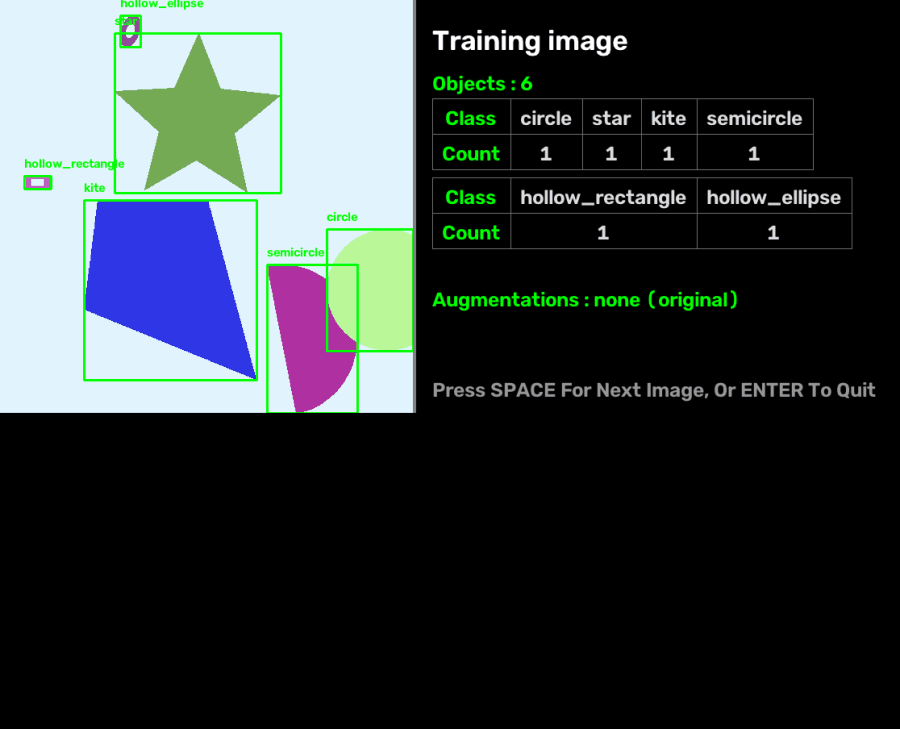
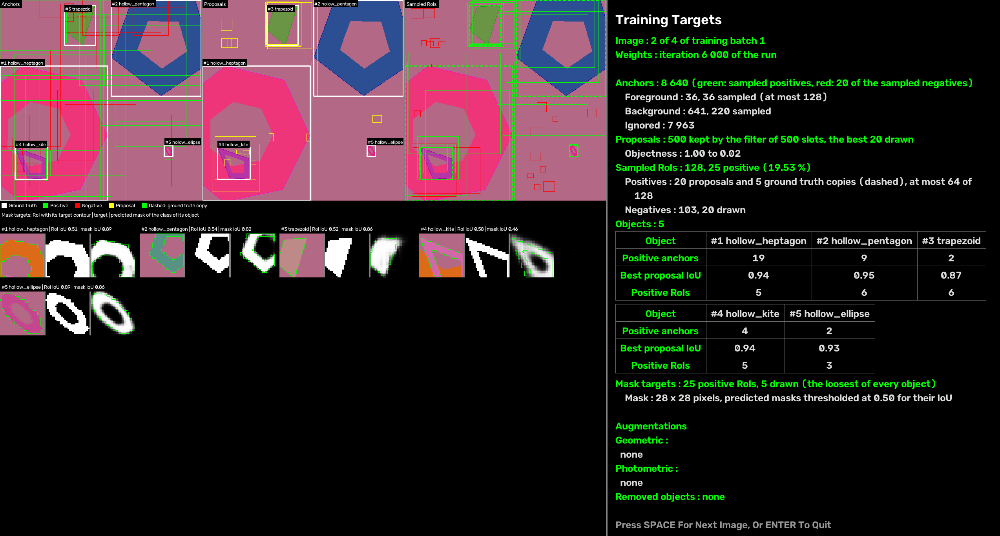
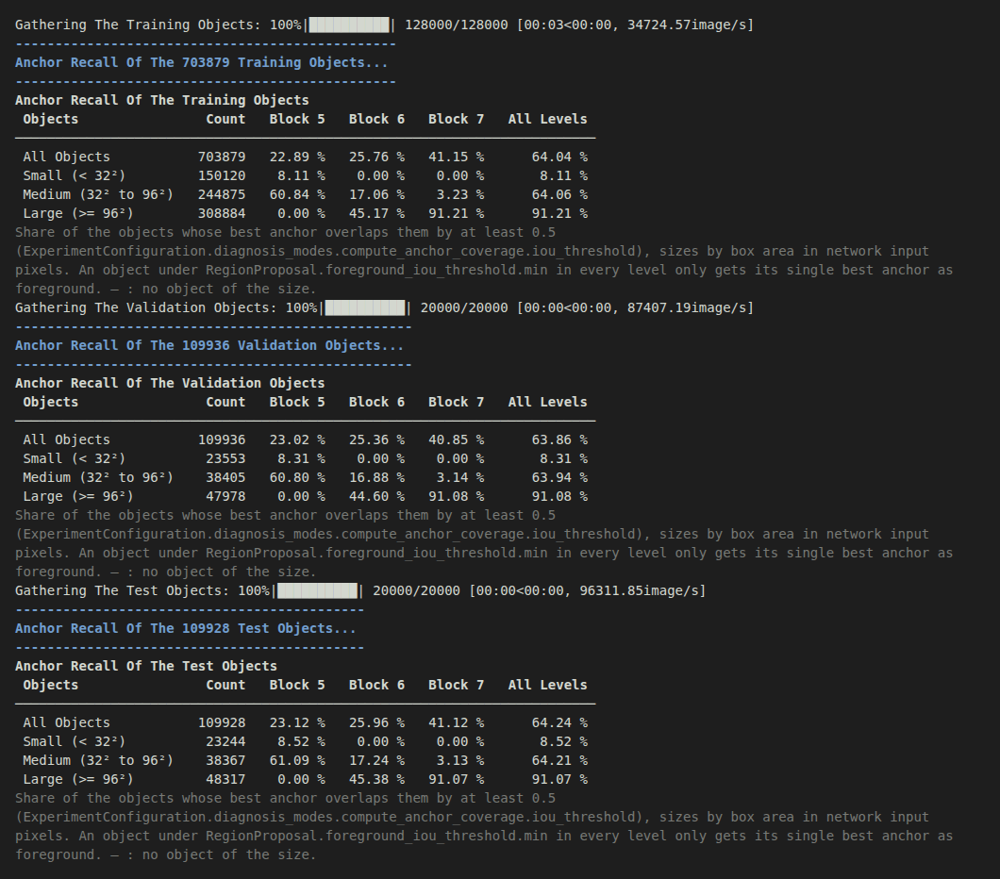
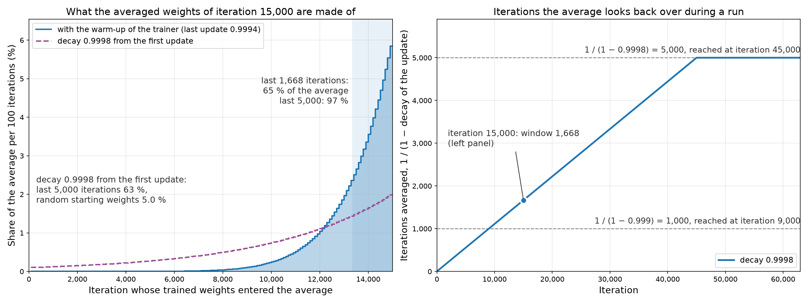

# Training Reference

Should you need the details of a training run, this reference completes the [Training](../../README.md#training) and [Transfer Between Runs](../../README.md#transfer-between-runs) sections of the README.

## Table Of Content
To find your way in this reference, the sections are:
- [Launching A Run](#launching-a-run)
- [Run Folder](#run-folder)
- [Console Output](#console-output)
- [Stopping And Resuming](#stopping-and-resuming)
- [Data Augmentation](#data-augmentation)
- [Viewing The Input Images](#viewing-the-input-images)
- [Viewing The Training Targets](#viewing-the-training-targets)
- [Checking The Anchor Coverage](#checking-the-anchor-coverage)
- [Benchmarking The Speed](#benchmarking-the-speed)
- [TensorBoard Monitoring](#tensorboard-monitoring)
- [Moving Average Of The Weights](#moving-average-of-the-weights)
- [Transfer Between Runs](#transfer-between-runs)
  - [Adding Classes](#adding-classes)

## Launching A Run
Before anything starts, the launch checks the configuration and applies fixed loader and memory settings.
- A missing `--configuration_path` file or an invalid configuration stops the program with the list of every problem. Removed settings are refused ([Fixed Settings](configuration_reference.md#fixed-settings)).
- Each loader uses 1 worker and prepares 2 batches. The validation loader exists only when `validation_iteration_ratio` is above 0 (or for the diagnosis modes).
- Batches go to pinned memory only with a discrete CUDA GPU (`uses_pinned_memory` of `vision_training/data/loaders.py`). The DGX Spark shares one memory with the processor.
- Forward passes run in bfloat16; weights and test evaluation stay in float32.
- The launch adds `expandable_segments:True` to `PYTORCH_CUDA_ALLOC_CONF`. Without it, the changing shapes of sequence batches make the allocator reserve more and more memory.

## Run Folder
To find your way in a run, the tree shows what each file holds.

```text
<experiment_folder>/<run name>/
├── training_configuration.yaml        # Configuration of the last start
├── training_configuration_until_iteration_<n>.yaml  # Configuration up to iteration n, kept by a resume that changed it
├── data.json                          # Class counts per split, data folders, SHA-256 of labels.json and images
├── data_until_iteration_<n>.json      # Data up to iteration n, kept by a resume whose data changed
├── label_dictionary.json              # Class index of every category, the classes of the run
├── anchor_recall.csv                  # Anchor recall of the training and test objects, first launch (DET, INS)
├── anchor_recall.png                  # The same tables drawn, recalls shaded from red to green (DET, INS)
├── Input_Samples/                     # First 10 samples of every split as fed to the network
│   ├── Training/, Validation/, Test/
│   └── samples.json                   # Source, labels, augmentations and input size of every sample
├── Input_Samples_until_iteration_<n>/ # Kept by a resume that changed the configuration or data
├── Weights/
│   ├── full-checkpoint                # Registry of the saved checkpoints
│   └── Iteration_<n>/model_<n>.pt     # Weights, optimizer state, moving average and metadata
├── Tensorboard/Train/, Validation/, Test/, Test_EMA/
├── Results.txt                        # Report of every evaluated checkpoint
├── evaluation_curves.png              # Headline metric of every evaluation
├── Evaluation/
│   ├── evaluation_summary.csv         # Every test scalar of every evaluated iteration
│   └── Iteration_<n>/[EMA/]           # Evaluation files of iteration n
├── Checkpoint_Evaluation/             # Same layout, written by scripts/evaluation/evaluate_checkpoint.py
├── Checkpoint_Evaluation_nms_<name>/  # DET or INS run evaluated with another final NMS
└── mlflow_run.json                    # MLflow run, with the tracking on
```

The files work as follows:
- **Checkpoints**: one every `intermediate_weight_saving_iterations` (0 for none), and one evaluated on the test split every `weight_saving_iterations`. `Iteration_<n>` holds n training steps. The evaluation files are listed in [Evaluation Outputs](configuration_reference.md#evaluation-outputs).
- **`evaluation_summary.csv`**: one row per iteration, written by `update_evaluation_curves` (`vision_training/evaluation/evaluation_curves.py`). A checkpoint evaluated again replaces its row.
- **`evaluation_curves.png`**: the headline metric (`Accuracy` for CLS, `mAP@0.5/area` for DET, …) of both weights, the best iteration ringed, the averaging window shaded.
- **`label_dictionary.json`**: the class index of every category, also stored in every checkpoint. Evaluation, export and loading tools read it, so editing the mapping file never changes the classes of a run.
- **`data.json`**: written at the start and sent to MLflow. It lists the classes in index order (background first for DET, INS and SEG), with their categories, keypoint names for KPT, and counts per split.

The excerpt shows two classes of a `data.json`.

```json
"classes": [
  {"class_index": 0, "class_name": "square", "category_ids": [1], "images": {"train": 55540, "validation": 5581, "test": 5543}},
  …
]
```

The table gives what is counted per class in each task.

| Task | Counted per class |
|---|---|
| CLS, SSL | `images`, a multi-label image counting once per class |
| DET, INS, KPT | `images` holding the class, and its `annotations` |
| SEG | `images` whose mask holds the class |
| M2O | `sequences` |
| M2M, SEL | `frames` |
| CMP | `pairs` |

So that a run can be checked against what it was fed, `Input_Samples/` is written before the first iteration of every training launch (`BaseTrainer.save_input_samples`, `vision_training/trainers/input_samples.py`).
- **Samples**: the first 10 of every split by identifier (`NUMBER_INPUT_SAMPLES`), the same at every launch. An unreadable sample is recorded with its error.
- **Images**: the windows of the [input viewer](#viewing-the-input-images). Training samples are augmented as by the training step, and the random states restored afterwards. SSL training images show their two views.
- **Resume**: when the configuration or data changed, the folder is kept as `Input_Samples_until_iteration_<n>` and the samples written again.
- **Cost**: 0.2 to 0.9 seconds for the tiny synthetic runs, 1.0 second at 1024 pixels for detection.

## Console Output
Each time a run starts, the console prints the run name with links to its files, the changes since the last start, the transferred components, the splits, the main settings, the model summary and the Export Sizes. A transferred component shows its source and learning rate:

```text
- Pretrained Backbone     : file:///…/experiments/CLS_IN-KAR-256_…_HFLAT.512.256-HLN-CWB_MC1000
    - Source Iteration    : last saved checkpoint
    - Frozen              : False
    - Norm. Layers Frozen : False
    - Learning Rate       : 0.0005 (multiplier 0.5 x 0.001)
```

- **Every `information_dump` iterations**: the interval averages of samples seen, throughput, losses, metrics and duration. Rates are percentages, `94.03 %`, with their change in points, `+0.52 %`. Values and changes are aligned on their decimal point (`format_metric_line` of `metric_tracking.py`).
- **Dropped batches**: a batch that fails to load is skipped, each distinct error printed once. More than 20 drops among the last 200 fetches of a split (`MAXIMUM_DROPPED_BATCHES_IN_WINDOW`, `DROPPED_BATCH_WINDOW`) stop the training.

```text
Training Batch Dropped : The image cannot be read : <file>
- Dropped Batches Since The Last Summary : Training 2, Validation 1 (their loading failed, see the errors printed above)
```

- **Every `weight_saving_iterations` iterations**: the evaluation report, appended to `Results.txt`, then the `EMA Weights` report.

The two figures show the launch information and an interval summary.

<p align="center">
  
</p>

<p align="center">
  
</p>

## Stopping And Resuming
In case a run has to stop, the rules below say what is saved.

**Stopping**
- Ctrl+C saves a checkpoint of the last step. An unevaluated checkpoint is announced, to evaluate with [evaluate_checkpoint.py](tools_reference.md#evaluating-checkpoints).
- An iteration fails after 10 failed batch fetches in a row. A batch with a NaN or infinite loss is skipped without optimizer step. More than 5 failing iterations in a row stop the training, with a checkpoint.
- A failed save, a failed test evaluation or a split dropping too many batches stop the training at once: `Critical Error At Iteration <n>, Exiting: <error>`.
- A split giving no batch is refused at launch.

**Resuming**
- Launching the same configuration again continues from the last checkpoint, with its optimizer state. `number_iterations` is the run total: from 5000 with 8000, it trains iterations 5001 to 8000.
- Only settings without a [run name](configuration_reference.md#run-names) token may change; any other change starts a new run folder.
- The run keeps the classes of its `label_dictionary.json`, with a warning when the mapping file now gives others.
- The changed settings are printed, and the previous configuration kept:

```text
- Previous Configuration  : file:///…/training_configuration_until_iteration_72500.yaml
- Changed Settings        : Since Iteration 72500
    - ExperimentConfiguration.learning_rate        : 0.0002 -> 0.0001
    - Backbone.pretrained.learning_rate_multiplier : 0.5 -> 1.0
```

- A `labels.json` whose SHA-256 differs from `data.json` stops the resume, unless `ExperimentConfiguration.allow_data_change_on_resume: true`. The previous record is kept as `data_until_iteration_<n>.json`.

**Restarting**: to train the same settings from scratch, set another `run_name_suffix` or `experiment_folder`, or move the run folder away.

## Data Augmentation
If one wishes to augment the training images, set `Data.data_augmentation.activated`. `probability` is the share of images augmented, and every type has its own `activated` and `probability`.
- It runs on the device before the forward pass (`vision_training/data/device_image_operations.py`).
- Geometric types move the boxes, masks and keypoints. `random_perspective` and `random_jigsaw` move the image only and are refused for DET, INS, SEG and KPT.
- Photometric types keep the targets, so `random_black_out` and `random_erasing` can hide an object.
- A sequence gets the same draws on all frames, unless `independent_frames` is on ([Sequence Tasks](tasks_reference.md#sequence-tasks-m2o-m2m-cmp-sel)).
- Strengths are fixed in `SUPERVISED_AUGMENTATION_STRENGTHS` and `SELF_SUPERVISED_AUGMENTATION_STRENGTHS` ([SSL views](tasks_reference.md#self-supervised-learning-ssl)). Intensities are levels of [0, 255] images.

The table gives the types whose strength differs between the supervised and self-supervised tasks.

| Type | Supervised tasks | Self-supervised task |
|---|---|---|
| `random_crop` | 75 % to 100 % of each side, same aspect ratio | 20 % to 100 % of the area, aspect ratio x1/2 to x2 |
| `random_rotation` | -5 to 5 degrees | -10 to 10 degrees |
| `brightness_contrast_saturation` | brightness +-40 levels, contrast and saturation x0.7 to x1.0 | all three x0.6 to x1.2 |
| `random_hue` | up to 18 degrees | up to 36 degrees |
| `random_noise` | Gaussian, standard deviation 20 levels | 30 levels |
| `random_plasma_shadow` | fractal shadow, quantity 0 to 0.5, up to 76.5 levels | quantity 0 to 0.3, up to 51 levels |
| `random_haze` | airlight 180 to 255 levels, 20 % to 60 % | 160 to 255 levels, 20 % to 70 % |
| `random_solarize` | pixels at or above 127.5 inverted | at or above 191.25, second view only |
| `random_black_out` | grid cells blacked out with probability 0.2 | 0.35, second view only |

The other types have the same strength in both:
- `random_aspect_crop`: 75 % to 100 % of width and height, drawn apart.
- `random_zoom_out`: image shrunk to 50 % to 100 % on a black canvas.
- `random_translation`: up to 25 % of the width, height or both.
- `random_left_right_flip`, `random_up_down_flip`: mirror.
- `random_90_rotation`: -90 or 90 degrees, square images only.
- `random_perspective`: corners moved inwards by up to 5 % of half the side.
- `random_jigsaw`: 2x2 pieces shuffled; size a multiple of 2.
- `clahe_augment`: clip limit 2.0 on 4x4 tiles. `sharp_augment`: unsharp mask, sigma 1.5, strength 3.
- `equalize_histogram_augment`: luminance. `equalize_bgr_histogram_augment`: one channel or all three.
- `gray_scale_augment`: grayscale on three channels. `random_colour_augmentation`: blue and red swapped.
- `random_gamma`: 0.8 to 1.25. `random_linear_illumination`: ramp of 12.75 to 38.25 levels.
- `random_blur`: 9x9 Gaussian, sigma 2.5. `random_motion_blur`: line of 5 to 15 pixels, angle 0 to 180 degrees.
- `random_erasing`: black rectangle of 2 % to 15 % of the area.

Should you need to see a type at both strengths, `scripts/data/visualize_augmentation_strengths.py` writes one `<type>.png` per type. `--split_folder` and `--output_folder` are required; the configuration defaults to the synthetic shapes classifier, with 4 images and the seed 0.

```bash
# Draw every augmentation type at both strengths on 4 validation images
uv run python -m scripts.data.visualize_augmentation_strengths \
    --split_folder ~/Data/classifier_data/synthetic_shapes/validation --output_folder ~/Data/augmentation_examples
```

## Viewing The Input Images
Before a long training, `ExperimentConfiguration.diagnosis_modes.view_input_images: True` shows what the network receives. It opens a Training and a Validation window, each image with a panel of its targets and drawn augmentations.
- SSL runs show the two views. With `Data.grouped_batches` on, every training batch is first shown whole.
- SPACE shows the next samples, ENTER exits without training.
- It needs a display and creates no run folder. Without a display, use the `Input_Samples/` of a run ([Run Folder](#run-folder)).

The figure shows the viewer; the animation shows boxes following the flips, rotations and zoom-outs.

<p align="center">
  
</p>

<p align="center">
  
</p>
<p align="center"><em>Augmentation draws of <code>object_detection/configuration_example.yaml</code> on one image.</em></p>

## Viewing The Training Targets
Suppose a detector learns badly while its inputs look right: `ExperimentConfiguration.diagnosis_modes.view_training_targets: True` (DET, INS) shows what its losses are computed on. Every training batch is prepared and augmented as in training, then run through the model in training mode with its ground truth (`DetectionTrainer.view_training_targets`). Each image gets one window of three panels:
- **Anchors**: the sampled positive anchors in green, 20 of the sampled negatives in red, the objects in white.
- **Proposals**: the 20 best proposals kept by the proposal filter, in yellow.
- **Sampled RoIs**: the positive RoIs in green, the ground truth boxes added to the proposals dashed, 20 negatives in red.
- **Mask targets** (INS): for every object, its positive RoI with the lowest box IoU. It shows the RoI crop with the target contour, the target (`build_mask_targets`) and the predicted mask of the object class.

The panel counts the anchors, proposals and RoIs, and gives one column per object: positive anchors, best proposal IoU, positive RoIs.
- The weights are those of the last checkpoint of the run when there is one, read only; otherwise the initial weights.
- The sampling is random, as in training, so two launches draw other negatives.
- SPACE shows the next image, ENTER exits without training. It needs a display and creates no run folder.

The figure shows an image of the README instance segmentation run at iteration 6,000.

<p align="center">
  
</p>

Look for objects with few positive anchors (anchor scales or ratios too far from the object) or a low best proposal IoU. Also check the share of positive RoIs against `Detector.number_training_positives`.

## Checking The Anchor Coverage
Suppose a detector misses objects of one size: `ExperimentConfiguration.diagnosis_modes.compute_anchor_coverage: { activated: True, iou_threshold: 0.5 }` (DET, INS) prints, per split, level and object size, the share of objects whose best anchor overlaps them by at least `iou_threshold`, then exits.
- Splits are read from their annotations, no image loaded.
- The best anchor is the grid anchor nearest the object centre for every shape, computed exactly on the CPU.
- Sizes are the side of an object as a share of the input side, in bins that double from under 1/16 to 1/2 and above ([object sizes](metrics_reference.md#ap-and-map-by-object-size)). `Pixels` and `Area` give each bin at this input.
- Recalls are coloured from red (0 %) to green (100 %).
- It writes no file. The first launch of a run measures the training and test splits at `RegionProposal.foreground_iou_threshold.min` into `anchor_recall.csv` and `anchor_recall.png` ([Anchor Recall](metrics_reference.md#anchor-recall)).

The figure shows the console on the synthetic shapes.

<p align="center">
  
</p>
<p align="center"><em>On <code>object_detection/configuration_synthetic_shapes.yaml</code>, the anchors of blocks 5, 6 and 7 cover 64.04 % of the training objects, but 8.11 % of those under 1/16 of the side.</em></p>

Read the `All Levels` column size by size. An object under `RegionProposal.foreground_iou_threshold.min` in every level gets only its single best anchor as foreground. Small objects ask for smaller scales on a finer level, large ones for a larger scale, elongated ones for other `aspect_ratios`. The three splits should give close shares.

## Benchmarking The Speed
Before training an architecture, `ExperimentConfiguration.diagnosis_modes.benchmark_speed: True` measures how fast it trains and infers when the data never waits, then exits (`BaseTrainer.benchmark_speed`, `vision_training/trainers/speed_benchmark.py`). It writes nothing to the run folder.
- **Memory**: `limit_process_memory` caps PyTorch at the free memory minus a margin: 40 GB on an integrated GPU (`INTEGRATED_GPU_MEMORY_MARGIN_BYTES`), 2 GB on a discrete one (`DISCRETE_GPU_MEMORY_MARGIN_BYTES`).
- **Largest batch size**: `find_largest_batch_size` doubles, then bisects to within 1/16, up to `MAXIMUM_BENCHMARK_BATCH_SIZE` (2048).
- **Inference**: the last checkpoint is loaded when there is one. Each format is timed at batch 1, the configured batch and the largest: `PyTorch Evaluation`, `PyTorch Inference Model`, `TorchScript`, and ONNX Runtime CUDA and TensorRT FP32 and FP16. The ONNX formats need `onnxruntime-gpu`.
- **Training**: `run_training_step` is timed at the configured and largest batch sizes. The training time of `number_iterations` is a lower bound (loading, validation and evaluations left out).
- **Timing**: `measure_iteration_time` warms up 2 seconds, then times 5 windows over 5 seconds. Each row gives the median window, samples per second, spread and peak memory.

## TensorBoard Monitoring
To follow a run live, open TensorBoard on its folders, listed below.

| Folder | Written | Content |
|---|---|---|
| `Train`, `Validation` | every iteration | losses and metrics |
| `Test` | every evaluation | test scalars and sample images `Samples/<sample>` |
| `Test_EMA` | every evaluation, moving average on | the `Test` tags of the averaged weights |

## Moving Average Of The Weights
Should you need a model smoothed over its last iterations, `Optimization.exponential_moving_average` keeps an average of the weights next to the trained ones (`ExponentialMovingAverage` of `vision_training/trainers/weight_averaging.py`).
- After every optimizer step: `ema_weights = decay × ema_weights + (1 − decay) × current_weights`, batch normalization statistics included.
- It looks back about 1 / (1 − decay) iterations: about 100 at 0.99, 1,000 at 0.999, 5,000 at 0.9998.
- The n-th update uses min(decay, (1 + n) / (10 + n)), so the random starting weights fade quickly. A run of 15,000 iterations at 0.9998 ends on a decay of 0.9994, about 1,670 iterations.
- It costs the memory of one more model. It is saved in every checkpoint and gives no run name token.
- Validation curves use the trained weights. The [export](tools_reference.md#export) takes the averaged ones with `use_averaged_weights`.

Every test evaluation scores the trained weights, then the averaged ones. The averaged results go to `EMA/` subfolders, `Test_EMA` in TensorBoard, `test_ema/` in MLflow, `ema_` columns of `evaluation_summary.csv`, and the orange curve of `evaluation_curves.png`.

The figure shows how many trained weights one averaged model mixes.

<p align="center">
  
</p>
<p align="center"><em>Decay 0.9998, iteration 15,000. Left: share of the average held by every 100 iterations; the warm-up lowered the last decay to 0.9994, so the last 1,668 iterations carry 65 %. Right: the window 1 / (1 − decay) of every update. Drawn by <code>documentation/presentation/figures/plot_moving_average_window.py</code>.</em></p>

## Transfer Between Runs
If one wishes to start a component from a trained run, set the `pretrained` block of its section. The table lists the sections that accept one.

| Section | Component | From the tasks |
|---|---|---|
| `Backbone` | backbone | any task |
| `TemporalModel` | temporal module | M2O, M2M, CMP, SEL |
| `ClassificationHead` | classification head, class layer with `class_layer: True` | CLS, M2O, M2M, CMP, SEL |
| `SegmentationDecoder` | U-Net decoder, class layers with `class_layers: True` | SEG |
| `Neck` | feature pyramid or path aggregation neck | DET, INS |
| `RegionProposal` | region proposal heads | DET, INS |
| `Detector` | detection heads, class layers with `class_layers: True` | DET, INS |
| `MaskHead` | mask heads, class layers with `class_layers: True` | INS |
| `HRNet` | high resolution network | KPT |
| `KeypointHead` | heatmap and tag head, keypoint channel layers with `class_layers: True` | KPT |

The settings defining the layers must match, which is checked at launch. The image size may differ. The table lists what must match per component.

| Component | Settings that must match |
|---|---|
| Backbone | `input_channels`, `convolutions`, `modules`, `normalization`, `last_max_pooling`; when one backbone's blocks start the other's, the shared blocks are loaded |
| Classification head | `fully_connected`, `fully_connected_normalization`, the image size after `flatten` |
| Transformer with positional embedding | `maximum_sequence_length` |
| Neck | `type` (not `none`), `output_channels`, `normalization`, the detection levels and the channels of their backbone blocks |
| Region proposal, detection and mask heads | detection levels and their head settings, anchors per position, `shared` (a run written before it has one head per level), normalization, modules, the same `Neck.type` and, with a neck, `Neck.output_channels`; the mask image branch is not transferred and stays `[0, 0]` |
| High resolution network | `base_width`, `modules_per_stage`, `blocks_per_branch`, `modules`, `normalization`, channels of the last stem block |
| Keypoint head | `higher_resolution`, `hidden_width`, `HRNet.base_width`; with `class_layers: True`, every channel must predict the same keypoint of the same class |

The transfer follows these rules:
- A detection run can initialise an instance segmentation run, whose mask heads train alone with the rest frozen.
- Heads trained behind a neck read its outputs. Load the neck from the same run and iteration (`Neck.pretrained`); otherwise the launch warns that the heads read another neck.
- A deeper backbone starts with the source blocks; its next blocks stay random. `freeze`, `freeze_normalization_parameters` and `learning_rate_multiplier` apply to the loaded blocks only, stored as `pretrained_backbone_blocks` in every checkpoint.
- A resumed run does not load the pretrained component again.
- The averaged weights of the source are loaded when it kept a [moving average](#moving-average-of-the-weights) and the new run has one on.
- With `class_layer: False` (the default), a classification head loads its hidden layers only; its class layer stays random. A head without hidden layer needs `class_layer: True`.
- Detection, mask and keypoint heads do the same with `class_layers: False`, so a detector trained on other classes still gives its convolutions.
- The run name tokens are in [Run Names](configuration_reference.md#run-names).

### Adding Classes
Should a new run need more classes than its source, or the same classes in another order, a component loaded with its class layers can still initialise it.
- Every source class must be a class of the new run, compared by name from the `data.json` of both runs.
- When the source classes come first in the same order, append the new classes at the end of the label mapping file.
- Otherwise each source class is found by name, e.g. the 1,000 ImageNet-1k classes among the 21,842 merged ImageNet classes. A missing source class stops the run.
- The other classes keep random rows, which may disturb the source classes at first. The console prints the kept and added classes.
- A source run without class names gives its classes as the first classes of the new run, with a warning.

The table lists the layers moved by class.

| Layer | Section |
|---|---|
| Class layer of the classification head | `ClassificationHead` with `class_layer` |
| Classification and box regression layers of the detection heads | `Detector` with `class_layers` |
| Mask prediction layer of the mask heads | `MaskHead` with `class_layers` |
| Final class layer and deep supervision layers of the decoder | `SegmentationDecoder` with `class_layers` |
| Last heatmap and tag convolutions (same keypoints required, never moved by name) | `KeypointHead` with `class_layers` |

On the synthetic shapes (9 classes extended to 20, stage 14 of `documentation/architecture_benchmarking/experiment_plan.md`), the new classes reached 75.13 % accuracy at iteration 250, and the source classes kept 99.86 %.
